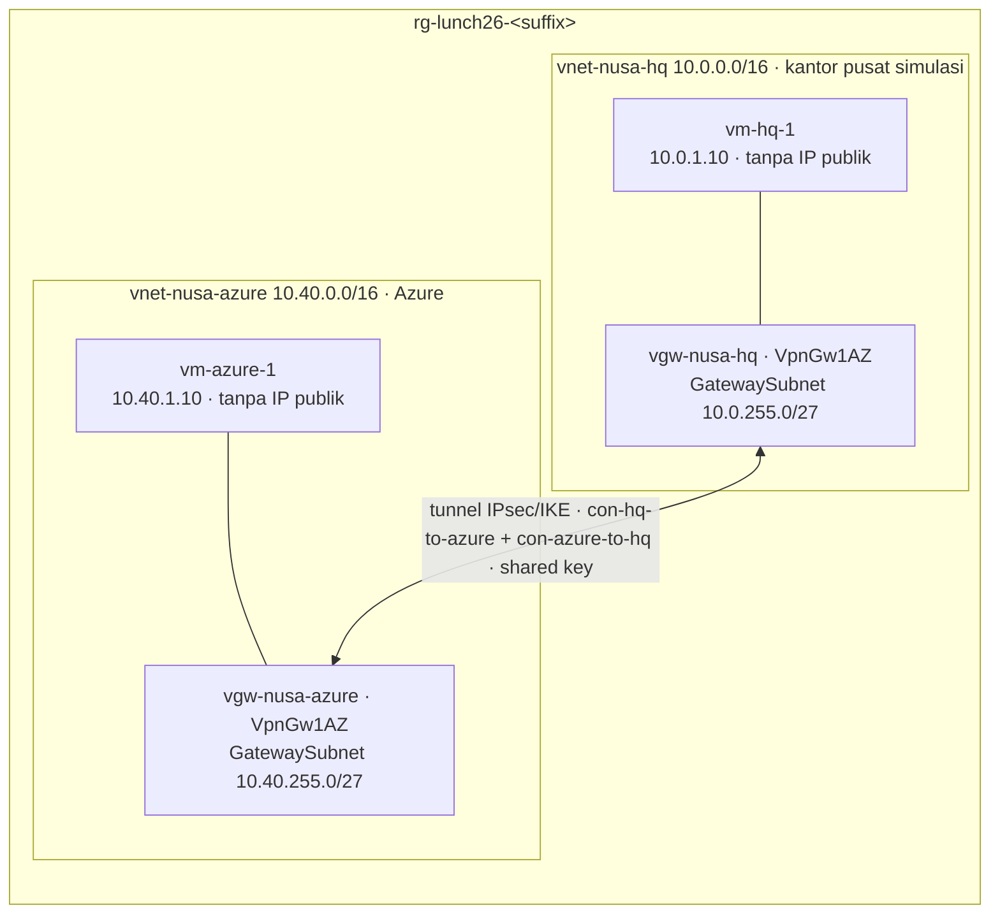

# Lab 26 · Menghubungkan kantor pusat

🇬🇧 [Read in English](README.md)

> **Pasangan dari:** [Makan Siang 26 · Hybrid Connectivity: VPN Gateway, ExpressRoute, dan Virtual WAN (Lanjutan)](../../lunches/26-hybrid-connectivity/README.id.md)
> **Waktu:** sekitar 90 menit, termasuk 30–45 menit menunggu gateway · **Biaya:** 💲💲💲 (lihat [kelompok biaya](../README.id.md#kelompok-biaya)) · **Tingkat kesulitan:** ★★★
> **Bisa dikerjakan terpisah:** ✅ Anda tidak memerlukan lab sebelumnya. Semua yang dibutuhkan lab ini dibuat oleh langkah-langkahnya sendiri atau oleh `setup.sh`.
> **Penulis:** Stefanus Pinarta · [Tentang penulis](../../README.id.md#tentang-penulis)

## 🎯 Yang akan Anda bangun

Pak Budi ingin kantor pusat di Jakarta (10.0.0.0/16) bisa menjangkau jaringan Azure milik Nusantara Retail
(10.40.0.0/16) melalui link privat yang terenkripsi, alih-alih membuka server ke internet. Tidak ada yang bisa
mengirimkan appliance VPN ke meja Anda, jadi `setup.sh` **menyimulasikan kantor pusat dengan virtual network kedua**
yang punya VPN gateway sendiri: Azure memerankan kedua sisi. Anda menghubungkan kedua gateway **route-based VpnGw1AZ**
dengan **koneksi VNet-to-VNet** di kedua arah, yang dilindungi oleh **shared key yang dibuat saat runtime**. Lalu Anda
menyaksikan statusnya mencapai **Connected**, membuktikan bahwa `vm-azure-1` dan `vm-hq-1` saling berkomunikasi pada
alamat IP privat melalui tunnel, dan membaca rute yang ditambahkan Azure. Tugas opsional membandingkan hasilnya dengan
VNet peering.



> [!CAUTION]
> **💲💲💲 — argo mulai berjalan saat `setup.sh` memulai pembuatan gateway.** VPN gateway ditagih untuk setiap jam
> keberadaannya, ada atau tidak ada lalu lintas, dan lab ini menjalankan dua gateway (ditambah IP publiknya dan dua VM
> kecil). Kerjakan lab dalam sekali duduk, jangan pernah membiarkannya berjalan semalaman, dan jalankan
> `bash cleanup.sh` begitu `verify.sh` lulus — atau begitu Anda memutuskan untuk berhenti. Untuk angka pastinya,
> hitung harga gateway **VpnGw1AZ** untuk region Anda di
> [Azure pricing calculator](https://azure.microsoft.com/pricing/calculator/).

## ✅ Sebelum mulai

- Sebuah subscription Azure tempat Anda bisa membuat resource (lihat [Lab 01](../01-before-you-begin/README.id.md)).
  Peran Contributor pada subscription sudah cukup: lab ini tidak membuat role assignment apa pun.
- Sekitar dua jam yang bisa Anda pakai untuk menuntaskan apa yang Anda mulai. Sebagian besar waktu menunggu terjadi di
  awal.
- **Azure Cloud Shell (Bash)** — buka [shell.azure.com](https://shell.azure.com). Tidak ada yang perlu diinstal.
- Ambil file lab dan muat pengaturan bersama:

```bash
git clone https://github.com/stefpin/azure-fundamentals-lunches.git   # first time only
cd azure-fundamentals-lunches/labs/26-hybrid-connectivity
source ../common/config.sh
RG=$(rg_name 26)
PSK_FILE="$HOME/.azlunches-lab26-psk"
```

- Buat titik awalnya. Skrip ini butuh sekitar 5 menit:

```bash
bash setup.sh
```

`setup.sh` membangun dua "lokasi" di dalam satu resource group. Masing-masing mendapat virtual network dengan
**GatewaySubnet** (/27, tanpa network security group) dan subnet workload dengan NSG, sebuah VM `$VM_SIZE_SMALL` kecil
**tanpa IP publik** yang menjalankan web server mungil, dan sebuah **IP publik Standard** yang zone-redundant.
Terakhir, skrip ini **memulai** pembuatan gateway route-based **VpnGw1AZ** di masing-masing jaringan dengan
`--no-wait`. Skripnya selesai, tetapi gateway terus dibangun di Azure selama **30–45 menit atau lebih**, bahkan jika
Anda menutup Cloud Shell. Catat suffix yang dicetak oleh skrip.

> [!IMPORTANT]
> Resource lab menimbulkan biaya selama masih ada. Akhiri dengan bagian **Bersihkan**, meskipun Anda berhenti di tengah
> jalan — dan meskipun gateway masih dalam proses pembuatan.

## 🧭 Pilih mode Anda

| Mode | Cocok untuk Anda jika… | Caranya |
|---|---|---|
| **Terpandu** | Anda ingin setiap langkah dijelaskan | ikuti Tugas 1–7 di bawah (Tugas 8 bersifat opsional) |
| **Tantangan** | Anda sudah menguasai dasarnya | jalankan `setup.sh`, baca hanya [Ringkasan tantangan](#-ringkasan-tantangan), bangun dengan cara Anda sendiri, lalu jalankan `bash verify.sh` |

Atur waktu Anda seperti ini:

| Jam | Anda | Azure |
|---|---|---|
| 0:00 | jalankan `setup.sh` (sekitar 5 menit) | membuat jaringan dan VM, memulai pembuatan kedua gateway |
| 0:05 | Tugas 1: menjelajahi jaringan yang baru setengah jadi | gateway sedang dibangun |
| 0:15 | Tugas 2: membaca sambil menunggu | gateway sedang dibangun |
| sekitar 0:50 | Tugas 3–7 (dan Tugas 8 yang opsional) | gateway siap; tunnel aktif dalam hitungan menit |
| sekitar 1:25 | `verify.sh`, lalu `cleanup.sh` | menghapus semuanya di latar belakang (10–20 menit) |

## Tugas 1 · Menjelajahi jaringan selagi gateway dibangun

Lihat apa saja yang sudah ada sebelum tunnel-nya ada — nanti Anda akan membandingkannya dengan hasil akhir.

```bash
az network vnet-gateway list --resource-group "$RG" \
  --query "[].{gateway:name, sku:sku.name, generation:vpnGatewayGeneration, type:vpnType, state:provisioningState}" \
  --output table

az network vnet subnet list --resource-group "$RG" --vnet-name vnet-nusa-azure \
  --query "[].{subnet:name, prefix:addressPrefix || addressPrefixes[0], nsg:networkSecurityGroup.id}" \
  --output table
```

Sekarang coba jangkau kantor pusat dari VM Azure. Run Command menjalankan skrip di dalam VM melalui VM agent, jadi Anda
tidak memerlukan SSH atau IP publik. Eksekusi pertama butuh satu atau dua menit.

```bash
az vm run-command invoke --resource-group "$RG" --name vm-azure-1 \
  --command-id RunShellScript --scripts "ping -c 3 -W 2 10.0.1.10" \
  --query "value[0].message" --output tsv
```

Terakhir, lihat rute yang dipakai network interface `vm-azure-1`. Ini butuh waktu hingga satu menit.

```bash
NIC_AZ=$(az vm show --resource-group "$RG" --name vm-azure-1 \
  --query "networkProfile.networkInterfaces[0].id" --output tsv)
az network nic show-effective-route-table --ids "$NIC_AZ" --output table
```

> [!TIP]
> **Lebih suka portal?** *Home › Virtual network gateways* menampilkan kedua gateway selagi dibangun. Untuk rute, buka
> *vm-azure-1 › Networking*, pilih network interface, lalu pilih **Effective routes**.

> ✅ **Pemeriksaan:** kedua gateway menunjukkan **VpnGw1AZ**, **Generation1**, **RouteBased**, dan state
> **Updating**. GatewaySubnet (10.40.255.0/27) tidak punya NSG; `snet-app` punya. Ping melaporkan `100% packet loss`.
> Route table berisi `10.40.0.0/16` dengan next hop **VnetLocal** dan `10.0.0.0/8` dengan next hop **None** — Azure
> *membuang* lalu lintas untuk rentang privat yang tidak punya rute lebih baik, dan itulah persis yang terjadi pada ping
> Anda.

## Tugas 2 · Membaca sambil menunggu (30–45 menit)

Setiap gateway sebenarnya adalah sepasang instance yang dikelola Microsoft, yang ditempatkan Azure di GatewaySubnet Anda,
disebar ke beberapa availability zone, lalu dikonfigurasi — satu aktif, satu siaga (standby). Semua itu butuh waktu,
itulah sebabnya perubahan gateway sungguhan selalu direncanakan dan tidak pernah dikerjakan "sebentar saja". Periksa
kemajuannya kira-kira setiap sepuluh menit:

```bash
az network vnet-gateway list --resource-group "$RG" \
  --query "[].{gateway:name, state:provisioningState}" --output table
```

Manfaatkan waktunya dengan baik. Setiap bacaan di bawah ini butuh 5–10 menit:

| Baca | Cari |
|---|---|
| [Tentang SKU VPN Gateway](https://learn.microsoft.com/azure/vpn-gateway/about-gateway-skus) | batas tunnel dan benchmark throughput VpnGw1AZ, serta alasan SKU non-AZ dihentikan |
| [Menghubungkan VNet dengan koneksi VNet-to-VNet (Azure CLI)](https://learn.microsoft.com/azure/vpn-gateway/vpn-gateway-howto-vnet-vnet-cli) | langkah-langkah yang diotomatiskan `setup.sh` dan yang akan Anda kerjakan di Tugas 4; bedanya dengan site-to-site |
| [Perutean lalu lintas virtual network](https://learn.microsoft.com/azure/virtual-network/virtual-networks-udr-overview) | rute **None** dari Tugas 1, longest prefix match, dan rute mana yang menang jika dua rute punya prefix yang sama |
| [Apa itu Azure ExpressRoute?](https://learn.microsoft.com/azure/expressroute/expressroute-introduction) | dua jenis peering, dan mengapa circuit privat berperilaku lebih dapat diprediksi daripada internet |
| [Apa itu Azure Virtual WAN?](https://learn.microsoft.com/azure/virtual-wan/virtual-wan-about) | Basic vs Standard, dan kapan empat puluh toko membuat hub terkelola menjadi desain yang lebih sederhana |

> [!NOTE]
> Cloud Shell tertutup setelah sekitar **20 menit tanpa input**. Itu tidak memengaruhi gateway — gateway dibangun di
> Azure, bukan di shell Anda. Saat kembali, muat ulang pengaturan Anda:
> `cd ~/azure-fundamentals-lunches/labs/26-hybrid-connectivity && source ../common/config.sh && RG=$(rg_name 26) && PSK_FILE="$HOME/.azlunches-lab26-psk"`.
> Di sesi Cloud Shell ephemeral (tanpa storage), clone repositori lagi dan atur `SUFFIX=<the suffix you wrote
> down>` — isi dengan suffix yang Anda catat tadi — sebelum Anda menjalankan `source` untuk memuat pengaturan.

Jika Anda lebih suka menunggu daripada memeriksa berulang-ulang, `az network vnet-gateway wait --resource-group "$RG"
--name vgw-nusa-hq --created --timeout 4500` akan selesai ketika gateway itu mencapai **Succeeded** — tetapi biarkan
tab tetap aktif supaya Cloud Shell tidak kehabisan waktu (time out).

> ✅ **Pemeriksaan:** kedua gateway menunjukkan **Succeeded**. Jika salah satunya menunjukkan **Failed**, lihat
> Pemecahan masalah.

## Tugas 3 · Memeriksa gateway yang sudah jadi

```bash
for gw in vgw-nusa-azure vgw-nusa-hq; do
  az network vnet-gateway show --resource-group "$RG" --name "$gw" \
    --query "{name:name, state:provisioningState, sku:sku.name, generation:vpnGatewayGeneration, vpnType:vpnType, activeActive:activeActive, asn:bgpSettings.asn}" \
    --output table
done

az network public-ip list --resource-group "$RG" \
  --query "[].{name:name, address:ipAddress, sku:sku.name, zones:to_string(zones)}" --output table
```

Yang sedang Anda lihat:

- **VpnGw1AZ, Generation1** — SKU zone-redundant yang paling kecil (hingga 30 tunnel site-to-site). Gateway baru wajib
  memakai SKU AZ; VpnGw1–5 non-zonal yang lama tidak bisa dibuat lagi.
- **activeActive False** — mode default *active-standby*: satu instance membawa tunnel dan instance lainnya mengambil
  alih saat pemeliharaan atau kegagalan, setelah gangguan singkat. Gateway produksi biasanya berjalan active-active.
- **asn 65515** — nomor autonomous system (ASN) BGP default. Lab ini tidak memakai BGP; tantangan tambahan memakainya.
- **Alamat IP publik** adalah alamat yang akan dihubungi perangkat kantor pusat sungguhan — dan yang akan diizinkan Pak
  Budi melewati firewall-nya.

> ✅ **Pemeriksaan:** kedua gateway berstatus **Succeeded**, **VpnGw1AZ**, **Generation1**, **RouteBased**, dengan
> `activeActive` **False** dan ASN **65515**. Kedua IP publik berjenis **Standard** dengan zona `["1","2","3"]` (atau
> `null` jika Anda menjalankan `setup.sh` dengan `PIP_ZONES=""` di region tanpa availability zone).

## Tugas 4 · Membuat koneksi dengan shared key yang dibuat saat runtime

Kedua ujung tunnel IPsec harus memegang **pre-shared key** yang sama. Buat key yang kuat di dalam file yang hanya bisa
dibaca oleh Anda, sehingga key itu tidak pernah muncul di layar maupun di riwayat perintah Anda:

```bash
[[ -s "$PSK_FILE" ]] || ( umask 077; openssl rand -hex 24 > "$PSK_FILE" )
ls -l "$PSK_FILE"
```

`openssl rand -hex 24` menghasilkan 48 karakter heksadesimal (192 bit acak); isinya hanya huruf dan angka, yang
diterima oleh setiap perangkat VPN. Sekarang buat satu koneksi di masing-masing gateway. Link VNet-to-VNet selalu punya
dua bagian, dan keduanya harus membawa key yang sama:

```bash
az network vpn-connection create --resource-group "$RG" --name con-azure-to-hq --location "$LOCATION" \
  --vnet-gateway1 vgw-nusa-azure --vnet-gateway2 vgw-nusa-hq \
  --shared-key "$(cat "$PSK_FILE")" --output none

az network vpn-connection create --resource-group "$RG" --name con-hq-to-azure --location "$LOCATION" \
  --vnet-gateway1 vgw-nusa-hq --vnet-gateway2 vgw-nusa-azure \
  --shared-key "$(cat "$PSK_FILE")" --output none
```

Dengan koneksi VNet-to-VNet, Azure mengisi ruang alamat sisi seberang untuk Anda. Untuk kantor pusat yang sungguhan,
Anda justru akan membuat **local network gateway** (IP publik Pak Budi dan 10.0.0.0/16), menghubungkannya dengan
`--local-gateway2`, lalu mengetik key yang sama ke perangkat VPN miliknya — tantangan tambahan memberi Anda kesempatan
untuk melatihnya.

> [!TIP]
> **Lebih suka portal?** *Virtual network gateways › vgw-nusa-azure › Settings › Connections › + Add*, connection type
> **VNet-to-VNet**, gateway kedua `vgw-nusa-hq`, lalu lakukan hal yang sama untuk arah sebaliknya. Untuk menempelkan
> key tanpa mencetaknya di terminal, buka file tersebut di editor Cloud Shell: `code "$PSK_FILE"`.

> ✅ **Pemeriksaan:** `az network vpn-connection list --resource-group "$RG" --query "[].{name:name, type:connectionType, state:provisioningState}" --output table`
> menampilkan `con-azure-to-hq` dan `con-hq-to-azure`, keduanya **Vnet2Vnet** dan **Succeeded**. `ls -l` menunjukkan
> file key sebagai `-rw-------`. Siapa pun yang punya hak cukup atas sebuah koneksi bisa membaca kembali key-nya dari
> Azure (`az network vpn-connection shared-key show`), jadi perlakukan akses ke koneksi seperti akses ke sebuah rahasia.

## Tugas 5 · Menyaksikan tunnel aktif

Gateway kini menjalankan **IKE**: keduanya menyepakati algoritma enkripsi dan saling membuktikan bahwa mereka mengetahui
key yang sama tanpa pernah mengirimkannya. Lalu mereka menyiapkan **IPsec security association**, dan sejak saat itu
setiap paket di antara kedua jaringan berjalan terenkripsi. Periksa statusnya:

```bash
for con in con-azure-to-hq con-hq-to-azure; do
  az network vpn-connection show --resource-group "$RG" --name "$con" \
    --query "{name:name, status:connectionStatus, protocol:connectionProtocol, bytesIn:ingressBytesTransferred, bytesOut:egressBytesTransferred}" \
    --output table
done
```

Ulangi setiap 30 detik sampai keduanya menunjukkan **Connected** — biasanya dalam beberapa menit. Atau biarkan CLI yang
menunggu untuk Anda:

```bash
az network vpn-connection wait --resource-group "$RG" --name con-hq-to-azure \
  --custom "connectionStatus=='Connected'" --interval 20 --timeout 900
```

> ✅ **Pemeriksaan:** kedua koneksi menunjukkan **Connected** dengan protokol **IKEv2**. Anda mungkin melihat `Unknown`
> atau `Connecting` lebih dulu — itu normal. Penghitung byte masih kecil sampai Anda mengirim lalu lintas di Tugas 6.

## Tugas 6 · Mengirim lalu lintas melalui tunnel

Dari Azure ke kantor pusat — ping, lalu minta halaman health dari web server kantor pusat:

```bash
az vm run-command invoke --resource-group "$RG" --name vm-azure-1 \
  --command-id RunShellScript \
  --scripts "ping -c 4 -W 2 10.0.1.10; curl -s --max-time 5 http://10.0.1.10/health" \
  --query "value[0].message" --output tsv
```

Dan sebaliknya, dari kantor pusat ke Azure, kali ini mengambil halaman beranda:

```bash
az vm run-command invoke --resource-group "$RG" --name vm-hq-1 \
  --command-id RunShellScript \
  --scripts "ping -c 4 -W 2 10.40.1.10; curl -s --max-time 5 http://10.40.1.10/" \
  --query "value[0].message" --output tsv
```

Tidak ada satu pun NSG yang punya aturan kustom, tetapi lalu lintasnya tetap bisa masuk. Aturan default
**AllowVnetInBound** mengizinkan lalu lintas dari service tag **VirtualNetwork**, dan tag itu mencakup rentang alamat yang
terhubung melalui VPN gateway. Di produksi Anda akan memperketatnya: seluruh jaringan Pak Budi tidak perlu bisa
menjangkau setiap server di Azure.

> ✅ **Pemeriksaan:** kedua ping melaporkan `0% packet loss` (dengan round trip beberapa milidetik). Perintah pertama
> diakhiri dengan `ok`; perintah kedua mencetak halaman HTML kecil yang bertuliskan *Served by **vm-azure-1***.
> Jalankan lagi perulangan dari Tugas 5: penghitung byte sudah bertambah.

## Tugas 7 · Membaca rute yang ditambahkan Azure

```bash
NIC_AZ=$(az vm show --resource-group "$RG" --name vm-azure-1 \
  --query "networkProfile.networkInterfaces[0].id" --output tsv)
az network nic show-effective-route-table --ids "$NIC_AZ" --output table
```

Bandingkan dengan Tugas 1. Ada rute baru untuk **10.0.0.0/16** yang sumber dan next hop-nya sama-sama
**VirtualNetworkGateway**. Rute lama `10.0.0.0/8 → None` masih ada, tetapi Azure memakai **longest prefix match**
(prefix terpanjang yang cocok menang): untuk 10.0.1.10, rute /16 lebih spesifik daripada rute /8, sehingga paket
dikirim ke gateway alih-alih dibuang. Semua alamat lain di 10.0.0.0/8 tetap dibuang.

Sekarang periksa sendiri sisi seberangnya: ambil network interface `vm-hq-1` dengan cara yang sama, lalu lihat rutenya.

> ✅ **Pemeriksaan:** di `vm-azure-1`, `10.0.0.0/16` berstatus **Active** dengan next hop type
> **VirtualNetworkGateway**. Di `vm-hq-1`, rute padanannya adalah untuk `10.40.0.0/16`. Anda tidak menambahkan route
> table ataupun rute statis apa pun: gateway-lah yang melakukannya, dan gateway akan memperbarui rute secara otomatis
> jika salah satu ruang alamat berubah.

## Tugas 8 (opsional) · Membandingkan dengan VNet peering

Kedua "lokasi" ini sebenarnya adalah virtual network Azure, dan di antara jaringan Azure, **VNet peering** biasanya alat
yang lebih tepat: tanpa gateway, tanpa beban enkripsi, latensi lebih rendah, dan Anda membayar per GB, bukan per jam
gateway. Buat peering di antara keduanya selagi VPN masih aktif, lalu lihat jalur mana yang dipilih Azure:

```bash
az network vnet peering create --resource-group "$RG" --name peer-azure-to-hq \
  --vnet-name vnet-nusa-azure --remote-vnet vnet-nusa-hq --allow-vnet-access true --output none
az network vnet peering create --resource-group "$RG" --name peer-hq-to-azure \
  --vnet-name vnet-nusa-hq --remote-vnet vnet-nusa-azure --allow-vnet-access true --output none

az network nic show-effective-route-table --ids "$NIC_AZ" --output table
az vm run-command invoke --resource-group "$RG" --name vm-azure-1 \
  --command-id RunShellScript --scripts "ping -c 4 -W 2 10.0.1.10" \
  --query "value[0].message" --output tsv
```

CLI membutuhkan `--allow-vnet-access true` ditulis secara eksplisit — nilai default flag ini adalah `false`. Peering
hanya berfungsi jika kedua arahnya ada.

> ✅ **Pemeriksaan:** kini ada dua rute untuk `10.0.0.0/16`. Rute **virtual network peering** berstatus *Active* dan
> rute gateway berstatus *Invalid*: Azure lebih memilih system route untuk peering, bahkan dibandingkan rute gateway
> untuk prefix yang sama. Bandingkan nilai `time=` pada ping dengan Tugas 6 — biasanya sedikit lebih rendah.

Hapus peering itu sebelum melanjutkan — `verify.sh` memeriksa bahwa lalu lintas memakai tunnel:

```bash
az network vnet peering delete --resource-group "$RG" --vnet-name vnet-nusa-azure --name peer-azure-to-hq
az network vnet peering delete --resource-group "$RG" --vnet-name vnet-nusa-hq --name peer-hq-to-azure
```

## 🔧 Rusak lalu perbaiki

Alasan paling umum sebuah tunnel sungguhan tidak pernah aktif adalah **pre-shared key yang tidak cocok** — seseorang
salah mengetiknya di perangkat, atau hanya merotasinya di satu sisi. Beri bagian kantor pusat sebuah key yang berbeda:

```bash
az network vpn-connection shared-key update --resource-group "$RG" \
  --connection-name con-hq-to-azure --value "NotTheRightKey123" --output none
```

Jalankan perulangan status dari Tugas 5 selama beberapa menit berikutnya, lalu ulangi ping pertama dari Tugas 6.

**Gejala:** koneksi keluar dari status **Connected** (Anda mungkin melihat `Connecting` atau `NotConnected`) dan ping
melaporkan `100% packet loss`. Tidak ada hal lain yang berubah — gateway, rute, dan NSG semuanya baik-baik saja.

<details><summary>Petunjuk: apa yang salah, dan perbaikannya</summary>

Selama IKE, setiap sisi membuktikan bahwa ia mengetahui key-nya. Key-nya berbeda, sehingga autentikasi gagal dan tidak
ada IPsec security association yang terbentuk; tanpa itu, tidak ada lalu lintas yang bisa mengalir. Pasang kembali key
yang benar di bagian kantor pusat:

```bash
az network vpn-connection shared-key update --resource-group "$RG" \
  --connection-name con-hq-to-azure --value "$(cat "$PSK_FILE")" --output none
```

Dalam beberapa menit, kedua koneksi kembali **Connected** dan ping berhasil. Dengan perangkat sungguhan, Anda akan
membandingkan log IKE perangkat tersebut dengan sisi Azure; **VPN troubleshoot** di Network Watcher memberi tahu Anda
jika penyebabnya adalah kegagalan autentikasi.

Jika status masih **Connected** sekitar lima menit setelah Anda memasang key yang salah, security association yang lama
masih hidup. Paksa negosiasi baru dengan `az network vnet-gateway reset --resource-group "$RG" --name vgw-nusa-hq`
(butuh beberapa menit), lalu saksikan kegagalannya muncul.

</details>

## 🧪 Verifikasi hasil kerja Anda

```bash
bash verify.sh
```

Setiap pemeriksaan harus menyatakan **PASS**. Jika ada yang gagal, pesannya memberi tahu tugas mana yang perlu Anda
ulangi. Skrip ini membaca effective routes dan menjalankan uji ping serta HTTP kecil di dalam setiap VM melalui Run
Command, jadi butuh 2–3 menit. Hapus dulu peering opsional dari Tugas 8.

## 🧹 Bersihkan (jangan dilewati!)

```bash
bash cleanup.sh
```

Skrip ini meminta konfirmasi (atur `ASSUME_YES=1` untuk melewati pertanyaan itu). Skrip menghapus resource group
`rg-lunch26-<suffix>` — gateway, koneksi, IP publik, VM, disk, dan jaringan — serta menghapus file shared key
`~/.azlunches-lab26-psk`. Tidak ada yang dibuat di luar resource group.

Menghapus gateway butuh waktu, sering 10–20 menit, dan **penagihan baru berhenti ketika gateway sudah hilang**.
Setengah jam kemudian, pastikan tidak ada yang tersisa:

```bash
az group list --tag lunch=26 --output table
```

## 🩺 Pemecahan masalah

| Gejala | Kemungkinan penyebab | Perbaikan |
|---|---|---|
| State sebuah gateway **Failed** | Pembuatannya terkena error platform yang bersifat sementara | `az network vnet-gateway delete --resource-group "$RG" --name <gateway>`, lalu jalankan `bash setup.sh` lagi — skrip hanya membuat ulang yang belum ada |
| `setup.sh` gagal saat membuat gateway karena SKU | Anda mengatur `VPN_SKU` ke SKU non-AZ seperti `VpnGw1`, yang tidak bisa dibuat lagi | Jalankan lagi tanpa `VPN_SKU`, atau gunakan `VpnGw2AZ`–`VpnGw5AZ` |
| `vpn-connection create` gagal dengan `AnotherOperationInProgress` atau menyatakan gateway belum siap | Sebuah gateway masih dibangun atau sedang diperbarui | Tunggu sampai kedua gateway menunjukkan **Succeeded** (Tugas 2), lalu coba lagi |
| Sebuah koneksi tetap `Connecting` atau `NotConnected` lebih dari 10 menit | Kedua bagian memakai shared key yang berbeda | Atur keduanya ke key di `$PSK_FILE` dengan `shared-key update` (lihat Rusak lalu perbaiki) |
| `$PSK_FILE` hilang setelah Cloud Shell di-restart, padahal koneksinya ada | File itu berada di sesi ephemeral | Pulihkan key ke file baru: `( umask 077; az network vpn-connection shared-key show --resource-group "$RG" --connection-name con-azure-to-hq --query value --output tsv > "$PSK_FILE" )` |
| Status **Connected**, tetapi ping melaporkan `100% packet loss` | Sebuah VM sedang berhenti, peering opsional hanya dihapus di satu sisi, atau aturan NSG kustom memblokir lalu lintas | Periksa power state dengan `az vm get-instance-view`, effective routes (Tugas 7), dan aturan NSG; hapus sisa peering |
| `(Conflict) Run command extension execution is in progress` | Run Command lain masih berjalan di VM yang sama | Tunggu sampai selesai, lalu coba lagi — satu skrip per VM dalam satu waktu |
| `verify.sh` melaporkan next hop selain **VirtualNetworkGateway** | Peering opsional dari Tugas 8 masih terpasang | Hapus kedua peering (akhir Tugas 8) dan jalankan `verify.sh` lagi |
| Cloud Shell time out saat menunggu | 20 menit tanpa input | Buka lagi, muat ulang pengaturan (lihat catatan di Tugas 2), lalu jalankan ulang perintahnya; gateway tetap dibangun |
| `az group list --tag lunch=26` masih menampilkan group itu lama setelah pembersihan | Penghapusan gateway berjalan lambat | Tunggu 15 menit lagi; jika group masih ada, jalankan `bash cleanup.sh` lagi |

## 🚀 Tantangan tambahan

- **Latih setup site-to-site yang sesungguhnya.** Setelah `verify.sh` lulus, hapus kedua koneksi VNet-to-VNet dan
  gambarkan masing-masing sisi sebagai lokasi "on-premises" dengan **local network gateway** — persis seperti yang akan
  Anda lakukan untuk perangkat Pak Budi:

  ```bash
  az network vpn-connection delete --resource-group "$RG" --name con-azure-to-hq
  az network vpn-connection delete --resource-group "$RG" --name con-hq-to-azure
  HQ_IP=$(az network public-ip show --resource-group "$RG" --name pip-vgw-nusa-hq --query ipAddress --output tsv)
  AZ_IP=$(az network public-ip show --resource-group "$RG" --name pip-vgw-nusa-azure --query ipAddress --output tsv)
  az network local-gateway create --resource-group "$RG" --name lgw-nusa-hq \
    --gateway-ip-address "$HQ_IP" --local-address-prefixes 10.0.0.0/16
  az network local-gateway create --resource-group "$RG" --name lgw-nusa-azure \
    --gateway-ip-address "$AZ_IP" --local-address-prefixes 10.40.0.0/16
  az network vpn-connection create --resource-group "$RG" --name con-s2s-azure-to-hq \
    --vnet-gateway1 vgw-nusa-azure --local-gateway2 lgw-nusa-hq --shared-key "$(cat "$PSK_FILE")"
  az network vpn-connection create --resource-group "$RG" --name con-s2s-hq-to-azure \
    --vnet-gateway1 vgw-nusa-hq --local-gateway2 lgw-nusa-azure --shared-key "$(cat "$PSK_FILE")"
  ```

  Connection type kini **IPsec**, dan Anda sendiri yang memelihara address prefix-nya. Untuk perangkat sungguhan, menu
  **Download configuration** di portal pada koneksi seperti ini menghasilkan contoh konfigurasi untuk perangkat VPN yang
  umum dipakai.
- **Intip IKE:** `az network vpn-connection list-ike-sas --resource-group "$RG" --name con-azure-to-hq` (sebuah perintah
  preview) menampilkan IKE security association yang dinegosiasikan, termasuk algoritma enkripsi dan integritasnya.
- **Coba BGP:** beri kedua gateway ASN privat yang berbeda (`az network vnet-gateway update --asn 65010`, dan 65020 pada
  gateway yang satunya), aktifkan BGP di kedua koneksi (`az network vpn-connection update --enable-bgp true`), lalu
  bandingkan `az network vnet-gateway list-learned-routes` sebelum dan sesudahnya. Setiap pembaruan gateway bisa
  memakan waktu lama, jadi lakukan ini hanya jika anggaran Anda memungkinkan tambahan satu jam.
- **Hitung harga pilihan-pilihan ini untuk Ibu Sari:** di [pricing calculator](https://azure.microsoft.com/pricing/calculator/),
  bandingkan biaya sebulan untuk satu gateway VpnGw1AZ, sebuah circuit ExpressRoute 50 Mbps dengan gateway ErGw1Az, dan
  sebuah hub Virtual WAN dengan satu scale unit site-to-site VPN. Mana yang akan Anda usulkan untuk satu kantor pusat?
  Untuk empat puluh toko?

## 🏁 Ringkasan tantangan

Jalankan `bash setup.sh`, lalu bangun hal-hal berikut dengan cara apa pun yang Anda suka (portal, CLI, Bicep):

1. `vnet-nusa-azure` (10.40.0.0/16) dan `vnet-nusa-hq` (10.0.0.0/16) masing-masing punya `GatewaySubnet` berukuran /27
   atau lebih besar (`setup.sh` yang membuatnya; jangan ubah rencana alamatnya).
2. `vgw-nusa-azure` dan `vgw-nusa-hq` adalah VPN gateway **route-based** dengan **SKU AZ**, dalam state **Succeeded**,
   masing-masing dengan IP publik **Standard** yang zone-redundant (dibuat oleh `setup.sh`; Anda cukup menunggunya).
3. Dua koneksi **VNet-to-VNet**, `con-azure-to-hq` dan `con-hq-to-azure`, memakai shared key yang sama, yang **dibuat
   saat runtime** — tidak pernah diketik, dicetak, atau di-commit.
4. Kedua koneksi berstatus **Connected**.
5. Network interface `vm-azure-1` merutekan **10.0.0.0/16** ke **virtual network gateway** (tanpa peering yang
   terpasang).
6. `vm-azure-1` dan `vm-hq-1` bisa saling ping dan mengambil halaman `/health` satu sama lain, di kedua arah.
7. Anda bisa menjelaskan mengapa GatewaySubnet tidak punya NSG dan mengapa NSG tidak memerlukan aturan baru (tidak
   diperiksa oleh skrip).

Lalu jalankan `bash verify.sh`. Buntu? Intip `solution.sh` atau beralih ke mode Terpandu. **Setelah itu, jalankan
`bash cleanup.sh`.**

---

⬅️ [Bacaan Makan Siang 26](../../lunches/26-hybrid-connectivity/README.id.md) · 🏠 [Semua lab](../README.id.md) · 🏠 [Beranda kursus](../../README.id.md)

<sub>Terakhir divalidasi: Oktober 2026 · Ada yang tidak berfungsi? [Laporkan masalah lab](../../CONTRIBUTING.md).</sub>
