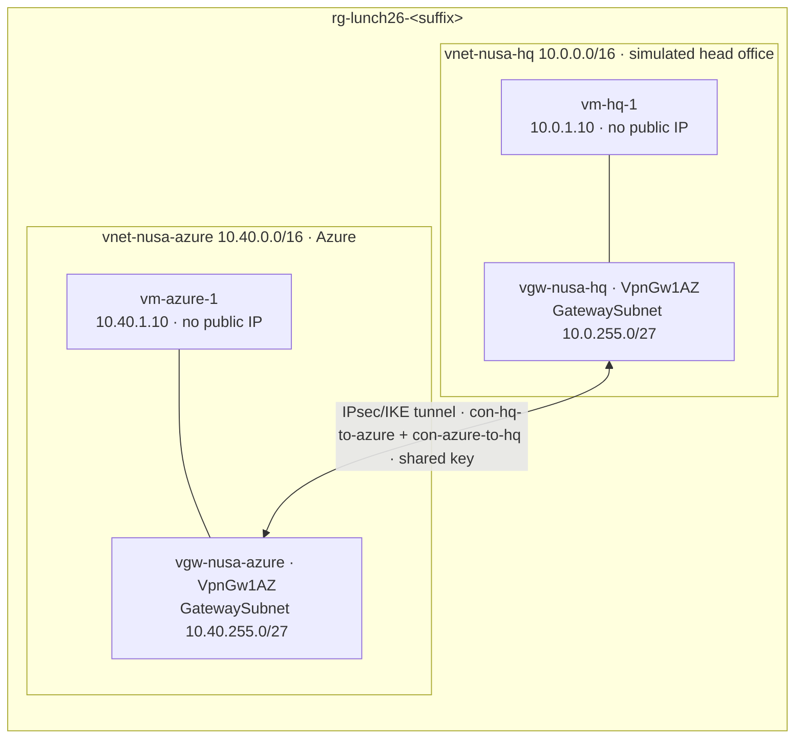

# Lab 26 · Connect head office

🇮🇩 [Baca dalam Bahasa Indonesia](README.id.md)

> **Pairs with:** [Lunch 26 · Hybrid Connectivity: VPN Gateway, ExpressRoute and Virtual WAN](../../lunches/26-hybrid-connectivity/README.md)
> **Time:** about 90 minutes, including 30–45 minutes of waiting for the gateways · **Cost:** 💲💲💲 (see [cost bands](../README.md#cost-bands)) · **Difficulty:** ★★★
> **Works on its own:** ✅ You do not need any earlier lab. Everything this lab needs is created by its steps or by `setup.sh`.
> **Author:** Stefanus Pinarta · [About the author](../../README.md#about-the-author)

## 🎯 What you'll build

Pak Budi wants head office in Jakarta (10.0.0.0/16) to reach Nusantara Retail's Azure network (10.40.0.0/16) over a
private, encrypted link instead of exposing servers to the internet. Nobody can ship a VPN appliance to your desk, so
`setup.sh` **simulates head office with a second virtual network** that has its own VPN gateway: Azure plays both
sides. You connect the two **route-based VpnGw1AZ** gateways with **VNet-to-VNet connections** in both directions,
protected by a **shared key generated at run time**. Then you watch the status reach **Connected**, prove that
`vm-azure-1` and `vm-hq-1` talk to each other on private IP addresses through the tunnel, and read the route Azure
added. An optional task compares the result with VNet peering.



> [!CAUTION]
> **💲💲💲 — the meter starts when `setup.sh` starts the gateways.** A VPN gateway is billed for every hour it exists,
> whether or not any traffic flows, and this lab runs two of them (plus their public IPs and two small VMs). Do the lab
> in one sitting, never leave it running overnight, and run `bash cleanup.sh` as soon as `verify.sh` passes — or as soon
> as you decide to stop. For numbers, price a **VpnGw1AZ** gateway for your region in the
> [Azure pricing calculator](https://azure.microsoft.com/pricing/calculator/).

## ✅ Before you start

- An Azure subscription where you can create resources (see [Lab 01](../01-before-you-begin/README.md)). Contributor
  on the subscription is enough: this lab creates no role assignments.
- About two hours in which you can finish what you start. Most of the waiting happens at the beginning.
- **Azure Cloud Shell (Bash)** — open [shell.azure.com](https://shell.azure.com). Nothing to install.
- Get the lab files and load the shared settings:

```bash
git clone https://github.com/stefpin/azure-fundamentals-lunches.git   # first time only
cd azure-fundamentals-lunches/labs/26-hybrid-connectivity
source ../common/config.sh
RG=$(rg_name 26)
PSK_FILE="$HOME/.azlunches-lab26-psk"
```

- Create the starting point. The script takes about 5 minutes:

```bash
bash setup.sh
```

`setup.sh` builds two "sites" in one resource group. Each gets a virtual network with a **GatewaySubnet** (/27, no
network security group) and a workload subnet with an NSG, a small `$VM_SIZE_SMALL` VM **without a public IP** that runs
a tiny web server, and a zone-redundant **Standard public IP**. Last, it **starts** a route-based **VpnGw1AZ** gateway in
each network with `--no-wait`. The script finishes, but the gateways keep building in Azure for **30–45 minutes or
more**, even if you close Cloud Shell. Write down the suffix the script prints.

> [!IMPORTANT]
> Lab resources cost money while they exist. Finish with the **Clean up** section, even if you stop halfway — and even if
> the gateways are still building.

## 🧭 Choose your mode

| Mode | For you if… | How |
|---|---|---|
| **Guided** | you want every step explained | follow Tasks 1–7 below (Task 8 is optional) |
| **Challenge** | you already know the basics | run `setup.sh`, read only the [Challenge brief](#-challenge-brief), build it your way, then run `bash verify.sh` |

Plan your time like this:

| Clock | You | Azure |
|---|---|---|
| 0:00 | run `setup.sh` (about 5 minutes) | creates the networks and VMs, starts both gateways |
| 0:05 | Task 1: tour the half-built network | gateways building |
| 0:15 | Task 2: read while you wait | gateways building |
| about 0:50 | Tasks 3–7 (and the optional Task 8) | gateways ready; the tunnel comes up within minutes |
| about 1:25 | `verify.sh`, then `cleanup.sh` | deletes everything in the background (10–20 minutes) |

## Task 1 · Tour the network while the gateways build

Look at what exists before the tunnel does — you'll compare it with the end result.

```bash
az network vnet-gateway list --resource-group "$RG" \
  --query "[].{gateway:name, sku:sku.name, generation:vpnGatewayGeneration, type:vpnType, state:provisioningState}" \
  --output table

az network vnet subnet list --resource-group "$RG" --vnet-name vnet-nusa-azure \
  --query "[].{subnet:name, prefix:addressPrefix || addressPrefixes[0], nsg:networkSecurityGroup.id}" \
  --output table
```

Now try to reach head office from the Azure VM. Run Command executes the script inside the VM through the VM agent, so
you don't need SSH or a public IP. The first run takes a minute or two.

```bash
az vm run-command invoke --resource-group "$RG" --name vm-azure-1 \
  --command-id RunShellScript --scripts "ping -c 3 -W 2 10.0.1.10" \
  --query "value[0].message" --output tsv
```

Finally, look at the routes the network interface of `vm-azure-1` uses. This takes up to a minute.

```bash
NIC_AZ=$(az vm show --resource-group "$RG" --name vm-azure-1 \
  --query "networkProfile.networkInterfaces[0].id" --output tsv)
az network nic show-effective-route-table --ids "$NIC_AZ" --output table
```

> [!TIP]
> **Prefer the portal?** *Home › Virtual network gateways* lists both gateways while they build. For the routes, open
> *vm-azure-1 › Networking*, select the network interface, and choose **Effective routes**.

> ✅ **Checkpoint:** both gateways show **VpnGw1AZ**, **Generation1**, **RouteBased** and the state **Updating**. The
> GatewaySubnet (10.40.255.0/27) has no NSG; `snet-app` has one. The ping reports `100% packet loss`. The route table
> has `10.40.0.0/16` with next hop **VnetLocal** and `10.0.0.0/8` with next hop **None** — Azure *drops* traffic for
> private ranges it has no better route for, which is exactly what happened to your ping.

## Task 2 · Read while you wait (30–45 minutes)

Each gateway is really a pair of Microsoft-managed instances that Azure places in your GatewaySubnet, spreads across
availability zones and configures — one active, one on standby. That takes time, which is why real gateway changes
are planned ahead and never done "just quickly". Check progress every ten minutes or so:

```bash
az network vnet-gateway list --resource-group "$RG" \
  --query "[].{gateway:name, state:provisioningState}" --output table
```

Use the time well. Each item below takes 5–10 minutes:

| Read | Look for |
|---|---|
| [About VPN Gateway SKUs](https://learn.microsoft.com/azure/vpn-gateway/about-gateway-skus) | VpnGw1AZ's tunnel limit and benchmark throughput, and why the non-AZ SKUs are going away |
| [Connect VNets with a VNet-to-VNet connection (Azure CLI)](https://learn.microsoft.com/azure/vpn-gateway/vpn-gateway-howto-vnet-vnet-cli) | the steps `setup.sh` automated and the ones you'll do in Task 4; how it differs from site-to-site |
| [Virtual network traffic routing](https://learn.microsoft.com/azure/virtual-network/virtual-networks-udr-overview) | the **None** routes from Task 1, longest prefix match, and which route wins when two have the same prefix |
| [What is Azure ExpressRoute?](https://learn.microsoft.com/azure/expressroute/expressroute-introduction) | the two peerings, and why a private circuit behaves more predictably than the internet |
| [What is Azure Virtual WAN?](https://learn.microsoft.com/azure/virtual-wan/virtual-wan-about) | Basic vs Standard, and when forty stores make a managed hub the simpler design |

> [!NOTE]
> Cloud Shell closes after about **20 minutes without input**. That doesn't affect the gateways — they build in Azure,
> not in your shell. When you come back, reload your settings:
> `cd ~/azure-fundamentals-lunches/labs/26-hybrid-connectivity && source ../common/config.sh && RG=$(rg_name 26) && PSK_FILE="$HOME/.azlunches-lab26-psk"`.
> In an ephemeral Cloud Shell session (no storage), clone the repository again and set `SUFFIX=<the suffix you wrote
> down>` before you `source` the settings.

If you'd rather watch than poll, `az network vnet-gateway wait --resource-group "$RG" --name vgw-nusa-hq --created
--timeout 4500` returns when that gateway reaches **Succeeded** — but keep the tab active so Cloud Shell doesn't time out.

> ✅ **Checkpoint:** both gateways show **Succeeded**. If one shows **Failed**, see Troubleshooting.

## Task 3 · Inspect the finished gateways

```bash
for gw in vgw-nusa-azure vgw-nusa-hq; do
  az network vnet-gateway show --resource-group "$RG" --name "$gw" \
    --query "{name:name, state:provisioningState, sku:sku.name, generation:vpnGatewayGeneration, vpnType:vpnType, activeActive:activeActive, asn:bgpSettings.asn}" \
    --output table
done

az network public-ip list --resource-group "$RG" \
  --query "[].{name:name, address:ipAddress, sku:sku.name, zones:to_string(zones)}" --output table
```

What you're looking at:

- **VpnGw1AZ, Generation1** — the smallest zone-redundant SKU (up to 30 site-to-site tunnels). New gateways must use an
  AZ SKU; the old non-zonal VpnGw1–5 can no longer be created.
- **activeActive False** — the default *active-standby* mode: one instance carries the tunnel and the other takes over
  during maintenance or a failure, after a short interruption. Production gateways usually run active-active.
- **asn 65515** — the default BGP autonomous system number. This lab doesn't use BGP; the stretch goals do.
- The **public IP addresses** are what a real head-office device would connect to — and what Pak Budi would allow
  through his firewall.

> ✅ **Checkpoint:** both gateways are **Succeeded**, **VpnGw1AZ**, **Generation1**, **RouteBased**, with
> `activeActive` **False** and ASN **65515**. Both public IPs are **Standard** with zones `["1","2","3"]` (or `null` if
> you ran `setup.sh` with `PIP_ZONES=""` in a region without availability zones).

## Task 4 · Create the connections with a shared key generated at run time

Both ends of an IPsec tunnel must hold the same **pre-shared key**. Generate a strong one in a file that only you can
read, so it never appears on screen or in your command history:

```bash
[[ -s "$PSK_FILE" ]] || ( umask 077; openssl rand -hex 24 > "$PSK_FILE" )
ls -l "$PSK_FILE"
```

`openssl rand -hex 24` produces 48 hexadecimal characters (192 random bits); letters and digits only, which every VPN
device accepts. Now create one connection on each gateway. A VNet-to-VNet link always has two halves, and both must
carry the same key:

```bash
az network vpn-connection create --resource-group "$RG" --name con-azure-to-hq --location "$LOCATION" \
  --vnet-gateway1 vgw-nusa-azure --vnet-gateway2 vgw-nusa-hq \
  --shared-key "$(cat "$PSK_FILE")" --output none

az network vpn-connection create --resource-group "$RG" --name con-hq-to-azure --location "$LOCATION" \
  --vnet-gateway1 vgw-nusa-hq --vnet-gateway2 vgw-nusa-azure \
  --shared-key "$(cat "$PSK_FILE")" --output none
```

With a VNet-to-VNet connection, Azure fills in the other side's address space for you. For the real head office you
would instead create a **local network gateway** (Pak Budi's public IP and 10.0.0.0/16), connect to it with
`--local-gateway2`, and type the same key into his VPN device — the stretch goals let you rehearse that.

> [!TIP]
> **Prefer the portal?** *Virtual network gateways › vgw-nusa-azure › Settings › Connections › + Add*, connection type
> **VNet-to-VNet**, second gateway `vgw-nusa-hq`, then the same for the other direction. To paste the key without
> printing it in the terminal, open the file in the Cloud Shell editor: `code "$PSK_FILE"`.

> ✅ **Checkpoint:** `az network vpn-connection list --resource-group "$RG" --query "[].{name:name, type:connectionType, state:provisioningState}" --output table`
> shows `con-azure-to-hq` and `con-hq-to-azure`, both **Vnet2Vnet** and **Succeeded**. `ls -l` showed the key file
> as `-rw-------`. Anyone with enough rights on a connection can read its key back from Azure
> (`az network vpn-connection shared-key show`), so treat access to connections like access to a secret.

## Task 5 · Watch the tunnel come up

The gateways now run **IKE**: they agree on encryption algorithms and prove to each other that they know the same key
without ever sending it. Then they set up **IPsec security associations**, and from then on every packet between the
networks travels encrypted. Check the status:

```bash
for con in con-azure-to-hq con-hq-to-azure; do
  az network vpn-connection show --resource-group "$RG" --name "$con" \
    --query "{name:name, status:connectionStatus, protocol:connectionProtocol, bytesIn:ingressBytesTransferred, bytesOut:egressBytesTransferred}" \
    --output table
done
```

Repeat it every 30 seconds until both say **Connected** — usually within a few minutes. Or let the CLI wait for you:

```bash
az network vpn-connection wait --resource-group "$RG" --name con-hq-to-azure \
  --custom "connectionStatus=='Connected'" --interval 20 --timeout 900
```

> ✅ **Checkpoint:** both connections show **Connected** with protocol **IKEv2**. You may see `Unknown` or `Connecting`
> first — that's normal. The byte counters are small until you send traffic in Task 6.

## Task 6 · Send traffic through the tunnel

From Azure to head office — ping, then ask the head-office web server for its health page:

```bash
az vm run-command invoke --resource-group "$RG" --name vm-azure-1 \
  --command-id RunShellScript \
  --scripts "ping -c 4 -W 2 10.0.1.10; curl -s --max-time 5 http://10.0.1.10/health" \
  --query "value[0].message" --output tsv
```

And back from head office to Azure, this time fetching the home page:

```bash
az vm run-command invoke --resource-group "$RG" --name vm-hq-1 \
  --command-id RunShellScript \
  --scripts "ping -c 4 -W 2 10.40.1.10; curl -s --max-time 5 http://10.40.1.10/" \
  --query "value[0].message" --output tsv
```

Neither NSG has a single custom rule, yet the traffic gets in. The default rule **AllowVnetInBound** allows traffic
from the **VirtualNetwork** service tag, and that tag includes address ranges connected through the VPN gateway. In
production you'd tighten this: Pak Budi's whole network doesn't need to reach every Azure server.

> ✅ **Checkpoint:** both pings report `0% packet loss` (round trips of a few milliseconds). The first command ends with
> `ok`; the second prints a small HTML page that says *Served by **vm-azure-1***. Run the Task 5 loop again: the byte
> counters have grown.

## Task 7 · Read the route Azure added

```bash
NIC_AZ=$(az vm show --resource-group "$RG" --name vm-azure-1 \
  --query "networkProfile.networkInterfaces[0].id" --output tsv)
az network nic show-effective-route-table --ids "$NIC_AZ" --output table
```

Compare it with Task 1. There's a new route for **10.0.0.0/16** whose source and next hop are both
**VirtualNetworkGateway**. The old `10.0.0.0/8 → None` route is still there, but Azure uses the **longest prefix
match**: for 10.0.1.10, the /16 route is more specific than the /8 one, so the packet goes to the gateway instead of
being dropped. Everything else in 10.0.0.0/8 is still dropped.

Now check the other side yourself: get the network interface of `vm-hq-1` the same way and look at its routes.

> ✅ **Checkpoint:** on `vm-azure-1`, `10.0.0.0/16` is **Active** with next hop type **VirtualNetworkGateway**. On
> `vm-hq-1`, the matching route is for `10.40.0.0/16`. You added no route table and no static route: the gateways did
> it, and they would update the routes automatically if either address space changed.

## Task 8 (optional) · Compare with VNet peering

Both "sites" are really Azure virtual networks, and between Azure networks **VNet peering** is usually the better
tool: no gateways, no encryption overhead, lower latency, and you pay per GB instead of per gateway hour. Peer them
while the VPN is still up and see which path Azure picks:

```bash
az network vnet peering create --resource-group "$RG" --name peer-azure-to-hq \
  --vnet-name vnet-nusa-azure --remote-vnet vnet-nusa-hq --allow-vnet-access true --output none
az network vnet peering create --resource-group "$RG" --name peer-hq-to-azure \
  --vnet-name vnet-nusa-hq --remote-vnet vnet-nusa-azure --allow-vnet-access true --output none

az network nic show-effective-route-table --ids "$NIC_AZ" --output table
az vm run-command invoke --resource-group "$RG" --name vm-azure-1 \
  --command-id RunShellScript --scripts "ping -c 4 -W 2 10.0.1.10" \
  --query "value[0].message" --output tsv
```

The CLI needs `--allow-vnet-access true` written out — its default for this flag is `false`. A peering only works when
both directions exist.

> ✅ **Checkpoint:** there are now two routes for `10.0.0.0/16`. The **virtual network peering** route is *Active* and
> the gateway route is *Invalid*: Azure prefers system routes for peerings, even over gateway routes for the same
> prefix. Compare the `time=` values of the pings with Task 6 — they're usually a little lower.

Remove the peering before you continue — `verify.sh` checks that traffic uses the tunnel:

```bash
az network vnet peering delete --resource-group "$RG" --vnet-name vnet-nusa-azure --name peer-azure-to-hq
az network vnet peering delete --resource-group "$RG" --vnet-name vnet-nusa-hq --name peer-hq-to-azure
```

## 🔧 Break it and fix it

The most common reason a real tunnel never comes up is a **mismatched pre-shared key** — someone mistyped it on the
device or rotated it on only one side. Give the head-office half a different key:

```bash
az network vpn-connection shared-key update --resource-group "$RG" \
  --connection-name con-hq-to-azure --value "NotTheRightKey123" --output none
```

Run the status loop from Task 5 for the next few minutes, then repeat the first ping from Task 6.

**Symptom:** the connections drop out of **Connected** (you may see `Connecting` or `NotConnected`) and the ping
reports `100% packet loss`. Nothing else changed — the gateways, routes and NSGs are all fine.

<details><summary>Hint: what went wrong, and the fix</summary>

During IKE each side proves that it knows the key. The keys differ, so authentication fails and no IPsec security
associations are created; without them, no traffic can flow. Put the right key back on the head-office half:

```bash
az network vpn-connection shared-key update --resource-group "$RG" \
  --connection-name con-hq-to-azure --value "$(cat "$PSK_FILE")" --output none
```

Within a few minutes both connections are **Connected** again and the ping works. With a real device you would compare
its IKE logs with the Azure side; Network Watcher's **VPN troubleshoot** tells you when the cause is an authentication
failure.

If the status still says **Connected** a good five minutes after you set the wrong key, the old security associations
are still alive. Force a new negotiation with `az network vnet-gateway reset --resource-group "$RG" --name vgw-nusa-hq`
(it takes several minutes), and then watch the failure appear.

</details>

## 🧪 Verify your work

```bash
bash verify.sh
```

Every check should say **PASS**. If one fails, the message tells you which task to revisit. The script reads the
effective routes and runs a small ping and HTTP test inside each VM through Run Command, so it takes 2–3 minutes.
Remove the optional peering from Task 8 first.

## 🧹 Clean up (do not skip!)

```bash
bash cleanup.sh
```

The script asks for confirmation (set `ASSUME_YES=1` to skip the question). It deletes the resource group
`rg-lunch26-<suffix>` — gateways, connections, public IPs, VMs, disks and networks — and removes the shared key file
`~/.azlunches-lab26-psk`. Nothing was created outside the resource group.

Deleting the gateways takes a while, often 10–20 minutes, and **billing stops when they're gone**. Half an hour later,
check that nothing is left:

```bash
az group list --tag lunch=26 --output table
```

## 🩺 Troubleshooting

| Symptom | Likely cause | Fix |
|---|---|---|
| A gateway's state is **Failed** | Creation hit a transient platform error | `az network vnet-gateway delete --resource-group "$RG" --name <gateway>`, then run `bash setup.sh` again — it recreates only what's missing |
| `setup.sh` fails while creating a gateway because of the SKU | You set `VPN_SKU` to a non-AZ SKU such as `VpnGw1`, which can't be created any more | Run it again without `VPN_SKU`, or use `VpnGw2AZ`–`VpnGw5AZ` |
| `vpn-connection create` fails with `AnotherOperationInProgress` or says the gateway isn't ready | A gateway is still building or updating | Wait until both gateways show **Succeeded** (Task 2), then retry |
| A connection stays `Connecting` or `NotConnected` for more than 10 minutes | The two halves have different shared keys | Set both to the key in `$PSK_FILE` with `shared-key update` (see Break it and fix it) |
| `$PSK_FILE` is missing after a Cloud Shell restart, but the connections exist | The file lived in an ephemeral session | Recover the key into a new file: `( umask 077; az network vpn-connection shared-key show --resource-group "$RG" --connection-name con-azure-to-hq --query value --output tsv > "$PSK_FILE" )` |
| Status **Connected**, but ping reports `100% packet loss` | A VM is stopped, the optional peering was deleted on one side only, or a custom NSG rule blocks the traffic | Check `az vm get-instance-view` power state, the effective routes (Task 7) and the NSG rules; remove leftover peerings |
| `(Conflict) Run command extension execution is in progress` | Another Run Command is still running on the same VM | Wait until it finishes, then retry — one script per VM at a time |
| `verify.sh` reports a next hop other than **VirtualNetworkGateway** | The optional peering from Task 8 is still in place | Delete both peerings (end of Task 8) and run `verify.sh` again |
| Cloud Shell timed out during a wait | 20 minutes without input | Reopen it, reload the settings (note in Task 2) and rerun the command; the gateways kept going |
| `az group list --tag lunch=26` still shows the group long after cleanup | Gateway deletion is slow | Wait another 15 minutes; if the group remains, run `bash cleanup.sh` again |

## 🚀 Stretch goals

- **Rehearse the real site-to-site setup.** After `verify.sh` passes, delete the two VNet-to-VNet connections and
  describe each side as an "on-premises" site with a **local network gateway** — exactly what you'd do for Pak Budi's
  device:

  ```bash
  az network vpn-connection delete --resource-group "$RG" --name con-azure-to-hq
  az network vpn-connection delete --resource-group "$RG" --name con-hq-to-azure
  HQ_IP=$(az network public-ip show --resource-group "$RG" --name pip-vgw-nusa-hq --query ipAddress --output tsv)
  AZ_IP=$(az network public-ip show --resource-group "$RG" --name pip-vgw-nusa-azure --query ipAddress --output tsv)
  az network local-gateway create --resource-group "$RG" --name lgw-nusa-hq \
    --gateway-ip-address "$HQ_IP" --local-address-prefixes 10.0.0.0/16
  az network local-gateway create --resource-group "$RG" --name lgw-nusa-azure \
    --gateway-ip-address "$AZ_IP" --local-address-prefixes 10.40.0.0/16
  az network vpn-connection create --resource-group "$RG" --name con-s2s-azure-to-hq \
    --vnet-gateway1 vgw-nusa-azure --local-gateway2 lgw-nusa-hq --shared-key "$(cat "$PSK_FILE")"
  az network vpn-connection create --resource-group "$RG" --name con-s2s-hq-to-azure \
    --vnet-gateway1 vgw-nusa-hq --local-gateway2 lgw-nusa-azure --shared-key "$(cat "$PSK_FILE")"
  ```

  The connection type is now **IPsec**, and you maintain the address prefixes yourself. For a real device, the
  portal's **Download configuration** on such a connection produces a sample configuration for common VPN devices.
- **Peek at IKE:** `az network vpn-connection list-ike-sas --resource-group "$RG" --name con-azure-to-hq` (a preview
  command) shows the negotiated IKE security associations, including the encryption and integrity algorithms.
- **Try BGP:** give the gateways different private ASNs (`az network vnet-gateway update --asn 65010`, and 65020 on the
  other), enable BGP on both connections (`az network vpn-connection update --enable-bgp true`), and compare
  `az network vnet-gateway list-learned-routes` before and after. Each gateway update can take a long time, so only do
  this if your budget allows the extra hour.
- **Price the options for Ibu Sari:** in the [pricing calculator](https://azure.microsoft.com/pricing/calculator/),
  compare a month of one VpnGw1AZ gateway, a 50 Mbps ExpressRoute circuit with an ErGw1Az gateway, and a Virtual WAN
  hub with a site-to-site VPN scale unit. Which would you propose for one head office? For forty stores?

## 🏁 Challenge brief

Run `bash setup.sh`, then build the following any way you like (portal, CLI, Bicep):

1. `vnet-nusa-azure` (10.40.0.0/16) and `vnet-nusa-hq` (10.0.0.0/16) each have a `GatewaySubnet` of /27 or larger
   (`setup.sh` creates these; don't change the address plan).
2. `vgw-nusa-azure` and `vgw-nusa-hq` are **route-based** VPN gateways with an **AZ SKU**, in the **Succeeded** state,
   each with a **Standard**, zone-redundant public IP (created by `setup.sh`; you wait for them).
3. Two **VNet-to-VNet** connections, `con-azure-to-hq` and `con-hq-to-azure`, use the same shared key, **generated at
   run time** — never typed, printed or committed.
4. Both connections are **Connected**.
5. The network interface of `vm-azure-1` routes **10.0.0.0/16** to the **virtual network gateway** (no peering in place).
6. `vm-azure-1` and `vm-hq-1` can ping each other and fetch each other's `/health` page, in both directions.
7. You can explain why the GatewaySubnet has no NSG and why the NSGs needed no new rules (not checked by the script).

Then run `bash verify.sh`. Stuck? Peek at `solution.sh` or switch to Guided mode. **Then run `bash cleanup.sh`.**

---

⬅️ [Lunch 26 reading](../../lunches/26-hybrid-connectivity/README.md) · 🏠 [All labs](../README.md) · 🏠 [Course home](../../README.md)

<sub>Last validated: October 2026 · Something broken? [Report a lab problem](../../CONTRIBUTING.md).</sub>
