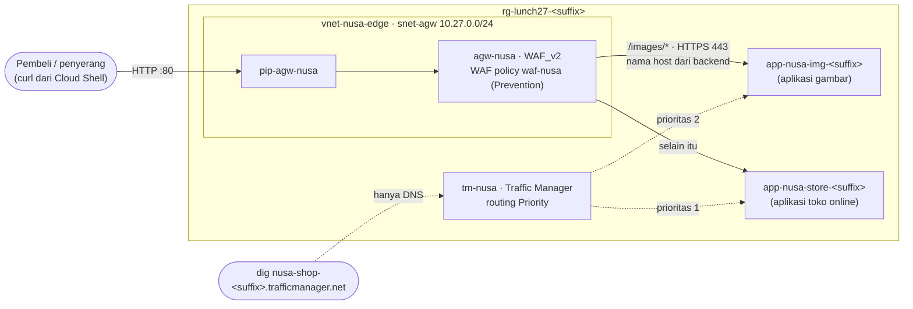

# Lab 27 · Melindungi dan merutekan toko online

🇬🇧 [Read in English](README.md)

> **Pasangan dari:** [Makan Siang 27 · Load Balancing (Lanjutan): Application Gateway, Front Door, dan Traffic Manager](../../lunches/27-load-balancing-advanced/README.id.md)
> **Waktu:** sekitar 75 menit (termasuk 5–15 menit menunggu gateway) · **Biaya:** 💲💲💲 (lihat [kelompok biaya](../README.id.md#kelompok-biaya)) · **Tingkat kesulitan:** ★★★
> **Bisa dikerjakan terpisah:** ✅ Anda tidak memerlukan lab sebelumnya. Semua yang dibutuhkan lab ini dibuat oleh langkah-langkahnya sendiri atau oleh `setup.sh`.
> **Penulis:** Stefanus Pinarta · [Tentang penulis](../../README.id.md#tentang-penulis)

## 🎯 Yang akan Anda bangun

Toko online Nusantara Retail dan layanan gambarnya yang baru berjalan sebagai dua aplikasi App Service kecil. Anda
menempatkan sebuah **Application Gateway (WAF_v2)** di depan keduanya, yang mengirim `/images/*` ke aplikasi gambar
dan semua yang lain ke aplikasi toko online, serta sebuah **WAF policy** yang memblokir percobaan SQL injection dengan
HTTP 403. Lalu Anda menambahkan profil **Traffic Manager** yang menjawab DNS dengan toko online sebagai pilihan
pertama dan sebuah standby sebagai pilihan kedua, menghentikan toko online, dan menyaksikan jawaban DNS berubah.
Secara opsional, Anda menempatkan **Front Door Standard** di depan toko online untuk melihat edge global bekerja.



## ✅ Sebelum mulai

- Sebuah subscription Azure tempat Anda bisa membuat resource (lihat [Lab 01](../01-before-you-begin/README.id.md)).
- **Azure Cloud Shell (Bash)** — buka [shell.azure.com](https://shell.azure.com). `dig` dan Python sudah terpasang di
  sana.
- Ambil file lab dan muat pengaturan bersama:

```bash
git clone https://github.com/stefpin/azure-fundamentals-lunches.git   # first time only
cd azure-fundamentals-lunches/labs/27-load-balancing-advanced
source ../common/config.sh
source lab.env          # resource names for this lab, plus helpers: load_hosts, gw_ip, tm_watch
RG=$(rg_name 27)
```

- Buat titik awalnya — butuh sekitar 3–5 menit. Langkah ini membuat resource group, virtual network dengan subnet
  kosong `snet-agw` (10.27.0.0/24, khusus untuk gateway), sebuah App Service plan **Free (F1)**, dan dua aplikasi yang
  hanya menerima HTTPS, lalu men-deploy halaman-halaman di [`app/`](app/):

```bash
bash setup.sh
load_hosts              # sets STORE_HOST and IMG_HOST — rerun it whenever you reconnect
```

> [!IMPORTANT]
> Ini lab 💲💲💲. Application Gateway WAF_v2 ditagih untuk setiap jam selama ia ada, sejak dibuat sampai Anda
> menghapusnya, bahkan tanpa lalu lintas sama sekali, dan Front Door yang opsional punya biaya dasar selama profilnya
> ada. Kerjakan lab ini dalam sekali duduk dan jalankan **Bersihkan** segera sesudahnya. Aplikasi App Service memakai
> tier Free. Jika Cloud Shell terputus, sambungkan lagi, lalu jalankan ulang `cd`, kedua baris `source`, dan
> `load_hosts`; resource tetap dibangun di Azure selama Anda terputus.

## 🧭 Pilih mode Anda

| Mode | Cocok untuk Anda jika… | Caranya |
|---|---|---|
| **Terpandu** | Anda ingin setiap langkah dijelaskan | ikuti Tugas 1–8 (Tugas 9 opsional) |
| **Tantangan** | Anda sudah menguasai dasarnya | jalankan `bash setup.sh`, baca hanya [Ringkasan tantangan](#-ringkasan-tantangan), bangun dengan cara Anda sendiri, lalu jalankan `bash verify.sh` |

## Tugas 1 · Berkenalan dengan dua aplikasi

Setiap aplikasi memberi label pada halamannya sendiri, jadi Anda selalu bisa tahu siapa yang menjawab.

```bash
curl -s "https://${STORE_HOST}/"        | grep -o "Served by the [A-Z]* app"
curl -s "https://${IMG_HOST}/images/"   | grep -o "Served by the [A-Z]* app"
curl -s -o /dev/null -w "HTTP %{http_code}\n" "https://${STORE_HOST}/images/"
```

Perintah terakhir mengembalikan `404`: aplikasi toko online tidak punya folder `/images/`. Hanya aplikasi gambar yang
punya — nanti gateway harus mengirim request semacam itu ke sana.

> ✅ **Pemeriksaan:** perintah pertama menampilkan *Served by the STOREFRONT app*, perintah kedua *Served by the IMAGES
> app*, dan perintah terakhir `HTTP 404`.

## Tugas 2 · Membuat WAF policy (Detection dulu)

**WAF policy** adalah resource tersendiri yang menyimpan pengaturan dan rule set firewall; Anda memasangkannya ke
gateway pada tugas berikutnya. Microsoft menyarankan **Default Rule Set (DRS) 2.2** untuk policy baru (default CLI
masih 2.1, jadi Anda menyebut versinya secara eksplisit). Mulailah di mode **Detection**: setiap kecocokan dicatat,
tetapi tidak ada yang diblokir.

```bash
az network application-gateway waf-policy create -g "$RG" -n "$WAF_POLICY" -l "$LOCATION" \
  --type Microsoft_DefaultRuleSet --version 2.2 --output none

az network application-gateway waf-policy policy-setting update -g "$RG" --policy-name "$WAF_POLICY" \
  --mode Detection --state Enabled --request-body-check true --output none

az network application-gateway waf-policy show -g "$RG" -n "$WAF_POLICY" \
  --query "{mode:policySettings.mode, state:policySettings.state, ruleSet:managedRules.managedRuleSets[0].ruleSetType, version:managedRules.managedRuleSets[0].ruleSetVersion}" -o table
```

> ✅ **Pemeriksaan:** `Detection`, `Enabled`, `Microsoft_DefaultRuleSet`, `2.2`. (Jika versi 2.2 ditolak di region
> Anda, buat policy dengan `--version 2.1` — lihat Pemecahan masalah.)

## Tugas 3 · Membuat Application Gateway (5–15 menit)

Gateway membutuhkan IP publik statis bertipe Standard dan subnet-nya sendiri. Anda membuatnya dengan:

- `--sku WAF_v2` dan policy dari Tugas 2;
- autoscale antara 1 dan 2 instance, agar lab tetap kecil (minimumnya juga bisa 0 — autoscaling murni);
- listener di port 80, dan aplikasi toko online sebagai satu-satunya anggota backend pool default;
- backend settings yang berbicara **HTTPS di port 443** dengan aplikasi;
- `--priority 100` untuk routing rule (rule v2 membutuhkan prioritas).

```bash
az network public-ip create -g "$RG" -n "$PIP_AGW" -l "$LOCATION" \
  --sku Standard --allocation-method Static --output none

az network application-gateway create -g "$RG" -n "$AGW" -l "$LOCATION" \
  --sku WAF_v2 --min-capacity 1 --max-capacity 2 \
  --vnet-name "$VNET" --subnet "$SUBNET_AGW" \
  --public-ip-address "$PIP_AGW" --waf-policy "$WAF_POLICY" \
  --frontend-port 80 --http-settings-protocol Https --http-settings-port 443 \
  --servers "$STORE_HOST" --priority 100 --output none
```

Selagi gateway dibangun, baca lagi bagian 2 dan 3 dari makan siang ini. Perintah tadi membuat komponen default yang
akan Anda pakai ulang: `appGatewayFrontendIP`, `appGatewayHttpListener`, `appGatewayBackendPool` (toko online),
`appGatewayBackendHttpSettings`, dan rule `rule1`. Di region yang memiliki availability zone, gateway otomatis
tersebar ke beberapa zona.

Sekarang coba:

```bash
GW_IP=$(gw_ip); echo "$GW_IP"
curl -s -o /dev/null -w "HTTP %{http_code}\n" "http://${GW_IP}/"
```

> ✅ **Pemeriksaan:**
> `az network application-gateway show -g "$RG" -n "$AGW" --query "{sku:sku.name, state:operationalState}" -o table`
> menampilkan `WAF_v2` dan `Running` — **dan request-nya gagal**, biasanya dengan `HTTP 502` (Bad Gateway). Itu memang
> sudah diduga; Tugas 4 menjelaskan sebabnya.

> [!TIP]
> **Lebih suka portal?** Buka `agw-nusa` dan lihat *Backend health*: toko online berstatus **Unhealthy**, dan
> detailnya menyebut nama host atau common name sertifikat. Portal juga memungkinkan Anda menelusuri setiap komponen
> yang baru saja dibuat: *Listeners*, *Rules*, *Backend pools*, *Backend settings*, *Health probes*, dan policy *Web
> application firewall* yang terhubung.

## Tugas 4 · Mengajari gateway berbicara dengan App Service

App Service menampung aplikasi milik banyak pelanggan di front end bersama dan menemukan aplikasi yang tepat
berdasarkan **nama host** di setiap request. Gateway meneruskan nama host yang dipakai klien (di sini sebuah alamat
IP), dan default health probe-nya memakai `127.0.0.1`. App Service tidak mengenali keduanya, dan sertifikat HTTPS-nya
(`*.azurewebsites.net`) juga tidak cocok dengan keduanya — sehingga backend ditandai tidak sehat dan pembeli mendapat 502.

Perbaikannya: buat backend settings **mengambil nama host dari target backend** (nama `*.azurewebsites.net` milik
masing-masing aplikasi), lalu tambahkan custom probe yang mengambil nama host-nya dari pengaturan tersebut.

```bash
az network application-gateway probe create -g "$RG" --gateway-name "$AGW" -n "$PROBE_AGW" \
  --protocol Https --path / --host-name-from-http-settings true \
  --interval 30 --timeout 30 --threshold 3 --output none

az network application-gateway http-settings update -g "$RG" --gateway-name "$AGW" \
  -n appGatewayBackendHttpSettings --host-name-from-backend-pool true --probe "$PROBE_AGW" --output none

az network application-gateway show-backend-health -g "$RG" -n "$AGW" \
  --query "backendAddressPools[].backendHttpSettingsCollection[].servers[].{address:address, health:health}" -o table

curl -s "http://${GW_IP}/" | grep -o "Served by the [A-Z]* app"
```

Setiap perintah `application-gateway ... create/update` memperbarui seluruh gateway, jadi perkirakan satu atau dua
menit untuk setiap perintah.

> ✅ **Pemeriksaan:** host toko online menampilkan `Healthy`, dan gateway sekarang mengembalikan *Served by the
> STOREFRONT app*. Di produksi, sebaiknya Anda memasang **custom domain** yang sama di gateway dan di aplikasi,
> sehingga nama host tidak pernah perlu diubah (makan siangnya menjelaskan alasannya).

## Tugas 5 · Merutekan `/images/*` ke aplikasi gambar

Tambahkan backend pool kedua untuk aplikasi gambar, sebuah **URL path map** yang mengirim `/images/*` ke sana (semua
yang lain menuju pool default), lalu ubah `rule1` dari *Basic* menjadi *PathBasedRouting*. Beri tanda kutip pada
`"/images/*"` agar shell tidak menjabarkan tanda bintangnya menjadi daftar file.

```bash
az network application-gateway address-pool create -g "$RG" --gateway-name "$AGW" -n "$POOL_IMG" \
  --servers "$IMG_HOST" --output none

az network application-gateway url-path-map create -g "$RG" --gateway-name "$AGW" -n "$PATH_MAP" \
  --rule-name images --paths "/images/*" \
  --address-pool "$POOL_IMG" --http-settings appGatewayBackendHttpSettings \
  --default-address-pool appGatewayBackendPool --default-http-settings appGatewayBackendHttpSettings \
  --output none

az network application-gateway rule update -g "$RG" --gateway-name "$AGW" -n rule1 \
  --rule-type PathBasedRouting --url-path-map "$PATH_MAP" --output none
```

Satu objek backend settings melayani kedua pool: karena ia mengambil nama host dari target di masing-masing pool,
setiap aplikasi menerima namanya sendiri. Uji kedua path dan gambarnya sekaligus:

```bash
curl -s "http://${GW_IP}/"        | grep -o "Served by the [A-Z]* app"
curl -s "http://${GW_IP}/images/" | grep -o "Served by the [A-Z]* app"
curl -s -o /dev/null -w "HTTP %{http_code} %{content_type}\n" "http://${GW_IP}/images/batik.svg"
```

> ✅ **Pemeriksaan:** `/` dilayani oleh aplikasi STOREFRONT, `/images/` oleh aplikasi IMAGES, dan file SVG
> mengembalikan `HTTP 200 image/svg+xml`. Buka `http://<gateway IP>/` di browser lalu klik tautan gambarnya. Gateway
> meneruskan **path lengkap**, itulah sebabnya aplikasi gambar menyimpan halamannya di folder `images`.

## Tugas 6 · Mengalihkan WAF ke Prevention dan memblokir serangan

Kirim probe SQL injection klasik (`?id=1' OR 1=1--`, dalam bentuk URL-encoded) selagi policy masih di mode Detection:

```bash
curl -s -o /dev/null -w "HTTP %{http_code}\n" "http://${GW_IP}/?id=1%27%20OR%201%3D1--"
```

Anda mendapat `HTTP 200`: di mode Detection, WAF hanya mencatat kecocokannya. Sekarang beralih ke Prevention:

```bash
az network application-gateway waf-policy policy-setting update -g "$RG" --policy-name "$WAF_POLICY" \
  --mode Prevention --state Enabled --request-body-check true --output none
```

Tunggu satu atau dua menit sampai perubahan itu tiba di gateway, lalu kirim request yang sama — dan satu request
normal:

```bash
curl -s -o /dev/null -w "attack: HTTP %{http_code}\n" "http://${GW_IP}/?id=1%27%20OR%201%3D1--"
curl -s -o /dev/null -w "normal: HTTP %{http_code}\n" "http://${GW_IP}/?id=42"
```

> ✅ **Pemeriksaan:** `attack: HTTP 403` dan `normal: HTTP 200`. Rule SQL injection berkategori *critical* (skor
> anomali 5), yang dengan sendirinya sudah mencapai ambang blokir 5; toko online tidak pernah melihat request
> tersebut.

## Tugas 7 · Profil Traffic Manager dengan routing priority

Traffic Manager menjawab kueri DNS; ia tidak pernah menyentuh lalu lintas HTTP. Buat profil **Priority** dengan TTL 30
detik dan health check HTTPS yang cepat (setiap 10 detik, berstatus degraded setelah 3 kegagalan berturut-turut), lalu
tambahkan kedua aplikasi sebagai **external endpoint**. (Aplikasi tier Free tidak bisa menjadi *Azure* endpoint; untuk
itu dibutuhkan tier Standard atau lebih tinggi.)

```bash
az network traffic-manager profile create -g "$RG" -n "$TM_PROFILE" \
  --routing-method Priority --unique-dns-name "$TM_DNS" --ttl 30 \
  --protocol HTTPS --port 443 --path "/" --interval 10 --timeout 9 --max-failures 2 --output none

az network traffic-manager endpoint create -g "$RG" --profile-name "$TM_PROFILE" -n ep-store \
  --type externalEndpoints --target "$STORE_HOST" --priority 1 --endpoint-status Enabled --output none

az network traffic-manager endpoint create -g "$RG" --profile-name "$TM_PROFILE" -n ep-images \
  --type externalEndpoints --target "$IMG_HOST" --priority 2 --endpoint-status Enabled --output none
```

Di sini aplikasi gambar berperan sebagai salinan standby dari toko online; di produksi, perannya diisi oleh toko
online yang sama di region kedua. Beri probe waktu satu menit, lalu lihat kesehatan endpoint dan jawaban DNS-nya:

```bash
tm_watch 3
dig +noall +answer "${TM_DNS}.trafficmanager.net"
```

> ✅ **Pemeriksaan:** kedua endpoint berstatus `Online`, dan record DNS pertama adalah CNAME ke `app-nusa-store-…`,
> dengan TTL 30 detik atau kurang. Traffic Manager hanya membagikan sebuah nama; klien terhubung langsung ke
> aplikasinya.

Coba `curl -s -o /dev/null -w "HTTP %{http_code}\n" "https://${TM_DNS}.trafficmanager.net/"`: pemeriksaan TLS gagal,
dan lewat HTTP biasa App Service menjawab dengan halaman *not found*. Aplikasi itu tidak mengenal nama
`trafficmanager.net`. Di produksi, kedua aplikasi akan memakai **custom domain** yang sama (tier Basic atau lebih
tinggi), dan domain itulah yang diarahkan ke Traffic Manager.

## Tugas 8 · Failover lewat DNS

Hentikan aplikasi toko online — setara dengan kehilangan situs utama — dan saksikan reaksi Traffic Manager:

```bash
az webapp stop -g "$RG" -n "$APP_STORE"
tm_watch 9          # about 90 seconds
```

Dalam sekitar satu menit, aplikasi yang dihentikan gagal dalam tiga health check berturut-turut (`ep-store:Degraded`),
dan jawaban DNS beralih ke `app-nusa-img-…`. Resolver mana pun yang sudah menyimpan jawaban lama di cache akan
memakainya hingga TTL 30 detik habis; sebagian klien menyimpan cache lebih lama lagi. Waktu failover kira-kira sama
dengan waktu deteksi ditambah TTL ditambah caching di klien. Sekarang pulihkan:

```bash
az webapp start -g "$RG" -n "$APP_STORE"
tm_watch 9
```

> ✅ **Pemeriksaan:** Anda melihat `ep-store` berubah menjadi `Degraded` dan jawaban DNS berpindah ke aplikasi gambar,
> lalu keduanya kembali `Online` dengan toko online kembali di urutan pertama.

## Tugas 9 (opsional) · Menempatkan Front Door Standard di depan toko online

Front Door butuh sekitar 15 menit, sebagian besar untuk menunggu konfigurasinya sampai ke edge. Lewati tugas ini jika
waktu atau anggaran Anda terbatas.

```bash
az provider register -n Microsoft.Cdn --wait

az afd profile create -g "$RG" --profile-name "$AFD_PROFILE" --sku Standard_AzureFrontDoor --output none
az afd endpoint create -g "$RG" --profile-name "$AFD_PROFILE" --endpoint-name "$AFD_ENDPOINT" \
  --enabled-state Enabled --output none
az afd origin-group create -g "$RG" --profile-name "$AFD_PROFILE" --origin-group-name og-storefront \
  --probe-request-type GET --probe-protocol Https --probe-interval-in-seconds 60 --probe-path / \
  --sample-size 4 --successful-samples-required 3 --additional-latency-in-milliseconds 50 --output none
az afd origin create -g "$RG" --profile-name "$AFD_PROFILE" --origin-group-name og-storefront \
  --origin-name storefront --host-name "$STORE_HOST" --origin-host-header "$STORE_HOST" \
  --priority 1 --weight 1000 --enabled-state Enabled --http-port 80 --https-port 443 --output none
az afd route create -g "$RG" --profile-name "$AFD_PROFILE" --endpoint-name "$AFD_ENDPOINT" \
  --route-name route-default --origin-group og-storefront --supported-protocols Http Https \
  --forwarding-protocol HttpsOnly --https-redirect Enabled --link-to-default-domain Enabled --output none

AFD_HOST=$(az afd endpoint show -g "$RG" --profile-name "$AFD_PROFILE" --endpoint-name "$AFD_ENDPOINT" --query hostName -o tsv)
echo "https://${AFD_HOST}/"
```

Perhatikan `--origin-host-header`: seperti Application Gateway, Front Door harus mengirim nama host milik aplikasi itu
sendiri. Ulangi `curl -s "https://${AFD_HOST}/" | grep -o "Served by the [A-Z]* app"` setiap satu atau dua menit.
Sampai konfigurasinya selesai tersebar, Anda akan mendapat halaman error dari Front Door, bukan dari aplikasi Anda.

> ✅ **Pemeriksaan:** nama host Front Door (`…azurefd.net`) mengembalikan *Served by the STOREFRONT app*, lewat HTTPS
> dengan sertifikat Microsoft, dari edge location yang paling dekat dengan Cloud Shell Anda.

## 🔧 Rusak lalu perbaiki

Dewi "merapikan" path rule dan tanpa sengaja menghapus satu huruf:

```bash
az network application-gateway url-path-map rule update -g "$RG" --gateway-name "$AGW" \
  --path-map-name "$PATH_MAP" -n images --paths "/image/*" --output none
curl -s -o /dev/null -w "HTTP %{http_code}\n" "http://${GW_IP}/images/"
```

**Gejala:** `/images/` sekarang mengembalikan `HTTP 404`, padahal kedua aplikasi sehat dan halaman backend health
serba hijau.

<details><summary>Petunjuk</summary>

Tanyakan kepada gateway bagaimana ia merutekan:
`az network application-gateway url-path-map show -g "$RG" --gateway-name "$AGW" -n "$PATH_MAP" --query "pathRules[].{name:name, paths:join(',', paths)}" -o table`.
Request yang tidak cocok dengan path rule mana pun dikirim ke pool **default**, yaitu aplikasi toko online, yang tidak
punya folder `/images/` — jadi 404 itu berasal dari aplikasi toko online.

</details>

<details><summary>Perbaikan</summary>

```bash
az network application-gateway url-path-map rule update -g "$RG" --gateway-name "$AGW" \
  --path-map-name "$PATH_MAP" -n images --paths "/images/*" --output none
curl -s "http://${GW_IP}/images/" | grep -o "Served by the [A-Z]* app"
```

Pelajarannya: "backend sehat, halaman salah" biasanya berarti yang keliru adalah routing rule, bukan server.

</details>

## 🧪 Verifikasi hasil kerja Anda

```bash
bash verify.sh
```

Setiap pemeriksaan seharusnya menampilkan **PASS**. Jika ada yang gagal, pesannya memberi tahu tugas mana yang perlu
Anda ulangi. Jalankan setelah aplikasi dinyalakan kembali (Tugas 8) dan setidaknya dua menit setelah WAF dialihkan ke
Prevention.

## 🧹 Bersihkan (jangan dilewati!)

```bash
bash cleanup.sh
```

Perintah ini menghapus resource group `rg-lunch27-<suffix>` — gateway, WAF policy, IP publik, profil Traffic Manager,
Front Door opsional, plan, dan aplikasi — beserta folder lokal `out`. Tidak ada yang berada di luar group itu. Gateway
bisa butuh 5–10 menit untuk benar-benar hilang; penghapusan berlanjut di latar belakang.

## 🩺 Pemecahan masalah

| Gejala | Kemungkinan penyebab | Perbaikan |
|---|---|---|
| `setup.sh`: `az appservice plan create` menolak tier Free (misalnya pesan kuota atau "not available") | Plan Free dibatasi per subscription atau per region | `APP_SKU=B1 bash setup.sh` (ada biaya kecil per jam), atau gunakan region lain |
| `setup.sh` mencatat bahwa sebuah aplikasi *belum menampilkan* halamannya | start pertama aplikasi tier Free bisa lambat | tunggu satu menit, lalu `curl -s "https://${STORE_HOST}/"`; jalankan ulang `bash setup.sh` untuk deploy ulang |
| `waf-policy create` menolak `--version 2.2` | versi rule set itu belum ditawarkan untuk Anda | buat dengan `--version 2.1` (masih didukung) |
| `application-gateway create` gagal dengan error tentang prioritas request routing rule | rule v2 membutuhkan prioritas | sertakan `--priority 100` |
| `application-gateway create` gagal karena subnet sedang dipakai atau terlalu kecil | subnet harus khusus untuk Application Gateway | gunakan `snet-agw` (/24) yang masih kosong, yang dibuat oleh `setup.sh` |
| `HTTP 502` dari gateway | backend tidak sehat — hampir selalu karena nama host untuk App Service | Tugas 4; periksa `show-backend-health` |
| `HTTP 404` untuk `/images/` lewat gateway | path rule tidak ada atau salah eja, atau `rule1` masih *Basic* | `az network application-gateway rule show -g "$RG" --gateway-name "$AGW" -n rule1 --query ruleType`; Tugas 5 |
| `rule update` ke PathBasedRouting gagal | CLI versi Anda menolak perubahan itu | portal: *agw-nusa › Rules › rule1 › Backend targets* › *Add multiple targets to create a path-based rule* (`/images/*` → `pool-images`) |
| Serangan masih mengembalikan `200` setelah beralih ke Prevention | perubahan policy belum tiba di gateway | tunggu dua menit lalu coba lagi; pastikan dengan `waf-policy show ... --query policySettings.mode` |
| Halaman normal mengembalikan `403` | false positive WAF pada lalu lintas Anda sendiri | beralih ke Detection, cari ID rule-nya di log WAF, tambahkan exclusion, lalu kembali ke Prevention |
| Endpoint Traffic Manager tetap `Degraded` | probe tidak bisa mendapat `200` (aplikasi dihentikan, atau probe HTTP ke aplikasi yang hanya menerima HTTPS) | nyalakan aplikasinya; profil harus mem-probe `HTTPS` di port 443 |
| `dig` masih menampilkan aplikasi lama setelah failover | caching DNS | tunggu sampai TTL (30 detik) habis lalu coba lagi |
| Front Door mengembalikan halaman error | konfigurasi masih menyebar ke edge | tunggu beberapa menit lalu coba lagi |

## 🚀 Tantangan tambahan

- **Failover Front Door tanpa DNS:** tambahkan aplikasi gambar sebagai origin kedua (`--priority 2`) ke
  `og-storefront`, hentikan toko online, dan saksikan Front Door beralih tanpa TTL yang perlu ditunggu.
- **Baca log WAF:** kirim diagnostic log gateway ke sebuah Log Analytics workspace dan temukan request Anda yang
  diblokir di log firewall (Makan Siang 30 mengajarkan bahasa query-nya).
- **Custom rule WAF:** blokir request yang `User-Agent`-nya mengandung `sqlmap`, atau batasi laju request (rate-limit)
  ke sebuah path, dengan `az network application-gateway waf-policy custom-rule create`.
- **Kunci aplikasinya:** tambahkan access restriction App Service agar aplikasi hanya menerima lalu lintas dari
  gateway (IP publiknya, atau subnet-nya melalui service endpoint).
- **Bandingkan dengan portal:** bangun ulang path rule lewat *Rules › Add a routing rule* dan perhatikan bagaimana
  portal mengelompokkan listener, backend targets, dan backend settings.

## 🏁 Ringkasan tantangan

Jalankan `bash setup.sh`, lalu bangun hal-hal berikut dengan cara apa pun yang Anda suka (portal, CLI, Bicep), memakai
nama-nama dari `lab.env`:

1. WAF policy `waf-nusa`, dalam keadaan **enabled** di mode **Prevention**, dengan sebuah Microsoft Default Rule Set.
2. Application Gateway `agw-nusa`, SKU **WAF_v2**, maksimal 2 instance, memakai `waf-nusa`, mendengarkan HTTP di port
   80 pada IP publik `pip-agw-nusa`, di subnet `snet-agw`.
3. Backend settings lewat **HTTPS 443** yang mengambil nama host dari target backend, dengan custom probe yang
   mengambil nama host-nya dari pengaturan tersebut.
4. Routing berbasis path: `/images/*` → aplikasi gambar; semua yang lain → aplikasi toko online.
5. Probe SQL injection lewat gateway (`/?id=1' OR 1=1--`) dijawab dengan **403**, sementara `/` dan `/images/` tetap
   berfungsi.
6. Profil Traffic Manager `tm-nusa` (nama DNS `nusa-shop-<suffix>`) dengan routing **Priority**, health check HTTPS,
   dan dua **external endpoint**: aplikasi toko online (prioritas 1) dan aplikasi gambar (prioritas 2).

Lalu jalankan `bash verify.sh`. Buntu? Intip `solution.sh` atau beralih ke mode Terpandu.

---

⬅️ [Bacaan Makan Siang 27](../../lunches/27-load-balancing-advanced/README.id.md) · 🏠 [Semua lab](../README.id.md) · 🏠 [Beranda kursus](../../README.id.md)

<sub>Terakhir divalidasi: Oktober 2026 · Ada yang tidak berfungsi? [Laporkan masalah lab](../../CONTRIBUTING.md).</sub>
