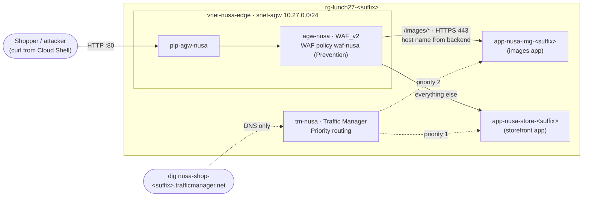

# Lab 27 · Protect and route the storefront

> **Pairs with:** [Lunch 27 · Load Balancing (Advanced): Application Gateway, Front Door and Traffic Manager](../../lunches/27-load-balancing-advanced/README.md)
> **Time:** about 75 minutes (including 5–15 minutes waiting for the gateway) · **Cost:** 💲💲💲 (see [cost bands](../README.md#cost-bands)) · **Difficulty:** ★★★
> **Works on its own:** ✅ You do not need any earlier lab. Everything this lab needs is created by its steps or by `setup.sh`.

## 🎯 What you'll build

Nusantara Retail's storefront and its new images service run as two small App Service apps. You put an
**Application Gateway (WAF_v2)** in front of them that sends `/images/*` to the images app and everything else to the
storefront, and a **WAF policy** that blocks a SQL-injection attempt with HTTP 403. Then you add a **Traffic Manager**
profile that answers DNS with the storefront first and a standby second, stop the storefront and watch the DNS answer
change. Optionally, you put **Front Door Standard** in front of the storefront to see the global edge.



## ✅ Before you start

- An Azure subscription where you can create resources (see [Lab 01](../01-before-you-begin/README.md)).
- **Azure Cloud Shell (Bash)** — open [shell.azure.com](https://shell.azure.com). `dig` and Python are preinstalled.
- Get the lab files and load the shared settings:

```bash
git clone https://github.com/stefpin/azure-fundamentals-lunches.git   # first time only
cd azure-fundamentals-lunches/labs/27-load-balancing-advanced
source ../common/config.sh
source lab.env          # resource names for this lab, plus helpers: load_hosts, gw_ip, tm_watch
RG=$(rg_name 27)
```

- Create the starting point — takes about 3–5 minutes. It creates the resource group, the virtual network with the
  empty subnet `snet-agw` (10.27.0.0/24, dedicated to the gateway), a **Free (F1)** App Service plan and two apps with
  HTTPS only, and deploys the pages in [`app/`](app/):

```bash
bash setup.sh
load_hosts              # sets STORE_HOST and IMG_HOST — rerun it whenever you reconnect
```

> [!IMPORTANT]
> This is a 💲💲💲 lab. An Application Gateway WAF_v2 is billed for every hour it exists, from creation until you
> delete it, even with no traffic, and the optional Front Door has a base fee while its profile exists. Do the lab in
> one sitting and run **Clean up** straight afterwards. The App Service apps use the Free tier. If Cloud Shell
> disconnects, reconnect, rerun the `cd`, both `source` lines and `load_hosts`; resources keep building in Azure.

## 🧭 Choose your mode

| Mode | For you if… | How |
|---|---|---|
| **Guided** | you want every step explained | follow Tasks 1–8 (Task 9 is optional) |
| **Challenge** | you already know the basics | run `bash setup.sh`, read only the [Challenge brief](#-challenge-brief), build it your way, then run `bash verify.sh` |

## Task 1 · Meet the two apps

Each app labels its own pages, so you can always tell who answered.

```bash
curl -s "https://${STORE_HOST}/"        | grep -o "Served by the [A-Z]* app"
curl -s "https://${IMG_HOST}/images/"   | grep -o "Served by the [A-Z]* app"
curl -s -o /dev/null -w "HTTP %{http_code}\n" "https://${STORE_HOST}/images/"
```

The last command returns `404`: the storefront app has no `/images/` folder. Only the images app does — the gateway
will have to send those requests there.

> ✅ **Checkpoint:** *Served by the STOREFRONT app*, *Served by the IMAGES app*, and `HTTP 404`.

## Task 2 · Create a WAF policy (Detection first)

A **WAF policy** is a separate resource that holds the firewall's settings and rule sets; you attach it to the gateway
in the next task. Microsoft recommends the **Default Rule Set (DRS) 2.2** for new policies (the CLI's default is still
2.1, so you name the version explicitly). Start in **Detection** mode: matches are logged but nothing is blocked.

```bash
az network application-gateway waf-policy create -g "$RG" -n "$WAF_POLICY" -l "$LOCATION" \
  --type Microsoft_DefaultRuleSet --version 2.2 --output none

az network application-gateway waf-policy policy-setting update -g "$RG" --policy-name "$WAF_POLICY" \
  --mode Detection --state Enabled --request-body-check true --output none

az network application-gateway waf-policy show -g "$RG" -n "$WAF_POLICY" \
  --query "{mode:policySettings.mode, state:policySettings.state, ruleSet:managedRules.managedRuleSets[0].ruleSetType, version:managedRules.managedRuleSets[0].ruleSetVersion}" -o table
```

> ✅ **Checkpoint:** `Detection`, `Enabled`, `Microsoft_DefaultRuleSet`, `2.2`. (If 2.2 is refused in your region, create
> the policy with `--version 2.1` — see Troubleshooting.)

## Task 3 · Create the Application Gateway (5–15 minutes)

The gateway needs a Standard static public IP and its own subnet. You create it with:

- `--sku WAF_v2` and the policy from Task 2;
- autoscale between 1 and 2 instances, to keep the lab small (the minimum can also be 0 — pure autoscaling);
- a listener on port 80, and the storefront app as the only member of the default backend pool;
- backend settings that talk **HTTPS on port 443** to the app;
- `--priority 100` for the routing rule (v2 rules need a priority).

```bash
az network public-ip create -g "$RG" -n "$PIP_AGW" -l "$LOCATION" \
  --sku Standard --allocation-method Static --output none

az network application-gateway create -g "$RG" -n "$AGW" -l "$LOCATION" \
  --sku WAF_v2 --min-capacity 1 --max-capacity 2 \
  --vnet-name "$VNET" --subnet "$SUBNET_AGW" \
  --public-ip-address "$PIP_AGW" --waf-policy "$WAF_POLICY" \
  --frontend-port 80 --http-settings-protocol Https --http-settings-port 443 \
  --servers "$STORE_HOST" --priority 100 --output none
```

While it builds, reread sections 2 and 3 of the lunch. The command creates default components you will reuse:
`appGatewayFrontendIP`, `appGatewayHttpListener`, `appGatewayBackendPool` (the storefront),
`appGatewayBackendHttpSettings` and the rule `rule1`. In regions with availability zones the gateway is spread across
zones automatically.

Now try it:

```bash
GW_IP=$(gw_ip); echo "$GW_IP"
curl -s -o /dev/null -w "HTTP %{http_code}\n" "http://${GW_IP}/"
```

> ✅ **Checkpoint:** `az network application-gateway show -g "$RG" -n "$AGW" --query "{sku:sku.name, state:operationalState}" -o table`
> shows `WAF_v2` and `Running` — **and the request fails**, typically with `HTTP 502` (Bad Gateway). That is expected;
> Task 4 explains why.

> [!TIP]
> **Prefer the portal?** Open `agw-nusa` and look at *Backend health*: the storefront is **Unhealthy**, and the details
> mention the host name or the certificate's common name. The portal also lets you browse every component you just
> created: *Listeners*, *Rules*, *Backend pools*, *Backend settings*, *Health probes*, and the linked *Web application
> firewall* policy.

## Task 4 · Teach the gateway to talk to App Service

App Service hosts many customers' apps on shared front ends and finds the right app by the **host name** in each
request. The gateway forwards the host name the client used (an IP address here), and its default health probe uses
`127.0.0.1`. App Service recognises neither, and the HTTPS certificate (`*.azurewebsites.net`) doesn't match them
either — so the backend is marked unhealthy and shoppers get 502.

The fix: make the backend settings **pick the host name from the backend target** (each app's own
`*.azurewebsites.net` name), and add a custom probe that takes its host name from those settings.

```bash
az network application-gateway probe create -g "$RG" --gateway-name "$AGW" -n "$PROBE_AGW" \
  --protocol Https --path / --host-name-from-http-settings true \
  --interval 30 --timeout 30 --threshold 3 --output none

az network application-gateway http-settings update -g "$RG" --gateway-name "$AGW" \
  -n appGatewayBackendHttpSettings --host-name-from-backend-pool true --probe "$PROBE_AGW" --output none

az network application-gateway show-backend-health -g "$RG" -n "$AGW" \
  --query "backendAddressPools[].backendHttpSettingsCollection[].servers[].{address:address, health:health}" -o table

curl -s "http://${GW_IP}/" | grep -o "Served by the [A-Z]* app"
```

Each `application-gateway ... create/update` command updates the whole gateway, so expect a minute or two per command.

> ✅ **Checkpoint:** the storefront host shows `Healthy`, and the gateway now returns *Served by the STOREFRONT app*.
> In production you would rather put the same **custom domain** on the gateway and the app, so the host name never has
> to change (the lunch explains why).

## Task 5 · Route `/images/*` to the images app

Add a second backend pool for the images app, a **URL path map** that sends `/images/*` there (everything else goes
to the default pool), and switch `rule1` from *Basic* to *PathBasedRouting*. Quote `"/images/*"` so the shell does
not expand the asterisk.

```bash
az network application-gateway address-pool create -g "$RG" --gateway-name "$AGW" -n "$POOL_IMG" \
  --servers "$IMG_HOST" --output none

az network application-gateway url-path-map create -g "$RG" --gateway-name "$AGW" -n "$PATH_MAP" \
  --rule-name images --paths "/images/*" \
  --address-pool "$POOL_IMG" --http-settings appGatewayBackendHttpSettings \
  --default-address-pool appGatewayBackendPool --default-http-settings appGatewayBackendHttpSettings \
  --output none

az network application-gateway rule update -g "$RG" --gateway-name "$AGW" -n rule1 \
  --rule-type PathBasedRouting --url-path-map "$PATH_MAP" --output none
```

One backend settings object serves both pools: because it picks the host name from each pool's target, every app
receives its own name. Test both paths and the image itself:

```bash
curl -s "http://${GW_IP}/"        | grep -o "Served by the [A-Z]* app"
curl -s "http://${GW_IP}/images/" | grep -o "Served by the [A-Z]* app"
curl -s -o /dev/null -w "HTTP %{http_code} %{content_type}\n" "http://${GW_IP}/images/batik.svg"
```

> ✅ **Checkpoint:** `/` is served by the STOREFRONT app, `/images/` by the IMAGES app, and the SVG returns
> `HTTP 200 image/svg+xml`. Open `http://<gateway IP>/` in a browser and click the images link. The gateway forwards the
> **full path**, which is why the images app keeps its pages in an `images` folder.

## Task 6 · Switch the WAF to Prevention and block an attack

Send a classic SQL-injection probe (`?id=1' OR 1=1--`, URL-encoded) while the policy is still in Detection mode:

```bash
curl -s -o /dev/null -w "HTTP %{http_code}\n" "http://${GW_IP}/?id=1%27%20OR%201%3D1--"
```

You get `HTTP 200`: in Detection mode the WAF only logs the match. Now switch to Prevention:

```bash
az network application-gateway waf-policy policy-setting update -g "$RG" --policy-name "$WAF_POLICY" \
  --mode Prevention --state Enabled --request-body-check true --output none
```

Wait a minute or two for the change to reach the gateway, then send the same request — and a normal one:

```bash
curl -s -o /dev/null -w "attack: HTTP %{http_code}\n" "http://${GW_IP}/?id=1%27%20OR%201%3D1--"
curl -s -o /dev/null -w "normal: HTTP %{http_code}\n" "http://${GW_IP}/?id=42"
```

> ✅ **Checkpoint:** `attack: HTTP 403` and `normal: HTTP 200`. The SQL-injection rule is *critical* (anomaly score 5),
> which reaches the blocking threshold of 5 on its own; the storefront never sees the request.

## Task 7 · A Traffic Manager profile with priority routing

Traffic Manager answers DNS queries; it never touches the HTTP traffic. Create a **Priority** profile with a 30-second
TTL and fast HTTPS health checks (every 10 seconds, degraded after 3 failures in a row), then add both apps as
**external endpoints**. (Free-tier apps can't be *Azure* endpoints; that needs the Standard tier or higher.)

```bash
az network traffic-manager profile create -g "$RG" -n "$TM_PROFILE" \
  --routing-method Priority --unique-dns-name "$TM_DNS" --ttl 30 \
  --protocol HTTPS --port 443 --path "/" --interval 10 --timeout 9 --max-failures 2 --output none

az network traffic-manager endpoint create -g "$RG" --profile-name "$TM_PROFILE" -n ep-store \
  --type externalEndpoints --target "$STORE_HOST" --priority 1 --endpoint-status Enabled --output none

az network traffic-manager endpoint create -g "$RG" --profile-name "$TM_PROFILE" -n ep-images \
  --type externalEndpoints --target "$IMG_HOST" --priority 2 --endpoint-status Enabled --output none
```

Here the images app plays the standby copy of the storefront; in production it would be the same storefront in a
second region. Give the probes a minute, then look at endpoint health and at the DNS answer:

```bash
tm_watch 3
dig +noall +answer "${TM_DNS}.trafficmanager.net"
```

> ✅ **Checkpoint:** both endpoints are `Online`, and the first DNS record is a CNAME to `app-nusa-store-…`, with a TTL
> of 30 seconds or less. Traffic Manager handed out a name; the client connects to the app directly.

Try `curl -s -o /dev/null -w "HTTP %{http_code}\n" "https://${TM_DNS}.trafficmanager.net/"`: the TLS check fails, and
over plain HTTP App Service answers with a *not found* page. The app doesn't know the `trafficmanager.net` name. In production
both apps would carry the same **custom domain** (Basic tier or higher), and that domain would point at Traffic
Manager.

## Task 8 · Fail over through DNS

Stop the storefront app — the equivalent of losing the primary site — and watch Traffic Manager react:

```bash
az webapp stop -g "$RG" -n "$APP_STORE"
tm_watch 9          # about 90 seconds
```

Within about a minute the stopped app fails three health checks in a row (`ep-store:Degraded`), and the DNS answer
switches to `app-nusa-img-…`. Any resolver that cached the old answer keeps it for up to the 30-second TTL; some
clients cache longer. Failover time is roughly detection plus TTL plus client caching. Now recover:

```bash
az webapp start -g "$RG" -n "$APP_STORE"
tm_watch 9
```

> ✅ **Checkpoint:** you saw `ep-store` go `Degraded` and the answer move to the images app, then both return to
> `Online` with the storefront first again.

## Task 9 (optional) · Put Front Door Standard in front of the storefront

Front Door takes about 15 minutes, mostly waiting for its configuration to reach the edge. Skip it if you are short of
time or budget.

```bash
az provider register -n Microsoft.Cdn --wait

az afd profile create -g "$RG" --profile-name "$AFD_PROFILE" --sku Standard_AzureFrontDoor --output none
az afd endpoint create -g "$RG" --profile-name "$AFD_PROFILE" --endpoint-name "$AFD_ENDPOINT" \
  --enabled-state Enabled --output none
az afd origin-group create -g "$RG" --profile-name "$AFD_PROFILE" --origin-group-name og-storefront \
  --probe-request-type GET --probe-protocol Https --probe-interval-in-seconds 60 --probe-path / \
  --sample-size 4 --successful-samples-required 3 --additional-latency-in-milliseconds 50 --output none
az afd origin create -g "$RG" --profile-name "$AFD_PROFILE" --origin-group-name og-storefront \
  --origin-name storefront --host-name "$STORE_HOST" --origin-host-header "$STORE_HOST" \
  --priority 1 --weight 1000 --enabled-state Enabled --http-port 80 --https-port 443 --output none
az afd route create -g "$RG" --profile-name "$AFD_PROFILE" --endpoint-name "$AFD_ENDPOINT" \
  --route-name route-default --origin-group og-storefront --supported-protocols Http Https \
  --forwarding-protocol HttpsOnly --https-redirect Enabled --link-to-default-domain Enabled --output none

AFD_HOST=$(az afd endpoint show -g "$RG" --profile-name "$AFD_PROFILE" --endpoint-name "$AFD_ENDPOINT" --query hostName -o tsv)
echo "https://${AFD_HOST}/"
```

Note `--origin-host-header`: like Application Gateway, Front Door must send the app's own host name. Retry
`curl -s "https://${AFD_HOST}/" | grep -o "Served by the [A-Z]* app"` every minute or two. Until the configuration has
propagated you get an error page from Front Door, not from your app.

> ✅ **Checkpoint:** the Front Door host name (`…azurefd.net`) returns *Served by the STOREFRONT app*, over HTTPS with
> Microsoft's certificate, from the edge location nearest to your Cloud Shell.

## 🔧 Break it and fix it

Dewi "tidies up" the path rule and drops one letter:

```bash
az network application-gateway url-path-map rule update -g "$RG" --gateway-name "$AGW" \
  --path-map-name "$PATH_MAP" -n images --paths "/image/*" --output none
curl -s -o /dev/null -w "HTTP %{http_code}\n" "http://${GW_IP}/images/"
```

**Symptom:** `/images/` now returns `HTTP 404`, although both apps are healthy and the backend health page is all
green.

<details><summary>Hint</summary>

Ask the gateway how it routes: `az network application-gateway url-path-map show -g "$RG" --gateway-name "$AGW" -n "$PATH_MAP" --query "pathRules[].{name:name, paths:join(',', paths)}" -o table`.
A request that matches no path rule goes to the **default** pool, the storefront app, which has no `/images/` folder,
so the 404 comes from the storefront app.

</details>

<details><summary>Fix</summary>

```bash
az network application-gateway url-path-map rule update -g "$RG" --gateway-name "$AGW" \
  --path-map-name "$PATH_MAP" -n images --paths "/images/*" --output none
curl -s "http://${GW_IP}/images/" | grep -o "Served by the [A-Z]* app"
```

Lesson: "healthy backends, wrong page" usually means a routing rule, not a server, is to blame.

</details>

## 🧪 Verify your work

```bash
bash verify.sh
```

Every check should say **PASS**. If one fails, the message tells you which task to revisit. Run it after the apps are
started again (Task 8) and at least two minutes after switching the WAF to Prevention.

## 🧹 Clean up (do not skip!)

```bash
bash cleanup.sh
```

This deletes the resource group `rg-lunch27-<suffix>` — gateway, WAF policy, public IP, Traffic Manager profile,
optional Front Door, plan and apps — and the local `out` folder. Nothing lives outside the group. The gateway can
take 5–10 minutes to disappear; deletion continues in the background.

## 🩺 Troubleshooting

| Symptom | Likely cause | Fix |
|---|---|---|
| `setup.sh`: `az appservice plan create` refuses the Free tier (for example a quota or "not available" message) | Free plans are limited per subscription or region | `APP_SKU=B1 bash setup.sh` (a small hourly charge), or use another region |
| `setup.sh` notes that an app *did not show* its page yet | first start of a Free-tier app can be slow | wait a minute, then `curl -s "https://${STORE_HOST}/"`; rerun `bash setup.sh` to redeploy |
| `waf-policy create` rejects `--version 2.2` | the rule set version isn't offered to you yet | create it with `--version 2.1` (still supported) |
| `application-gateway create` fails with an error about the request routing rule priority | v2 rules need a priority | include `--priority 100` |
| `application-gateway create` fails because the subnet is in use or too small | the subnet must be dedicated to Application Gateway | use the empty `snet-agw` (/24) that `setup.sh` created |
| `HTTP 502` from the gateway | the backend is unhealthy — almost always the host name for App Service | Task 4; check `show-backend-health` |
| `HTTP 404` for `/images/` through the gateway | path rule missing or misspelt, or `rule1` still *Basic* | `az network application-gateway rule show -g "$RG" --gateway-name "$AGW" -n rule1 --query ruleType`; Task 5 |
| `rule update` to PathBasedRouting fails | the CLI refused the change on your version | portal: *agw-nusa › Rules › rule1 › Backend targets* › *Add multiple targets to create a path-based rule* (`/images/*` → `pool-images`) |
| The attack still returns `200` after switching to Prevention | the policy change hasn't reached the gateway yet | wait two minutes and retry; confirm with `waf-policy show ... --query policySettings.mode` |
| Normal pages return `403` | a WAF false positive on your own traffic | switch to Detection, find the rule ID in the WAF logs, add an exclusion, then return to Prevention |
| Traffic Manager endpoints stay `Degraded` | probe can't get `200` (app stopped, or HTTP probing an HTTPS-only app) | start the apps; the profile must probe `HTTPS` on 443 |
| `dig` still shows the old app after the failover | DNS caching | wait for the TTL (30 s) and retry |
| Front Door returns an error page | configuration still propagating to the edge | wait several minutes and retry |

## 🚀 Stretch goals

- **Front Door failover without DNS:** add the images app as a second origin (`--priority 2`) to `og-storefront`,
  stop the storefront and watch Front Door switch, with no TTL to wait for.
- **Read the WAF logs:** send the gateway's diagnostic logs to a Log Analytics workspace and find your blocked request
  in the firewall log (Lunch 30 teaches the query language).
- **A custom WAF rule:** block requests whose `User-Agent` contains `sqlmap`, or rate-limit a path, with
  `az network application-gateway waf-policy custom-rule create`.
- **Lock the apps down:** add App Service access restrictions so the apps accept traffic only from the gateway (its
  public IP, or its subnet through a service endpoint).
- **Compare with the portal:** rebuild the path rule in *Rules › Add a routing rule* and notice how the portal groups
  listener, backend targets and backend settings.

## 🏁 Challenge brief

Run `bash setup.sh`, then build the following, any way you like (portal, CLI, Bicep), using the names from `lab.env`:

1. A WAF policy `waf-nusa`, **enabled** in **Prevention** mode, with a Microsoft Default Rule Set.
2. An Application Gateway `agw-nusa`, SKU **WAF_v2**, at most 2 instances, using `waf-nusa`, listening on HTTP port 80 on
   the public IP `pip-agw-nusa`, in subnet `snet-agw`.
3. Backend settings over **HTTPS 443** that pick the host name from the backend target, with a custom probe that picks
   its host name from those settings.
4. Path-based routing: `/images/*` → the images app; everything else → the storefront app.
5. A SQL-injection probe through the gateway (`/?id=1' OR 1=1--`) is answered with **403**, while `/` and `/images/` work.
6. A Traffic Manager profile `tm-nusa` (DNS name `nusa-shop-<suffix>`) with **Priority** routing, HTTPS health checks
   and two **external endpoints**: the storefront app (priority 1) and the images app (priority 2).

Then run `bash verify.sh`. Stuck? Peek at `solution.sh` or switch to Guided mode.

---

⬅️ [Lunch 27 reading](../../lunches/27-load-balancing-advanced/README.md) · 🏠 [All labs](../README.md) · 🏠 [Course home](../../README.md)

<sub>Last validated: October 2026 · Something broken? [Report a lab problem](../../CONTRIBUTING.md).</sub>
