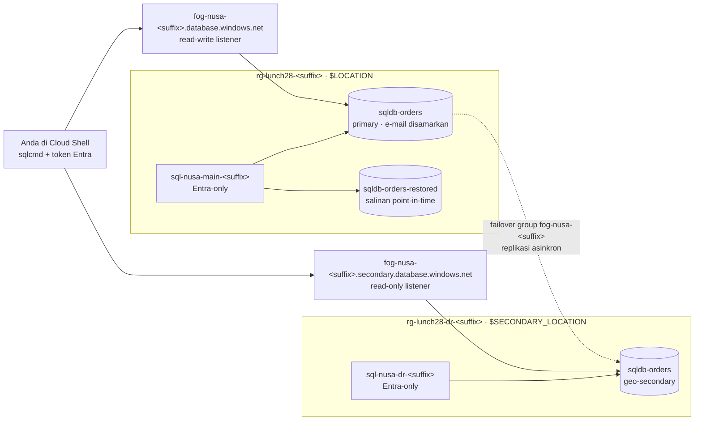

# Lab 28 · Pesanan yang selamat dari gangguan region

🇬🇧 [Read in English](README.md)

> **Pasangan dari:** [Makan Siang 28 · Database Relasional (Lanjutan)](../../lunches/28-relational-databases-advanced/README.id.md)
> **Waktu:** sekitar 60 menit (termasuk sekitar 10 menit persiapan dan sedikit waktu menunggu) · **Biaya:** 💲💲 (lihat [kelompok biaya](../README.id.md#kelompok-biaya)) · **Tingkat kesulitan:** ★★☆
> **Bisa dikerjakan terpisah:** ✅ Anda tidak memerlukan lab sebelumnya. Semua yang dibutuhkan lab ini dibuat oleh langkah-langkahnya sendiri atau oleh `setup.sh`.
> **Penulis:** Stefanus Pinarta · [Tentang penulis](../../README.id.md#tentang-penulis)

## 🎯 Yang akan Anda bangun

Database pesanan Nusantara Retail mendapat rencana pemulihan bencana. `setup.sh` memberi Anda dua logical server yang
hanya menerima sign-in Microsoft Entra — satu di region lab Anda (`$LOCATION`) dan satu di region kedua
(`$SECONDARY_LOCATION`) — ditambah database kecil `sqldb-orders` berisi data pelanggan dan pesanan. Kemudian Anda
menyamarkan detail kontak pelanggan untuk tim support, memasukkan database ke dalam sebuah **failover group**, dan
tersambung lewat **listener**-nya. Setelah sebuah "oops" yang disengaja, Anda memulihkan pesanan yang terhapus dengan
**point-in-time restore**, lalu menutup lab dengan **drill planned failover** yang memindahkan primary ke region
kedua. Secara opsional, Anda mengirim log audit ke Log Analytics.



## ✅ Sebelum mulai

- Sebuah subscription Azure tempat Anda bisa membuat resource (lihat [Lab 01](../01-before-you-begin/README.id.md)).
  Masuklah dengan **akun pengguna** (user account): lab ini menjadikan akun tersebut Microsoft Entra admin di kedua
  server.
- **Azure Cloud Shell (Bash)** — buka [shell.azure.com](https://shell.azure.com). Di dalamnya sudah tersedia Azure CLI
  dan sqlcmd.
- Subscription Anda harus diizinkan membuat SQL server di **dua** region. Default-nya adalah `southeastasia` dan
  pasangannya, `eastasia`; dua region berbeda mana pun bisa dipakai.
- Ambil file lab, lalu muat pengaturan bersama dan nama-nama yang akan Anda pakai ulang:

```bash
git clone https://github.com/stefpin/azure-fundamentals-lunches.git   # first time only
cd azure-fundamentals-lunches/labs/28-relational-databases-advanced
source ../common/config.sh
RG=$(rg_name 28); RG_DR=$(rg_name 28 dr)
SQL_MAIN="sql-nusa-main-${SUFFIX}"; SQL_DR="sql-nusa-dr-${SUFFIX}"
MAIN_FQDN="${SQL_MAIN}.database.windows.net"
FOG="fog-nusa-${SUFFIX}"
FOG_RW="${FOG}.database.windows.net"; FOG_RO="${FOG}.secondary.database.windows.net"
DB=sqldb-orders
source azsql.sh            # defines 'azsql': sqlcmd with your Microsoft Entra token
```

- Buat titik awalnya — butuh sekitar 10 menit:

```bash
bash setup.sh
```

> [!TIP]
> Cloud Shell mengakhiri sesi setelah sekitar 20 menit tanpa aktivitas. Jika itu terjadi, `cd` kembali ke folder lab
> dan jalankan lagi blok variabel di atas. Jika Cloud Shell juga mendapat alamat IP publik baru, jalankan
> `bash setup.sh` sekali lagi: skrip itu aman diulang dan akan memperbarui firewall rule di kedua server.

> [!IMPORTANT]
> Logical server-nya gratis, tetapi tiga database kecil yang Anda miliki di akhir lab — primary, geo-secondary-nya,
> dan salinan hasil restore — memakan biaya selama masih ada (beberapa sen per jam). Akhiri lab dengan bagian
> **Bersihkan**, bahkan jika Anda berhenti di tengah jalan.

## 🧭 Pilih mode Anda

| Mode | Cocok untuk Anda jika… | Caranya |
|---|---|---|
| **Terpandu** | Anda ingin setiap langkah dijelaskan | jalankan `setup.sh`, lalu ikuti Tugas 1–7 di bawah |
| **Tantangan** | Anda sudah menguasai dasarnya | baca hanya [Ringkasan tantangan](#-ringkasan-tantangan), bangun dengan cara Anda sendiri, lalu jalankan `bash verify.sh` |

## Tugas 1 · Memeriksa titik awal

Sebelum menambahkan pemulihan bencana, periksa dulu apa yang Anda lindungi dan di mana letaknya.

```bash
az sql server list --query "[?starts_with(name, 'sql-nusa-')].{server:name, region:location, group:resourceGroup}" --output table
az sql db show --resource-group "$RG" --server "$SQL_MAIN" --name "$DB" \
  --query "{tier:currentServiceObjectiveName, backups:currentBackupStorageRedundancy, earliestRestore:earliestRestoreDate}" --output table
azsql "$MAIN_FQDN" "$DB" -W -Q "SELECT StoreCode, COUNT(*) AS orders FROM dbo.Orders GROUP BY StoreCode ORDER BY StoreCode;"
```

Perhatikan tiga hal. Database ini memakai tier **Basic** — tier termurah yang mendukung failover group (penawaran
gratis tidak bisa ikut di dalamnya). Backup-nya **locally redundant**, yang membuat lab tetap murah dan berfungsi di
setiap region; rencana produksi yang mengandalkan geo-restore membutuhkan backup storage yang geo-redundant. Dan
`earliestRestore` mungkin masih kosong: database yang baru dibuat mendapat restore point pertamanya setelah full
backup pertama dan log backup sesudahnya selesai, biasanya dalam sekitar 30 menit. Anda akan membutuhkannya di
Tugas 5.

> ✅ **Pemeriksaan:** dua server di dua region yang berbeda; `sqldb-orders` berada di tier `Basic`; query menampilkan
> sembilan pesanan, tiga di antaranya untuk `SBY-01` (Surabaya).

## Tugas 2 · Menyamarkan alamat e-mail dan nomor telepon pelanggan

Tim layanan pelanggan perlu mencari data pelanggan, tetapi tidak perlu melihat detail kontak mereka secara lengkap.
**Dynamic data masking** menyembunyikan nilai di hasil query bagi pengguna tanpa permission `UNMASK`; data yang
tersimpan tidak berubah. Baca [`masking.sql`](masking.sql) terlebih dahulu. Skrip itu menyamarkan `Email` dengan
fungsi `email()` dan `Phone` dengan fungsi `partial()`, serta membuat user uji, `support_agent`, tanpa login.

```bash
azsql "$MAIN_FQDN" "$DB" -i masking.sql
```

Sekarang bandingkan apa yang Anda lihat sebagai admin dengan apa yang dilihat tim support. `EXECUTE AS USER`
memungkinkan Anda menyamar sebagai user uji itu di dalam sesi Anda sendiri:

```bash
azsql "$MAIN_FQDN" "$DB" -W -Q "SELECT TOP (3) FullName, Email, Phone FROM dbo.Customers ORDER BY CustomerId;"
azsql "$MAIN_FQDN" "$DB" -W -Q "EXECUTE AS USER = 'support_agent'; SELECT TOP (3) FullName, Email, Phone FROM dbo.Customers ORDER BY CustomerId; REVERT;"
```

Anda sengaja melakukan ini **sebelum** membuat failover group: masking rule tinggal di dalam database, sehingga ikut
direplikasi ke secondary bersama semua hal lainnya.

> [!TIP]
> **Lebih suka portal?** *SQL databases › sqldb-orders › Security › Dynamic Data Masking* menampilkan kolom yang
> disamarkan dan memungkinkan Anda menambah rule — bandingkan dengan hasil skripnya.

> ✅ **Pemeriksaan:** sebagai admin, Anda melihat alamat seperti `andi.pratama@example.com`; sebagai `support_agent`,
> Anda melihat nilai yang disamarkan seperti `aXXX@XXXX.com` dan `XXXX-XXXX-XX01`. `masking.sql` menampilkan dua kolom
> yang disamarkan.

## Tugas 3 · Membuat failover group

**Failover group** mereplikasi database ke server di region kedua dan memberi Anda dua nama listener yang mengikuti
perannya. Namanya akan menjadi nama DNS, jadi harus unik secara global; suffix sudah mengurus hal itu.
`--failover-policy Manual` adalah policy **customer-managed** yang disarankan Microsoft: Anda yang memutuskan kapan
failover.

```bash
az sql failover-group create \
  --name "$FOG" \
  --resource-group "$RG" \
  --server "$SQL_MAIN" \
  --partner-server "$SQL_DR" \
  --partner-resource-group "$RG_DR" \
  --failover-policy Manual \
  --add-db "$DB" \
  --output none
```

Azure sekarang melakukan **seeding** pada secondary: ia membuat `sqldb-orders` di server DR dan menyalin datanya.
Untuk database sekecil ini, prosesnya butuh beberapa menit. Sambil menunggu, baca lagi bagian 2 dari makan siang ini.

```bash
az sql failover-group show --resource-group "$RG" --server "$SQL_MAIN" --name "$FOG" \
  --query "{group:name, roleOfMainServer:replicationRole, policy:readWriteEndpoint.failoverPolicy}" --output table
az sql db replica list-links --resource-group "$RG" --server "$SQL_MAIN" --name "$DB" \
  --query "[].{partner:partnerServer, partnerRole:partnerRole, state:replicationState}" --output table
```

> [!TIP]
> **Lebih suka portal?** *SQL servers › sql-nusa-main-… › Data management › Failover groups › + Add group*. Tampilan
> peta menunjukkan kedua region dan arah replikasinya.

> ✅ **Pemeriksaan:** `roleOfMainServer` bernilai `Primary`, policy-nya `Manual`, dan link replikasi ke server DR
> mencapai status `CATCH_UP` (artinya seeding sudah selesai dan perubahan sedang mengalir).

## Tugas 4 · Tersambung lewat listener dan mengukur lag

Aplikasi tidak boleh memakai nama server untuk database yang berada di dalam failover group. Aplikasi memakai
**read-write listener** (selalu primary) atau **read-only listener** (secondary). Tanyakan kepada masing-masing di
mana Anda sebenarnya mendarat:

```bash
azsql "$FOG_RW" "$DB" -W -Q "SELECT @@SERVERNAME AS server_name, DATABASEPROPERTYEX(DB_NAME(), 'Updateability') AS updateability;"
azsql "$FOG_RO" "$DB" -K ReadOnly -W -Q "SELECT @@SERVERNAME AS server_name, DATABASEPROPERTYEX(DB_NAME(), 'Updateability') AS updateability;"
```

`-K ReadOnly` menyatakan niat hanya-baca (read-only intent), dan memang itulah yang seharusnya dilakukan alat
pelaporan. Sekarang lihat link replikasinya dari sudut pandang primary. `replication_lag_sec` adalah **RPO** Anda saat
ini: jumlah detik perubahan yang akan hilang jika terjadi forced failover.

```bash
azsql "$FOG_RW" "$DB" -W -Q "SELECT partner_server, role_desc, replication_state_desc, replication_lag_sec, last_replication FROM sys.dm_geo_replication_link_status;"
```

> ✅ **Pemeriksaan:** read-write listener mendarat di `sql-nusa-main-…` dengan `READ_WRITE`; read-only listener
> mendarat di `sql-nusa-dr-…` dengan `READ_ONLY`. Lag-nya hanya beberapa detik, sering kali 0 untuk database yang
> sedang sepi.

## Tugas 5 · Oops! Memulihkan pesanan yang terhapus dengan point-in-time restore

Pertama, pastikan restore point sudah ada — database yang baru dibuat tidak bisa di-restore ke momen sebelum backup
pertamanya:

```bash
az sql db show --resource-group "$RG" --server "$SQL_MAIN" --name "$DB" --query earliestRestoreDate --output tsv
```

Jika perintah ini tidak mencetak apa pun, tunggu lima menit lalu tanyakan lagi; sambil menunggu, baca bagian 3 dari
makan siang ini. Begitu perintah itu menampilkan sebuah waktu, catat waktu saat ini dalam UTC, lalu buat kesalahan
dengan sengaja:

```bash
BEFORE_OOPS=$(date -u +%Y-%m-%dT%H:%M:%S); echo "Restore point: $BEFORE_OOPS UTC"
sleep 5
azsql "$FOG_RW" "$DB" -Q "DELETE FROM dbo.Orders WHERE StoreCode = 'SBY-01';"
```

Apakah failover group melindungi Anda? Tanyakan kepada secondary:

```bash
azsql "$FOG_RO" "$DB" -K ReadOnly -W -Q "SELECT COUNT(*) AS sby_orders_on_secondary FROM dbo.Orders WHERE StoreCode = 'SBY-01';"
```

Nol. Replikasi menyalin kesalahan itu dalam hitungan detik — replikasi bukan backup. Restore database seperti
keadaannya tepat sebelum penghapusan, ke sebuah database **baru** di server utama:

```bash
az sql db restore \
  --resource-group "$RG" \
  --server "$SQL_MAIN" \
  --name "$DB" \
  --dest-name sqldb-orders-restored \
  --time "$BEFORE_OOPS" \
  --service-objective Basic \
  --backup-storage-redundancy Local \
  --output none
```

Restore biasanya butuh beberapa menit, bahkan untuk database yang sangat kecil. Jika perintah itu mengatakan point in
time-nya belum valid, berarti masih ada log backup yang tertunda: tunggu sepuluh menit lalu jalankan lagi. Salinan
hasil restore bukan bagian dari failover group, jadi Anda menjangkaunya lewat nama server utama itu sendiri:

```bash
azsql "$MAIN_FQDN" sqldb-orders-restored -W -Q "SELECT COUNT(*) AS sby_orders_in_restored_copy FROM dbo.Orders WHERE StoreCode = 'SBY-01';"
```

> [!TIP]
> **Lebih suka portal?** *SQL databases › sqldb-orders › Restore* menampilkan restore point paling awal dan
> memungkinkan Anda memilih waktunya dengan date picker.

> ✅ **Pemeriksaan:** salinan hasil restore memiliki tiga pesanan `SBY-01`, sementara database live tidak punya satu
> pun. `az sql db list --resource-group "$RG" --server "$SQL_MAIN" --query "[].name" --output tsv` menampilkan
> `sqldb-orders-restored`. (Mengembalikan baris-baris itu adalah salah satu tantangan tambahan.)

## Tugas 6 · Menjalankan drill planned failover

Saatnya memindahkan primary ke region kedua tanpa kehilangan apa pun. `set-primary` dijalankan terhadap server yang
akan **menjadi** primary. Tanpa `--allow-data-loss`, ini adalah **planned failover**: Azure menyinkronkan secondary
sepenuhnya, lalu menukar perannya.

```bash
az sql failover-group set-primary --name "$FOG" --resource-group "$RG_DR" --server "$SQL_DR"
az sql failover-group show --name "$FOG" --resource-group "$RG_DR" --server "$SQL_DR" \
  --query "{group:name, roleOfDrServer:replicationRole}" --output table
```

Nama listener tidak berubah, tetapi targetnya berubah. DNS menyimpan jawaban lama di cache hingga 30 detik, jadi
tunggu satu menit, lalu sambungkan dengan perintah yang persis sama seperti di Tugas 4 dan tulis sebuah pesanan baru:

```bash
azsql "$FOG_RW" "$DB" -W -Q "SELECT @@SERVERNAME AS server_name, DATABASEPROPERTYEX(DB_NAME(), 'Updateability') AS updateability;"
azsql "$FOG_RW" "$DB" -Q "INSERT INTO dbo.Orders (CustomerId, StoreCode, TotalIdr) VALUES (4, 'JKT-02', 315000);"
```

Server DR bisa mengambil alih hanya karena `setup.sh` memberinya Entra admin yang sama dan firewall rule untuk alamat
IP Anda — pengaturan level server tidak ikut direplikasi.

> ✅ **Pemeriksaan:** `roleOfDrServer` bernilai `Primary`; read-write listener sekarang mendarat di `sql-nusa-dr-…`
> dengan `READ_WRITE`, dan insert-nya berhasil.

## Tugas 7 (opsional) · Mengirim log audit ke Log Analytics

Auditing mencatat siapa melakukan apa di dalam database. Microsoft menyarankan auditing di level server, dikonfigurasi
di **kedua** server agar tetap berjalan setelah failover.

```bash
az monitor log-analytics workspace create --resource-group "$RG" --workspace-name log-nusa --location "$LOCATION" --output none
LAW_ID=$(az monitor log-analytics workspace show --resource-group "$RG" --workspace-name log-nusa --query id --output tsv)
az sql server audit-policy update --resource-group "$RG" --name "$SQL_MAIN" --state Enabled --lats Enabled --lawri "$LAW_ID" --output none
az sql server audit-policy update --resource-group "$RG_DR" --name "$SQL_DR" --state Enabled --lats Enabled --lawri "$LAW_ID" --output none
az sql server audit-policy show --resource-group "$RG_DR" --name "$SQL_DR" --query "{state:state, toAzureMonitor:isAzureMonitorTargetEnabled}" --output table
```

Jalankan beberapa query dengan `azsql`, tunggu 10–15 menit, lalu buka *Log Analytics workspaces › log-nusa › Logs* dan
jalankan:

```kusto
AzureDiagnostics
| where Category == "SQLSecurityAuditEvents"
| project TimeGenerated, server_principal_name_s, action_name_s, statement_s
| order by TimeGenerated desc
| take 20
```

> ✅ **Pemeriksaan:** audit policy menampilkan `Enabled`; setelah beberapa menit, query itu mengembalikan
> pernyataan-pernyataan Anda sendiri, lengkap dengan identitas Entra Anda. (Jika baris `project` memprotes soal sebuah
> kolom, hapus baris itu untuk melihat semua kolom.)

## 🔧 Rusak lalu perbaiki

Konfigurasi toko online lama milik Dewi masih mengarah ke nama server. Perankan aplikasi lama itu: tulis ke database
lewat **nama server utama**, bukan lewat listener.

```bash
azsql "$MAIN_FQDN" "$DB" -Q "INSERT INTO dbo.Orders (CustomerId, StoreCode, TotalIdr) VALUES (1, 'JKT-01', 120000);"
```

**Gejala:** *Msg 3906 … Failed to update database "sqldb-orders" because the database is read-only.* Koneksinya
berhasil — primary lama sekarang menjadi geo-secondary yang bisa dibaca — tetapi setiap operasi tulis gagal. Dalam
gangguan sungguhan, server itu mungkin sama sekali tidak menjawab.

<details><summary>Petunjuk: cara memperbaikinya</summary>

Sambungkan lewat read-write listener, yang targetnya selalu mengikuti primary di setiap failover:

```bash
azsql "$FOG_RW" "$DB" -Q "INSERT INTO dbo.Orders (CustomerId, StoreCode, TotalIdr) VALUES (1, 'JKT-01', 120000);"
```

Dalam sebuah aplikasi, itu berarti `Server=tcp:fog-nusa-<suffix>.database.windows.net,1433` di connection string —
ditambah retry logic, karena setiap failover memutus koneksi yang sedang terbuka.

</details>

## 🧪 Verifikasi hasil kerja Anda

```bash
bash verify.sh
```

Setiap pemeriksaan seharusnya menampilkan **PASS**. Jika ada yang gagal, pesannya memberi tahu tugas mana yang perlu
Anda ulangi. `verify.sh` mengharapkan server DR menjadi primary (Tugas 6). Jika Anda sengaja melakukan failback,
jalankan `EXPECTED_PRIMARY=main bash verify.sh`.

## 🧹 Bersihkan (jangan dilewati!)

```bash
bash cleanup.sh
```

Skrip ini menghapus semuanya dengan urutan yang benar: pertama failover group, lalu link geo-replication (menghapus
failover group tidak menghentikan replikasi), kemudian kedua resource group `rg-lunch28-<suffix>` dan
`rg-lunch28-dr-<suffix>` beserta server, database, salinan hasil restore, dan Log Analytics workspace. Penghapusan
berlanjut di latar belakang selama beberapa menit.

## 🩺 Pemecahan masalah

| Gejala | Kemungkinan penyebab | Perbaikan |
|---|---|---|
| `Location '…' is not accepting creation of new Windows Azure SQL Database servers for the subscription '…' at this time.` | Subscription Anda tidak bisa membuat SQL server di region tersebut | Jalankan `bash cleanup.sh` dan tunggu sampai `az group list --tag lunch=28 --output table` kosong (resource group-nya sudah ada di region lama), lalu `export SECONDARY_LOCATION=<another region>` (atau `LOCATION`), `source ../common/config.sh`, dan `bash setup.sh` |
| Error 40615: *Client with IP address '…' is not allowed to access the server* | Cloud Shell mendapat IP publik baru, atau Anda tersambung ke server yang tidak punya rule untuk Anda | Jalankan `bash setup.sh` lagi — skrip itu memperbarui rule di kedua server — lalu tunggu hingga lima menit |
| Msg 3906: *Failed to update database … because the database is read-only* | Anda menulis ke geo-secondary: lewat nama server atau read-only listener | Tulis lewat `$FOG_RW`; tepat setelah failover, tunggu satu menit sampai DNS diperbarui |
| `az sql failover-group create` mengatakan namanya sudah ada | Nama failover group adalah nama DNS global | Hapus group lama Anda, atau gunakan `SUFFIX` baru |
| `earliestRestoreDate` kosong | Full backup pertama dari database baru belum selesai | Tunggu; biasanya muncul dalam sekitar 30 menit setelah `setup.sh` |
| `az sql db restore` menolak point in time-nya | Waktunya lebih awal daripada restore point paling awal, atau masih ada log backup yang tertunda | Periksa `earliestRestoreDate`; tunggu sepuluh menit lalu jalankan restore lagi |
| `Login failed for user '<token-identified principal>'` | Anda masuk ke Azure dengan akun yang berbeda dari Entra admin server | `az account show --query user.name`; masuk dengan akun yang menjalankan `setup.sh` |
| `cleanup.sh` melaporkan bahwa ada sesuatu yang tidak bisa dihapus | Link replikasi atau operasi yang sedang berjalan menghalanginya | Tunggu lima menit lalu jalankan `bash cleanup.sh` lagi |

## 🚀 Tantangan tambahan

- **Kembalikan pesanan Surabaya.** Query lintas database tidak tersedia di Azure SQL Database, jadi buat pernyataan
  `INSERT` dari salinan hasil restore, lalu jalankan di primary:

  ```bash
  azsql "$MAIN_FQDN" sqldb-orders-restored -h-1 -W -Q "SET NOCOUNT ON; SELECT CONCAT('SET IDENTITY_INSERT dbo.Orders ON; INSERT INTO dbo.Orders (OrderId, CustomerId, OrderDate, StoreCode, TotalIdr, Status) VALUES (', OrderId, ', ', CustomerId, ', ''', CONVERT(varchar(19), OrderDate, 126), ''', ''', StoreCode, ''', ', TotalIdr, ', ''', Status, '''); SET IDENTITY_INSERT dbo.Orders OFF;') FROM dbo.Orders WHERE StoreCode = 'SBY-01';" > sby-orders.sql
  cat sby-orders.sql
  azsql "$FOG_RW" "$DB" -i sby-orders.sql && rm sby-orders.sql
  ```

- **Fail back** ke server utama dengan planned failover sekali lagi (`--server "$SQL_MAIN" --resource-group "$RG"`),
  lalu jalankan `EXPECTED_PRIMARY=main bash verify.sh`.
- **Row-level security:** buat predicate function dan security policy agar `support_agent` hanya melihat pesanan dari
  `JKT-01`, lalu uji dengan `EXECUTE AS USER`.
- **Saksikan lag bergerak:** sisipkan beberapa ratus baris dalam sebuah loop lewat `$FOG_RW`, dan jalankan query ke
  `sys.dm_geo_replication_link_status` selagi loop itu berjalan.
- **Baca pengaturan backup** di portal (*sqldb-orders › Data management › Backups*): kebijakan retensi, restore point
  yang tersedia, dan tempat long-term retention dikonfigurasi.

## 🏁 Ringkasan tantangan

Bangun hal-hal berikut dengan cara apa pun yang Anda suka (portal, CLI, Bicep). `setup.sh` boleh membuatkan titik
awalnya (butir 1–3):

1. Dua resource group, `rg-lunch28-<suffix>` di `$LOCATION` dan `rg-lunch28-dr-<suffix>` di `$SECONDARY_LOCATION`,
   dibuat dengan `ensure_rg` (diberi tag `course=azure-fundamentals-lunches` dan `lunch=28`).
2. Dua logical server, `sql-nusa-main-<suffix>` dan `sql-nusa-dr-<suffix>`, satu di setiap group, keduanya dengan
   **autentikasi Microsoft Entra-only** dan firewall rule yang mengizinkan alamat IP Cloud Shell Anda saat ini.
3. Database `sqldb-orders` di server utama dengan `dbo.Customers` dan `dbo.Orders` (gunakan `orders-dr.sql`).
4. **Dynamic data masking** pada `dbo.Customers.Email`.
5. Failover group `fog-nusa-<suffix>` yang berisi `sqldb-orders`, dengan failover policy customer-managed (`Manual`).
6. Database `sqldb-orders-restored` di server utama, dibuat dengan **point-in-time restore** dari momen sebelum Anda
   menghapus pesanan `SBY-01`.
7. **Planned failover** yang sudah selesai: `sql-nusa-dr-<suffix>` menjadi primary dari failover group.
8. Opsional: server auditing di kedua server ke Log Analytics workspace `log-nusa`.

Lalu jalankan `bash verify.sh`. Buntu? Intip `solution.sh` atau beralih ke mode Terpandu.

---

⬅️ [Bacaan Makan Siang 28](../../lunches/28-relational-databases-advanced/README.id.md) · 🏠 [Semua lab](../README.id.md) · 🏠 [Beranda kursus](../../README.id.md)

<sub>Terakhir divalidasi: Oktober 2026 · Ada yang tidak berfungsi? [Laporkan masalah lab](../../CONTRIBUTING.md).</sub>
