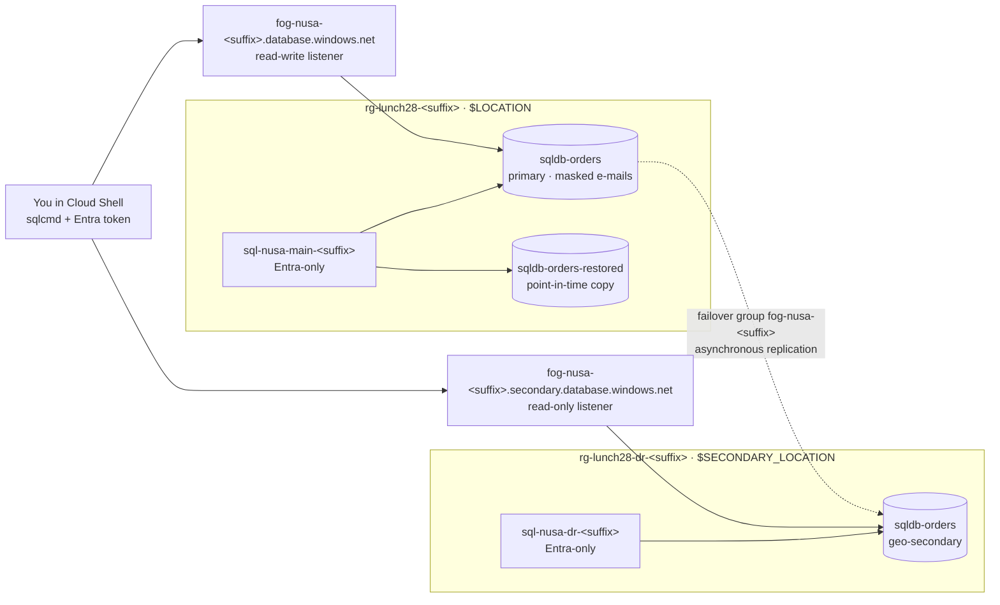

# Lab 28 · Orders that survive a regional outage

> **Pairs with:** [Lunch 28 · Relational Databases (Advanced)](../../lunches/28-relational-databases-advanced/README.md)
> **Time:** about 60 minutes (including about 10 minutes of setup and some waiting) · **Cost:** 💲💲 (see [cost bands](../README.md#cost-bands)) · **Difficulty:** ★★☆
> **Works on its own:** ✅ You do not need any earlier lab. Everything this lab needs is created by its steps or by `setup.sh`.

## 🎯 What you'll build

Nusantara Retail's orders database gets a disaster recovery plan. `setup.sh` gives you two logical servers that accept
only Microsoft Entra sign-ins — one in your lab region (`$LOCATION`) and one in a second region
(`$SECONDARY_LOCATION`) — plus a small `sqldb-orders` database with customers and orders. You then mask customer
contact details for the support team, put the database in a **failover group** and connect through its **listeners**.
After a deliberate "oops" you recover deleted orders with **point-in-time restore**, and you finish with a **planned
failover drill** that moves the primary to the second region. Optionally, you send audit logs to Log Analytics.



## ✅ Before you start

- An Azure subscription where you can create resources (see [Lab 01](../01-before-you-begin/README.md)). Sign in with
  a **user account**: the lab makes that account the Microsoft Entra admin of both servers.
- **Azure Cloud Shell (Bash)** — open [shell.azure.com](https://shell.azure.com). It already has the Azure CLI and sqlcmd.
- Your subscription must be allowed to create SQL servers in **two** regions. The defaults are `southeastasia` and
  its pair `eastasia`; any two different regions work.
- Get the lab files and load the shared settings and the names you will reuse:

```bash
git clone https://github.com/stefpin/azure-fundamentals-lunches.git   # first time only
cd azure-fundamentals-lunches/labs/28-relational-databases-advanced
source ../common/config.sh
RG=$(rg_name 28); RG_DR=$(rg_name 28 dr)
SQL_MAIN="sql-nusa-main-${SUFFIX}"; SQL_DR="sql-nusa-dr-${SUFFIX}"
MAIN_FQDN="${SQL_MAIN}.database.windows.net"
FOG="fog-nusa-${SUFFIX}"
FOG_RW="${FOG}.database.windows.net"; FOG_RO="${FOG}.secondary.database.windows.net"
DB=sqldb-orders
source azsql.sh            # defines 'azsql': sqlcmd with your Microsoft Entra token
```

- Create the starting point — takes about 10 minutes:

```bash
bash setup.sh
```

> [!TIP]
> Cloud Shell ends a session after about 20 minutes without activity. If that happens, `cd` back into the lab folder
> and run the variable block above again. If Cloud Shell also got a new public IP address, run `bash setup.sh` once
> more: it is safe to repeat and refreshes the firewall rules on both servers.

> [!IMPORTANT]
> The logical servers are free, but the three small databases you end up with — the primary, its geo-secondary and the
> restored copy — cost money while they exist (cents per hour). Finish with the **Clean up** section, even if you stop
> halfway.

## 🧭 Choose your mode

| Mode | For you if… | How |
|---|---|---|
| **Guided** | you want every step explained | run `setup.sh`, then follow Tasks 1–7 below |
| **Challenge** | you already know the basics | read only the [Challenge brief](#-challenge-brief), build it your way, then run `bash verify.sh` |

## Task 1 · Inspect the starting point

Before you add disaster recovery, check what you are protecting and where it lives.

```bash
az sql server list --query "[?starts_with(name, 'sql-nusa-')].{server:name, region:location, group:resourceGroup}" --output table
az sql db show --resource-group "$RG" --server "$SQL_MAIN" --name "$DB" \
  --query "{tier:currentServiceObjectiveName, backups:currentBackupStorageRedundancy, earliestRestore:earliestRestoreDate}" --output table
azsql "$MAIN_FQDN" "$DB" -W -Q "SELECT StoreCode, COUNT(*) AS orders FROM dbo.Orders GROUP BY StoreCode ORDER BY StoreCode;"
```

Notice three things. The database uses the **Basic** tier — the cheapest tier that supports failover groups (the free
offer cannot join one). Its backups are **locally redundant**, which keeps the lab cheap and works in every region; a
production plan that relies on geo-restore needs geo-redundant backup storage. And `earliestRestore` may still be
empty: a brand-new database gets its first restore point once the first full backup and the log backup after it
complete, usually within about 30 minutes. You will need it in Task 5.

> ✅ **Checkpoint:** two servers in two different regions; `sqldb-orders` is `Basic`; the query lists nine orders,
> three of them for `SBY-01` (Surabaya).

## Task 2 · Mask customer e-mail addresses and phone numbers

The customer service team needs to look up customers, but not to see their full contact details. **Dynamic data
masking** hides values in query results for users without the `UNMASK` permission; the stored data does not change.
Read [`masking.sql`](masking.sql) first. It masks `Email` with the `email()` function and `Phone` with a
`partial()` function, and creates a test user, `support_agent`, without a login.

```bash
azsql "$MAIN_FQDN" "$DB" -i masking.sql
```

Now compare what you see as the admin with what the support team sees. `EXECUTE AS USER` lets you impersonate the
test user inside your own session:

```bash
azsql "$MAIN_FQDN" "$DB" -W -Q "SELECT TOP (3) FullName, Email, Phone FROM dbo.Customers ORDER BY CustomerId;"
azsql "$MAIN_FQDN" "$DB" -W -Q "EXECUTE AS USER = 'support_agent'; SELECT TOP (3) FullName, Email, Phone FROM dbo.Customers ORDER BY CustomerId; REVERT;"
```

You do this **before** creating the failover group on purpose: masking rules live inside the database, so they will be
replicated to the secondary with everything else.

> [!TIP]
> **Prefer the portal?** *SQL databases › sqldb-orders › Security › Dynamic Data Masking* shows the masked columns and
> lets you add rules — compare it with the result of the script.

> ✅ **Checkpoint:** as the admin you see addresses such as `andi.pratama@example.com`; as `support_agent` you see
> masked values such as `aXXX@XXXX.com` and `XXXX-XXXX-XX01`. `masking.sql` listed two masked columns.

## Task 3 · Create the failover group

A **failover group** replicates the database to the server in the second region and gives you two listener names
that follow the roles. The name becomes a DNS name, so it must be globally unique; the suffix takes care of that.
`--failover-policy Manual` is the **customer-managed** policy that Microsoft recommends: you decide when to fail over.

```bash
az sql failover-group create \
  --name "$FOG" \
  --resource-group "$RG" \
  --server "$SQL_MAIN" \
  --partner-server "$SQL_DR" \
  --partner-resource-group "$RG_DR" \
  --failover-policy Manual \
  --add-db "$DB" \
  --output none
```

Azure now **seeds** the secondary: it creates `sqldb-orders` on the DR server and copies the data. For this small
database that takes a few minutes. While you wait, re-read section 2 of the lunch.

```bash
az sql failover-group show --resource-group "$RG" --server "$SQL_MAIN" --name "$FOG" \
  --query "{group:name, roleOfMainServer:replicationRole, policy:readWriteEndpoint.failoverPolicy}" --output table
az sql db replica list-links --resource-group "$RG" --server "$SQL_MAIN" --name "$DB" \
  --query "[].{partner:partnerServer, partnerRole:partnerRole, state:replicationState}" --output table
```

> [!TIP]
> **Prefer the portal?** *SQL servers › sql-nusa-main-… › Data management › Failover groups › + Add group*. The map
> view shows both regions and the replication direction.

> ✅ **Checkpoint:** `roleOfMainServer` is `Primary`, the policy is `Manual`, and the replication link to the DR
> server reaches the `CATCH_UP` state (that means seeding is finished and changes are flowing).

## Task 4 · Connect through the listeners and measure the lag

Applications should never use a server name for a database in a failover group. They use the **read-write listener**
(always the primary) or the **read-only listener** (the secondary). Ask each one where you actually landed:

```bash
azsql "$FOG_RW" "$DB" -W -Q "SELECT @@SERVERNAME AS server_name, DATABASEPROPERTYEX(DB_NAME(), 'Updateability') AS updateability;"
azsql "$FOG_RO" "$DB" -K ReadOnly -W -Q "SELECT @@SERVERNAME AS server_name, DATABASEPROPERTYEX(DB_NAME(), 'Updateability') AS updateability;"
```

`-K ReadOnly` declares read-only intent, which is what a reporting tool should do. Now look at the replication link
from the primary's point of view. `replication_lag_sec` is your **RPO** right now: the seconds of changes that a forced
failover would lose.

```bash
azsql "$FOG_RW" "$DB" -W -Q "SELECT partner_server, role_desc, replication_state_desc, replication_lag_sec, last_replication FROM sys.dm_geo_replication_link_status;"
```

> ✅ **Checkpoint:** the read-write listener lands on `sql-nusa-main-…` with `READ_WRITE`; the read-only listener lands
> on `sql-nusa-dr-…` with `READ_ONLY`. The lag is a small number of seconds, often 0 for an idle database.

## Task 5 · Oops! Recover deleted orders with point-in-time restore

First make sure a restore point exists — a brand-new database cannot be restored to a moment before its first backup:

```bash
az sql db show --resource-group "$RG" --server "$SQL_MAIN" --name "$DB" --query earliestRestoreDate --output tsv
```

If this prints nothing, wait five minutes and ask again; meanwhile, read section 3 of the lunch. When it shows a time,
note the current time in UTC, then make the mistake on purpose:

```bash
BEFORE_OOPS=$(date -u +%Y-%m-%dT%H:%M:%S); echo "Restore point: $BEFORE_OOPS UTC"
sleep 5
azsql "$FOG_RW" "$DB" -Q "DELETE FROM dbo.Orders WHERE StoreCode = 'SBY-01';"
```

Did the failover group protect you? Ask the secondary:

```bash
azsql "$FOG_RO" "$DB" -K ReadOnly -W -Q "SELECT COUNT(*) AS sby_orders_on_secondary FROM dbo.Orders WHERE StoreCode = 'SBY-01';"
```

Zero. Replication copied the mistake within seconds — replication is not a backup. Restore the database as it was
just before the delete, into a **new** database on the main server:

```bash
az sql db restore \
  --resource-group "$RG" \
  --server "$SQL_MAIN" \
  --name "$DB" \
  --dest-name sqldb-orders-restored \
  --time "$BEFORE_OOPS" \
  --service-objective Basic \
  --backup-storage-redundancy Local \
  --output none
```

A restore usually takes several minutes, even for a tiny database. If the command says the point in time is not valid
yet, a log backup is still pending: wait ten minutes and run it again. The restored copy is not part of the failover
group, so you reach it through the main server's own name:

```bash
azsql "$MAIN_FQDN" sqldb-orders-restored -W -Q "SELECT COUNT(*) AS sby_orders_in_restored_copy FROM dbo.Orders WHERE StoreCode = 'SBY-01';"
```

> [!TIP]
> **Prefer the portal?** *SQL databases › sqldb-orders › Restore* shows the earliest restore point and lets you pick
> the time with a date picker.

> ✅ **Checkpoint:** the restored copy has three `SBY-01` orders while the live database has none.
> `az sql db list --resource-group "$RG" --server "$SQL_MAIN" --query "[].name" --output tsv` lists
> `sqldb-orders-restored`. (Putting the rows back is a stretch goal.)

## Task 6 · Run a planned failover drill

Time to move the primary to the second region without losing anything. `set-primary` runs against the server that
should **become** the primary. Without `--allow-data-loss` it is a **planned** failover: Azure synchronises the
secondary fully, then swaps the roles.

```bash
az sql failover-group set-primary --name "$FOG" --resource-group "$RG_DR" --server "$SQL_DR"
az sql failover-group show --name "$FOG" --resource-group "$RG_DR" --server "$SQL_DR" \
  --query "{group:name, roleOfDrServer:replicationRole}" --output table
```

The listener names did not change, but their targets did. DNS caches the old answer for up to 30 seconds, so wait a
minute, then connect with exactly the same command as in Task 4 and write a new order:

```bash
azsql "$FOG_RW" "$DB" -W -Q "SELECT @@SERVERNAME AS server_name, DATABASEPROPERTYEX(DB_NAME(), 'Updateability') AS updateability;"
azsql "$FOG_RW" "$DB" -Q "INSERT INTO dbo.Orders (CustomerId, StoreCode, TotalIdr) VALUES (4, 'JKT-02', 315000);"
```

The DR server could take over only because `setup.sh` gave it the same Entra admin and a firewall rule for your IP
address — server-level settings are not replicated.

> ✅ **Checkpoint:** `roleOfDrServer` is `Primary`; the read-write listener now lands on `sql-nusa-dr-…` with
> `READ_WRITE`, and the insert succeeds.

## Task 7 (optional) · Send audit logs to Log Analytics

Auditing records who did what in the database. Microsoft recommends server-level auditing, configured on **both**
servers so that it keeps working after a failover.

```bash
az monitor log-analytics workspace create --resource-group "$RG" --workspace-name log-nusa --location "$LOCATION" --output none
LAW_ID=$(az monitor log-analytics workspace show --resource-group "$RG" --workspace-name log-nusa --query id --output tsv)
az sql server audit-policy update --resource-group "$RG" --name "$SQL_MAIN" --state Enabled --lats Enabled --lawri "$LAW_ID" --output none
az sql server audit-policy update --resource-group "$RG_DR" --name "$SQL_DR" --state Enabled --lats Enabled --lawri "$LAW_ID" --output none
az sql server audit-policy show --resource-group "$RG_DR" --name "$SQL_DR" --query "{state:state, toAzureMonitor:isAzureMonitorTargetEnabled}" --output table
```

Run a couple of queries with `azsql`, wait 10–15 minutes, then open *Log Analytics workspaces › log-nusa › Logs* and
run:

```kusto
AzureDiagnostics
| where Category == "SQLSecurityAuditEvents"
| project TimeGenerated, server_principal_name_s, action_name_s, statement_s
| order by TimeGenerated desc
| take 20
```

> ✅ **Checkpoint:** the audit policy shows `Enabled`; after a few minutes the query returns your own statements,
> signed with your Entra identity. (If the `project` line complains about a column, remove it to see every column.)

## 🔧 Break it and fix it

Dewi's old storefront configuration still points at a server name. Play the old app: write to the database through
the **main server's name** instead of the listener.

```bash
azsql "$MAIN_FQDN" "$DB" -Q "INSERT INTO dbo.Orders (CustomerId, StoreCode, TotalIdr) VALUES (1, 'JKT-01', 120000);"
```

**Symptom:** *Msg 3906 … Failed to update database "sqldb-orders" because the database is read-only.* The connection
works — the old primary is now a readable geo-secondary — but every write fails. In a real outage that server might
not answer at all.

<details><summary>Hint: how to fix it</summary>

Connect through the read-write listener, whose target follows the primary through every failover:

```bash
azsql "$FOG_RW" "$DB" -Q "INSERT INTO dbo.Orders (CustomerId, StoreCode, TotalIdr) VALUES (1, 'JKT-01', 120000);"
```

In an application, that means `Server=tcp:fog-nusa-<suffix>.database.windows.net,1433` in the connection string —
plus retry logic, because every failover drops open connections.

</details>

## 🧪 Verify your work

```bash
bash verify.sh
```

Every check should say **PASS**. If one fails, the message tells you which task to revisit. `verify.sh` expects the
DR server to be the primary (Task 6). If you failed back on purpose, run `EXPECTED_PRIMARY=main bash verify.sh`.

## 🧹 Clean up (do not skip!)

```bash
bash cleanup.sh
```

The script deletes things in the right order: first the failover group, then the geo-replication link (deleting a
failover group does not stop replication), then both resource groups `rg-lunch28-<suffix>` and
`rg-lunch28-dr-<suffix>` with the servers, the databases, the restored copy and the Log Analytics workspace. Deletion
continues in the background for a few minutes.

## 🩺 Troubleshooting

| Symptom | Likely cause | Fix |
|---|---|---|
| `Location '…' is not accepting creation of new Windows Azure SQL Database servers for the subscription '…' at this time.` | Your subscription cannot create SQL servers in that region | Run `bash cleanup.sh` and wait until `az group list --tag lunch=28 --output table` is empty (the resource groups already exist in the old regions), then `export SECONDARY_LOCATION=<another region>` (or `LOCATION`), `source ../common/config.sh` and `bash setup.sh` |
| Error 40615: *Client with IP address '…' is not allowed to access the server* | Cloud Shell has a new public IP, or you connect to a server without a rule for you | Run `bash setup.sh` again — it refreshes the rule on both servers — then wait up to five minutes |
| Msg 3906: *Failed to update database … because the database is read-only* | You are writing to the geo-secondary: a server name or the read-only listener | Write through `$FOG_RW`; right after a failover, wait a minute for DNS |
| `az sql failover-group create` says the name already exists | Failover group names are global DNS names | Delete your old group, or use a new `SUFFIX` |
| `earliestRestoreDate` is empty | The first full backup of the new database is not finished | Wait; it usually appears within about 30 minutes of `setup.sh` |
| `az sql db restore` refuses the point in time | The time is before the earliest restore point, or a log backup is still pending | Check `earliestRestoreDate`; wait ten minutes and run the restore again |
| `Login failed for user '<token-identified principal>'` | You are signed in to Azure as a different account from the servers' Entra admin | `az account show --query user.name`; sign in as the account that ran `setup.sh` |
| `cleanup.sh` reports that it could not delete something | A replication link or a running operation blocked it | Wait five minutes and run `bash cleanup.sh` again |

## 🚀 Stretch goals

- **Put Surabaya's orders back.** Cross-database queries are not available in Azure SQL Database, so generate the
  `INSERT` statements from the restored copy and run them on the primary:

  ```bash
  azsql "$MAIN_FQDN" sqldb-orders-restored -h-1 -W -Q "SET NOCOUNT ON; SELECT CONCAT('SET IDENTITY_INSERT dbo.Orders ON; INSERT INTO dbo.Orders (OrderId, CustomerId, OrderDate, StoreCode, TotalIdr, Status) VALUES (', OrderId, ', ', CustomerId, ', ''', CONVERT(varchar(19), OrderDate, 126), ''', ''', StoreCode, ''', ', TotalIdr, ', ''', Status, '''); SET IDENTITY_INSERT dbo.Orders OFF;') FROM dbo.Orders WHERE StoreCode = 'SBY-01';" > sby-orders.sql
  cat sby-orders.sql
  azsql "$FOG_RW" "$DB" -i sby-orders.sql && rm sby-orders.sql
  ```

- **Fail back** to the main server with another planned failover (`--server "$SQL_MAIN" --resource-group "$RG"`), then
  run `EXPECTED_PRIMARY=main bash verify.sh`.
- **Row-level security:** create a predicate function and a security policy so that `support_agent` sees only orders
  from `JKT-01`, and test it with `EXECUTE AS USER`.
- **Watch the lag move:** insert a few hundred rows in a loop through `$FOG_RW` and query
  `sys.dm_geo_replication_link_status` while it runs.
- **Read the backup settings** in the portal (*sqldb-orders › Data management › Backups*): retention policies, the
  available restore points, and where long-term retention would be configured.

## 🏁 Challenge brief

Build the following, any way you like (portal, CLI, Bicep). `setup.sh` may create the starting point (items 1–3):

1. Two resource groups, `rg-lunch28-<suffix>` in `$LOCATION` and `rg-lunch28-dr-<suffix>` in `$SECONDARY_LOCATION`,
   created with `ensure_rg` (tagged `course=azure-fundamentals-lunches` and `lunch=28`).
2. Two logical servers, `sql-nusa-main-<suffix>` and `sql-nusa-dr-<suffix>`, one in each group, both with
   **Microsoft Entra-only authentication** and a firewall rule that allows your current Cloud Shell IP address.
3. A database `sqldb-orders` on the main server with `dbo.Customers` and `dbo.Orders` (use `orders-dr.sql`).
4. **Dynamic data masking** on `dbo.Customers.Email`.
5. A failover group `fog-nusa-<suffix>` that contains `sqldb-orders`, with the customer-managed (`Manual`) failover policy.
6. A database `sqldb-orders-restored` on the main server, created by **point-in-time restore** from a moment before you
   deleted the `SBY-01` orders.
7. A completed **planned failover**: `sql-nusa-dr-<suffix>` is the primary of the failover group.
8. Optional: server auditing on both servers to a Log Analytics workspace `log-nusa`.

Then run `bash verify.sh`. Stuck? Peek at `solution.sh` or switch to Guided mode.

---

⬅️ [Lunch 28 reading](../../lunches/28-relational-databases-advanced/README.md) · 🏠 [All labs](../README.md) · 🏠 [Course home](../../README.md)

<sub>Last validated: October 2026 · Something broken? [Report a lab problem](../../CONTRIBUTING.md).</sub>
