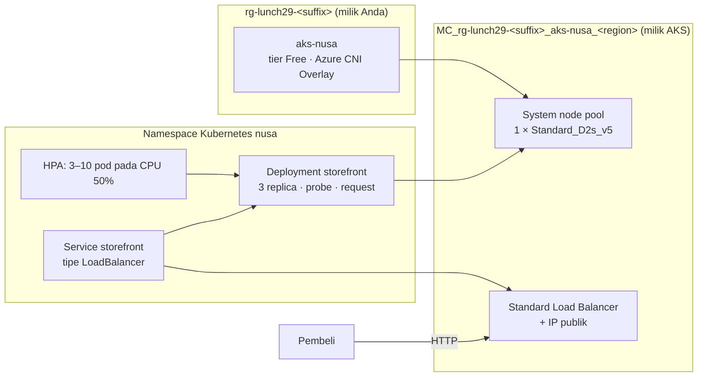

# Lab 29 · Kubernetes untuk tim microservices

🇬🇧 [Read in English](README.md)

> **Pasangan dari:** [Makan Siang 29 · Containers (Lanjutan): Azure Kubernetes Service](../../lunches/29-containers-advanced-aks/README.id.md)
> **Waktu:** sekitar 60 menit · **Biaya:** 💲💲💲 (lihat [kelompok biaya](../README.id.md#kelompok-biaya)) · **Tingkat kesulitan:** ★★★
> **Bisa dikerjakan terpisah:** ✅ Anda tidak memerlukan lab sebelumnya. Semua yang dibutuhkan lab ini dibuat oleh langkah-langkahnya sendiri.
> **Penulis:** Stefanus Pinarta · [Tentang penulis](../../README.id.md#tentang-penulis)

## 🎯 Yang akan Anda bangun

Tim Dewi membutuhkan cluster Kubernetes untuk microservices-nya, dan Ibu Sari membutuhkan bukti bahwa cluster itu bisa
memulihkan dirinya sendiri, ikut membesar saat promo 12.12, dan diperbarui tanpa menutup toko. Anda akan membuat
cluster **AKS** kecil (tier Free, Azure CNI Overlay, satu node) yang rentang alamatnya menjauhi 10.0.0.0/16 milik
kantor pusat, lalu melihat isi kedua resource group-nya. Setelah itu Anda men-deploy storefront dari manifest (file
YAML yang menjelaskan kondisi yang diinginkan) di [`k8s/`](k8s/): tiga replica dengan probe dan resource request di
belakang service LoadBalancer publik. Anda akan menghapus pod dan melihatnya kembali, meluncurkan v2 tanpa satu pun
request yang gagal, menambahkan Horizontal Pod Autoscaler lalu membebaninya sampai pod baru muncul, dan mendiagnosis
tag image yang rusak.



Aplikasinya adalah web server contoh kecil dari Microsoft yang mendengarkan di **port 80** dan menampilkan environment
variable `TITLE` sebagai judul halamannya, sehingga Anda bisa langsung melihat versi mana yang menjawab.

## ✅ Sebelum mulai

- Subscription Azure tempat Anda bisa membuat resource (lihat [Lab 01](../01-before-you-begin/README.id.md)), dengan
  kuota regional minimal **2 vCPU kosong** (4 jika Anda ingin mengerjakan tantangan tambahan).
- **Azure Cloud Shell (Bash)** — buka [shell.azure.com](https://shell.azure.com). `kubectl` sudah terpasang di sana.
- Ambil file lab dan muat pengaturan bersama:

```bash
git clone https://github.com/stefpin/azure-fundamentals-lunches.git   # first time only
cd azure-fundamentals-lunches/labs/29-containers-advanced-aks
source ../common/config.sh
RG=$(rg_name 29)
AKS=aks-nusa
AKS_NODE_SIZE=${AKS_NODE_SIZE:-Standard_D2s_v5}
```

- Pastikan ukuran node tersedia untuk Anda dan kuotanya cukup. Ukuran ini butuh 2 vCPU; subscription gratis dan trial
  sering kali hanya punya total 4 vCPU per region:

```bash
az vm list-skus --location "$LOCATION" --size "$AKS_NODE_SIZE" --resource-type virtualMachines \
  --query "[].{size:name, zones:join(',', locationInfo[0].zones || \`[]\`), restricted:length(restrictions)}" --output table

az vm list-usage --location "$LOCATION" \
  --query "[?contains(localName, 'Total Regional') || contains(localName, 'DSv5')].{quota:localName, used:currentValue, limit:limit}" \
  --output table

az provider register --namespace Microsoft.ContainerService --wait
```

Jika `restricted` bukan `0`, atau keluarga DSv5 tidak punya kuota kosong, pilih ukuran non-burstable lain dengan 2 vCPU,
misalnya `AKS_NODE_SIZE=Standard_D2as_v5` atau `Standard_D2s_v4`, lalu periksa lagi. Ukuran seri B tidak diizinkan untuk
system node pool.

> [!IMPORTANT]
> Ini lab 💲💲💲: VM node, disknya, load balancer, dan alamat IP publik menimbulkan biaya setiap jam selama cluster masih
> ada. Kerjakan lab ini dalam sekali duduk dan jalankan bagian **Bersihkan** segera setelah selesai, bahkan jika Anda
> berhenti di tengah jalan.
> Jika Cloud Shell timeout, buka lagi, `cd` kembali ke folder ini, dan jalankan ulang baris `source` dan baris variabel
> di atas (ditambah `IP=` dan `NODE_RG=` dari tugas-tugas).

## 🧭 Pilih mode Anda

| Mode | Cocok untuk Anda jika… | Caranya |
|---|---|---|
| **Terpandu** | Anda ingin setiap langkah dijelaskan | ikuti Tugas 1–5 di bawah |
| **Tantangan** | Anda sudah menguasai dasarnya | baca hanya [Ringkasan tantangan](#-ringkasan-tantangan), bangun dengan cara Anda sendiri, lalu jalankan `bash verify.sh` |

## Tugas 1 · Membuat cluster AKS kecil

Pembuatan cluster butuh **5 sampai 10 menit**. Jalankan sekarang, lalu baca tabel flag sambil menunggu.

```bash
ensure_rg "$RG" 29

az aks create \
  --resource-group "$RG" \
  --name "$AKS" \
  --location "$LOCATION" \
  --tier free \
  --node-count 1 \
  --node-vm-size "$AKS_NODE_SIZE" \
  --zones 1 2 3 \
  --network-plugin azure \
  --network-plugin-mode overlay \
  --pod-cidr 192.168.0.0/16 \
  --service-cidr 172.16.0.0/16 \
  --dns-service-ip 172.16.0.10 \
  --generate-ssh-keys \
  --output none
```

| Flag | Alasannya |
|---|---|
| `--tier free` | Manajemen cluster tidak dikenai biaya dan tidak ada SLA uptime: pas untuk lab. Produksi memakai Standard atau Premium. |
| `--node-count 1 --node-vm-size …` | Satu node system pool dengan 2 vCPU, ukuran praktis yang terkecil. System pool di produksi punya minimal tiga node. |
| `--zones 1 2 3` | Node pool boleh menempatkan node di ketiga zona. Dengan satu node, Anda hanya memakai satu zona, tetapi tantangan tambahan menambahkan node kedua. |
| `--network-plugin azure --network-plugin-mode overlay` | Azure CNI Overlay: pod mendapat alamat dari rentang pod privat, bukan dari virtual network Anda. Jika Anda menulis `--network-plugin azure` tanpa mode, AKS memakai mode node-subnet yang lebih lama, jadi nyatakan secara eksplisit. |
| `--pod-cidr 192.168.0.0/16` | Rentang alamat pod. Rentang ini tidak boleh tumpang tindih dengan jaringan mana pun yang kelak akan diajak bicara oleh cluster. |
| `--service-cidr 172.16.0.0/16 --dns-service-ip 172.16.0.10` | Rentang service default adalah 10.0.0.0/16, persis jaringan kantor pusat Pak Budi, jadi kita memindahkannya. |
| `--generate-ssh-keys` | Memakai SSH key Anda di `~/.ssh`, atau membuatnya jika Anda belum punya. |

Sambil menunggu, buka file-file di [`k8s/`](k8s/) (di Cloud Shell: `code k8s/deployment.yaml`) dan temukan jumlah
replica, pengaturan rolling update, probe, serta resource request dan limit.

Setelah perintahnya selesai, lihat apa yang sudah Anda buat dan hubungkan `kubectl` ke cluster:

```bash
az aks show --resource-group "$RG" --name "$AKS" \
  --query "{state:provisioningState, version:currentKubernetesVersion, tier:sku.tier, plugin:networkProfile.networkPlugin, mode:networkProfile.networkPluginMode, podCidr:networkProfile.podCidr, serviceCidr:networkProfile.serviceCidr}" \
  --output table

NODE_RG=$(az aks show --resource-group "$RG" --name "$AKS" --query nodeResourceGroup --output tsv)
echo "Node resource group: $NODE_RG"
az resource list --resource-group "$NODE_RG" --query "[].{name:name, type:type}" --output table

az aks get-credentials --resource-group "$RG" --name "$AKS" --overwrite-existing
kubectl get nodes -o wide
kubectl get nodes -L topology.kubernetes.io/zone,node.kubernetes.io/instance-type
kubectl get pods --namespace kube-system
```

Resource group Anda hanya berisi resource cluster. Node resource group, yang dibuat dan dimiliki AKS, berisi
infrastruktur yang sebenarnya: virtual machine scale set untuk node pool, virtual network, network security group,
load balancer dengan IP publik untuk outbound, dan sebuah managed identity. Lihat saja, jangan ubah apa pun di dalamnya.

> [!TIP]
> **Lebih suka portal?** *Kubernetes services › aks-nusa* menampilkan pengaturan yang sama di **Overview** dan
> **Settings › Networking**, dan **Kubernetes resources › Workloads** menampilkan pod sistem tanpa `kubectl` sama
> sekali. Halaman **Properties** menautkan ke infrastructure (node) resource group.

> ✅ **Pemeriksaan:** state-nya `Succeeded`, tier `Free`, plugin `azure` dalam mode `overlay`, rentang service
> `172.16.0.0/16`, dan `kubectl get nodes` menampilkan satu node berstatus `Ready` dengan label zona.

## Tugas 2 · Men-deploy storefront dari manifest

Manifest menjelaskan **desired state** (kondisi yang diinginkan); `kubectl apply` menyerahkannya ke API server, dan
para controller mewujudkannya.

```bash
kubectl apply -f k8s/namespace.yaml
kubectl apply -f k8s/deployment.yaml -f k8s/service.yaml -f k8s/pdb.yaml
kubectl rollout status deployment/storefront --namespace nusa
kubectl get deployment,pods,service,pdb --namespace nusa -o wide
```

Service meminta alamat IP publik kepada Azure, dan itu butuh satu atau dua menit. Pantau, lalu tekan **Ctrl+C** ketika
`EXTERNAL-IP` menampilkan sebuah alamat, bukan `<pending>`:

```bash
kubectl get service storefront --namespace nusa --watch
```

```bash
IP=$(kubectl get service storefront --namespace nusa -o jsonpath='{.status.loadBalancer.ingress[0].ip}')
echo "http://${IP}"
curl -s "http://${IP}/" | grep -o "<title>[^<]*</title>"

# The same service, seen from the Azure side:
az network public-ip list --resource-group "$NODE_RG" --query "[].{name:name, ip:ipAddress}" --output table
```

PodDisruptionBudget dari `pdb.yaml` menjanjikan bahwa gangguan yang disengaja (voluntary disruption), seperti drain
node saat upgrade, tidak pernah membuat storefront tinggal kurang dari dua pod yang siap.

> ✅ **Pemeriksaan:** `READY` menampilkan `3/3`, service punya alamat IP eksternal, `curl` mencetak
> `<title>Nusantara Retail storefront v1</title>`, dan alamat yang sama muncul di node resource group.

## Tugas 3 · Saksikan Kubernetes memulihkan dirinya, lalu scale secara manual

Hapus sebuah pod seolah-olah pod itu crash, lalu saksikan Deployment controller menggantinya:

```bash
kubectl get pods --namespace nusa
POD=$(kubectl get pods --namespace nusa -l app=storefront -o jsonpath='{.items[0].metadata.name}')
kubectl delete pod "$POD" --namespace nusa --wait=false
kubectl get pods --namespace nusa --watch        # Ctrl+C after a few seconds
kubectl get events --namespace nusa --sort-by=.lastTimestamp | tail -n 8
```

Sekarang lakukan scaling secara manual, dengan cara imperatif (Anda memberi perintah langsung, "jadikan lima sekarang",
alih-alih menuliskan keinginan di file):

```bash
kubectl scale deployment storefront --namespace nusa --replicas=5
kubectl get pods --namespace nusa -o wide
kubectl scale deployment storefront --namespace nusa --replicas=3
```

`kubectl scale` mengubah objek yang sedang berjalan, bukan file Anda. `kubectl apply -f k8s/deployment.yaml` berikutnya
akan mengembalikan jumlahnya ke 3, jadi perubahan deklaratif di file (atau autoscaler, di Tugas 5) adalah cara yang
bertahan lama untuk mengubahnya.

> ✅ **Pemeriksaan:** pod yang dihapus digantikan oleh pod bernama baru dalam hitungan detik, event-nya menampilkan
> `Killing` dan `Scheduled`/`Created`/`Started`, dan deployment naik ke 5 replica lalu kembali ke 3.

## Tugas 4 · Meluncurkan v2 tanpa kehilangan satu request pun, lalu rollback

Jalankan "pembeli" di latar belakang yang memanggil situs setiap setengah detik selama sekitar 90 detik dan menghitung
kode status HTTP-nya, lalu ubah pod template:

```bash
( for i in $(seq 1 180); do curl -s -o /dev/null -w "%{http_code}\n" --max-time 5 "http://${IP}/"; sleep 0.5; done | sort | uniq -c ) &
WATCH_PID=$!

kubectl set env deployment/storefront --namespace nusa TITLE="Nusantara Retail storefront v2"
kubectl rollout status deployment/storefront --namespace nusa
wait "$WATCH_PID"

curl -s "http://${IP}/" | grep -o "<title>[^<]*</title>"
kubectl rollout history deployment/storefront --namespace nusa
```

Hitungan si pembeli seharusnya hanya menampilkan `200`. Dengan `maxSurge: 1` dan `maxUnavailable: 0`, Kubernetes
menyalakan satu pod baru, menunggu readiness probe-nya, membuang satu pod lama, lalu mengulanginya; jumlah pod yang siap
tidak pernah turun di bawah tiga. Ibaratnya pergantian sif kasir di minimarket: kasir baru duduk dan siap melayani
lebih dulu, baru kasir lama pulang, sehingga antrean tidak pernah berhenti.

Sekarang anggap saja v2 punya bug, lalu lakukan rollback ke ReplicaSet sebelumnya:

```bash
kubectl rollout undo deployment/storefront --namespace nusa
kubectl rollout status deployment/storefront --namespace nusa
curl -s "http://${IP}/" | grep -o "<title>[^<]*</title>"
```

> ✅ **Pemeriksaan:** hitungannya hanya menampilkan respons `200`, judul berubah menjadi v2 lalu, setelah undo, kembali
> ke v1, dan `kubectl rollout history` menampilkan daftar revisinya.

## Tugas 5 · Autoscale pod dengan HPA

Horizontal Pod Autoscaler mengukur CPU sebagai persentase dari **request** setiap pod (di sini 50m, yaitu 50 millicore
atau seperdua puluh vCPU). AKS sudah menyertakan metrics-server, jadi Anda bisa melihat angka yang dipakainya:

```bash
kubectl top pods --namespace nusa
kubectl apply -f k8s/hpa.yaml
kubectl get hpa storefront --namespace nusa
```

`kubectl autoscale deployment storefront --namespace nusa --min=3 --max=10 --cpu=50%` membuat objek yang sama secara
imperatif (versi `kubectl` yang lebih lama memakai `--cpu-percent=50`). Versi YAML berfungsi di semua versi dan
tersimpan di source control.

Sekarang bangkitkan beban dari dalam cluster dengan pod yang sudah disediakan (berjalan selama lima menit), lalu pantau
HPA:

```bash
kubectl apply -f k8s/load-generator.yaml

for i in $(seq 1 16); do
  sleep 15
  kubectl get hpa storefront --namespace nusa --no-headers
done
kubectl get pods --namespace nusa -o wide
```

`TARGETS` naik jauh di atas `50%`, dan `REPLICAS` naik menuju 10. Jika beberapa pod baru tetap `Pending`, berarti
satu-satunya node sudah penuh: tepat pada saat itulah cluster autoscaler akan menambahkan node (tantangan tambahan 3).
Setelah load generator selesai, HPA menunggu stabilization window lima menitnya, lalu kembali ke 3. Hapus pod yang
sudah selesai itu:

```bash
kubectl delete pod load-generator --namespace nusa --ignore-not-found
```

<details><summary>Load generator tidak berhasil? Pakai Cloud Shell saja</summary>

```bash
end=$((SECONDS + 180))
while (( SECONDS < end )); do
  seq 1 300 | xargs -P 50 -I{} curl -s -o /dev/null --max-time 5 "http://${IP}/"
done &
for i in $(seq 1 12); do sleep 15; kubectl get hpa storefront --namespace nusa --no-headers; done
wait
```

</details>

> [!TIP]
> **Lebih suka portal?** *aks-nusa › Kubernetes resources › Workloads* menampilkan jumlah pod yang berubah, dan
> **Monitoring › Metrics** bisa membuat grafik CPU node selama beban berjalan.

> ✅ **Pemeriksaan:** selama beban berjalan, `kubectl get hpa` menampilkan nilai CPU di atas 50% dan lebih dari 3
> replica; beberapa menit setelah beban berhenti, jumlahnya kembali ke 3.

## 🔧 Rusak lalu perbaiki

Seorang rekan "meng-upgrade" storefront ke tag yang tidak ada:

```bash
kubectl set image deployment/storefront --namespace nusa storefront=mcr.microsoft.com/azuredocs/aks-helloworld:v99
kubectl rollout status deployment/storefront --namespace nusa --timeout=60s
kubectl get pods --namespace nusa
curl -s -o /dev/null -w "%{http_code}\n" "http://${IP}/"
```

**Gejala:** rollout tidak pernah selesai, dan satu pod baru menampilkan `ErrImagePull` lalu `ImagePullBackOff`. Namun
`curl` tetap mengembalikan `200`. Cari tahu mengapa pod itu macet, mengapa toko tetap buka, lalu perbaiki.

<details><summary>Petunjuk</summary>

Jalankan `kubectl describe pod <the-stuck-pod> --namespace nusa` dan baca bagian **Events** di bagian bawah: kubelet
melaporkan bahwa ia gagal menarik `mcr.microsoft.com/azuredocs/aks-helloworld:v99` karena tag-nya tidak ditemukan. Toko
tetap buka karena `maxUnavailable: 0` mempertahankan setiap pod lama sampai ada pod baru yang siap, dan pod yang satu ini
tidak pernah siap.

</details>

<details><summary>Perbaikan</summary>

```bash
kubectl rollout undo deployment/storefront --namespace nusa
# or: kubectl set image deployment/storefront --namespace nusa storefront=mcr.microsoft.com/azuredocs/aks-helloworld:v1
kubectl rollout status deployment/storefront --namespace nusa
kubectl get pods --namespace nusa
```

Pesan yang sama muncul ketika sebuah tag sudah dihapus, ketika registry bersifat privat dan cluster tidak punya izin
pull (`az aks update --attach-acr` memperbaikinya untuk ACR), atau ketika node tidak bisa menjangkau registry.

</details>

## 🧪 Verifikasi hasil kerja Anda

```bash
bash verify.sh
```

Setiap pemeriksaan seharusnya menampilkan **PASS**. Jika ada yang gagal, pesannya memberi tahu tugas mana yang perlu
Anda ulangi.

## 🧹 Bersihkan (jangan dilewati!)

```bash
bash cleanup.sh
```

Perintah ini menghapus resource group `rg-lunch29-<suffix>`. Karena cluster di dalamnya ikut terhapus, AKS juga
menghapus node resource group `MC_rg-lunch29-<suffix>_aks-nusa_<region>`, beserta VM node, disknya, load balancer, dan
alamat IP publik, jadi Anda tidak perlu menghapus grup itu sendiri. Script ini juga menghapus cluster dari kubeconfig
Anda. Penghapusan berjalan di latar belakang dan butuh beberapa menit; jalankan `bash cleanup.sh` lagi setelah sekitar
sepuluh menit untuk memastikan tidak ada yang tersisa (script itu juga menghapus node resource group yang tertinggal
akibat deployment yang gagal).

## 🩺 Pemecahan masalah

| Gejala | Kemungkinan penyebab | Perbaikan |
|---|---|---|
| `Operation could not be completed as it results in exceeding approved ... Cores quota` | Kuota vCPU regional atau kuota keluarga VM tidak cukup | Hapus VM atau cluster lain, pilih ukuran dari keluarga yang masih punya kuota (`AKS_NODE_SIZE=...`), atau minta tambahan kuota (tidak bisa di Free Trial atau Azure for Students) |
| Pembuatan gagal karena ukuran VM tidak tersedia, tidak diizinkan di subscription Anda, atau tidak ditawarkan di suatu zona | Ukuran itu dibatasi untuk subscription atau region Anda | Pilih ukuran lain dengan 2 vCPU yang bukan seri B, atau hapus baris `--zones 1 2 3` |
| Pembuatan menolak ukuran node untuk system node pool | Dokumentasi AKS tidak konsisten soal batas minimumnya (satu halaman menyebut 2 vCPU, halaman lain 4) | Pakai ukuran 4 vCPU seperti `Standard_D4s_v5` jika kuota Anda memungkinkan; ukuran ini memakai seluruh 4 vCPU kuota trial |
| `ManagedClusterCountExceedsQuotaLimit` | Terlalu banyak cluster AKS di region ini untuk subscription Anda | Hapus cluster yang tidak dipakai (`az aks list --output table`) |
| `MissingSubscriptionRegistration` untuk `Microsoft.ContainerService` | Resource provider belum terdaftar | `az provider register --namespace Microsoft.ContainerService --wait` |
| `kubectl`: `Unable to connect to the server` atau `You must be logged in to the server` | Entri kubeconfig sudah lama atau hilang, atau sesi Cloud Shell baru | `az aks get-credentials --resource-group "$RG" --name "$AKS" --overwrite-existing`, lalu `kubectl config current-context` |
| `EXTERNAL-IP` tetap `<pending>` lebih dari beberapa menit | Azure masih membuat IP publiknya, atau ada kuota atau policy yang memblokirnya | `kubectl describe service storefront --namespace nusa` lalu baca event-nya |
| `TARGETS` HPA menampilkan `<unknown>/50%` | Metrik belum tersedia, atau pod tidak punya CPU request | Tunggu satu menit setelah pod menyala; pastikan `deployment.yaml` masih punya `resources.requests.cpu` |
| Pod baru tetap `Pending` dengan `Insufficient cpu` | Satu-satunya node sudah penuh | Wajar di puncak beban; turunkan `maxReplicas`, atau tambahkan node (tantangan tambahan 2 dan 3) |
| `load-generator` berakhir dengan `Error` atau tidak pernah menyala | Image busybox tidak bisa ditarik atau tidak punya tool yang dibutuhkan | Gunakan alternatif Cloud Shell di Tugas 5 |
| Pod menampilkan `ErrImagePull` atau `ImagePullBackOff` | Nama image atau tag salah, atau tidak ada izin untuk pull | Lihat **Rusak lalu perbaiki** |

## 🚀 Tantangan tambahan

Tantangan tambahan 1–3 membutuhkan node kedua: total 4 vCPU. Periksa kuota Anda dulu, dan kembalikan skalanya setelah
selesai.

1. **Ingress dengan Gateway API.** Aktifkan implementasi Gateway API milik application routing add-on (Azure CLI 2.86
   atau lebih baru), beri ruang, lalu terapkan [`k8s/gateway.yaml`](k8s/gateway.yaml):

   ```bash
   az aks scale --resource-group "$RG" --name "$AKS" --node-count 2
   az aks update --resource-group "$RG" --name "$AKS" --enable-gateway-api --enable-app-routing-istio
   kubectl get pods --namespace aks-istio-system
   kubectl apply -f k8s/gateway.yaml
   kubectl wait --for=condition=programmed gateways.gateway.networking.k8s.io/storefront-gateway --namespace nusa --timeout=300s
   GW=$(kubectl get gateways.gateway.networking.k8s.io storefront-gateway --namespace nusa -o jsonpath='{.status.addresses[0].value}')
   curl -s "http://${GW}/" | grep -o "<title>[^<]*</title>"
   ```

   Jangan membangun ingress baru di atas varian NGINX milik add-on ini: dukungan Microsoft untuknya berakhir pada
   November 2026.
2. **Zona dan kegagalan node.** Dengan dua node, periksa `kubectl get nodes -L topology.kubernetes.io/zone` dan
   `kubectl get pods --namespace nusa -o wide`: topology spread constraint menempatkan replica di kedua node.
   Simulasikan pemeliharaan dengan `kubectl drain <node-name> --ignore-daemonsets --delete-emptydir-data`, saksikan
   pod-pod berpindah sementara PodDisruptionBudget menjaga dua di antaranya tetap hidup, lalu jalankan
   `kubectl uncordon <node-name>`.
3. **Cluster autoscaler.** Biarkan AKS menambahkan node kedua hanya ketika ada pod yang `Pending`:

   ```bash
   az aks update --resource-group "$RG" --name "$AKS" --enable-cluster-autoscaler --min-count 1 --max-count 2
   kubectl patch hpa storefront --namespace nusa --patch '{"spec":{"maxReplicas":20}}'
   ```

   Jalankan beban lagi dan pantau `kubectl get nodes --watch`: node baru bergabung setelah beberapa menit.
4. **Container insights.** Kirim log container ke workspace di dalam resource group lab, supaya proses pembersihan ikut
   menghapusnya:

   ```bash
   az monitor log-analytics workspace create --resource-group "$RG" --workspace-name log-nusa --output none
   WS_ID=$(az monitor log-analytics workspace show --resource-group "$RG" --workspace-name log-nusa --query id --output tsv)
   az aks enable-addons --resource-group "$RG" --name "$AKS" --addons monitoring --workspace-resource-id "$WS_ID"
   ```

   Setelah sekitar sepuluh menit, buka *aks-nusa › Monitoring › Insights*. Makan Siang 30 mengajarkan cara meng-query
   log ini dengan KQL.
5. **Jeda alih-alih hapus (untuk proyek yang lebih panjang).** `az aks stop --resource-group "$RG" --name "$AKS"`
   menghentikan node dan control plane sambil tetap menyimpan konfigurasinya, dan `az aks start` menghidupkan semuanya
   kembali. Untuk lab ini, menghapus cluster tetap pilihan termurah, dan panduan ini bisa membuatnya ulang dalam sepuluh
   menit.

## 🏁 Ringkasan tantangan

Bangun hal-hal berikut, dengan cara apa pun yang Anda suka (CLI, portal, Bicep, Terraform):

1. Resource group `rg-lunch29-<suffix>` di region lab Anda, dibuat dengan `ensure_rg "$(rg_name 29)" 29` agar
   `cleanup.sh` bisa menemukannya.
2. Cluster AKS `aks-nusa` di tier **Free**, memakai **Azure CNI Overlay**, dengan system node pool berukuran non-seri-B,
   dan dengan rentang alamat pod dan service yang tidak tumpang tindih dengan 10.0.0.0/16 milik kantor pusat.
3. Di namespace `nusa`, deployment `storefront` yang menjalankan `mcr.microsoft.com/azuredocs/aks-helloworld:v1` dengan
   minimal **3 replica yang siap**, request dan limit untuk CPU dan memori, serta readiness probe dan liveness probe.
4. Service `storefront` bertipe **LoadBalancer** dengan alamat IP publik yang menjawab HTTP 200.
5. Horizontal Pod Autoscaler `storefront` untuk deployment tersebut dengan minimum 3 dan maksimum 10 replica serta
   target utilisasi CPU.
6. Tidak ada pod di namespace itu yang macet di `ErrImagePull` atau `ImagePullBackOff`.

Lalu jalankan `bash verify.sh`. Buntu? Intip `solution.sh` atau beralih ke mode Terpandu. Setelah itu, hapus
cluster-nya.

---

⬅️ [Bacaan Makan Siang 29](../../lunches/29-containers-advanced-aks/README.id.md) · 🏠 [Semua lab](../README.id.md) · 🏠 [Beranda kursus](../../README.id.md)

<sub>Terakhir divalidasi: Oktober 2026 · Ada yang tidak berfungsi? [Laporkan masalah lab](../../CONTRIBUTING.md).</sub>
