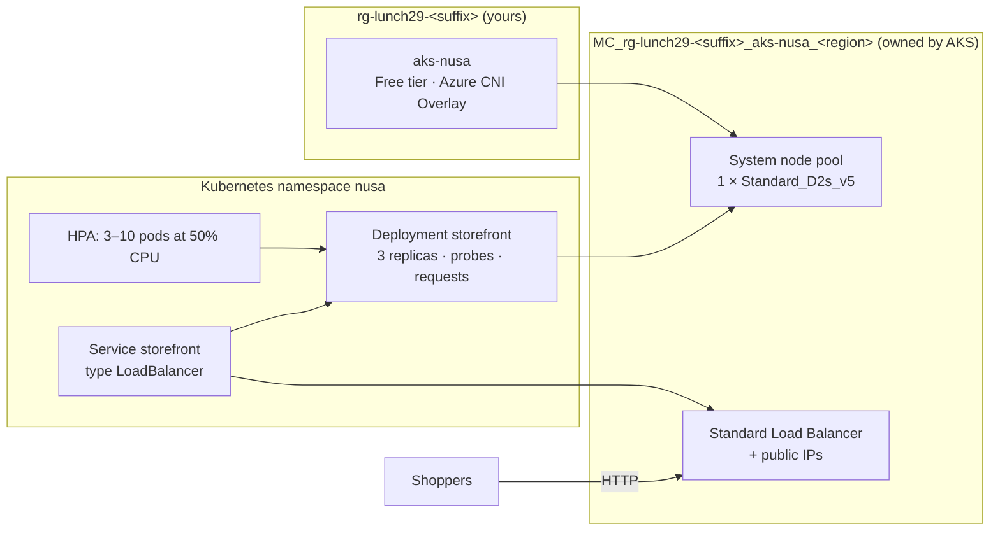

# Lab 29 · Kubernetes for the microservices team

> **Pairs with:** [Lunch 29 · Containers (Advanced): Azure Kubernetes Service](../../lunches/29-containers-advanced-aks/README.md)
> **Time:** about 60 minutes · **Cost:** 💲💲💲 (see [cost bands](../README.md#cost-bands)) · **Difficulty:** ★★★
> **Works on its own:** ✅ You do not need any earlier lab. Everything this lab needs is created by its steps.

## 🎯 What you'll build

Dewi's team needs a Kubernetes cluster for its microservices, and Ibu Sari needs proof that it heals itself, scales
for the 12.12 sale and updates without closing the shop. You will create a small **AKS** cluster (Free tier, Azure CNI
Overlay, one node) whose address ranges stay clear of head office's 10.0.0.0/16, and look inside both of its resource
groups. Then you deploy the storefront from the manifests in [`k8s/`](k8s/): three replicas with probes and resource
requests behind a public LoadBalancer service. You will delete pods and watch them return, roll out v2 without a single
failed request, add a Horizontal Pod Autoscaler and load it until new pods appear, and diagnose a broken image tag.



The app is a small Microsoft sample web server that listens on **port 80** and shows the `TITLE` environment variable
as its page title, so you can see at a glance which version answered.

## ✅ Before you start

- An Azure subscription where you can create resources (see [Lab 01](../01-before-you-begin/README.md)), with at least
  **2 free vCPUs** of regional quota (4 if you want the stretch goals).
- **Azure Cloud Shell (Bash)** — open [shell.azure.com](https://shell.azure.com). `kubectl` is already installed there.
- Get the lab files and load the shared settings:

```bash
git clone https://github.com/stefpin/azure-fundamentals-lunches.git   # first time only
cd azure-fundamentals-lunches/labs/29-containers-advanced-aks
source ../common/config.sh
RG=$(rg_name 29)
AKS=aks-nusa
AKS_NODE_SIZE=${AKS_NODE_SIZE:-Standard_D2s_v5}
```

- Check that the node size is offered to you and that you have quota. The size needs 2 vCPUs; free and trial
  subscriptions often have only 4 vCPUs in total per region:

```bash
az vm list-skus --location "$LOCATION" --size "$AKS_NODE_SIZE" --resource-type virtualMachines \
  --query "[].{size:name, zones:join(',', locationInfo[0].zones || \`[]\`), restricted:length(restrictions)}" --output table

az vm list-usage --location "$LOCATION" \
  --query "[?contains(localName, 'Total Regional') || contains(localName, 'DSv5')].{quota:localName, used:currentValue, limit:limit}" \
  --output table

az provider register --namespace Microsoft.ContainerService --wait
```

If `restricted` is not `0`, or the DSv5 family has no free quota, pick another non-burstable size with 2 vCPUs, for
example `AKS_NODE_SIZE=Standard_D2as_v5` or `Standard_D2s_v4`, and check again. B-series sizes are not allowed for a
system node pool.

> [!IMPORTANT]
> This is a 💲💲💲 lab: the node VM, its disk, the load balancer and the public IP addresses cost money every hour the
> cluster exists. Do the lab in one sitting and run **Clean up** as soon as you finish, even if you stop halfway.
> If Cloud Shell times out, reopen it, `cd` back into this folder and re-run the `source` and variable lines above
> (plus `IP=` and `NODE_RG=` from the tasks).

## 🧭 Choose your mode

| Mode | For you if… | How |
|---|---|---|
| **Guided** | you want every step explained | follow Tasks 1–5 below |
| **Challenge** | you already know the basics | read only the [Challenge brief](#-challenge-brief), build it your way, then run `bash verify.sh` |

## Task 1 · Create a small AKS cluster

The cluster takes **5 to 10 minutes** to create. Start it now and read the flag table while you wait.

```bash
ensure_rg "$RG" 29

az aks create \
  --resource-group "$RG" \
  --name "$AKS" \
  --location "$LOCATION" \
  --tier free \
  --node-count 1 \
  --node-vm-size "$AKS_NODE_SIZE" \
  --zones 1 2 3 \
  --network-plugin azure \
  --network-plugin-mode overlay \
  --pod-cidr 192.168.0.0/16 \
  --service-cidr 172.16.0.0/16 \
  --dns-service-ip 172.16.0.10 \
  --generate-ssh-keys \
  --output none
```

| Flag | Why |
|---|---|
| `--tier free` | No charge for cluster management and no uptime SLA: right for a lab. Production uses Standard or Premium. |
| `--node-count 1 --node-vm-size …` | One system-pool node with 2 vCPUs, the smallest practical size. Production system pools have at least three nodes. |
| `--zones 1 2 3` | The node pool may place nodes in all three zones. With one node you only use one, but the stretch goals add a second. |
| `--network-plugin azure --network-plugin-mode overlay` | Azure CNI Overlay: pods get addresses from a private pod range, not from your virtual network. If you set `--network-plugin azure` without the mode, AKS uses the older node-subnet mode, so state it explicitly. |
| `--pod-cidr 192.168.0.0/16` | The pod range. It must not overlap any network the cluster will ever talk to. |
| `--service-cidr 172.16.0.0/16 --dns-service-ip 172.16.0.10` | The default service range is 10.0.0.0/16, exactly Pak Budi's head-office network, so we move it. |
| `--generate-ssh-keys` | Uses your SSH key in `~/.ssh`, or creates one if you have none. |

While you wait, open the files in [`k8s/`](k8s/) (in Cloud Shell: `code k8s/deployment.yaml`) and find the replica
count, the rolling-update settings, the probes, and the resource requests and limits.

When the command returns, look at what you created and connect `kubectl`:

```bash
az aks show --resource-group "$RG" --name "$AKS" \
  --query "{state:provisioningState, version:currentKubernetesVersion, tier:sku.tier, plugin:networkProfile.networkPlugin, mode:networkProfile.networkPluginMode, podCidr:networkProfile.podCidr, serviceCidr:networkProfile.serviceCidr}" \
  --output table

NODE_RG=$(az aks show --resource-group "$RG" --name "$AKS" --query nodeResourceGroup --output tsv)
echo "Node resource group: $NODE_RG"
az resource list --resource-group "$NODE_RG" --query "[].{name:name, type:type}" --output table

az aks get-credentials --resource-group "$RG" --name "$AKS" --overwrite-existing
kubectl get nodes -o wide
kubectl get nodes -L topology.kubernetes.io/zone,node.kubernetes.io/instance-type
kubectl get pods --namespace kube-system
```

Your resource group holds only the cluster resource. The node resource group, created and owned by AKS, holds the real
infrastructure: a virtual machine scale set for the node pool, a virtual network, a network security group, a load
balancer with an outbound public IP and a managed identity. Look, but don't change anything in it.

> [!TIP]
> **Prefer the portal?** *Kubernetes services › aks-nusa* shows the same settings on **Overview** and **Settings ›
> Networking**, and **Kubernetes resources › Workloads** lists the system pods without any `kubectl`. The **Properties**
> page links to the infrastructure (node) resource group.

> ✅ **Checkpoint:** the state is `Succeeded`, the tier `Free`, the plugin `azure` in `overlay` mode, the service
> range `172.16.0.0/16`, and `kubectl get nodes` shows one node with status `Ready` and a zone label.

## Task 2 · Deploy the storefront from manifests

Manifests describe the **desired state**; `kubectl apply` hands it to the API server, and the controllers make it
happen.

```bash
kubectl apply -f k8s/namespace.yaml
kubectl apply -f k8s/deployment.yaml -f k8s/service.yaml -f k8s/pdb.yaml
kubectl rollout status deployment/storefront --namespace nusa
kubectl get deployment,pods,service,pdb --namespace nusa -o wide
```

The service asks Azure for a public IP address, which takes a minute or two. Watch it, and press **Ctrl+C** when
`EXTERNAL-IP` shows an address instead of `<pending>`:

```bash
kubectl get service storefront --namespace nusa --watch
```

```bash
IP=$(kubectl get service storefront --namespace nusa -o jsonpath='{.status.loadBalancer.ingress[0].ip}')
echo "http://${IP}"
curl -s "http://${IP}/" | grep -o "<title>[^<]*</title>"

# The same service, seen from the Azure side:
az network public-ip list --resource-group "$NODE_RG" --query "[].{name:name, ip:ipAddress}" --output table
```

The PodDisruptionBudget from `pdb.yaml` promises that voluntary disruptions, such as a node drain during an upgrade,
never take the storefront below two ready pods.

> ✅ **Checkpoint:** `READY` shows `3/3`, the service has an external IP address, `curl` prints
> `<title>Nusantara Retail storefront v1</title>`, and the same address appears in the node resource group.

## Task 3 · Watch Kubernetes heal itself, then scale by hand

Delete a pod as if it had crashed, and watch the Deployment controller replace it:

```bash
kubectl get pods --namespace nusa
POD=$(kubectl get pods --namespace nusa -l app=storefront -o jsonpath='{.items[0].metadata.name}')
kubectl delete pod "$POD" --namespace nusa --wait=false
kubectl get pods --namespace nusa --watch        # Ctrl+C after a few seconds
kubectl get events --namespace nusa --sort-by=.lastTimestamp | tail -n 8
```

Now scale by hand, imperatively:

```bash
kubectl scale deployment storefront --namespace nusa --replicas=5
kubectl get pods --namespace nusa -o wide
kubectl scale deployment storefront --namespace nusa --replicas=3
```

`kubectl scale` changes the live object, not your file. The next `kubectl apply -f k8s/deployment.yaml` sets the count
back to 3, so a declarative change in the file (or an autoscaler, in Task 5) is the lasting way to change it.

> ✅ **Checkpoint:** the deleted pod is replaced by one with a new name within seconds, the events show `Killing`
> and `Scheduled`/`Created`/`Started`, and the deployment went to 5 replicas and back to 3.

## Task 4 · Roll out v2 without dropping a request, then roll back

Start a background "shopper" that calls the site every half second for about 90 seconds and counts the HTTP status
codes, then change the pod template:

```bash
( for i in $(seq 1 180); do curl -s -o /dev/null -w "%{http_code}\n" --max-time 5 "http://${IP}/"; sleep 0.5; done | sort | uniq -c ) &
WATCH_PID=$!

kubectl set env deployment/storefront --namespace nusa TITLE="Nusantara Retail storefront v2"
kubectl rollout status deployment/storefront --namespace nusa
wait "$WATCH_PID"

curl -s "http://${IP}/" | grep -o "<title>[^<]*</title>"
kubectl rollout history deployment/storefront --namespace nusa
```

The shopper's tally should show only `200`. With `maxSurge: 1` and `maxUnavailable: 0`, Kubernetes starts one new pod,
waits for its readiness probe, removes one old pod, and repeats; the number of ready pods never drops below three.

Now pretend v2 has a bug and roll back to the previous ReplicaSet:

```bash
kubectl rollout undo deployment/storefront --namespace nusa
kubectl rollout status deployment/storefront --namespace nusa
curl -s "http://${IP}/" | grep -o "<title>[^<]*</title>"
```

> ✅ **Checkpoint:** the tally shows only `200` responses, the title changed to v2 and, after the undo, back to v1, and
> `kubectl rollout history` lists the revisions.

## Task 5 · Autoscale pods with the HPA

The Horizontal Pod Autoscaler measures CPU as a percentage of each pod's **request** (50m here). AKS includes
metrics-server, so you can see the numbers it uses:

```bash
kubectl top pods --namespace nusa
kubectl apply -f k8s/hpa.yaml
kubectl get hpa storefront --namespace nusa
```

`kubectl autoscale deployment storefront --namespace nusa --min=3 --max=10 --cpu=50%` creates the same object
imperatively (older `kubectl` versions use `--cpu-percent=50`). The YAML version works with every version and lives in
source control.

Now generate load from inside the cluster with the provided pod (it runs for five minutes), and watch the HPA:

```bash
kubectl apply -f k8s/load-generator.yaml

for i in $(seq 1 16); do
  sleep 15
  kubectl get hpa storefront --namespace nusa --no-headers
done
kubectl get pods --namespace nusa -o wide
```

`TARGETS` climbs well above `50%`, and `REPLICAS` rises towards 10. If some new pods stay `Pending`, the single node is
full: that is exactly the moment a cluster autoscaler would add a node (stretch goal 3). When the load generator
finishes, the HPA waits for its five-minute stabilization window and then scales back to 3. Remove the finished pod:

```bash
kubectl delete pod load-generator --namespace nusa --ignore-not-found
```

<details><summary>No luck with the load generator? Use Cloud Shell instead</summary>

```bash
end=$((SECONDS + 180))
while (( SECONDS < end )); do
  seq 1 300 | xargs -P 50 -I{} curl -s -o /dev/null --max-time 5 "http://${IP}/"
done &
for i in $(seq 1 12); do sleep 15; kubectl get hpa storefront --namespace nusa --no-headers; done
wait
```

</details>

> [!TIP]
> **Prefer the portal?** *aks-nusa › Kubernetes resources › Workloads* shows the pod count changing, and **Monitoring ›
> Metrics** can chart node CPU while the load runs.

> ✅ **Checkpoint:** during the load `kubectl get hpa` shows a CPU value above 50% and more than 3 replicas; a few
> minutes after the load stops, it is back to 3.

## 🔧 Break it and fix it

A colleague "upgrades" the storefront to a tag that does not exist:

```bash
kubectl set image deployment/storefront --namespace nusa storefront=mcr.microsoft.com/azuredocs/aks-helloworld:v99
kubectl rollout status deployment/storefront --namespace nusa --timeout=60s
kubectl get pods --namespace nusa
curl -s -o /dev/null -w "%{http_code}\n" "http://${IP}/"
```

**Symptom:** the rollout never finishes, and one new pod shows `ErrImagePull` and then `ImagePullBackOff`. Yet `curl`
still returns `200`. Find out why the pod is stuck, why the shop stayed open, and fix it.

<details><summary>Hint</summary>

Run `kubectl describe pod <the-stuck-pod> --namespace nusa` and read the **Events** at the bottom: the kubelet reports
that it failed to pull `mcr.microsoft.com/azuredocs/aks-helloworld:v99` because the tag was not found. The shop stayed
open because `maxUnavailable: 0` keeps every old pod running until a new pod is ready, and this one never becomes
ready.

</details>

<details><summary>Fix</summary>

```bash
kubectl rollout undo deployment/storefront --namespace nusa
# or: kubectl set image deployment/storefront --namespace nusa storefront=mcr.microsoft.com/azuredocs/aks-helloworld:v1
kubectl rollout status deployment/storefront --namespace nusa
kubectl get pods --namespace nusa
```

The same message appears when a tag was deleted, a registry is private and the cluster has no pull permission
(`az aks update --attach-acr` fixes that for ACR), or a node cannot reach the registry.

</details>

## 🧪 Verify your work

```bash
bash verify.sh
```

Every check should say **PASS**. If one fails, the message tells you which task to revisit.

## 🧹 Clean up (do not skip!)

```bash
bash cleanup.sh
```

This deletes the resource group `rg-lunch29-<suffix>`. Deleting the cluster inside it makes AKS delete the node
resource group `MC_rg-lunch29-<suffix>_aks-nusa_<region>` as well, with the node VM, its disk, the load balancer and the
public IP addresses, so you don't delete that group yourself. The script also removes the cluster from your kubeconfig.
Deletion runs in the background and takes several minutes; run `bash cleanup.sh` again after about ten minutes to
confirm that nothing is left (it also removes a node resource group left behind by a failed deployment).

## 🩺 Troubleshooting

| Symptom | Likely cause | Fix |
|---|---|---|
| `Operation could not be completed as it results in exceeding approved ... Cores quota` | Not enough regional or VM-family vCPU quota | Delete other VMs or clusters, choose a size from a family with free quota (`AKS_NODE_SIZE=...`), or request more quota (not possible on Free Trial or Azure for Students) |
| The create fails because the VM size is not available, not allowed in your subscription, or not offered in a zone | The size is restricted for your subscription or region | Pick another 2-vCPU, non-B-series size, or remove the `--zones 1 2 3` line |
| The create rejects the node size for a system node pool | AKS documentation is inconsistent about the minimum (one page says 2 vCPUs, another 4) | Use a 4-vCPU size such as `Standard_D4s_v5` if your quota allows; it uses all 4 vCPUs of a trial quota |
| `ManagedClusterCountExceedsQuotaLimit` | Too many AKS clusters in this region for your subscription | Delete unused clusters (`az aks list --output table`) |
| `MissingSubscriptionRegistration` for `Microsoft.ContainerService` | Resource provider not registered | `az provider register --namespace Microsoft.ContainerService --wait` |
| `kubectl`: `Unable to connect to the server` or `You must be logged in to the server` | Old or missing kubeconfig entry, or a new Cloud Shell session | `az aks get-credentials --resource-group "$RG" --name "$AKS" --overwrite-existing`, then `kubectl config current-context` |
| `EXTERNAL-IP` stays `<pending>` for more than a few minutes | Azure is still creating the public IP, or a quota or policy blocks it | `kubectl describe service storefront --namespace nusa` and read the events |
| HPA `TARGETS` shows `<unknown>/50%` | Metrics are not available yet, or the pods have no CPU requests | Wait a minute after the pods start; make sure `deployment.yaml` still has `resources.requests.cpu` |
| New pods stay `Pending` with `Insufficient cpu` | The single node is full | Expected at the top of the load; lower `maxReplicas`, or add a node (stretch goals 2 and 3) |
| `load-generator` ends in `Error` or never starts | The busybox image could not be pulled or lacks a tool | Use the Cloud Shell alternative in Task 5 |
| A pod shows `ErrImagePull` or `ImagePullBackOff` | Wrong image name or tag, or no permission to pull | See **Break it and fix it** |

## 🚀 Stretch goals

Stretch goals 1–3 need a second node: 4 vCPUs in total. Check your quota first and scale back afterwards.

1. **Ingress with the Gateway API.** Enable the application routing add-on's Gateway API implementation (Azure CLI
   2.86 or later), give it room, then apply [`k8s/gateway.yaml`](k8s/gateway.yaml):

   ```bash
   az aks scale --resource-group "$RG" --name "$AKS" --node-count 2
   az aks update --resource-group "$RG" --name "$AKS" --enable-gateway-api --enable-app-routing-istio
   kubectl get pods --namespace aks-istio-system
   kubectl apply -f k8s/gateway.yaml
   kubectl wait --for=condition=programmed gateways.gateway.networking.k8s.io/storefront-gateway --namespace nusa --timeout=300s
   GW=$(kubectl get gateways.gateway.networking.k8s.io storefront-gateway --namespace nusa -o jsonpath='{.status.addresses[0].value}')
   curl -s "http://${GW}/" | grep -o "<title>[^<]*</title>"
   ```

   Don't build new ingress on the add-on's NGINX flavour: its Microsoft support ends in November 2026.
2. **Zones and a node failure.** With two nodes, check `kubectl get nodes -L topology.kubernetes.io/zone` and
   `kubectl get pods --namespace nusa -o wide`: the topology spread constraints place replicas on both nodes. Simulate
   maintenance with `kubectl drain <node-name> --ignore-daemonsets --delete-emptydir-data`, watch the pods move while
   the PodDisruptionBudget keeps two of them up, then `kubectl uncordon <node-name>`.
3. **Cluster autoscaler.** Let AKS add the second node only when pods are `Pending`:

   ```bash
   az aks update --resource-group "$RG" --name "$AKS" --enable-cluster-autoscaler --min-count 1 --max-count 2
   kubectl patch hpa storefront --namespace nusa --patch '{"spec":{"maxReplicas":20}}'
   ```

   Run the load again and watch `kubectl get nodes --watch`: a new node joins after a few minutes.
4. **Container insights.** Send container logs to a workspace inside the lab's resource group, so that clean-up
   removes it too:

   ```bash
   az monitor log-analytics workspace create --resource-group "$RG" --workspace-name log-nusa --output none
   WS_ID=$(az monitor log-analytics workspace show --resource-group "$RG" --workspace-name log-nusa --query id --output tsv)
   az aks enable-addons --resource-group "$RG" --name "$AKS" --addons monitoring --workspace-resource-id "$WS_ID"
   ```

   After about ten minutes, open *aks-nusa › Monitoring › Insights*. Lunch 30 teaches you to query these logs with KQL.
5. **Pause instead of delete (for longer projects).** `az aks stop --resource-group "$RG" --name "$AKS"` stops the
   nodes and the control plane while keeping the configuration, and `az aks start` brings it all back. For this lab,
   deleting the cluster is still the cheapest option, and this guide recreates it in ten minutes.

## 🏁 Challenge brief

Build the following, any way you like (CLI, portal, Bicep, Terraform):

1. A resource group `rg-lunch29-<suffix>` in your lab region, created with `ensure_rg "$(rg_name 29)" 29` so that
   `cleanup.sh` can find it.
2. An AKS cluster `aks-nusa` on the **Free** tier, using **Azure CNI Overlay**, with a system node pool of a
   non-B-series size, and with pod and service address ranges that do not overlap head office's 10.0.0.0/16.
3. In namespace `nusa`, a deployment `storefront` running `mcr.microsoft.com/azuredocs/aks-helloworld:v1` with at least
   **3 ready replicas**, CPU and memory requests and limits, and readiness and liveness probes.
4. A service `storefront` of type **LoadBalancer** with a public IP address that answers HTTP 200.
5. A Horizontal Pod Autoscaler `storefront` for that deployment with a minimum of 3 and a maximum of 10 replicas and a
   CPU utilization target.
6. No pod in the namespace stuck in `ErrImagePull` or `ImagePullBackOff`.

Then run `bash verify.sh`. Stuck? Peek at `solution.sh` or switch to Guided mode. Then delete the cluster.

---

⬅️ [Lunch 29 reading](../../lunches/29-containers-advanced-aks/README.md) · 🏠 [All labs](../README.md) · 🏠 [Course home](../../README.md)

<sub>Last validated: October 2026 · Something broken? [Report a lab problem](../../CONTRIBUTING.md).</sub>
