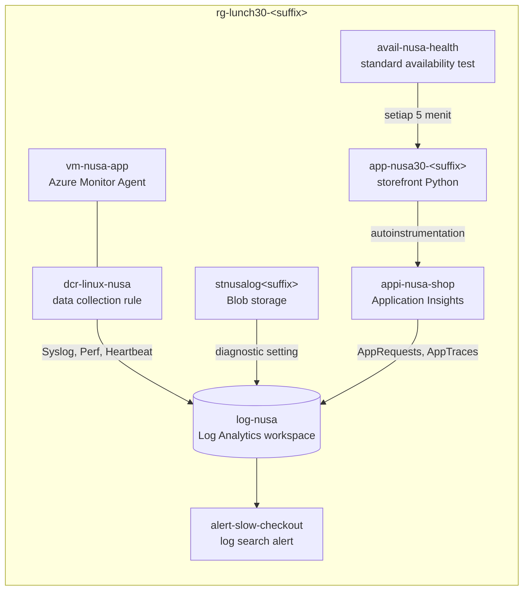

# Lab 30 · Mengapa checkout lambat pada hari Jumat?

🇬🇧 [Read in English](README.md)

> **Pasangan dari:** [Makan Siang 30 · Pemantauan (Lanjutan): Log Analytics, KQL, dan Application Insights](../../lunches/30-monitoring-advanced/README.id.md)
> **Waktu:** sekitar 60 menit · **Biaya:** 💲💲 (lihat [kelompok biaya](../README.id.md#kelompok-biaya)) · **Tingkat kesulitan:** ★★★
> **Bisa dikerjakan terpisah:** ✅ Anda tidak memerlukan lab sebelumnya. Semua yang dibutuhkan lab ini dibuat oleh langkah-langkahnya sendiri atau oleh `setup.sh`.
> **Penulis:** Stefanus Pinarta · [Tentang penulis](../../README.id.md#tentang-penulis)

## 🎯 Yang akan Anda bangun

Jumat lalu, checkout Nusantara Retail butuh empat detik, padahal semua grafik CPU tampak baik-baik saja. Dewi
menyalahkan gambar produk, Pak Budi menyalahkan VM order job, dan Rizky menyalahkan penyedia pembayaran. Hari ini Anda
membangun ruang bukti yang akan mengakhiri perdebatan itu: satu Log Analytics workspace yang diisi oleh tiga pipa —
Azure Monitor Agent dengan data collection rule di VM, diagnostic setting di Blob storage, dan Application Insights di
web app storefront. Setelah itu Anda menjawab sepuluh pertanyaan KQL bernilai, mengubah query checkout lambat menjadi
log search alert, dan memperbaiki data collection rule yang diam-diam membuang warning.



## ✅ Sebelum mulai

- Subscription Azure tempat Anda bisa membuat resource dan memberikan role pada resource tersebut (lihat
  [Lab 01](../01-before-you-begin/README.id.md)).
- **Azure Cloud Shell (Bash)** — buka [shell.azure.com](https://shell.azure.com). Tidak ada yang perlu dipasang:
  `setup.sh` menambahkan extension Azure CLI yang dipakai lab ini (`monitor-control-service`, `application-insights`,
  `scheduled-query`, dan `log-analytics`).
- Opsional: alamat email yang bisa Anda baca selama lab, jika Anda ingin alert-nya masuk ke kotak masuk Anda.
- Ambil file lab, lalu muat pengaturan bersama dan nama-nama resource lab:

```bash
git clone https://github.com/stefpin/azure-fundamentals-lunches.git   # first time only
cd azure-fundamentals-lunches/labs/30-monitoring-advanced
source ../common/config.sh
source lab.env
```

- Buat titik awalnya: workspace `log-nusa`, VM `vm-nusa-app`, storage account `stnusalog<suffix>`, dan web app
  storefront — semuanya belum dipantau. Prosesnya sekitar 6–10 menit:

```bash
bash setup.sh
```

> [!IMPORTANT]
> Resource lab menimbulkan biaya selama masih ada. Akhiri lab dengan bagian **Bersihkan**, bahkan jika Anda berhenti di
> tengah jalan.

> [!NOTE]
> Data pemantauan tidak datang seketika. Agent, rule, diagnostic setting, atau resource Application Insights yang
> benar-benar baru biasanya butuh **5–15 menit** sebelum baris pertamanya muncul. Urutan tugas sudah diatur agar Anda
> bisa terus bekerja sementara data mulai mengalir; Tugas 6 adalah saatnya Anda meng-query data itu.

> [!TIP]
> Cloud Shell terputus setelah sekitar 20 menit tanpa ketikan. Jika itu terjadi, sambungkan lagi dan muat ulang
> variabelnya:
>
> ```bash
> cd ~/azure-fundamentals-lunches/labs/30-monitoring-advanced && source ../common/config.sh && source lab.env
> LAW_ID=$(az monitor log-analytics workspace show -g "$RG" -n "$LAW" --query id -o tsv)
> LAW_GUID=$(az monitor log-analytics workspace show -g "$RG" -n "$LAW" --query customerId -o tsv)
> VM_ID=$(az vm show -g "$RG" -n "$VM" --query id -o tsv)
> ST_ID=$(az storage account show -g "$RG" -n "$ST" --query id -o tsv)
> HOST=$(az webapp show -g "$RG" -n "$APP" --query defaultHostName -o tsv)
> kql() { az monitor log-analytics query --workspace "$LAW_GUID" --analytics-query "$1" --output table; }
> ```

## 🧭 Pilih mode Anda

| Mode | Cocok untuk Anda jika… | Caranya |
|---|---|---|
| **Terpandu** | Anda ingin setiap langkah dijelaskan | ikuti Tugas 1–7 di bawah |
| **Tantangan** | Anda sudah menguasai dasarnya | baca hanya [Ringkasan tantangan](#-ringkasan-tantangan), bangun dengan cara Anda sendiri, lalu jalankan `bash verify.sh` |

## Tugas 1 · Berkeliling ruang bukti

Mulailah dari workspace yang masih kosong: di mana letaknya, berapa lama ia menyimpan data, dan bagaimana cara
mengajukan pertanyaan kepadanya dari Cloud Shell.

```bash
LAW_ID=$(az monitor log-analytics workspace show --resource-group "$RG" --workspace-name "$LAW" --query id --output tsv)
LAW_GUID=$(az monitor log-analytics workspace show --resource-group "$RG" --workspace-name "$LAW" --query customerId --output tsv)

az monitor log-analytics workspace show --resource-group "$RG" --workspace-name "$LAW" \
  --query "{name:name, location:location, pricing:sku.name, retentionDays:retentionInDays, workspaceGuid:customerId}" \
  --output yaml

# Plan and retention of a table you'll fill today
az monitor log-analytics workspace table show --resource-group "$RG" --workspace-name "$LAW" --name Syslog \
  --query "{table:name, plan:plan || properties.plan, analyticsDays:retentionInDays || properties.retentionInDays, totalDays:totalRetentionInDays || properties.totalRetentionInDays}" \
  --output yaml

# A small helper that runs KQL from Cloud Shell. It needs the workspace GUID, not the name.
kql() { az monitor log-analytics query --workspace "$LAW_GUID" --analytics-query "$1" --output table; }
kql 'print Message = "Selamat siang from log-nusa", Now = now()'
```

Workspace punya dua ID: resource ID Azure (`LAW_ID`), yang Anda pakai untuk *mengirim* data ke sana, dan GUID workspace
(`LAW_GUID`, disebut *Workspace ID* di portal), yang Anda pakai untuk *meng-query*-nya. Ibaratnya sebuah toko: alamat
gudang dipakai untuk mengirim barang, sedangkan nomor WhatsApp dipakai untuk bertanya. Keduanya milik toko yang sama,
tetapi tidak bisa saling menggantikan.

> [!TIP]
> **Lebih suka portal?** Buka `log-nusa` › *Settings › Tables* untuk melihat plan dan retention setiap tabel, lalu
> *Logs*.
> Ganti editor dari *Simple mode* ke *KQL mode* — Anda akan memakai KQL mode di sepanjang sisa lab ini.

> ✅ **Pemeriksaan:** `retentionDays: 30`, tabel `Syslog` pada plan `Analytics` dengan analytics retention 30 hari,
> dan satu baris berisi sapaan Anda beserta waktu saat ini.

## Tugas 2 · Memberi VM identitas dan Azure Monitor Agent

Azure Monitor Agent masuk ke Azure Monitor dengan **managed identity** milik VM — tanpa key atau rahasia workspace yang
perlu disimpan. Beri VM sebuah system-assigned identity, lalu pasang agent sebagai VM extension (komponen tambahan yang
dipasang Azure ke dalam VM):

```bash
VM_ID=$(az vm show --resource-group "$RG" --name "$VM" --query id --output tsv)

az vm identity assign --resource-group "$RG" --name "$VM" --output none

az vm extension set \
  --resource-group "$RG" \
  --vm-name "$VM" \
  --name AzureMonitorLinuxAgent \
  --publisher Microsoft.Azure.Monitor \
  --enable-auto-upgrade true \
  --output none

az vm show --resource-group "$RG" --name "$VM" --query identity.type --output tsv
az vm extension list --resource-group "$RG" --vm-name "$VM" \
  --query "[].{name:name, version:typeHandlerVersion, state:provisioningState, autoUpgrade:enableAutomaticUpgrade}" \
  --output table
```

Sekarang tanyakan kepada workspace apakah agent sudah melaporkan sesuatu:

```bash
kql 'Heartbeat | where TimeGenerated > ago(1h) | summarize count() by Computer'
```

Kosong. Itu memang yang diharapkan: agent tidak mengumpulkan apa pun sampai sebuah data collection rule memberitahunya
apa yang harus dikumpulkan dan ke mana mengirimnya. Itulah Tugas 3.

> [!TIP]
> **Lebih suka portal?** VM › *Settings › Identity* › *System assigned: On*. Lalu VM › *Settings › Extensions +
> applications* › *Add* › *Azure Monitor Agent for Linux*. (Membuat data collection rule di portal juga sekaligus
> memasang agent untuk Anda.)

> ✅ **Pemeriksaan:** tipe identitasnya `SystemAssigned`, `AzureMonitorLinuxAgent` menampilkan `Succeeded` dengan
> auto-upgrade aktif, dan query Heartbeat tidak mengembalikan baris apa pun.

## Tugas 3 · Memberi tahu agent apa yang dikumpulkan: data collection rule

Baca dulu rule-nya — isinya pendek:

```bash
cat dcr-linux-nusa.json
```

| Bagian | Isinya |
|---|---|
| `dataSources.syslog` | kumpulkan Syslog dari facility `auth`, `authpriv`, `cron`, `daemon`, `syslog`, dan `user`, pada level **Warning** ke atas |
| `dataSources.performanceCounters` | ambil sampel counter CPU, memori, disk, dan jaringan setiap 60 detik |
| `destinations.logAnalytics` | satu tujuan bernama `la-nusa`: workspace yang resource ID-nya menggantikan `__WORKSPACE_RESOURCE_ID__` |
| `dataFlows` | kirim stream Syslog dan Perf ke `la-nusa` (keduanya mendarat di tabel `Syslog` dan `Perf`) |

Syslog adalah catatan sistem standar di Linux. Setiap pesannya punya tingkat keparahan (severity), dari *debug* dan
*info* yang paling ringan, lalu *warning*, sampai *err* dan *emerg* yang paling serius. "Warning ke atas" berarti
warning dan semua yang lebih serius.

Isi rule dengan workspace Anda, buat rule-nya, lalu hubungkan (associate) dengan VM:

```bash
mkdir -p "$OUT_DIR"
sed "s|__WORKSPACE_RESOURCE_ID__|${LAW_ID}|" dcr-linux-nusa.json > "$OUT_DIR/dcr.json"

az monitor data-collection rule create \
  --resource-group "$RG" \
  --location "$LOCATION" \
  --name "$DCR" \
  --rule-file "$OUT_DIR/dcr.json" \
  --output none
DCR_ID=$(az monitor data-collection rule show --resource-group "$RG" --name "$DCR" --query id --output tsv)

az monitor data-collection rule association create \
  --name "$DCR_ASSOC" \
  --rule-id "$DCR_ID" \
  --resource "$VM_ID" \
  --output none

az monitor data-collection rule association list --resource "$VM_ID" \
  --query "[].{association:name, rule:dataCollectionRuleId || properties.dataCollectionRuleId}" --output table
```

Rule harus berada di region yang sama dengan workspace tujuannya; di sini semuanya berada di `$LOCATION`. Association
itulah yang menghubungkan satu mesin dengan satu rule — di produksi, Azure Policy membuat association untuk setiap VM
baru (Makan Siang 31).

Sekarang beri server order job sesuatu untuk dilaporkan. Run Command (fitur untuk menjalankan perintah di dalam VM tanpa
perlu login lewat SSH) menulis tiga pesan ke Syslog dengan tiga tingkat severity:

```bash
az vm run-command invoke --resource-group "$RG" --name "$VM" --command-id RunShellScript \
  --scripts "logger -p user.warning -t nusa-orders 'Order batch 4471 retry 3/5: payment API slow'; logger -p user.info -t nusa-orders 'Order batch 4471 started'; logger -p user.err -t nusa-orders 'Order batch 4470 failed after 5 retries'" \
  --query "value[0].message" --output tsv
```

Mana dari ketiganya yang seharusnya sampai ke workspace? Anda akan memeriksanya di Tugas 6. Heartbeat seharusnya mulai
masuk dalam sekitar 5–10 menit; sementara itu lanjutkan ke Tugas 4.

> [!TIP]
> **Lebih suka portal?** *Monitor › Settings › Data Collection Rules* › *Create*. Di *Resources* tambahkan
> `vm-nusa-app`; di *Collect and deliver* tambahkan *Linux Syslog* (minimum log level *LOG_WARNING*) dan *Performance
> Counters*, masing-masing dengan `log-nusa` sebagai tujuan. Buka *JSON View* dari rule yang sudah jadi dan bandingkan
> dengan file-nya.

> ✅ **Pemeriksaan:** daftar association menampilkan `dcra-vm-nusa-app` yang menunjuk ke
> `.../dataCollectionRules/dcr-linux-nusa`, dan Run Command selesai tanpa error.

## Tugas 4 · Platform log: diagnostic setting untuk Blob storage

Gambar produk milik Dewi tersimpan di Blob storage. Siapa yang membacanya, seberapa cepat, dan pembacaan mana yang
gagal? Layanan storage hanya menulis resource log tersebut jika Anda mengalirkannya ke suatu tempat. Untuk storage,
setting-nya dipasang pada **blob service** (`.../blobServices/default`), bukan pada storage account itu sendiri:

```bash
ST_ID=$(az storage account show --resource-group "$RG" --name "$ST" --query id --output tsv)

# Which log categories does the blob service offer?
az monitor diagnostic-settings categories list --resource "$ST_ID/blobServices/default" \
  --query "(value || @)[].{category:name, type:categoryType}" --output table

az monitor diagnostic-settings create \
  --name "$DIAG" \
  --resource "$ST_ID/blobServices/default" \
  --workspace "$LAW_ID" \
  --logs '[{"categoryGroup":"allLogs","enabled":true}]' \
  --output none

az monitor diagnostic-settings list --resource "$ST_ID/blobServices/default" \
  --query "(value || @)[].{name:name, workspace:workspaceId, logs:logs[].categoryGroup}" --output yaml
```

- `categoryGroup: allLogs` berarti "setiap kategori log, termasuk yang ditambahkan belakangan" — di sini `StorageRead`,
  `StorageWrite`, dan `StorageDelete`. Group `audit` adalah alternatif yang lebih kecil.
- Log storage mendarat di tabel resource-specific `StorageBlobLogs`.
- Diagnostic setting hidup lebih lama daripada resource-nya. Itu sebabnya `cleanup.sh` menghapusnya secara eksplisit.

> [!TIP]
> **Lebih suka portal?** Storage account › *Monitoring › Diagnostic settings* › pilih **blob** › *Add diagnostic
> setting*. Centang *allLogs* dan *Send to Log Analytics workspace* › `log-nusa`.

> ✅ **Pemeriksaan:** satu setting bernama `diag-blob-to-log-nusa` yang workspace-nya berakhiran `/workspaces/log-nusa`
> dan daftar log-nya berisi `allLogs`.

## Tugas 5 · Application Insights untuk storefront

Storefront di `app/app.py` sama sekali tidak berisi kode pemantauan. Anda akan menyalakan **autoinstrumentation**: App
Service memuat agent berbasis OpenTelemetry milik Microsoft ke dalam proses Python dan mengirim request, exception, dan
warning yang dicatat ke resource Application Insights berbasis workspace.

```bash
az monitor app-insights component create \
  --app "$APPI" \
  --resource-group "$RG" \
  --location "$LOCATION" \
  --workspace "$LAW_ID" \
  --application-type web \
  --output none
APPI_ID=$(az monitor app-insights component show --app "$APPI" --resource-group "$RG" --query id --output tsv)
CONN=$(az monitor app-insights component show --app "$APPI" --resource-group "$RG" --query connectionString --output tsv)

az webapp config appsettings set --resource-group "$RG" --name "$APP" \
  --settings "APPLICATIONINSIGHTS_CONNECTION_STRING=$CONN" \
             "ApplicationInsightsAgent_EXTENSION_VERSION=~3" \
             "OTEL_SERVICE_NAME=nusa-storefront" \
  --output none
```

| App setting | Alasannya |
|---|---|
| `APPLICATIONINSIGHTS_CONNECTION_STRING` | ke mana telemetri dikirim (mengidentifikasi `appi-nusa-shop`) |
| `ApplicationInsightsAgent_EXTENSION_VERSION=~3` | menyalakan agent yang dikelola App Service di Linux |
| `OTEL_SERVICE_NAME` | pengaturan standar OpenTelemetry: nama yang tampil di application map dan di `AppRoleName` |

Mengubah app setting akan me-restart aplikasi. Selanjutnya, awasi storefront dari luar dengan **standard availability
test** yang memanggil `/health` setiap 5 menit dari lima lokasi: Singapura, Hong Kong, Jepang, Australia, dan Pantai
Barat Amerika Serikat.

```bash
HOST=$(az webapp show --resource-group "$RG" --name "$APP" --query defaultHostName --output tsv)

az monitor app-insights web-test create \
  --resource-group "$RG" \
  --name "$WEBTEST" \
  --location "$LOCATION" \
  --web-test-kind standard \
  --defined-web-test-name "$WEBTEST" \
  --synthetic-monitor-id "$WEBTEST" \
  --enabled true \
  --frequency 300 \
  --timeout 30 \
  --retry-enabled true \
  --locations Id=apac-sg-sin-azr \
  --locations Id=apac-hk-hkn-azr \
  --locations Id=apac-jp-kaw-edge \
  --locations Id=emea-au-syd-edge \
  --locations Id=us-ca-sjc-azr \
  --http-verb GET \
  --request-url "https://$HOST/health" \
  --expected-status-code 200 \
  --tags "hidden-link:$APPI_ID=Resource" \
  --output none
```

Tag `hidden-link` itulah yang menautkan test ke `appi-nusa-shop`, sehingga hasilnya muncul di bawah *Availability* dan
di tabel `AppAvailabilityResults`. Standard test ditagih per eksekusi, jadi lab ini menjaga frekuensinya di 5 menit.

Terakhir, mainkan suasana Jumat malam. `traffic.sh` mengirim pembeli ke storefront serta membaca dan menulis gambar
produk; jalankan di latar belakang selama 25 menit:

```bash
nohup bash traffic.sh 25 > "$OUT_DIR/traffic.log" 2>&1 &
sleep 60; tail -n 3 "$OUT_DIR/traffic.log"
```

> [!TIP]
> **Lebih suka portal?** Web app › *Monitoring › Application Insights* › *Turn on Application Insights* mengatur app
> setting yang sama untuk Anda. Untuk test-nya: `appi-nusa-shop` › *Investigate › Availability* › *Add Standard test*.

> ✅ **Pemeriksaan:** log traffic menampilkan putaran-putaran dengan beberapa checkout yang lambat dan sedikit yang
> gagal, dan `az monitor app-insights web-test list --resource-group "$RG" --query "[].name" --output tsv` mencetak
> `avail-nusa-health`.
> Jika log menyebut panggilan storage yang gagal, role assignment baru Anda masih dalam proses propagasi — lanjutkan
> saja.

## Tugas 6 · Sepuluh pertanyaan KQL

Beri pipa-pipa itu waktu sekitar sepuluh menit setelah Tugas 5, lalu periksa apa yang sudah tiba:

```bash
kql 'union isfuzzy=true withsource=SourceTable Heartbeat, Syslog, Perf, StorageBlobLogs, AppRequests, AppTraces, AppExceptions, AppAvailabilityResults
| where TimeGenerated > ago(1h)
| summarize Rows = count() by SourceTable'
```

Portal adalah tempat yang nyaman untuk tugas ini: `log-nusa` › *Logs*, *KQL mode*, rentang waktu *Set in query*. Setiap
solusi di bawah juga bisa dijalankan di Cloud Shell sebagai `kql '<query>'` (grafik hanya ada di portal; CLI mencetak
baris-barisnya).

Penilaian: ★ = 1 poin, ★★ = 2 poin, ★★★ = 3 poin — total 20 poin. Tulis query Anda, jalankan, dan baru setelah itu buka
solusinya. Empat belas poin atau lebih, dan Anda siap untuk tugas on-call (giliran jaga saat ada gangguan).

**1. ★ Apakah agent-nya hidup?** Komputer mana saja yang mengirim heartbeat melalui Azure Monitor Agent, dan kapan
masing-masing terakhir melapor?

<details><summary>Solusi 1</summary>

```kusto
Heartbeat
| where TimeGenerated > ago(1h)
| where Category == "Azure Monitor Agent"
| summarize LastSeen = max(TimeGenerated), Heartbeats = count() by Computer, OSType, Version
```

Harapkan satu baris untuk `vm-nusa-app` dengan kira-kira satu heartbeat per menit sejak association dibuat. `Heartbeat`
gratis untuk di-ingest.

</details>

**2. ★ Apa yang diperingatkan server order job?** Tampilkan warning Syslog dari empat jam terakhir, yang terbaru di
atas.

<details><summary>Solusi 2</summary>

```kusto
Syslog
| where TimeGenerated > ago(4h)
| where SeverityLevel =~ "warning"
| project TimeGenerated, Computer, Facility, ProcessName, SyslogMessage
| sort by TimeGenerated desc
```

Pesan *Order batch 4471 retry 3/5* Anda dari `nusa-orders` ada di sana. Hapus filter severity dan Anda juga akan
menemukan pesan *err* — tetapi tidak pernah pesan *info*: DCR mengumpulkan Warning ke atas, jadi agent sudah membuangnya
di sumber.

</details>

**3. ★ Apa yang terjadi pada gambar produk?** Hitung operasi blob berdasarkan nama operasi, hasil, dan tipe
autentikasi.

<details><summary>Solusi 3</summary>

```kusto
StorageBlobLogs
| where TimeGenerated > ago(4h)
| summarize Requests = count() by OperationName, StatusText, AuthenticationType
| sort by Requests desc
```

Anda akan melihat `PutBlob`, `ListBlobs`, dan `GetBlob` dengan `Success` melalui `OAuth`, plus `GetBlob` dengan
`BlobNotFound` — banner 12.12 yang tidak ada. Baris dengan `AuthorizationPermissionMismatch` berasal dari menit-menit
sebelum role assignment Anda berlaku.

</details>

**4. ★★ Apakah VM Pak Budi sibuk?** Buat grafik CPU rata-rata setiap komputer dalam ember 5 menit untuk satu jam
terakhir.

<details><summary>Solusi 4</summary>

```kusto
Perf
| where TimeGenerated > ago(1h)
| where ObjectName == "Processor" and CounterName == "% Processor Time"
| summarize AvgCpu = avg(CounterValue) by bin(TimeGenerated, 5m), Computer
| render timechart
```

Garis yang datar dan rendah: VM-nya tidak bersalah.

</details>

**5. ★★ Berapa sisa memorinya?** Tampilkan hanya sampel *Available MBytes Memory* terbaru untuk setiap komputer.

<details><summary>Solusi 5</summary>

```kusto
Perf
| where TimeGenerated > ago(1h)
| where ObjectName == "Memory" and CounterName == "Available MBytes Memory"
| summarize arg_max(TimeGenerated, CounterValue) by Computer
| project Computer, LastSample = TimeGenerated, AvailableMB = CounterValue
```

`arg_max(TimeGenerated, CounterValue)` menyimpan seluruh baris terbaru per komputer, alih-alih merata-ratakannya.

</details>

**6. ★★ Operasi mana yang gagal?** Untuk setiap nama request, tampilkan jumlah request, jumlah kegagalan, dan
persentase kegagalannya, yang terburuk di atas.

<details><summary>Solusi 6</summary>

```kusto
AppRequests
| where TimeGenerated > ago(1h)
| summarize Requests = count(), Failed = countif(Success == false) by Name
| extend FailedPct = round(100.0 * Failed / Requests, 1)
| sort by FailedPct desc
```

`POST /checkout` gagal sekitar 7% dari waktu; `GET /products`, `GET /`, dan `GET /health` milik availability test sama
sekali tidak gagal.

</details>

**7. ★★ Apa kata kodenya?** Hitung warning yang menyebut payment gateway dalam ember 5 menit, sebagai grafik kolom.

<details><summary>Solusi 7</summary>

```kusto
AppTraces
| where TimeGenerated > ago(1h)
| where SeverityLevel == 2 and Message has "Payment gateway"
| summarize Warnings = count() by bin(TimeGenerated, 5m)
| render columnchart
```

Di `AppTraces`, `SeverityLevel` 2 berarti *Warning*. Baris-baris ini berasal dari modul `logging` Python —
autoinstrumentation mengumpulkan root logger.

</details>

**8. ★★★ Grafik untuk Ibu Sari.** Plot median dan durasi persentil ke-95 dari request checkout dalam ember 5 menit.

<details><summary>Solusi 8</summary>

```kusto
AppRequests
| where TimeGenerated > ago(1h)
| where Name has "checkout"
| summarize p50 = percentile(DurationMs, 50), p95 = percentile(DurationMs, 95) by bin(TimeGenerated, 5m)
| render timechart
```

Median bertahan di sekitar 200–300 ms sementara p95 berada di sekitar 2.500–3.000 ms: sebagian besar pelanggan
baik-baik saja, dan satu dari lima menunggu penyedia pembayaran. Rata-rata akan menyembunyikan hal itu.

</details>

**9. ★★★ Kenapa checkout itu gagal?** Tampilkan request yang gagal dalam satu jam terakhir beserta tipe dan pesan
exception dari operasi yang sama. Pertahankan request gagal yang tidak punya exception.

<details><summary>Solusi 9</summary>

```kusto
AppRequests
| where TimeGenerated > ago(1h) and Success == false
| project TimeGenerated, OperationId, Name, ResultCode, DurationMs
| join kind=leftouter (
    AppExceptions
    | where TimeGenerated > ago(1h)
    | summarize arg_max(TimeGenerated, ExceptionType, OuterMessage) by OperationId
  ) on OperationId
| project TimeGenerated, Name, ResultCode, DurationMs, ExceptionType, OuterMessage
| sort by TimeGenerated desc
```

Setiap kegagalan adalah `POST /checkout` dengan result code 500 setelah sekitar tiga detik, dan exception-nya menyebut
bahwa penyedia pembayaran tidak menjawab. `kind=leftouter` mempertahankan request tanpa exception, dan `summarize` di
sisi kanan menyimpan satu exception per operasi agar baris tidak berlipat ganda. Rizky benar.

</details>

**10. ★★★ Berapa biaya bukti ini?** Tampilkan megabyte yang ditagih (billable) yang di-ingest per tabel dalam sehari
terakhir, yang terbesar di atas, sebagai pie chart.

<details><summary>Solusi 10</summary>

```kusto
Usage
| where TimeGenerated > ago(1d)
| where IsBillable == true
| summarize BillableMB = round(sum(Quantity), 2) by DataType
| sort by BillableMB desc
| render piechart
```

`Quantity` dalam satuan MB. `Heartbeat` tidak muncul karena gratis. `Usage` ditulis secara berkelompok (batch), jadi di
awal lab tabel ini mungkin masih kosong — jalankan lagi di akhir.

</details>

> ✅ **Pemeriksaan:** pertanyaan 1, 6, dan 8 mengembalikan baris. Jika sebuah tabel masih kosong, tunggu beberapa menit
> dan gunakan tabel Pemecahan masalah.

## Tugas 7 · Dari query menjadi alert

Pertanyaan 8 sudah menemukan masalahnya; sekarang pastikan Anda mendengarnya lebih dulu lain kali. **Log search alert**
menjalankan query sesuai jadwal. Jika Anda ingin menerima email, buat action group dulu (lewati blok ini jika tidak):

```bash
export ALERT_EMAIL="you@example.com"     # change this to your own address
az monitor action-group create \
  --resource-group "$RG" \
  --name "$AG" \
  --short-name nusaoncall \
  --action email oncall-email "$ALERT_EMAIL" usecommonalertschema \
  --output none
AG_ID=$(az monitor action-group show --resource-group "$RG" --name "$AG" --query id --output tsv)
```

Buat rule-nya. Jika Anda melewati action group, hilangkan baris `--action-groups`:

```bash
az monitor scheduled-query create \
  --resource-group "$RG" \
  --name "$ALERT" \
  --location "$LOCATION" \
  --scopes "$LAW_ID" \
  --condition "count 'SlowCheckout' > 3 at least 1 violations out of 1 aggregated points" \
  --condition-query SlowCheckout="AppRequests | where Name has 'checkout' and DurationMs > 1000" \
  --window-size 10m \
  --evaluation-frequency 5m \
  --severity 3 \
  --description "More than 3 checkouts slower than 1 second in 10 minutes" \
  --action-groups "$AG_ID" \
  --output none

az monitor scheduled-query show --resource-group "$RG" --name "$ALERT" \
  --query "{enabled:enabled, every:evaluationFrequency, window:windowSize, query:criteria.allOf[0].query, operator:criteria.allOf[0].operator, threshold:criteria.allOf[0].threshold}" \
  --output yaml
```

| Bagian | Artinya |
|---|---|
| `--condition-query SlowCheckout="…"` | query-nya, dengan nama placeholder; query ini mengembalikan checkout yang lambat, bukan vonis |
| `--condition "count 'SlowCheckout' > 3 …"` | hitung baris yang dikembalikan query dan bunyikan alert jika jumlahnya lebih dari 3 |
| `--window-size 10m` | setiap eksekusi melihat 10 menit terakhir: dua kali frekuensinya, sehingga baris yang datang terlambat tetap terhitung |
| `--evaluation-frequency 5m` | jalankan setiap 5 menit (rule 1 menit lebih mahal) |
| `--scopes "$LAW_ID"` | workspace yang menyimpan `AppRequests` |

Alert ini butuh checkout lambat untuk dihitung. Jika `traffic.sh` sudah selesai (`tail -n 2 "$OUT_DIR/traffic.log"`
menampilkan *Done*), jalankan lagi:

```bash
nohup bash traffic.sh 15 > "$OUT_DIR/traffic.log" 2>&1 &
```

Alert berbunyi dalam sekitar 5–15 menit. Pantau *Monitor › Alerts* di portal, dengan filter pada resource group Anda.

**Opsional — workbook untuk seluruh tim (portal, sekitar 5 menit):** `log-nusa` › *Workbooks* › *New*. *Add › Add
query*, tempel solusi 8 dan pilih *Time chart*; tambahkan query kedua dengan solusi 6 sebagai *Grid*. Pilih *Done
editing*, lalu *Save* dengan nama `Checkout health` di resource group lab Anda. Itulah halaman yang bisa dibuka Ibu
Sari sebelum 12.12.

> [!TIP]
> **Lebih suka portal?** Jalankan solusi 8 tanpa baris `render` di *Logs*, lalu pilih *New alert rule*. Query-nya ikut
> terbawa: atur *Measure* ke *Table rows*, *Aggregation granularity* ke 10 menit, threshold ke 3, dan frekuensi ke 5
> menit.

> ✅ **Pemeriksaan:** rule menampilkan `enabled: true`, `every: PT5M`, `window: PT10M`, dan `threshold: 3.0`, dan alert
> `alert-slow-checkout` (Sev 3) yang berbunyi muncul di *Monitor › Alerts* — plus email jika Anda membuat action group.

## 🔧 Rusak lalu perbaiki

Rizky memangkas data collection rule "untuk menghemat tagihan log". Terapkan versinya:

```bash
sed 's/"Warning", //' "$OUT_DIR/dcr.json" > "$OUT_DIR/dcr-rizky.json"
grep logLevels "$OUT_DIR/dcr-rizky.json"
az monitor data-collection rule create --resource-group "$RG" --location "$LOCATION" --name "$DCR" \
  --rule-file "$OUT_DIR/dcr-rizky.json" --output none
```

Tunggu sekitar lima menit agar agent menerima perubahan itu, lalu biarkan server order job melaporkan dua masalah dengan
penanda `rizkytest`:

```bash
az vm run-command invoke --resource-group "$RG" --name "$VM" --command-id RunShellScript \
  --scripts "logger -p user.warning -t nusa-orders 'Payment API slow again (rizkytest)'; logger -p user.err -t nusa-orders 'Order batch 4480 failed (rizkytest)'" \
  --query "value[0].message" --output tsv
```

**Gejala:** sepuluh menit kemudian, hanya satu dari dua pesan itu yang ada di workspace, dan `bash verify.sh` gagal di
salah satu pemeriksaan.

```bash
kql 'Syslog | where TimeGenerated > ago(30m) | where SyslogMessage has "rizkytest" | project TimeGenerated, SeverityLevel, SyslogMessage'
```

<details><summary>Petunjuk: apa yang hilang, dan bagaimana memperbaikinya?</summary>

Error-nya tiba; warning-nya tidak. Rule milik Rizky hanya mencantumkan `Error`, `Critical`, `Alert`, dan `Emergency`,
sehingga agent kini membuang setiap warning di VM sebelum dikirim — termasuk warning "payment API slow" yang sebenarnya
bisa menjelaskan kejadian hari Jumat. Menyaring di sumber adalah cara yang benar untuk menghemat uang, tetapi hanya
untuk data yang tidak dibutuhkan siapa pun.

Buat ulang rule dari file aslinya, yang menyertakan `Warning`:

```bash
az monitor data-collection rule create --resource-group "$RG" --location "$LOCATION" --name "$DCR" \
  --rule-file "$OUT_DIR/dcr.json" --output none
```

Tunggu sekitar lima menit, jalankan lagi perintah `logger` dengan penanda `rizkyfixed`, lalu query penanda itu sepuluh
menit kemudian: kedua severity tiba. Warning yang Anda kirim saat rule sedang rusak hilang untuk selamanya — agent tidak
mengisi ulang (backfill) apa yang sudah disaring oleh rule.

</details>

## 🧪 Verifikasi hasil kerja Anda

```bash
bash verify.sh
```

Setiap pemeriksaan seharusnya menampilkan **PASS**. Jika ada yang gagal, pesannya memberi tahu tugas mana yang perlu Anda
ulangi. Bagian terakhir menghitung baris per tabel sebagai catatan: jika sebuah tabel masih kosong, tunggu beberapa
menit lalu jalankan script-nya lagi.

## 🧹 Bersihkan (jangan dilewati!)

```bash
bash cleanup.sh
```

Perintah ini menghapus, secara berurutan: diagnostic setting pada blob service (diagnostic setting bisa hidup lebih lama
daripada resource-nya), role assignment Storage Blob Data Contributor milik Anda, workspace `log-nusa` — secara
permanen, alih-alih menyimpannya dalam kondisi soft-delete selama 14 hari — lalu resource group `rg-lunch30-<suffix>`
beserta semua isinya: VM dan resource jaringannya, storage account, App Service plan dan web app, Application Insights
beserta availability test-nya, data collection rule, alert rule, dan action group. Perintah ini juga menghapus folder
lokal `$HOME/lab30-out`. Penghapusan berlanjut di latar belakang selama beberapa menit.

Jika Anda membuat diagnostic setting tingkat subscription di tantangan tambahan, hapus juga — setting itu tidak berada
di dalam resource group.

## 🩺 Pemecahan masalah

| Gejala | Kemungkinan penyebab | Perbaikan |
|---|---|---|
| Perintah `az monitor data-collection`, `app-insights`, `scheduled-query`, atau `log-analytics query` meminta pemasangan extension, atau menyatakan perintahnya tidak dikenali | extension CLI belum terpasang di Cloud Shell ini | jalankan `bash setup.sh` lagi, atau `az extension add --name monitor-control-service` (dan `application-insights`, `scheduled-query`, `log-analytics`) |
| `setup.sh` gagal pada App Service plan dengan error kuota | subscription Anda tidak punya kuota untuk plan Basic di region ini | jalankan `export LAB30_APP_SKU=F1` (Free) atau pilih `LOCATION` lain, lalu `source lab.env` dan `bash setup.sh` lagi |
| Tidak ada baris `Heartbeat` 15 menit setelah Tugas 3 | tidak ada managed identity, tidak ada association, agent tidak bisa menjangkau Azure Monitor, atau rule dan workspace berada di region yang berbeda | ulangi pemeriksaan di Tugas 2 dan Tugas 3; VM butuh IP publiknya untuk HTTPS keluar; buat ulang rule di region milik workspace |
| Baris `Heartbeat` tiba, tetapi warning Syslog tidak | rule tidak menyertakan `Warning`, atau pesan dikirim sebelum rule berlaku | `grep logLevels "$OUT_DIR/dcr.json"`; kirim warning baru dengan perintah `logger` dari Tugas 3 lalu tunggu 10 menit |
| `StorageBlobLogs` tetap kosong | diagnostic setting terpasang di storage account, bukan di `.../blobServices/default`, atau belum ada traffic blob | ulangi Tugas 4 persis seperti tertulis; periksa `$OUT_DIR/traffic.log` untuk putaran storage |
| `traffic.sh` melaporkan putaran storage yang gagal selama lebih dari 10 menit | role assignment dari `setup.sh` tidak ada | `az role assignment create --assignee-object-id "$(az ad signed-in-user show --query id -o tsv)" --assignee-principal-type User --role "Storage Blob Data Contributor" --scope "$ST_ID"` |
| Tidak ada baris `AppRequests` 15 menit setelah Tugas 5 | app setting tidak ada atau salah eja, atau aplikasi belum di-restart | periksa dengan `az webapp config appsettings list --resource-group "$RG" --name "$APP" --output table`; `az webapp restart --resource-group "$RG" --name "$APP"`; pastikan `traffic.sh` masih berjalan |
| `az monitor log-analytics query` menyatakan workspace tidak ditemukan | Anda memasukkan nama workspace atau resource ID | gunakan GUID: `$LAW_GUID` (*Workspace ID* di portal) |
| Alert rule tidak bisa dibuat: *Failed to resolve table or column expression named 'AppRequests'* | Application Insights belum mengirim data pertamanya | tunggu sampai pertanyaan 6 mengembalikan baris, lalu jalankan perintahnya lagi (atau tambahkan `--skip-query-validation true`) |
| Alert belum berbunyi setelah 15 menit | checkout lambat dalam window 10 menit belum cukup banyak | pastikan `traffic.sh` berjalan (`tail "$OUT_DIR/traffic.log"`); jalankan lagi dengan `nohup bash traffic.sh 15 > "$OUT_DIR/traffic.log" 2>&1 &` |

## 🚀 Tantangan tambahan

- **Transformasi saat ingestion:** tambahkan `"transformKql": "source | where ProcessName != \"nusa-orders\""` ke data
  flow Syslog dalam salinan `$OUT_DIR/dcr.json`, buat ulang rule dari salinan itu, lalu pastikan warning `nusa-orders`
  yang baru tidak lagi tiba sementara warning Syslog lainnya tetap masuk. Setelah itu, buat ulang rule dari
  `$OUT_DIR/dcr.json`.
- **Table plan:** buka `log-nusa` › *Settings › Tables*, cari tabel yang Anda isi hari ini yang menawarkan plan *Basic*,
  dan baca apa saja yang berubah (harga query, alert, retention) sebelum Anda beralih. Perlu dicatat, plan sebuah tabel
  hanya bisa diubah sekali seminggu.
- **Application map:** buka `appi-nusa-shop` › *Investigate › Application map*, lalu *Performance* › `POST /checkout` ›
  telusuri sampel yang lambat untuk melihat end-to-end transaction-nya.
- **Activity log di workspace:** buat diagnostic setting tingkat subscription yang mengirim activity log ke `log-nusa`
  (`az monitor diagnostic-settings subscription create`), query `AzureActivity`, lalu hapus setting itu dengan
  `az monitor diagnostic-settings subscription delete` sebelum Anda membersihkan lab.
- **Grafana:** buka *Monitor › Dashboards with Grafana* dan jelajahi dashboard siap pakai untuk VM dan App Service Anda.

## 🏁 Ringkasan tantangan

Jalankan `bash setup.sh` untuk mendapatkan resource group `rg-lunch30-<suffix>` dengan workspace `log-nusa`, VM
`vm-nusa-app`, storage account `stnusalog<suffix>`, dan web app `app-nusa30-<suffix>`. Lalu bangun hal-hal berikut,
dengan cara apa pun yang Anda suka (portal, CLI, Bicep):

1. `vm-nusa-app` memiliki **system-assigned managed identity** dan extension **Azure Monitor Agent**.
2. Sebuah **data collection rule** yang ter-associate dengan VM mengumpulkan Syslog pada level **Warning** ke atas dan
   minimal satu performance counter, lalu mengirim keduanya ke `log-nusa`. (`dcr-linux-nusa.json` adalah titik awal
   yang valid.)
3. Sebuah **diagnostic setting** pada **blob service** milik storage account mengirim category group **allLogs** ke
   `log-nusa`.
4. Resource Application Insights **berbasis workspace** bernama `appi-nusa-shop` yang memakai `log-nusa`; web app
   mengirim telemetri ke sana melalui **autoinstrumentation**; sebuah **standard availability test** yang aktif dan
   tertaut ke resource itu memeriksa storefront.
5. Sebuah **log search alert** bernama `alert-slow-checkout`, dengan scope `log-nusa` (atau `appi-nusa-shop`), yang
   meng-query `AppRequests` dan berbunyi ketika lebih dari 3 checkout butuh waktu lebih dari 1 detik.
6. Bangkitkan traffic dengan `bash traffic.sh 20` dan jawab pertanyaan 6, 8, dan 9 dari Tugas 6 dengan query Anda
   sendiri.

Lalu jalankan `bash verify.sh`. Buntu? Intip `solution.sh` atau beralih ke mode Terpandu.

---

⬅️ [Bacaan Makan Siang 30](../../lunches/30-monitoring-advanced/README.id.md) · 🏠 [Semua lab](../README.id.md) · 🏠 [Beranda kursus](../../README.id.md)

<sub>Terakhir divalidasi: Oktober 2026 · Ada yang tidak berfungsi? [Laporkan masalah lab](../../CONTRIBUTING.md).</sub>
