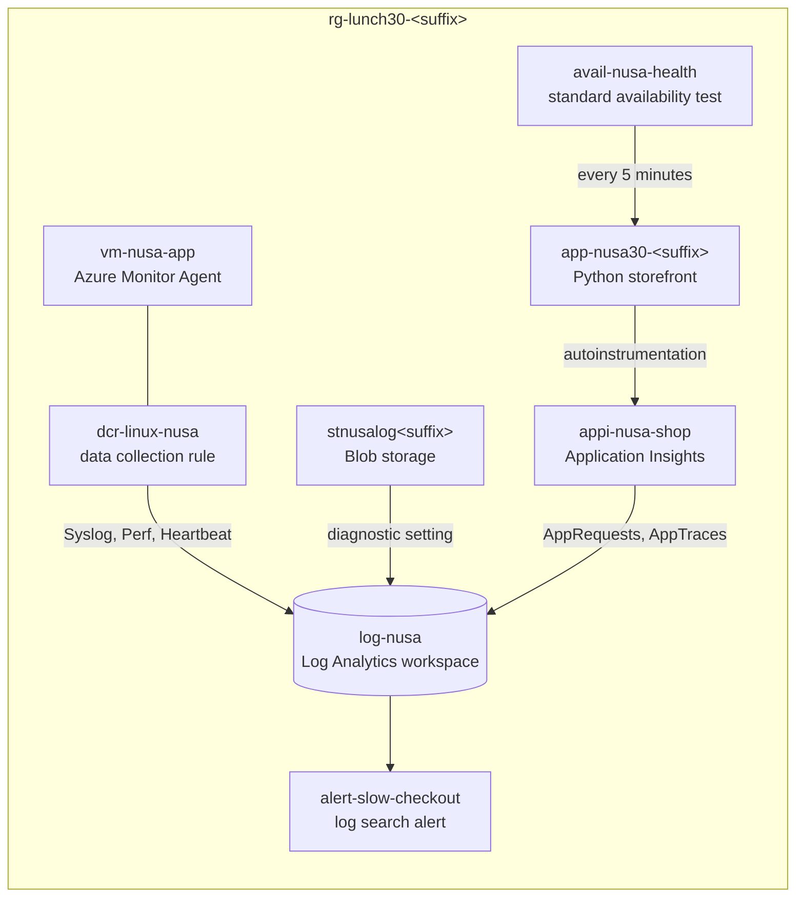

# Lab 30 · Why was checkout slow on Friday?

🇮🇩 [Baca dalam Bahasa Indonesia](README.id.md)

> **Pairs with:** [Lunch 30 · Monitoring (Advanced): Log Analytics, KQL and Application Insights](../../lunches/30-monitoring-advanced/README.md)
> **Time:** about 60 minutes · **Cost:** 💲💲 (see [cost bands](../README.md#cost-bands)) · **Difficulty:** ★★★
> **Works on its own:** ✅ You do not need any earlier lab. Everything this lab needs is created by its steps or by `setup.sh`.
> **Author:** Stefanus Pinarta · [About the author](../../README.md#about-the-author)

## 🎯 What you'll build

Last Friday Nusantara Retail's checkout took four seconds while every CPU chart looked fine. Dewi blames the product
images, Pak Budi the order-jobs VM, Rizky the payment provider. Today you build the evidence room that settles it: one
Log Analytics workspace fed by three pipes — the Azure Monitor Agent with a data collection rule on the VM, a diagnostic
setting on Blob storage, and Application Insights on the storefront web app. Then you answer ten graded KQL questions,
turn the slow-checkout query into a log search alert, and repair a data collection rule that silently drops warnings.



## ✅ Before you start

- An Azure subscription where you can create resources and assign roles on them (see [Lab 01](../01-before-you-begin/README.md)).
- **Azure Cloud Shell (Bash)** — open [shell.azure.com](https://shell.azure.com). Nothing to install: `setup.sh` adds
  the Azure CLI extensions this lab uses (`monitor-control-service`, `application-insights`, `scheduled-query` and
  `log-analytics`).
- Optional: an email address you can read during the lab, if you want the alert in your inbox.
- Get the lab files and load the shared settings and the lab's resource names:

```bash
git clone https://github.com/stefpin/azure-fundamentals-lunches.git   # first time only
cd azure-fundamentals-lunches/labs/30-monitoring-advanced
source ../common/config.sh
source lab.env
```

- Create the starting point: the workspace `log-nusa`, the VM `vm-nusa-app`, the storage account `stnusalog<suffix>`
  and the storefront web app — with nothing monitored yet. It takes about 6–10 minutes:

```bash
bash setup.sh
```

> [!IMPORTANT]
> Lab resources cost money while they exist. Finish with the **Clean up** section, even if you stop halfway.

> [!NOTE]
> Monitoring data isn't instant. A brand-new agent, rule, diagnostic setting or Application Insights resource usually
> needs **5–15 minutes** before its first rows appear. The tasks are ordered so you can keep working while data starts
> flowing; Task 6 is where you query it.

> [!TIP]
> Cloud Shell disconnects after about 20 minutes without typing. If that happens, reconnect and reload the variables:
>
> ```bash
> cd ~/azure-fundamentals-lunches/labs/30-monitoring-advanced && source ../common/config.sh && source lab.env
> LAW_ID=$(az monitor log-analytics workspace show -g "$RG" -n "$LAW" --query id -o tsv)
> LAW_GUID=$(az monitor log-analytics workspace show -g "$RG" -n "$LAW" --query customerId -o tsv)
> VM_ID=$(az vm show -g "$RG" -n "$VM" --query id -o tsv)
> ST_ID=$(az storage account show -g "$RG" -n "$ST" --query id -o tsv)
> HOST=$(az webapp show -g "$RG" -n "$APP" --query defaultHostName -o tsv)
> kql() { az monitor log-analytics query --workspace "$LAW_GUID" --analytics-query "$1" --output table; }
> ```

## 🧭 Choose your mode

| Mode | For you if… | How |
|---|---|---|
| **Guided** | you want every step explained | follow Tasks 1–7 below |
| **Challenge** | you already know the basics | read only the [Challenge brief](#-challenge-brief), build it your way, then run `bash verify.sh` |

## Task 1 · Tour the evidence room

Start with the empty workspace: where it lives, how long it keeps data, and how to ask it a question from Cloud Shell.

```bash
LAW_ID=$(az monitor log-analytics workspace show --resource-group "$RG" --workspace-name "$LAW" --query id --output tsv)
LAW_GUID=$(az monitor log-analytics workspace show --resource-group "$RG" --workspace-name "$LAW" --query customerId --output tsv)

az monitor log-analytics workspace show --resource-group "$RG" --workspace-name "$LAW" \
  --query "{name:name, location:location, pricing:sku.name, retentionDays:retentionInDays, workspaceGuid:customerId}" \
  --output yaml

# Plan and retention of a table you'll fill today
az monitor log-analytics workspace table show --resource-group "$RG" --workspace-name "$LAW" --name Syslog \
  --query "{table:name, plan:plan || properties.plan, analyticsDays:retentionInDays || properties.retentionInDays, totalDays:totalRetentionInDays || properties.totalRetentionInDays}" \
  --output yaml

# A small helper that runs KQL from Cloud Shell. It needs the workspace GUID, not the name.
kql() { az monitor log-analytics query --workspace "$LAW_GUID" --analytics-query "$1" --output table; }
kql 'print Message = "Selamat siang from log-nusa", Now = now()'
```

The workspace has two IDs: the Azure resource ID (`LAW_ID`), which you use to *send* data to it, and the workspace
GUID (`LAW_GUID`, called *Workspace ID* in the portal), which you use to *query* it.

> [!TIP]
> **Prefer the portal?** Open `log-nusa` › *Settings › Tables* to see every table's plan and retention, then *Logs*.
> Switch the editor from *Simple mode* to *KQL mode* — you'll use KQL mode for the rest of the lab.

> ✅ **Checkpoint:** `retentionDays: 30`, the `Syslog` table on the `Analytics` plan with 30 days of analytics
> retention, and one row with your greeting and the current time.

## Task 2 · Give the VM an identity and the Azure Monitor Agent

The Azure Monitor Agent signs in to Azure Monitor with the VM's **managed identity** — no keys or workspace secrets. Give
the VM a system-assigned identity, then install the agent as a VM extension:

```bash
VM_ID=$(az vm show --resource-group "$RG" --name "$VM" --query id --output tsv)

az vm identity assign --resource-group "$RG" --name "$VM" --output none

az vm extension set \
  --resource-group "$RG" \
  --vm-name "$VM" \
  --name AzureMonitorLinuxAgent \
  --publisher Microsoft.Azure.Monitor \
  --enable-auto-upgrade true \
  --output none

az vm show --resource-group "$RG" --name "$VM" --query identity.type --output tsv
az vm extension list --resource-group "$RG" --vm-name "$VM" \
  --query "[].{name:name, version:typeHandlerVersion, state:provisioningState, autoUpgrade:enableAutomaticUpgrade}" \
  --output table
```

Now ask the workspace whether the agent reports anything:

```bash
kql 'Heartbeat | where TimeGenerated > ago(1h) | summarize count() by Computer'
```

Nothing. That's expected: the agent doesn't collect anything until a data collection rule tells it what to collect and
where to send it. That's Task 3.

> [!TIP]
> **Prefer the portal?** VM › *Settings › Identity* › *System assigned: On*. Then VM › *Settings › Extensions +
> applications* › *Add* › *Azure Monitor Agent for Linux*. (Creating a data collection rule in the portal also installs
> the agent for you.)

> ✅ **Checkpoint:** the identity type is `SystemAssigned`, `AzureMonitorLinuxAgent` shows `Succeeded` with auto-upgrade
> on, and the Heartbeat query returns no rows.

## Task 3 · Tell the agent what to collect: a data collection rule

Read the rule first — it's short:

```bash
cat dcr-linux-nusa.json
```

| Part | What it says |
|---|---|
| `dataSources.syslog` | collect Syslog from the `auth`, `authpriv`, `cron`, `daemon`, `syslog` and `user` facilities, at **Warning** and above |
| `dataSources.performanceCounters` | sample CPU, memory, disk and network counters every 60 seconds |
| `destinations.logAnalytics` | one destination named `la-nusa`: the workspace whose resource ID replaces `__WORKSPACE_RESOURCE_ID__` |
| `dataFlows` | send the Syslog and Perf streams to `la-nusa` (they land in the `Syslog` and `Perf` tables) |

Fill in your workspace, create the rule, and associate it with the VM:

```bash
mkdir -p "$OUT_DIR"
sed "s|__WORKSPACE_RESOURCE_ID__|${LAW_ID}|" dcr-linux-nusa.json > "$OUT_DIR/dcr.json"

az monitor data-collection rule create \
  --resource-group "$RG" \
  --location "$LOCATION" \
  --name "$DCR" \
  --rule-file "$OUT_DIR/dcr.json" \
  --output none
DCR_ID=$(az monitor data-collection rule show --resource-group "$RG" --name "$DCR" --query id --output tsv)

az monitor data-collection rule association create \
  --name "$DCR_ASSOC" \
  --rule-id "$DCR_ID" \
  --resource "$VM_ID" \
  --output none

az monitor data-collection rule association list --resource "$VM_ID" \
  --query "[].{association:name, rule:dataCollectionRuleId || properties.dataCollectionRuleId}" --output table
```

The rule must be in the same region as the workspace it sends to; here everything is in `$LOCATION`. The association is
what connects one machine to one rule — in production, Azure Policy creates associations for every new VM (Lunch 31).

Now give the order-jobs server something to say. Run Command writes three messages to Syslog at three severities:

```bash
az vm run-command invoke --resource-group "$RG" --name "$VM" --command-id RunShellScript \
  --scripts "logger -p user.warning -t nusa-orders 'Order batch 4471 retry 3/5: payment API slow'; logger -p user.info -t nusa-orders 'Order batch 4471 started'; logger -p user.err -t nusa-orders 'Order batch 4470 failed after 5 retries'" \
  --query "value[0].message" --output tsv
```

Which of the three should reach the workspace? You'll check in Task 6. Heartbeats should start within about 5–10
minutes; carry on with Task 4 meanwhile.

> [!TIP]
> **Prefer the portal?** *Monitor › Settings › Data Collection Rules* › *Create*. On *Resources* add `vm-nusa-app`; on
> *Collect and deliver* add *Linux Syslog* (minimum log level *LOG_WARNING*) and *Performance Counters*, each with
> `log-nusa` as the destination. Open the finished rule's *JSON View* and compare it with the file.

> ✅ **Checkpoint:** the association list shows `dcra-vm-nusa-app` pointing at `.../dataCollectionRules/dcr-linux-nusa`,
> and Run Command returns without errors.

## Task 4 · Platform logs: a diagnostic setting for Blob storage

Dewi's product images live in Blob storage. Who reads them, how fast, and which reads fail? The storage service writes
those resource logs only if you route them somewhere. For storage, the setting goes on the **blob service**
(`.../blobServices/default`), not on the storage account itself:

```bash
ST_ID=$(az storage account show --resource-group "$RG" --name "$ST" --query id --output tsv)

# Which log categories does the blob service offer?
az monitor diagnostic-settings categories list --resource "$ST_ID/blobServices/default" \
  --query "(value || @)[].{category:name, type:categoryType}" --output table

az monitor diagnostic-settings create \
  --name "$DIAG" \
  --resource "$ST_ID/blobServices/default" \
  --workspace "$LAW_ID" \
  --logs '[{"categoryGroup":"allLogs","enabled":true}]' \
  --output none

az monitor diagnostic-settings list --resource "$ST_ID/blobServices/default" \
  --query "(value || @)[].{name:name, workspace:workspaceId, logs:logs[].categoryGroup}" --output yaml
```

- `categoryGroup: allLogs` means "every log category, including any added later" — here `StorageRead`, `StorageWrite`
  and `StorageDelete`. The `audit` group is the smaller alternative.
- Storage logs land in the resource-specific table `StorageBlobLogs`.
- A diagnostic setting outlives its resource. That's why `cleanup.sh` deletes it explicitly.

> [!TIP]
> **Prefer the portal?** Storage account › *Monitoring › Diagnostic settings* › select **blob** › *Add diagnostic
> setting*. Tick *allLogs* and *Send to Log Analytics workspace* › `log-nusa`.

> ✅ **Checkpoint:** one setting named `diag-blob-to-log-nusa` whose workspace ends in `/workspaces/log-nusa` and whose
> logs list `allLogs`.

## Task 5 · Application Insights for the storefront

The storefront in `app/app.py` contains no monitoring code at all. You'll turn on **autoinstrumentation**: App Service
loads Microsoft's OpenTelemetry-based agent into the Python process and sends requests, exceptions and logged warnings
to a workspace-based Application Insights resource.

```bash
az monitor app-insights component create \
  --app "$APPI" \
  --resource-group "$RG" \
  --location "$LOCATION" \
  --workspace "$LAW_ID" \
  --application-type web \
  --output none
APPI_ID=$(az monitor app-insights component show --app "$APPI" --resource-group "$RG" --query id --output tsv)
CONN=$(az monitor app-insights component show --app "$APPI" --resource-group "$RG" --query connectionString --output tsv)

az webapp config appsettings set --resource-group "$RG" --name "$APP" \
  --settings "APPLICATIONINSIGHTS_CONNECTION_STRING=$CONN" \
             "ApplicationInsightsAgent_EXTENSION_VERSION=~3" \
             "OTEL_SERVICE_NAME=nusa-storefront" \
  --output none
```

| App setting | Why |
|---|---|
| `APPLICATIONINSIGHTS_CONNECTION_STRING` | where to send telemetry (it identifies `appi-nusa-shop`) |
| `ApplicationInsightsAgent_EXTENSION_VERSION=~3` | turns on the App Service-managed agent on Linux |
| `OTEL_SERVICE_NAME` | a standard OpenTelemetry setting: the name shown on the application map and in `AppRoleName` |

Changing app settings restarts the app. Next, watch the storefront from outside with a **standard availability test**
that calls `/health` every 5 minutes from five locations: Singapore, Hong Kong, Japan, Australia and the US West Coast.

```bash
HOST=$(az webapp show --resource-group "$RG" --name "$APP" --query defaultHostName --output tsv)

az monitor app-insights web-test create \
  --resource-group "$RG" \
  --name "$WEBTEST" \
  --location "$LOCATION" \
  --web-test-kind standard \
  --defined-web-test-name "$WEBTEST" \
  --synthetic-monitor-id "$WEBTEST" \
  --enabled true \
  --frequency 300 \
  --timeout 30 \
  --retry-enabled true \
  --locations Id=apac-sg-sin-azr \
  --locations Id=apac-hk-hkn-azr \
  --locations Id=apac-jp-kaw-edge \
  --locations Id=emea-au-syd-edge \
  --locations Id=us-ca-sjc-azr \
  --http-verb GET \
  --request-url "https://$HOST/health" \
  --expected-status-code 200 \
  --tags "hidden-link:$APPI_ID=Resource" \
  --output none
```

The `hidden-link` tag is what attaches the test to `appi-nusa-shop`, so its results appear under *Availability* and in
the `AppAvailabilityResults` table. Standard tests are billed per run, so this lab keeps the frequency at 5 minutes.

Finally, play Friday evening. `traffic.sh` sends shoppers to the storefront and reads and writes product images; run it
in the background for 25 minutes:

```bash
nohup bash traffic.sh 25 > "$OUT_DIR/traffic.log" 2>&1 &
sleep 60; tail -n 3 "$OUT_DIR/traffic.log"
```

> [!TIP]
> **Prefer the portal?** Web app › *Monitoring › Application Insights* › *Turn on Application Insights* sets the same
> app settings for you. For the test: `appi-nusa-shop` › *Investigate › Availability* › *Add Standard test*.

> ✅ **Checkpoint:** the traffic log shows rounds with some slow and a few failed checkouts, and
> `az monitor app-insights web-test list --resource-group "$RG" --query "[].name" --output tsv` prints `avail-nusa-health`.
> If the log mentions failed storage calls, your new role assignment is still propagating — keep going.

## Task 6 · Ten KQL questions

Give the pipes about ten minutes after Task 5, then check what has arrived:

```bash
kql 'union isfuzzy=true withsource=SourceTable Heartbeat, Syslog, Perf, StorageBlobLogs, AppRequests, AppTraces, AppExceptions, AppAvailabilityResults
| where TimeGenerated > ago(1h)
| summarize Rows = count() by SourceTable'
```

The portal is the comfortable place for this task: `log-nusa` › *Logs*, *KQL mode*, time range *Set in query*. Every
solution below also works in Cloud Shell as `kql '<query>'` (charts are portal-only; the CLI prints the rows).

Grading: ★ = 1 point, ★★ = 2 points, ★★★ = 3 points — 20 points in total. Write your query, run it, and only then open
the solution. Fourteen points or more and you're ready for on-call.

**1. ★ Is the agent alive?** Which computers send heartbeats through the Azure Monitor Agent, and when did each last
check in?

<details><summary>Solution 1</summary>

```kusto
Heartbeat
| where TimeGenerated > ago(1h)
| where Category == "Azure Monitor Agent"
| summarize LastSeen = max(TimeGenerated), Heartbeats = count() by Computer, OSType, Version
```

Expect one row for `vm-nusa-app` with roughly one heartbeat per minute since the association. `Heartbeat` is free to
ingest.

</details>

**2. ★ What did the order-jobs server warn about?** List the Syslog warnings of the last four hours, newest first.

<details><summary>Solution 2</summary>

```kusto
Syslog
| where TimeGenerated > ago(4h)
| where SeverityLevel =~ "warning"
| project TimeGenerated, Computer, Facility, ProcessName, SyslogMessage
| sort by TimeGenerated desc
```

Your *Order batch 4471 retry 3/5* message from `nusa-orders` is there. Remove the severity filter and you'll also find
the *err* message — but never the *info* one: the DCR collects Warning and above, so the agent dropped it at the source.

</details>

**3. ★ What happened to the product images?** Count blob operations by operation name, result and authentication type.

<details><summary>Solution 3</summary>

```kusto
StorageBlobLogs
| where TimeGenerated > ago(4h)
| summarize Requests = count() by OperationName, StatusText, AuthenticationType
| sort by Requests desc
```

You'll see `PutBlob`, `ListBlobs` and `GetBlob` with `Success` over `OAuth`, plus `GetBlob` with `BlobNotFound` — the
12.12 banner that doesn't exist. Rows with `AuthorizationPermissionMismatch` come from the minutes before your role
assignment applied.

</details>

**4. ★★ Is Pak Budi's VM busy?** Chart the average CPU of each computer in 5-minute buckets for the last hour.

<details><summary>Solution 4</summary>

```kusto
Perf
| where TimeGenerated > ago(1h)
| where ObjectName == "Processor" and CounterName == "% Processor Time"
| summarize AvgCpu = avg(CounterValue) by bin(TimeGenerated, 5m), Computer
| render timechart
```

A flat, low line: the VM is innocent.

</details>

**5. ★★ How much memory is left?** Show only the newest *Available MBytes Memory* sample for each computer.

<details><summary>Solution 5</summary>

```kusto
Perf
| where TimeGenerated > ago(1h)
| where ObjectName == "Memory" and CounterName == "Available MBytes Memory"
| summarize arg_max(TimeGenerated, CounterValue) by Computer
| project Computer, LastSample = TimeGenerated, AvailableMB = CounterValue
```

`arg_max(TimeGenerated, CounterValue)` keeps the whole latest row per computer instead of averaging.

</details>

**6. ★★ Which operations fail?** For each request name, show the number of requests, failures and the failure
percentage, worst first.

<details><summary>Solution 6</summary>

```kusto
AppRequests
| where TimeGenerated > ago(1h)
| summarize Requests = count(), Failed = countif(Success == false) by Name
| extend FailedPct = round(100.0 * Failed / Requests, 1)
| sort by FailedPct desc
```

`POST /checkout` fails about 7% of the time; `GET /products`, `GET /` and the availability test's `GET /health` don't
fail at all.

</details>

**7. ★★ What did the code say?** Count the warnings that mention the payment gateway in 5-minute buckets, as a column
chart.

<details><summary>Solution 7</summary>

```kusto
AppTraces
| where TimeGenerated > ago(1h)
| where SeverityLevel == 2 and Message has "Payment gateway"
| summarize Warnings = count() by bin(TimeGenerated, 5m)
| render columnchart
```

In `AppTraces`, `SeverityLevel` 2 means *Warning*. These rows come from Python's `logging` module — autoinstrumentation
collects the root logger.

</details>

**8. ★★★ The chart for Ibu Sari.** Plot the median and the 95th-percentile duration of checkout requests in 5-minute
buckets.

<details><summary>Solution 8</summary>

```kusto
AppRequests
| where TimeGenerated > ago(1h)
| where Name has "checkout"
| summarize p50 = percentile(DurationMs, 50), p95 = percentile(DurationMs, 95) by bin(TimeGenerated, 5m)
| render timechart
```

The median stays around 200–300 ms while the p95 sits near 2,500–3,000 ms: most customers are fine, and one in five
waits for the payment provider. An average would have hidden that.

</details>

**9. ★★★ Why did those checkouts fail?** List the failed requests of the last hour with the exception type and message
of the same operation. Keep failed requests that have no exception.

<details><summary>Solution 9</summary>

```kusto
AppRequests
| where TimeGenerated > ago(1h) and Success == false
| project TimeGenerated, OperationId, Name, ResultCode, DurationMs
| join kind=leftouter (
    AppExceptions
    | where TimeGenerated > ago(1h)
    | summarize arg_max(TimeGenerated, ExceptionType, OuterMessage) by OperationId
  ) on OperationId
| project TimeGenerated, Name, ResultCode, DurationMs, ExceptionType, OuterMessage
| sort by TimeGenerated desc
```

Every failure is a `POST /checkout` with result code 500 after about three seconds, and the exception says the
payment provider didn't answer. `kind=leftouter` keeps requests without an exception, and the `summarize` on the right
side keeps one exception per operation so rows don't multiply. Rizky was right.

</details>

**10. ★★★ What does this evidence cost?** Show the billable megabytes ingested per table over the last day, largest
first, as a pie chart.

<details><summary>Solution 10</summary>

```kusto
Usage
| where TimeGenerated > ago(1d)
| where IsBillable == true
| summarize BillableMB = round(sum(Quantity), 2) by DataType
| sort by BillableMB desc
| render piechart
```

`Quantity` is in MB. `Heartbeat` doesn't appear because it's free. `Usage` is written in batches, so early in the lab
it may still be empty — run it again at the end.

</details>

> ✅ **Checkpoint:** questions 1, 6 and 8 return rows. If a table is still empty, wait a few minutes and use the
> Troubleshooting table.

## Task 7 · From query to alert

Question 8 found the problem; now make sure you hear about it next time. A **log search alert** runs a query on a
schedule. If you want an email, create an action group first (skip this block otherwise):

```bash
export ALERT_EMAIL="you@example.com"     # change this to your own address
az monitor action-group create \
  --resource-group "$RG" \
  --name "$AG" \
  --short-name nusaoncall \
  --action email oncall-email "$ALERT_EMAIL" usecommonalertschema \
  --output none
AG_ID=$(az monitor action-group show --resource-group "$RG" --name "$AG" --query id --output tsv)
```

Create the rule. If you skipped the action group, leave out the `--action-groups` line:

```bash
az monitor scheduled-query create \
  --resource-group "$RG" \
  --name "$ALERT" \
  --location "$LOCATION" \
  --scopes "$LAW_ID" \
  --condition "count 'SlowCheckout' > 3 at least 1 violations out of 1 aggregated points" \
  --condition-query SlowCheckout="AppRequests | where Name has 'checkout' and DurationMs > 1000" \
  --window-size 10m \
  --evaluation-frequency 5m \
  --severity 3 \
  --description "More than 3 checkouts slower than 1 second in 10 minutes" \
  --action-groups "$AG_ID" \
  --output none

az monitor scheduled-query show --resource-group "$RG" --name "$ALERT" \
  --query "{enabled:enabled, every:evaluationFrequency, window:windowSize, query:criteria.allOf[0].query, operator:criteria.allOf[0].operator, threshold:criteria.allOf[0].threshold}" \
  --output yaml
```

| Part | Meaning |
|---|---|
| `--condition-query SlowCheckout="…"` | the query, under a placeholder name; it returns the slow checkouts, not a verdict |
| `--condition "count 'SlowCheckout' > 3 …"` | count the rows the query returns and fire when there are more than 3 |
| `--window-size 10m` | each run looks at the last 10 minutes: twice the frequency, so rows that arrive late are still counted |
| `--evaluation-frequency 5m` | run every 5 minutes (1-minute rules cost more) |
| `--scopes "$LAW_ID"` | the workspace that holds `AppRequests` |

The alert needs slow checkouts to count. If `traffic.sh` has finished (`tail -n 2 "$OUT_DIR/traffic.log"` says
*Done*), start it again:

```bash
nohup bash traffic.sh 15 > "$OUT_DIR/traffic.log" 2>&1 &
```

The alert fires within about 5–15 minutes. Watch *Monitor › Alerts* in the portal, filtered on your resource group.

**Optional — a workbook for the whole team (portal, about 5 minutes):** `log-nusa` › *Workbooks* › *New*. *Add › Add
query*, paste solution 8 and choose *Time chart*; add a second query with solution 6 as a *Grid*. Select *Done editing*,
then *Save* it as `Checkout health` in your lab resource group. That's the page Ibu Sari can open before 12.12.

> [!TIP]
> **Prefer the portal?** Run solution 8 without the `render` line in *Logs*, then select *New alert rule*. The query
> comes with it: set *Measure* to *Table rows*, *Aggregation granularity* to 10 minutes, the threshold to 3 and the
> frequency to 5 minutes.

> ✅ **Checkpoint:** the rule shows `enabled: true`, `every: PT5M`, `window: PT10M` and `threshold: 3.0`, and a fired
> `alert-slow-checkout` alert (Sev 3) appears under *Monitor › Alerts* — plus an email if you created the action group.

## 🔧 Break it and fix it

Rizky trimmed the data collection rule "to cut the log bill". Apply his version:

```bash
sed 's/"Warning", //' "$OUT_DIR/dcr.json" > "$OUT_DIR/dcr-rizky.json"
grep logLevels "$OUT_DIR/dcr-rizky.json"
az monitor data-collection rule create --resource-group "$RG" --location "$LOCATION" --name "$DCR" \
  --rule-file "$OUT_DIR/dcr-rizky.json" --output none
```

Wait about five minutes for the agent to pick up the change, then let the order-jobs server report two problems with the
marker `rizkytest`:

```bash
az vm run-command invoke --resource-group "$RG" --name "$VM" --command-id RunShellScript \
  --scripts "logger -p user.warning -t nusa-orders 'Payment API slow again (rizkytest)'; logger -p user.err -t nusa-orders 'Order batch 4480 failed (rizkytest)'" \
  --query "value[0].message" --output tsv
```

**Symptom:** ten minutes later, only one of the two messages is in the workspace, and `bash verify.sh` fails a check.

```bash
kql 'Syslog | where TimeGenerated > ago(30m) | where SyslogMessage has "rizkytest" | project TimeGenerated, SeverityLevel, SyslogMessage'
```

<details><summary>Hint: what's missing, and how do you fix it?</summary>

The error arrived; the warning didn't. Rizky's rule lists only `Error`, `Critical`, `Alert` and `Emergency`, so the
agent now drops every warning on the VM before it's sent — including the "payment API slow" warnings that would have
explained Friday. Filtering at the source is the right way to save money, but only for data nobody needs.

Re-create the rule from the original file, which includes `Warning`:

```bash
az monitor data-collection rule create --resource-group "$RG" --location "$LOCATION" --name "$DCR" \
  --rule-file "$OUT_DIR/dcr.json" --output none
```

Wait about five minutes, run the `logger` command again with the marker `rizkyfixed`, and query for it ten minutes
later: both severities arrive. The warning you sent during the break is gone for good — the agent doesn't backfill
what a rule filtered out.

</details>

## 🧪 Verify your work

```bash
bash verify.sh
```

Every check should say **PASS**. If one fails, the message tells you which task to revisit. The last section counts rows
per table as notes: if a table is still empty, wait a few minutes and run the script again.

## 🧹 Clean up (do not skip!)

```bash
bash cleanup.sh
```

This deletes, in order: the diagnostic setting on the blob service (diagnostic settings can outlive their resource),
your Storage Blob Data Contributor role assignment, the workspace `log-nusa` — permanently, instead of keeping it
soft-deleted for 14 days — and then resource group `rg-lunch30-<suffix>` with everything else in it: the VM and its
network resources, the storage account, the App Service plan and web app, Application Insights with its availability
test, the data collection rule, the alert rule and the action group. It also removes the local folder
`$HOME/lab30-out`. Deletion continues in the background for a few minutes.

If you created a subscription-level diagnostic setting in the stretch goals, delete it too — it isn't in the resource
group.

## 🩺 Troubleshooting

| Symptom | Likely cause | Fix |
|---|---|---|
| An `az monitor data-collection`, `app-insights`, `scheduled-query` or `log-analytics query` command asks to install an extension, or says it isn't recognized | the CLI extension isn't installed in this Cloud Shell | run `bash setup.sh` again, or `az extension add --name monitor-control-service` (and `application-insights`, `scheduled-query`, `log-analytics`) |
| `setup.sh` fails on the App Service plan with a quota error | your subscription has no quota for Basic plans in this region | run `export LAB30_APP_SKU=F1` (Free) or choose another `LOCATION`, then `source lab.env` and `bash setup.sh` again |
| No `Heartbeat` rows 15 minutes after Task 3 | no managed identity, no association, the agent can't reach Azure Monitor, or the rule and workspace are in different regions | re-run the Task 2 and Task 3 checks; the VM needs its public IP for outbound HTTPS; recreate the rule in the workspace's region |
| `Heartbeat` rows arrive but no Syslog warnings | the rule doesn't include `Warning`, or the message was sent before the rule applied | `grep logLevels "$OUT_DIR/dcr.json"`; send a new warning with Task 3's `logger` command and wait 10 minutes |
| `StorageBlobLogs` stays empty | the diagnostic setting is on the storage account instead of `.../blobServices/default`, or no blob traffic yet | re-run Task 4 exactly; check `$OUT_DIR/traffic.log` for storage rounds |
| `traffic.sh` reports failed storage rounds for more than 10 minutes | the role assignment from `setup.sh` is missing | `az role assignment create --assignee-object-id "$(az ad signed-in-user show --query id -o tsv)" --assignee-principal-type User --role "Storage Blob Data Contributor" --scope "$ST_ID"` |
| No `AppRequests` rows 15 minutes after Task 5 | the app settings are missing or misspelled, or the app hasn't restarted | check them with `az webapp config appsettings list --resource-group "$RG" --name "$APP" --output table`; `az webapp restart --resource-group "$RG" --name "$APP"`; make sure `traffic.sh` is still running |
| `az monitor log-analytics query` says the workspace wasn't found | you passed the workspace name or resource ID | use the GUID: `$LAW_GUID` (the *Workspace ID* in the portal) |
| The alert rule can't be created: *Failed to resolve table or column expression named 'AppRequests'* | Application Insights hasn't sent its first data yet | wait until question 6 returns rows, then run the command again (or add `--skip-query-validation true`) |
| The alert hasn't fired after 15 minutes | not enough slow checkouts in a 10-minute window | check that `traffic.sh` is running (`tail "$OUT_DIR/traffic.log"`); start it again with `nohup bash traffic.sh 15 > "$OUT_DIR/traffic.log" 2>&1 &` |

## 🚀 Stretch goals

- **Transform at ingestion:** add `"transformKql": "source | where ProcessName != \"nusa-orders\""` to the Syslog data
  flow in a copy of `$OUT_DIR/dcr.json`, re-create the rule from the copy, and confirm that a new `nusa-orders` warning
  no longer arrives while other Syslog warnings still do. Re-create the rule from `$OUT_DIR/dcr.json` afterwards.
- **Table plans:** open `log-nusa` › *Settings › Tables*, find a table you filled today that offers the *Basic* plan,
  and read what changes (query price, alerts, retention) before you switch. Note that a table's plan can be changed only
  once a week.
- **The application map:** open `appi-nusa-shop` › *Investigate › Application map*, then *Performance* › `POST /checkout`
  › drill into a slow sample to see its end-to-end transaction.
- **Activity log in the workspace:** create a subscription diagnostic setting that sends the activity log to `log-nusa`
  (`az monitor diagnostic-settings subscription create`), query `AzureActivity`, and delete the setting with
  `az monitor diagnostic-settings subscription delete` before you clean up.
- **Grafana:** open *Monitor › Dashboards with Grafana* and explore the prebuilt dashboards for your VM and App Service.

## 🏁 Challenge brief

Run `bash setup.sh` to get resource group `rg-lunch30-<suffix>` with workspace `log-nusa`, VM `vm-nusa-app`, storage
account `stnusalog<suffix>` and web app `app-nusa30-<suffix>`. Then build the following, any way you like (portal, CLI,
Bicep):

1. `vm-nusa-app` has a **system-assigned managed identity** and the **Azure Monitor Agent** extension.
2. A **data collection rule** associated with the VM collects Syslog at **Warning** and above and at least one
   performance counter, and sends both to `log-nusa`. (`dcr-linux-nusa.json` is a valid starting point.)
3. A **diagnostic setting** on the storage account's **blob service** sends the **allLogs** category group to `log-nusa`.
4. A **workspace-based** Application Insights resource named `appi-nusa-shop` that uses `log-nusa`; the web app sends
   telemetry to it through **autoinstrumentation**; an enabled **standard availability test** linked to it checks the
   storefront.
5. A **log search alert** named `alert-slow-checkout`, scoped to `log-nusa` (or `appi-nusa-shop`), that queries
   `AppRequests` and fires when more than 3 checkouts take longer than 1 second.
6. Generate traffic with `bash traffic.sh 20` and answer questions 6, 8 and 9 of Task 6 with your own queries.

Then run `bash verify.sh`. Stuck? Peek at `solution.sh` or switch to Guided mode.

---

⬅️ [Lunch 30 reading](../../lunches/30-monitoring-advanced/README.md) · 🏠 [All labs](../README.md) · 🏠 [Course home](../../README.md)

<sub>Last validated: October 2026 · Something broken? [Report a lab problem](../../CONTRIBUTING.md).</sub>
