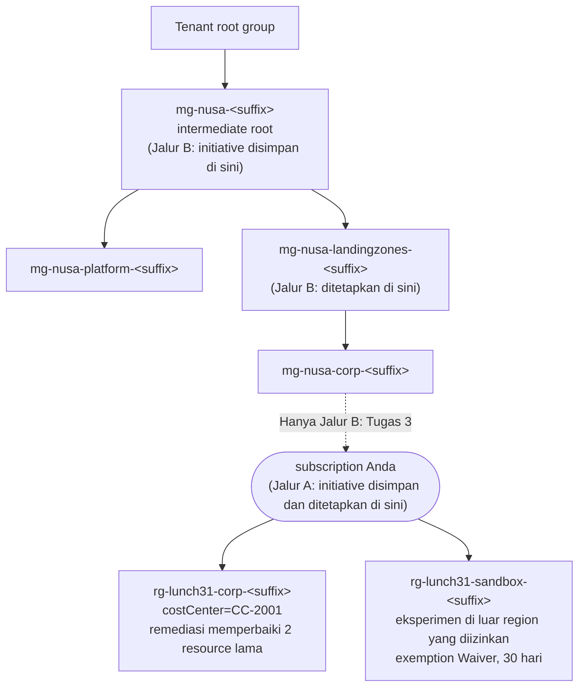

# Lab 31 · Tata kelola untuk seluruh perusahaan

🇬🇧 [Read in English](README.md)

> **Pasangan dari:** [Makan Siang 31 · Hierarki Resource dan Tata Kelola (Lanjutan): Tata Kelola Skala Besar](../../lunches/31-governance-at-scale/README.id.md)
> **Waktu:** sekitar 60 menit, termasuk 15–25 menit menunggu Azure Policy · **Biaya:** 💲 (lihat [kelompok biaya](../README.id.md#kelompok-biaya)) · **Tingkat kesulitan:** ★★★
> **Bisa dikerjakan terpisah:** ✅ Anda tidak memerlukan lab sebelumnya. Semua yang dibutuhkan lab ini dibuat oleh langkah-langkahnya sendiri atau oleh `setup.sh`.
> **Penulis:** Stefanus Pinarta · [Tentang penulis](../../README.id.md#tentang-penulis)

## 🎯 Yang akan Anda bangun

Ibu Sari menginginkan aturan yang sama di setiap subscription (*langganan*) yang kelak dimiliki Nusantara Retail. Anda
akan membangun hierarki Azure landing zone versi mini yang terdiri atas **management group** (*grup manajemen*), lalu
menulis sebuah **initiative** kustom (paket beberapa policy) sebagai kode, berisi lokasi yang diizinkan, tag `costCenter`
yang wajib, dan tag yang sama yang diwarisi dari resource group (*grup sumber daya*). Anda akan menetapkannya dengan cara
yang aman (**DoNotEnforce** lebih dulu, dengan sebuah **managed identity**), memperbaiki resource yang sudah ada dengan
**remediation task**, memberi eksperimen sandbox milik Dewi sebuah **Waiver** berbatas waktu, membaca kepatuhan lintas
scope dengan **Azure Resource Graph**, lalu mengekspor semuanya sebagai file policy-as-code. Memindahkan subscription
Anda ke dalam hierarki bersifat opsional (Jalur B) dan sepenuhnya bisa dibatalkan.



## ✅ Sebelum mulai

- **Tenant Anda sendiri.** Management group adalah objek yang berlaku untuk seluruh tenant. Kerjakan lab ini hanya di
  tenant Microsoft Entra yang Anda kendalikan — misalnya tenant yang terbentuk saat Anda membuat akun gratis — dan di
  subscription tempat Anda berperan sebagai **Owner**. Jangan pernah menjalankannya di tenant milik perusahaan tempat Anda
  bekerja, dan jangan pernah memindahkan subscription perusahaan. Jika organisasi Anda menyediakan tenant sandbox untuk
  belajar, tanyakan dulu kepada administratornya.
- Di tenant baru, pengguna mana pun bisa membuat management group. Jika pengaturan hierarki tenant Anda mewajibkan
  otorisasi, Tugas 2 akan gagal dengan `AuthorizationFailed` — gunakan tenant lain.
- **Azure Cloud Shell (Bash)** — buka [shell.azure.com](https://shell.azure.com). Tidak ada yang perlu diinstal.
- Ambil file lab, lalu muat pengaturan bersama dan nama-nama khusus lab ini:

```bash
git clone https://github.com/stefpin/azure-fundamentals-lunches.git   # first time only
cd azure-fundamentals-lunches/labs/31-governance-at-scale
source ../common/config.sh
source lab-vars.sh        # resource groups, management group names, policy names, Path A/B
echo "Path $LAB31_PATH | corp RG: $CORP_RG | sandbox RG: $SANDBOX_RG | intermediate root: $MG_ROOT"
```

- Buat titik awalnya — dua resource group berisi resource "lama" tanpa tag (sekitar 2–3 menit). Skrip akan menampilkan
  tenant dan subscription Anda, lalu meminta Anda mengonfirmasi bahwa keduanya memang milik Anda:

```bash
bash setup.sh
```

> [!IMPORTANT]
> Lab ini nyaris tanpa biaya (sebuah storage account kosong dan dua network security group), tetapi lab ini membuat objek
> **di luar** resource group: management group, initiative, policy assignment, exemption, dan role assignment. Selalu
> akhiri dengan bagian **Bersihkan** — `cleanup.sh` menghapus semuanya dengan urutan yang benar, dan memindahkan
> subscription Anda kembali jika tadi Anda memindahkannya.

> [!TIP]
> Cloud Shell melupakan variabel Anda saat sesinya habis (timeout). Kembali ke folder lab dan jalankan lagi
> `source ../common/config.sh && source lab-vars.sh`. Lakukan hal yang sama setelah Tugas 3: variabelnya kemudian beralih
> ke Jalur B.

## 🧭 Pilih mode Anda

| Mode | Cocok untuk Anda jika… | Caranya |
|---|---|---|
| **Terpandu** | Anda ingin setiap langkah dijelaskan | ikuti Tugas 1–9 di bawah |
| **Tantangan** | Anda sudah menguasai dasarnya | baca hanya [Ringkasan tantangan](#-ringkasan-tantangan), bangun dengan cara Anda sendiri, lalu jalankan `bash verify.sh` |

Kedua mode berjalan di salah satu dari dua jalur (skrip lab menyebutnya *Path A* dan *Path B*). Tentukan pilihan Anda
sebelum Tugas 3:

| | Jalur A (default) | Jalur B (opsional) |
|---|---|---|
| Subscription Anda | tetap di tempatnya | pindah ke `mg-nusa-corp-<suffix>` di Tugas 3 |
| Initiative disimpan di | subscription Anda | intermediate root `mg-nusa-<suffix>` |
| Initiative ditetapkan di | subscription Anda | `mg-nusa-landingzones-<suffix>` — subscription Anda mewarisinya |
| Yang Anda pelajari | semuanya, kecuali pewarisan sungguhan melalui management group | pola landing zone yang lengkap: simpan di atas, tetapkan di landing zones, warisi ke bawah |
| Yang Anda butuhkan | Owner pada subscription | Owner pada subscription, di tenant milik Anda |
| Cara membatalkan | tidak ada yang perlu dibatalkan | `cleanup.sh` memindahkan subscription kembali ke induk aslinya |

Mengapa berbeda? Sebuah definisi hanya bisa ditetapkan di scope tempat ia disimpan atau di bawahnya. Selama subscription
Anda berada di luar `mg-nusa-<suffix>`, initiative yang disimpan di management group itu tidak bisa menjangkaunya,
sehingga Jalur A menyimpan initiative di dalam subscription itu sendiri.

## Tugas 1 · Melihat titik awal dan menemukan definisi bawaan

Mulailah dengan melihat apa yang akan Anda atur, lalu temukan tiga definisi bawaan (built-in) yang akan dipakai ulang oleh
initiative.

```bash
for rg in "$CORP_RG" "$SANDBOX_RG"; do
  echo "== $rg  (resource group costCenter: $(az group show --name "$rg" --query tags.costCenter --output tsv))"
  az resource list --resource-group "$rg" \
    --query "[].{name:name, type:type, location:location, costCenter:tags.costCenter}" --output table
done

lookup_builtin_ids     # from lab-vars.sh: looks the definitions up by display name, never by GUID
printf '%s\n' "$ALLOWED_LOCATIONS_ID" "$REQUIRE_TAG_ID" "$INHERIT_TAG_ID"
```

Grup corp membawa tag `costCenter=CC-2001`, tetapi storage account dan network security group di dalamnya tidak. Grup
sandbox sama sekali tidak punya tag, dan network security group-nya berada di `$SECONDARY_LOCATION` — di luar region yang
nanti diizinkan oleh baseline.

> ✅ **Pemeriksaan:** tiga resource lama dengan kolom `costCenter` yang kosong, dan tiga ID yang diawali
> `/providers/Microsoft.Authorization/policyDefinitions/`. Jika ada ID yang kosong, jalankan lagi `lookup_builtin_ids`.

## Tugas 2 · Membangun hierarki management group

Anda akan membuat potongan terkecil dari hierarki Azure landing zone yang masih memperlihatkan polanya: sebuah
intermediate root di bawah tenant root group, sebuah grup Platform, sebuah grup Landing zones, dan Corp di bawahnya.

```bash
az account management-group create --name "$MG_ROOT" --display-name "Nusantara Retail (lab $SUFFIX)"
az account management-group create --name "$MG_PLATFORM" --display-name "Platform" --parent "$MG_ROOT"
az account management-group create --name "$MG_LZ" --display-name "Landing zones" --parent "$MG_ROOT"
az account management-group create --name "$MG_CORP" --display-name "Corp" --parent "$MG_LZ"
```

Beberapa hal yang perlu Anda ketahui selagi perintahnya berjalan:

- `--name` adalah **ID** management group. ID ini tidak pernah bisa diubah; nama tampilannya bisa. Itulah sebabnya lab ini
  menambahkan suffix Anda ke setiap ID.
- Management group yang paling pertama di sebuah tenant bisa butuh waktu hingga 15 menit untuk muncul. Jika pembuatan grup
  anak gagal dengan pesan "not found", tunggu satu menit lalu jalankan lagi baris tersebut.
- Anda otomatis menjadi **Owner** dari setiap management group yang Anda buat, dan itulah yang memungkinkan Anda menyimpan
  dan menetapkan policy di sana.
- Landing zone yang sesungguhnya punya lebih banyak grup (Security, Management, Connectivity, dan Identity di bawah
  Platform; Online dan Local di samping Corp; Sandboxes; Decommissioned). Makan Siang 31 menjelaskan masing-masing.

```bash
for mg in "$MG_ROOT" "$MG_PLATFORM" "$MG_LZ" "$MG_CORP"; do
  echo "$mg  ->  parent: $(mg_parent "$mg")"
done
```

> [!TIP]
> **Lebih suka portal?** Lokasinya di portal: *Home › Management groups › + Create*. Lalu pilih **Tenant root group** dan
> buka pohonnya untuk melihat keempat grup Anda — portal menampilkan hierarki lebih jelas daripada perintah apa pun.

> ✅ **Pemeriksaan:** induk dari intermediate root adalah ID tenant Anda (tenant root group); platform dan landing zones
> menunjuk ke `mg-nusa-<suffix>`; corp menunjuk ke `mg-nusa-landingzones-<suffix>`.

## Tugas 3 · (Opsional, Jalur B) Memindahkan subscription lab Anda ke Corp

Lewati tugas ini untuk Jalur A. Untuk Jalur B, baca bagian ini dulu.

> [!WARNING]
> Memindahkan subscription mengubah policy dan role assignment mana yang berlaku untuk **semua isinya**, dan Azure bisa
> butuh hingga 30 menit untuk mencerminkan hierarki baru di semua tempat. Lakukan hanya dengan subscription lab Anda
> sendiri di tenant Anda sendiri.
> Di tenant pribadi, subscription biasanya berada langsung di bawah tenant root group, sehingga memindahkannya keluar lalu
> kembali tidak memerlukan izin tambahan.

```bash
# 1. Where does the subscription live now? (The tenant root group's ID is your tenant ID.)
ORIGINAL_PARENT=$(az graph query --graph-query "resourcecontainers
  | where type =~ 'microsoft.resources/subscriptions' and subscriptionId == '$SUB_ID'
  | project parent = tostring(properties.managementGroupAncestorsChain[0].name)" \
  --query "data[0].parent" --output tsv)
echo "Current parent: ${ORIGINAL_PARENT:-$TENANT_ID}"

# 2. Move it into Corp
az account management-group subscription add --name "$MG_CORP" --subscription "$SUB_ID"

# 3. Remember the original parent for cleanup.sh, then reload the lab variables (they switch to Path B)
echo "${ORIGINAL_PARENT:-$TENANT_ID}" > "$LAB31_STATE_FILE"
source lab-vars.sh && echo "Path $LAB31_PATH: assign at $ASSIGN_SCOPE"
```

Jika `az graph` meminta Anda memasang ekstensi `resource-graph`, jawab ya (`setup.sh` biasanya sudah memasangnya).

> ✅ **Pemeriksaan:** `az account management-group subscription show --name "$MG_CORP" --subscription "$SUB_ID" --query displayName --output tsv`
> mencetak nama subscription Anda, dan `echo $LAB31_PATH` mencetak `B`.

## Tugas 4 · Membuat initiative dari file policy-as-code

Buka dua file di `policy/nusa-baseline/`. Keduanya mengikuti tata letak dari panduan policy-as-code Microsoft:

```bash
cat policy/nusa-baseline/policyset.definitions.json   # the three member policies
cat policy/nusa-baseline/policyset.parameters.json    # the initiative's own parameters
```

Setiap anggota punya **reference ID** pendek (`allowedLocations`, `requireCostCenterTag`, `inheritCostCenterTag`) dan
meneruskan sebuah parameter initiative ke policy-nya — `[parameters('allowedLocations')]` menjadi `listOfAllowedLocations`
milik definisi bawaan. ID definisinya masih berupa placeholder (penanda tempat), karena kursus ini tidak pernah menuliskan
GUID secara langsung: isi placeholder itu dengan ID yang Anda cari di Tugas 1, lalu buat initiative-nya.

```bash
mkdir -p generated
sed -e "s#__ALLOWED_LOCATIONS_ID__#${ALLOWED_LOCATIONS_ID}#" \
    -e "s#__REQUIRE_TAG_ID__#${REQUIRE_TAG_ID}#" \
    -e "s#__INHERIT_TAG_ID__#${INHERIT_TAG_ID}#" \
    policy/nusa-baseline/policyset.definitions.json > generated/policyset.definitions.json

az policy set-definition create --name "$INITIATIVE" $INITIATIVE_SCOPE_FLAG \
  --display-name "Nusantara baseline" \
  --description "Allowed locations, a required costCenter tag, and the costCenter tag inherited from the resource group." \
  --definitions ./generated/policyset.definitions.json \
  --params ./policy/nusa-baseline/policyset.parameters.json
```

`$INITIATIVE_SCOPE_FLAG` kosong pada Jalur A (initiative disimpan di subscription Anda) dan berisi
`--management-group mg-nusa-<suffix>` pada Jalur B (disimpan di intermediate root, sehingga setiap grup di bawahnya bisa
memakainya).

> ✅ **Pemeriksaan:**
> `az policy set-definition show --name "$INITIATIVE" $INITIATIVE_SCOPE_FLAG --query "policyDefinitions[].policyDefinitionReferenceId"`
> menampilkan ketiga reference ID. Jika perintah itu mengatakan initiative tidak ditemukan, jalankan `source lab-vars.sh` —
> variabel jalurnya mungkin sudah tidak sesuai.

## Tugas 5 · Menetapkan initiative — dengan aman

Tetapkan initiative sekali saja, di puncak dari apa yang Anda atur: subscription Anda (Jalur A) atau grup landing zones
(Jalur B). Dua pilihan berikut membuat assignment ini aman sekaligus berguna.

```bash
az policy assignment create --name "$ASSIGNMENT" --display-name "Nusantara baseline (Lab 31)" \
  --scope "$ASSIGN_SCOPE" --policy-set-definition "$INITIATIVE_ID" \
  --params "{ 'allowedLocations': { 'value': [ '$LOCATION' ] }, 'tagName': { 'value': 'costCenter' } }" \
  --enforcement-mode DoNotEnforce \
  --mi-system-assigned --location "$LOCATION" \
  --identity-scope "$CORP_RG_ID" --role Contributor
```

- **`--enforcement-mode DoNotEnforce`** — Azure mengevaluasi dan melaporkan kepatuhan, tetapi tidak menolak atau mengubah
  apa pun saat resource dibuat atau diperbarui. Remediation task tetap berfungsi. Inilah ring pertama dari rollout yang
  aman.
- **`--mi-system-assigned --location`** — policy Modify di dalam initiative membutuhkan managed identity (identitas yang
  dikelola Azure) untuk mengubah resource. `--identity-scope` dan `--role` memberinya role **Contributor** (role yang
  diminta definisi bawaan) hanya pada grup corp. Di produksi, Anda akan memberikannya di semua tempat yang harus ditulisi
  remediasi, biasanya scope assignment.

> [!WARNING]
> Pada Jalur A, assignment ini mencakup **seluruh subscription** Anda. Dalam mode DoNotEnforce ia hanya melapor, itulah
> sebabnya Anda mungkin melihat resource dari lab lain tercantum sebagai tidak patuh. Jangan mengubahnya ke enforcement
> `Default`: policy tag wajib kemudian akan menolak setiap resource tanpa tag di subscription itu, termasuk milik lab lain.
> Bagian tantangan tambahan menunjukkan cara aman untuk mencoba enforcement.

> ✅ **Pemeriksaan:** assignment melaporkan `DoNotEnforce` dan sebuah identitas system-assigned, dan identitas itu memegang
> sebuah role di grup corp:
> ```bash
> az policy assignment show --name "$ASSIGNMENT" --scope "$ASSIGN_SCOPE" \
>   --query "{mode:enforcementMode, identity:identity.type, locations:parameters.allowedLocations.value}"
> PID=$(az policy assignment show --name "$ASSIGNMENT" --scope "$ASSIGN_SCOPE" --query identity.principalId --output tsv)
> az role assignment list --scope "$CORP_RG_ID" --query "[?principalId=='$PID'].roleDefinitionName" --output tsv
> ```
> Jika perintah terakhir tidak mencetak apa pun, tunggu satu menit (identitas baru butuh waktu untuk tereplikasi) lalu
> berikan role itu sendiri:
> `az role assignment create --assignee-object-id "$PID" --assignee-principal-type ServicePrincipal --role Contributor --scope "$CORP_RG_ID"`.

## Tugas 6 · Meremediasi resource group corp

Assignment tidak menyentuh resource yang sudah ada dengan sendirinya. Yang melakukannya adalah **remediation task** —
untuk satu policy Modify atau DeployIfNotExists dalam satu waktu, jadi untuk initiative Anda menyebutkan reference ID
anggotanya. `ReEvaluateCompliance` membuat task memeriksa resource saat itu juga, alih-alih menunggu pemindaian kepatuhan
berikutnya.

```bash
az policy remediation create --name "$REMEDIATION" --resource-group "$CORP_RG" \
  --policy-assignment "$ASSIGNMENT_ID" --definition-reference-id inheritCostCenterTag \
  --resource-discovery-mode ReEvaluateCompliance

# Run this every minute or so until the state is Succeeded (usually 5–15 minutes)
az policy remediation show --name "$REMEDIATION" --resource-group "$CORP_RG" \
  --query "{state:provisioningState, deployments:deploymentStatus}"

az resource list --resource-group "$CORP_RG" --query "[].{name:name, costCenter:tags.costCenter}" --output table
```

Sambil menunggu, pikirkan sandbox-nya: mengapa task ini tidak akan pernah menyentuhnya? (Resource group-nya tidak punya
tag `costCenter` untuk diwarisi, dan identitasnya tidak punya role di sana.)

> ✅ **Pemeriksaan:** status remediasi adalah `Succeeded`, dan `stcorp<suffix>` maupun `nsg-corp-legacy` kini menampilkan
> `CC-2001`. Jika statusnya `Succeeded` tetapi tag-nya belum ada, resource tersebut belum dievaluasi — buat task kedua
> dengan `--name` lain, misalnya `"${REMEDIATION}-2"`.

## Tugas 7 · Memberi sandbox sebuah Waiver berbatas waktu

Eksperimen Dewi melanggar dua aturan: lokasinya di `$SECONDARY_LOCATION` dan tidak punya tag `costCenter`. Ibu Sari
menerima risiko itu selama 30 hari, sementara integrasi dengan mitra diuji. Itulah **Waiver**: risiko yang diterima, terlihat
di laporan kepatuhan sebagai *Exempt* (dikecualikan), dengan tanggal berakhir dan jejak dokumen yang jelas.

```bash
EXPIRES=$(date -u -d '+30 days' '+%Y-%m-%dT%H:%M:%SZ')
az policy exemption create --name "$EXEMPTION" --resource-group "$SANDBOX_RG" \
  --policy-assignment "$ASSIGNMENT_ID" --exemption-category Waiver --expires-on "$EXPIRES" \
  --display-name "Sandbox experiment in $SECONDARY_LOCATION (NUSA-1042)" \
  --description "Dewi tests a partner integration for 30 days. Risk accepted by Ibu Sari." \
  --metadata "{requestedBy:Dewi,approvedBy:'Ibu Sari',ticketRef:NUSA-1042}"
```

> [!TIP]
> Gunakan **Mitigated** alih-alih Waiver ketika tujuan policy sudah terpenuhi dengan cara lain. Untuk mengecualikan sebuah
> scope dari sebagian anggota initiative saja, tambahkan `--policy-definition-reference-ids` dengan reference ID mereka.
> Dan ketika sebuah exemption kedaluwarsa, Azure tidak menghapusnya — resource-nya hanya kembali tampil sebagai tidak
> patuh.

> ✅ **Pemeriksaan:**
> `az policy exemption list --resource-group "$SANDBOX_RG" --query "[].{name:name, category:exemptionCategory, expires:expiresOn}" --output table`
> menampilkan satu Waiver yang kedaluwarsa dalam 30 hari.

## Tugas 8 · Membaca kepatuhan dalam skala besar dengan Resource Graph

Minta Azure mengevaluasi kedua grup lab sekarang juga, alih-alih menunggu siklus terjadwal berikutnya:

```bash
az policy state trigger-scan --resource-group "$CORP_RG" --no-wait
az policy state trigger-scan --resource-group "$SANDBOX_RG" --no-wait

# Repeat until both numbers are above zero (often 5–10 minutes)
for rg in "$CORP_RG" "$SANDBOX_RG"; do
  echo "$rg: $(az policy state list --resource-group "$rg" --filter "policyAssignmentName eq '$ASSIGNMENT'" --query "length(@)" --output tsv) records"
done
```

Sekarang kueri kepatuhan seperti yang dilakukan tim platform — lintas semua subscription yang bisa Anda baca, dalam satu
permintaan. Resource Graph bisa tertinggal beberapa menit dari perintah di atas.

```bash
# 1. The initiative's results by member policy and state
az graph query --graph-query "policyresources
  | where type == 'microsoft.policyinsights/policystates'
  | where tostring(properties.policyAssignmentName) == '$ASSIGNMENT'
  | summarize resources = count() by policy = tostring(properties.policyDefinitionReferenceId), state = tostring(properties.complianceState)
  | order by policy asc" --query data --output table

# 2. Which lab resources are still non-compliant, and why?
az graph query --graph-query "policyresources
  | where type == 'microsoft.policyinsights/policystates'
  | where tostring(properties.policyAssignmentName) == '$ASSIGNMENT'
  | where tostring(properties.complianceState) == 'NonCompliant'
  | where tolower(tostring(properties.resourceId)) contains '/resourcegroups/rg-lunch31-'
  | project resource = extract('[^/]+$', 0, tostring(properties.resourceId)), policy = tostring(properties.policyDefinitionReferenceId)" \
  --query data --output table

# 3. Every exemption you can see, with its category and end date
az graph query --graph-query "policyresources
  | where type == 'microsoft.authorization/policyexemptions'
  | project name, resourceGroup, category = tostring(properties.exemptionCategory), expiresOn = tostring(properties.expiresOn)" \
  --query data --output table

# 4. Where each of your subscriptions sits in the hierarchy
az graph query --graph-query "resourcecontainers
  | where type == 'microsoft.resources/subscriptions'
  | project subscription = name, parent = tostring(properties.managementGroupAncestorsChain[0].displayName)" \
  --query data --output table
```

Pada Jalur B, tambahkan `--management-groups "$MG_ROOT"` ke query mana pun untuk membatasinya ke hierarki lab, dan coba
`az policy state summarize --management-group "$MG_LZ"` untuk rangkuman di scope management group.

> ✅ **Pemeriksaan:** resource corp berstatus `Compliant` untuk ketiga anggota, query 2 tidak menampilkan apa pun dari grup
> corp, query 3 menampilkan `sandbox-waiver` sebagai Waiver, dan query 4 menampilkan subscription Anda di bawah **Corp**
> (Jalur B) atau tenant root group (Jalur A). Resource sandbox tampil sebagai `Exempt` setelah dievaluasi ulang.

## Tugas 9 · Mengekspor tata kelola sebagai kode

Semua yang Anda klik atau ketik seharusnya tinggal di Git, ditinjau, lalu di-deploy oleh pipeline. Ekspor kondisi yang
diinginkan (desired state) — hanya properti yang akan Anda rawat sendiri, bukan properti baca-saja yang ditambahkan Azure —
dalam tata letak policy-as-code:

```bash
OUT="exported/$INITIATIVE"
mkdir -p "$OUT/exemptions.$ASSIGNMENT"
az policy set-definition show --name "$INITIATIVE" $INITIATIVE_SCOPE_FLAG \
  --query "{name:name, displayName:displayName, description:description, parameters:parameters, policyDefinitions:policyDefinitions}" \
  --output json > "$OUT/policyset.json"
az policy assignment show --name "$ASSIGNMENT" --scope "$ASSIGN_SCOPE" \
  --query "{name:name, displayName:displayName, scope:scope, policyDefinitionId:policyDefinitionId, enforcementMode:enforcementMode, parameters:parameters, nonComplianceMessages:nonComplianceMessages, identityType:identity.type, location:location}" \
  --output json > "$OUT/assign.$ASSIGNMENT.json"
az policy exemption show --name "$EXEMPTION" --resource-group "$SANDBOX_RG" \
  --query "{name:name, displayName:displayName, exemptionCategory:exemptionCategory, expiresOn:expiresOn, policyAssignmentId:policyAssignmentId, metadata:metadata}" \
  --output json > "$OUT/exemptions.$ASSIGNMENT/$EXEMPTION.json"
find exported -type f | sort
```

Di tim sungguhan, file-file ini masuk ke repositori di samping `policy/nusa-baseline/`, dan sebuah pipeline dengan
identitasnya sendiri yang men-deploy-nya. Di sini `generated/` dan `exported/` sengaja dicantumkan di `.gitignore` milik
lab: keduanya berisi ID subscription Anda, yang tidak pantas masuk ke repositori publik.

> ✅ **Pemeriksaan:** tiga file — `policyset.json`, `assign.nusa-baseline.json`, dan
> `exemptions.nusa-baseline/sandbox-waiver.json` — dan file assignment menampilkan `"enforcementMode": "DoNotEnforce"`.

## 🔧 Rusak lalu perbaiki

Rizky menyimpan sebuah policy audit baru di management group **Corp** dan ingin menetapkannya ke seluruh grup **Landing
zones**. Cobalah:

```bash
az policy definition create --name "$SCOPE_TEST" --management-group "$MG_CORP" \
  --display-name "Lab 31 scope test: audit storage without costCenter" \
  --mode Indexed --rules ./policy/scope-test/policy.rules.json

az policy assignment create --name "$SCOPE_TEST" --scope "$MG_PREFIX/$MG_LZ" \
  --policy "$MG_PREFIX/$MG_CORP/providers/Microsoft.Authorization/policyDefinitions/$SCOPE_TEST"
```

Definisinya berhasil dibuat, tetapi assignment-nya gagal dengan error yang menyatakan definisi policy berada **di luar
scope** (out of scope — definisi hanya bisa dipakai di scope tempat ia disimpan atau di bawahnya). Kata-kata persisnya bisa
berbeda antarversi.

<details><summary>Petunjuk dan perbaikan</summary>

Definisinya tinggal *di bawah* scope yang Anda tuju. Simpan definisi itu di grup Landing zones (atau lebih tinggi),
tetapkan salinan tersebut, lalu hapus salinan yang tersimpan terlalu rendah. Policy ini hanya mengaudit, jadi tidak
mengubah apa pun.

```bash
az policy definition create --name "$SCOPE_TEST" --management-group "$MG_LZ" \
  --display-name "Lab 31 scope test: audit storage without costCenter" \
  --mode Indexed --rules ./policy/scope-test/policy.rules.json
az policy assignment create --name "$SCOPE_TEST" --scope "$MG_PREFIX/$MG_LZ" \
  --policy "$MG_PREFIX/$MG_LZ/providers/Microsoft.Authorization/policyDefinitions/$SCOPE_TEST"
az policy definition delete --name "$SCOPE_TEST" --management-group "$MG_CORP"
```

Ini aturan yang sama yang menentukan Jalur A vs Jalur B, dan alasan desain landing zone menyimpan definisi bersama di
intermediate root. `cleanup.sh` menghapus assignment dan definisinya.

</details>

## 🧪 Verifikasi hasil kerja Anda

```bash
bash verify.sh
```

Setiap pemeriksaan seharusnya menyatakan **PASS**. Jika ada yang gagal, pesannya memberi tahu tugas mana yang perlu Anda
ulangi. `verify.sh` berfungsi untuk kedua jalur dan tidak mengubah apa pun.

## 🧹 Bersihkan (jangan dilewati!)

```bash
bash cleanup.sh
```

Urutannya penting, dan skrip ini mengikutinya: exemption, lalu role assignment milik identitas dan policy assignment, lalu
initiative dan definisi, lalu subscription Anda dipindahkan kembali ke induk aslinya (Jalur B), lalu management group —
anak lebih dulu — dan terakhir resource group `rg-lunch31-corp-<suffix>` dan `rg-lunch31-sandbox-<suffix>` serta folder
`generated/` dan `exported/`. Jika Azure masih melihat anak di bawah sebuah management group (tampilan hierarkinya bisa
tertinggal setelah pemindahan), skrip akan mencoba lagi; jika skrip menyerah, tunggu beberapa menit lalu jalankan lagi.

## 🩺 Pemecahan masalah

| Gejala | Kemungkinan penyebab | Perbaikan |
|---|---|---|
| `AuthorizationFailed` … `Microsoft.Management/managementGroups/write` di Tugas 2 | tenant Anda mewajibkan otorisasi untuk membuat management group, atau tenant itu adalah tenant kantor | gunakan tenant milik Anda sendiri; jangan meminta hak di tenant perusahaan hanya demi lab ini |
| Management group anak gagal dengan "not found" tepat setelah induknya dibuat | management group pertama di sebuah tenant bisa butuh hingga 15 menit; hierarkinya bersifat *eventually consistent* (baru konsisten setelah beberapa saat) | tunggu satu menit lalu jalankan lagi perintah yang sama |
| `AuthorizationFailed` saat memindahkan subscription di Tugas 3 | Anda membutuhkan Owner pada subscription serta akses tulis pada induk saat ini maupun induk baru (tenant root group adalah pengecualiannya) | tetap di Jalur A, atau gunakan tenant Anda sendiri |
| `InvalidCreatePolicyAssignmentRequest` … out of scope | definisi disimpan di bawah scope assignment (tugas Rusak lalu perbaiki, atau initiative Jalur A yang ditetapkan ke management group) | simpan definisi di scope yang Anda tuju atau di atasnya |
| `PolicyDefinitionNotFound` saat membuat initiative | placeholder belum diganti (variabel dari Tugas 1 kosong saat Anda menjalankan `sed`) | jalankan `lookup_builtin_ids`, ulangi perintah `sed`, lalu buat initiative lagi |
| CLI tidak bisa membaca `--definitions` atau `--params` | penanganan path file berbeda antarversi CLI | berikan isinya secara langsung: `--definitions "$(cat generated/policyset.definitions.json)"` |
| `PrincipalNotFound` saat role diberikan di Tugas 5 | managed identity yang baru dibuat belum tereplikasi di Microsoft Entra ID | tunggu satu menit, lalu jalankan perintah `az role assignment create` dari pemeriksaan Tugas 5 |
| Remediasi `Failed`, atau `Succeeded` dengan nol deployment | identitas tidak punya role di grup corp, atau resource belum dievaluasi (pada Jalur B, hierarki baru bisa butuh waktu untuk berlaku) | perbaiki role-nya, tunggu beberapa menit, lalu buat remediation task baru dengan `--name` lain |
| `az policy exemption create` menolak scope tepat setelah pemindahan pada Jalur B | tampilan hierarki Azure yang tersimpan di cache masih menempatkan resource group di luar assignment | tunggu beberapa menit; atau tambahkan `--assignment-scope-validation DoNotValidate` |
| `az graph query` tidak mengembalikan status policy apa pun | Resource Graph masih tertinggal, atau belum ada evaluasi yang selesai | jalankan pemindaian di Tugas 8, tunggu beberapa menit, lalu kueri lagi |
| `'graph' is misspelled or not recognized` | ekstensi Resource Graph belum terpasang | `az extension add --name resource-graph` |
| `cleanup.sh` tidak bisa menghapus management group | sebuah anak atau subscription masih terpasang menurut tampilan Azure yang tersimpan di cache | tunggu beberapa menit, lalu jalankan lagi `bash cleanup.sh` |

## 🚀 Tantangan tambahan

- **Enforcement ring 1.** Tetapkan initiative yang sama untuk kedua kalinya di resource group corp dengan
  `--enforcement-mode Default` (beri nama `nusa-ring1`, scope `"$CORP_RG_ID"`, parameter yang sama, ditambah
  `--mi-system-assigned --location "$LOCATION"`). Setelah sekitar lima menit, coba buat storage account di
  `$SECONDARY_LOCATION` di grup tersebut dan baca error `RequestDisallowedByPolicy`-nya. Sisa subscription Anda tetap dalam
  mode hanya-melapor. `cleanup.sh` juga menghapus assignment ini.
- **Exemption Mitigated.** Kecualikan hanya `nsg-corp-legacy` dari `requireCostCenterTag` dengan
  `--exemption-category Mitigated --scope <its resource ID> --policy-definition-reference-ids requireCostCenterTag`,
  lalu bandingkan tampilannya di query 3.
- **Lihat pengaturan hierarki.** `az account management-group hierarchy-settings list --name "$TENANT_ID"` menunjukkan
  apakah tenant Anda punya default management group untuk subscription baru dan apakah pembuatan grup memerlukan
  otorisasi. Mengubahnya berdampak pada seluruh tenant, jadi di sini cukup dibaca saja.
- **Deploy sebagai stack.** Tulis ulang assignment dalam Bicep dan deploy dengan `az stack mg create` di grup landing
  zones (Makan Siang 20 membahas deployment stacks). Setelah selesai, hapus stack-nya dengan
  `--action-on-unmanage deleteAll`.

## 🏁 Ringkasan tantangan

Bangun hal-hal berikut dengan cara apa pun yang Anda suka (portal, CLI, Bicep), setelah menjalankan `bash setup.sh`:

1. Management group `mg-nusa-<suffix>` (di bawah tenant root group), `mg-nusa-platform-<suffix>` dan
   `mg-nusa-landingzones-<suffix>` (keduanya di bawah `mg-nusa-<suffix>`), serta `mg-nusa-corp-<suffix>` (di bawah
   landing zones).
2. Sebuah initiative kustom yang berisi definisi bawaan *Allowed locations*, *Require a tag on resources*, dan *Inherit a
   tag from the resource group if missing*, dengan parameter initiative untuk lokasi yang diizinkan dan nama tag —
   disimpan di subscription Anda (Jalur A) atau di `mg-nusa-<suffix>` (Jalur B, dengan subscription Anda dipindahkan ke
   corp).
3. Sebuah assignment initiative tersebut ke subscription Anda (Jalur A) atau ke `mg-nusa-landingzones-<suffix>` (Jalur B):
   lokasi yang diizinkan = hanya `$LOCATION`, nama tag `costCenter`, enforcement mode DoNotEnforce, dan managed identity
   yang memegang Contributor di `rg-lunch31-corp-<suffix>`.
4. Sebuah remediation task yang berhasil di `rg-lunch31-corp-<suffix>`, yang setelahnya membuat kedua resource lama membawa
   `costCenter=CC-2001`.
5. Sebuah exemption **Waiver** pada `rg-lunch31-sandbox-<suffix>` untuk assignment tersebut, yang kedaluwarsa dalam 30
   hari.
6. Catatan kepatuhan untuk assignment tersebut di grup corp.
7. Assignment yang diekspor sebagai `exported/<initiative>/assign.<assignment>.json` di folder lab.

Lalu jalankan `bash verify.sh`. Buntu? Intip `solution.sh` (`MOVE_SUBSCRIPTION=yes bash solution.sh` menjalankan Jalur B)
atau beralih ke mode Terpandu.

---

⬅️ [Bacaan Makan Siang 31](../../lunches/31-governance-at-scale/README.id.md) · 🏠 [Semua lab](../README.id.md) · 🏠 [Beranda kursus](../../README.id.md)

<sub>Terakhir divalidasi: Oktober 2026 · Ada yang tidak berfungsi? [Laporkan masalah lab](../../CONTRIBUTING.md).</sub>
