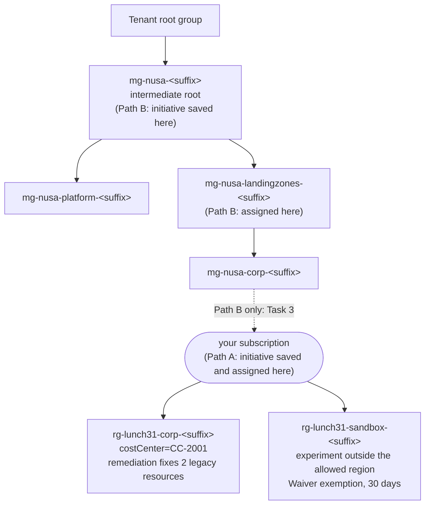

# Lab 31 · Governance for the whole company

> **Pairs with:** [Lunch 31 · Resource Hierarchy and Governance (Advanced)](../../lunches/31-governance-at-scale/README.md)
> **Time:** about 60 minutes, including 15–25 minutes of waiting for Azure Policy · **Cost:** 💲 (see [cost bands](../README.md#cost-bands)) · **Difficulty:** ★★★
> **Works on its own:** ✅ You do not need any earlier lab. Everything this lab needs is created by its steps or by `setup.sh`.

## 🎯 What you'll build

Ibu Sari wants the same rules in every subscription Nusantara Retail will ever own. You will build a miniature Azure
landing zone hierarchy of **management groups**, write a custom **initiative** as code (allowed locations, a required
`costCenter` tag and the same tag inherited from the resource group), assign it the safe way — **DoNotEnforce** first,
with a **managed identity** — fix existing resources with a **remediation task**, give Dewi's sandbox experiment a
time-boxed **Waiver**, read compliance across scopes with **Azure Resource Graph**, and export everything as
policy-as-code files. Moving your subscription into the hierarchy is optional (Path B) and fully reversible.



## ✅ Before you start

- **Your own tenant.** Management groups are tenant-wide objects. Do this lab only in a Microsoft Entra tenant you
  control — for example the one created with your free account — in a subscription where you are **Owner**. Never run
  it in your employer's tenant, and never move a company subscription. If your organisation gave you a sandbox tenant
  for learning, check with its administrators first.
- In a new tenant, any user can create management groups. If your tenant's hierarchy settings require authorization,
  Task 2 fails with `AuthorizationFailed` — use another tenant.
- **Azure Cloud Shell (Bash)** — open [shell.azure.com](https://shell.azure.com). Nothing to install.
- Get the lab files and load the shared settings plus this lab's names:

```bash
git clone https://github.com/stefpin/azure-fundamentals-lunches.git   # first time only
cd azure-fundamentals-lunches/labs/31-governance-at-scale
source ../common/config.sh
source lab-vars.sh        # resource groups, management group names, policy names, Path A/B
echo "Path $LAB31_PATH | corp RG: $CORP_RG | sandbox RG: $SANDBOX_RG | intermediate root: $MG_ROOT"
```

- Create the starting point — two resource groups with untagged "legacy" resources (about 2–3 minutes). The script
  shows your tenant and subscription and asks you to confirm that they are yours:

```bash
bash setup.sh
```

> [!IMPORTANT]
> The lab costs almost nothing (an empty storage account and two network security groups), but it creates objects
> **outside** resource groups: management groups, an initiative, a policy assignment, an exemption and a role
> assignment. Always finish with the **Clean up** section — `cleanup.sh` removes all of them, in the right order, and
> moves your subscription back if you moved it.

> [!TIP]
> Cloud Shell forgets your variables when it times out. Go back to the lab folder and run
> `source ../common/config.sh && source lab-vars.sh` again. Do the same after Task 3: the variables then switch to Path B.

## 🧭 Choose your mode

| Mode | For you if… | How |
|---|---|---|
| **Guided** | you want every step explained | follow Tasks 1–9 below |
| **Challenge** | you already know the basics | read only the [Challenge brief](#-challenge-brief), build it your way, then run `bash verify.sh` |

Both modes work on one of two paths. Choose before Task 3:

| | Path A (default) | Path B (optional) |
|---|---|---|
| Your subscription | stays where it is | moves into `mg-nusa-corp-<suffix>` in Task 3 |
| Initiative saved at | your subscription | the intermediate root `mg-nusa-<suffix>` |
| Initiative assigned at | your subscription | `mg-nusa-landingzones-<suffix>` — your subscription inherits it |
| What you learn | everything except real inheritance through management groups | the full landing-zone pattern: save high, assign at landing zones, inherit downwards |
| You need | Owner on the subscription | Owner on the subscription, in a tenant you own |
| Undo | nothing to undo | `cleanup.sh` moves the subscription back to its original parent |

Why the difference? A definition can only be assigned at or below the scope where it is saved. While your subscription
sits outside `mg-nusa-<suffix>`, an initiative saved in that management group cannot reach it, so Path A saves the
initiative in the subscription itself.

## Task 1 · Look at the starting point and find the built-ins

Start by seeing what you are about to govern, and find the three built-in definitions the initiative will reuse.

```bash
for rg in "$CORP_RG" "$SANDBOX_RG"; do
  echo "== $rg  (resource group costCenter: $(az group show --name "$rg" --query tags.costCenter --output tsv))"
  az resource list --resource-group "$rg" \
    --query "[].{name:name, type:type, location:location, costCenter:tags.costCenter}" --output table
done

lookup_builtin_ids     # from lab-vars.sh: looks the definitions up by display name, never by GUID
printf '%s\n' "$ALLOWED_LOCATIONS_ID" "$REQUIRE_TAG_ID" "$INHERIT_TAG_ID"
```

The corp group carries `costCenter=CC-2001`, but its storage account and network security group do not. The sandbox
group has no tag at all, and its network security group sits in `$SECONDARY_LOCATION` — outside the region the
baseline will allow.

> ✅ **Checkpoint:** three legacy resources with an empty `costCenter` column, and three IDs that start with
> `/providers/Microsoft.Authorization/policyDefinitions/`. If an ID is empty, run `lookup_builtin_ids` again.

## Task 2 · Build the management group hierarchy

You will create the smallest piece of the Azure landing zone hierarchy that still shows the pattern: an intermediate
root under the tenant root group, a Platform group, a Landing zones group and Corp below it.

```bash
az account management-group create --name "$MG_ROOT" --display-name "Nusantara Retail (lab $SUFFIX)"
az account management-group create --name "$MG_PLATFORM" --display-name "Platform" --parent "$MG_ROOT"
az account management-group create --name "$MG_LZ" --display-name "Landing zones" --parent "$MG_ROOT"
az account management-group create --name "$MG_CORP" --display-name "Corp" --parent "$MG_LZ"
```

A few things worth knowing while the commands run:

- The `--name` is the management group's **ID**. It can never change; the display name can. That is why the lab adds
  your suffix to every ID.
- The very first management group in a tenant can take up to 15 minutes to appear. If a child fails with "not found",
  wait a minute and run that line again.
- You become **Owner** of every management group you create, which is what lets you save and assign policies there.
- A real landing zone has more groups (Security, Management, Connectivity and Identity under Platform; Online and Local
  next to Corp; Sandboxes; Decommissioned). Lunch 31 explains each one.

```bash
for mg in "$MG_ROOT" "$MG_PLATFORM" "$MG_LZ" "$MG_CORP"; do
  echo "$mg  ->  parent: $(mg_parent "$mg")"
done
```

> [!TIP]
> **Prefer the portal?** Portal path: *Home › Management groups › + Create*. Then select **Tenant root group** and
> expand the tree to see your four groups — the portal shows the hierarchy better than any command.

> ✅ **Checkpoint:** the intermediate root's parent is your tenant ID (the tenant root group); platform and landing
> zones point to `mg-nusa-<suffix>`; corp points to `mg-nusa-landingzones-<suffix>`.

## Task 3 · (Optional, Path B) Move your lab subscription into Corp

Skip this task for Path A. For Path B, read this first.

> [!WARNING]
> Moving a subscription changes which policies and role assignments apply to **everything in it**, and Azure can take up
> to 30 minutes to reflect the new hierarchy everywhere. Do it only with your own lab subscription in your own tenant.
> In a personal tenant the subscription normally sits directly under the tenant root group, so moving it out and back
> needs no extra permissions.

```bash
# 1. Where does the subscription live now? (The tenant root group's ID is your tenant ID.)
ORIGINAL_PARENT=$(az graph query --graph-query "resourcecontainers
  | where type =~ 'microsoft.resources/subscriptions' and subscriptionId == '$SUB_ID'
  | project parent = tostring(properties.managementGroupAncestorsChain[0].name)" \
  --query "data[0].parent" --output tsv)
echo "Current parent: ${ORIGINAL_PARENT:-$TENANT_ID}"

# 2. Move it into Corp
az account management-group subscription add --name "$MG_CORP" --subscription "$SUB_ID"

# 3. Remember the original parent for cleanup.sh, then reload the lab variables (they switch to Path B)
echo "${ORIGINAL_PARENT:-$TENANT_ID}" > "$LAB31_STATE_FILE"
source lab-vars.sh && echo "Path $LAB31_PATH: assign at $ASSIGN_SCOPE"
```

If `az graph` asks to install the `resource-graph` extension, answer yes (`setup.sh` normally installed it already).

> ✅ **Checkpoint:** `az account management-group subscription show --name "$MG_CORP" --subscription "$SUB_ID" --query displayName --output tsv`
> prints your subscription's name, and `echo $LAB31_PATH` prints `B`.

## Task 4 · Create the initiative from policy-as-code files

Open the two files in `policy/nusa-baseline/`. They follow the layout from Microsoft's policy-as-code guidance:

```bash
cat policy/nusa-baseline/policyset.definitions.json   # the three member policies
cat policy/nusa-baseline/policyset.parameters.json    # the initiative's own parameters
```

Each member has a short **reference ID** (`allowedLocations`, `requireCostCenterTag`, `inheritCostCenterTag`) and passes
an initiative parameter through to the policy — `[parameters('allowedLocations')]` becomes the built-in's
`listOfAllowedLocations`. The definition IDs are placeholders, because the course never hard-codes GUIDs: render them
with the IDs you looked up in Task 1, then create the initiative.

```bash
mkdir -p generated
sed -e "s#__ALLOWED_LOCATIONS_ID__#${ALLOWED_LOCATIONS_ID}#" \
    -e "s#__REQUIRE_TAG_ID__#${REQUIRE_TAG_ID}#" \
    -e "s#__INHERIT_TAG_ID__#${INHERIT_TAG_ID}#" \
    policy/nusa-baseline/policyset.definitions.json > generated/policyset.definitions.json

az policy set-definition create --name "$INITIATIVE" $INITIATIVE_SCOPE_FLAG \
  --display-name "Nusantara baseline" \
  --description "Allowed locations, a required costCenter tag, and the costCenter tag inherited from the resource group." \
  --definitions ./generated/policyset.definitions.json \
  --params ./policy/nusa-baseline/policyset.parameters.json
```

`$INITIATIVE_SCOPE_FLAG` is empty on Path A (the initiative is saved in your subscription) and
`--management-group mg-nusa-<suffix>` on Path B (saved at the intermediate root, so every group below can use it).

> ✅ **Checkpoint:**
> `az policy set-definition show --name "$INITIATIVE" $INITIATIVE_SCOPE_FLAG --query "policyDefinitions[].policyDefinitionReferenceId"`
> lists the three reference IDs. If the command says it cannot find the initiative, run `source lab-vars.sh` — the
> path variables may be out of date.

## Task 5 · Assign the initiative — safely

Assign the initiative once, at the top of what you govern: your subscription (Path A) or the landing zones group
(Path B). Two choices make this assignment safe and useful.

```bash
az policy assignment create --name "$ASSIGNMENT" --display-name "Nusantara baseline (Lab 31)" \
  --scope "$ASSIGN_SCOPE" --policy-set-definition "$INITIATIVE_ID" \
  --params "{ 'allowedLocations': { 'value': [ '$LOCATION' ] }, 'tagName': { 'value': 'costCenter' } }" \
  --enforcement-mode DoNotEnforce \
  --mi-system-assigned --location "$LOCATION" \
  --identity-scope "$CORP_RG_ID" --role Contributor
```

- **`--enforcement-mode DoNotEnforce`** — Azure evaluates and reports compliance, but denies and modifies nothing while
  resources are created or updated. Remediation tasks still work. This is the first ring of a safe rollout.
- **`--mi-system-assigned --location`** — the Modify policy inside the initiative needs a managed identity to change
  resources. `--identity-scope` and `--role` grant it **Contributor** (the role the built-in definition asks for) on the
  corp group only. In production you would grant it everywhere remediation must write, usually the assignment scope.

> [!WARNING]
> On Path A this assignment covers your **whole subscription**. In DoNotEnforce mode it only reports, which is why you
> may see resources from other labs listed as non-compliant. Do not switch it to `Default` enforcement: the required-tag
> policy would then refuse every untagged resource in the subscription, including other labs. The stretch goals show
> a safe way to try enforcement.

> ✅ **Checkpoint:** the assignment reports `DoNotEnforce` and a system-assigned identity, and the identity holds a role
> on the corp group:
> ```bash
> az policy assignment show --name "$ASSIGNMENT" --scope "$ASSIGN_SCOPE" \
>   --query "{mode:enforcementMode, identity:identity.type, locations:parameters.allowedLocations.value}"
> PID=$(az policy assignment show --name "$ASSIGNMENT" --scope "$ASSIGN_SCOPE" --query identity.principalId --output tsv)
> az role assignment list --scope "$CORP_RG_ID" --query "[?principalId=='$PID'].roleDefinitionName" --output tsv
> ```
> If the last command prints nothing, wait a minute (new identities take a moment to replicate) and grant it yourself:
> `az role assignment create --assignee-object-id "$PID" --assignee-principal-type ServicePrincipal --role Contributor --scope "$CORP_RG_ID"`.

## Task 6 · Remediate the corp resource group

The assignment does not touch existing resources by itself. A **remediation task** does — for one Modify or
DeployIfNotExists policy at a time, so for an initiative you name the member's reference ID.
`ReEvaluateCompliance` makes the task check the resources now instead of waiting for the next compliance scan.

```bash
az policy remediation create --name "$REMEDIATION" --resource-group "$CORP_RG" \
  --policy-assignment "$ASSIGNMENT_ID" --definition-reference-id inheritCostCenterTag \
  --resource-discovery-mode ReEvaluateCompliance

# Run this every minute or so until the state is Succeeded (usually 5–15 minutes)
az policy remediation show --name "$REMEDIATION" --resource-group "$CORP_RG" \
  --query "{state:provisioningState, deployments:deploymentStatus}"

az resource list --resource-group "$CORP_RG" --query "[].{name:name, costCenter:tags.costCenter}" --output table
```

While you wait, think about the sandbox: why will this task never touch it? (Its resource group has no `costCenter` tag
to inherit, and the identity has no role there.)

> ✅ **Checkpoint:** the remediation state is `Succeeded`, and both `stcorp<suffix>` and `nsg-corp-legacy` now show
> `CC-2001`. If the state is `Succeeded` but the tags are missing, the resources were not yet evaluated — create a second
> task with another `--name`, for example `"${REMEDIATION}-2"`.

## Task 7 · Grant the sandbox a time-boxed Waiver

Dewi's experiment breaks two rules: it sits in `$SECONDARY_LOCATION` and has no `costCenter` tag. Ibu Sari accepts that
risk for 30 days while a partner integration is tested. That is a **Waiver**: an accepted risk, visible in compliance as
*Exempt*, with an end date and a paper trail.

```bash
EXPIRES=$(date -u -d '+30 days' '+%Y-%m-%dT%H:%M:%SZ')
az policy exemption create --name "$EXEMPTION" --resource-group "$SANDBOX_RG" \
  --policy-assignment "$ASSIGNMENT_ID" --exemption-category Waiver --expires-on "$EXPIRES" \
  --display-name "Sandbox experiment in $SECONDARY_LOCATION (NUSA-1042)" \
  --description "Dewi tests a partner integration for 30 days. Risk accepted by Ibu Sari." \
  --metadata "{requestedBy:Dewi,approvedBy:'Ibu Sari',ticketRef:NUSA-1042}"
```

> [!TIP]
> Use **Mitigated** instead of Waiver when the policy's intent is met another way. To exempt a scope from only some
> members of an initiative, add `--policy-definition-reference-ids` with their reference IDs. And when an exemption
> expires, Azure does not delete it — the resources simply show as non-compliant again.

> ✅ **Checkpoint:**
> `az policy exemption list --resource-group "$SANDBOX_RG" --query "[].{name:name, category:exemptionCategory, expires:expiresOn}" --output table`
> shows one Waiver that expires in 30 days.

## Task 8 · Read compliance at scale with Resource Graph

Ask Azure to evaluate both lab groups now, instead of waiting for the next scheduled cycle:

```bash
az policy state trigger-scan --resource-group "$CORP_RG" --no-wait
az policy state trigger-scan --resource-group "$SANDBOX_RG" --no-wait

# Repeat until both numbers are above zero (often 5–10 minutes)
for rg in "$CORP_RG" "$SANDBOX_RG"; do
  echo "$rg: $(az policy state list --resource-group "$rg" --filter "policyAssignmentName eq '$ASSIGNMENT'" --query "length(@)" --output tsv) records"
done
```

Now query compliance the way a platform team does — across every subscription you can read, in one request. Resource
Graph can lag a few minutes behind the commands above.

```bash
# 1. The initiative's results by member policy and state
az graph query --graph-query "policyresources
  | where type == 'microsoft.policyinsights/policystates'
  | where tostring(properties.policyAssignmentName) == '$ASSIGNMENT'
  | summarize resources = count() by policy = tostring(properties.policyDefinitionReferenceId), state = tostring(properties.complianceState)
  | order by policy asc" --query data --output table

# 2. Which lab resources are still non-compliant, and why?
az graph query --graph-query "policyresources
  | where type == 'microsoft.policyinsights/policystates'
  | where tostring(properties.policyAssignmentName) == '$ASSIGNMENT'
  | where tostring(properties.complianceState) == 'NonCompliant'
  | where tolower(tostring(properties.resourceId)) contains '/resourcegroups/rg-lunch31-'
  | project resource = extract('[^/]+$', 0, tostring(properties.resourceId)), policy = tostring(properties.policyDefinitionReferenceId)" \
  --query data --output table

# 3. Every exemption you can see, with its category and end date
az graph query --graph-query "policyresources
  | where type == 'microsoft.authorization/policyexemptions'
  | project name, resourceGroup, category = tostring(properties.exemptionCategory), expiresOn = tostring(properties.expiresOn)" \
  --query data --output table

# 4. Where each of your subscriptions sits in the hierarchy
az graph query --graph-query "resourcecontainers
  | where type == 'microsoft.resources/subscriptions'
  | project subscription = name, parent = tostring(properties.managementGroupAncestorsChain[0].displayName)" \
  --query data --output table
```

On Path B, add `--management-groups "$MG_ROOT"` to any query to limit it to the lab hierarchy, and try
`az policy state summarize --management-group "$MG_LZ"` for a roll-up at management-group scope.

> ✅ **Checkpoint:** the corp resources are `Compliant` for all three members, query 2 lists nothing from the corp
> group, query 3 shows `sandbox-waiver` as a Waiver, and query 4 shows your subscription under **Corp** (Path B) or the
> tenant root group (Path A). Sandbox resources show as `Exempt` once they have been evaluated again.

## Task 9 · Export the governance as code

Everything you clicked or typed should live in Git, reviewed and deployed by a pipeline. Export the desired state —
only the properties you would maintain by hand, not the read-only ones Azure adds — in the policy-as-code layout:

```bash
OUT="exported/$INITIATIVE"
mkdir -p "$OUT/exemptions.$ASSIGNMENT"
az policy set-definition show --name "$INITIATIVE" $INITIATIVE_SCOPE_FLAG \
  --query "{name:name, displayName:displayName, description:description, parameters:parameters, policyDefinitions:policyDefinitions}" \
  --output json > "$OUT/policyset.json"
az policy assignment show --name "$ASSIGNMENT" --scope "$ASSIGN_SCOPE" \
  --query "{name:name, displayName:displayName, scope:scope, policyDefinitionId:policyDefinitionId, enforcementMode:enforcementMode, parameters:parameters, nonComplianceMessages:nonComplianceMessages, identityType:identity.type, location:location}" \
  --output json > "$OUT/assign.$ASSIGNMENT.json"
az policy exemption show --name "$EXEMPTION" --resource-group "$SANDBOX_RG" \
  --query "{name:name, displayName:displayName, exemptionCategory:exemptionCategory, expiresOn:expiresOn, policyAssignmentId:policyAssignmentId, metadata:metadata}" \
  --output json > "$OUT/exemptions.$ASSIGNMENT/$EXEMPTION.json"
find exported -type f | sort
```

In a real team these files go into a repository next to `policy/nusa-baseline/`, and a pipeline with its own identity
deploys them. Here `generated/` and `exported/` are listed in the lab's `.gitignore` on purpose: they contain your
subscription ID, which does not belong in a public repository.

> ✅ **Checkpoint:** three files — `policyset.json`, `assign.nusa-baseline.json` and
> `exemptions.nusa-baseline/sandbox-waiver.json` — and the assignment file shows `"enforcementMode": "DoNotEnforce"`.

## 🔧 Break it and fix it

Rizky saves a new audit policy in the **Corp** management group and wants to assign it to the whole **Landing zones**
group. Try it:

```bash
az policy definition create --name "$SCOPE_TEST" --management-group "$MG_CORP" \
  --display-name "Lab 31 scope test: audit storage without costCenter" \
  --mode Indexed --rules ./policy/scope-test/policy.rules.json

az policy assignment create --name "$SCOPE_TEST" --scope "$MG_PREFIX/$MG_LZ" \
  --policy "$MG_PREFIX/$MG_CORP/providers/Microsoft.Authorization/policyDefinitions/$SCOPE_TEST"
```

The definition is created, but the assignment fails with an error saying the policy definition is **out of scope**
(definitions can only be used at or below the scope where they are saved). The exact wording can vary between versions.

<details><summary>Hint and fix</summary>

The definition lives *below* the scope you are assigning to. Save it at the Landing zones group (or higher), assign
that copy, and delete the copy that was saved too low. The policy only audits, so it changes nothing.

```bash
az policy definition create --name "$SCOPE_TEST" --management-group "$MG_LZ" \
  --display-name "Lab 31 scope test: audit storage without costCenter" \
  --mode Indexed --rules ./policy/scope-test/policy.rules.json
az policy assignment create --name "$SCOPE_TEST" --scope "$MG_PREFIX/$MG_LZ" \
  --policy "$MG_PREFIX/$MG_LZ/providers/Microsoft.Authorization/policyDefinitions/$SCOPE_TEST"
az policy definition delete --name "$SCOPE_TEST" --management-group "$MG_CORP"
```

This is the same rule that decides Path A vs Path B, and why landing zone designs save shared definitions at the
intermediate root. `cleanup.sh` removes the assignment and the definition.

</details>

## 🧪 Verify your work

```bash
bash verify.sh
```

Every check should say **PASS**. If one fails, the message tells you which task to revisit. `verify.sh` works for
both paths and changes nothing.

## 🧹 Clean up (do not skip!)

```bash
bash cleanup.sh
```

The order matters, and the script follows it: exemptions, then the identity's role assignment and the policy
assignments, then the initiative and definitions, then your subscription moves back to its original parent (Path B),
then the management groups — children first — and finally the resource groups `rg-lunch31-corp-<suffix>` and
`rg-lunch31-sandbox-<suffix>` and the `generated/` and `exported/` folders. If Azure still sees a child under a
management group (its view of the hierarchy can lag after a move), the script retries; if it gives up, wait a few
minutes and run it again.

## 🩺 Troubleshooting

| Symptom | Likely cause | Fix |
|---|---|---|
| `AuthorizationFailed` … `Microsoft.Management/managementGroups/write` in Task 2 | your tenant requires authorization to create management groups, or it is a work tenant | use a tenant you own; do not ask for rights in a company tenant just for this lab |
| A child management group fails with "not found" right after its parent was created | the first management group in a tenant can take up to 15 minutes; the hierarchy is eventually consistent | wait a minute and run the same command again |
| `AuthorizationFailed` when moving the subscription in Task 3 | you need Owner on the subscription and write access on both the current and the new parent (the tenant root group is the exception) | stay on Path A, or use your own tenant |
| `InvalidCreatePolicyAssignmentRequest` … out of scope | the definition is saved below the assignment scope (the Break it and fix it task, or a Path A initiative assigned to a management group) | save the definition at or above the scope you assign to |
| `PolicyDefinitionNotFound` while creating the initiative | the placeholders were not replaced (Task 1 variables were empty when you ran `sed`) | run `lookup_builtin_ids`, re-run the `sed` command, create the initiative again |
| The CLI cannot parse `--definitions` or `--params` | file-path handling differs between CLI versions | pass the contents instead: `--definitions "$(cat generated/policyset.definitions.json)"` |
| `PrincipalNotFound` when the role is granted in Task 5 | the brand-new managed identity has not replicated in Microsoft Entra ID yet | wait a minute, then run the `az role assignment create` command from the Task 5 checkpoint |
| Remediation `Failed`, or `Succeeded` with zero deployments | the identity has no role on the corp group, or the resources were not evaluated yet (on Path B, the new hierarchy can take a while to apply) | fix the role, wait a few minutes, create a new remediation task with another `--name` |
| `az policy exemption create` refuses the scope right after a Path B move | Azure's cached view of the hierarchy still places the resource group outside the assignment | wait a few minutes; or add `--assignment-scope-validation DoNotValidate` |
| `az graph query` returns no policy states | Resource Graph lags behind, or no evaluation has finished | run the Task 8 scans, wait a few minutes, query again |
| `'graph' is misspelled or not recognized` | the Resource Graph extension is missing | `az extension add --name resource-graph` |
| `cleanup.sh` cannot delete a management group | a child or the subscription is still attached in Azure's cached view | wait a few minutes, then run `bash cleanup.sh` again |

## 🚀 Stretch goals

- **Ring 1 enforcement.** Assign the same initiative a second time at the corp resource group with
  `--enforcement-mode Default` (name it `nusa-ring1`, scope `"$CORP_RG_ID"`, same parameters, plus
  `--mi-system-assigned --location "$LOCATION"`). After about five minutes, try to create a storage account in
  `$SECONDARY_LOCATION` in that group and read the `RequestDisallowedByPolicy` error. The rest of your subscription stays
  in report-only mode. `cleanup.sh` removes this assignment too.
- **A Mitigated exemption.** Exempt only `nsg-corp-legacy` from `requireCostCenterTag` with
  `--exemption-category Mitigated --scope <its resource ID> --policy-definition-reference-ids requireCostCenterTag`,
  and compare how it appears in query 3.
- **Look at the hierarchy settings.** `az account management-group hierarchy-settings list --name "$TENANT_ID"` shows
  whether your tenant has a default management group for new subscriptions and requires authorization to create groups.
  Changing them affects the whole tenant, so only read them here.
- **Deploy it as a stack.** Rewrite the assignment in Bicep and deploy it with `az stack mg create` at the landing
  zones group (Lunch 20 covers deployment stacks). Delete the stack afterwards with `--action-on-unmanage deleteAll`.

## 🏁 Challenge brief

Build the following, any way you like (portal, CLI, Bicep), after running `bash setup.sh`:

1. Management groups `mg-nusa-<suffix>` (under the tenant root group), `mg-nusa-platform-<suffix>` and
   `mg-nusa-landingzones-<suffix>` (both under `mg-nusa-<suffix>`), and `mg-nusa-corp-<suffix>` (under landing zones).
2. A custom initiative containing the built-ins *Allowed locations*, *Require a tag on resources* and *Inherit a tag
   from the resource group if missing*, with initiative parameters for the allowed locations and the tag name — saved in
   your subscription (Path A) or in `mg-nusa-<suffix>` (Path B, with your subscription moved into corp).
3. An assignment of that initiative to your subscription (Path A) or to `mg-nusa-landingzones-<suffix>` (Path B):
   allowed locations = only `$LOCATION`, tag name `costCenter`, enforcement mode DoNotEnforce, and a managed identity
   that holds Contributor on `rg-lunch31-corp-<suffix>`.
4. A successful remediation task in `rg-lunch31-corp-<suffix>`, after which both legacy resources carry
   `costCenter=CC-2001`.
5. A **Waiver** exemption on `rg-lunch31-sandbox-<suffix>` for that assignment, expiring within 30 days.
6. Compliance records for the assignment in the corp group.
7. The assignment exported as `exported/<initiative>/assign.<assignment>.json` in the lab folder.

Then run `bash verify.sh`. Stuck? Peek at `solution.sh` (`MOVE_SUBSCRIPTION=yes bash solution.sh` runs Path B) or
switch to Guided mode.

---

⬅️ [Lunch 31 reading](../../lunches/31-governance-at-scale/README.md) · 🏠 [All labs](../README.md) · 🏠 [Course home](../../README.md)

<sub>Last validated: October 2026 · Something broken? [Report a lab problem](../../CONTRIBUTING.md).</sub>
