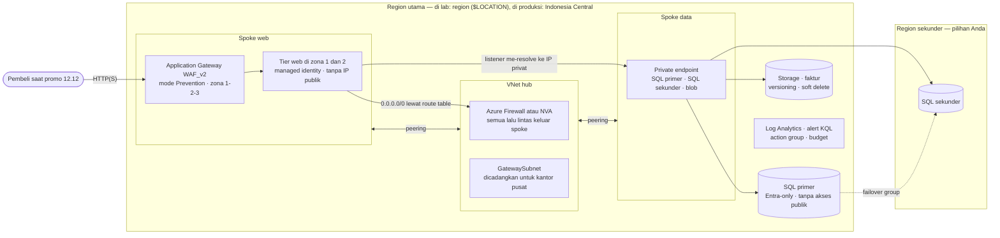

# Tantangan capstone lanjutan · Nusantara Retail melangkah ke produksi

🇬🇧 [Read in English](README.md)

> **Pasangan dari:** seluruh bulan pendalaman, [Makan Siang 22](../../lunches/22-identity-access-advanced/README.id.md) sampai [Makan Siang 31](../../lunches/31-governance-at-scale/README.id.md) (hanya persyaratan: tanpa bacaan, demo, atau video)
> **Waktu:** sekitar 8–12 jam dalam 3–5 sesi · **Biaya:** 💲💲💲 (lihat [kelompok biaya](../README.id.md#kelompok-biaya)) · **Tingkat kesulitan:** ★★★
> **Bisa dikerjakan terpisah:** ✅ Anda tidak memerlukan lab sebelumnya. Anda merancang dan membangun setiap resource sendiri. Yang Anda perlukan adalah apa yang diajarkan di Makan Siang 22–31.
> **Penulis:** Stefanus Pinarta · [Tentang penulis](../../README.id.md#tentang-penulis)

> [!CAUTION]
> **💲💲💲 Ini proyek termahal dalam kursus ini, karena menjalankan layanan kelas produksi.**
> Application Gateway WAF_v2, Azure Firewall (jika Anda memilihnya), Azure Bastion, private endpoint, NAT gateway, dan
> database SQL kedua ditagih **untuk setiap jam keberadaannya, bahkan ketika tidak ada satu permintaan pun yang masuk** —
> ibarat argo taksi yang terus berjalan selama taksi menunggu di depan rumah, meskipun Anda belum naik. Jangan pernah
> membiarkan lingkungan lengkapnya menyala semalaman atau "sampai akhir pekan depan". Bangun secara bertahap, buktikan
> setiap tahap, **hapus**, lalu bangun ulang dari Bicep Anda di sesi berikutnya; kemampuan membangun ulang itulah inti dari
> infrastructure as code (*infrastruktur sebagai kode*). Buat budget (anggaran) dengan alert *sebelum* deployment pertama
> Anda, dan hitung biaya desain Anda untuk region Anda di
> [Azure pricing calculator](https://azure.microsoft.com/pricing/calculator/) (*kalkulator harga*) sebelum membangunnya.

## 🎯 Ringkasan proyek

Delapan minggu sebelum promo 12.12, Ibu Sari meresmikannya: toko online pindah ke Azure secara sungguhan. Capstone inti
(Lab 21) sudah membuktikan bahwa satu availability zone (*zona ketersediaan*) bisa gagal total sementara toko tetap buka.
Produksi membawa pertanyaan yang lebih sulit, dan kini setiap pertanyaan datang dari orang tertentu:

- **Ibu Sari:** "Kalau seluruh region Jakarta padam, berapa lama kita tidak bisa jualan, dan berapa banyak pesanan yang hilang?"
- **Pak Budi:** "Kantor pusat memakai `10.0.0.0/16`. Saat kita menghubungkannya tahun depan, tidak boleh ada yang tumpang
  tindih, dan semua lalu lintas keluar harus lewat satu titik yang kita kendalikan."
- **Rizky**, yang sedang menulis laporan keamanan sebagai kontraktor: "Kenapa siapa pun di internet bisa menjangkau
  database? Dan di mana kata sandinya disimpan?" Satu-satunya jawaban yang bisa diterima adalah *"tidak bisa"* dan
  *"memang tidak ada kata sandi"*.
- **Tim keuangan:** "Berapa biayanya setiap bulan, dan siapa yang akan sadar kalau biayanya berlipat dua?"
- **Dewi:** "Saya ingin merilis dari Git, bukan dengan mengeklik ke sana kemari di portal."

Tugas Anda: rancang platformnya, bangun sebagai kode, buktikan setiap persyaratan di bawah dengan pemeriksaan penerimaan,
tulis rencana pemulihan bencana (disaster recovery, DR) dan tinjauan arsitekturnya, lalu bongkar semuanya. Tidak ada
instruksi langkah demi langkah — justru itulah tantangannya. Semua yang Anda butuhkan sudah diajarkan di Makan Siang 22–31
(lihat [di mana setiap bagian diajarkan](#-di-mana-setiap-bagian-diajarkan)).

## ✅ Sebelum mulai

- Anda sudah mempelajari Makan Siang 22–31 (mengerjakan lab-labnya sangat membantu), dan idealnya juga Lab 21.
  [Modul Bicep](../21-core-capstone/infra/) milik lab itu adalah titik awal yang masuk akal untuk tier web, SQL, dan
  pemantauan.
- Sebuah **subscription lab pribadi atau khusus** tempat Anda berperan sebagai **Owner**. Role assignment, policy
  assignment, dan deployment stack dengan deny settings semuanya membutuhkan role tersebut. Subscription gratis dan pelajar
  punya kuota vCPU yang kecil dan kredit terbatas, jadi periksa keduanya sebelum mulai.
- **Azure Cloud Shell (Bash)** atau Azure CLI lokal dengan Bicep. VS Code dengan ekstensi Bicep membuat penulisan template
  jauh lebih mudah.
- **Repositori Git privat** milik Anda sendiri untuk semua hasil kerja (deliverable). Simpan pekerjaan Anda di sana, dan
  gunakan folder kursus ini hanya untuk pengaturan bersama:

  ```bash
  git clone https://github.com/stefpin/azure-fundamentals-lunches.git   # first time only
  cd azure-fundamentals-lunches/labs/32-advanced-capstone-challenge
  source ../common/config.sh      # gives you $LOCATION, $SECONDARY_LOCATION, $SUFFIX and the helper functions
  ```

- Kuota yang cukup: sekitar 6 vCPU dari keluarga B-series kecil di region utama Anda dan 2 di region sekunder. Jalankan
  pemeriksaan yang sama dengan `"$SECONDARY_LOCATION"`:

  ```bash
  az vm list-usage --location "$LOCATION" -o table | grep -i -E "total regional vcpus|bs family|basv2|bsv2"
  ```

> [!IMPORTANT]
> Resource lab memakan biaya selama masih ada. Akhiri **setiap** sesi dengan [Bersihkan](#-bersihkan), meskipun Anda
> berhenti di tengah jalan.

## 🧭 Cara kerja tantangan ini

- **Persyaratan (R1–R12)** menjelaskan *apa* yang harus benar, tidak pernah *bagaimana* caranya. **Batasan (C1–C7)** tidak
  bisa ditawar. **Daftar periksa penerimaan (A1–A19)** memberi tahu Anda persis cara membuktikan setiap persyaratan.
- **Deliverable** (hasil kerja yang diserahkan), semuanya di repositori Anda sendiri:

| Deliverable | Isinya |
|---|---|
| `infra/` | Bicep: sebuah `main.bicep` (scope subscription cocok untuk ini) ditambah satu modul per area, dan sebuah `main.bicepparam` tanpa rahasia di dalamnya |
| `DR-PLAN.md` | Rencana pemulihan bencana Anda untuk produksi di Indonesia Central, termasuk hasil latihan (drill) yang terukur (R9) |
| `ARCHITECTURE-REVIEW.md` | Tinjauan Well-Architected Anda, risiko teratas, trade-off (kompromi yang disengaja), dan temuan yang diterima (R10, R12) |
| `COST.md` | Estimasi biaya Anda dan opsi lebih murah yang Anda pertimbangkan (R11) |
| `evidence/` | Output setiap pemeriksaan penerimaan, hasil KQL, dan tangkapan layar. Samarkan ID subscription, ID tenant, dan alamat email |

- **Bekerja per tahap.** Setiap tahap menambahkan modul ke template yang sama dan di-deploy melalui stack yang sama.
  Buktikan apa yang sudah Anda bangun, lalu hapus, atau pertahankan hanya selama Anda masih aktif mengerjakannya:

| Tahap | Yang dibangun | Dibuktikan dengan | Perkiraan waktu | Biaya selama berjalan |
|---|---|---|---|---|
| 1 · Fondasi | resource group dan tag, budget, initiative policy, hub dan spoke, firewall atau NVA, route table, Log Analytics | A1–A3, A14, A18 | 2–3 jam | 💲💲 (💲💲💲 dengan Azure Firewall) |
| 2 · Data | server SQL di dua region, database dan failover group, penyimpanan, private endpoint dan zona DNS | A9, A10, A12 | 2 jam | 💲💲 |
| 3 · Web | tier web lintas zona, managed identity, Application Gateway WAF_v2 dan policy-nya | A4–A8, A11, A13 | 2 jam | 💲💲💲 |
| 4 · Operasional | diagnostic settings, Azure Monitor Agent dan DCR, alert KQL, retensi backup, latihan pemulihan | A15, A16 | 1–2 jam | 💲💲💲 |
| 5 · Pembuktian | uji penolakan (deny), latihan DR, tinjauan Defender for Cloud, dokumen, lalu semua pemeriksaan sekali lagi | A2, A12, A17, A19 | 2 jam | 💲💲💲 |

## 📋 Persyaratan

### R1 · Semuanya sebagai kode, di bawah deployment stack

1. Setiap resource Azure didefinisikan dalam **modul Bicep** di repositori Anda. Budget dan pengaturan Defender for Cloud
   adalah satu-satunya hal yang boleh Anda konfigurasi di portal. Region, ukuran, suffix, dan grup admin Entra adalah
   parameter; tidak ada ID subscription yang ditulis langsung di dalam kode (hard-coded).
2. Anda men-deploy melalui **deployment stack** (`az stack sub create` atau `az stack group create`) dengan **deny
   settings** minimal `denyDelete`, dan dengan `deleteAll` sebagai tindakan untuk resource yang tidak lagi dikelola
   (unmanaged), sehingga menghapus sebuah resource dari template juga menghapusnya dari Azure.
3. Anda meninjau setiap perubahan dengan what-if sebelum menerapkannya, dan men-deploy ulang template yang tidak berubah
   tidak mengubah apa pun.

### R2 · Hub dan spoke dengan satu pintu keluar yang terkendali

1. Sebuah VNet (*jaringan virtual*) **hub** dan setidaknya dua **spoke** (web dan data) di region utama. Setiap spoke
   hanya di-peer dengan hub. Tidak ada rentang alamat yang tumpang tindih dengan VNet lain atau dengan `10.0.0.0/16` milik
   kantor pusat, dan hub menyisakan ruang untuk `GatewaySubnet` (VPN ke kantor pusat menyusul nanti, lihat Makan Siang 26).
2. Sebuah **firewall** terpusat: Azure Firewall atau network virtual appliance (NVA, VM yang berperan sebagai perangkat
   jaringan) Linux kecil dengan IP forwarding.
3. **Route table** mengirim lalu lintas setiap spoke yang menuju internet (`0.0.0.0/0`) serta lalu lintas antar-spoke
   melalui firewall atau NVA. Subnet Application Gateway adalah pengecualiannya (lihat petunjuk).
4. Tidak ada VM (*komputer virtual*) tier web atau data yang memiliki alamat IP publik. Setiap subnet workload punya NSG,
   dan tidak ada NSG yang mengizinkan SSH atau RDP dari internet. Anda mengelola VM melalui Run Command atau Azure Bastion.

### R3 · Tier web zone-redundant di balik web application firewall

1. Tier web berjalan di spoke web di **setidaknya dua availability zone**, baik sebagai Flexible scale set (*Kumpulan
   Skala Komputer Virtual*, Makan Siang 23) maupun sebagai dua VM atau lebih. Tier ini memakai
   `labs/common/cloud-init-web.yml` atau aplikasi Anda sendiri, dan harus menjawab di `/health`.
2. **Application Gateway WAF_v2** berjalan di subnet khusus miliknya sendiri dengan zona yang ditetapkan secara eksplisit,
   sebuah **WAF policy dalam mode Prevention** (memblokir, bukan sekadar mencatat) yang memakai managed rule set, dan
   health probe di `/health`.
3. Permintaan normal melalui gateway mengembalikan **200**, dan percobaan SQL injection yang terang-terangan mengembalikan
   **403**. Server web hanya menerima HTTP dari subnet gateway.
4. *(Opsional)* HTTPS, memakai sertifikat yang disimpan di Key Vault dan dibaca oleh user-assigned managed identity milik
   gateway.

### R4 · Data privat yang bertahan saat sebuah region mengalami gangguan

1. **Azure SQL**: satu logical server di masing-masing dari dua region Anda, keduanya dengan **Microsoft Entra-only
   authentication** (hanya login lewat Entra, tanpa login SQL berbasis kata sandi) dan grup admin Entra yang sama, serta
   sebuah database di dalam **failover group** dengan kebijakan failover yang dikelola pelanggan (customer-managed). Klien
   terhubung melalui read-write listener, tidak pernah melalui nama server. *(Penawaran database gratis tidak bisa
   bergabung dengan failover group, jadi gunakan database serverless atau provisioned yang kecil.)*
2. Sebuah **storage account** (*akun penyimpanan*) untuk faktur dengan **shared key access dinonaktifkan**, versi TLS
   minimum 1.2, blob soft delete, container soft delete, dan versioning.
3. **Private endpoint** (*titik akhir privat*) untuk kedua server SQL dan untuk layanan blob milik storage account,
   ditempatkan di spoke data. Zona DNS privat `privatelink.database.windows.net` dan `privatelink.blob.core.windows.net`
   di-link sehingga setiap VNet yang membutuhkannya me-resolve nama-nama itu ke IP privat.
4. **Akses jaringan publik dinonaktifkan** pada kedua server SQL dan pada storage account.

### R5 · Identitas, bukan rahasia

1. Tier web memakai **managed identity** (user-assigned direkomendasikan) untuk semua yang dibacanya.
2. Setiap role assignment memakai role bawaan dengan hak paling minim, pada scope tersempit yang masih berfungsi (prinsip
   hak akses minimum, least privilege). Gunakan role data untuk data. Workload tidak pernah mendapat Owner atau
   Contributor.
3. **Tidak ada rahasia di dalam kode** (lihat C4). Jika Anda men-deploy dari GitHub Actions, gunakan OpenID Connect dengan
   federated credential (Makan Siang 22), jangan pernah client secret.

### R6 · Tata kelola sebagai kode

1. Sebuah **initiative policy kustom** yang memuat setidaknya policy berikut: *Allowed locations* (tepat dua region Anda),
   *Require a tag on resource groups* (`cost-center`), dan *Inherit a tag from the resource group if missing* (tag yang
   sama). Initiative ini ditetapkan di scope management group atau subscription (baca C6 dulu), dengan remediation task
   untuk tag yang diwarisi.
2. Initiative dan assignment-nya juga didefinisikan dalam Bicep. Stack terpisah di scope yang lebih tinggi tidak masalah.
3. Setiap exemption dicatat di `ARCHITECTURE-REVIEW.md` beserta alasan dan tanggal kedaluwarsanya.

### R7 · Observabilitas yang bisa dikueri

1. Satu **Log Analytics workspace** di region utama. **Diagnostic settings** mengirim log ke workspace itu dari
   Application Gateway (termasuk log firewall-nya), Azure Firewall (jika Anda memakainya), database SQL, layanan blob
   milik storage account, dan Key Vault (jika Anda memakainya).
2. **Azure Monitor Agent** berjalan di setiap VM, dengan **data collection rule** (DCR) yang setidaknya mengumpulkan Syslog
   atau performance counter.
3. Setidaknya **dua log search alert rule (KQL)** memberi tahu sebuah action group, misalnya "blokir WAF melonjak" dan
   "sebuah server web berhenti mengirim heartbeat", dan Anda sudah melihat masing-masing alert itu terpicu.

### R8 · Cadangan (backup) yang sudah pernah dipulihkan

1. **SQL:** retensi point-in-time restore minimal 14 hari, ditambah kebijakan long-term retention (LTR) (misalnya backup
   mingguan yang disimpan selama empat minggu) pada database primer **dan** sekunder, sehingga LTR tetap berjalan setelah
   failover.
2. **Blob:** soft delete dan versioning, seperti di R4.2. Point-in-time restore untuk container bersifat opsional.
3. Sebuah **latihan pemulihan (restore drill)**: pulihkan database ke suatu titik waktu sebagai database baru, dan
   kembalikan faktur yang tertimpa atau terhapus dari versi sebelumnya. Catat berapa lama masing-masing berlangsung, lalu
   hapus salinan hasil pemulihan.
4. Tier web tidak menyimpan state (data sesi atau berkas yang harus dipertahankan). VM yang hilang diganti dari kode atau
   oleh scale set, tidak pernah dipulihkan dari backup.

### R9 · Rencana DR untuk region tanpa pasangan

1. `DR-PLAN.md` menargetkan **produksi di Indonesia Central**, yang tidak memiliki region berpasangan (*pasangan
   wilayah*). Sebutkan region sekunder Anda dan jelaskan alasan pilihan Anda (latensi ke pembeli di Indonesia, layanan apa
   saja yang tersedia di sana, residensi data).
2. Untuk setiap komponen, nyatakan apa yang direplikasi dan bagaimana caranya (failover group, salinan blob atau object
   replication, deploy ulang dari Bicep), RTO (recovery time objective — berapa lama layanan boleh terhenti sampai pulih)
   dan RPO (recovery point objective — seberapa banyak data, diukur dalam waktu, yang boleh hilang) yang Anda harapkan,
   serta apa pun yang biasanya ditangani region berpasangan tetapi kini harus Anda kerjakan sendiri. Sebagai contoh,
   geo-redundant backup storage untuk Azure SQL tidak tersedia di region tanpa pasangan.
3. Runbook (panduan langkah operasional) untuk failover dan failback: siapa yang memutuskan, urutan langkahnya, dan cara
   Anda memeriksa bahwa toko berfungsi.
4. Sebuah **latihan (drill)**: lakukan failover pada failover group ke region sekunder, ukur waktu sampai listener
   me-resolve ke private endpoint milik primer yang baru (dan, jika Anda punya klien SQL di dalam VNet, sampai operasi
   tulis berhasil), lalu lakukan failback. Catat kedua waktu tersebut.

### R10 · Postur keamanan

1. Tinjau rekomendasi **Defender for Cloud** (*Microsoft Defender untuk Cloud*) untuk resource group Anda. Perbaiki setiap
   item dengan tingkat keparahan High, atau catat di `ARCHITECTURE-REVIEW.md` alasan Anda menerimanya (atau kecualikan
   dengan tanggal kedaluwarsa).
2. Jika Anda memakai Key Vault, gunakan model izin RBAC (*kontrol akses berbasis peran*). Putuskan apakah purge protection
   akan diaktifkan, dan catat trade-off-nya: fitur ini melindungi produksi, tetapi juga membuat nama vault tetap tercadang
   setelah setiap pembersihan.

### R11 · Pagar pengaman biaya

1. Sebuah **budget** dengan alert pada 50%, 80%, dan 100% (atau ambang Anda sendiri) sudah ada **sebelum** deployment
   mahal pertama Anda.
2. Setiap resource group membawa tag `cost-center`, `environment`, dan `workload`, ditambah `course` dan `lunch=32` (lihat
   C5).
3. `COST.md` berisi estimasi dari pricing calculator per jam, per hari, dan per bulan 30 hari, menyebutkan tiga komponen
   termahal, dan menjelaskan setidaknya dua alternatif lebih murah yang Anda pertimbangkan (misalnya NVA alih-alih Azure
   Firewall).

### R12 · Tinjauan Well-Architected

1. `ARCHITECTURE-REVIEW.md` menilai desain Anda terhadap kelima pilar Well-Architected, memakai
   [daftar periksa tinjauan](../21-core-capstone/review-checklist.id.md) dari Lab 21, asesmen resmi
   [Azure Well-Architected Review](https://learn.microsoft.com/assessments/azure-architecture-review/), atau keduanya.
2. Dokumen itu mencantumkan lima risiko teratas Anda, masing-masing dengan pemilik dan langkah berikutnya, serta setidaknya
   tiga trade-off yang eksplisit, misalnya biaya versus keandalan untuk region sekunder.

## 🚧 Batasan

- **C1 · Biaya.** 💲💲💲. Biarkan lingkungan lengkap menyala hanya selama Anda sedang mengerjakannya, dan hapus di antara
  sesi (lihat [Bersihkan](#-bersihkan)). Gunakan SKU (varian produk) terkecil yang memenuhi setiap persyaratan: VM
  B-series, database serverless atau provisioned yang kecil, autoscaling Application Gateway dengan batas maksimum rendah,
  dan tier Basic atau Standard dari Azure Firewall jika Anda memilihnya (jangan pernah Premium). Aktifkan long-term
  retention hanya di sesi terakhir Anda, karena backup LTR hidup lebih lama daripada database-nya.
- **C2 · Region.** Gunakan `$LOCATION` dan `$SECONDARY_LOCATION` dari `labs/common/config.sh` (secara default Southeast
  Asia dan East Asia). Untuk meniru produksi secara persis, setel `LOCATION=indonesiacentral` dengan region sekunder seperti
  `southeastasia`, tetapi hanya setelah memastikan setiap layanan dan SKU yang Anda butuhkan tersedia di kedua region untuk
  subscription Anda. Apa pun pilihannya, bangunlah seolah-olah region utama Anda tidak punya pasangan: jangan mengandalkan
  fitur region berpasangan apa pun.
- **C3 · Ukuran.** Paling banyak 6 vCPU di region utama dan 2 di region sekunder, satu Application Gateway, dan database
  SQL berukuran 2 vCore atau kurang.
- **C4 · Tidak ada rahasia di dalam kode.** Kata sandi, account key, token SAS, connection string yang memuat kredensial,
  dan private key tidak pernah masuk ke Bicep, file parameter, skrip, cloud-init, atau YAML pipeline, dan tidak pernah
  masuk ke riwayat Git Anda. Gunakan autentikasi Entra, managed identity, dan Key Vault. Gunakan hanya SSH public key,
  atau tanpa SSH sama sekali. Aktifkan GitHub secret scanning dan push protection untuk repositori Anda.
- **C5 · Nama dan tag.** Gunakan singkatan CAF (Cloud Adoption Framework) ditambah `$SUFFIX` (`vnet-`, `snet-`, `afw-`,
  `agw-`, `waf-`, `sql-`, `st`, `kv-`, `log-`, `pep-`). Beri nama resource group dengan `rg_name 32 <purpose>` (misalnya
  `rg-lunch32-hub-<suffix>`) dan beri tag `course=azure-fundamentals-lunches` dan `lunch=32`, agar pemeriksaan dan
  `delete_lunch_rgs 32` bisa menemukannya.
- **C6 · Kemungkinan besar Anda berbagi subscription dengan lab-lab lain.** Policy yang ditetapkan di scope subscription
  atau management group memengaruhi setiap lab lain yang Anda jalankan di sana, dan *Allowed locations* akan memblokir
  deployment ke region lain mana pun. Gunakan subscription atau management group khusus, atau mulai assignment dengan
  enforcement mode `DoNotEnforce` dan alihkan ke `Default` hanya selama Anda sedang mengerjakan capstone.
- **C7 · Batas waktu.** Rencanakan 8–12 jam. Jika waktu Anda habis, pangkas cakupan pekerjaan, jangan potong kompas:
  pertahankan R4.4 dan C4, lalu catat apa pun yang Anda tinggalkan di `ARCHITECTURE-REVIEW.md`.

## 🗺 Arsitektur yang disarankan

Berikut satu desain yang memenuhi setiap persyaratan. Anda boleh mengubahnya, asalkan bisa mempertahankan perubahan itu
dalam tinjauan Anda.



Diagram ini melewatkan beberapa hal. Deployment stack dan initiative policy membungkus semuanya. Key Vault bersifat
opsional. Region sekunder tidak punya tier web: saat bencana, Anda membangunnya ulang dari Bicep (cold standby — cadangan
"dingin" yang baru dinyalakan saat dibutuhkan), kecuali RTO Anda menuntut cadangan "hangat" (warm standby, lihat
tantangan tambahan).

## ✅ Daftar periksa penerimaan

Jalankan pemeriksaan dari Cloud Shell. Tetapkan nama-nama Anda lebih dulu, lalu simpan output setiap pemeriksaan di bawah
`evidence/` (misalnya `... | tee evidence/A06-appgw.txt`).

```bash
source ../common/config.sh
RG_HUB=$(rg_name 32 hub)      # hub VNet, firewall or NVA, private DNS zones
RG_WEB=$(rg_name 32 web)      # web spoke, Application Gateway, web tier, managed identity
RG_DATA=$(rg_name 32 data)    # data spoke, primary SQL server, storage, private endpoints
RG_DR=$(rg_name 32 dr)        # secondary SQL server, in $SECONDARY_LOCATION
RG_OPS=$(rg_name 32 ops)      # Log Analytics, action group, alert rules
# Change these to the names you chose:
STACK=stack-nusa-prod
HUB_VNET=vnet-nusa-hub; WEB_VNET=vnet-nusa-web
AGW=agw-nusa-$SUFFIX; WAF_POLICY=waf-nusa-$SUFFIX
SQL1=sql-nusa-1-$SUFFIX; SQL2=sql-nusa-2-$SUFFIX; FOG=fog-nusa-$SUFFIX; DB=sqldb-orders
ST=stnusa$SUFFIX
VM=$(az vm list -g "$RG_WEB" --query "[0].name" -o tsv)     # any web-tier VM
```

| Persyaratan | Dibuktikan oleh |
|---|---|
| R1 · Kode dan stack | A1, A2 |
| R2 · Hub dan spoke | A3, A4, A5 |
| R3 · Tier web dan WAF | A6, A7, A8 |
| R4 · Data privat | A9, A10, A11, A12 |
| R5 · Identitas | A13 |
| R6 · Tata kelola | A14 |
| R7 · Observabilitas | A8, A15 |
| R8 · Backup | A16 |
| R9 · Rencana DR | A12, A19 |
| R10 · Postur keamanan | A17 |
| R11 · Biaya | A18, A19 |
| R12 · Tinjauan | A19 |

**A1 · Stack ada dan melindungi resource-nya**

```bash
az stack sub show --name "$STACK" \
  --query "{state:provisioningState, deny:denySettings.mode, managed:length(resources)}" -o table
az deployment sub what-if --location "$LOCATION" \
  --template-file infra/main.bicep --parameters infra/main.bicepparam
```

✅ **Lulus:** status stack adalah succeeded, `deny` bernilai `denyDelete` atau `denyWriteAndDelete`, `managed` menghitung
setiap resource yang Anda harapkan, dan what-if pada template Anda yang tidak berubah tidak menampilkan pembuatan,
penghapusan, atau modifikasi yang nyata. (Jika Anda memakai stack di level resource group, jalankan
`az stack group show -g <rg> --name ...` dan `az deployment group what-if` sebagai gantinya.)

**A2 · Deny settings benar-benar menolak**

```bash
AG=$(az monitor action-group list -g "$RG_OPS" --query "[0].name" -o tsv)
az monitor action-group delete -g "$RG_OPS" -n "$AG"
```

✅ **Lulus:** penghapusan gagal dengan error otorisasi yang menyebut sebuah deny assignment. Jika penghapusan berhasil,
berarti Anda termasuk excluded principal (identitas yang dikecualikan) milik stack, atau action group itu tidak dikelola
oleh stack. Perbaiki hal itu, lalu deploy ulang stack untuk mengembalikan action group-nya.

**A3 · Hub dan spoke**

```bash
az network vnet peering list -g "$RG_HUB" --vnet-name "$HUB_VNET" \
  --query "[].{peering:name, state:peeringState, sync:peeringSyncLevel}" -o table
az network vnet list \
  --query "[?starts_with(name, 'vnet-nusa')].{vnet:name, ranges:join(', ', addressSpace.addressPrefixes), peerings:length(virtualNetworkPeerings)}" \
  -o table      # adjust the name prefix to your naming
```

✅ **Lulus:** hub punya satu peering per spoke, masing-masing `Connected` dan `FullyInSync`. Setiap spoke punya tepat satu
peering, dan tidak ada rentang yang tumpang tindih dengan rentang VNet lain atau dengan `10.0.0.0/16`.

**A4 · Semua lalu lintas keluar melewati firewall**

```bash
NIC_ID=$(az vm show -g "$RG_WEB" -n "$VM" --query "networkProfile.networkInterfaces[0].id" -o tsv)
az network nic show-effective-route-table --ids "$NIC_ID" -o table
az vm run-command invoke -g "$RG_WEB" -n "$VM" --command-id RunShellScript \
  --scripts "curl -s --max-time 10 https://api.ipify.org" --query "value[0].message" -o tsv
```

✅ **Lulus** (VM harus dalam keadaan menyala): route `User` untuk `0.0.0.0/0` dengan next hop type `VirtualAppliance` dan IP
privat firewall Anda berstatus `Active`, dan route default `0.0.0.0/0` ke `Internet` tampil `Invalid`. Alamat yang
dilaporkan VM adalah IP publik firewall Anda (atau milik NAT gateway yang dipakai NVA), bukan milik Application Gateway.

**A5 · Tidak ada IP publik pada workload, dan NSG di mana-mana**

```bash
az vm list -d --query "[?publicIps!=''].{vm:name, rg:resourceGroup, publicIp:publicIps}" -o table
az network vnet subnet list -g "$RG_WEB" --vnet-name "$WEB_VNET" \
  --query "[].{subnet:name, nsg:networkSecurityGroup.id, routeTable:routeTable.id}" -o jsonc
```

✅ **Lulus:** tidak ada VM web atau data Anda yang muncul di daftar pertama. Di daftar kedua, setiap subnet workload punya
NSG, subnet tier web punya route table Anda, dan subnet Application Gateway tidak punya route table. Ulangi perintah kedua
untuk spoke data.

**A6 · Application Gateway dan WAF policy-nya**

```bash
az network application-gateway show -g "$RG_WEB" -n "$AGW" \
  --query "{tier:sku.tier, zones:zones, state:operationalState, wafPolicy:firewallPolicy.id}" -o jsonc
az network application-gateway waf-policy show -g "$RG_WEB" -n "$WAF_POLICY" \
  --query "{state:policySettings.state, mode:policySettings.mode, ruleSets:managedRules.managedRuleSets[].ruleSetType}" -o jsonc
az network application-gateway show-backend-health -g "$RG_WEB" -n "$AGW" \
  --query "backendAddressPools[].backendHttpSettingsCollection[].servers[].{server:address, health:health}" -o table
```

✅ **Lulus:** tier-nya `WAF_v2`, setidaknya dua zona tercantum, statusnya `Running`, dan sebuah WAF policy terhubung.
Policy itu `Enabled` dalam mode `Prevention` dengan managed rule set, dan setiap server backend berstatus `Healthy`.

**A7 · WAF memblokir serangan**

```bash
AGW_PIP_ID=$(az network application-gateway show -g "$RG_WEB" -n "$AGW" \
  --query "frontendIPConfigurations[?publicIPAddress].publicIPAddress.id | [0]" -o tsv)
AGW_IP=$(az network public-ip show --ids "$AGW_PIP_ID" --query ipAddress -o tsv)
curl -s -o /dev/null -w "normal: HTTP %{http_code}\n" "http://${AGW_IP}/?id=42"
curl -s -o /dev/null -w "attack: HTTP %{http_code}\n" "http://${AGW_IP}/?id=1%27%20OR%201%3D1--"
```

✅ **Lulus:** `normal: HTTP 200` dan `attack: HTTP 403`.

**A8 · Blokir itu muncul di Log Analytics** (jalankan KQL di halaman **Logs** milik workspace Anda)

```kusto
AGWFirewallLogs
| where TimeGenerated > ago(1h)
| summarize requests = count() by Action
```

✅ **Lulus:** muncul baris `Blocked`. Beri waktu 5–15 menit sampai log tiba. Jika diagnostic setting Anda menulis ke tabel
bersama *Azure diagnostics* alih-alih tabel khusus per resource (resource-specific), gunakan
`AzureDiagnostics | where Category == "ApplicationGatewayFirewallLog" | summarize count() by action_s` sebagai gantinya.

**A9 · SQL hanya-Entra dan privat**

```bash
az sql server show -g "$RG_DATA" -n "$SQL1" --query publicNetworkAccess -o tsv
az sql server show -g "$RG_DR" -n "$SQL2" --query publicNetworkAccess -o tsv
az sql server ad-only-auth get -g "$RG_DATA" -n "$SQL1" --query azureAdOnlyAuthentication -o tsv
az sql server ad-only-auth get -g "$RG_DR" -n "$SQL2" --query azureAdOnlyAuthentication -o tsv
```

✅ **Lulus:** `Disabled`, `Disabled`, `true`, `true`.

**A10 · Storage terkunci rapat**

```bash
az storage account show -g "$RG_DATA" -n "$ST" \
  --query "{publicAccess:publicNetworkAccess, sharedKey:allowSharedKeyAccess, tls:minimumTlsVersion}" -o table
az storage account blob-service-properties show -g "$RG_DATA" --account-name "$ST" \
  --query "{versioning:isVersioningEnabled, blobSoftDelete:deleteRetentionPolicy.enabled, containerSoftDelete:containerDeleteRetentionPolicy.enabled}" -o table
```

✅ **Lulus:** `Disabled`, `False`, dan `TLS1_2`, lalu `True`, `True`, dan `True`.

**A11 · Nama-nama di-resolve ke private endpoint dari dalam jaringan**

```bash
az network private-endpoint list -g "$RG_DATA" \
  --query "[].{endpoint:name, target:privateLinkServiceConnections[0].groupIds[0], status:privateLinkServiceConnections[0].privateLinkServiceConnectionState.status}" -o table
az network private-dns link vnet list -g "$RG_HUB" -z privatelink.database.windows.net \
  --query "[].{link:name, state:virtualNetworkLinkState}" -o table      # -g: wherever your DNS zones live
az vm run-command invoke -g "$RG_WEB" -n "$VM" --command-id RunShellScript \
  --scripts "getent hosts $FOG.database.windows.net $SQL1.database.windows.net $SQL2.database.windows.net $ST.blob.core.windows.net" \
  --query "value[0].message" -o tsv
```

✅ **Lulus:** ada setidaknya tiga endpoint (`sqlServer` dua kali dan `blob`), semuanya `Approved`. Setiap VNet yang
membutuhkan zona tersebut punya link berstatus `Completed` (ulangi perintah kedua untuk
`privatelink.blob.core.windows.net`). Keempat nama di-resolve ke alamat privat dari rentang Anda, dan listener di-resolve
ke alamat yang sama dengan primer saat ini.

**A12 · Failover group melakukan failover, lalu kembali**

```bash
az sql failover-group show -g "$RG_DATA" -s "$SQL1" -n "$FOG" \
  --query "{role:replicationRole, partner:partnerServers[0].replicationRole, policy:readWriteEndpoint.failoverPolicy, databases:length(databases)}" -o table
time az sql failover-group set-primary -g "$RG_DR" -s "$SQL2" -n "$FOG"      # planned failover to the secondary
# ...now repeat the getent check from A11: the listener should resolve to the secondary's private endpoint
time az sql failover-group set-primary -g "$RG_DATA" -s "$SQL1" -n "$FOG"    # fail back
```

✅ **Lulus:** sebelum latihan, perannya `Primary` dan `Secondary`, kebijakannya `Manual`, dan ada setidaknya satu
database. Setelah `set-primary` yang pertama, peran bertukar dan listener mengikutinya; setelah yang kedua, semuanya
kembali seperti semula. Kedua waktu dicatat di `DR-PLAN.md`.

**A13 · Identitas, bukan rahasia**

```bash
az vm list -g "$RG_WEB" --query "[].{vm:name, identity:identity.type}" -o table
MI=$(az identity list -g "$RG_WEB" --query "[0].principalId" -o tsv)
az role assignment list --all --assignee "$MI" --query "[].{role:roleDefinitionName, scope:scope}" -o table
git -C ~/your-capstone-repo grep -n -I -i -E "password|accountkey|sharedaccesssignature|sig=|client_secret|PRIVATE KEY"
```

✅ **Lulus:** setiap VM web punya managed identity. Identitas itu hanya punya role data yang sempit (misalnya *Storage Blob
Data Reader* pada storage account), tidak pernah Owner atau Contributor. Setiap temuan `git grep` adalah nama properti
seperti `disablePasswordAuthentication`, tidak pernah nilai sungguhan.

**A14 · Tata kelola sebagai kode**

```bash
az policy set-definition show -n <initiative-name> \
  --query "{initiative:displayName, policies:length(policyDefinitions)}" -o table   # add --management-group <mg-id> if it lives there
az policy assignment list --scope <assignment-scope-id> \
  --query "[?contains(policyDefinitionId, 'policySetDefinitions')].{assignment:name, enforcement:enforcementMode}" -o table
az policy state summarize --resource-group "$RG_WEB" --query "results.nonCompliantResources" -o tsv
az network nsg create -g "$RG_WEB" -n nsg-policy-probe -l westus2 -o none          # this must be refused
```

✅ **Lulus:** initiative memuat setidaknya tiga policy, dan enforcement assignment-nya `Default`. Jumlah resource yang tidak
patuh adalah 0, atau setiap item yang tersisa dijelaskan dalam tinjauan Anda. Probe-nya (resource uji coba) gagal dengan
`RequestDisallowedByPolicy`. Jika berhasil, hapus `nsg-policy-probe` dan perbaiki assignment Anda. (Jika Anda mengaktifkan
`--deny-settings-apply-to-child-scopes`, deny assignment milik stack mungkin menolak probe lebih dulu, jadi baca kode
error-nya.)

**A15 · Observabilitas**

```bash
AGW_ID=$(az network application-gateway show -g "$RG_WEB" -n "$AGW" --query id -o tsv)
az monitor diagnostic-settings list --resource "$AGW_ID" --query "[].{setting:name, workspace:workspaceId}" -o table
az resource list --resource-type Microsoft.Insights/scheduledQueryRules --query "[].{alert:name, rg:resourceGroup}" -o table
for i in {1..30}; do curl -s -o /dev/null "http://${AGW_IP}/?id=1%27%20OR%201%3D1--"; done   # makes the WAF alert fire
```

```kusto
Heartbeat
| where TimeGenerated > ago(15m)
| summarize lastSeen = max(TimeGenerated) by Computer, Category
```

✅ **Lulus:** diagnostic setting gateway menunjuk ke workspace Anda (ulangi untuk resource lain di R7.1). Setidaknya ada
dua scheduled query rule. Setiap VM muncul di `Heartbeat` dengan `lastSeen` dari beberapa menit terakhir (kolom `Category`
menunjukkan agen mana yang mengirimnya). Dalam sekitar 15 menit setelah perulangan serangan, alert WAF Anda terpicu
(**Monitor → Alerts**) dan email dari action group tiba. Untuk menguji alert heartbeat, hentikan satu VM web, tunggu
alert-nya, lalu nyalakan lagi VM tersebut.

**A16 · Backup dan latihan pemulihan**

```bash
az sql db str-policy show -g "$RG_DATA" -s "$SQL1" -n "$DB" --query retentionDays -o tsv
az sql db ltr-policy show -g "$RG_DATA" -s "$SQL1" -n "$DB" -o table
az sql db ltr-policy show -g "$RG_DR" -s "$SQL2" -n "$DB" -o table
az sql db list -g "$RG_DATA" -s "$SQL1" --query "[].{database:name, status:status}" -o table
```

✅ **Lulus:** retensi 14 hari atau lebih, dan kedua database menampilkan retensi mingguan (atau bulanan) seperti `P4W`.
Selama latihan, salinan hasil pemulihan muncul di daftar; hapus setelah Anda mencatat buktinya. Untuk pemulihan blob,
bukti Anda menunjukkan faktur yang tertimpa berhasil dipulihkan dari versi sebelumnya. Ambil bukti itu dari dalam VNet,
karena storage account tidak punya akses publik.

**A17 · Tinjauan Defender for Cloud** (jalankan KQL di **Resource Graph Explorer**)

```kusto
securityresources
| where type == "microsoft.security/assessments"
| where id contains "rg-lunch32-"
| where properties.status.code == "Unhealthy"
| project recommendation = tostring(properties.displayName),
          severity = tostring(properties.metadata.severity), id
```

✅ **Lulus:** setiap item `High` sudah diperbaiki atau tercantum di `ARCHITECTURE-REVIEW.md` beserta alasan Anda
menerimanya (atau dicakup oleh exemption dengan tanggal kedaluwarsa). Rekomendasi diperbarui menurut jadwalnya sendiri,
jadi jalankan query lagi tepat sebelum Anda menyatakan selesai.

**A18 · Pagar pengaman biaya**

```bash
az consumption budget list --query "[].{budget:name, amount:amount, timeGrain:timeGrain}" -o table
az group list --tag lunch=32 \
  --query "[].{rg:name, costCenter:tags.\"cost-center\", environment:tags.environment, workload:tags.workload}" -o table
```

✅ **Lulus:** sebuah budget ada (periksa ambang alert-nya di portal) dan dibuat sebelum deployment mahal pertama Anda.
Setiap resource group capstone menampilkan ketiga tag. (Budget yang scope-nya sebuah resource group ditampilkan dengan
`--resource-group`.)

**A19 · Dokumen-dokumennya**

```bash
ls DR-PLAN.md ARCHITECTURE-REVIEW.md COST.md evidence/
```

✅ **Lulus:** semuanya ada. `DR-PLAN.md` memuat waktu latihan yang terukur serta RTO dan RPO untuk setiap komponen.
`ARCHITECTURE-REVIEW.md` mencakup kelima pilar, lima risiko teratas, dan setidaknya tiga trade-off. `COST.md` memberikan
angka per jam, per hari, dan per bulan.

🏁 **Anda selesai jika** setiap pemeriksaan lulus dalam satu sesi, dokumen sudah di-commit ke repositori Anda, dan
pemeriksaan terakhir di [Bersihkan](#-bersihkan) tidak menemukan sisa apa pun.

## 💡 Petunjuk

Cobalah memenuhi persyaratan sendiri dulu. Buka petunjuk hanya ketika Anda benar-benar buntu.

<details>
<summary>💡 Petunjuk 1 · Firewall atau NVA?</summary>

- **NVA** (opsi termurah, seperti di Lab 25): sebuah VM Linux kecil di hub. Aktifkan IP forwarding di NIC-nya
  (`enableIPForwarding: true` di Bicep) *dan* di dalam Linux (`net.ipv4.ip_forward=1`), lalu tambahkan aturan `iptables`
  MASQUERADE agar lalu lintas spoke bisa mencapai internet. Beri subnet NVA sebuah NAT gateway untuk lalu lintas keluarnya.
  Letakkan semua ini di cloud-init, agar pembangunan ulang tidak membutuhkan langkah manual.
- **Azure Firewall**: membutuhkan subnet yang dinamai persis `AzureFirewallSubnet` (minimal /26), firewall policy dengan
  network rule dan application rule, serta sebuah diagnostic setting. Tier Basic juga membutuhkan
  `AzureFirewallManagementSubnet` (minimal /26) dan IP publik kedua untuk lalu lintas manajemen. Setiap tier ditagih per
  jam selama ter-deploy.
- Apa pun pilihannya, jika Azure Monitor Agent atau ekstensi VM berhenti bekerja setelah Anda menambahkan route
  `0.0.0.0/0`, berarti firewall Anda memblokir sesuatu yang dibutuhkan VM. Cari tujuan yang ditolak di log firewall atau
  NVA, lalu izinkan. Service tag seperti `AzureMonitor` membantu.

</details>

<details>
<summary>💡 Petunjuk 2 · Application Gateway dalam jaringan hub-and-spoke</summary>

- Gateway membutuhkan **subnet khusus** yang tidak berisi apa pun selain dirinya. Microsoft merekomendasikan /24 untuk v2,
  agar ada ruang untuk menskalakan.
- **Tidak ada route table di subnet itu.** Application Gateway v2 tidak mendukung pengiriman `0.0.0.0/0` melalui virtual
  appliance (forced tunnelling); hanya opsi *private deployment* yang terpisah yang melonggarkan aturan ini.
- Jika Anda memasang NSG di subnet gateway, izinkan TCP masuk 65200–65535 dari service tag `GatewayManager`, biarkan tag
  `AzureLoadBalancer` tetap diizinkan, izinkan port listener Anda dari internet, dan jangan blokir lalu lintas internet
  keluar.
- Tempatkan gateway di spoke web, berdekatan dengan backend-nya. Itulah cara paling sederhana untuk menghindari asymmetric
  routing (paket pergi lewat satu jalur tetapi pulang lewat jalur lain): route table subnet web bisa mengirim `0.0.0.0/0`
  ke firewall, sementara balasan ke gateway tetap di dalam VNet karena route milik VNet itu sendiri lebih spesifik.
- Di NSG subnet web, izinkan port 80 hanya dari rentang subnet gateway.
- Tetapkan zona secara eksplisit (`zones: ['1', '2', '3']`) dan gunakan autoscaling dengan batas maksimum yang kecil.

</details>

<details>
<summary>💡 Petunjuk 3 · Private endpoint dan DNS</summary>

- Gunakan satu zona DNS privat per layanan: `privatelink.database.windows.net` untuk kedua server SQL dan
  `privatelink.blob.core.windows.net` untuk blob storage. Tautkan setiap zona ke setiap VNet yang VM-nya harus me-resolve
  nama tersebut (hub dan spoke), atau pusatkan resolusi nama dengan DNS Private Resolver (Makan Siang 25).
- Biarkan setiap private endpoint mendaftarkan record-nya sendiri melalui **private DNS zone group**, alih-alih membuat A
  record secara manual.
- Private endpoint bisa berada di region yang berbeda dari resource-nya. Letakkan juga endpoint untuk server SQL
  *sekunder* di spoke data primer Anda, agar tier web tetap bisa menjangkau database setelah failover.
- Listener `<fog>.database.windows.net` adalah CNAME (nama alias di DNS) ke server primer saat ini. Karena endpoint kedua
  server ada di zona tersebut, rantainya selalu berakhir di IP privat yang benar. TTL DNS listener adalah 30 detik.
- Dengan akses publik dinonaktifkan, Anda tidak bisa menjangkau data plane storage dari Cloud Shell atau portal. Kerjakan
  urusan data dari dalam jaringan: gunakan VM alat (tools VM) kecil dengan Azure CLI terpasang dan managed identity yang
  memegang *Storage Blob Data Contributor*, lalu kendalikan VM itu lewat Run Command. Mengizinkan akses publik sementara
  untuk IP Anda sendiri adalah jalan pintas; jika Anda mengambilnya, catat di bukti Anda dan segera tutup kembali.

</details>

<details>
<summary>💡 Petunjuk 4 · Failover group tanpa kejutan</summary>

- Konfigurasikan kedua server dengan cara yang sama: autentikasi Entra-only, grup admin Entra yang sama, akses publik
  dinonaktifkan. Untuk database-nya, pilih database serverless General Purpose dengan 1–2 vCore, bukan penawaran gratis.
- Buat failover group dengan kebijakan yang dikelola pelanggan (`failoverPolicy: 'Manual'` di Bicep). Dengan begitu Andalah
  yang memutuskan kapan failover terjadi — persis yang dibutuhkan untuk latihan.
- Nama failover group menjadi nama DNS, jadi harus unik secara global.
- Database sekunder yang dibuat oleh failover group tidak zone-redundant secara default. Aktifkan zone redundancy
  setelahnya jika desain Anda membutuhkannya.
- Jika dua region Anda bukan pasangan region Azure (seperti Indonesia Central dengan region lain mana pun), beri database
  primer dan sekunder jendela pemeliharaan (maintenance window) yang berbeda.
- Konfigurasikan kebijakan LTR yang sama pada database sekunder. Backup LTR hanya diambil selama database berstatus primer,
  jadi langkah ini memastikan backup tetap berjalan setelah failover.

</details>

<details>
<summary>💡 Petunjuk 5 · Deployment stack dalam praktik</summary>

```bash
az stack sub create --name stack-nusa-prod --location "$LOCATION" \
  --template-file infra/main.bicep --parameters infra/main.bicepparam \
  --action-on-unmanage deleteAll --deny-settings-mode denyDelete
```

- `main.bicep` dengan scope subscription bisa membuat resource group-nya sendiri, sehingga satu perintah
  `az stack sub delete --name stack-nusa-prod --action-on-unmanage deleteAll --yes` menghapus semuanya.
- Menjalankan `az stack sub create` lagi pada stack yang sudah ada akan memperbaruinya.
- Deny settings hanya melindungi control plane (lapisan pengelolaan resource, bukan isi datanya), jadi tidak akan
  menghentikan perubahan pada blob atau secret. Anda bisa mengecualikan paling banyak lima principal. Selama masih
  membangun, `denyDelete` adalah mode yang lebih ramah. Begitu semuanya stabil, coba `denyWriteAndDelete` dan lihat apa
  saja yang diblokirnya.
- Apa pun yang dibuat di luar stack di dalam resource group yang dikelola stack (misalnya database hasil pemulihan) membuat
  resource group itu tidak bisa dihapus. Hapus resource tersebut lebih dulu.

</details>

<details>
<summary>💡 Petunjuk 6 · Initiative policy</summary>

- Cari ID definisi bawaan berdasarkan display name, misalnya
  `az policy definition list --query "[?displayName=='Allowed locations'].name" -o tsv`. Lakukan hal yang sama untuk
  *Require a tag on resource groups* dan *Inherit a tag from the resource group if missing*.
- *Allowed locations* mengabaikan resource group dan resource yang lokasinya `global`. Zona DNS privat bersifat global,
  jadi aman. Tambahkan *Allowed locations for resource groups* jika Anda ingin resource group ikut dicakup.
- Policy Modify membutuhkan managed identity pada assignment-nya, role yang tercantum di `roleDefinitionIds` milik
  definisi yang diberikan kepada identitas tersebut di scope assignment, dan remediation task untuk resource yang sudah
  ada.
- Assignment di scope management group sebaiknya berada di stack terpisah di scope itu (`az stack mg create`).

</details>

<details>
<summary>💡 Petunjuk 7 · Dua alert KQL</summary>

```kusto
// WAF blocks spiking: evaluate every 5 minutes over the last 5 minutes
AGWFirewallLogs
| where Action == "Blocked"
| summarize blocked = count() by bin(TimeGenerated, 5m)
| where blocked > 20
```

```kusto
// A web server stopped sending heartbeats
Heartbeat
| summarize lastSeen = max(TimeGenerated) by Computer
| where lastSeen < ago(10m)
```

- Di Bicep, setiap alert adalah resource `Microsoft.Insights/scheduledQueryRules` yang menunjuk ke workspace dan action
  group Anda.
- Query heartbeat hanya bisa mendeteksi komputer yang pernah melapor pada suatu saat di dalam jendela waktu aturan
  tersebut. Buat jendelanya jauh lebih panjang daripada ambang 10 menit, misalnya satu jam.

</details>

<details>
<summary>💡 Petunjuk 8 · Merencanakan region tanpa pasangan</summary>

- Indonesia Central tidak punya region berpasangan, jadi tidak ada yang direplikasi otomatis ke region mitra untuk Anda.
  Misalnya, geo-redundant backup storage untuk Azure SQL tidak tersedia di sana. Anda sendiri yang memilih, dan membayar,
  setiap salinan.
- Jawaban yang umum: failover group untuk pesanan; object replication atau penyalinan terjadwal untuk faktur (Makan Siang
  24); Bicep untuk semua yang lain. Ukur waktu membangun ulang tier web di region sekunder, karena itulah RTO cold standby
  Anda. Siapkan Allowed locations dan DNS untuk region sekunder *sebelum* bencana terjadi, bukan saat bencana berlangsung.
- Tulis rencananya untuk produksi meskipun lab Anda berjalan di Southeast Asia, dan catat apa yang akan berbeda di sana.

</details>

<details>
<summary>💡 Petunjuk 9 · Bukti yang meyakinkan auditor</summary>

- Simpan output setiap pemeriksaan penerimaan, misalnya `az ... | tee evidence/A12-failover.txt`.
- Catat timestamp UTC (`date -u`) di sekitar setiap latihan, agar Anda bisa mencocokkannya dengan apa yang direkam Log
  Analytics.
- Samarkan ID subscription, ID tenant, dan alamat email sebelum Anda meng-commit apa pun.

</details>

## 🧹 Bersihkan

Bersihkan di akhir **setiap** sesi, bukan hanya ketika proyek sudah selesai.

> [!WARNING]
> Beberapa hal tetap bertahan setelah penghapusan resource group biasa, lalu terus memakan biaya atau menghalangi Anda di
> sesi berikutnya: **backup long-term retention** (hidup lebih lama daripada server maupun database-nya), **Key Vault yang
> soft-deleted** (namanya tetap tercadang, dan bila purge protection aktif, nama itu tercadang sampai periode retensi
> berakhir), dan **apa pun di scope subscription atau management group** (policy, budget, role assignment, paket
> Defender). Kerjakan seluruh daftar di bawah ini.

1. **Hapus stack dan semua yang dikelolanya.**

   ```bash
   source ../common/config.sh
   az stack sub delete --name stack-nusa-prod --action-on-unmanage deleteAll --yes
   # If you have a governance stack at management-group scope:
   az stack mg delete --name stack-nusa-governance --management-group-id <mg-id> --action-on-unmanage deleteAll --yes
   ```

   Jika penghapusan gagal, baca error-nya dan singkirkan apa pun yang menghalanginya (biasanya sesuatu yang dibuat di luar
   stack), lalu jalankan penghapusan lagi. Sebagai upaya terakhir, `--action-on-unmanage detachAll` menghapus stack
   beserta deny assignment-nya tanpa menghapus resource-nya, sehingga Anda kemudian bisa menghapus resource group sendiri.

2. **Hapus resource group yang tersisa:** `delete_lunch_rgs 32`

3. **Hapus backup long-term retention** (hanya jika Anda mengaktifkan LTR). Backup ini disimpan selama periode retensinya
   penuh, bahkan setelah server dan database-nya tiada. Jika Anda sempat menjalankan latihan failover, periksa kedua
   region:

   ```bash
   for loc in "$LOCATION" "$SECONDARY_LOCATION"; do
     az sql db ltr-backup list -l "$loc" --query "[].{server:serverName, database:databaseName, backup:name}" -o table
   done
   az sql db ltr-backup delete -l <location> -s <server> -d <database> -n "<backup-name>" --yes
   ```

4. **Purge Key Vault yang soft-deleted** agar namanya bisa dipakai lagi:

   ```bash
   az keyvault list-deleted --query "[?contains(name, '$SUFFIX')].name" -o tsv
   az keyvault purge --name <vault-name>     # fails if purge protection is on: the name stays reserved until retention ends
   ```

5. **Hapus semua yang Anda buat di atas level resource group:**

   ```bash
   az policy assignment delete --name <assignment> --scope <scope-id>
   az policy set-definition delete --name <initiative>               # add --management-group <mg-id> if it lives there
   az role assignment list --scope /subscriptions/<subscription-id> -o table
   az role assignment delete --ids <role-assignment-id>              # only the ones you created for this project
   az consumption budget delete --budget-name <budget>
   ```

   Matikan juga paket Defender for Cloud berbayar yang Anda aktifkan (**Defender for Cloud → Environment settings →
   subscription Anda**). Jika Anda membuatnya, hapus juga app registration untuk pipeline Anda (`az ad app delete --id <app-id>`)
   dan management group latihan apa pun (pindahkan subscription Anda kembali terlebih dulu). Di portal, role assignment
   milik identitas yang sudah dihapus muncul sebagai *Identity not found*; hapus juga yang itu.

6. **Pemeriksaan akhir.** Perintah ini seharusnya tidak mencetak apa pun (resource group gratis `NetworkWatcherRG` boleh
   tetap ada):

   ```bash
   az group list --tag lunch=32 -o table
   az stack sub list --query "[].name" -o tsv
   for loc in "$LOCATION" "$SECONDARY_LOCATION"; do az sql db ltr-backup list -l "$loc" -o table; done
   az keyvault list-deleted --query "[].name" -o tsv
   ```

## 🩺 Pemecahan masalah

| Gejala | Kemungkinan penyebab | Perbaikan |
|---|---|---|
| Deployment Application Gateway gagal karena subnetnya | Ada sesuatu yang lain di subnet itu, atau subnetnya terlalu kecil | Beri gateway subnet khusus miliknya sendiri (/24 direkomendasikan untuk v2) |
| Backend health menampilkan *Unknown*, atau gateway tidak bisa dikelola | Route table atau NSG di subnet gateway merusak lalu lintas manajemennya | Lepaskan route table dari subnet itu, dan izinkan `GatewayManager` pada TCP 65200–65535 serta `AzureLoadBalancer` |
| VM web kehilangan akses internet setelah Anda menambahkan route table | Firewall atau NVA tidak meneruskan atau menerjemahkan alamat lalu lintas | NVA: IP forwarding di NIC *dan* di Linux, aturan MASQUERADE, dan jalur keluar. Azure Firewall: aturan yang mengizinkan lalu lintas tersebut |
| `getent hosts` mengembalikan IP publik untuk SQL atau storage | Zona belum di-link ke VNet itu, nama zonanya salah, atau endpoint tidak punya DNS zone group | Link zona ke VNet tersebut, gunakan nama `privatelink.` yang persis, dan tambahkan DNS zone group |
| Pembuatan failover group gagal | Database memakai penawaran gratis, atau nama failover group itu sudah dipakai orang lain | Gunakan database di luar penawaran gratis, dan pilih nama yang lebih unik |
| Menghapus stack menyisakan sebuah resource group | Ada sesuatu di grup itu yang dibuat di luar stack | Hapus resource tersebut, lalu hapus stack lagi |
| Deploy ulang gagal karena nama vault sudah ada | Vault dari sesi terakhir Anda masih dalam status soft-deleted | Purge vault itu (`az keyvault purge`) atau ganti namanya |
| Deployment Anda sendiri ditolak oleh policy | Initiative Anda menolak sesuatu yang dilakukan template Anda | Cari nama policy di pesan error, lalu perbaiki template-nya, bukan policy-nya |

## 🚀 Tantangan tambahan

- Deploy dari **GitHub Actions** dengan OpenID Connect: jalankan what-if di setiap pull request dan perbarui stack saat merge (Makan Siang 22).
- Terapkan **HTTPS end to end**: simpan sertifikat di Key Vault, izinkan managed identity milik gateway membacanya, dan alihkan (redirect) HTTP ke HTTPS.
- Bangun **warm standby**: tier web yang diperkecil dan Application Gateway kedua di region sekunder, di belakang Azure
  Front Door atau Traffic Manager (Makan Siang 27). Lalu ukur RTO baru Anda.
- Hubungkan **kantor pusat**: VNet on-premises simulasi dengan VPN ke `GatewaySubnet` milik hub (Makan Siang 26). Ini
  💲💲💲 dan lambat dibuat.
- Coba **kontainer**: jalankan toko online di AKS dengan Application Gateway sebagai ingress (pintu masuk lalu lintas),
  alih-alih VM (Makan Siang 29).

## 📚 Di mana setiap bagian diajarkan

| Makan Siang | Yang akan Anda pakai darinya | Lab |
|---|---|---|
| [22 · Identitas dan Akses (Lanjutan)](../../lunches/22-identity-access-advanced/README.id.md) | managed identity, prinsip hak akses minimum, OIDC untuk pipeline (R5) | [Lab 22](../22-identity-access-advanced/README.id.md) |
| [23 · Virtual Machines (Lanjutan)](../../lunches/23-virtual-machines-advanced/README.id.md) | scale set yang tersebar di beberapa zona, autoscale (R3) | [Lab 23](../23-virtual-machines-advanced/README.id.md) |
| [24 · Penyimpanan (Lanjutan)](../../lunches/24-storage-advanced/README.id.md) | versioning, soft delete, private endpoint, object replication (R4, R8, R9) | [Lab 24](../24-storage-advanced/README.id.md) |
| [25 · Jaringan Virtual (Lanjutan)](../../lunches/25-networking-advanced/README.id.md) | hub dan spoke, route table, NVA, Azure Firewall, DNS privat (R2, R4) | [Lab 25](../25-networking-advanced/README.id.md) |
| [26 · Konektivitas Hibrid](../../lunches/26-hybrid-connectivity/README.id.md) | perencanaan alamat untuk kantor pusat, `GatewaySubnet` (R2) | [Lab 26](../26-hybrid-connectivity/README.id.md) |
| [27 · Penyeimbangan Beban (Lanjutan)](../../lunches/27-load-balancing-advanced/README.id.md) | Application Gateway WAF_v2 dan WAF policy (R3) | [Lab 27](../27-load-balancing-advanced/README.id.md) |
| [28 · Database Relasional (Lanjutan)](../../lunches/28-relational-databases-advanced/README.id.md) | failover group, listener, point-in-time restore, LTR (R4, R8, R9) | [Lab 28](../28-relational-databases-advanced/README.id.md) |
| [29 · Kontainer (Lanjutan): AKS](../../lunches/29-containers-advanced-aks/README.id.md) | tantangan tambahan AKS yang opsional | [Lab 29](../29-containers-advanced-aks/README.id.md) |
| [30 · Pemantauan (Lanjutan)](../../lunches/30-monitoring-advanced/README.id.md) | diagnostic settings, Azure Monitor Agent dan DCR, KQL, log search alert (R7) | [Lab 30](../30-monitoring-advanced/README.id.md) |
| [31 · Tata Kelola Skala Besar](../../lunches/31-governance-at-scale/README.id.md) | initiative, remediasi, exemption, deployment stack (R1, R6) | [Lab 31](../31-governance-at-scale/README.id.md) |

Anda juga akan bersandar pada bulan inti: [Makan Siang 17 · Pencadangan Data dan Pemulihan Bencana (Dasar)](../../lunches/17-backup-disaster-recovery/README.id.md)
(RTO dan RPO), [Makan Siang 19 · Manajemen Biaya (Dasar)](../../lunches/19-cost-management/README.id.md) (budget),
[Makan Siang 20 · Infrastructure as Code dengan Bicep (Dasar)](../../lunches/20-infrastructure-as-code-bicep/README.id.md) dan
[Makan Siang 21 · Capstone Inti: Menyatukan Semuanya (Dasar)](../../lunches/21-core-capstone/README.id.md) (tinjauan Well-Architected).

---

⬅️ [Bacaan Makan Siang 31](../../lunches/31-governance-at-scale/README.id.md) · 🏠 [Semua lab](../README.id.md) · 🏠 [Beranda kursus](../../README.id.md)

<sub>Terakhir divalidasi: Oktober 2026 · Ada yang tidak berfungsi? [Laporkan masalah lab](../../CONTRIBUTING.md).</sub>
