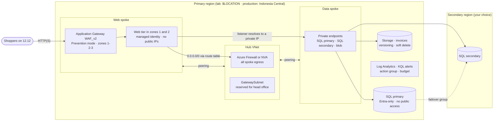

# Advanced capstone challenge · Nusantara Retail goes to production

🇮🇩 [Baca dalam Bahasa Indonesia](README.id.md)

> **Pairs with:** the whole deep-dive month, [Lunch 22](../../lunches/22-identity-access-advanced/README.md) to [Lunch 31](../../lunches/31-governance-at-scale/README.md) (requirements only: no reading, demo or video)
> **Time:** about 8–12 hours over 3–5 sessions · **Cost:** 💲💲💲 (see [cost bands](../README.md#cost-bands)) · **Difficulty:** ★★★
> **Works on its own:** ✅ You do not need any earlier lab. You design and build every resource yourself. You do need what Lunches 22–31 teach.
> **Author:** Stefanus Pinarta · [About the author](../../README.md#about-the-author)

> [!CAUTION]
> **💲💲💲 This is the most expensive project in the course, because it runs production-grade services.**
> Application Gateway WAF_v2, Azure Firewall (if you choose it), Azure Bastion, private endpoints, a NAT gateway and a
> second SQL database are billed **for every hour they exist, even when nobody sends a single request**. Never leave the
> full environment running overnight or "until next weekend". Build in phases, prove each phase, **delete it**, and
> rebuild from your Bicep next session; being able to rebuild is the whole point of infrastructure as code. Create a budget
> with alerts *before* your first deployment, and price your design for your region in the
> [Azure pricing calculator](https://azure.microsoft.com/pricing/calculator/) before you build it.

## 🎯 The brief

Eight weeks before the 12.12 sale, Ibu Sari makes it official: the storefront moves to Azure for real. The core capstone
(Lab 21) proved that a whole availability zone can fail while the shop stays open. Production brings harder questions, and
each one now comes from a specific person:

- **Ibu Sari:** "If the whole Jakarta region goes dark, how long can't we sell, and how many orders do we lose?"
- **Pak Budi:** "Head office is `10.0.0.0/16`. When we connect it next year, nothing may overlap, and all outbound traffic
  leaves through one place we control."
- **Rizky**, writing the contractor's security report: "Why can anyone on the internet reach the database? And where are
  the passwords kept?" The only acceptable answers are *"they can't"* and *"there aren't any"*.
- **The finance team:** "What will this cost each month, and who notices if it doubles?"
- **Dewi:** "I want to ship from Git, not by clicking around the portal."

Your job: design the platform, build it as code, prove every requirement below with the acceptance checks, write the DR
plan and the architecture review, and then tear everything down. There are no step-by-step instructions, and that is
the challenge. Everything you need was taught in Lunches 22–31 (see [where each piece is taught](#-where-each-piece-is-taught)).

## ✅ Before you start

- You have worked through Lunches 22–31 (doing their labs helps a lot), and ideally Lab 21. Its
  [Bicep modules](../21-core-capstone/infra/) are a reasonable starting point for the web tier, SQL and monitoring.
- A **personal or dedicated lab subscription** where you are **Owner**. Role assignments, policy assignments and
  deployment stacks with deny settings all need that role. Free and student subscriptions have small vCPU quotas and
  limited credit, so check both before you begin.
- **Azure Cloud Shell (Bash)** or a local Azure CLI with Bicep. VS Code with the Bicep extension makes authoring much easier.
- Your own **private Git repository** for the deliverables. Keep your work there, and use this course folder only for the
  shared settings:

  ```bash
  git clone https://github.com/stefpin/azure-fundamentals-lunches.git   # first time only
  cd azure-fundamentals-lunches/labs/32-advanced-capstone-challenge
  source ../common/config.sh      # gives you $LOCATION, $SECONDARY_LOCATION, $SUFFIX and the helper functions
  ```

- Enough quota: about 6 vCPUs of a small B-series family in your primary region and 2 in your secondary region. Run
  the same check with `"$SECONDARY_LOCATION"`:

  ```bash
  az vm list-usage --location "$LOCATION" -o table | grep -i -E "total regional vcpus|bs family|basv2|bsv2"
  ```

> [!IMPORTANT]
> Lab resources cost money while they exist. End **every** session with [Clean up](#-clean-up), even if you stop halfway.

## 🧭 How this challenge works

- **Requirements (R1–R12)** describe *what* must be true, never *how* to do it. **Constraints (C1–C7)** are not
  negotiable. The **acceptance checklist (A1–A19)** tells you exactly how to prove each requirement.
- **Deliverables**, all in your own repository:

| Deliverable | What it contains |
|---|---|
| `infra/` | Bicep: a `main.bicep` (subscription scope works well) plus one module per area, and a `main.bicepparam` with no secrets in it |
| `DR-PLAN.md` | Your disaster-recovery plan for production in Indonesia Central, including measured drill results (R9) |
| `ARCHITECTURE-REVIEW.md` | Your Well-Architected review, top risks, trade-offs and accepted findings (R10, R12) |
| `COST.md` | Your cost estimate and the cheaper options you considered (R11) |
| `evidence/` | The output of every acceptance check, KQL results and screenshots. Redact subscription IDs, tenant IDs and email addresses |

- **Work in phases.** Each phase adds modules to the same template and is deployed through the same stack. Prove what you
  built, then delete it, or keep it only for as long as you're actively working on it:

| Phase | Build | Prove with | Rough time | Cost while running |
|---|---|---|---|---|
| 1 · Foundations | resource groups and tags, budget, policy initiative, hub and spokes, firewall or NVA, route tables, Log Analytics | A1–A3, A14, A18 | 2–3 h | 💲💲 (💲💲💲 with Azure Firewall) |
| 2 · Data | SQL servers in two regions, database and failover group, storage, private endpoints and DNS zones | A9, A10, A12 | 2 h | 💲💲 |
| 3 · Web | web tier across zones, managed identity, Application Gateway WAF_v2 and its policy | A4–A8, A11, A13 | 2 h | 💲💲💲 |
| 4 · Operate | diagnostic settings, Azure Monitor Agent and DCR, KQL alerts, backup retention, restore drill | A15, A16 | 1–2 h | 💲💲💲 |
| 5 · Prove | deny test, DR drill, Defender for Cloud review, documents, then every check once more | A2, A12, A17, A19 | 2 h | 💲💲💲 |

## 📋 Requirements

### R1 · Everything as code, under a deployment stack

1. Every Azure resource is defined in **Bicep modules** in your repository. The budget and the Defender for Cloud
   settings are the only things you may configure in the portal. Regions, sizes, the suffix and the Entra admin group are
   parameters; no subscription ID is hard-coded.
2. You deploy through a **deployment stack** (`az stack sub create` or `az stack group create`) with **deny settings** of
   at least `denyDelete`, and with `deleteAll` as the action for unmanaged resources, so that removing a resource from the
   template also removes it from Azure.
3. You preview every change with what-if before you apply it, and redeploying an unchanged template changes nothing.

### R2 · Hub and spoke with one controlled exit

1. A **hub** VNet and at least two **spokes** (web and data) in the primary region. Each spoke peers with the hub only. No
   address range overlaps another VNet or head office's `10.0.0.0/16`, and the hub keeps room for a `GatewaySubnet` (the VPN
   to head office comes later, see Lunch 26).
2. A central **firewall**: either Azure Firewall or a small Linux network virtual appliance (NVA) with IP forwarding.
3. **Route tables** send each spoke's internet-bound traffic (`0.0.0.0/0`) and its spoke-to-spoke traffic through the
   firewall or NVA. The Application Gateway subnet is the exception (see the hints).
4. No web-tier or data VM has a public IP address. Every workload subnet has an NSG, and no NSG allows SSH or RDP from the
   internet. You manage VMs through Run Command or Azure Bastion.

### R3 · A zone-redundant web tier behind a web application firewall

1. The web tier runs in the web spoke across **at least two availability zones**, either as a Flexible scale set
   (Lunch 23) or as two or more VMs. It uses `labs/common/cloud-init-web.yml` or your own app, and it must answer on `/health`.
2. **Application Gateway WAF_v2** runs in its own dedicated subnet with explicitly set zones, a **WAF policy in Prevention
   mode** using a managed rule set, and a health probe on `/health`.
3. A normal request through the gateway returns **200**, and an obvious SQL-injection attempt returns **403**. The web
   servers accept HTTP only from the gateway's subnet.
4. *(Optional)* HTTPS, using a certificate stored in Key Vault and read by the gateway's user-assigned managed identity.

### R4 · Private data that survives a regional outage

1. **Azure SQL**: one logical server in each of your two regions, both with **Microsoft Entra-only authentication** and the
   same Entra admin group, and a database in a **failover group** with the customer-managed failover policy. Clients
   connect through the read-write listener, never through a server name. *(The free database offer can't join a failover
   group, so use a small serverless or provisioned database.)*
2. A **storage account** for invoices with **shared key access disabled**, a minimum TLS version of 1.2, blob soft
   delete, container soft delete and versioning.
3. **Private endpoints** for both SQL servers and for the storage account's blob service, placed in the data spoke. The
   private DNS zones `privatelink.database.windows.net` and `privatelink.blob.core.windows.net` are linked so that every
   VNet that needs them resolves those names to private IPs.
4. **Public network access is disabled** on both SQL servers and on the storage account.

### R5 · Identities, not secrets

1. The web tier uses a **managed identity** (user-assigned is recommended) for everything it reads.
2. Each role assignment uses the least-privileged built-in role at the narrowest scope that works. Use data roles for
   data. A workload never gets Owner or Contributor.
3. **No secrets in code** (see C4). If you deploy from GitHub Actions, use OpenID Connect with a federated credential
   (Lunch 22), never a client secret.

### R6 · Governance as code

1. A **custom policy initiative** containing at least these policies: *Allowed locations* (exactly your two regions),
   *Require a tag on resource groups* (`cost-center`) and *Inherit a tag from the resource group if missing* (the same
   tag). It's assigned at management-group or subscription scope (read C6 first), with a remediation task for the
   inherited tag.
2. The initiative and its assignment are defined in Bicep as well. A separate stack at the higher scope is fine.
3. Every exemption is recorded in `ARCHITECTURE-REVIEW.md` with a reason and an expiry date.

### R7 · Observability you can query

1. One **Log Analytics workspace** in the primary region. **Diagnostic settings** send logs to it from the Application
   Gateway (including its firewall log), Azure Firewall (if you use it), the SQL database, the storage account's blob
   service and Key Vault (if you use it).
2. The **Azure Monitor Agent** runs on every VM, with a **data collection rule** that collects at least Syslog or
   performance counters.
3. At least **two log search alert rules (KQL)** notify an action group, for example "WAF blocks are spiking" and "a web
   server stopped sending heartbeats", and you have seen each one fire.

### R8 · Backups that have been restored

1. **SQL:** point-in-time restore retention of at least 14 days, plus a long-term retention (LTR) policy (for example,
   weekly backups kept for four weeks) on the primary **and** the secondary database, so that LTR continues after a failover.
2. **Blob:** soft delete and versioning, as in R4.2. Point-in-time restore for containers is optional.
3. A **restore drill**: restore the database to a point in time as a new database, and recover an overwritten or deleted
   invoice from a previous version. Record how long each one took, then delete the restored copy.
4. The web tier keeps no state. A lost VM is replaced from code or by the scale set, never restored from a backup.

### R9 · A DR plan for a region without a pair

1. `DR-PLAN.md` targets **production in Indonesia Central**, which has no paired region. Name your secondary region and
   explain your choice (latency to Indonesian shoppers, which services are available there, data residency).
2. For each component, state what replicates and how (failover group, blob copy or object replication, redeploying from
   Bicep), the RTO and RPO you expect, and anything a paired region would have handled for you that you now have to do
   yourself. For example, geo-redundant backup storage for Azure SQL isn't available in a region without a pair.
3. Runbooks for failover and failback: who decides, in what order things happen, and how you check that the shop works.
4. A **drill**: fail the failover group over to the secondary, measure the time until the listener resolves to the new
   primary's private endpoint (and, if you have a SQL client inside the VNet, until a write succeeds), then fail back.
   Record both times.

### R10 · Security posture

1. Review the **Defender for Cloud** recommendations for your resource groups. Fix every High-severity item, or record in
   `ARCHITECTURE-REVIEW.md` why you accept it (or exempt it with an expiry date).
2. If you use Key Vault, it uses the RBAC permission model. Decide whether to turn on purge protection and record the
   trade-off: it protects production, but it also keeps the vault name reserved after every cleanup.

### R11 · Cost guardrails

1. A **budget** with alerts at 50%, 80% and 100% (or your own thresholds) exists **before** your first expensive deployment.
2. Every resource group carries the tags `cost-center`, `environment` and `workload`, plus `course` and `lunch=32` (see C5).
3. `COST.md` contains a pricing-calculator estimate per hour, per day and per 30-day month, names the three most expensive
   components, and describes at least two cheaper alternatives you considered (for example, an NVA instead of Azure Firewall).

### R12 · A Well-Architected review

1. `ARCHITECTURE-REVIEW.md` assesses your design against all five Well-Architected pillars, using Lab 21's
   [review checklist](../21-core-capstone/review-checklist.md), the official
   [Azure Well-Architected Review](https://learn.microsoft.com/assessments/azure-architecture-review/) assessment, or both.
2. It lists your top five risks, each with an owner and a next step, and at least three explicit trade-offs, such as
   cost versus reliability for the secondary region.

## 🚧 Constraints

- **C1 · Cost.** 💲💲💲. Keep the full environment running only while you're working on it, and delete it between sessions
  (see [Clean up](#-clean-up)). Use the smallest SKUs that meet each requirement: B-series VMs, a serverless or small
  provisioned database, Application Gateway autoscaling with a low maximum, and the Basic or Standard tier of Azure
  Firewall if you choose it (never Premium). Turn on long-term retention only in your last session, because LTR backups
  outlive the database.
- **C2 · Regions.** Use `$LOCATION` and `$SECONDARY_LOCATION` from `labs/common/config.sh` (Southeast Asia and East Asia
  by default). To mirror production exactly, set `LOCATION=indonesiacentral` with a secondary such as `southeastasia`,
  but only after checking that every service and SKU you need is offered in both regions for your subscription. Either
  way, build as if your primary region had no pair: don't rely on any paired-region feature.
- **C3 · Size.** At most 6 vCPUs in the primary region and 2 in the secondary, one Application Gateway, and SQL databases
  of 2 vCores or fewer.
- **C4 · No secrets in code.** Passwords, account keys, SAS tokens, connection strings with credentials and private keys
  never go into Bicep, parameter files, scripts, cloud-init or pipeline YAML, and never into your Git history. Use Entra
  authentication, managed identities and Key Vault. Use SSH public keys only, or no SSH at all. Turn on GitHub secret
  scanning and push protection for your repository.
- **C5 · Names and tags.** Use CAF abbreviations plus `$SUFFIX` (`vnet-`, `snet-`, `afw-`, `agw-`, `waf-`, `sql-`,
  `st`, `kv-`, `log-`, `pep-`). Name resource groups with `rg_name 32 <purpose>` (for example `rg-lunch32-hub-<suffix>`)
  and tag them `course=azure-fundamentals-lunches` and `lunch=32`, so the checks and `delete_lunch_rgs 32` can find them.
- **C6 · You probably share the subscription with your other labs.** A policy assigned at subscription or management-group
  scope affects every other lab you run there, and *Allowed locations* will block deployments to any other region. Use a
  dedicated subscription or management group, or start the assignment in enforcement mode `DoNotEnforce` and switch it to
  `Default` only while you're working on the capstone.
- **C7 · Time-box.** Plan for 8–12 hours. If you run out of time, cut scope rather than corners: keep R4.4 and C4, and
  record whatever you dropped in `ARCHITECTURE-REVIEW.md`.

## 🗺 Suggested architecture

Here is one design that meets every requirement. You may change it, as long as you can defend the change in your review.



The diagram leaves out a few things. The deployment stack and the policy initiative wrap everything. Key Vault is
optional. The secondary region has no web tier: in a disaster you rebuild it from Bicep (cold standby), unless your RTO
calls for a warm one (see the stretch goals).

## ✅ Acceptance checklist

Run the checks from Cloud Shell. Set your names first, then save the output of each check under `evidence/`
(for example `... | tee evidence/A06-appgw.txt`).

```bash
source ../common/config.sh
RG_HUB=$(rg_name 32 hub)      # hub VNet, firewall or NVA, private DNS zones
RG_WEB=$(rg_name 32 web)      # web spoke, Application Gateway, web tier, managed identity
RG_DATA=$(rg_name 32 data)    # data spoke, primary SQL server, storage, private endpoints
RG_DR=$(rg_name 32 dr)        # secondary SQL server, in $SECONDARY_LOCATION
RG_OPS=$(rg_name 32 ops)      # Log Analytics, action group, alert rules
# Change these to the names you chose:
STACK=stack-nusa-prod
HUB_VNET=vnet-nusa-hub; WEB_VNET=vnet-nusa-web
AGW=agw-nusa-$SUFFIX; WAF_POLICY=waf-nusa-$SUFFIX
SQL1=sql-nusa-1-$SUFFIX; SQL2=sql-nusa-2-$SUFFIX; FOG=fog-nusa-$SUFFIX; DB=sqldb-orders
ST=stnusa$SUFFIX
VM=$(az vm list -g "$RG_WEB" --query "[0].name" -o tsv)     # any web-tier VM
```

| Requirement | Proved by |
|---|---|
| R1 · Code and stack | A1, A2 |
| R2 · Hub and spoke | A3, A4, A5 |
| R3 · Web tier and WAF | A6, A7, A8 |
| R4 · Private data | A9, A10, A11, A12 |
| R5 · Identities | A13 |
| R6 · Governance | A14 |
| R7 · Observability | A8, A15 |
| R8 · Backups | A16 |
| R9 · DR plan | A12, A19 |
| R10 · Security posture | A17 |
| R11 · Cost | A18, A19 |
| R12 · Review | A19 |

**A1 · The stack exists and protects its resources**

```bash
az stack sub show --name "$STACK" \
  --query "{state:provisioningState, deny:denySettings.mode, managed:length(resources)}" -o table
az deployment sub what-if --location "$LOCATION" \
  --template-file infra/main.bicep --parameters infra/main.bicepparam
```

✅ **Pass:** the stack's state is succeeded, `deny` is `denyDelete` or `denyWriteAndDelete`, `managed` counts every
resource you expect, and what-if on your unchanged template shows no creates, deletes or real modifications. (If you use a
resource-group stack, run `az stack group show -g <rg> --name ...` and `az deployment group what-if` instead.)

**A2 · The deny settings really deny**

```bash
AG=$(az monitor action-group list -g "$RG_OPS" --query "[0].name" -o tsv)
az monitor action-group delete -g "$RG_OPS" -n "$AG"
```

✅ **Pass:** the delete fails with an authorization error that mentions a deny assignment. If it succeeds, either you're
one of the stack's excluded principals or the action group isn't managed by the stack. Fix that, then redeploy the stack
to bring the action group back.

**A3 · Hub and spoke**

```bash
az network vnet peering list -g "$RG_HUB" --vnet-name "$HUB_VNET" \
  --query "[].{peering:name, state:peeringState, sync:peeringSyncLevel}" -o table
az network vnet list \
  --query "[?starts_with(name, 'vnet-nusa')].{vnet:name, ranges:join(', ', addressSpace.addressPrefixes), peerings:length(virtualNetworkPeerings)}" \
  -o table      # adjust the name prefix to your naming
```

✅ **Pass:** the hub has one peering per spoke, each `Connected` and `FullyInSync`. Each spoke has exactly one peering,
and no range overlaps another VNet's range or `10.0.0.0/16`.

**A4 · All egress leaves through the firewall**

```bash
NIC_ID=$(az vm show -g "$RG_WEB" -n "$VM" --query "networkProfile.networkInterfaces[0].id" -o tsv)
az network nic show-effective-route-table --ids "$NIC_ID" -o table
az vm run-command invoke -g "$RG_WEB" -n "$VM" --command-id RunShellScript \
  --scripts "curl -s --max-time 10 https://api.ipify.org" --query "value[0].message" -o tsv
```

✅ **Pass** (the VM must be running): a `User` route for `0.0.0.0/0` with next hop type `VirtualAppliance` and your
firewall's private IP is `Active`, and the default `0.0.0.0/0` route to `Internet` shows `Invalid`. The address the VM
reports is the public IP of your firewall (or of the NVA's NAT gateway), not the Application Gateway's.

**A5 · No public IPs on workloads, and NSGs everywhere**

```bash
az vm list -d --query "[?publicIps!=''].{vm:name, rg:resourceGroup, publicIp:publicIps}" -o table
az network vnet subnet list -g "$RG_WEB" --vnet-name "$WEB_VNET" \
  --query "[].{subnet:name, nsg:networkSecurityGroup.id, routeTable:routeTable.id}" -o jsonc
```

✅ **Pass:** none of your web or data VMs appears in the first list. In the second, every workload subnet has an NSG, the
web-tier subnet has your route table, and the Application Gateway subnet has no route table. Repeat the second command
for the data spoke.

**A6 · Application Gateway and its WAF policy**

```bash
az network application-gateway show -g "$RG_WEB" -n "$AGW" \
  --query "{tier:sku.tier, zones:zones, state:operationalState, wafPolicy:firewallPolicy.id}" -o jsonc
az network application-gateway waf-policy show -g "$RG_WEB" -n "$WAF_POLICY" \
  --query "{state:policySettings.state, mode:policySettings.mode, ruleSets:managedRules.managedRuleSets[].ruleSetType}" -o jsonc
az network application-gateway show-backend-health -g "$RG_WEB" -n "$AGW" \
  --query "backendAddressPools[].backendHttpSettingsCollection[].servers[].{server:address, health:health}" -o table
```

✅ **Pass:** the tier is `WAF_v2`, at least two zones are listed, the state is `Running` and a WAF policy is linked. The
policy is `Enabled` in `Prevention` mode with a managed rule set, and every backend server is `Healthy`.

**A7 · The WAF blocks an attack**

```bash
AGW_PIP_ID=$(az network application-gateway show -g "$RG_WEB" -n "$AGW" \
  --query "frontendIPConfigurations[?publicIPAddress].publicIPAddress.id | [0]" -o tsv)
AGW_IP=$(az network public-ip show --ids "$AGW_PIP_ID" --query ipAddress -o tsv)
curl -s -o /dev/null -w "normal: HTTP %{http_code}\n" "http://${AGW_IP}/?id=42"
curl -s -o /dev/null -w "attack: HTTP %{http_code}\n" "http://${AGW_IP}/?id=1%27%20OR%201%3D1--"
```

✅ **Pass:** `normal: HTTP 200` and `attack: HTTP 403`.

**A8 · The block shows up in Log Analytics** (run the KQL in your workspace's **Logs** page)

```kusto
AGWFirewallLogs
| where TimeGenerated > ago(1h)
| summarize requests = count() by Action
```

✅ **Pass:** a `Blocked` row appears. Allow 5–15 minutes for the logs to arrive. If your diagnostic setting writes to the
shared *Azure diagnostics* table instead of resource-specific tables, use
`AzureDiagnostics | where Category == "ApplicationGatewayFirewallLog" | summarize count() by action_s` instead.

**A9 · SQL is Entra-only and private**

```bash
az sql server show -g "$RG_DATA" -n "$SQL1" --query publicNetworkAccess -o tsv
az sql server show -g "$RG_DR" -n "$SQL2" --query publicNetworkAccess -o tsv
az sql server ad-only-auth get -g "$RG_DATA" -n "$SQL1" --query azureAdOnlyAuthentication -o tsv
az sql server ad-only-auth get -g "$RG_DR" -n "$SQL2" --query azureAdOnlyAuthentication -o tsv
```

✅ **Pass:** `Disabled`, `Disabled`, `true`, `true`.

**A10 · Storage is locked down**

```bash
az storage account show -g "$RG_DATA" -n "$ST" \
  --query "{publicAccess:publicNetworkAccess, sharedKey:allowSharedKeyAccess, tls:minimumTlsVersion}" -o table
az storage account blob-service-properties show -g "$RG_DATA" --account-name "$ST" \
  --query "{versioning:isVersioningEnabled, blobSoftDelete:deleteRetentionPolicy.enabled, containerSoftDelete:containerDeleteRetentionPolicy.enabled}" -o table
```

✅ **Pass:** `Disabled`, `False` and `TLS1_2`, then `True`, `True` and `True`.

**A11 · Names resolve to private endpoints from inside the network**

```bash
az network private-endpoint list -g "$RG_DATA" \
  --query "[].{endpoint:name, target:privateLinkServiceConnections[0].groupIds[0], status:privateLinkServiceConnections[0].privateLinkServiceConnectionState.status}" -o table
az network private-dns link vnet list -g "$RG_HUB" -z privatelink.database.windows.net \
  --query "[].{link:name, state:virtualNetworkLinkState}" -o table      # -g: wherever your DNS zones live
az vm run-command invoke -g "$RG_WEB" -n "$VM" --command-id RunShellScript \
  --scripts "getent hosts $FOG.database.windows.net $SQL1.database.windows.net $SQL2.database.windows.net $ST.blob.core.windows.net" \
  --query "value[0].message" -o tsv
```

✅ **Pass:** there are at least three endpoints (`sqlServer` twice and `blob`), all `Approved`. Every VNet that needs
the zone has a `Completed` link (repeat the second command for `privatelink.blob.core.windows.net`). All four names
resolve to private addresses from your ranges, and the listener resolves to the same address as the current primary.

**A12 · The failover group fails over, and back**

```bash
az sql failover-group show -g "$RG_DATA" -s "$SQL1" -n "$FOG" \
  --query "{role:replicationRole, partner:partnerServers[0].replicationRole, policy:readWriteEndpoint.failoverPolicy, databases:length(databases)}" -o table
time az sql failover-group set-primary -g "$RG_DR" -s "$SQL2" -n "$FOG"      # planned failover to the secondary
# ...now repeat the getent check from A11: the listener should resolve to the secondary's private endpoint
time az sql failover-group set-primary -g "$RG_DATA" -s "$SQL1" -n "$FOG"    # fail back
```

✅ **Pass:** before the drill, the roles are `Primary` and `Secondary`, the policy is `Manual` and there's at least one
database. After the first `set-primary`, the roles swap and the listener follows them; after the second, they're back
where they started. Both times are recorded in `DR-PLAN.md`.

**A13 · Identities, not secrets**

```bash
az vm list -g "$RG_WEB" --query "[].{vm:name, identity:identity.type}" -o table
MI=$(az identity list -g "$RG_WEB" --query "[0].principalId" -o tsv)
az role assignment list --all --assignee "$MI" --query "[].{role:roleDefinitionName, scope:scope}" -o table
git -C ~/your-capstone-repo grep -n -I -i -E "password|accountkey|sharedaccesssignature|sig=|client_secret|PRIVATE KEY"
```

✅ **Pass:** every web VM has a managed identity. The identity has only narrow data roles (for example *Storage Blob Data
Reader* on the storage account), never Owner or Contributor. Every `git grep` hit is a property name such as
`disablePasswordAuthentication`, never an actual value.

**A14 · Governance as code**

```bash
az policy set-definition show -n <initiative-name> \
  --query "{initiative:displayName, policies:length(policyDefinitions)}" -o table   # add --management-group <mg-id> if it lives there
az policy assignment list --scope <assignment-scope-id> \
  --query "[?contains(policyDefinitionId, 'policySetDefinitions')].{assignment:name, enforcement:enforcementMode}" -o table
az policy state summarize --resource-group "$RG_WEB" --query "results.nonCompliantResources" -o tsv
az network nsg create -g "$RG_WEB" -n nsg-policy-probe -l westus2 -o none          # this must be refused
```

✅ **Pass:** the initiative contains at least three policies, and its assignment's enforcement is `Default`. The
non-compliant count is 0, or every remaining item is explained in your review. The probe fails with
`RequestDisallowedByPolicy`. If it succeeds, delete `nsg-policy-probe` and fix your assignment. (If you turned on
`--deny-settings-apply-to-child-scopes`, the stack's deny assignment may refuse the probe first, so read the error code.)

**A15 · Observability**

```bash
AGW_ID=$(az network application-gateway show -g "$RG_WEB" -n "$AGW" --query id -o tsv)
az monitor diagnostic-settings list --resource "$AGW_ID" --query "[].{setting:name, workspace:workspaceId}" -o table
az resource list --resource-type Microsoft.Insights/scheduledQueryRules --query "[].{alert:name, rg:resourceGroup}" -o table
for i in {1..30}; do curl -s -o /dev/null "http://${AGW_IP}/?id=1%27%20OR%201%3D1--"; done   # makes the WAF alert fire
```

```kusto
Heartbeat
| where TimeGenerated > ago(15m)
| summarize lastSeen = max(TimeGenerated) by Computer, Category
```

✅ **Pass:** the gateway's diagnostic setting points to your workspace (repeat for the other resources in R7.1). At least
two scheduled query rules exist. Every VM appears in `Heartbeat` with a `lastSeen` from the last few minutes (the
`Category` column shows which agent sent it). Within about 15
minutes of the attack loop, your WAF alert fires (**Monitor → Alerts**) and the action group's email arrives. To test the
heartbeat alert, stop one web VM, wait for the alert, then start the VM again.

**A16 · Backups and the restore drill**

```bash
az sql db str-policy show -g "$RG_DATA" -s "$SQL1" -n "$DB" --query retentionDays -o tsv
az sql db ltr-policy show -g "$RG_DATA" -s "$SQL1" -n "$DB" -o table
az sql db ltr-policy show -g "$RG_DR" -s "$SQL2" -n "$DB" -o table
az sql db list -g "$RG_DATA" -s "$SQL1" --query "[].{database:name, status:status}" -o table
```

✅ **Pass:** retention is 14 days or more, and both databases show a weekly (or monthly) retention such as `P4W`. During
the drill, the restored copy appears in the list; delete it once you've recorded the evidence. For the blob recovery,
your evidence shows the overwritten invoice restored from an earlier version. Capture it from inside the VNet, because the
storage account has no public access.

**A17 · Defender for Cloud review** (run the KQL in **Resource Graph Explorer**)

```kusto
securityresources
| where type == "microsoft.security/assessments"
| where id contains "rg-lunch32-"
| where properties.status.code == "Unhealthy"
| project recommendation = tostring(properties.displayName),
          severity = tostring(properties.metadata.severity), id
```

✅ **Pass:** every `High` item has been fixed or is listed in `ARCHITECTURE-REVIEW.md` with the reason you accept it (or
covered by an exemption with an expiry date). Recommendations refresh on their own schedule, so run the query again just
before you sign off.

**A18 · Cost guardrails**

```bash
az consumption budget list --query "[].{budget:name, amount:amount, timeGrain:timeGrain}" -o table
az group list --tag lunch=32 \
  --query "[].{rg:name, costCenter:tags.\"cost-center\", environment:tags.environment, workload:tags.workload}" -o table
```

✅ **Pass:** a budget exists (check its alert thresholds in the portal) and was created before your first expensive
deployment. Every capstone resource group shows all three tags. (A budget scoped to a resource group is listed with
`--resource-group`.)

**A19 · The documents**

```bash
ls DR-PLAN.md ARCHITECTURE-REVIEW.md COST.md evidence/
```

✅ **Pass:** everything exists. `DR-PLAN.md` contains measured drill times and an RTO and RPO for each component.
`ARCHITECTURE-REVIEW.md` covers all five pillars, the top five risks and at least three trade-offs. `COST.md` gives
hourly, daily and monthly figures.

🏁 **You're done when** every check passes in a single session, the documents are committed to your repository, and the
final check in [Clean up](#-clean-up) finds nothing left behind.

## 💡 Hints

Try the requirements on your own first. Open a hint only when you're stuck.

<details>
<summary>💡 Hint 1 · Firewall or NVA?</summary>

- **NVA** (the cheapest option, as in Lab 25): a small Linux VM in the hub. Turn on IP forwarding both on its NIC
  (`enableIPForwarding: true` in Bicep) *and* inside Linux (`net.ipv4.ip_forward=1`), and add an `iptables`
  MASQUERADE rule so spoke traffic can reach the internet. Give the NVA's subnet a NAT gateway for its outbound traffic.
  Put all of this in cloud-init, so a rebuild needs no manual steps.
- **Azure Firewall**: needs a subnet named exactly `AzureFirewallSubnet` (at least /26), a firewall policy with network
  and application rules, and a diagnostic setting. The Basic tier also needs an `AzureFirewallManagementSubnet` (at least
  /26) and a second public IP for management traffic. Every tier is billed by the hour while it's deployed.
- Either way, if the Azure Monitor Agent or VM extensions stop working after you add the `0.0.0.0/0` route, your firewall
  is blocking something the VM needs. Look for the denied destinations in the firewall or NVA logs and allow them. Service
  tags such as `AzureMonitor` help.

</details>

<details>
<summary>💡 Hint 2 · Application Gateway in a hub-and-spoke network</summary>

- The gateway needs a **dedicated subnet** with nothing else in it. Microsoft recommends a /24 for v2, so it has room to scale.
- **No route table on that subnet.** Application Gateway v2 doesn't support sending `0.0.0.0/0` through a virtual
  appliance (forced tunnelling); only the separate *private deployment* option relaxes these rules.
- If you put an NSG on the gateway subnet, allow inbound TCP 65200–65535 from the `GatewayManager` service tag, keep the
  `AzureLoadBalancer` tag allowed, allow your listener ports from the internet, and don't block outbound internet traffic.
- Keep the gateway in the web spoke, next to its backends. It's the simplest way to avoid asymmetric routing: the web
  subnet's route table can send `0.0.0.0/0` to the firewall, and replies to the gateway still stay inside the VNet because
  the VNet's own route is more specific.
- In the web subnet's NSG, allow port 80 only from the gateway subnet's range.
- Set the zones explicitly (`zones: ['1', '2', '3']`) and use autoscaling with a small maximum.

</details>

<details>
<summary>💡 Hint 3 · Private endpoints and DNS</summary>

- Use one private DNS zone per service: `privatelink.database.windows.net` for both SQL servers and
  `privatelink.blob.core.windows.net` for blob storage. Link each zone to every VNet whose VMs must resolve the names
  (hub and spokes), or centralise resolution with DNS Private Resolver (Lunch 25).
- Let each private endpoint register its own record through a **private DNS zone group**, rather than creating A records
  by hand.
- A private endpoint can sit in a different region from its resource. Put the endpoint for the *secondary* SQL server in
  your primary data spoke as well, so the web tier can still reach the database after a failover.
- The listener `<fog>.database.windows.net` is a CNAME to the current primary server. Because both servers' endpoints are
  in the zone, the chain always ends at the right private IP. The listener's DNS TTL is 30 seconds.
- With public access disabled, you can't reach the storage data plane from Cloud Shell or the portal. Do data work from
  inside the network instead: use a small tools VM with Azure CLI installed and a managed identity holding *Storage Blob
  Data Contributor*, and drive it through Run Command. Temporarily allowing public access for your own IP is a shortcut;
  if you take it, record it in your evidence and close it again straight away.

</details>

<details>
<summary>💡 Hint 4 · A failover group without surprises</summary>

- Configure both servers the same way: Entra-only authentication, the same Entra admin group, public access disabled. For
  the database, choose a General Purpose serverless database with 1–2 vCores, not the free offer.
- Create the failover group with the customer-managed policy (`failoverPolicy: 'Manual'` in Bicep). That way you decide
  when it fails over, which is exactly what drills need.
- The failover group's name becomes a DNS name, so it must be globally unique.
- Secondary databases created by a failover group aren't zone-redundant by default. Turn zone redundancy on afterwards if
  your design needs it.
- If your two regions aren't an Azure region pair (as with Indonesia Central and any other region), give the primary and
  the secondary database different maintenance windows.
- Configure the same LTR policy on the secondary database. LTR backups are only taken while a database is the primary, so
  this keeps them coming after a failover.

</details>

<details>
<summary>💡 Hint 5 · Deployment stacks in practice</summary>

```bash
az stack sub create --name stack-nusa-prod --location "$LOCATION" \
  --template-file infra/main.bicep --parameters infra/main.bicepparam \
  --action-on-unmanage deleteAll --deny-settings-mode denyDelete
```

- A subscription-scope `main.bicep` can create the resource groups itself, so a single
  `az stack sub delete --name stack-nusa-prod --action-on-unmanage deleteAll --yes` removes everything.
- Running `az stack sub create` again on an existing stack updates it.
- Deny settings protect only the control plane, so they won't stop changes to blobs or secrets. You can exclude at most
  five principals. While you're still building, `denyDelete` is the friendlier mode. Once things are stable, try
  `denyWriteAndDelete` and see what it blocks.
- Anything created outside the stack inside a managed resource group (a restored database, for example) stops that
  resource group from being deleted. Delete it first.

</details>

<details>
<summary>💡 Hint 6 · The policy initiative</summary>

- Look up built-in definition IDs by display name, for example
  `az policy definition list --query "[?displayName=='Allowed locations'].name" -o tsv`. Do the same for *Require a tag
  on resource groups* and *Inherit a tag from the resource group if missing*.
- *Allowed locations* ignores resource groups and resources whose location is `global`. Private DNS zones are global, so
  they're fine. Add *Allowed locations for resource groups* if you want resource groups covered too.
- A Modify policy needs a managed identity on its assignment, the role(s) listed in the definition's
  `roleDefinitionIds` granted to that identity at the assignment scope, and a remediation task for resources that
  already exist.
- An assignment at management-group scope belongs in a separate stack at that scope (`az stack mg create`).

</details>

<details>
<summary>💡 Hint 7 · Two KQL alerts</summary>

```kusto
// WAF blocks spiking: evaluate every 5 minutes over the last 5 minutes
AGWFirewallLogs
| where Action == "Blocked"
| summarize blocked = count() by bin(TimeGenerated, 5m)
| where blocked > 20
```

```kusto
// A web server stopped sending heartbeats
Heartbeat
| summarize lastSeen = max(TimeGenerated) by Computer
| where lastSeen < ago(10m)
```

- In Bicep, each alert is a `Microsoft.Insights/scheduledQueryRules` resource that points to your workspace and your
  action group.
- The heartbeat query can only notice a computer that reported at some point within the rule's time window. Make the
  window much longer than the 10-minute threshold, for example one hour.

</details>

<details>
<summary>💡 Hint 8 · Planning for a region without a pair</summary>

- Indonesia Central has no paired region, so nothing is replicated to a partner region for you. For example, geo-redundant
  backup storage for Azure SQL isn't available there. You choose, and pay for, every copy yourself.
- Typical answers: the failover group for orders; object replication or a scheduled copy for invoices (Lunch 24); Bicep
  for everything else. Time a rebuild of the web tier in the secondary region, because that's your cold-standby RTO. Have
  Allowed locations and DNS ready for the secondary region *before* a disaster, not during one.
- Write the plan for production even if your lab runs in Southeast Asia, and note what would be different there.

</details>

<details>
<summary>💡 Hint 9 · Evidence that would convince an auditor</summary>

- Save the output of every acceptance check, for example `az ... | tee evidence/A12-failover.txt`.
- Note UTC timestamps (`date -u`) around each drill, so you can line them up with what Log Analytics recorded.
- Redact subscription IDs, tenant IDs and email addresses before you commit anything.

</details>

## 🧹 Clean up

Clean up at the end of **every** session, not just when the project is finished.

> [!WARNING]
> Some things survive a normal resource-group delete and either keep costing money or get in your way next time:
> **long-term retention backups** (they outlive both the server and the database), **soft-deleted Key Vaults** (the name
> stays reserved, and with purge protection on, it stays reserved until the retention period ends), and **anything at
> subscription or management-group scope** (policies, budgets, role assignments, Defender plans). Work through the whole
> list below.

1. **Delete the stacks and everything they manage.**

   ```bash
   source ../common/config.sh
   az stack sub delete --name stack-nusa-prod --action-on-unmanage deleteAll --yes
   # If you have a governance stack at management-group scope:
   az stack mg delete --name stack-nusa-governance --management-group-id <mg-id> --action-on-unmanage deleteAll --yes
   ```

   If a delete fails, read the error and remove whatever is blocking it (usually something created outside the stack),
   then run the delete again. As a last resort, `--action-on-unmanage detachAll` removes the stack and its deny
   assignments without deleting the resources, so you can then delete the resource groups yourself.

2. **Delete any leftover resource groups:** `delete_lunch_rgs 32`

3. **Delete long-term retention backups** (only if you turned LTR on). They're kept for their full retention period even
   after the server and database are gone. If you ran a failover drill, check both regions:

   ```bash
   for loc in "$LOCATION" "$SECONDARY_LOCATION"; do
     az sql db ltr-backup list -l "$loc" --query "[].{server:serverName, database:databaseName, backup:name}" -o table
   done
   az sql db ltr-backup delete -l <location> -s <server> -d <database> -n "<backup-name>" --yes
   ```

4. **Purge soft-deleted Key Vaults** so their names are free again:

   ```bash
   az keyvault list-deleted --query "[?contains(name, '$SUFFIX')].name" -o tsv
   az keyvault purge --name <vault-name>     # fails if purge protection is on: the name stays reserved until retention ends
   ```

5. **Remove everything above resource-group level that you created:**

   ```bash
   az policy assignment delete --name <assignment> --scope <scope-id>
   az policy set-definition delete --name <initiative>               # add --management-group <mg-id> if it lives there
   az role assignment list --scope /subscriptions/<subscription-id> -o table
   az role assignment delete --ids <role-assignment-id>              # only the ones you created for this project
   az consumption budget delete --budget-name <budget>
   ```

   Also switch off any paid Defender for Cloud plan you turned on (**Defender for Cloud → Environment settings → your
   subscription**). If you created them, also delete the app registration for your pipeline (`az ad app delete --id <app-id>`)
   and any practice management group (move your subscription back first). In the portal, role assignments that belonged
   to deleted identities show up as *Identity not found*; remove those too.

6. **Final check.** This should print nothing (the free `NetworkWatcherRG` resource group can stay):

   ```bash
   az group list --tag lunch=32 -o table
   az stack sub list --query "[].name" -o tsv
   for loc in "$LOCATION" "$SECONDARY_LOCATION"; do az sql db ltr-backup list -l "$loc" -o table; done
   az keyvault list-deleted --query "[].name" -o tsv
   ```

## 🩺 Troubleshooting

| Symptom | Likely cause | Fix |
|---|---|---|
| Application Gateway deployment fails because of its subnet | Something else is in that subnet, or the subnet is too small | Give the gateway its own dedicated subnet (a /24 is recommended for v2) |
| Backend health shows *Unknown*, or the gateway can't be managed | A route table or NSG on the gateway subnet is breaking its management traffic | Remove the route table from that subnet, and allow `GatewayManager` on TCP 65200–65535 and `AzureLoadBalancer` |
| Web VMs lose internet access after you add the route table | The firewall or NVA isn't forwarding or translating traffic | NVA: IP forwarding on the NIC *and* in Linux, a MASQUERADE rule and an outbound path. Azure Firewall: a rule that allows the traffic |
| `getent hosts` returns a public IP for SQL or storage | The zone isn't linked to that VNet, the zone name is wrong, or the endpoint has no DNS zone group | Link the zone to the VNet, use the exact `privatelink.` names, and add a DNS zone group |
| Creating the failover group fails | The database uses the free offer, or someone else already uses that failover-group name | Use a database outside the free offer, and choose a more unique name |
| Deleting the stack leaves a resource group behind | Something in that group was created outside the stack | Delete that resource, then delete the stack again |
| A redeploy fails because the vault name already exists | The vault from your last session is soft-deleted | Purge it (`az keyvault purge`) or change the name |
| Your own deployment is refused by policy | Your initiative denies something your template does | Find the policy name in the error, then fix the template, not the policy |

## 🚀 Stretch goals

- Deploy from **GitHub Actions** with OpenID Connect: run what-if on every pull request and update the stack on merge (Lunch 22).
- Go **HTTPS end to end**: store a certificate in Key Vault, let the gateway's managed identity read it, and redirect HTTP to HTTPS.
- Build a **warm standby**: a scaled-down web tier and a second Application Gateway in the secondary region, behind Azure
  Front Door or Traffic Manager (Lunch 27). Then measure your new RTO.
- Connect **head office**: a simulated on-premises VNet with a VPN into the hub's `GatewaySubnet` (Lunch 26). This is
  💲💲💲 and slow to create.
- Try **containers**: run the storefront on AKS with Application Gateway as the ingress, instead of VMs (Lunch 29).

## 📚 Where each piece is taught

| Lunch | What you'll use from it | Lab |
|---|---|---|
| [22 · Identity and Access (Advanced)](../../lunches/22-identity-access-advanced/README.md) | managed identities, least privilege, OIDC for pipelines (R5) | [Lab 22](../22-identity-access-advanced/README.md) |
| [23 · Virtual Machines (Advanced)](../../lunches/23-virtual-machines-advanced/README.md) | scale sets spread across zones, autoscale (R3) | [Lab 23](../23-virtual-machines-advanced/README.md) |
| [24 · Storage (Advanced)](../../lunches/24-storage-advanced/README.md) | versioning, soft delete, private endpoints, object replication (R4, R8, R9) | [Lab 24](../24-storage-advanced/README.md) |
| [25 · Virtual Networking (Advanced)](../../lunches/25-networking-advanced/README.md) | hub and spoke, route tables, NVA, Azure Firewall, private DNS (R2, R4) | [Lab 25](../25-networking-advanced/README.md) |
| [26 · Hybrid Connectivity](../../lunches/26-hybrid-connectivity/README.md) | address planning for head office, `GatewaySubnet` (R2) | [Lab 26](../26-hybrid-connectivity/README.md) |
| [27 · Load Balancing (Advanced)](../../lunches/27-load-balancing-advanced/README.md) | Application Gateway WAF_v2 and WAF policies (R3) | [Lab 27](../27-load-balancing-advanced/README.md) |
| [28 · Relational Databases (Advanced)](../../lunches/28-relational-databases-advanced/README.md) | failover groups, listeners, point-in-time restore, LTR (R4, R8, R9) | [Lab 28](../28-relational-databases-advanced/README.md) |
| [29 · Containers (Advanced): AKS](../../lunches/29-containers-advanced-aks/README.md) | the optional AKS stretch goal | [Lab 29](../29-containers-advanced-aks/README.md) |
| [30 · Monitoring (Advanced)](../../lunches/30-monitoring-advanced/README.md) | diagnostic settings, the Azure Monitor Agent and DCRs, KQL, log search alerts (R7) | [Lab 30](../30-monitoring-advanced/README.md) |
| [31 · Governance at Scale](../../lunches/31-governance-at-scale/README.md) | initiatives, remediation, exemptions, deployment stacks (R1, R6) | [Lab 31](../31-governance-at-scale/README.md) |

You'll also lean on the core month: [Lunch 17 · Backup and Disaster Recovery](../../lunches/17-backup-disaster-recovery/README.md)
(RTO and RPO), [Lunch 19 · Cost Management](../../lunches/19-cost-management/README.md) (budgets),
[Lunch 20 · Infrastructure as Code with Bicep](../../lunches/20-infrastructure-as-code-bicep/README.md) and
[Lunch 21 · Core Capstone](../../lunches/21-core-capstone/README.md) (the Well-Architected review).

---

⬅️ [Lunch 31 reading](../../lunches/31-governance-at-scale/README.md) · 🏠 [All labs](../README.md) · 🏠 [Course home](../../README.md)

<sub>Last validated: October 2026 · Something broken? [Report a lab problem](../../CONTRIBUTING.md).</sub>
