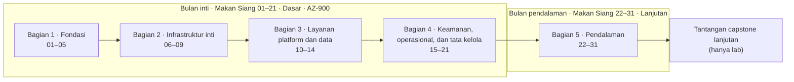
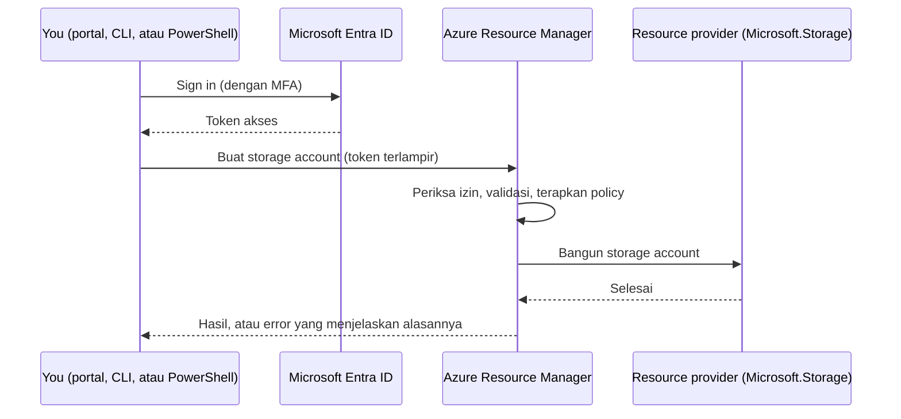
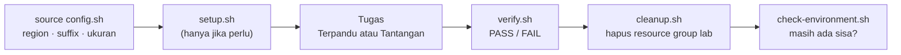

# Makan Siang 01 · Sebelum Memulai: Lab Azure, Perkakas, dan Pagar Pengaman Biaya Anda (Dasar)

🇬🇧 [Read in English](README.md)

> **Jalur:** Bulan inti · **Level:** Dasar · **Bagian 1:** Fondasi
> **Waktu:** 60 menit · **Makan siang prasyarat:** tidak ada
> **Area keterampilan AZ-900:** Menjelaskan manajemen dan tata kelola Azure
> **Lab:** [Lab 01 · Menyiapkan lingkungan lab](../../labs/01-before-you-begin/README.id.md) — sekitar 30 menit · biaya 💲
> **Penulis:** Stefanus Pinarta · [Tentang penulis](../../README.id.md#tentang-penulis)

| ⏱ Menit | Segmen |
|---:|---|
| 5 | Skenario dan tujuan |
| 25 | Bacaan |
| 15 | Demo: animasi interaktif (+ video panduan opsional) |
| 5 | Uji pemahaman |
| 5 | Poin penting dan pratinjau lab |
| 5 | Waktu cadangan — habiskan makan siang Anda 🍜 |

## 🍱 Menu hari ini

Setelah makan siang ini, Anda akan mampu:

- **Menjelaskan** bagaimana sebuah makan siang, demonya, dan lab mandirinya saling melengkapi, lalu merencanakan
  perjalanan Anda selama dua bulan kursus ini.
- **Memilih** subscription (*langganan*) yang aman untuk belajar (akun gratis, Azure for Students, atau pay-as-you-go)
  dan menjelaskan apa yang bisa dan tidak bisa dilakukan oleh spending limit.
- **Membandingkan** Azure portal, Azure Cloud Shell, Azure CLI, dan Azure PowerShell, serta menjelaskan bagaimana setiap
  permintaan sampai ke Azure Resource Manager dan ke sebuah resource provider.
- **Menerapkan** konvensi lab dan pagar pengaman biaya kursus ini: satu region (*wilayah*), satu resource group
  (*grup sumber daya*) bertag untuk setiap lab, anggaran (budget) dengan alert (*pemberitahuan*), dan kebiasaan
  bersih-bersih.

## 🏪 Sementara itu di Nusantara Retail

Hari ini Senin pertama Anda sebagai cloud engineer baru di PT Nusantara Retail. Pak Budi, yang mengurus TI kantor
pusat, mengajak Anda berkeliling. Tur itu berakhir di sebuah ruangan kecil di sebelah pantry: satu server fisik, kipas
yang terus berdengung, dan UPS yang berbunyi bip setiap kali mesin kopi dinyalakan. Server itulah yang menjalankan toko
online untuk pelanggan dari keempat puluh gerai. Trafiknya naik tiga kali lipat tahun ini. Servernya tidak.

Dalam rapat bulan lalu, Ibu Sari, sang direktur, mengajukan pertanyaan sederhana: *"Kalau server itu mati, berapa lama
kita tidak bisa jualan?"* Tidak ada yang menjawab.

Ia memberi Anda waktu untuk mempelajari Azure dengan benar, dengan satu syarat: "Jangan ada tagihan kejutan. Saya mau
bisa menjelaskan setiap rupiahnya." Sebelum merancang apa pun, Anda butuh tempat berlatih, perkakas yang tepat, dan
pagar pengaman yang membuat pengeluaran tetap bisa diprediksi.

Pertanyaan hari ini: **bagaimana menyiapkan lab Azure tempat Anda bisa bereksperimen dengan leluasa, tanpa membahayakan
perusahaan maupun anggarannya?**

---

## 📖 Bacaan (≈25 menit)

### 1. Cara kerja kursus ini

Kursus ini dirancang untuk orang yang belajar sedikit demi sedikit, tetapi rutin. Setiap makan siang adalah satu jam
yang bisa Anda "kunci" di kalender, dan semuanya mengikuti ritme yang sama, sehingga Anda selalu tahu sedang berada di
mana.

| Menit | Segmen | Yang Anda lakukan |
|---:|---|---|
| 5 | Skenario | Berkenalan dengan masalah Nusantara Retail hari ini dan tujuan belajarnya. |
| 25 | Bacaan | Mempelajari konsep dengan bahasa sederhana, lengkap dengan diagram dan tabel. |
| 15 | Demo | Menelusuri animasi interaktif langkah demi langkah; jika mau, menonton video panduan singkat. |
| 5 | Uji pemahaman | Menjawab lima pertanyaan berbasis skenario. Setiap jawaban menjelaskan *alasannya*. |
| 5 | Poin penting | Mengulang lima poin utama dan mengintip lab-nya. |
| 5 | Waktu cadangan | Habiskan makan siang Anda. Sungguh. |

**Lab** praktik sengaja *tidak* dimasukkan ke dalam satu jam itu. Sebagian besar lab butuh 30 sampai 90 menit (capstone
lebih lama), kadang dengan waktu menunggu, jadi Anda mengerjakannya belakangan: malam hari, akhir pekan, kapan pun Anda
sempat. Setiap lab bersifat **mandiri**. Lab membuat sendiri semua yang dibutuhkannya, sehingga Anda bisa mengerjakan
Lab 17 tanpa pernah menyentuh Lab 1 sampai 16. Jika sebuah lab butuh titik awal, misalnya dua web server untuk lab load
balancing, skrip `setup.sh` akan membangunnya untuk Anda. Setiap lab yang membuat resource (*sumber daya*) Azure juga
dilengkapi `verify.sh` yang memeriksa hasil kerja Anda dan `cleanup.sh` yang menghapus semuanya lagi.

Lab tersedia dalam dua mode. Mode **Terpandu** menjelaskan setiap langkah. Mode **Tantangan** hanya memberi Anda
persyaratannya: bangun dengan cara Anda sendiri, lalu biarkan `verify.sh` yang menilai hasilnya.

Kursus ini berjalan selama dua "bulan" makan siang di hari kerja:

**Bulan inti** (Makan Siang 01–21) membahas setiap layanan fundamental sampai ke tingkat yang Anda perlukan untuk
menjelaskannya, memilihnya, dan memakainya. Isinya mengikuti keterampilan yang diukur dalam ujian AZ-900 Azure
Fundamentals dan ditutup dengan capstone yang merangkai semuanya. **Bulan pendalaman** (Makan Siang 22–31) kembali ke
topik-topik besar, seperti identitas, virtual machine, jaringan, database, dan tata kelola (governance), pada kedalaman
yang dibutuhkan seorang administrator atau arsitek. Topik yang tidak muat dalam satu jam dipecah menjadi makan siang
Dasar dan pasangan Lanjutan-nya: misalnya, Makan Siang 06 (Virtual Machines, Dasar) berpasangan dengan Makan Siang 23
(Virtual Machines, Lanjutan).

Setiap lab mencantumkan **kelompok biaya** di bagian kepalanya, jadi Anda tahu apa yang akan terjadi sebelum mulai:

| Kelompok | Arti | Contoh lab |
|---|---|---|
| 💲 | Gratis atau hampir gratis | resource group, penyimpanan, policy, lab ini |
| 💲💲 | Biaya kecil selama resource berjalan, biasanya hanya beberapa sen dolar per jam | virtual machine (*komputer virtual*), load balancer, pemantauan |
| 💲💲💲 | Biaya yang terasa selama berjalan, atau gateway yang lama dibuat | VPN gateway, Application Gateway, AKS — hapus segera setelah selesai |

Kursus ini tidak pernah menyebut harga pasti, karena harga berubah-ubah dan berbeda di setiap region. Jika Anda butuh
angka, Azure pricing calculator (*kalkulator harga*) memberikan angka terbaru; Anda akan memakainya di Lab 02.

### 2. Berkenalan dengan Nusantara Retail

Setiap makan siang membawa satu perusahaan selangkah lebih dekat untuk menjawab pertanyaan sang direktur.
**PT Nusantara Retail** adalah peritel menengah dengan empat puluh gerai di seluruh Indonesia dan kantor pusat di Jakarta.
Situs e-commerce-nya, yang oleh semua orang disebut **toko online** (di kode dan nama resource disebut *storefront*),
berjalan di satu server di samping pantry itu. Kalau server itu rusak, penjualan online berhenti sampai ada yang
memperbaikinya.

Anda akan bertemu orang-orang yang sama berulang kali:

| Tokoh | Peran | Yang mereka pedulikan |
|---|---|---|
| **Ibu Sari** | Direktur | Risiko dan biaya. Ia ingin jawaban dalam rupiah dan dalam jam toko tidak bisa berjualan (downtime). |
| **Dewi** | Developer | Merilis fitur dengan cepat, tanpa menunggu berminggu-minggu untuk mendapat server. |
| **Pak Budi** | TI kantor pusat | Jaringan on-premises atau jaringan di lokasi kantor sendiri (10.0.0.0/16) dan semua yang terhubung ke sana. Berhati-hati terhadap perubahan. |
| **Rizky** | Kontraktor alih daya | Mendapat akses secukupnya untuk bekerja, tidak lebih. |
| **Tim keuangan** | Pemilik anggaran | Tagihan bulanan yang sesuai dengan yang sudah disetujui. |
| **Anda** | Cloud engineer baru | Mengubah semua kebutuhan di atas menjadi desain Azure yang benar-benar berjalan. |

Satu fakta memengaruhi banyak keputusan berikutnya: Nusantara Retail ingin data pelanggannya tetap berada di Indonesia.
Region adalah lokasi geografis tempat Microsoft mengoperasikan sekelompok pusat data Azure. Karena itu, di lingkungan
produksi, toko online akan berjalan di region **Indonesia Central** di Jakarta. Lab-lab di kursus ini memakai
**Southeast Asia** (Singapura) sebagai default karena region itu menawarkan pilihan layanan paling lengkap. Makan Siang
03 menjelaskan region secara tuntas dan menunjukkan cara memilihnya.

### 3. Subscription yang aman untuk dirusak

Untuk membuat apa pun di Azure, Anda membutuhkan sebuah **subscription**: wadah penagihan dan pengelolaan tempat resource
Anda berada. Anda masuk (sign in) dengan sebuah **akun** (akun Microsoft, akun GitHub, atau akun kantor), dan setiap
subscription memercayai satu **tenant**, yaitu direktori Microsoft Entra ID (*ID Microsoft Entra*) yang menyimpan data
pengguna dan grup. Makan Siang 04 membahas hierarki ini lebih dalam. Untuk sekarang, ingat dua hal: resource tinggal di
dalam subscription, dan setiap subscription pasti ada pihak yang membayarnya.

Untuk kursus ini, Anda butuh subscription yang **hanya milik Anda sendiri**. Ada tiga cara umum untuk mendapatkannya:

| Opsi | Yang Anda dapatkan (selalu periksa penawaran terbaru) | Perlu kartu kredit/debit? | Perlu diketahui |
|---|---|---|---|
| **Akun gratis Azure** (Azure free account) | Kredit US$200 untuk 30 hari pertama; layanan populer gratis selama 12 bulan (misalnya 750 jam per bulan untuk VM seri B yang kecil); lebih dari 65 layanan yang selalu gratis | Ya, untuk verifikasi identitas | Spending limit aktif secara default. Untuk melanjutkan setelah 30 hari, atau setelah kreditnya habis, Anda pindah ke pay-as-you-go. Layanan gratis 12 bulan berlaku untuk pelanggan baru yang melakukan perpindahan itu dalam 30 hari. |
| **Azure for Students** | Kredit US$100 yang bisa dipakai dalam 12 bulan, plus layanan gratis | Tidak; verifikasi memakai email kampus Anda | Untuk mahasiswa di institusi yang memenuhi syarat; bisa diperpanjang setiap tahun selama Anda masih kuliah. |
| **Pay-as-you-go** | Tanpa kredit; jatah gratis bulanan untuk layanan tertentu; Anda membayar pemakaian di atas jatah itu | Ya | Tanpa spending limit. Anggaran dan kebiasaan bersih-bersih Anda adalah satu-satunya rem. |

Bacalah [halaman opsi akun Azure](https://azure.microsoft.com/en-us/pricing/purchase-options/azure-account) dan
[halaman Azure for Students](https://azure.microsoft.com/en-us/free/students) sebelum mendaftar, karena penawarannya bisa
berubah.

**Spending limit.** Subscription berbasis kredit, termasuk akun gratis, datang dengan **spending limit** (batas
pengeluaran) yang sudah aktif. Ini bukan angka yang Anda pilih: nilainya sama dengan kredit Anda, dan Anda tidak bisa
menaikkan atau menurunkannya. Anda hanya bisa mempertahankannya atau menghapusnya. Ketika pemakaian Anda menghabiskan
kredit, Azure menonaktifkan resource Anda sampai akhir periode penagihan: virtual machine dihentikan dan di-deallocate
(dilepas dari server fisiknya, sehingga biaya komputasinya ikut berhenti), dan penyimpanan menjadi read-only (hanya bisa
dibaca). Layanan yang tercakup berhenti memakan uang Anda, tetapi juga berhenti berjalan. Batas ini juga punya celah:
beberapa produk Azure Marketplace dan paket dukungan (support plan) ditagih terpisah. Dan batas ini hilang sepenuhnya
saat Anda memindahkan akun gratis ke pay-as-you-go. Subscription pay-as-you-go sama sekali tidak bisa memiliki spending
limit.

Ibaratnya listrik PLN. Subscription dengan spending limit mirip meteran token prabayar: begitu token habis, listrik
padam, tetapi Anda tidak mungkin menunggak. Pay-as-you-go mirip listrik pascabayar: listrik tidak pernah padam karena
pemakaian, dan tagihannya baru datang di akhir bulan, berapa pun besarnya.

**Pilih yang mana?** Jika Anda mahasiswa, mulailah dengan Azure for Students. Jika bukan, akun gratis adalah awal yang
nyaman: makan siang pertama tidak banyak memakan biaya, dan kreditnya bisa menyerap kesalahan. Saat 30 hari berakhir,
Anda bisa pindah ke pay-as-you-go dan tetap memakai subscription yang sama. Lakukan satu hal *sebelum* pindah: buat
anggaran dari Lab 01, karena jaring pengaman spending limit hilang pada saat yang sama. Jika Anda punya langganan Visual
Studio, mungkin di dalamnya ada kredit Azure bulanan untuk pengembangan dan pengujian; periksa manfaat pelanggan
(subscriber benefits) Anda. Tidak yakin apa yang sudah Anda punya? Di portal, buka **Subscriptions**, pilih
subscription-nya, lalu lihat jenis penawarannya (offer) di halaman **Overview**.

> [!WARNING]
> Jangan pernah mengerjakan lab ini di subscription perusahaan atau subscription produksi, bahkan "cuma buat tes
> sebentar". Eksperimen Anda bisa merusak resource yang dipakai bersama, biayanya jatuh ke anggaran orang lain, kebijakan
> perusahaan bisa memblokir langkah-langkah lab, dan skrip pembersihan menghapus resource group secara utuh. Gunakan
> subscription pribadi, atau subscription yang dibuatkan kantor *khusus* untuk Anda belajar.

**Lindungi akun Anda.** Akun yang bisa membuat resource juga bisa membuat tagihan. Microsoft kini mewajibkan
**multifactor authentication (MFA, *autentikasi multifaktor*)**, yaitu verifikasi tambahan selain kata sandi, untuk
masuk ke Azure: pertama untuk portal, dan sejak 2025 juga untuk Azure CLI, Azure PowerShell, dan perkakas infrastructure
as code (*infrastruktur sebagai kode*) setiap kali perkakas itu membuat, mengubah, atau menghapus resource. Siapkan
aplikasi Microsoft Authenticator atau passkey saat diminta, jangan pernah membagikan akses masuk Anda kepada orang lain,
dan jangan pernah meng-commit kunci atau kata sandi ke Git.

### 4. Tiga jalan masuk, satu pintu depan

Anda bisa mengelola Azure dari halaman web, dari terminal di browser, atau dari komputer Anda sendiri. Keempat perkakas
di bawah ini melakukan pekerjaan yang sama; masing-masing cocok untuk momen yang berbeda.

| Perkakas | Apa itu | Paling cocok untuk | Persiapan |
|---|---|---|---|
| **Azure portal** | Antarmuka web di portal.azure.com | Menjelajah, tampilan visual (biaya, metrik, diagram), tugas sekali jalan | Tidak ada; cukup masuk lewat browser |
| **Azure Cloud Shell** | Terminal berbasis browser yang menjalankan **Bash** atau **PowerShell**, dan sudah dalam keadaan login | Semua lab di kursus ini; skrip singkat dari komputer mana pun | Tidak ada; buka dari toolbar portal atau di shell.azure.com |
| **Azure CLI** (`az`) | Perkakas baris perintah lintas platform | Skrip yang bisa diulang, pengguna Bash, otomatisasi | Pasang di Windows, macOS, atau Linux, lalu `az login` |
| **Azure PowerShell** (modul Az) | Cmdlet PowerShell seperti `New-AzResourceGroup` | Administrator Windows, pipeline PowerShell | Pasang modul Az (disarankan PowerShell 7), lalu `Connect-AzAccount` |

**Azure Cloud Shell** layak dilihat lebih dekat, karena semua lab memakainya. Cloud Shell berjalan di host Linux
sementara yang dikelola Microsoft, dengan Azure CLI, Azure PowerShell, Bicep, Git, dan banyak perkakas lain yang sudah
terpasang. Sesi akan berakhir (time out) setelah 20 menit tanpa aktivitas keyboard. Saat pertama kali membukanya, Anda
memilih cara memperlakukan file Anda:

- **Ephemeral session** (sesi sementara) tidak memerlukan storage account. Sesi ini paling cepat dimulai, tetapi semua
  yang Anda simpan dihapus saat sesi berakhir.
- **Persistent storage** (penyimpanan persisten) memasang (mount) sebuah file share Azure Files dari storage account
  (*akun penyimpanan*) di subscription Anda. Direktori `$HOME` Anda tetap ada dari sesi ke sesi, begitu juga salinan
  repositori kursus dan suffix lab Anda. Storage account ini memakan sedikit biaya, seperti penyimpanan pada umumnya.

Bedanya mirip kamar hotel transit dan kamar kos. Di kamar hotel, apa pun yang tertinggal dibersihkan saat Anda
check-out, dan besok Anda mulai lagi dari kamar kosong. Di kamar kos, barang Anda masih ada di lemari keesokan harinya,
dengan biaya sewa bulanan yang kecil.

Untuk kursus ini, persistent storage menghemat waktu karena Anda tidak perlu meng-clone repositori lagi setiap kali,
tetapi kedua pilihan sama-sama bisa dipakai.

Di komputer Anda sendiri, **Visual Studio Code** dengan ekstensi Bicep, Azure Resources, dan Azure CLI Tools menjadi
meja kerja Azure yang nyaman. Lab 01 mencantumkan perkakas lokal sebagai tambahan opsional; Anda tidak pernah
membutuhkannya untuk mengerjakan lab.

**Apa yang terjadi saat Anda mengeklik Create.** Perkakas apa pun yang Anda pakai, permintaan Anda menuju tempat yang
sama: **Azure Resource Manager (ARM)**, layanan deployment dan pengelolaan untuk Azure. ARM memeriksa siapa Anda, dengan
token dari Microsoft Entra ID. ARM memeriksa apakah Anda diizinkan melakukan tindakan itu, dengan Azure role-based
access control (Azure RBAC, *kontrol akses berbasis peran*). ARM memvalidasi permintaan: apakah nama region itu
benar-benar ada, apakah ada kebijakan (policy) yang melarangnya? Baru setelah itu ARM menyerahkan permintaan ke
**resource provider** yang tepat, yaitu layanan yang tahu cara membangun jenis resource tersebut, seperti
`Microsoft.Compute` untuk virtual machine atau `Microsoft.Storage` untuk storage account.

Bayangkan gedung perkantoran di Jakarta. Tamu boleh datang lewat lobi, lift parkir, atau pintu samping, tetapi
semuanya harus melewati meja resepsionis: menunjukkan kartu identitas (siapa Anda), dicek apakah sudah ada janji
(apakah Anda diizinkan), lalu diarahkan ke lantai yang tepat. Azure Resource Manager adalah meja resepsionis itu, dan
resource provider adalah kantor-kantor di setiap lantai.

Karena semua perkakas berbicara dengan API yang sama, satu klik dan satu perintah memberikan hasil yang sama. Itulah
sebabnya lab bisa menampilkan perintah CLI dan jalur portal untuk tugas yang sama, dan mengapa apa pun yang bisa Anda
klik juga bisa Anda jadikan skrip.

**Perkakas mana untuk kapan?** Di Nusantara Retail, tim keuangan akan "tinggal" di tampilan Cost Management (*manajemen
biaya*) di portal, karena grafik lebih ampuh daripada perintah untuk melihat tren. Dewi akan menulis skrip deployment
dengan Azure CLI, supaya bisa ditinjau dan diulang. Pak Budi sudah punya skrip PowerShell untuk server Windows-nya dan
akan langsung merasa betah dengan Azure PowerShell. Kursus ini mengajarkan CLI lebih dulu, karena perintah mudah
disalin, dibandingkan, dan dijalankan ulang, dan kursus ini menunjukkan jalur portal setiap kali portal mengajarkan
sesuatu yang visual.

Satu istilah lagi yang akan segera Anda temui: sebuah subscription harus **terdaftar** (registered) pada sebuah resource
provider sebelum bisa memakai jenis-jenis resource dari provider itu. Portal, dan deployment template, biasanya
mendaftarkan provider yang umum untuk Anda saat pertama kali dibutuhkan. Jika suatu saat Anda melihat error yang
mengatakan subscription belum terdaftar untuk memakai sebuah namespace (misalnya `Microsoft.CloudShell` saat pertama kali
membuka Cloud Shell), buka **Subscriptions › subscription Anda › Resource providers**, cari namespace tersebut, lalu
pilih **Register**.

### 5. Konvensi lab dan pagar pengaman biaya

Beberapa konvensi membuat lab tetap bisa ditebak, murah, dan mudah dibersihkan. Konvensi itu disimpan di
`labs/common/config.sh`, yang selalu dimuat paling awal oleh setiap skrip lab.

- **Satu region.** `LOCATION` secara default bernilai `southeastasia`. Pelajar di Indonesia bisa memakai
  `indonesiacentral` sebagai gantinya: jalankan `export LOCATION=indonesiacentral` sebelum `source ../common/config.sh`,
  dan pastikan layanan setiap lab tersedia di sana.
- **Satu resource group per lab.** **Resource group** adalah wadah untuk resource yang saling berkaitan. Lab NN bekerja
  di `rg-lunchNN-<suffix>`, sehingga menghapus satu group itu akan menghapus semua yang dibuat lab tersebut.
- **Tag.** Setiap resource group lab membawa dua **tag**, yaitu label berupa pasangan nama dan nilai:
  `course=azure-fundamentals-lunches` dan `lunch=NN`. Skrip pembersihan dan `check-environment.sh` menemukan sisa-sisa
  resource berdasarkan tag ini.
- **Nama.** Resource mengikuti singkatan Cloud Adoption Framework (`vnet-` untuk virtual network, `vm-` untuk virtual
  machine, `st` untuk storage account) ditambah **suffix acak** berupa lima karakter huruf kecil dan angka. Beberapa
  nama, seperti nama storage account dan web app, harus unik secara global; suffix ini mencegah bentrok dengan pelajar
  lain. Suffix dibuat sekali dan disimpan di `~/.azlunches-suffix`.
- **Ukuran kecil.** Lab memakai ukuran VM kecil jenis burstable (bisa sesekali "ngebut" di atas kapasitas dasarnya) dan
  tidak pernah memakai lebih dari empat vCPU (CPU virtual) sekaligus, karena subscription gratis dan uji coba punya kuota
  yang kecil.

Sekarang pagar pengamannya, yaitu kebiasaan yang menjaga janji "jangan ada tagihan kejutan" kepada Ibu Sari:

1. **Anggaran dengan alert.** Di Cost Management, sebuah **anggaran** (budget) memantau pengeluaran terhadap jumlah yang
   Anda tentukan untuk satu bulan, kuartal, atau tahun. Anda memasang alert pada persentase tertentu dari jumlah itu.
   Kursus ini memakai 50%, 80%, dan 100% dari biaya aktual, dan Azure mengirimi Anda email setiap kali pengeluaran
   melewati salah satunya. Alert **forecasted** (berdasarkan prakiraan) bisa memperingatkan lebih awal, saat Azure
   memperkirakan Anda *akan* melewati suatu ambang batas.
2. **Spending limit**, jika subscription Anda memilikinya, sebagai benteng pertahanan terakhir.
3. **Kelompok biaya** dan ukuran default yang kecil, supaya Anda tahu biaya sebuah lab sebelum memulainya.
4. **Auto-shutdown** pada VM lab, supaya VM yang terlupa mematikan dirinya sendiri di malam hari. Anda mengaturnya di
   Makan Siang 06.
5. **Kebiasaan bersih-bersih.** Jalankan `bash cleanup.sh` pada hari Anda menyelesaikan sebuah lab. Seminggu sekali,
   jalankan `bash labs/common/check-environment.sh`; skrip ini menampilkan resource group kursus yang masih hidup. Skrip
   pembersihan juga menghapus hal-hal yang berada *di luar* resource group, seperti role assignment, policy assignment,
   atau pengguna uji coba, jadi selalu utamakan skrip ini daripada menghapus group secara manual.

Berikut cara pagar pengaman itu bekerja dalam sebulan yang biasa. Anda menyelesaikan lab virtual machine pada Jumat
malam, tetapi lupa menjalankan skrip pembersihan. Pada hari Minggu, email 50% datang. Pada hari Senin, Anda menjalankan
`check-environment.sh`, yang menunjukkan bahwa `rg-lunch06-<suffix>` masih hidup, dan setelah satu kali `cleanup.sh`,
argo biayanya pun berhenti. Tanpa anggaran, Anda baru akan menemukan VM itu di invoice berminggu-minggu kemudian.

Alert anggaran bekerja seperti lampu indikator bensin di motor: lampunya menyala sebagai peringatan, tetapi motor tetap
melaju sampai tangkinya benar-benar kosong. Yang memutuskan untuk berhenti dan mengisi bensin tetap Anda.

> [!TIP]
> Alert anggaran dikirim dari `azure-noreply@microsoft.com`. Tambahkan alamat itu ke daftar pengirim aman (safe senders)
> Anda hari ini juga, supaya satu email yang penting itu tidak berakhir di folder junk.

> [!IMPORTANT]
> Anggaran adalah alarm, bukan rem. Melewati 100% hanya mengirim email; tidak ada yang dihentikan atau dihapus. Data
> biaya juga butuh waktu untuk masuk (sering 8 hingga 24 jam, kadang lebih lama) dan anggaran dievaluasi kira-kira
> sekali sehari, jadi alert bisa tiba berjam-jam setelah pengeluaran terjadi. Satu-satunya hal yang benar-benar
> menghentikan pengeluaran adalah spending limit pada subscription berbasis kredit, dan Anda sendiri, dengan menghapus
> resource.

### 6. Bagaimana semuanya menyatu untuk Nusantara Retail

Bayangkan lagi ruangan di samping pantry itu. Sebelum menyentuh toko online, kini Anda punya sandbox (area bermain) yang
aman: subscription pribadi atau khusus, dilindungi MFA, yang tidak berisi apa pun yang diandalkan perusahaan. Jika itu
akun gratis, spending limit membatasi kerugian sebesar kreditnya. Anggaran bulanan dengan alert di 50%, 80%, dan 100%
memberi Anda peringatan dini, dan alert prakiraan (forecast) memperingatkan Anda lebih awal lagi.

Anda juga punya cara kerja yang cocok untuk semua orang di sekitar Anda. Ibu Sari mendapat prediktabilitas
(predictability): lab diberi tag, dikelompokkan, biayanya sudah dipetakan dalam kelompok biaya, dan dibersihkan pada
hari yang sama. Dewi mendapat kecepatan: Cloud Shell siap dalam hitungan detik di browser mana pun, tanpa perlu
memasang apa-apa. Pak Budi mendapat ketenangan: tidak ada satu pun bagian lab Anda yang menyentuh jaringan 10.0.0.0/16
miliknya atau subscription perusahaan. Dan saat Rizky si kontraktor datang di Makan Siang 05, Anda sudah tahu bahwa
setiap permintaan, termasuk permintaannya, melewati Azure Resource Manager, tempat identitas dan izin diperiksa.

Pertanyaan sang direktur masih terbuka. Untuk menjawabnya, Anda lebih dulu butuh kosakata cloud: apa yang Anda sewa,
apa yang masih Anda miliki, dan mengapa membayar hanya untuk yang Anda pakai mengubah hitung-hitungan ekonomi server
tunggal itu. Itulah Makan Siang 02.

> [!NOTE]
> **Renungkan sejenak:** akun gratis Anda punya spending limit, dan Anda juga sudah membuat anggaran bulanan dengan
> alert 100%. Pengeluaran mencapai keduanya pada hari yang sama. Mana yang menghentikan virtual machine Anda, dan mana
> yang hanya mengirim email? Apa yang berubah pada hari Anda memindahkan subscription ke pay-as-you-go?

---

## 🎬 Demo (≈15 menit)

1. **Animasi interaktif (≈6–8 menit):** [Buka demo](https://stefpin.github.io/azure-fundamentals-lunches/demos/01-before-you-begin.html?lang=id) —
   tekan ▶ Putar atau telusuri langkah demi langkah sesuai kecepatan Anda. Sedang offline? Unduh
   [`docs/demos/01-before-you-begin.html`](../../docs/demos/01-before-you-begin.html) lalu buka di browser apa saja.
2. **Video panduan (≤ 6 menit):** _segera hadir_ — [baca naskah video](demo-video-script.id.md).

Yang perlu diperhatikan:

- Tiga perkakas berbeda mengirim permintaannya ke Azure Resource Manager yang sama, yang meneruskan masing-masing ke
  resource provider yang berbeda.
- Salah ketik pada nama region ditolak oleh Resource Manager sebelum apa pun dibuat. Pesan error-nya memberi tahu nilai
  yang valid.
- Indikator anggaran melewati 50%, 80%, dan 100%. Setiap ambang batas mengirim email, dan tidak ada yang berhenti.
- Menghapus resource group menghapus semua resource di dalamnya dalam satu langkah.

## ✅ Uji pemahaman (≈5 menit)

1. Dewi berkata: "Saya coba lab-labnya di subscription produksi kantor saja, ya. Nanti semuanya saya hapus." Apa yang
   Anda katakan kepadanya?
   

Lihat jawaban

   Gunakan subscription lab pribadi atau khusus sebagai gantinya. *alasannya:* langkah lab dan skrip pembersihan bisa
   merusak atau menghapus resource yang dipakai bersama, biayanya jatuh ke anggaran orang lain, dan kebijakan
   perusahaan bisa memblokir langkah-langkah lab.

   

2. Anda membuat anggaran bulanan dengan alert di 50%, 80%, dan 100%. Anda lupa pada sebuah VM, dan pengeluaran aktual
   mencapai 130% dari anggaran sebelum Anda menyadarinya. Apa yang terjadi pada VM itu?
   

Lihat jawaban

   Tidak ada: VM itu masih berjalan dan masih memakan biaya. *alasannya:* anggaran hanya mengirim notifikasi; anggaran
   tidak pernah menghentikan atau menghapus resource.

   

3. Pada hari ke-20, kredit akun gratis Anda habis, dan Anda belum pindah ke pay-as-you-go. Apa yang terjadi pada
   virtual machine dan storage account Anda?
   

Lihat jawaban

   Spending limit menonaktifkan keduanya: VM dihentikan dan di-deallocate, dan storage account menjadi read-only. Untuk
   melanjutkan, Anda pindah ke pay-as-you-go, yang menghapus batas tersebut. *alasannya:* spending limit sama dengan
   jumlah kredit dan dirancang untuk menghentikan pengeluaran, bukan untuk menagih Anda.

   

4. Pak Budi membuat storage account di portal. Dewi membuat satu lagi dengan `az storage account create`. Layanan mana
   yang menerima dan memeriksa kedua permintaan itu, dan layanan mana yang benar-benar membangun storage account-nya?
   

Lihat jawaban

   Azure Resource Manager menerima, mengautentikasi, mengotorisasi, dan memvalidasi kedua permintaan; resource provider
   `Microsoft.Storage` yang membangun akun-akunnya. *alasannya:* setiap perkakas Azure memanggil API Resource Manager
   yang sama.

   

5. Kemarin Anda meng-clone repositori kursus di Cloud Shell. Hari ini foldernya hilang dan `config.sh` membuat suffix
   baru. Apa yang terjadi, dan bagaimana mencegahnya?
   

Lihat jawaban

   Anda memakai ephemeral session, yang file-filenya dihapus saat sesi berakhir. Beralihlah ke persistent storage (di
   Cloud Shell: **Settings › Reset user settings**, lalu mount sebuah storage account), atau catat suffix Anda dan
   pulihkan dengan `echo <suffix> > ~/.azlunches-suffix` setelah meng-clone ulang. *alasannya:* hanya persistent
   storage yang menyimpan `$HOME` dari sesi ke sesi.

   

## 🧠 Poin penting

- Satu makan siang berisi satu jam skenario, bacaan, demo, dan kuis. Lab bersifat mandiri, dikerjakan belakangan sesuai
  kecepatan Anda, dan selalu diakhiri dengan `verify.sh` dan `cleanup.sh`.
- Belajarlah di subscription lab pribadi atau khusus yang dilindungi MFA, jangan pernah di subscription perusahaan atau
  produksi.
- Spending limit (akun gratis dan penawaran berbasis kredit lainnya) menonaktifkan resource saat kredit habis; anggaran
  hanya mengirim alert. Pay-as-you-go tidak punya spending limit, jadi anggaran dan kebiasaan bersih-bersih Anda jauh
  lebih penting di sana.
- Portal, Cloud Shell, Azure CLI, dan Azure PowerShell semuanya mengirim permintaan ke Azure Resource Manager, yang
  memeriksanya lalu menyerahkannya ke resource provider. Lab memakai Bash dan Azure CLI di Cloud Shell.
- Satu region, satu resource group bertag per lab, dan suffix acak membuat pembersihan cukup dengan satu perintah:
  menghapus group berarti menghapus semua isinya.

## 🗒️ Catatan lapangan dari Stefanus

> **Tulis dulu perintah hapusnya.** Sebelum membangun apa pun di Azure, bahkan uji coba lima menit, saya menuliskan
> perintah untuk membongkarnya. Di kursus ini, barisnya adalah `bash cleanup.sh`; dalam pekerjaan saya sendiri biasanya
> satu `az group delete`, ditambah catatan untuk apa pun yang tinggal di luar group, misalnya role assignment. Kalau
> baris itu tidak bisa saya tulis, artinya saya sedang menebar resource yang nanti harus saya cari satu per satu. Mirip
> menyewa tenda hajatan: sebelum tenda berdiri, sudah jelas kapan tenda itu dibongkar. Kebiasaan kedua hanya lima detik:
> `az account show` sebelum perintah pertama di setiap sesi. Salah ketik langsung ketahuan karena perintahnya gagal,
> seperti yang akan Anda lihat di Lab 01; perintah yang benar di subscription yang salah justru berhasil tanpa suara.
> Jadi, beri subscription lab Anda nama yang mustahil tertukar. Email anggaran memang mengingatkan, tetapi telat sehari;
> baris hapus itu bekerja malam ini juga.

## 🔬 Lab Anda: Menyiapkan lingkungan lab

Di Lab 01, Anda membuka Azure Cloud Shell, meng-clone repositori kursus, dan menjalankan pemeriksaan lingkungan. Lalu
Anda membuat pagar pengaman yang melindungi seluruh kursus, yaitu anggaran bulanan dengan alert di 50%, 80%, dan 100%,
dan Anda berlatih ritme lab pada sesuatu yang tidak berbahaya: sebuah resource group bertag yang Anda buat dengan CLI,
periksa di portal, lalu hapus. Anda juga akan sengaja membuat sebuah perintah gagal dan belajar membaca pesan error
Azure.

- ⏱ Sekitar 30 menit · kelompok biaya 💲 · bisa dikerjakan terpisah (tidak perlu lab sebelumnya)
- 👉 [Mulai Lab 01](../../labs/01-before-you-begin/README.id.md)

## 📚 Pelajari lebih lanjut

- [Apa itu Azure Cloud Shell?](https://learn.microsoft.com/azure/cloud-shell/overview) — shell yang akan Anda pakai di
  setiap lab: perkakasnya, batas waktu sesi, dan pilihan penyimpanannya.
- [Spending limit Azure](https://learn.microsoft.com/azure/cost-management-billing/manage/spending-limit) — subscription
  mana yang memilikinya, apa yang diblokirnya, dan cara menghapus atau mengaktifkannya kembali.
- [Tutorial: Membuat dan mengelola anggaran](https://learn.microsoft.com/azure/cost-management-billing/costs/tutorial-acm-create-budgets) —
  semua opsi anggaran, termasuk alert prakiraan (forecasted) dan action group.
- [Apa itu Azure Resource Manager?](https://learn.microsoft.com/azure/azure-resource-manager/management/overview) —
  pintu depan yang dilewati setiap permintaan, beserta istilah-istilah yang akan Anda temui lagi di Makan Siang 04.

---

⬅️ [Beranda kursus](../../README.id.md) · [Makan Siang 02 · Konsep Cloud (Dasar)](../02-cloud-concepts/README.id.md) ➡️

Terakhir divalidasi: Oktober 2026 · Menemukan informasi yang sudah usang? [Buka issue](../../CONTRIBUTING.md).
