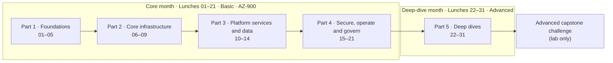
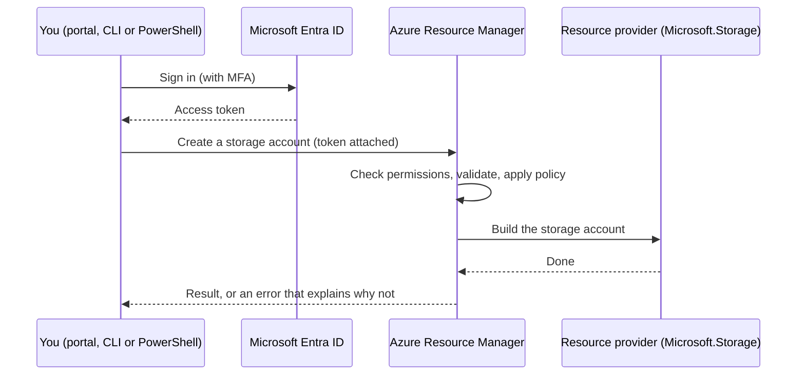
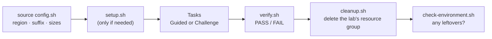

# Lunch 01 · Before You Begin: Your Azure Lab, Tools and Cost Guardrails (Basic)

> **Track:** Core month · **Level:** Basic · **Part 1:** Foundations
> **Time:** 60 minutes · **Prerequisite lunches:** none
> **AZ-900 skill area:** Describe Azure management and governance
> **Lab:** [Lab 01 · Set up your lab environment](../../labs/01-before-you-begin/README.md) — about 30 minutes · cost 💲

| ⏱ Minutes | Segment |
|---:|---|
| 5 | Scenario and objectives |
| 25 | Reading |
| 15 | Demo: interactive animation (+ optional walkthrough video) |
| 5 | Knowledge check |
| 5 | Key takeaways and lab preview |
| 5 | Buffer — finish your lunch 🍜 |

## 🍱 Today's menu

By the end of this lunch you will be able to:

- **Explain** how a lunch, its demo and its independent lab fit together, and plan your way through the two months of the course.
- **Choose** a safe subscription for learning (free account, Azure for Students or pay-as-you-go) and explain what a spending limit does and does not do.
- **Compare** the Azure portal, Azure Cloud Shell, the Azure CLI and Azure PowerShell, and describe how every request reaches Azure Resource Manager and a resource provider.
- **Apply** the course's lab conventions and cost guardrails: one region, one tagged resource group per lab, a budget with alerts, and a cleanup habit.

## 🏪 Meanwhile at Nusantara Retail

It is your first Monday as the new cloud engineer at PT Nusantara Retail. Pak Budi, who runs head-office IT, gives you
the tour. It ends in a small room next to the pantry: one physical server, a humming fan, and a UPS that beeps whenever
the coffee machine starts. That server runs the online storefront for customers of all forty stores. Traffic has tripled
this year. The server has not.

At last month's meeting Ibu Sari, the director, asked a simple question: *"If that server dies, how long can't we sell?"*
Nobody answered.

She has given you time to learn Azure properly, with one condition: "No surprise bills. I want to be able to explain
every rupiah." Before you design anything, you need a place to practise, the right tools, and guardrails that keep
spending predictable.

Today's question: **how do you set up an Azure lab where you can experiment freely, without risking the company or the
budget?**

---

## 📖 Reading (≈25 minutes)

### 1. How this course works

This course is built for people who learn in short, regular bursts. Each lunch is one hour you can protect in your
calendar, and every lunch follows the same rhythm, so you always know where you are.

| Minutes | Segment | What you do |
|---:|---|---|
| 5 | Scenario | Meet today's Nusantara Retail problem and the objectives. |
| 25 | Reading | Learn the concepts in plain language, with diagrams and tables. |
| 15 | Demo | Step through an interactive animation; optionally watch a short walkthrough video. |
| 5 | Knowledge check | Answer five scenario questions. Each answer explains *why*. |
| 5 | Takeaways | Review the five key points and preview the lab. |
| 5 | Buffer | Finish your lunch. Really. |

The hands-on **lab** is deliberately *not* part of the hour. Most labs take 30 to 90 minutes (the capstones longer),
sometimes with waiting time, so you do them later: in the evening, at the weekend, whenever suits you. Every lab is **independent**. It creates
everything it needs, so you can do Lab 17 without ever touching Labs 1 to 16. When a lab needs a starting point, such as
two web servers for the load-balancing lab, a `setup.sh` script builds it for you. Every lab that creates Azure resources
also ships a `verify.sh` that checks your work and a `cleanup.sh` that removes everything again.

Labs come in two modes. **Guided** mode explains every step. **Challenge** mode gives you the requirements only: build
it your way, then let `verify.sh` judge the result.

The course runs over two "months" of weekday lunches:

The **core month** (Lunches 01–21) covers every fundamental service at the level you need to explain it, choose it and
use it. It follows the skills measured for the AZ-900 Azure Fundamentals exam and ends with a capstone that pulls
everything together. The **deep-dive month** (Lunches 22–31) returns to the big topics, such as identity, virtual
machines, networking, databases and governance, at the depth an administrator or architect needs. A topic that does not
fit into one hour is split into a Basic lunch and an Advanced partner: Lunch 06 (Virtual Machines, Basic) pairs with
Lunch 23 (Virtual Machines, Advanced), for example.

Every lab shows a **cost band** in its header, so you know what to expect before you start:

| Band | Meaning | Typical labs |
|---|---|---|
| 💲 | Free or close to free | resource groups, storage, policies, this lab |
| 💲💲 | Small charges while resources run, typically cents per hour | virtual machines, load balancers, monitoring |
| 💲💲💲 | Noticeable charges while running, or slow-to-create gateways | VPN gateways, Application Gateway, AKS — delete them straight away |

The course never quotes exact prices, because prices change and differ by region. When you want numbers, the Azure
pricing calculator gives you current ones; you will use it in Lab 02.

### 2. Meet Nusantara Retail

Every lunch moves one company a step closer to answering the director's question. **PT Nusantara Retail** is a
mid-sized retailer with forty stores across Indonesia and a head office in Jakarta. Its e-commerce site, which everyone
calls the **storefront**, runs on that single server by the pantry. If the server fails, online sales stop until
someone fixes it.

You will meet the same people again and again:

| Person | Role | What they care about |
|---|---|---|
| **Ibu Sari** | Director | Risk and cost. She wants answers in rupiah and in hours of downtime. |
| **Dewi** | Developer | Shipping features fast, without waiting weeks for a server. |
| **Pak Budi** | Head-office IT | The on-premises network (10.0.0.0/16) and everything plugged into it. Careful with change. |
| **Rizky** | Outsourced contractor | Getting just enough access to do his job, and no more. |
| **The finance team** | Budget owners | Monthly bills that match what was approved. |
| **You** | New cloud engineer | Turning all of the above into a working Azure design. |

One fact shapes many later decisions: Nusantara Retail wants its customer data to stay in Indonesia. In production, the
storefront would therefore run in the **Indonesia Central** region in Jakarta. The labs default to **Southeast Asia**
(Singapore) because it offers the broadest choice of services. Lunch 03 explains regions properly and shows you how to
choose.

### 3. A subscription you can safely break

To create anything in Azure you need a **subscription**: a billing and management container that your resources live
in. You sign in with an **account** (a Microsoft account, a GitHub account or a work account), and every subscription
trusts one **tenant**, the Microsoft Entra ID directory that holds users and groups. Lunch 04 explores this hierarchy.
For now, remember two things: resources live in subscriptions, and every subscription has someone paying for it.

For this course you want a subscription that is **yours alone**. There are three common ways to get one:

| Option | What you get (always check the current offer) | Card needed? | Good to know |
|---|---|---|---|
| **Azure free account** | US$200 credit for the first 30 days; popular services free for 12 months (for example 750 hours a month of a small B-series VM); 65+ always-free services | Yes, for identity verification | Spending limit on by default. To continue after 30 days, or once the credit is used, you move to pay-as-you-go. The 12-month free services are for new customers who make that move within 30 days. |
| **Azure for Students** | US$100 credit to use within 12 months, plus free services | No; you verify with your academic email | For students at eligible institutions; you can renew every year while you study. |
| **Pay-as-you-go** | No credit; free monthly amounts of selected services; you pay for usage beyond them | Yes | No spending limit. Budgets and your cleanup habit are your only brakes. |

Read the [Azure account options page](https://azure.microsoft.com/en-us/pricing/purchase-options/azure-account) and the
[Azure for Students page](https://azure.microsoft.com/en-us/free/students) before you sign up, because offers change.

**The spending limit.** Credit-based subscriptions, including the free account, come with a **spending limit** switched
on. It is not a number you pick: it equals your credit, and you cannot raise or lower it. You can only keep it or remove
it. When your usage exhausts the credit, Azure disables your resources for the rest of the billing period: virtual
machines are stopped and deallocated, and storage becomes read-only. Covered services stop costing you money, but they
also stop running. The limit has gaps, too: some Azure Marketplace products and support plans are billed separately.
And it disappears completely when you move a free account to pay-as-you-go. Pay-as-you-go subscriptions cannot have a
spending limit at all.

**Which one should you pick?** If you are a student, start with Azure for Students. Otherwise, a free account is a
comfortable start: the first lunches cost little, and the credit absorbs mistakes. When the 30 days end, you can move
to pay-as-you-go and keep the same subscription. Do one thing *before* that move: create the budget from Lab 01, because
the safety net of the spending limit goes away at the same moment. If you have a Visual Studio subscription, it may
include a monthly Azure credit for development and testing; check your subscriber benefits. Not sure what you already
have? In the portal, open **Subscriptions**, select the subscription, and look at its offer on the **Overview** page.

> [!WARNING]
> Never do these labs in a company or production subscription, not even "just for a quick test". Your experiments can
> break shared resources, your costs land on someone else's budget, company policies may block lab steps, and cleanup
> scripts delete whole resource groups. Use a personal subscription, or one your employer created *only* for your learning.

**Protect the account.** An account that can create resources can also create bills. Microsoft now requires
**multifactor authentication (MFA)** for Azure sign-ins: first for the portal, and since 2025 also for the Azure CLI,
Azure PowerShell and infrastructure-as-code tools whenever they create, change or delete resources. Set up the
Microsoft Authenticator app or a passkey when you are prompted, never share your sign-in, and never commit keys or
passwords to Git.

### 4. Three ways in, one front door

You can manage Azure from a web page, from a terminal in your browser, or from your own computer. The four tools below
all do the same job; they suit different moments.

| Tool | What it is | Best for | Setup |
|---|---|---|---|
| **Azure portal** | The web interface at portal.azure.com | Exploring, visual views (costs, metrics, diagrams), one-off tasks | None; sign in with a browser |
| **Azure Cloud Shell** | A browser-based terminal running **Bash** or **PowerShell**, already signed in | Every lab in this course; quick scripts from any computer | None; open it from the portal toolbar or at shell.azure.com |
| **Azure CLI** (`az`) | A cross-platform command-line tool | Repeatable scripts, Bash users, automation | Install on Windows, macOS or Linux, then `az login` |
| **Azure PowerShell** (Az module) | PowerShell cmdlets such as `New-AzResourceGroup` | Windows administrators, PowerShell pipelines | Install the Az module (PowerShell 7 recommended), then `Connect-AzAccount` |

**Azure Cloud Shell** deserves a closer look, because every lab uses it. It runs on a temporary Linux host that
Microsoft manages, with the Azure CLI, Azure PowerShell, Bicep, Git and many other tools already installed. A session
times out after 20 minutes without keyboard activity. The first time you open it, you choose how to treat your files:

- An **ephemeral session** needs no storage account. It starts fastest, but everything you saved is deleted when the
  session ends.
- **Persistent storage** mounts an Azure Files share from a storage account in your subscription. Your `$HOME` directory
  survives between sessions, and so do your copy of the course repository and your lab suffix. The storage account costs
  a little, like any storage.

For this course, persistent storage saves you from cloning the repository again every time, but either choice works.

On your own computer, **Visual Studio Code** with the Bicep, Azure Resources and Azure CLI Tools extensions becomes a
comfortable Azure workbench. Lab 01 lists the local tools as optional extras; you never need them for the labs.

**What happens when you click Create.** Whichever tool you use, the request goes to the same place: **Azure Resource
Manager (ARM)**, the deployment and management service for Azure. ARM checks who you are, using a token from Microsoft
Entra ID. It checks that you are allowed to perform the action, using Azure role-based access control. It validates the
request: is that region name real, does a policy forbid this? Only then does it hand the request to the right
**resource provider**, the service that knows how to build that type of resource, such as `Microsoft.Compute` for
virtual machines or `Microsoft.Storage` for storage accounts.

Because every tool talks to the same API, a click and a command give the same result. That is why the labs can show a
CLI command and a portal path for the same task, and why anything you can click, you can also script.

**Which tool when?** At Nusantara Retail, the finance team will live in the portal's Cost Management views, because
charts beat commands for spotting a trend. Dewi will script her deployments with the Azure CLI, so they can be reviewed
and repeated. Pak Budi already has PowerShell scripts for his Windows servers and will feel at home with Azure
PowerShell. This course teaches CLI first, because commands are easy to copy, compare and re-run, and it shows the
portal path whenever the portal teaches something visual.

One more term you will meet early: a subscription must be **registered** for a resource provider before it can use that
provider's resource types. The portal, and deployments of templates, usually register the common providers for you the
first time you need them. If you ever see an error saying a subscription is not registered to use a namespace (for
example `Microsoft.CloudShell` the first time you open Cloud Shell), open **Subscriptions › your subscription ›
Resource providers**, find the namespace and select **Register**.

### 5. Lab conventions and cost guardrails

A few conventions keep the labs predictable, cheap and easy to clean up. They live in `labs/common/config.sh`, which
every lab script loads first.

- **One region.** `LOCATION` defaults to `southeastasia`. Learners in Indonesia can use `indonesiacentral` instead: run
  `export LOCATION=indonesiacentral` before `source ../common/config.sh`, and check that each lab's services are offered
  there.
- **One resource group per lab.** A **resource group** is a container for related resources. Lab NN works in
  `rg-lunchNN-<suffix>`, so deleting that single group deletes everything the lab created.
- **Tags.** Every lab resource group carries two **tags**, which are name-value labels: `course=azure-fundamentals-lunches`
  and `lunch=NN`. Cleanup scripts and `check-environment.sh` find leftovers by these tags.
- **Names.** Resources follow the Cloud Adoption Framework abbreviations (`vnet-` for virtual networks, `vm-` for virtual
  machines, `st` for storage accounts) plus a **random suffix** of five lowercase letters and digits. Some names, such as
  those of storage accounts and web apps, must be globally unique; the suffix prevents clashes with other learners. It is
  generated once and kept in `~/.azlunches-suffix`.
- **Small sizes.** Labs use small, burstable VM sizes and stay at or below four vCPUs at a time, because free and trial
  subscriptions have small quotas.

Now the guardrails, the habits that keep Ibu Sari's "no surprise bills" promise:

1. **A budget with alerts.** In Cost Management, a **budget** tracks spending against an amount you choose for a month,
   quarter or year. You attach alerts at percentages of that amount. This course uses 50%, 80% and 100% of actual cost,
   and Azure emails you as spending crosses each one. A **forecasted** alert can warn you earlier, when Azure predicts
   that you *will* cross a threshold.
2. **The spending limit,** if your subscription has one, as the last line of defence.
3. **Cost bands** and small default sizes, so you know what a lab costs before you start.
4. **Auto-shutdown** on lab VMs, so a forgotten VM switches itself off at night. You configure it in Lunch 06.
5. **The cleanup habit.** Run `bash cleanup.sh` on the day you finish a lab. Once a week, run
   `bash labs/common/check-environment.sh`; it lists any course resource groups that are still alive. Cleanup scripts
   also remove what lives *outside* a resource group, such as role assignments, policy assignments or test users, so
   always prefer them to deleting the group by hand.

Here is how the guardrails play out in a typical month. You finish the virtual machine lab on a Friday evening but forget
to run the cleanup script. On Sunday the 50% email arrives. On Monday you run `check-environment.sh`, which lists
`rg-lunch06-<suffix>` as still alive, and one `cleanup.sh` later the meter stops. Without the budget, you would have
discovered the VM on your invoice weeks later.

> [!TIP]
> Budget alerts come from `azure-noreply@microsoft.com`. Add that address to your safe senders list today, so the one
> email that matters does not end up in your junk folder.

> [!IMPORTANT]
> A budget is an alarm, not a brake. Crossing 100% sends an email; it does not stop or delete anything. Cost data also
> takes time to arrive (often 8 to 24 hours, sometimes longer) and budgets are evaluated about once a day, so an alert
> can arrive many hours after the spending happened. The only things that actually stop spending are the spending limit
> on credit-based subscriptions, and you, deleting resources.

### 6. How it fits together for Nusantara Retail

Picture the pantry room again. Before you touch the storefront, you now have a safe sandbox: a personal or dedicated
subscription, protected by MFA, that holds nothing the company depends on. If it is a free account, the spending limit
caps the damage at the credit. A monthly budget with alerts at 50%, 80% and 100% gives you early warnings, and a forecast
alert warns you even earlier.

You also have a way of working that suits everyone around you. Ibu Sari gets predictability: labs are tagged, grouped,
costed in bands and cleaned up on the same day. Dewi gets speed: Cloud Shell is ready in seconds in any browser, with
nothing to install. Pak Budi gets reassurance: nothing in your lab touches his 10.0.0.0/16 network or the company's
subscriptions. And when Rizky the contractor arrives in Lunch 05, you will already know that every request, his
included, passes through Azure Resource Manager, where identity and permissions are checked.

The director's question is still open. To answer it, you first need the vocabulary of the cloud: what you rent, what you
still own, and why paying only for what you use changes the economics of that single server. That is Lunch 02.

> [!NOTE]
> **Pause and think:** your free account has a spending limit, and you have also created a monthly budget with a 100%
> alert. Spending reaches both on the same day. Which one stops your virtual machines, and which one only sends an email?
> What changes on the day you move the subscription to pay-as-you-go?

---

## 🎬 Demo (≈15 minutes)

1. **Interactive animation (≈6–8 min):** [Open the demo](https://stefpin.github.io/azure-fundamentals-lunches/demos/01-before-you-begin.html) —
   press ▶ Play or step through it at your own pace. Offline? Download
   [`docs/demos/01-before-you-begin.html`](../../docs/demos/01-before-you-begin.html) and open it in any browser.
2. **Walkthrough video (≤ 6 min):** _coming soon_ — [read the walkthrough script](demo-video-script.md).

What to watch for:

- Three different tools send their requests to the same Azure Resource Manager, which passes each one to a different
  resource provider.
- A typo in a region name is rejected by Resource Manager before anything is created. The error tells you what is valid.
- The budget gauge passes 50%, 80% and 100%. Each threshold sends an email, and nothing stops.
- Deleting the resource group removes every resource inside it in one step.

## ✅ Knowledge check (≈5 minutes)

1. Dewi says: "I'll just try the labs in the company's production subscription. I'll delete everything afterwards." What
   do you tell her?
   

Show answer

   Use a personal or dedicated lab subscription instead. *Why:* lab steps and cleanup scripts can break or delete shared
   resources, the costs land on someone else's budget, and company policies may block lab steps.

   

2. You created a monthly budget with alerts at 50%, 80% and 100%. You forget a VM, and actual spending reaches 130% of
   the budget before you notice. What happened to the VM?
   

Show answer

   Nothing: it is still running and still costing money. *Why:* budgets only send notifications; they never stop or
   delete resources.

   

3. On day 20 your free-account credit runs out and you have not moved to pay-as-you-go. What happens to your virtual
   machine and your storage account?
   

Show answer

   The spending limit disables them: the VM is stopped and deallocated, and the storage account becomes read-only. To
   continue, you move to pay-as-you-go, which removes the limit. *Why:* the spending limit equals the credit and is
   designed to stop spending rather than bill you.

   

4. Pak Budi creates a storage account in the portal. Dewi creates another with `az storage account create`. Which
   service receives and checks both requests, and which one actually builds the storage accounts?
   

Show answer

   Azure Resource Manager receives, authenticates, authorizes and validates both requests; the `Microsoft.Storage`
   resource provider builds the accounts. *Why:* every Azure tool calls the same Resource Manager API.

   

5. Yesterday you cloned the course repository in Cloud Shell. Today the folder is gone and `config.sh` has generated a
   new suffix. What happened, and how do you prevent it?
   

Show answer

   You were using an ephemeral session, whose files are deleted when it ends. Switch to persistent storage (Cloud Shell
   **Settings › Reset user settings**, then mount a storage account), or write your suffix down and restore it with
   `echo <suffix> > ~/.azlunches-suffix` after cloning again. *Why:* only persistent storage keeps `$HOME` between
   sessions.

   

## 🧠 Key takeaways

- A lunch is one hour of scenario, reading, demo and quiz. Labs are independent, done later at your own pace, and always
  end with `verify.sh` and `cleanup.sh`.
- Learn in a personal or dedicated lab subscription protected by MFA, never in a company or production subscription.
- A spending limit (free account and other credit-based offers) disables resources when the credit is gone; a budget
  only sends alerts. Pay-as-you-go has no spending limit, so your budget and cleanup habit matter even more there.
- The portal, Cloud Shell, the Azure CLI and Azure PowerShell all send requests to Azure Resource Manager, which checks
  them and hands them to resource providers. The labs use Bash and the Azure CLI in Cloud Shell.
- One region, one tagged resource group per lab and a random suffix make cleanup a single command: deleting the group
  deletes everything inside it.

## 🔬 Your lab: Set up your lab environment

In Lab 01 you open Azure Cloud Shell, clone the course repository and run the environment check. Then you create the
guardrail that protects the whole course, a monthly budget with alerts at 50%, 80% and 100%, and you practise the lab
rhythm on something harmless: a tagged resource group that you create with the CLI, inspect in the portal and delete.
You will also break a command on purpose and learn to read an Azure error message.

- ⏱ About 30 minutes · 💲 cost band · works on its own (no earlier lab needed)
- 👉 [Start Lab 01](../../labs/01-before-you-begin/README.md)

## 📚 Go further

- [What is Azure Cloud Shell?](https://learn.microsoft.com/azure/cloud-shell/overview) — the shell you will use in
  every lab: tools, session time-outs and storage options.
- [Azure spending limit](https://learn.microsoft.com/azure/cost-management-billing/manage/spending-limit) — which
  subscriptions have one, what it blocks, and how to remove it or turn it back on.
- [Tutorial: Create and manage budgets](https://learn.microsoft.com/azure/cost-management-billing/costs/tutorial-acm-create-budgets) —
  every budget option, including forecasted alerts and action groups.
- [What is Azure Resource Manager?](https://learn.microsoft.com/azure/azure-resource-manager/management/overview) — the
  front door every request passes through, and the terms you will meet again in Lunch 04.

---

⬅️ [Course home](../../README.md) · [Lunch 02 · Cloud Concepts](../02-cloud-concepts/README.md) ➡️

Last validated: October 2026 · Spotted something out of date? [Open an issue](../../CONTRIBUTING.md).
