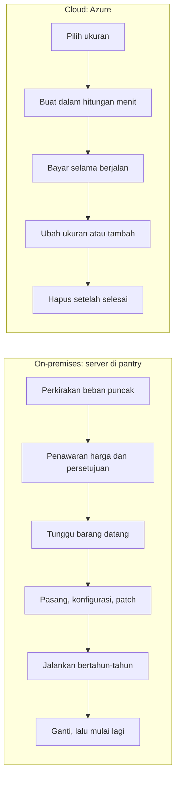
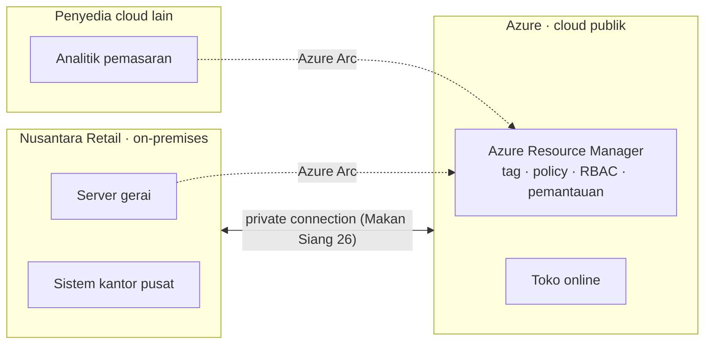
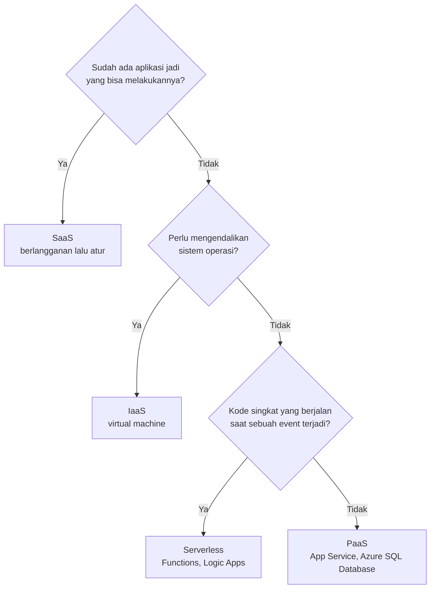

# Makan Siang 02 · Konsep Cloud (Dasar)

🇬🇧 [Read in English](README.md)

> **Jalur:** Bulan inti · **Level:** Dasar · **Bagian 1:** Fondasi
> **Waktu:** 60 menit · **Makan siang prasyarat:** 01
> **Area keterampilan AZ-900:** Menjelaskan konsep cloud
> **Lab:** [Lab 02 · Menyusun justifikasi bisnis](../../labs/02-cloud-concepts/README.id.md) — sekitar 40 menit · biaya 💲 (tidak ada resource Azure yang dibuat)
> **Penulis:** Stefanus Pinarta · [Tentang penulis](../../README.id.md#tentang-penulis)

| ⏱ Menit | Segmen |
|---:|---|
| 5 | Skenario dan tujuan |
| 25 | Bacaan |
| 15 | Demo: animasi interaktif (+ video panduan opsional) |
| 5 | Uji pemahaman |
| 5 | Poin penting dan pratinjau lab |
| 5 | Waktu cadangan — habiskan makan siang Anda 🍜 |

## 🍱 Menu hari ini

Setelah makan siang ini, Anda akan mampu:

- **Mendefinisikan** cloud computing (*komputasi awan*) dan **menjelaskan** consumption-based model (*model berbasis
  penggunaan*), belanja modal (CapEx) versus belanja operasional (OpEx), serta model-model harga cloud yang utama.
- **Membandingkan** model cloud publik, privat, hibrid (public, private, hybrid cloud), dan multicloud, serta
  menjelaskan posisi Azure Arc.
- **Menjelaskan** IaaS (*infrastruktur sebagai layanan*), PaaS (*platform sebagai layanan*), SaaS (*perangkat lunak
  sebagai layanan*), dan serverless, serta **memakai** model tanggung jawab bersama (shared responsibility model) untuk
  menentukan siapa mengerjakan apa.
- **Menjelaskan** manfaat layanan cloud (ketersediaan tinggi, skalabilitas, elastisitas, keandalan, prediktabilitas,
  keamanan, tata kelola, dan kemudahan pengelolaan) dengan contoh-contoh dari Nusantara Retail.

## 🏪 Sementara itu di Nusantara Retail

Tim keuangan meneruskan sebuah penawaran harga kepada Anda: server yang lebih besar untuk ruangan di samping pantry,
dikirim dalam enam minggu, lengkap dengan lampiran jadwal penyusutan lima tahun. Ibu Sari menambahkan satu baris di
atasnya: *"Atau sebaiknya kita pakai 'cloud' yang dibicarakan semua orang itu? Jelaskan ke saya dalam hitungan uang dan
risiko."*

Dewi sudah punya jawaban: "Kasih saya platform. Saya tidak mau mem-patch server lagi seumur hidup." Pak Budi kurang
yakin: "Kalau jalannya di pusat data (datacenter) orang lain, siapa yang memperbaiki kalau rusak? Dan siapa yang
disalahkan?" Sebenarnya mereka menanyakan hal yang sama dari dua sisi yang berlawanan.

Sebelum bisa menghitung harga apa pun, Anda butuh kosakata bersama: apa persisnya yang Anda sewa, apa yang masih Anda
miliki, dan apa yang terjadi pada tagihan saat trafik naik tiga kali lipat lagi.

Pertanyaan hari ini: **apa yang sebenarnya berubah jika pindah ke cloud, dari sisi uang, tanggung jawab, dan risiko
bahwa satu server bisa melumpuhkan seluruh toko?**

---

## 📖 Bacaan (≈25 menit)

### 1. Apa sebenarnya cloud computing itu

**Cloud computing** berarti menyewa layanan komputasi lewat internet dari penyedia yang memiliki dan menjalankan pusat
datanya. Layanan itu beragam, mulai dari server mentah, penyimpanan, dan jaringan, sampai database, analitik, AI, dan
aplikasi yang sudah jadi. Anda membuat apa yang Anda butuhkan, tepat saat Anda membutuhkannya, melalui portal atau API,
dan Anda membayar sesuai pemakaian.

Definisi yang banyak dipakai, dari National Institute of Standards and Technology (NIST) Amerika Serikat, menyebut lima
karakteristik. Kelimanya adalah ujian yang bagus untuk menilai apakah sesuatu benar-benar "cloud" atau sekadar ruang
server milik orang lain:

- **On-demand self-service (layanan mandiri sesuai permintaan):** Anda membuat resource (*sumber daya*) sendiri, dalam
  hitungan menit, tanpa purchase order atau menelepon siapa pun.
- **Broad network access (akses jaringan yang luas):** Anda menjangkau layanan lewat jaringan, dari mana saja, dengan
  perkakas standar.
- **Resource pooling (pemakaian sumber daya bersama):** penyedia membagi kumpulan perangkat keras yang sangat besar
  kepada banyak pelanggan, sambil menjaga resource setiap pelanggan tetap terisolasi dari pelanggan lain.
- **Rapid elasticity (elastisitas cepat):** kapasitas bisa bertambah dan berkurang dengan cepat, sering kali secara
  otomatis.
- **Measured service (layanan terukur):** pemakaian dicatat oleh meteran, sehingga Anda membayar per detik, jam,
  gigabyte, atau transaksi.

Ujian ini penting karena "tervirtualisasi" tidak sama dengan "cloud". Pak Budi bisa memasang hypervisor (perangkat
lunak yang membagi satu server fisik menjadi beberapa mesin virtual) di server yang lebih besar lalu menjalankan lima
virtual machine (*komputer virtual*) di atasnya. Itu berguna, tetapi ia tetap harus memesan perangkat kerasnya,
menunggunya datang, dan memiliki kapasitas yang jumlahnya tetap. Tanpa layanan mandiri, elastisitas, dan meteran
pemakaian, itu hanyalah ruang server yang lebih efisien.

Analogi yang pas untuk lalu lintas Jakarta: punya mobil sendiri versus memakai aplikasi ojek atau taksi online. Punya
mobil berarti membayar di muka, ditambah parkir, asuransi, dan servis, untuk kendaraan yang sebagian besar waktunya diam
di garasi. Ojek atau taksi online berarti membayar per perjalanan sementara orang lain merawat kendaraannya, dan di hari
yang sibuk Anda tinggal memesan lebih banyak perjalanan. Tidak ada yang selalu lebih murah. Keduanya cocok untuk pola
pemakaian yang berbeda, dan itulah persis keputusan yang sedang dihadapi Nusantara Retail.

Bandingkan riwayat hidup server di pantry dengan server di cloud:

### 2. Uang: CapEx, OpEx, dan consumption-based model

**Belanja modal (capital expenditure, CapEx)** adalah uang yang dikeluarkan di muka untuk aset fisik: server,
penyimpanan, switch jaringan, UPS, AC untuk ruang server. Anda membayar sekali, lalu menyusutkan nilainya selama
beberapa tahun. Untuk membeli, Anda harus menebak kebutuhan di masa depan, lalu hidup dengan tebakan itu.

**Belanja operasional (operational expenditure, OpEx)** adalah uang yang dikeluarkan untuk layanan saat Anda
memakainya: listrik, koneksi internet, langganan perangkat lunak, dan layanan cloud. Biayanya ditagih pada periode
pemakaian, dan bisa naik atau turun mengikuti bisnis.

Cloud mengikuti **consumption-based model**: tidak ada yang perlu dibeli di muka, dan tagihannya mencerminkan apa yang
benar-benar Anda pakai. Hapus sebuah resource, dan biayanya berhenti. (Hati-hati dengan detailnya: data yang Anda
simpan di penyimpanan tetap memakan biaya, dan virtual machine yang di-stop tetapi tidak di-deallocate masih ditagih
untuk komputasinya. Makan Siang 06 menjelaskan bedanya.) Bagi Nusantara Retail, ini membawa tiga keuntungan praktis:
tidak ada modal yang terikat pada perangkat keras yang mungkin ukurannya salah, kebebasan untuk mencoba sesuatu selama
sehari lalu membuangnya, dan biaya yang mengikuti penjualan. Toko online akan lebih mahal di bulan Desember, saat
pendapatannya juga lebih besar.

Ibaratnya parkir di mal. Anda tidak membeli lahan parkir; Anda membayar per jam selama mobil berada di sana, dan begitu
keluar gerbang, argonya berhenti. Tetapi kalau mobil ditinggal, argonya terus berjalan, sama seperti data yang terus
tersimpan atau VM yang lupa di-deallocate.

Bandingkan keduanya dalam satu invoice. Dengan server baru, tim keuangan membayar harga penuh pada bulan barang itu
datang, lalu menyebarnya dalam penyusutan lima tahun, entah servernya sibuk atau menganggur. Dengan Azure, toko online
menjadi satu baris di anggaran operasional bulanan: lebih tinggi di bulan Desember, lebih rendah di bulan Februari, dan
hilang pada hari Anda menghapusnya.

Harga beli juga hanya sebagian dari cerita. **Total cost of ownership (TCO)**, atau total biaya kepemilikan, server
pantry mencakup listrik, pendingin, ruang lantai, kontrak pemeliharaan, disk cadangan, lisensi perangkat lunak,
keamanan fisik, dan jam kerja yang dihabiskan Pak Budi untuk merawatnya. Perbandingan yang adil menaruh semua itu di
samping tagihan Azure. Untuk migrasi sungguhan, Azure Migrate dapat menemukan server yang sudah ada dan menyusun
business case (fitur pratinjau pada saat tulisan ini dibuat) yang membandingkan biaya on-premises dengan biaya Azure.

Ada lebih dari satu cara membayar. AZ-900 menyebutnya **model harga cloud** (cloud pricing models):

| Model harga | Cara membayar | Cocok untuk | Waspadai |
|---|---|---|---|
| **Pay-as-you-go** | Per detik, jam, GB, atau transaksi, tanpa komitmen | Beban kerja baru, yang naik-turun tajam, atau yang berumur pendek; lab | Harga satuan paling tinggi; resource yang terlupa terus ditagih |
| **Reservasi dan savings plan** | Komitmen satu atau tiga tahun untuk mendapatkan tarif yang lebih rendah | Beban kerja stabil yang berjalan 24 jam sehari, seperti database produksi | Anda tetap membayar komitmennya meskipun pemakaian Anda lebih sedikit |
| **Kapasitas Spot** | Kapasitas sisa dengan diskon besar, yang bisa diambil kembali oleh Azure dengan pemberitahuan singkat | Pekerjaan batch yang boleh terputus dan lingkungan pengujian | Jangan pernah untuk apa pun yang diandalkan pelanggan |
| **Jatah gratis** | Tidak membayar apa-apa, sampai batas bulanan tertentu | Belajar, perkakas kecil, prototipe | Pemakaian di atas batas akan ditagih |
| **Langganan per pengguna** (khas SaaS) | Biaya tetap per pengguna per bulan | Email, aplikasi perkantoran, penggajian | Membayar lisensi yang tidak dipakai siapa pun |

> [!WARNING]
> "Cloud itu lebih murah" adalah janji yang hanya bisa ditepati oleh Anda sendiri. OpEx tidak otomatis lebih rendah:
> virtual machine yang menyala 24 jam dengan ukuran tiga kali lipat dari kebutuhannya bisa lebih mahal dalam lima tahun
> daripada server yang digantikannya. Penghematan datang dari memakai hanya yang Anda butuhkan (right-sizing atau
> menyesuaikan ukuran, mematikan, menghapus) dan dari biaya yang tidak lagi Anda tanggung: peremajaan perangkat keras,
> suku cadang, ruangan, listrik, dan akhir pekan Pak Budi. Makan Siang 19 membahas cost management (*manajemen biaya*)
> secara mendalam.

### 3. Publik, privat, hibrid, dan multicloud

Sebuah **model cloud** menggambarkan di mana cloud berjalan dan siapa pemiliknya.

- **Cloud publik:** penyedia seperti Microsoft memiliki dan menjalankan pusat data, lalu menawarkan layanannya kepada
  siapa saja lewat internet. Para pelanggan berbagi perangkat keras fisik, tetapi terisolasi satu sama lain. Tidak ada
  CapEx, skalanya sangat besar, dan Anda bisa mulai dalam hitungan menit; sebagai gantinya, Anda tidak punya kendali
  fisik.
- **Cloud privat:** layanan mandiri bergaya cloud yang dibangun untuk satu organisasi saja, di pusat datanya sendiri
  atau di pusat data sewaan (hosted). Anda mendapat kendali maksimum sekaligus tanggung jawab maksimum. Anda membeli
  dan menjalankan perangkat kerasnya, jadi CapEx kembali muncul, dan elastisitasnya terbatas pada apa yang sudah Anda
  beli.
- **Cloud hibrid:** cloud publik dan lingkungan privat atau on-premises (di lokasi sendiri), yang terhubung sehingga
  bisa bekerja sama. Anda memilih di mana setiap beban kerja berjalan. Model hibrid umum dipakai saat sebagian sistem
  belum bisa pindah, karena regulasi, latensi, atau investasi perangkat keras yang masih baru.
- **Multicloud:** dua atau lebih penyedia cloud publik dipakai bersamaan, misalnya karena perusahaan yang diakuisisi
  berjalan di penyedia lain, atau satu layanan lebih cocok untuk kebutuhan tertentu. Ini menambah beban: setiap penyedia
  punya perkakas, identitas, keterampilan, dan tagihannya sendiri.

**Azure Arc** mengurangi beban itu. Arc "memproyeksikan" server, cluster Kubernetes, dan instance SQL Server yang
berjalan di luar Azure (on-premises, di edge, atau di cloud lain) ke dalam Azure Resource Manager. Setelah itu, semuanya
muncul berdampingan dengan resource Azure Anda, dan Anda bisa memberinya tag, mengaturnya dengan Azure Policy,
mengendalikan aksesnya dengan Azure RBAC (*kontrol akses berbasis peran*), serta memantau dan mengamankannya dengan
perkakas yang sama. Fitur inti Arc untuk pengelolaan (control plane) tidak dikenai biaya tambahan; layanan yang Anda
tambahkan di atasnya, seperti Microsoft Defender for Cloud (*Microsoft Defender untuk Cloud*) atau Azure Monitor,
ditagih seperti biasa.

| Model | Siapa pemilik perangkat keras | Contoh penggunaan umum | Di Nusantara Retail |
|---|---|---|---|
| **Publik** | Penyedia cloud | Aplikasi baru, situs web, permintaan yang naik-turun | Toko online di Azure |
| **Privat** | Organisasi Anda, atau penyedia hosting yang bertindak atas nama Anda | Kebutuhan kendali yang ketat, investasi pusat data yang sudah ada | Tidak direncanakan: satu ruang server bukanlah cloud privat |
| **Hibrid** | Keduanya, saling terhubung | Migrasi bertahap; sistem yang harus tetap on-premises | Sistem gerai tetap di gerai; toko online pindah ke Azure |
| **Multicloud** | Dua penyedia atau lebih | Akuisisi, layanan khusus, tidak bergantung pada satu vendor | Perkakas analitik pemasaran yang sudah berjalan di penyedia lain |

### 4. IaaS, PaaS, SaaS, dan serverless: siapa mengerjakan apa

Penyedia cloud menawarkan **jenis layanan** (service types) di berbagai tingkat tumpukan teknologi (stack). Makin
tinggi tingkatnya, makin banyak yang dikerjakan penyedia untuk Anda, dan makin sedikit yang Anda kendalikan.

- **Infrastructure as a service (IaaS):** Anda menyewa virtual machine, disk, dan jaringan. Microsoft menjalankan pusat
  data, host fisik, dan jaringan fisiknya; Anda mengelola semuanya dari sistem operasi ke atas: patching, hardening
  (pengerasan keamanan), runtime, aplikasi, dan data Anda. Kendali paling besar, pekerjaan paling banyak. Contoh
  penggunaan: migrasi lift and shift (memindahkan sistem apa adanya), perangkat lunak yang butuh pengaturan sistem
  operasi tertentu, mesin untuk pengujian dan pengembangan. Contoh layanan: Azure Virtual Machines, managed disk,
  virtual network (*jaringan virtual*).
- **Platform as a service (PaaS):** Anda membawa kode dan data; Microsoft menjalankan, mem-patch, dan menskalakan sistem
  operasi, runtime, dan middleware. Contoh penggunaan: web app (*aplikasi web*) dan API, database terkelola, tim yang
  ingin merilis dengan cepat. Contoh layanan: Azure App Service, Azure SQL Database, Azure Storage.
- **Software as a service (SaaS):** aplikasi jadi yang Anda langgani lalu Anda atur. Vendor menjalankan semuanya; Anda
  mengelola pengguna, data, dan pengaturan Anda. Contoh penggunaan: email dan kolaborasi, CRM, HR dan penggajian. Contoh
  layanan: Microsoft 365, Dynamics 365.

**Serverless** adalah ujung terjauh dari PaaS: Anda berhenti memikirkan server sama sekali, bahkan soal berapa instance
yang berjalan. Kode atau alur kerja (workflow) berjalan saat sebuah peristiwa (event) terjadi, menyesuaikan skala
secara otomatis (sampai nol saat tidak ada pekerjaan), dan Anda membayar per eksekusi. Azure Functions menjalankan kode;
Azure Logic Apps menjalankan alur kerja. Di Nusantara Retail, sebuah serverless function (*fungsi*) bisa mengirim email
konfirmasi pesanan begitu pesanan masuk. Makan Siang 14 membangunnya.

**Model tanggung jawab bersama** menjelaskan siapa yang mengurus setiap lapisan pada setiap jenis layanan:

| Lapisan | On-premises | IaaS | PaaS | SaaS |
|---|---|---|---|---|
| Data Anda | Anda | Anda | Anda | Anda |
| Pengaturan dan konfigurasi | Anda | Anda | Anda | Anda |
| Identitas dan akses | Anda | Anda | Anda | Anda |
| Perangkat (laptop, ponsel) | Anda | Anda | Anda | Anda |
| Aplikasi | Anda | Anda | Bersama | Microsoft |
| Kontrol jaringan | Anda | Anda | Bersama | Microsoft |
| Sistem operasi | Anda | Anda | Microsoft | Microsoft |
| Host fisik | Anda | Microsoft | Microsoft | Microsoft |
| Jaringan fisik dan pusat data | Anda | Microsoft | Microsoft | Microsoft |

Baca tabel ini dari bawah ke atas: setiap langkah dari on-premises menuju SaaS menyerahkan lebih banyak lapisan kepada
Microsoft. Sekarang baca empat baris teratas. Keempatnya tidak pernah berpindah. Apa pun jenis layanannya, Nusantara
Retail-lah yang menentukan siapa yang boleh masuk, mewajibkan MFA, mengklasifikasikan data pelanggan, mengonfigurasi
setiap layanan dengan aman, dan merawat laptop serta ponselnya sendiri. Penyedia bisa saja menjalankan platform tanpa cela, sementara Anda tetap membocorkan data
lewat satu kata sandi yang lemah.

Bayangkan urusan tempat tinggal. On-premises seperti rumah milik sendiri: atap bocor, pompa air rusak, atau pagar
jebol, semuanya Anda yang urus. IaaS seperti menyewa unit apartemen kosong: pengelola gedung mengurus struktur, lift,
dan satpam, tetapi perabot dan isi unit tetap urusan Anda. PaaS seperti kos eksklusif yang sudah lengkap perabotnya:
Anda tinggal membawa koper. SaaS seperti menginap di hotel. Namun di mana pun Anda tinggal, kunci kamar tetap tanggung
jawab Anda: kalau kartu kunci diberikan kepada orang asing, pengelolanya tidak bisa disalahkan.

Sel-sel "Bersama" adalah tempat sebagian besar insiden nyata terjadi, karena masing-masing pihak mengira pihak lain yang
mengawasi. Di PaaS, Microsoft mem-patch perangkat lunak web server di bawah aplikasi Dewi, tetapi Dewi tetap yang menulis
kodenya, menjaga library-nya tetap mutakhir, menyimpan connection string dengan aman, dan memutuskan apakah aplikasinya
menerima trafik dari seluruh internet. Di IaaS, Microsoft mengamankan jaringan fisik, tetapi aturan firewall di depan
setiap virtual machine adalah tugas Pak Budi. Saat memilih jenis layanan, tuliskan siapa pemilik setiap urusan bersama
itu sebelum sistem Anda go-live.

### 5. Manfaat yang dijanjikan cloud

AZ-900 memakai istilah khusus untuk manfaat layanan cloud. Masing-masing menjawab kekhawatiran yang berbeda, jadi
pelajari semuanya sebagai satu paket.

- **Ketersediaan tinggi (high availability)** menjaga layanan tetap berjalan meskipun terjadi kegagalan. Penyedia
  menjanjikannya dalam **service-level agreement (SLA)** atau perjanjian tingkat layanan: persentase waktu aktif
  (uptime) per bulan, dengan service credit (potongan tagihan) jika target itu meleset. Setiap layanan punya SLA
  sendiri, dan banyak yang bergantung pada cara Anda mengonfigurasinya; dua VM di availability zone (*zona
  ketersediaan*) yang berbeda mendapat SLA lebih tinggi daripada satu VM saja.
- **Skalabilitas (scalability)** adalah kemampuan menangani beban yang lebih besar dengan menambah resource.
  **Penskalaan vertikal** (scale up atau scale down) berarti VM yang lebih besar atau lebih kecil; cara ini punya batas
  atas dan biasanya butuh restart. **Penskalaan horizontal** (scale out atau scale in) berarti lebih banyak atau lebih
  sedikit instance; cara ini butuh aplikasi yang bisa berjalan sebagai beberapa salinan di belakang load balancer, dan
  hampir tidak punya batas atas.
- **Elastisitas (elasticity)** adalah penskalaan yang terjadi secara otomatis, ke dua arah, mengikuti perubahan
  permintaan. Autoscale menambah instance web sebelum serbuan belanja 12.12 dan menguranginya lagi sesudahnya, sehingga
  Anda membayar kapasitas puncak hanya selama masa puncak.
- **Keandalan (reliability)** adalah kemampuan pulih dari kegagalan dan tetap berfungsi. Availability zone, beberapa
  region (*wilayah*), dan cadangan (backup) terkelola adalah bahan bangunannya; Makan Siang 03, 09, dan 17 memakainya.
- **Prediktabilitas (predictability)** ada dua macam. Prediktabilitas *kinerja*: autoscaling dan load balancing menjaga
  waktu respons tetap stabil. Prediktabilitas *biaya*: pricing calculator (*kalkulator harga*), anggaran (budget), dan
  Cost Management memungkinkan Anda memperkirakan dan melacak pengeluaran.
- **Keamanan (security):** Microsoft mengamankan lapisan fisik dan, pada PaaS serta SaaS, mem-patch platformnya untuk
  Anda. Layanan seperti perlindungan DDoS dan Microsoft Defender for Cloud menambah perlindungan (Makan Siang 15). Bagian
  Anda tetap menjadi tanggung jawab Anda.
- **Tata kelola (governance):** policy dan templat menjaga deployment tetap sesuai standar perusahaan dan regulasi, dan
  log audit menunjukkan siapa mengubah apa: Azure Policy, tag, resource lock (*kunci sumber daya*), dan Microsoft
  Purview (Makan Siang 18).
- **Kemudahan pengelolaan (manageability)** punya dua makna. Pengelolaan *terhadap* cloud: autoscaling, pemantauan,
  alert (*pemberitahuan*), dan templat yang mengurus resource untuk Anda. Pengelolaan *di dalam* cloud: portal, CLI,
  PowerShell, dan API dari Makan Siang 01.

Ibaratnya warung makan yang laris. Membeli kompor yang lebih besar adalah penskalaan vertikal: ada batasnya, dan dapur
harus berhenti sebentar saat kompornya diganti. Menambah juru masak dan kompor adalah penskalaan horizontal. Kalau juru
masak tambahan datang sendiri setiap jam makan siang dan pulang saat warung sepi, itulah elastisitas.

Persentase SLA lebih mudah dinilai jika diubah menjadi menit. Dalam sebulan berisi 30 hari (43.200 menit):

| SLA | Downtime yang diizinkan per bulan 30 hari |
|---|---|
| 99% | 7 jam 12 menit |
| 99,9% | 43 menit 12 detik |
| 99,95% | 21 menit 36 detik |
| 99,99% | sekitar 4 menit 19 detik |

Jika sebuah permintaan bergantung pada dua layanan secara berurutan, kalikan SLA keduanya: lapisan web dengan SLA 99,95%
di depan database dengan SLA 99,99% menghasilkan sekitar 99,94% untuk seluruh jalur. Setiap dependensi tambahan
menurunkan totalnya.

Istilah-istilah ini juga mengubah pertanyaan Ibu Sari menjadi sesuatu yang bisa diukur. Saat ini ketersediaan toko
online bergantung pada satu server, satu catu daya, dan ponsel satu orang yang harus tetap menyala. Di cloud, Anda bisa
memilih target, misalnya "tidak lebih dari 22 menit downtime tak terencana per bulan", lalu merancang sistem untuk
mencapainya dengan zone, load balancing, dan layanan terkelola. Bedakan tiga hal ini: ketersediaan tinggi menjaga
layanan tetap berjalan saat terjadi kegagalan kecil, keandalan adalah kemampuan keseluruhan untuk pulih, dan pemulihan
bencana (disaster recovery, Makan Siang 17) memulihkan layanan setelah kegagalan besar, misalnya hilangnya satu region.

> [!TIP]
> Jebakan ujian favorit: **skalabilitas** berarti sistem *bisa* membesar; **elastisitas** berarti sistem membesar *dan
> mengecil* secara otomatis mengikuti permintaan. Setiap sistem yang elastis pasti skalabel, tetapi tidak setiap sistem
> yang skalabel itu elastis.

### 6. Menerapkannya pada server tunggal Nusantara Retail

Kembali ke penawaran harga di meja Ibu Sari. Kini Anda bisa memaparkan tiga opsi dalam bahasa yang ia minta:

1. **Membeli server yang lebih besar.** CapEx di muka dan masa tunggu enam minggu. Tetap saja satu kotak, jadi satu
   kerusakan tetap menghentikan penjualan. Kapasitasnya yang tetap akan menganggur hampir sepanjang tahun dan mungkin
   tetap kekecilan saat 12.12. Nusantara memiliki setiap lapisannya.
2. **Lift and shift ke IaaS.** Pindahkan toko online ke virtual machine Azure. Cepat dan familier, tidak ada perangkat
   keras yang perlu dibeli, dan dua VM di availability zone yang berbeda di belakang load balancer menghilangkan titik
   kegagalan tunggal (single point of failure). Tetapi Pak Budi tetap mem-patch sistem operasi dan mengelola backup.
3. **Pindah ke PaaS.** Jalankan toko online di App Service dan database-nya di Azure SQL Database. Microsoft mem-patch
   platformnya, backup sudah tersedia di dalamnya, dan autoscale menangani 12.12. Dewi mungkin perlu mengubah sebagian
   kode dan konfigurasi. Nusantara tetap memegang data, identitas, dan pengaturannya.

Apa pun pilihannya, beberapa pertanyaan sama menentukannya dengan harga. Apakah tim punya keterampilan untuk
menjalankannya? Seberapa cepat risiko server pantry harus hilang? Di mana data pelanggan harus disimpan? (Untuk
Nusantara Retail, jawabannya mengarah ke region Indonesia Central.) Dan siapa yang siaga pada pukul 02.00 dini hari:
Pak Budi atau platformnya?

Banyak perusahaan melakukan keduanya: lift and shift dulu supaya cepat lepas dari perangkat keras lama, lalu modernisasi
ke PaaS. Sistem gerai bisa tetap on-premises untuk sementara, yang menjadikan Nusantara Retail perusahaan hibrid, dan
Azure Arc bisa membawanya ke bawah tata kelola yang sama di kemudian hari. Di Lab 02, Anda akan menghitung harga opsi 2
dan 3 dengan Azure pricing calculator lalu menulis rekomendasi satu halaman untuk Ibu Sari. Makan Siang 03 kemudian
menjawab pertanyaan berikutnya: di bagian dunia mana semua ini sebaiknya dijalankan?

> [!NOTE]
> **Renungkan sejenak:** Nusantara Retail sudah memindahkan toko online ke PaaS. Enam bulan kemudian, data pelanggan
> bocor karena akun seorang kepala gerai yang tidak memakai MFA terkena phishing. Menurut model tanggung jawab bersama,
> kegagalan siapakah ini, dan termasuk baris mana dalam tabel?

---

## 🎬 Demo (≈15 menit)

1. **Animasi interaktif (≈6–8 menit):** [Buka demo](https://stefpin.github.io/azure-fundamentals-lunches/demos/02-cloud-concepts.html?lang=id) —
   tekan ▶ Putar atau telusuri langkah demi langkah sesuai kecepatan Anda. Sedang offline? Unduh
   [`docs/demos/02-cloud-concepts.html`](../../docs/demos/02-cloud-concepts.html) lalu buka di browser apa saja.
2. **Video panduan (≤ 6 menit):** _segera hadir_ — [baca naskah video](demo-video-script.id.md).

Yang perlu diperhatikan:

- Saat slider bergeser dari on-premises ke IaaS, PaaS, dan SaaS, hitung berapa lapisan yang dipegang masing-masing
  pihak.
- Empat lapisan teratas tidak pernah berganti pemilik.
- Dengan server berkapasitas tetap, kapasitas itu kalau tidak terbuang, ya kekecilan; perhatikan apa yang terjadi pada
  12.12.
- Kapasitas elastis mengikuti kurva permintaan naik lalu turun lagi, dan tagihannya ikut mengikuti.

## ✅ Uji pemahaman (≈5 menit)

1. Tim keuangan bertanya: "Apakah cloud itu cuma cara lain untuk membeli server?" Bagaimana Anda menjelaskan perubahan
   pengeluaran untuk toko online?
   

Lihat jawaban

   Pengeluarannya berpindah dari CapEx (membeli server di muka lalu menyusutkannya) ke OpEx (membayar setiap bulan
   sesuai pemakaian). *alasannya:* consumption-based model tidak mengenal pembelian di muka, dan biaya mengikuti
   pemakaian yang sebenarnya.

   

2. Tim HR memakai layanan penggajian online di browser. Mereka tidak pernah melihat server atau sebaris kode pun. Jenis
   layanan apakah ini, dan siapa yang wajib menghapus akun mantan karyawan?
   

Lihat jawaban

   SaaS, dan Nusantara Retail yang menghapus akunnya. *alasannya:* identitas dan akses selalu menjadi tanggung jawab
   pelanggan, apa pun jenis layanannya.

   

3. Selama promo 12.12, toko online secara otomatis menjalankan enam instance web selama dua hari, dan dua instance di
   sisa bulan itu. Manfaat mana yang paling tepat menggambarkannya: skalabilitas atau elastisitas?
   

Lihat jawaban

   Elastisitas. *alasannya:* kapasitas membesar dan mengecil secara otomatis mengikuti permintaan; skalabilitas hanya
   menyatakan bahwa sistem bisa membesar.

   

4. Pak Budi ingin server gerai tetap berada di gerai, tetapi tampil di Azure portal dengan tag dan Azure Policy yang
   diterapkan. Model cloud apakah ini, dan layanan Azure mana yang memungkinkannya?
   

Lihat jawaban

   Cloud hibrid dengan Azure Arc. *alasannya:* Arc memproyeksikan server yang berjalan di luar Azure ke dalam Azure
   Resource Manager, tempat tag, policy, dan RBAC berlaku.

   

5. Toko online berjalan di virtual machine Azure. Seorang penyerang mengeksploitasi patch sistem operasi yang belum
   dipasang. Siapa yang bertanggung jawab memasangnya?
   

Lihat jawaban

   Nusantara Retail. *alasannya:* di IaaS, sistem operasi adalah milik pelanggan; Microsoft hanya bertanggung jawab atas
   host fisik, jaringan, dan pusat data.

   

## 🧠 Poin penting

- Cloud computing berarti menyewa layanan komputasi sesuai kebutuhan lewat internet: layanan mandiri, sumber dayanya
  dipakai bersama, elastis, dan terukur.
- Consumption-based model memindahkan pengeluaran dari CapEx ke OpEx. Model harga (pay-as-you-go, reservasi dan savings
  plan, Spot, jatah gratis, langganan per pengguna) menukar fleksibilitas dengan harga.
- Publik, privat, hibrid, dan multicloud menggambarkan di mana beban kerja berjalan dan siapa pemilik perangkat kerasnya;
  Azure Arc membawa server dan cluster di luar Azure ke dalam pengelolaan Azure.
- IaaS, PaaS, dan SaaS menyerahkan makin banyak bagian stack kepada penyedia, dan serverless paling jauh untuk kode yang
  dipicu event. Data, pengaturan, dan identitas Anda selalu tetap milik Anda.
- Ketersediaan tinggi, skalabilitas, elastisitas, keandalan, prediktabilitas, keamanan, tata kelola, dan kemudahan
  pengelolaan adalah manfaat yang harus Anda rancang. Semua itu tidak terjadi begitu saja hanya karena sesuatu berjalan
  di cloud.

## 🗒️ Catatan lapangan dari Stefanus

> **SLA itu potongan tagihan, bukan polis asuransi.** Setiap kali dokumen desain menulis "99,99%", saya mengajukan dua
> pertanyaan. Pertama: 99,99% dari apa? Saya mendaftar semua layanan yang dilewati satu permintaan pelanggan, lalu
> mengalikan SLA-nya, karena rantai layanan selalu lebih lemah daripada mata rantai terlemahnya. Kedua: apa yang
> terjadi kalau penyedia meleset dari target? Jawabannya service credit, yaitu potongan sekian persen dari biaya bulanan
> layanan itu saja, dan itu pun hanya kalau Anda mengajukan klaim. Penjualan yang hilang saat 12.12 tidak ikut diganti,
> apalagi pelanggan yang kecewa lalu tidak kembali. Jadi saya membaca setiap SLA sebagai komitmen untuk satu komponen,
> bukan sebagai ketersediaan seluruh toko. Target bisnisnya, misalnya "tidak lebih dari 22 menit downtime per bulan",
> tetap tugas saya untuk dirancang, lalu diuji.

## 🔬 Lab Anda: Menyusun justifikasi bisnis

Di Lab 02, Anda mengubah konsep hari ini menjadi sebuah keputusan. Anda menghitung harga dua desain untuk toko online di
Azure pricing calculator, yaitu desain lift and shift di virtual machine dan desain PaaS di App Service dan Azure SQL
Database, lalu membandingkannya seperti seorang analis. Sebuah lembar kerja mengajak Anda mengelompokkan layanan sebagai
IaaS, PaaS, atau SaaS, pengeluaran sebagai CapEx atau OpEx, dan tanggung jawab sebagai milik Anda, milik Microsoft, atau
bersama, lengkap dengan kunci jawaban untuk memeriksa sendiri. Terakhir, Anda menulis rekomendasi satu halaman untuk Ibu
Sari. Tidak ada yang dibuat di Azure.

- ⏱ Sekitar 40 menit · kelompok biaya 💲 (tanpa resource Azure) · bisa dikerjakan terpisah (tidak perlu lab sebelumnya)
- 👉 [Mulai Lab 02](../../labs/02-cloud-concepts/README.id.md)

## 📚 Pelajari lebih lanjut

- [Menjelaskan cloud computing](https://learn.microsoft.com/training/modules/describe-cloud-compute/) — modul Microsoft
  Learn untuk area keterampilan AZ-900 ini, dengan asesmen singkat di bagian akhir.
- [Tanggung jawab bersama di cloud](https://learn.microsoft.com/azure/security/fundamentals/shared-responsibility) —
  matriks tanggung jawab versi Microsoft sendiri untuk on-premises, IaaS, PaaS, dan SaaS.
- [Ikhtisar Azure Arc](https://learn.microsoft.com/azure/azure-arc/overview) — apa saja yang bisa dikelola Arc di luar
  Azure, dan fitur mana yang tidak dikenai biaya tambahan.
- [Panduan belajar Ujian AZ-900](https://learn.microsoft.com/credentials/certifications/resources/study-guides/az-900) —
  daftar lengkap keterampilan yang diukur, untuk memantau kemajuan Anda selama bulan inti.

---

⬅️ [Makan Siang 01 · Sebelum Memulai: Lab Azure, Perkakas, dan Pagar Pengaman Biaya Anda (Dasar)](../01-before-you-begin/README.id.md) · 🏠 [Beranda kursus](../../README.id.md) · [Makan Siang 03 · Infrastruktur Global Azure: Region, Availability Zone, dan Region Pair (Dasar)](../03-global-infrastructure/README.id.md) ➡️

Terakhir divalidasi: Oktober 2026 · Menemukan informasi yang sudah usang? [Buka issue](../../CONTRIBUTING.md).
