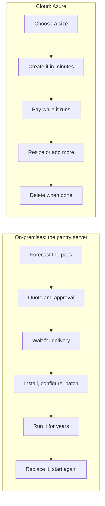
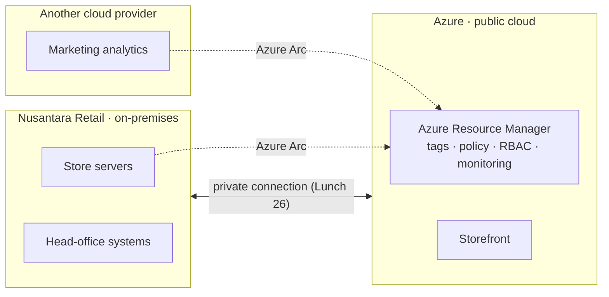
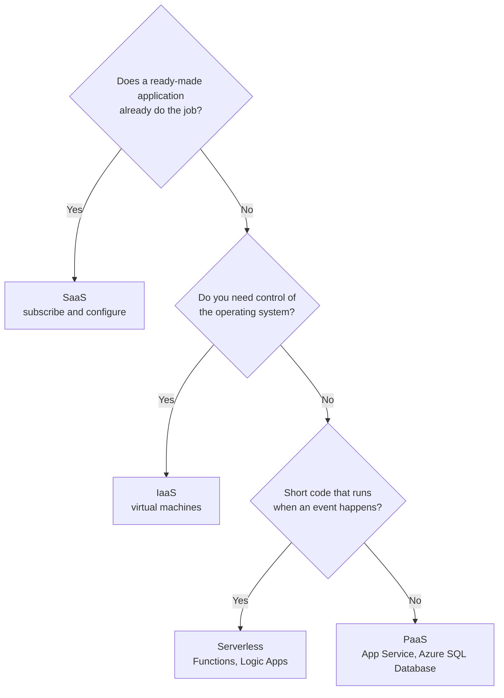

# Lunch 02 · Cloud Concepts (Basic)

🇮🇩 [Baca dalam Bahasa Indonesia](README.id.md)

> **Track:** Core month · **Level:** Basic · **Part 1:** Foundations
> **Time:** 60 minutes · **Prerequisite lunches:** 01
> **AZ-900 skill area:** Describe cloud concepts
> **Lab:** [Lab 02 · Make the business case](../../labs/02-cloud-concepts/README.md) — about 40 minutes · cost 💲 (no Azure resources created)
> **Author:** Stefanus Pinarta · [About the author](../../README.md#about-the-author)

| ⏱ Minutes | Segment |
|---:|---|
| 5 | Scenario and objectives |
| 25 | Reading |
| 15 | Demo: interactive animation (+ optional walkthrough video) |
| 5 | Knowledge check |
| 5 | Key takeaways and lab preview |
| 5 | Buffer — finish your lunch 🍜 |

## 🍱 Today's menu

By the end of this lunch you will be able to:

- **Define** cloud computing and **explain** the consumption-based model, CapEx versus OpEx, and the main cloud pricing models.
- **Compare** public, private, hybrid and multicloud models, and say where Azure Arc fits.
- **Describe** IaaS, PaaS, SaaS and serverless, and **use** the shared responsibility model to decide who does what.
- **Explain** the benefits of cloud services (high availability, scalability, elasticity, reliability, predictability,
  security, governance and manageability) with Nusantara Retail examples.

## 🏪 Meanwhile at Nusantara Retail

The finance team has forwarded you a quote: a bigger server for the pantry room, delivery in six weeks, with a five-year
depreciation schedule attached. Ibu Sari added one line on top: *"Or should we do this cloud thing everyone talks
about? Explain it to me in money and in risk."*

Dewi has already made up her mind: "Give me a platform. I don't want to patch servers ever again." Pak Budi is less sure:
"If it runs in someone else's datacenter, who fixes it when it breaks? And who gets blamed?" They are asking the same
question from opposite sides.

Before you can price anything, you need a shared vocabulary: what exactly you rent, what you still own, and what happens
to the bill when traffic triples again.

Today's question: **what does moving to the cloud really change, for money, for responsibility, and for the risk that
one server takes the whole shop down?**

---

## 📖 Reading (≈25 minutes)

### 1. What cloud computing actually is

**Cloud computing** is renting computing services over the internet from a provider that owns and runs the datacenters.
Those services range from raw servers, storage and networks to databases, analytics, AI and complete applications. You
create what you need when you need it, through a portal or an API, and you pay for what you use.

A widely used definition from the US National Institute of Standards and Technology (NIST) lists five characteristics.
They are a good test of whether something is really "cloud" or just someone else's server room:

- **On-demand self-service:** you create resources yourself, in minutes, without a purchase order or a phone call.
- **Broad network access:** you reach the services over the network, from anywhere, with standard tools.
- **Resource pooling:** the provider shares huge pools of hardware among many customers and keeps each customer's
  resources isolated from the others.
- **Rapid elasticity:** capacity grows and shrinks quickly, often automatically.
- **Measured service:** usage is metered, so you pay per second, hour, gigabyte or transaction.

The test matters because "virtualised" is not the same as "cloud". Pak Budi could install a hypervisor on a bigger
server and run five virtual machines on it. That is useful, but he would still order the hardware, wait for it, and own
a fixed amount of capacity. Without self-service, elasticity and metering, it is simply a more efficient server room.

An analogy that works well in Jakarta traffic: owning a car versus using a ride-hailing app. Owning a car means paying
up front, plus parking, insurance and servicing, for a vehicle that sits idle most of the day. Ride-hailing means paying
per trip while someone else maintains the vehicle, and on a busy day you simply book more rides. Neither is always
cheaper. They suit different patterns of use, and that is exactly the decision Nusantara Retail faces.

Compare the life of the pantry server with the life of a server in the cloud:

### 2. Money: CapEx, OpEx and the consumption-based model

**Capital expenditure (CapEx)** is money spent up front on physical assets: servers, storage, network switches, the UPS,
the air conditioning for the server room. You pay once and depreciate the cost over several years. To buy, you must
guess future demand, and then you live with that guess.

**Operational expenditure (OpEx)** is money spent on services as you consume them: electricity, internet links,
software subscriptions, and cloud services. It is billed in the period you use it, and it can rise or fall with the
business.

The cloud follows a **consumption-based model**: nothing to buy up front, and a bill that reflects what you actually
used. Delete a resource and its charges stop. (Careful with the details: data you keep in storage keeps costing, and a
virtual machine that is stopped but not deallocated still bills for compute. Lunch 06 explains the difference.) For
Nusantara Retail this brings three practical gains: no capital tied up in hardware that might be the wrong size, the
freedom to try something for a day and throw it away, and costs that follow sales. The storefront will cost more in
December, when it also earns more.

Compare the two on a single invoice. With the new server, finance pays the full price in the month it arrives and then
spreads it over five years of depreciation, whether the server is busy or idle. With Azure, the storefront becomes a
line in the monthly operating budget: higher in December, lower in February, and gone the day you delete it.

The purchase price is also only part of the story. The **total cost of ownership (TCO)** of the pantry server includes
electricity, cooling, floor space, the maintenance contract, spare disks, software licences, physical security and the
hours Pak Budi spends looking after it. A fair comparison puts all of that next to the Azure bill. For a real migration,
Azure Migrate can discover existing servers and build a business case (a preview feature at the time of writing) that
compares on-premises and Azure costs.

There is more than one way to pay. AZ-900 calls these **cloud pricing models**:

| Pricing model | How you pay | Good for | Watch out for |
|---|---|---|---|
| **Pay-as-you-go** | Per second, hour, GB or transaction, with no commitment | New, spiky or short-lived workloads; labs | The highest unit price; forgotten resources keep billing |
| **Reservations and savings plans** | A one- or three-year commitment in exchange for a lower rate | Steady workloads that run around the clock, such as a production database | You pay for the commitment even if you use less |
| **Spot capacity** | Spare capacity at a deep discount that Azure can take back at short notice | Interruptible batch jobs and test environments | Never for anything customers depend on |
| **Free amounts** | Nothing, up to a monthly limit | Learning, small tools, prototypes | Usage above the limit is billed |
| **Per-user subscription** (typical for SaaS) | A fixed fee per user per month | E-mail, office apps, payroll | Paying for licences nobody uses |

> [!WARNING]
> "The cloud is cheaper" is a promise only you can keep. OpEx is not automatically lower: a virtual machine that runs
> around the clock at three times the size it needs can cost more over five years than the server it replaced. The
> savings come from using only what you need (right-sizing, switching off, deleting) and from costs you stop carrying:
> hardware refreshes, spare parts, the room, the power, and Pak Budi's weekends. Lunch 19 goes deep on cost management.

### 3. Public, private, hybrid and multicloud

A **cloud model** describes where the cloud runs and who owns it.

- **Public cloud:** a provider such as Microsoft owns and runs the datacenters and offers services to anyone over the
  internet. Customers share physical hardware but are isolated from each other. There is no CapEx, scale is huge, and
  you can start in minutes; in exchange, you have no physical control.
- **Private cloud:** cloud-style self-service built for a single organisation, in its own datacenter or a hosted one.
  You get maximum control and maximum responsibility. You buy and run the hardware, so CapEx returns, and elasticity is
  limited to what you bought.
- **Hybrid cloud:** public cloud and private or on-premises environments, connected so that they work together. You
  choose where each workload runs. Hybrid is common when some systems cannot move yet, because of regulation, latency or
  a recent hardware investment.
- **Multicloud:** two or more public cloud providers used at the same time, for example because an acquired company
  runs on another provider or one service fits a need better. It adds overhead: every provider has its own tools,
  identities, skills and bills.

**Azure Arc** reduces that overhead. It projects servers, Kubernetes clusters and SQL Server instances that run outside
Azure (on-premises, at the edge or in another cloud) into Azure Resource Manager. They then appear next to your Azure
resources, and you can tag them, govern them with Azure Policy, control access with Azure RBAC, and monitor and secure
them with the same tools. Arc's core control-plane features cost nothing extra; services you add on top, such as
Microsoft Defender for Cloud or Azure Monitor, are billed as usual.

| Model | Who owns the hardware | Typical use case | At Nusantara Retail |
|---|---|---|---|
| **Public** | The cloud provider | New applications, websites, variable demand | The storefront in Azure |
| **Private** | Your organisation, or a host acting for you | Strict control requirements, existing datacenter investment | Not planned: one server room is not a private cloud |
| **Hybrid** | Both, connected | Gradual migration; systems that must stay on-premises | Store systems stay in the stores; the storefront moves to Azure |
| **Multicloud** | Two or more providers | Acquisitions, specialised services, not depending on one vendor | A marketing analytics tool that already runs on another provider |

### 4. IaaS, PaaS, SaaS and serverless: who does what

Cloud providers offer **service types** at different levels of the stack. The higher you go, the more the provider does
for you, and the less you control.

- **Infrastructure as a service (IaaS):** you rent virtual machines, disks and networks. Microsoft runs the datacenter,
  the physical hosts and the physical network; you manage everything from the operating system up: patching, hardening,
  runtimes, your application and your data. Most control, most work. Typical uses: lift-and-shift migrations, software
  that needs a specific operating system setup, test and development machines. Examples: Azure Virtual Machines,
  managed disks, virtual networks.
- **Platform as a service (PaaS):** you bring code and data; Microsoft runs, patches and scales the operating system,
  runtime and middleware. Typical uses: web apps and APIs, managed databases, teams that want to ship fast. Examples:
  Azure App Service, Azure SQL Database, Azure Storage.
- **Software as a service (SaaS):** a finished application you subscribe to and configure. The vendor runs everything;
  you manage your users, data and settings. Typical uses: e-mail and collaboration, CRM, HR and payroll. Examples:
  Microsoft 365, Dynamics 365.

**Serverless** is the far end of PaaS: you stop thinking about servers at all, even about how many instances run. Code
or workflows run when an event happens, scale automatically (down to zero when idle), and you pay per execution. Azure
Functions runs code; Azure Logic Apps runs workflows. At Nusantara Retail, a serverless function could send the order
confirmation e-mail the moment an order arrives. Lunch 14 builds it.

The **shared responsibility model** says who looks after each layer in each service type:

| Layer | On-premises | IaaS | PaaS | SaaS |
|---|---|---|---|---|
| Your data | You | You | You | You |
| Settings and configuration | You | You | You | You |
| Identities and access | You | You | You | You |
| Devices (laptops, phones) | You | You | You | You |
| Applications | You | You | Shared | Microsoft |
| Network controls | You | You | Shared | Microsoft |
| Operating system | You | You | Microsoft | Microsoft |
| Physical hosts | You | Microsoft | Microsoft | Microsoft |
| Physical network and datacenter | You | Microsoft | Microsoft | Microsoft |

Read the table from the bottom up: each step from on-premises to SaaS hands more layers to Microsoft. Now read the top
four rows. They never move. Whatever the service type, Nusantara Retail decides who can sign in, enforces MFA,
classifies customer data, configures each service securely and looks after its own laptops and phones. A provider can run a flawless platform while you still
leak data through one weak password.

The "Shared" cells are where most real incidents happen, because each side assumes the other is looking. In PaaS,
Microsoft patches the web server software under Dewi's app, but Dewi still writes the code, keeps her libraries up to
date, stores connection strings safely and decides whether the app accepts traffic from the whole internet. In IaaS,
Microsoft secures the physical network, but the firewall rules in front of each virtual machine are Pak Budi's job. When
you choose a service type, write down who owns each shared item before you go live.

### 5. The benefits the cloud promises

AZ-900 uses specific words for the benefits of cloud services. Each one answers a different worry, so learn them as a
set.

- **High availability** keeps a service running despite failures. Providers promise it in a **service-level agreement
  (SLA)**: a percentage of uptime per month, with service credits if they miss it. Every service has its own SLA, and
  many depend on how you configure them; two VMs in different availability zones earn a higher SLA than one VM alone.
- **Scalability** is the ability to handle more load by adding resources. **Vertical scaling** (scaling up or down)
  means a bigger or smaller VM; it has a ceiling and usually needs a restart. **Horizontal scaling** (scaling out or in)
  means more or fewer instances; it needs an application that can run as several copies behind a load balancer, and it
  has almost no ceiling.
- **Elasticity** is scaling that happens automatically, in both directions, as demand changes. Autoscale adds web
  instances before the 12.12 rush and removes them afterwards, so you pay for the peak only during the peak.
- **Reliability** is the ability to recover from failures and keep working. Availability zones, multiple regions and
  managed backups are the building blocks; Lunches 03, 09 and 17 use them.
- **Predictability** comes in two kinds. *Performance* predictability: autoscaling and load balancing keep response
  times steady. *Cost* predictability: the pricing calculator, budgets and Cost Management let you forecast and track
  spending.
- **Security:** Microsoft secures the physical layer and, in PaaS and SaaS, patches the platform for you. Services such
  as DDoS protection and Microsoft Defender for Cloud add more (Lunch 15). Your share stays yours.
- **Governance:** policies and templates keep deployments within company standards and regulations, and audit logs
  show who changed what: Azure Policy, tags, resource locks and Microsoft Purview (Lunch 18).
- **Manageability** has two meanings. Management *of* the cloud: autoscaling, monitoring, alerts and templates that look
  after resources for you. Management *in* the cloud: the portal, the CLI, PowerShell and the APIs from Lunch 01.

An SLA percentage is easier to judge as minutes. In a 30-day month (43,200 minutes):

| SLA | Allowed downtime per 30-day month |
|---|---|
| 99% | 7 hours 12 minutes |
| 99.9% | 43 minutes 12 seconds |
| 99.95% | 21 minutes 36 seconds |
| 99.99% | about 4 minutes 19 seconds |

When a request depends on two services in a row, multiply their SLAs: a web tier at 99.95% in front of a database at
99.99% gives about 99.94% for the whole path. Every extra dependency lowers the total.

These words also turn Ibu Sari's question into something you can measure. Today the storefront's availability depends
on one server, one power supply and one person's phone being switched on. In the cloud you can choose a target, such as
"no more than 22 minutes of unplanned downtime a month", and then design for it with zones, load balancing and managed
services. Keep three ideas apart: high availability keeps the service running through small failures, reliability is
the overall ability to recover, and disaster recovery (Lunch 17) brings the service back after a large failure such as
the loss of a region.

> [!TIP]
> A favourite exam trap: **scalability** means a system *can* grow; **elasticity** means it grows *and shrinks*
> automatically with demand. Every elastic system is scalable, but not every scalable system is elastic.

### 6. Applying it to Nusantara Retail's single server

Back to the quote on Ibu Sari's desk. You can now lay out three options in the language she asked for:

1. **Buy the bigger server.** CapEx up front and a six-week wait. It is still one box, so a failure still stops sales.
   Its fixed capacity sits idle most of the year and may still be too small on 12.12. Nusantara owns every layer.
2. **Lift and shift to IaaS.** Move the storefront to Azure virtual machines. It is quick and familiar, there is no
   hardware to buy, and two VMs in different availability zones behind a load balancer remove the single point of
   failure. But Pak Budi still patches operating systems and manages backups.
3. **Move to PaaS.** Run the storefront on App Service and its database on Azure SQL Database. Microsoft patches the
   platform, backups are built in, and autoscale handles 12.12. Dewi may need to change some code and configuration.
   Nusantara keeps its data, identities and settings.

Whatever you choose, a few questions decide it as much as the price does. Does the team have the skills to run it?
How soon must the risk of the pantry server be gone? Where must customer data live? (For Nusantara Retail, that points
to the Indonesia Central region.) And who will be on call at 2 a.m., Pak Budi or the platform?

Many companies do both: lift and shift first to get off the old hardware quickly, then modernise to PaaS. The store
systems can stay on-premises for now, which makes Nusantara Retail a hybrid company, and Azure Arc can bring them under
the same governance later. In Lab 02 you will price options 2 and 3 with the Azure pricing calculator and write a
one-page recommendation for Ibu Sari. Lunch 03 then answers the next question: where in the world should all of this
run?

> [!NOTE]
> **Pause and think:** Nusantara Retail has moved the storefront to PaaS. Six months later, customer data leaks because
> a store manager's account without MFA was phished. Under the shared responsibility model, whose failure is it, and
> which row of the table does it belong to?

---

## 🎬 Demo (≈15 minutes)

1. **Interactive animation (≈6–8 min):** [Open the demo](https://stefpin.github.io/azure-fundamentals-lunches/demos/02-cloud-concepts.html) —
   press ▶ Play or step through it at your own pace. Offline? Download
   [`docs/demos/02-cloud-concepts.html`](../../docs/demos/02-cloud-concepts.html) and open it in any browser.
2. **Walkthrough video (≤ 6 min):** _coming soon_ — [read the walkthrough script](demo-video-script.md).

What to watch for:

- As the slider moves from on-premises to IaaS, PaaS and SaaS, count how many layers each side owns.
- The four layers at the top of the stack never change owner.
- With a fixed server, capacity is either wasted or too small; watch what happens on 12.12.
- Elastic capacity follows the demand curve up and back down, and the bill follows it too.

## ✅ Knowledge check (≈5 minutes)

1. The finance team asks: "Is the cloud just a different way of buying servers?" How do you explain the change in
   spending for the storefront?
   

Show answer

   It moves spending from CapEx (buy a server up front and depreciate it) to OpEx (pay every month for what you use).
   *Why:* the consumption-based model has no upfront purchase, and costs follow actual usage.

   

2. The HR team uses an online payroll service in the browser. They never see a server or a line of code. Which service
   type is this, and who must remove a former employee's account?
   

Show answer

   SaaS, and Nusantara Retail removes the account. *Why:* identities and access are always the customer's
   responsibility, whatever the service type.

   

3. During the 12.12 sale the storefront automatically runs six web instances for two days and two for the rest of the
   month. Which benefit describes this best: scalability or elasticity?
   

Show answer

   Elasticity. *Why:* capacity grows and shrinks automatically with demand; scalability only says that the system can
   grow.

   

4. Pak Budi wants the store servers to stay in the stores, but to appear in the Azure portal with tags and Azure Policy
   applied. Which cloud model is this, and which Azure service makes it possible?
   

Show answer

   A hybrid cloud with Azure Arc. *Why:* Arc projects servers that run outside Azure into Azure Resource Manager, where
   tags, policies and RBAC apply.

   

5. The storefront runs on Azure virtual machines. An attacker exploits a missing operating system patch. Who was
   responsible for installing it?
   

Show answer

   Nusantara Retail. *Why:* in IaaS the operating system belongs to the customer; Microsoft is responsible only for the
   physical hosts, network and datacenter.

   

## 🧠 Key takeaways

- Cloud computing means renting computing services on demand over the internet: self-service, pooled, elastic and
  metered.
- The consumption-based model moves spending from CapEx to OpEx. Pricing models (pay-as-you-go, reservations and
  savings plans, spot, free amounts, per-user subscriptions) trade flexibility against price.
- Public, private, hybrid and multicloud describe where workloads run and who owns the hardware; Azure Arc brings
  servers and clusters outside Azure under Azure management.
- IaaS, PaaS and SaaS hand more of the stack to the provider, and serverless goes furthest for event-driven code. Your
  data, settings, identities and devices always stay yours.
- High availability, scalability, elasticity, reliability, predictability, security, governance and manageability are
  benefits you design for. They do not happen just because something runs in the cloud.

## 🗒️ Field notes from Stefanus

> **An SLA is a refund policy, not an insurance policy.** When a design document says "99.99%", I ask two questions.
> First: 99.99% of what? I list every service a customer request passes through and multiply their SLAs, because a
> chain of services is weaker than its weakest link. Second: what happens when the provider misses the target? The
> answer is a service credit, a percentage of that one service's monthly fee, and only if you claim it. It does not
> cover the sales lost on 12.12, or the customers who never came back. So I read each SLA as a commitment for one
> component, never as the availability of the whole shop. The business target, such as "no more than 22 minutes of
> downtime a month", is mine to design for, and to test.

## 🔬 Your lab: Make the business case

In Lab 02 you turn today's concepts into a decision. You price two designs for the storefront in the Azure pricing
calculator, a lift-and-shift design on virtual machines and a PaaS design on App Service and Azure SQL Database, then
compare them like an analyst. A worksheet lets you classify services as IaaS, PaaS or SaaS, spending as CapEx or OpEx,
and responsibilities as yours, Microsoft's or shared, with answers to check yourself. Finally, you write a one-page
recommendation for Ibu Sari. Nothing is created in Azure.

- ⏱ About 40 minutes · 💲 cost band (no Azure resources) · works on its own (no earlier lab needed)
- 👉 [Start Lab 02](../../labs/02-cloud-concepts/README.md)

## 📚 Go further

- [Describe cloud computing](https://learn.microsoft.com/training/modules/describe-cloud-compute/) — the Microsoft Learn
  module for this AZ-900 skill area, with a short assessment at the end.
- [Shared responsibility in the cloud](https://learn.microsoft.com/azure/security/fundamentals/shared-responsibility) —
  Microsoft's own responsibility matrix for on-premises, IaaS, PaaS and SaaS.
- [Azure Arc overview](https://learn.microsoft.com/azure/azure-arc/overview) — what Arc can manage outside Azure and
  which features cost nothing extra.
- [Study guide for Exam AZ-900](https://learn.microsoft.com/credentials/certifications/resources/study-guides/az-900) —
  the full list of skills measured, to track your progress through the core month.

---

⬅️ [Lunch 01 · Before You Begin](../01-before-you-begin/README.md) · 🏠 [Course home](../../README.md) · [Lunch 03 · Azure Global Infrastructure](../03-global-infrastructure/README.md) ➡️

Last validated: October 2026 · Spotted something out of date? [Open an issue](../../CONTRIBUTING.md).
