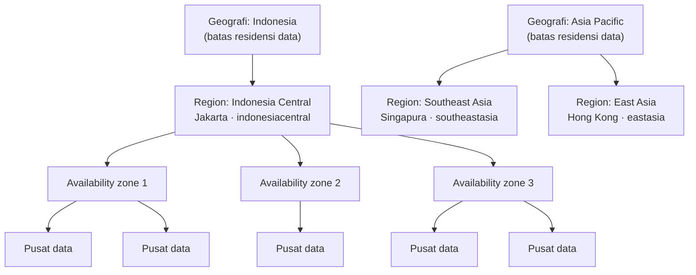
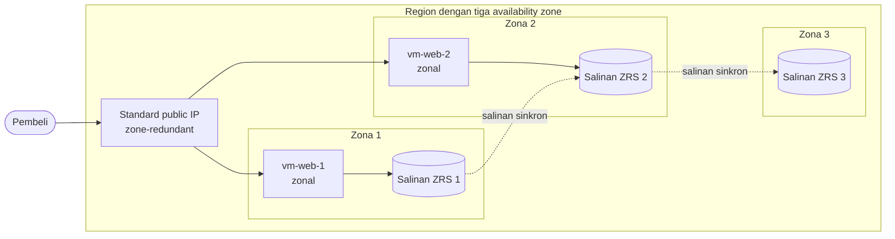
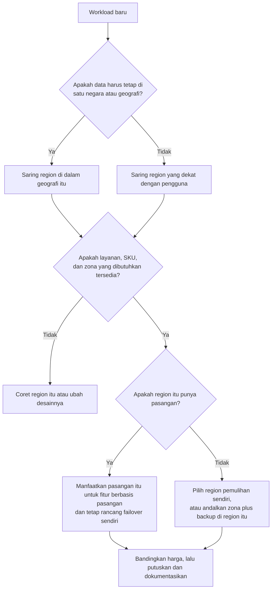

# Makan Siang 03 · Infrastruktur Global Azure: Region, Availability Zone, dan Region Pair (Dasar)

🇬🇧 [Read in English](README.md)

> **Jalur:** Bulan inti · **Level:** Dasar · **Bagian 1:** Fondasi
> **Waktu:** 60 menit · **Makan siang prasyarat:** 01
> **Area keterampilan AZ-900:** Menjelaskan arsitektur dan layanan Azure
> **Lab:** [Lab 03 · Menjelajahi region dan zona](../../labs/03-global-infrastructure/README.id.md) — sekitar 35 menit · biaya 💲
> **Penulis:** Stefanus Pinarta · [Tentang penulis](../../README.id.md#tentang-penulis)

| ⏱ Menit | Segmen |
|---:|---|
| 5 | Skenario dan tujuan |
| 25 | Bacaan |
| 15 | Demo: animasi interaktif (+ video panduan opsional) |
| 5 | Uji pemahaman |
| 5 | Poin penting dan pratinjau lab |
| 5 | Waktu cadangan — habiskan makan siang Anda 🍜 |

## 🍱 Menu hari ini

Setelah makan siang ini, Anda akan mampu:

- **Menjelaskan** bagaimana pusat data (datacenter), availability zone (*zona ketersediaan*), region (*wilayah*), dan
  geografi saling berkaitan, serta dari jenis kegagalan apa setiap tingkat melindungi Anda.
- **Membandingkan** resource (*sumber daya*) zonal, zone-redundant, dan nonzonal (regional), lalu memilih perilaku yang
  tepat untuk web server, alamat IP publik, dan storage account (*akun penyimpanan*).
- **Mendeskripsikan** apa yang diberikan region pair (*pasangan wilayah*), apa yang tidak, dan cara merencanakan region
  yang tidak punya pasangan, seperti Indonesia Central.
- **Memilih** region untuk sebuah workload (beban kerja, yaitu aplikasi beserta semua komponen pendukungnya) dengan
  menimbang residensi data, latensi, ketersediaan layanan dan SKU, harga, availability zone, serta opsi pemulihan
  bencana (disaster recovery).

## 🏪 Sementara itu di Nusantara Retail

Business case minggu lalu disambut baik. Kini Ibu Sari mengajukan pertanyaan lanjutan yang sangat
praktis: *"Kalau toko kita pindah ke Azure, sebenarnya tokonya tinggal di mana? Jakarta? Singapura? Lalu bagaimana kalau
gedungnya sedang ketiban sial, seperti pantri kita waktu atapnya bocor?"*

Seperti biasa, semua orang langsung punya pendapat. Dewi ingin region yang paling dekat, karena halaman checkout terasa
lambat di jaringan seluler. Tim keuangan pernah mendengar bahwa layanan yang sama bisa berbeda harganya di negara lain.
Pak Budi mengingatkan bahwa database pelanggan menyimpan nama, nomor telepon, dan alamat pengiriman para pembeli di
Indonesia, dan tim legal ingin data itu tetap berada di Indonesia.

Anda membuka daftar region Azure dan langsung disambut puluhan nama, jumlah zona, pasangan region, dan catatan kaki.
Sebelum ada yang membuat satu pun resource produksi, Anda perlu jawaban yang jelas untuk sang direktur: **region mana
yang sebaiknya dipakai Nusantara Retail, dan bagaimana toko tetap hidup jika satu gedung, atau bahkan seluruh region,
mengalami gangguan?**

---

## 📖 Bacaan (≈25 menit)

### 1. Dari satu gedung ke satu geografi

Azure bukanlah satu komputer raksasa di satu tempat. Azure adalah armada **pusat data** yang tersebar di seluruh dunia:
gedung-gedung berisi server, perangkat penyimpanan, dan perangkat jaringan, masing-masing dengan pasokan listrik, sistem
pendingin, dan pengamanan fisiknya sendiri. Anda tidak pernah memilih pusat data secara langsung. Azure mengelompokkan
pusat data ke dalam unit yang lebih besar, dan Anda memilih di antara unit-unit itu.

**Region** adalah sekumpulan pusat data di satu wilayah metropolitan, yang saling terhubung oleh jaringan cepat
berlatensi rendah. Latensi adalah waktu tempuh data dari satu titik ke titik lain; makin rendah latensinya, makin cepat sebuah
aplikasi terasa. Saat Anda membuat virtual machine (*komputer virtual*), storage account, atau database, Anda hampir
selalu memilih region, dan resource itu akan tinggal di sana. Setiap region punya nama tampilan untuk manusia dan nama
teknis untuk script: *Indonesia Central* ditulis `indonesiacentral`, *Southeast Asia* ditulis `southeastasia`.
Dokumentasi Microsoft mencantumkan lebih dari 70 region saat tulisan ini dibuat (Oktober 2026), dan region baru terus
bermunculan. Indonesia Central di Jakarta dibuka pada 27 Mei 2025.

**Geografi** (geography) adalah kelompok berisi satu region atau lebih yang membentuk batas residensi data, biasanya
sebuah negara atau pasar seperti Indonesia, Jepang, atau Eropa. Residensi data berarti aturan tentang di mana data
secara fisik boleh disimpan. Setiap region menjadi anggota tepat satu geografi. Detail ini lebih penting daripada
kelihatannya. Southeast Asia (Singapura) dan East Asia (Hong Kong) termasuk geografi *Asia Pacific*, sedangkan
Indonesia Central termasuk geografi *Indonesia*. Jika Nusantara Retail wajib menyimpan data pelanggan di dalam
Indonesia, batas geografi inilah garis yang tidak boleh dilewati.

Ada segelintir layanan yang bersifat **nonregional**: Anda sama sekali tidak men-deploy-nya ke sebuah region.
Microsoft Entra ID, Azure DNS, Azure Front Door, dan Azure Traffic Manager berjalan di banyak region sekaligus, sehingga
hilangnya satu region tidak ikut menjatuhkan layanan tersebut. Sebagian besar yang Anda bangun dalam kursus ini bersifat
regional, artinya keputusan memilih region akan Anda ambil berulang kali.

Dua catatan praktis sebelum kita masuk lebih dalam. Pertama, tidak semua region terbuka untuk semua pelanggan: beberapa
region dibatasi untuk skenario tertentu, misalnya pemulihan bencana di dalam negeri, dan aksesnya harus diminta
terlebih dahulu. Kedua, layanan yang sama belum tentu tersedia di setiap region, dan region baru sering kali dibuka
dengan katalog layanan yang lebih kecil daripada region yang sudah lama beroperasi. Bagian 5 menunjukkan cara
memeriksanya sebelum Anda memutuskan.

Anda akan menjumpai region di tiga tempat. Dropdown region di portal mengelompokkannya per geografi, sehingga Singapura
muncul sebagai "(Asia Pacific) Southeast Asia". Perintah Azure CLI `az account list-locations` menampilkan setiap region
yang bisa dilihat subscription (*langganan*) Anda, lengkap dengan geografi, lokasi fisik, region pasangan, dan detail
zonanya. Terakhir, daftar region di dokumentasi Microsoft menampilkan fakta yang sama untuk semua orang, termasuk
region yang belum bisa Anda akses.

### 2. Availability zone: gedung-gedung terpisah di dalam satu region

**Availability zone** adalah kelompok terpisah berisi satu pusat data atau lebih di dalam sebuah region, dengan pasokan
listrik, pendingin, dan jaringan yang berdiri sendiri. Zona-zona itu sengaja dibuat berjauhan, biasanya terpisah
beberapa kilometer dan umumnya berjarak tidak lebih dari sekitar 100 kilometer satu sama lain, sehingga pemadaman listrik,
kebakaran, atau banjir lokal di satu zona semestinya tidak menghentikan zona lainnya. Namun zona-zona itu juga sengaja
dibuat cukup dekat: Microsoft menargetkan waktu bolak-balik (round trip) antarzona di bawah kira-kira dua milidetik.
Itu cukup cepat untuk menyalin data antarzona secara sinkron, yaitu sebelum sebuah penulisan data dikonfirmasi.

Bayangkan sebuah usaha roti di Jakarta yang punya tiga dapur produksi: di Jakarta Utara, Jakarta Selatan, dan Jakarta
Timur. Masing-masing punya sambungan listrik, genset, dan saluran air sendiri. Kalau dapur di Jakarta Utara kebanjiran,
dua dapur lainnya tetap memanggang roti, dan karena jaraknya masih satu kota, adonan bisa dikirim ke mana saja dengan
cepat. Tiga dapur itulah availability zone; kota Jakarta adalah region-nya.

Region yang menyediakan zona memiliki minimal tiga zona, dan beberapa punya lebih banyak (East US 2 punya empat saat
tulisan ini dibuat). Southeast Asia, East Asia, dan Indonesia Central masing-masing punya tiga. Sebagian region,
kebanyakan yang lebih tua atau lebih kecil, sama sekali tidak punya zona. Bahkan di region yang punya zona pun, layanan,
tier (tingkatan layanan), atau ukuran VM tertentu mungkin belum mendukung zona di sana, jadi selalu periksa dulu sebelum Anda merancang
dengan mengandalkannya.

Zona melindungi Anda dari lebih dari sekadar bencana. Microsoft berupaya meluncurkan pembaruan platform ke satu zona
dalam satu waktu di sebuah region, sehingga workload yang berjalan di beberapa zona tetap melayani saat salah satu
zonanya sedang diperbarui. Zona juga membatasi dampak kegagalan yang lebih kecil, misalnya satu rak server atau satu
cluster (sekelompok server yang bekerja bersama) yang mati, sehingga bagian lain workload Anda tetap berjalan.

Ada satu detail halus yang mengejutkan hampir semua orang. Saat Anda memilih "zona 1", yang Anda pilih sebenarnya adalah
**zona logis** (logical zone). Azure memetakan zona logis ke zona fisik secara terpisah untuk setiap subscription, tepat
pada saat subscription itu dibuat. Karena itu, zona 1 di subscription Anda bisa jadi gedung yang berbeda dengan zona 1
di subscription rekan Anda. Ibaratnya dua perusahaan yang menyewa gudang di kawasan pergudangan yang sama: bangunan yang
oleh perusahaan pertama disebut "Gudang 1" bisa saja disebut "Gudang 3" oleh perusahaan kedua. Anda bisa melihat
pemetaan milik Anda sendiri dengan `az account list-locations`, dan itulah yang akan Anda lakukan di lab.

> [!WARNING]
> Jangan pernah berasumsi bahwa "zona 1" berarti gedung yang sama di dua subscription yang berbeda. Jika Anda membagi
> sebuah workload ke beberapa subscription dan peduli di zona fisik mana setiap bagiannya mendarat, periksa dulu
> pemetaan zona logis ke zona fisik untuk kedua subscription itu.

> [!TIP]
> Saat tulisan ini dibuat, dokumentasi availability zone dari Microsoft menyatakan bahwa Azure tidak menagih biaya
> transfer data antar-availability zone di region yang sama. Menyebarkan workload ke beberapa zona membuat Anda
> membayar instans tambahannya, bukan lalu lintas di antara zona. Periksa halaman harga terbaru sebelum Anda
> memasukkan hal ini ke dalam business case.

### 3. Resource zonal, zone-redundant, dan nonzonal

Region yang punya zona tidak otomatis membuat resource Anda tangguh. Yang menentukan adalah bagaimana setiap resource
memanfaatkan zona-zona itu. Layanan Azure menunjukkan tiga perilaku:

- Resource **zonal** dipatok ke satu zona yang Anda pilih. Virtual machine beserta managed disk-nya (disk yang dikelola
  Azure untuk VM itu) yang dibuat dengan `--zone 1` bersifat zonal. Resource zonal terlindung dari masalah di zona lain,
  tetapi nasibnya terikat pada zonanya sendiri: jika zona 1 padam, VM itu ikut padam.
- Resource **zone-redundant** disebar atau direplikasi ke beberapa zona oleh layanan itu sendiri. Contohnya: Standard
  public IP (alamat IP publik yang bisa dihubungi dari internet) yang dibuat sebagai zone-redundant, storage account
  yang memakai **zone-redundant storage (ZRS)**, frontend dari Standard load balancer (penyeimbang beban yang membagi
  lalu lintas ke beberapa server), serta database seperti Azure SQL Database atau Azure Cosmos DB yang redundansi
  zonanya diaktifkan. Saat sebuah zona gagal, Microsoft yang melakukan failover untuk Anda, yaitu mengalihkan layanan
  ke zona-zona yang tersisa.
- Resource **nonzonal**, disebut juga resource **regional**, tidak dikonfigurasi untuk zona, entah karena region-nya
  memang tidak punya zona atau karena tidak ada yang memilihnya. Azure bisa menempatkannya di zona mana pun, dan Anda
  tidak bisa menentukan zona yang mana. Jika zona itu mengalami gangguan, resource tersebut bisa ikut mati.

| Perilaku | Siapa yang memilih zona | Bertahan saat satu zona hilang? | Contoh | Cocok untuk |
|---|---|---|---|---|
| Zonal | Anda (zona 1, 2, atau 3) | Hanya jika Anda sendiri menjalankan salinannya di zona lain | VM, managed disk, public IP zonal | Beberapa VM yang disebar ke berbagai zona; komponen yang sangat sering saling berkomunikasi dan ingin Anda tempatkan berdampingan |
| Zone-redundant | Layanannya, di beberapa zona | Ya, Azure yang menangani failover | Storage ZRS, public IP zone-redundant, frontend load balancer, database zone-redundant | Komponen bersama yang harus tetap berfungsi |
| Nonzonal (regional) | Tidak ada; Azure yang menempatkan | Tidak dijamin | Resource yang dibuat tanpa pengaturan zona; apa pun di region tanpa zona | Dev dan test, atau saat lapisan lain sudah menangani ketahanannya |

Storage membuat perbedaannya terasa nyata. **Locally redundant storage (LRS)** menyimpan tiga salinan data Anda di
dalam satu pusat data: murah, dan cukup untuk data yang bisa Anda buat ulang, tetapi masalah yang melanda seluruh pusat
data bisa membuat ketiga salinan itu tidak bisa diakses sekaligus. ZRS menulis setiap perubahan ke salinan di tiga zona
atau lebih sebelum mengonfirmasi penulisan itu, sehingga satu zona utuh bisa hilang tanpa kehilangan data maupun
ketersediaan. Makan Siang 07 membahas semua opsi redundansi untuk storage.

Ibaratnya menyimpan fotokopi ijazah. LRS seperti menaruh tiga lembar fotokopi di satu lemari: rapi dan murah, tetapi
kalau rumahnya kebanjiran, ketiganya basah bersamaan. ZRS seperti menitipkan fotokopi itu di rumah tiga saudara di
kecamatan yang berbeda, dan Anda baru tenang setelah ketiganya mengabari bahwa titipan sudah diterima.

Desain yang tetap bertahan saat zona mana pun hilang disebut **zone-resilient**. Ada dua cara untuk mencapainya:
gunakan layanan zone-redundant, atau jalankan beberapa instans zonal di zona yang berbeda di belakang sesuatu yang
membagi lalu lintas, misalnya load balancer. Pola kedua inilah yang akan Anda pakai untuk melindungi web server
Nusantara Retail di Makan Siang 09.

Ada dua kesalahan yang sebaiknya Anda hindari sejak hari pertama. Yang pertama adalah menyalin script yang menulis
`--zone 1` untuk setiap VM: hasilnya sepasang server yang katanya memiliki ketersediaan tinggi (high
availability), padahal keduanya tinggal di zona yang sama dan akan tumbang bersama. Sebarkan resource zonal dengan
sengaja, dan ingat bahwa VM zonal menyimpan managed disk-nya di zona yang sama. Yang kedua adalah menganggap redundansi
zona sebagai cadangan (backup). ZRS melindungi Anda dari perangkat keras yang rusak dan gedung yang hilang, bukan dari
ulah manusia: jika seseorang menghapus atau menimpa sebuah file, perubahan itu diterapkan ke setiap salinan di setiap
zona dalam sekejap. Kembali ke fotokopi ijazah tadi: kalau Anda berpesan "tolong sobek fotokopinya" kepada ketiga
saudara, ketiganya akan patuh. Risiko itu ditangani oleh backup, soft delete (data yang terhapus masih bisa dipulihkan selama periode tertentu), dan
versioning (versi lama sebuah file tetap disimpan); semuanya dibahas di Makan Siang 17 dan 24.

**Melihat lebih dekat Standard public IP.** Public IP menunjukkan mengapa Anda perlu membaca nilai bawaan (default)
dengan teliti. Public IP dengan SKU (varian produk) Basic sudah dipensiunkan pada 30 September 2025, sehingga setiap public IP baru
adalah Standard. Standard public IP bisa zonal (dibuat dengan `--zone 1`) atau zone-redundant (dibuat dengan
`--zone 1 2 3`). Lalu bagaimana dengan yang dibuat tanpa pengaturan zona sama sekali? Di region yang punya
availability zone, Microsoft kini memperlakukannya sebagai zone-redundant: semua Standard IP yang dulunya nonzonal di
region berzona telah dijadikan zone-redundant, dan IP yang menampilkan zona 1, 2, dan 3 berperilaku sama dengan IP yang
tidak menampilkan zona sama sekali. Di region tanpa zona, setiap public IP bersifat nonzonal. Dua aturan lagi
melengkapi gambarannya: pengaturan zona sebuah IP tidak bisa diubah setelah dibuat, dan IP zone-redundant hanya bisa
dibuat di region yang ketiga zonanya sudah aktif. Di lab, Anda akan membuat ketiga variannya dan membandingkan properti
`zones` masing-masing. Menuliskan zona secara eksplisit di script membuat niat Anda jelas bagi orang berikutnya yang
membacanya.

### 4. Region pair, region tanpa pasangan, dan sovereign cloud

Zona melindungi Anda di dalam sebuah region. Untuk kejadian langka ketika seluruh region hilang, Azure punya gagasan
kedua: **region pair**. Microsoft memasangkan sebagian region dengan region mitra, biasanya di geografi yang sama dan
cukup jauh sehingga satu bencana kecil kemungkinannya menghantam keduanya. Anda tidak bisa memilih pasangan sendiri;
Microsoft yang menentukannya. Southeast Asia dan East Asia adalah satu pasangan.

Ibaratnya dua kantor cabang bank yang "dijodohkan" oleh kantor pusat: jadwal renovasi keduanya tidak pernah dibuat
bersamaan, dan jika terjadi bencana besar, salah satunya didahulukan untuk buka kembali. Namun berkas nasabah di cabang
pertama tidak otomatis difotokopi ke cabang kedua; urusan itu tetap harus Anda atur sendiri.

Jika region Anda punya pasangan dan Anda memakai pasangan itu sebagai region sekunder, Anda mendapat beberapa
keuntungan dari platform, dan ada baiknya Anda tahu persis di mana batas keuntungan itu:

| Yang diberikan region pair | Yang **tidak** diberikan region pair |
|---|---|
| **Pembaruan berurutan:** Microsoft menggilir pembaruan platform terencana di kedua region, sehingga pembaruan yang bermasalah kecil kemungkinannya mengenai keduanya sekaligus. | Salinan VM, database, atau file Anda. Tidak ada yang direplikasi kecuali Anda menyalakan fitur yang melakukannya. |
| **Prioritas pemulihan:** dalam gangguan langka yang melanda seluruh geografi, salah satu region dari setiap pasangan diprioritaskan untuk dipulihkan. | Failover otomatis untuk workload Anda. Itu harus Anda rancang, bangun, dan uji sendiri. |
| **Residensi data:** hampir setiap pasangan tetap berada di dalam satu geografi. Brazil South, yang dipasangkan dengan South Central US, adalah pengecualian yang terkenal. | Kebebasan memilih mitra. Pasangannya ditetapkan oleh Microsoft. |
| Target siap pakai untuk segelintir layanan yang punya replikasi bawaan ke region pasangan, seperti geo-redundant storage (GRS). | Jaminan bahwa layanan yang Anda pakai mendukung replikasi berbasis pasangan sama sekali. |

> [!IMPORTANT]
> Region pair bukanlah backup. Membuat resource di Southeast Asia tidak menyalinnya ke East Asia. Hanya fitur yang
> Anda nyalakan, seperti GRS untuk storage account atau geo-replica untuk database, yang memindahkan data ke region
> lain. Itu pun, failover akun GRS yang dikelola Microsoft hanya terjadi dalam situasi katastrofik, jadi rencanakan dan
> uji failover Anda sendiri, entah region Anda punya pasangan atau tidak.

**Region tanpa pasangan.** Banyak region yang lebih baru sama sekali tidak punya pasangan dan mengandalkan availability
zone sebagai perlindungan utamanya. Di Asia Pasifik, contohnya Indonesia Central, Malaysia West, dan New Zealand North.
"Tanpa pasangan" tidak berarti "tanpa pemulihan bencana". Artinya, Anda sendiri yang memilih region kedua dan
menyiapkan replikasi dengan fitur yang bisa bekerja di antara dua region mana pun, seperti geo-replica database, object
replication di storage, Azure Site Recovery untuk VM, atau backup yang disalin ke region lain. Yang hilang hanyalah
kemudahan yang mengandaikan adanya pasangan: geo-redundant storage klasik, misalnya, mereplikasi ke region pasangan,
sehingga tidak tersedia di region yang tidak punya pasangan. Makan Siang 17 menyusun rencana pemulihan untuk situasi
persis seperti ini.

**Sovereign cloud.** Di samping cloud Azure global, Microsoft menjalankan instans terpisah untuk kebutuhan hukum dan
regulasi khusus: **Azure Government** untuk lembaga pemerintah Amerika Serikat beserta mitranya, dan **Azure operated by
21Vianet** di Tiongkok. Dalam materi ujian AZ-900, region semacam ini disebut sovereign region (*wilayah berdaulat*).
Keduanya punya region sendiri, endpoint untuk login dan manajemen sendiri, dan sering kali katalog layanan yang lebih
kecil. Nusantara Retail tidak akan pernah membutuhkannya, tetapi keberadaannya menjelaskan mengapa "Azure" bisa
terlihat berbeda di pasar lain, dan mengapa script yang ditulis untuk Azure global belum tentu bisa berjalan di sana
tanpa diubah.

### 5. Memilih region untuk Nusantara Retail

Memilih region adalah keputusan desain, bukan nilai bawaan yang Anda terima begitu saja di dropdown. Ibaratnya mencari
kos: Anda tidak asal mengambil kamar pertama yang ditawarkan. Anda menimbang jaraknya ke kantor, harga sewanya,
fasilitasnya, apakah daerahnya langganan banjir, dan ke mana Anda bisa menumpang kalau terjadi sesuatu. Region pun
ditimbang dengan cara serupa. Telusuri enam faktor yang sama setiap kali, dan tuliskan jawabannya agar engineer
berikutnya memahami alasannya:

| Faktor | Pertanyaan yang perlu diajukan | Cara memeriksa | Nusantara Retail |
|---|---|---|---|
| Residensi data dan kepatuhan (compliance) | Apakah data harus tetap berada di satu negara atau satu geografi? | Geografi region di daftar region; tim legal atau tim kepatuhan Anda | Data pelanggan sebaiknya tetap di Indonesia, jadi arahnya ke Indonesia Central |
| Latensi | Di mana penggunanya, dan seberapa jauh region-nya? | Uji dari lokasi pengguna Anda; Microsoft juga menerbitkan statistik latensi antar-region | Pembeli tersebar di seluruh Indonesia, jadi Jakarta adalah region terdekat |
| Ketersediaan layanan dan SKU | Apakah region itu menyediakan setiap layanan, tier, dan ukuran VM yang Anda butuhkan? | Halaman products-by-region, `az provider show`, dan `az vm list-skus` | Periksa setiap layanan terlebih dahulu; Southeast Asia punya katalog terlengkap di sekitar kita |
| Harga | Apakah hal yang sama lebih mahal atau lebih murah di region ini? | Pricing calculator (*kalkulator harga*) dengan setiap kandidat region dipilih | Bandingkan Jakarta dan Singapura untuk SKU yang benar-benar akan Anda pakai |
| Availability zone | Bisakah workload disebar ke beberapa zona? | Daftar region, dan pemetaan zona di CLI | Kedua region punya tiga zona |
| Opsi pemulihan bencana | Adakah pasangan, dan region kedua mana yang bisa Anda pakai? | Daftar region pair dan panduan keandalan (reliability guide) setiap layanan | Indonesia Central tidak punya pasangan, jadi rencananya Anda susun sendiri |

Jarak berpengaruh pada baris terakhir itu. Dalam statistik waktu bolak-balik antar-region yang diterbitkan Microsoft
(nilai median selama 30 hari yang berakhir pada 30 Juli 2026), Indonesia Central dan Southeast Asia berjarak sekitar 16
sampai 17 milidetik, sedangkan Indonesia Central ke East Asia sekitar 47 milidetik. Angka-angka itu menggambarkan lalu
lintas di dalam jaringan Microsoft; yang dirasakan seorang pembeli di Makassar juga bergantung pada operator seluler
yang ia pakai. Itulah sebabnya Anda perlu mengukur dari lokasi pengguna yang sebenarnya.

Harga juga perlu dicermati dengan sama telitinya. Selisih kecil per jam bisa menjadi jumlah yang lumayan untuk server
yang menyala sebulan penuh, dan region kedua menambah biaya lebih dari sekadar resource-nya sendiri: lalu lintas
replikasi antar-region muncul di tagihan sebagai biaya transfer data. Hitung harga seluruh desain di pricing
calculator, termasuk region pemulihannya, sebelum Anda menjanjikan angka kepada Ibu Sari.

Untuk Nusantara Retail, jawabannya mulai terbentuk. Produksi berjalan di **Indonesia Central**, tersebar di ketiga
zonanya: layanan zone-redundant di mana pun tersedia, dan beberapa VM zonal di bagian desain yang memang membutuhkan
VM. Backup tetap berada di region itu. Boleh tidaknya salinan kedua disimpan di luar Indonesia, dengan Southeast Asia
sebagai kandidat yang paling jelas, adalah pertanyaan untuk tim legal, bukan untuk Anda putuskan sendiri. Sementara
itu, lab-lab di kursus ini memakai **Southeast Asia**, karena region itu punya tiga zona, sebuah pasangan, dan katalog
layanan terlengkap di sekitar kita; Anda bisa memindahkan lab mana pun ke `indonesiacentral` dengan mengatur
`LOCATION`.

> [!NOTE]
> **Renungkan sejenak:** Ibu Sari bertanya, "Kalau seluruh region Jakarta mati, apakah kita akan kehilangan data
> pelanggan?" Dengan rencana di atas, apa jawaban jujur Anda, dan satu keputusan mana yang akan mengubah jawaban itu?

Di makan siang berikutnya, Anda akan melihat satu tingkat di atas region: bagaimana subscription, resource group, dan
Azure Resource Manager menata semua yang Anda buat, di mana pun resource itu tinggal.

---

## 🎬 Demo (≈15 menit)

1. **Animasi interaktif (≈6–8 menit):** [Buka demo](https://stefpin.github.io/azure-fundamentals-lunches/demos/03-global-infrastructure.html?lang=id) —
   tekan ▶ Putar atau telusuri langkah demi langkah sesuai kecepatan Anda. Sedang offline? Unduh
   [`docs/demos/03-global-infrastructure.html`](../../docs/demos/03-global-infrastructure.html) lalu buka di browser apa pun.
2. **Video panduan (≤ 6 menit):** _segera hadir_ — [baca naskah video](demo-video-script.id.md).

Yang perlu diperhatikan:

- Bagaimana kamera memperbesar tampilan dari bola dunia ke sebuah geografi, sebuah region, tiga zonanya, dan akhirnya
  pusat data di dalam satu zona, serta dari apa setiap tingkat melindungi Anda.
- Saat zona 1 gagal: resource mana yang tetap berfungsi (zone-redundant) dan mana yang ikut mati bersama zonanya (zonal).
- Bagaimana desainnya berubah ketika web server kedua berjalan di zona lain.
- Perbedaan antara Southeast Asia, yang punya pasangan, dan Indonesia Central, yang tidak punya.

## ✅ Uji pemahaman (≈5 menit)

1. Dewi membuat satu-satunya web server dengan `--zone 2` dan tidak ada apa pun di zona lain. Kemudian zona 2 kehilangan
   listrik. Apa yang terjadi pada toko, dan apa nama untuk jenis resource seperti ini?
   

Lihat jawaban

   VM itu bersifat **zonal**, jadi ia ikut mati bersama zona 2 dan toko offline sampai zona itu pulih. *alasannya:*
   resource zonal berbagi nasib dengan zonanya; agar bertahan, jalankan VM kedua di zona lain di belakang load balancer.

   

2. Foto produk disimpan di Southeast Asia dengan zone-redundant storage (ZRS). Apakah foto-foto itu terlindungi jika
   seluruh region Southeast Asia tidak bisa diakses?
   

Lihat jawaban

   Tidak. ZRS menyimpan salinan di beberapa zona dalam **satu** region; gangguan yang melanda seluruh region membutuhkan
   salinan di region lain, misalnya geo-zone-redundant storage ke East Asia atau replikasi buatan Anda sendiri. *alasannya:* zona
   melindungi dari hilangnya satu zona, bukan seluruh region.

   

3. Seorang rekan berkata: "Kita di Southeast Asia, yang berpasangan dengan East Asia, jadi VM kita otomatis failover ke
   Hong Kong." Benarkah begitu?
   

Lihat jawaban

   Tidak. Pasangan memberi pembaruan berurutan, prioritas pemulihan, dan residensi data, tetapi tidak pernah menyalin
   atau melakukan failover untuk VM Anda; Anda membutuhkan sesuatu seperti Azure Site Recovery dan rencana yang sudah
   diuji. *alasannya:* hanya fitur yang Anda nyalakan yang memanfaatkan pasangan.

   

4. Tim legal memutuskan bahwa data pelanggan harus tetap berada di Indonesia. Region mana yang Anda pilih, dan seperti
   apa pemulihan bencananya?
   

Lihat jawaban

   Indonesia Central, tersebar di ketiga zonanya, dengan backup yang disimpan di region itu; salinan apa pun ke region
   lain, seperti Southeast Asia, akan keluar dari Indonesia, sehingga butuh persetujuan tim legal. *alasannya:* region
   itu tidak punya pasangan, dan geografi adalah batas residensi data.

   

5. Anda membuat Standard public IP di Southeast Asia tanpa pengaturan zona apa pun, dan `az network public-ip show`
   tidak menampilkan zona. Apakah IP itu zonal, zone-redundant, atau nonzonal?
   

Lihat jawaban

   Zone-redundant. Di region yang punya availability zone, Standard public IP yang dibuat tanpa zona diperlakukan
   sebagai zone-redundant; hanya di region tanpa zona, IP itu menjadi nonzonal. *alasannya:* Microsoft telah menjadikan
   semua Standard IP yang dulunya nonzonal sebagai zone-redundant, jadi tetapkan zona secara eksplisit bila Anda ingin
   niat Anda terlihat jelas.

   

## 🧠 Poin penting

- **Geografi** adalah batas residensi data, **region** adalah sekumpulan pusat data di satu wilayah metropolitan, dan
  **availability zone** adalah kelompok pusat data terpisah dengan listrik, pendingin, dan jaringannya sendiri.
- Zona hanya membantu jika resource Anda memanfaatkannya: resource **zonal** berbagi nasib dengan zonanya, resource
  **zone-redundant** bertahan saat satu zona gagal, dan resource **nonzonal** tidak memberi jaminan apa pun.
- **Region pair** memberi pembaruan berurutan, prioritas pemulihan, dan residensi data, tetapi tidak pernah
  mereplikasi atau melakukan failover workload Anda secara otomatis.
- Region **tanpa pasangan**, seperti Indonesia Central, mengandalkan zona; untuk bencana yang melanda seluruh region,
  Anda sendiri yang memilih region kedua dan menyiapkan replikasinya, jika aturan data Anda mengizinkan.
- Pilih region berdasarkan **residensi, latensi, ketersediaan layanan dan SKU, harga, zona, dan opsi DR**, lalu
  verifikasi masing-masing dengan dokumentasi atau CLI sebelum Anda membangun.

## 🗒️ Catatan lapangan dari Stefanus

> **Sebut dulu gangguannya, baru pilih region-nya.** Sebelum ada yang membuka dropdown region, saya selalu bertanya:
> *gangguan apa yang harus bisa dilewati desain ini — satu rak server, satu gedung, atau satu region utuh?* Setelah
> itu, setiap kotak di diagram arsitektur wajib diberi label: zonal, zone-redundant, atau nonzonal. Kotak tanpa label
> adalah tempat kejutan bersembunyi, biasanya berupa sepasang VM yang katanya "tahan gangguan" padahal sama-sama
> dibuat dengan `--zone 1`. Untuk tingkat region, aturan saya sama singkatnya: kalau tidak ada yang bisa menyebut nama
> fitur yang menyalin data ke region lain, berarti salinan itu memang tidak ada, entah region-nya punya pasangan atau
> tidak. Terakhir, saya mengukur latensi dari ponsel yang memakai jaringan seluler seperti milik pengguna sungguhan,
> bukan hanya dari Cloud Shell. Cloud Shell berjalan di dalam pusat data Azure, jadi ia tidak bisa merasakan sinyal di
> HP para pembeli.

## 🔬 Lab Anda: Menjelajahi region dan zona

Pada waktu luang Anda sendiri, Anda akan memakai Azure CLI untuk menampilkan daftar region beserta geografi dan
pasangannya, menemukan pemetaan zona logis ke zona fisik di subscription Anda, dan memeriksa ukuran VM mana yang
mendukung zona. Setelah itu, Anda membuat tiga Standard public IP, yaitu zonal, zone-redundant, dan "tanpa zona", lalu
membandingkannya, serta membangun storage account LRS dan ZRS berdampingan. Lab ini mengubah kosakata hari ini menjadi
hal-hal yang sudah Anda lihat dengan mata kepala sendiri, nyaris tanpa biaya.

- ⏱ Sekitar 35 menit · 💲 · bisa dikerjakan terpisah (tidak perlu lab sebelumnya)
- 👉 [Mulai Lab 03](../../labs/03-global-infrastructure/README.id.md)

## 📚 Pelajari lebih lanjut

- [Apa itu region Azure?](https://learn.microsoft.com/azure/reliability/regions-overview) — geografi, region, layanan
  nonregional, dan faktor-faktor yang disarankan Microsoft untuk memilih region.
- [Apa itu availability zone?](https://learn.microsoft.com/azure/reliability/availability-zones-overview) — dukungan
  zonal dan zone-redundant, zona logis dan fisik, serta daftar terbaru region yang punya zona.
- [Region pair Azure dan region tanpa pasangan](https://learn.microsoft.com/azure/reliability/regions-paired) — daftar
  lengkap pasangan, pengecualian yang asimetris, dan region yang tidak punya pasangan.
- [Statistik latensi round-trip jaringan Azure](https://learn.microsoft.com/azure/networking/azure-network-latency) —
  latensi median antar-region Azure, berguna saat Anda memilih region pemulihan.

---

⬅️ [Makan Siang 02 · Konsep Cloud (Dasar)](../02-cloud-concepts/README.id.md) · 🏠 [Beranda kursus](../../README.id.md) · [Makan Siang 04 · Hierarki Resource dan Azure Resource Manager (Dasar)](../04-resource-hierarchy-basic/README.id.md) ➡️

Terakhir divalidasi: Oktober 2026 · Menemukan informasi yang sudah usang? [Buka issue](../../CONTRIBUTING.md).
