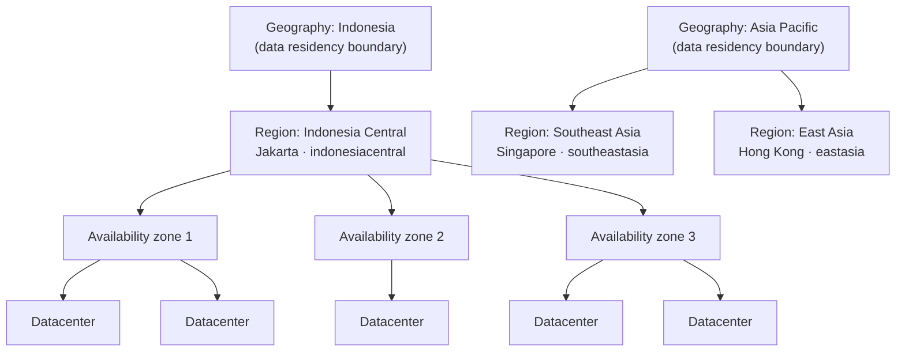
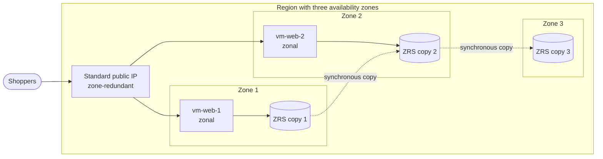
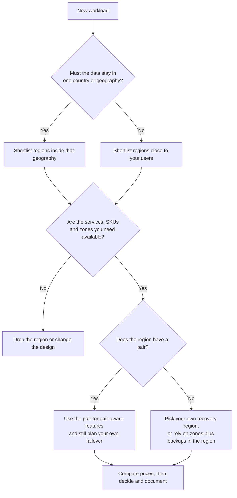

# Lunch 03 · Azure Global Infrastructure: Regions, Availability Zones and Region Pairs (Basic)

🇮🇩 [Baca dalam Bahasa Indonesia](README.id.md)

> **Track:** Core month · **Level:** Basic · **Part 1:** Foundations
> **Time:** 60 minutes · **Prerequisite lunches:** 01
> **AZ-900 skill area:** Describe Azure architecture and services
> **Lab:** [Lab 03 · Explore regions and zones](../../labs/03-global-infrastructure/README.md) — about 35 minutes · cost 💲
> **Author:** Stefanus Pinarta · [About the author](../../README.md#about-the-author)

| ⏱ Minutes | Segment |
|---:|---|
| 5 | Scenario and objectives |
| 25 | Reading |
| 15 | Demo: interactive animation (+ optional walkthrough video) |
| 5 | Knowledge check |
| 5 | Key takeaways and lab preview |
| 5 | Buffer — finish your lunch 🍜 |

## 🍱 Today's menu

By the end of this lunch you will be able to:

- **Explain** how datacenters, availability zones, regions and geographies fit together, and which kind of failure each
  level protects you from.
- **Compare** zonal, zone-redundant and nonzonal (regional) resources, and pick the right behaviour for a web server, a
  public IP address and a storage account.
- **Describe** what a region pair gives you, what it does not, and how to plan for a region without a pair such as
  Indonesia Central.
- **Choose** a region for a workload by weighing data residency, latency, service and SKU availability, price,
  availability zones and disaster recovery options.

## 🏪 Meanwhile at Nusantara Retail

The business case from last week landed well. Ibu Sari now asks the practical follow-up: *"If we move the shop to
Azure, where does it actually live? Jakarta? Singapore? And what happens when that building has a bad day, like our
pantry room did when the roof leaked?"*

Everyone has an opinion. Dewi wants the closest region because the checkout page feels slow on mobile networks. The
finance team has heard that the same service can cost a different amount in another country. Pak Budi points out that
the customer database holds names, phone numbers and delivery addresses of Indonesian shoppers, and the legal team
would like that data to stay in Indonesia.

You open the list of Azure regions and find dozens of names, zone counts, pairs and footnotes. Before anyone creates a
production resource, you need a clear answer for the director: **which region should Nusantara Retail use, and how does
the shop survive a failure in a building, or in the whole region?**

---

## 📖 Reading (≈25 minutes)

### 1. From a building to a geography

Azure is not one giant computer in one place. It is a worldwide fleet of **datacenters**: buildings full of servers,
storage and network equipment, each with its own power feeds, cooling and physical security. You never pick a
datacenter directly. Azure groups datacenters into larger units, and you choose among those units instead.

A **region** is a set of datacenters in one metropolitan area, connected by a fast, low-latency network. When you create
a virtual machine, a storage account or a database, you almost always choose a region, and the resource lives there.
Each region has a display name for people and a programmatic name for scripts: *Indonesia Central* is
`indonesiacentral`, *Southeast Asia* is `southeastasia`. Microsoft's documentation lists more than 70 regions at the
time of writing (October 2026), and new ones keep opening. Indonesia Central, in Jakarta, opened on May 27, 2025.

A **geography** is a group of one or more regions that forms a data residency boundary, usually a country or a market
such as Indonesia, Japan or Europe. Every region belongs to exactly one geography. This detail matters more than it
first appears. Southeast Asia (Singapore) and East Asia (Hong Kong) belong to the *Asia Pacific* geography, while
Indonesia Central belongs to the *Indonesia* geography. If Nusantara Retail must keep customer data inside Indonesia,
the geography is the line it may not cross.

A handful of services are **nonregional**: you don't deploy them into a region at all. Microsoft Entra ID, Azure DNS,
Azure Front Door and Azure Traffic Manager run across many regions, so the loss of one region doesn't take them down.
Most of what you build in this course is regional, which means the region decision is one you will make again and
again.

Two practical notes before we go deeper. First, not every region is open to every customer: a few regions are
restricted to specific scenarios, such as in-country disaster recovery, and need an access request. Second, the same
service is not necessarily available in every region, and a new region often starts with a smaller catalogue than an
established one. Section 5 shows how to check before you commit.

You will see regions in three places. The portal's region dropdown groups them by geography, so Singapore appears as
"(Asia Pacific) Southeast Asia". The Azure CLI command `az account list-locations` returns every region your
subscription can see, with its geography, physical location, paired region and zone details. And Microsoft's region
list in the documentation shows the same facts for everyone, including regions you can't access yet.

### 2. Availability zones: separate buildings inside one region

An **availability zone** is a separate group of one or more datacenters inside a region, with its own independent
power, cooling and networking. Zones are placed apart on purpose, typically several kilometres and usually within about
100 kilometres of each other, so a local power cut, fire or flood in one zone should leave the others running. They
are also close on purpose: Microsoft aims for round trips between zones of under roughly two milliseconds, which is
fast enough to copy data between zones synchronously, before a write is confirmed.

Regions that offer zones have at least three, and a few have more (East US 2 has four at the time of writing).
Southeast Asia, East Asia and Indonesia Central each have three. Some regions, mostly older or smaller ones, have no
zones at all. And even in a region with zones, an individual service, tier or VM size may not support zones there yet,
so always check before you design around them.

Zones protect you from more than disasters. Microsoft aims to roll out platform updates to one zone at a time within a
region, so a workload that runs in several zones keeps serving while one zone is being updated. Zones also contain
smaller failures, such as a rack or a cluster going down, so the rest of your workload keeps running.

There is one subtlety that surprises almost everyone. When you choose "zone 1", you are choosing a **logical zone**.
Azure maps logical zones to physical zones separately for each subscription, at the moment the subscription is
created. Zone 1 in your subscription may therefore be a different building from zone 1 in a colleague's subscription.
You can see your own mapping with `az account list-locations`, which you will do in the lab.

> [!WARNING]
> Never assume that "zone 1" means the same building in two different subscriptions. If you split a workload across
> subscriptions and care about which physical zone each part lands in, check the logical-to-physical zone mapping for
> both subscriptions first.

> [!TIP]
> At the time of writing, Microsoft's availability zone documentation states that Azure doesn't charge for data
> transfer between availability zones in the same region. Spreading a workload across zones costs you the extra
> instances, not the traffic between them. Check the current pricing pages before you put this in a business case.

### 3. Zonal, zone-redundant and nonzonal resources

Having zones in a region doesn't make your resources resilient automatically. What matters is how each resource uses
them. Azure services show three behaviours:

- A **zonal** resource is pinned to one zone that you choose. A virtual machine and its managed disks created with
  `--zone 1` are zonal. A zonal resource is isolated from problems in other zones, but it shares the fate of its own
  zone: if zone 1 goes dark, so does the VM.
- A **zone-redundant** resource is spread or replicated across several zones by the service itself. Examples are a
  Standard public IP created as zone-redundant, a storage account that uses **zone-redundant storage (ZRS)**, the
  frontend of a Standard load balancer, and databases such as Azure SQL Database or Azure Cosmos DB with zone
  redundancy turned on. When a zone fails, Microsoft fails over to the remaining zones for you.
- A **nonzonal** resource, also called a **regional** resource, is not configured for zones, either because the region
  has none or because nobody chose any. Azure may place it in any zone and you don't control which one. If that zone has
  an outage, the resource may go down with it.

| Behaviour | Who picks the zone | Survives the loss of one zone? | Examples | Good fit |
|---|---|---|---|---|
| Zonal | You (zone 1, 2 or 3) | Only if you run copies in other zones yourself | VM, managed disk, zonal public IP | Several VMs spread over zones; very chatty components you want side by side |
| Zone-redundant | The service, across several zones | Yes, Azure handles the failover | ZRS storage, zone-redundant public IP, load balancer frontend, zone-redundant databases | Shared building blocks that must keep working |
| Nonzonal (regional) | Nobody; Azure places it | Not guaranteed | Resources created without zone settings; anything in a region without zones | Dev and test, or when another layer handles resilience |

Storage makes the difference concrete. **Locally redundant storage (LRS)** keeps three copies of your data inside a
single datacenter: cheap, and fine for data you can rebuild, but a datacenter-wide problem can make all three copies
unavailable at once. ZRS writes every change to copies in three or more zones before it confirms the write, so a whole
zone can disappear without losing data or availability. Lunch 07 covers all the storage redundancy options.

A design that survives the loss of any single zone is called **zone-resilient**. You get there in one of two ways: use
zone-redundant services, or run several zonal instances in different zones behind something that spreads the traffic,
such as a load balancer. The second pattern is exactly how you will protect Nusantara Retail's web servers in Lunch 09.

Two mistakes are worth avoiding from day one. The first is copying a script that says `--zone 1` for every VM: you end
up with a "highly available" pair of servers that both live in the same zone and fail together. Spread zonal resources
deliberately, and remember that a zonal VM keeps its managed disks in the same zone. The second is treating zone
redundancy as a backup. ZRS protects you from broken hardware and lost buildings, not from people: if someone deletes
or overwrites a file, that change is applied to every copy in every zone within moments. Backups, soft delete and
versioning (Lunches 17 and 24) cover that risk.

**A closer look at Standard public IPs.** Public IPs show why you should read defaults carefully. Basic SKU public IPs
were retired on September 30, 2025, so every new public IP is Standard. A Standard public IP can be zonal (created with
`--zone 1`) or zone-redundant (created with `--zone 1 2 3`). What about one created without any zone setting? In a
region with availability zones, Microsoft now treats it as zone-redundant: all former nonzonal Standard IPs in
zone-enabled regions were made zone-redundant, and an IP that shows zones 1, 2 and 3 behaves the same as one that shows
no zones at all. In a region without zones, every public IP is nonzonal. Two more rules complete the picture: an IP's
zone setting can't be changed after creation, and zone-redundant IPs can only be created where three zones are live.
In the lab you'll create all three variants and compare their `zones` property. Writing the zones explicitly in your
scripts makes your intent obvious to the next person who reads them.

### 4. Region pairs, regions without a pair, and sovereign clouds

Zones protect you inside a region. For the rare event that a whole region is lost, Azure has a second idea: **region
pairs**. Microsoft associates some regions with a partner region, usually in the same geography and far enough away
that a single disaster is unlikely to hit both. You can't choose your own pair; Microsoft defines it. Southeast Asia
and East Asia are a pair.

If your region has a pair and you use that pair as your secondary region, you get some platform benefits, and it pays
to be precise about where they stop:

| A region pair gives you | A region pair does **not** give you |
|---|---|
| **Sequential updates:** Microsoft staggers planned platform updates across the two regions, so a faulty update is unlikely to hit both at once. | Copies of your VMs, databases or files. Nothing is replicated unless you turn on a feature that does it. |
| **Recovery priority:** in a rare geography-wide outage, one region of every pair is prioritised for recovery. | Automatic failover of your workload. You design, build and test that yourself. |
| **Data residency:** almost every pair stays inside one geography. Brazil South, paired with South Central US, is the well-known exception. | A choice of partner. The pair is fixed by Microsoft. |
| A ready-made target for the few services with built-in pair replication, such as geo-redundant storage (GRS). | A guarantee that the services you use support pair-based replication at all. |

> [!IMPORTANT]
> A region pair is not a backup. Creating a resource in Southeast Asia does not copy it to East Asia. Only features you
> switch on, such as GRS for a storage account or a geo-replica for a database, move data to another region. Even then,
> Microsoft-managed failover of GRS accounts happens only in catastrophic situations, so plan and test your own failover
> whether or not your region has a pair.

**Regions without a pair.** Many newer regions have no pair at all and rely on availability zones as their main
protection. In Asia Pacific these include Indonesia Central, Malaysia West and New Zealand North. "No pair" does not
mean "no disaster recovery". It means you choose the second region yourself and set up replication with features that
work between any two regions, such as database geo-replicas, storage object replication, Azure Site Recovery for VMs,
or backups copied to another region. What disappears are the conveniences that assume a pair: classic geo-redundant
storage, for example, replicates to the paired region, so it isn't available where there is no pair. Lunch 17 builds a
recovery plan for exactly this situation.

**Sovereign clouds.** Alongside the global Azure cloud, Microsoft runs separate instances for special legal and
regulatory needs: **Azure Government** for US government agencies and their partners, and **Azure operated by
21Vianet** in China. They have their own regions, their own sign-in and management endpoints, and often a smaller
service catalogue. Nusantara Retail will never need them, but they explain why "Azure" can look different in another
market, and why a script written for global Azure may not run there unchanged.

### 5. Choosing a region for Nusantara Retail

Choosing a region is a design decision, not a default you accept in a dropdown. Work through the same six factors every
time, and write the answers down so the next engineer understands why:

| Factor | Question to ask | How to check | Nusantara Retail |
|---|---|---|---|
| Data residency and compliance | Must the data stay in a country or a geography? | The region's geography in the region list; your legal or compliance team | Customer data should stay in Indonesia, which points to Indonesia Central |
| Latency | Where are the users, and how far away is the region? | Test from where your users are; Microsoft also publishes inter-region latency statistics | Shoppers are spread across Indonesia, so Jakarta is the closest region |
| Service and SKU availability | Does the region offer every service, tier and VM size you need? | The products-by-region page, `az provider show` and `az vm list-skus` | Check each service first; Southeast Asia has the broadest catalogue nearby |
| Price | Does the same thing cost more or less in this region? | The pricing calculator with each candidate region selected | Compare Jakarta and Singapore for the SKUs you will really use |
| Availability zones | Can you spread the workload across zones? | The region list, and the zone mapping in the CLI | Both regions have three zones |
| Disaster recovery options | Is there a pair, and which second region could you use? | The region pairs list and each service's reliability guide | Indonesia Central has no pair, so the plan is your own |

Distances matter for that last row. In Microsoft's published round-trip statistics between regions (median values for
the 30 days ending July 30, 2026), Indonesia Central and Southeast Asia are about 16 to 17 milliseconds apart, while
Indonesia Central to East Asia is about 47 milliseconds. Those numbers describe traffic inside Microsoft's network; what
a shopper in Makassar experiences also depends on their mobile provider, which is why you should measure from where
your users really are.

Price deserves the same care. A small difference per hour turns into a real amount for servers that run all month, and
a second region adds more than its own resources: replication traffic between regions appears on the bill as data
transfer. Price the whole design in the pricing calculator, including the recovery region, before you promise Ibu Sari
a number.

For Nusantara Retail the answer is taking shape. Production runs in **Indonesia Central**, spread across its three
zones: zone-redundant services wherever they exist, and several zonal VMs where the design needs VMs. Backups stay in
the region. Whether a second copy may live outside Indonesia, with Southeast Asia as the obvious candidate, is a
question for the legal team, not for you alone. Meanwhile the labs use **Southeast Asia**, because it has three zones,
a pair and the broadest service catalogue nearby; you can switch any lab to `indonesiacentral` by setting `LOCATION`.

> [!NOTE]
> **Pause and think:** Ibu Sari asks, "If the whole Jakarta region went down, would we lose customer data?" With the
> plan above, what is your honest answer, and which single decision would change it?

In the next lunch you look one level up from the region: how subscriptions, resource groups and Azure Resource Manager
organise everything you create, wherever it lives.

---

## 🎬 Demo (≈15 minutes)

1. **Interactive animation (≈6–8 min):** [Open the demo](https://stefpin.github.io/azure-fundamentals-lunches/demos/03-global-infrastructure.html) —
   press ▶ Play or step through it at your own pace. Offline? Download
   [`docs/demos/03-global-infrastructure.html`](../../docs/demos/03-global-infrastructure.html) and open it in any browser.
2. **Walkthrough video (≤ 6 min):** _coming soon_ — [read the walkthrough script](demo-video-script.md).

What to watch for:

- How the camera zooms from the globe to a geography, a region, its three zones and finally the datacenters inside a
  zone, and what each level protects you from.
- When zone 1 fails: which resources keep working (zone-redundant) and which one goes down with its zone (zonal).
- How the design changes when a second web server runs in another zone.
- The difference between Southeast Asia, which has a pair, and Indonesia Central, which doesn't.

## ✅ Knowledge check (≈5 minutes)

1. Dewi creates the only web server with `--zone 2` and nothing in any other zone. Zone 2 then loses power. What
   happens to the shop, and what is the name for this kind of resource?
   

Show answer

   The VM is **zonal**, so it goes down with zone 2 and the shop is offline until the zone recovers. *Why:* a zonal
   resource shares the fate of its zone; to survive, run a second VM in another zone behind a load balancer.

   

2. Product photos are stored in Southeast Asia with zone-redundant storage (ZRS). Are they protected if the entire
   Southeast Asia region becomes unavailable?
   

Show answer

   No. ZRS keeps copies in several zones of **one** region; a region-wide outage needs a copy in another region, for
   example geo-zone-redundant storage to East Asia or your own replication. *Why:* zones protect against the loss of a
   zone, not of a whole region.

   

3. A colleague says: "We're in Southeast Asia, which is paired with East Asia, so our VMs fail over to Hong Kong
   automatically." Is that right?
   

Show answer

   No. A pair gives sequential updates, recovery priority and data residency, but it never copies or fails over your
   VMs; you would need something like Azure Site Recovery and a tested plan. *Why:* only features you turn on use the
   pair.

   

4. The legal team decides that customer data must stay in Indonesia. Which region do you choose, and what does
   disaster recovery look like?
   

Show answer

   Indonesia Central, spread across its three zones, with backups kept in the region; any copy to another region, such
   as Southeast Asia, would leave Indonesia, so it needs the legal team's approval. *Why:* the region has no pair, and
   the geography is the data residency boundary.

   

5. You create a Standard public IP in Southeast Asia without any zone setting, and `az network public-ip show` lists no
   zones. Is the IP zonal, zone-redundant or nonzonal?
   

Show answer

   Zone-redundant. In regions with availability zones, Standard public IPs created without zones are treated as
   zone-redundant; only in a region without zones would it be nonzonal. *Why:* Microsoft made all former nonzonal
   Standard IPs zone-redundant, so set zones explicitly when you want to make your intent visible.

   

## 🧠 Key takeaways

- A **geography** is a data residency boundary, a **region** is a set of datacenters in one metro area, and an
  **availability zone** is a separate group of datacenters with its own power, cooling and network.
- Zones only help if your resources use them: **zonal** resources share their zone's fate, **zone-redundant** resources
  survive a zone failure, and **nonzonal** resources give no guarantee.
- **Region pairs** bring sequential updates, recovery priority and data residency, but never automatic replication or
  failover of your workloads.
- Regions **without a pair**, such as Indonesia Central, rely on zones; for regional disasters you choose your own
  second region and set up replication, if your data rules allow it.
- Choose a region on **residency, latency, service and SKU availability, price, zones and DR options**, and verify each
  one with the documentation or the CLI before you build.

## 🗒️ Field notes from Stefanus

> **Name the failure before you pick the region.** Before anyone opens the region dropdown, I ask one question: *which
> failure must this design survive — a rack, a building or a whole region?* Then every box on the architecture diagram
> gets a label: zonal, zone-redundant or nonzonal. Unlabelled boxes are where the surprises hide, typically a "highly
> available" pair of VMs that were both created with `--zone 1`. At the region level my rule is just as short: if
> nobody can name the feature that copies the data to another region, there is no copy, pair or no pair. And I measure
> latency from a phone on the kind of mobile network the users really have, never only from Cloud Shell: it runs
> inside an Azure datacenter, so it can't tell me what a shopper feels.

## 🔬 Your lab: Explore regions and zones

On your own time, you will use the Azure CLI to list regions, their geographies and pairs, find your subscription's
logical-to-physical zone mapping and check which VM sizes support zones. Then you create a zonal, a zone-redundant and
a "no zone" Standard public IP and compare them, and build an LRS and a ZRS storage account side by side. It turns
today's vocabulary into things you have seen with your own eyes, for almost no cost.

- ⏱ About 35 minutes · 💲 · works on its own (no earlier lab needed)
- 👉 [Start Lab 03](../../labs/03-global-infrastructure/README.md)

## 📚 Go further

- [What are Azure regions?](https://learn.microsoft.com/azure/reliability/regions-overview) — geographies, regions,
  nonregional services and the factors Microsoft suggests for choosing regions.
- [What are availability zones?](https://learn.microsoft.com/azure/reliability/availability-zones-overview) — zonal and
  zone-redundant support, logical and physical zones, and the current list of regions with zones.
- [Azure region pairs and nonpaired regions](https://learn.microsoft.com/azure/reliability/regions-paired) — the full
  pair list, the asymmetric exceptions and the regions that have no pair.
- [Azure network round-trip latency statistics](https://learn.microsoft.com/azure/networking/azure-network-latency) —
  median latency between Azure regions, useful when you pick a recovery region.

---

⬅️ [Lunch 02 · Cloud Concepts](../02-cloud-concepts/README.md) · 🏠 [Course home](../../README.md) · [Lunch 04 · Resource Hierarchy and Azure Resource Manager (Basic)](../04-resource-hierarchy-basic/README.md) ➡️

Last validated: October 2026 · Spotted something out of date? [Open an issue](../../CONTRIBUTING.md).
