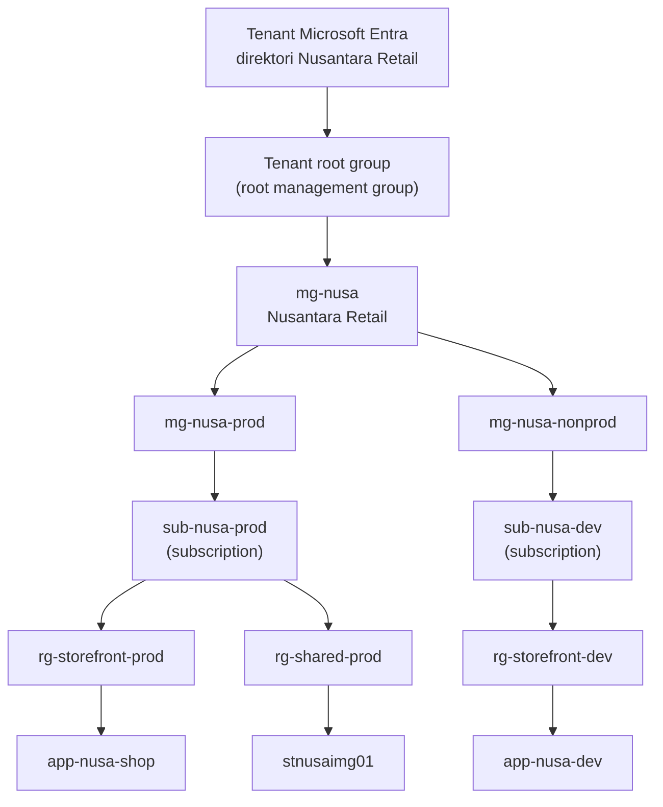
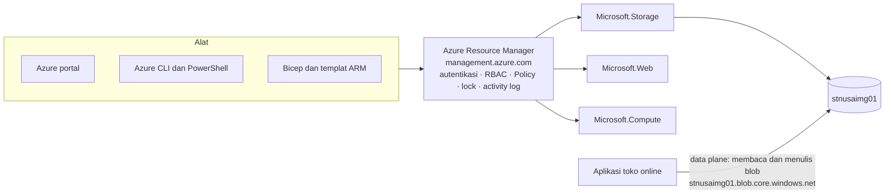

# Makan Siang 04 · Hierarki Resource dan Azure Resource Manager (Dasar)

🇬🇧 [Read in English](README.md)

> **Jalur:** Bulan inti · **Level:** Dasar · **Bagian 1:** Fondasi
> **Waktu:** 60 menit · **Makan siang prasyarat:** 01
> **Area keterampilan AZ-900:** Menjelaskan arsitektur dan layanan Azure
> **Lab:** [Lab 04 · Menata Nusantara Retail](../../labs/04-resource-hierarchy-basic/README.id.md) — sekitar 40 menit · biaya 💲
> **Penulis:** Stefanus Pinarta · [Tentang penulis](../../README.id.md#tentang-penulis)

| ⏱ Menit | Segmen |
|---:|---|
| 5 | Skenario dan tujuan |
| 25 | Bacaan |
| 15 | Demo: animasi interaktif (+ video panduan opsional) |
| 5 | Uji pemahaman |
| 5 | Poin penting dan pratinjau lab |
| 5 | Waktu cadangan — habiskan makan siang Anda 🍜 |

## 🍱 Menu hari ini

Setelah makan siang ini, Anda akan mampu:

- **Menjelaskan** tingkatan dalam hierarki resource Azure, mulai dari tenant Microsoft Entra hingga satu resource
  (*sumber daya*), beserta kegunaan setiap tingkat.
- **Mendeskripsikan** bagaimana Azure Resource Manager menangani setiap permintaan pengelolaan, serta membedakan
  operasi control plane dari operasi data plane.
- **Membaca** sebuah resource ID dan **memprediksi** role, policy, lock (*kunci sumber daya*), anggaran (budget), dan
  tag mana yang berlaku pada sebuah resource melalui scope-nya.
- **Menata** resource dengan resource group (*grup sumber daya*), konvensi penamaan, tag, dan lock, lalu menemukannya
  kembali dengan Azure Resource Graph.

## 🏪 Sementara itu di Nusantara Retail

Tiga minggu eksperimen sudah meninggalkan jejaknya. Subscription (*langganan*) lab kini berisi sebuah resource group
bernama `test`, dua lagi bernama `rg1` dan `rg-new`, sebuah virtual machine (*komputer virtual*) bernama
`server-baru-final2` (namanya saja sudah bercerita banyak), dan sebuah storage account (*akun penyimpanan*) bernama
`dewitest123`. Tidak ada yang ingat mana di antaranya yang milik toko online.

Permintaan mulai menumpuk di meja Anda. Tim keuangan ingin melihat berapa biaya toko online, terpisah dari proyek baru
sinkronisasi stok. Rizky, sang kontraktor, perlu mengelola toko online dan tidak boleh menyentuh yang lain. Pak Budi
menginginkan jaminan bahwa tidak seorang pun, bahkan administrator yang sedang terburu-buru, bisa menghapus storage
account yang nantinya menyimpan semua foto produk. Dan Ibu Sari ingin aturan seperti "data pelanggan tetap di Jakarta"
cukup ditetapkan sekali lalu berlaku di mana-mana.

Tidak satu pun permintaan ini menyangkut layanan tertentu. Semuanya tentang **struktur**. Pertanyaan hari ini:
**bagaimana Nusantara Retail sebaiknya menata seluruh aset Azure-nya agar akses, aturan, dan biaya otomatis mengikuti
struktur itu?**

---

## 📖 Bacaan (≈25 menit)

### 1. Enam tingkat, dari tenant sampai resource

Setiap resource Azure berada di dasar sebuah hierarki, dan setiap tingkat di atasnya adalah tempat Anda bisa memasang
aturan yang mengalir ke bawah. Mari kita baca dari atas:

- **Tenant Microsoft Entra** adalah direktori identitas organisasi: berisi pengguna, grup, dan aplikasi. Setiap
  subscription memercayai tepat satu tenant. Proses masuk (sign-in) terjadi di sini; Makan Siang 05 membahasnya secara
  mendalam.
- **Root management group** berada tepat di bawah tenant. Setiap tenant punya tepat satu, yang tampil di portal sebagai
  *Tenant root group*, dan ID-nya sama dengan ID tenant. Setiap management group dan subscription bermuara ke sana,
  subscription baru otomatis masuk ke dalamnya, dan grup ini tidak bisa dipindahkan atau dihapus. Secara bawaan tidak
  ada yang punya akses ke grup ini: seorang Global Administrator harus terlebih dahulu menaikkan (elevate) aksesnya
  sendiri.
- **Management group** (*grup manajemen*) adalah wadah untuk subscription dan untuk management group lainnya. Sebuah
  pohon bisa sedalam hingga enam tingkat di bawah root (tingkat root dan tingkat subscription tidak dihitung), satu
  tenant bisa menampung hingga 10.000 management group, dan setiap management group atau subscription punya tepat satu
  induk (parent).
- **Subscription** menampung resource group dan merupakan satuan penagihan serta skala (penjelasannya ada di bawah).
- **Resource group** adalah wadah untuk resource yang berbagi siklus hidup (lifecycle) yang sama.
- **Resource** adalah hal yang benar-benar Anda pakai dan bayar: virtual machine, storage account, web app (*aplikasi
  web*), dan database.

Ibaratnya susunan wilayah administratif di Indonesia: negara, provinsi, kabupaten atau kota, kecamatan, kelurahan, lalu
rumah. Setiap kelurahan masuk ke tepat satu kecamatan. Undang-undang yang ditetapkan di tingkat nasional berlaku sampai
ke rumah terakhir, sementara peraturan daerah satu provinsi tidak berlaku di provinsi sebelah. Hierarki Azure bekerja
dengan cara yang mirip, seperti yang akan Anda lihat di bagian 3.



| Tingkat | Fungsi utama | Aturan yang perlu diingat | Contoh di Nusantara Retail |
|---|---|---|---|
| Tenant Microsoft Entra | Identitas dan sign-in | Setiap subscription memercayai tepat satu tenant | Direktori perusahaan |
| Root management group | Puncak pohon tata kelola | ID-nya sama dengan ID tenant; tidak bisa dipindahkan atau dihapus; tanpa akses secara bawaan | Tenant root group |
| Management group | Mengelompokkan subscription agar aturan bisa diterapkan dalam skala besar | Hingga enam tingkat di bawah root; masing-masing punya satu induk | mg-nusa, mg-nusa-prod, mg-nusa-nonprod |
| Subscription | Batas penagihan, kuota, dan akses | Satu induk management group; memercayai satu tenant | sub-nusa-prod, sub-nusa-dev |
| Resource group | Wadah siklus hidup | Setiap resource berada di tepat satu grup; tidak bisa bersarang | rg-storefront-prod, rg-shared-prod |
| Resource | Layanan yang Anda pakai | Tipenya berasal dari resource provider; sebagian besar nama bersifat permanen | app-nusa-shop, stnusaimg01 |

Subscription layak dilihat lebih dekat, karena ia sekaligus menjadi tiga jenis batas. Pertama, **batas penagihan**:
pemakaian dicatat per subscription lalu digabungkan ke billing account (akun penagihan) di atasnya, sehingga subscription yang terpisah
memberi Anda pemisahan biaya yang bersih tanpa perlu disiplin memasang tag. Kedua, **batas skala**: kuota dan batasan,
misalnya berapa banyak vCPU (prosesor virtual) yang boleh Anda jalankan di sebuah region, berlaku per subscription,
sehingga eksperimen di lingkungan development tidak bisa menghabiskan kuota produksi. Ketiga, **batas akses dan
policy** yang alami. Itulah sebabnya langkah pertama yang paling umum cukup sederhana: dua subscription, satu untuk
produksi dan satu untuk semua hal lainnya.

> [!IMPORTANT]
> Management group berlaku di tingkat tenant. Saat seseorang pertama kali memakainya, Azure membuat root management
> group dan menempatkan setiap subscription yang sudah ada di bawahnya, dan kecuali administrator sudah menyalakan
> hierarchy protection, pengguna mana pun di tenant itu bisa membuat management group. Berlatihlah hanya di tenant lab
> milik Anda sendiri, jangan pernah di tenant perusahaan, dan jangan pernah memindah-mindahkan subscription kantor
> hanya untuk "melihat apa yang terjadi".

### 2. Azure Resource Manager: satu pintu depan untuk semua alat

Di Makan Siang 01 Anda sudah melihat bahwa portal, Azure CLI, Azure PowerShell, dan setiap SDK (pustaka pemrograman
untuk developer) mengirim permintaannya ke **Azure Resource Manager (ARM)**. Ada baiknya Anda tahu apa yang dilakukan ARM terhadap setiap permintaan, karena
semua aturan dalam makan siang ini ditegakkan di sana. ARM mengautentikasi pemanggil dengan token Microsoft Entra,
memeriksa role assignment (penetapan peran) Azure RBAC (*kontrol akses berbasis peran*) di scope tujuan dan di setiap
scope di atasnya, mengevaluasi Azure Policy, memeriksa resource lock, mencatat operasinya di activity log, dan baru
setelah itu menyerahkan permintaan ke **resource provider** yang tepat. Karena semua alat melewati API (antarmuka pemrograman) yang sama,
semuanya mendapat jawaban yang sama: portal tidak punya kekuatan rahasia yang tidak dimiliki CLI.

Bayangkan meja resepsionis di lobi sebuah gedung perkantoran. Entah Anda datang lewat pintu depan, lift dari parkiran,
atau pintu samping, semua tamu harus melapor di meja yang sama: menunjukkan kartu identitas (autentikasi), dicek apakah
boleh naik ke lantai tujuan (RBAC), dicek terhadap tata tertib gedung (Policy dan lock), lalu dicatat di buku tamu
(activity log). Baru setelah itu Anda diantar ke kantor yang dituju (resource provider).

Resource provider adalah layanan di balik sekelompok tipe resource, dan namanya berupa **namespace** seperti
`Microsoft.Compute`, `Microsoft.Network`, `Microsoft.Storage`, atau `Microsoft.Web`. Setiap provider menawarkan
**resource type** (tipe resource), sehingga tipe lengkap sebuah storage account adalah
`Microsoft.Storage/storageAccounts`. Sebagian tipe merupakan anak dari tipe lain: blob container bertipe
`Microsoft.Storage/storageAccounts/blobServices/containers`. Setiap tipe juga menerbitkan **versi API**-nya (berupa
tanggal, misalnya `2024-01-01`) dan region tempat tipe itu tersedia, persis seperti yang Anda periksa di Lab 03.

Semua yang ditangani ARM disebut **control plane** (jalur pengelolaan): membuat, mengonfigurasi, dan menghapus resource
melalui `https://management.azure.com`. Memakai resource disebut **data plane** (jalur pemakaian): membaca blob dari
`https://stnusaimg01.blob.core.windows.net`, menjalankan query ke database, atau terhubung ke VM lewat SSH. Permintaan
data plane langsung menuju endpoint (alamat layanan) milik layanan itu dan diatur oleh otorisasi layanan itu sendiri:
data role Microsoft Entra, access key (kunci akses), shared access signature (token akses terbatas), atau login
database. Ada dua konsekuensinya. Data plane tetap
bekerja walaupun control plane sesaat tidak tersedia, sehingga toko Anda tetap buka. Selain itu, aturan yang
ditegakkan ARM, seperti lock, tidak otomatis melindungi apa yang terjadi di data plane. Kembali ke gedung perkantoran
tadi: karyawan yang sudah memegang kartu akses ruangannya sendiri tidak perlu melapor ke resepsionis setiap kali
mengambil berkas dari lemari. Itulah data plane.



Karena setiap operasi tulis di control plane melewati ARM, **activity log** menjadi catatan yang andal tentang siapa
membuat, mengubah, atau menghapus apa, dan kapan, di setiap scope. Saat seseorang bertanya "siapa yang menghapus VM test
hari Jumat?", di sanalah Anda mencarinya (Makan Siang 16).

ARM juga memahami *desired state* (kondisi yang diinginkan). Saat Anda mengirim sebuah template (*templat ARM*) yang
mendeskripsikan resource, ARM menghitung apa yang perlu dibuat dan apa yang sudah ada, sehingga men-deploy file yang
sama dua kali memberikan hasil yang sama. Gagasan inilah yang menggerakkan infrastructure as code (*infrastruktur
sebagai kode*) dengan Bicep di Makan Siang 20.

### 3. Scope, pewarisan, dan resource ID

**Scope** (cakupan) adalah tempat Anda memasang sebuah pengaturan: management group, subscription, resource group, atau
satu resource. Aturan yang membuat hierarki ini berguna adalah pewarisan (inheritance): pengaturan mengalir ke semua
yang ada di bawahnya, termasuk hal-hal yang dibuat belakangan. Beri tim keuangan role reader di `mg-nusa-prod`, maka
mereka bisa membaca setiap subscription, resource group, dan resource di bawahnya, bahkan yang baru dibuat tahun depan.
Pasang lock di `rg-shared-prod`, maka setiap resource yang ditambahkan ke grup itu belakangan juga ikut terlindungi.
Persis seperti undang-undang tadi yang berlaku sampai ke rumah terakhir. Namun, tidak semuanya mengalir ke bawah:

| Pengaturan | Bisa dipasang di | Mengalir ke bawah? | Yang perlu diwaspadai |
|---|---|---|---|
| Role assignment Azure RBAC | Management group, subscription, resource group, resource | Ya | Izin dari semua scope terakumulasi; tetapkan di tingkat serendah yang masuk akal (Makan Siang 05) |
| Assignment Azure Policy | Management group, subscription, resource group | Ya, dengan kemungkinan pengecualian (exemption) | Penolakan terjadi di ARM, sebelum apa pun dibangun (Makan Siang 18) |
| Resource lock | Subscription, resource group, resource (bukan management group) | Ya; lock yang paling ketat yang berlaku | Memblokir semua orang, termasuk Owner |
| Anggaran (budget) | Management group (tidak untuk setiap jenis perjanjian), subscription, resource group | Mencakup biaya semua yang ada di dalamnya | Mengirim alert (*pemberitahuan*); tidak menghentikan pengeluaran (Makan Siang 19) |
| Tag | Subscription, resource group, resource (bukan management group) | **Tidak** | Salin atau wajibkan tag dengan Azure Policy |

Setiap scope, dan setiap resource, punya alamat yang disebut **resource ID**. Resource ID adalah jalur dari subscription
turun sampai ke resource, dan itulah yang dipakai script, template, role assignment, lock, dan alert untuk menunjuk
sesuatu:

```text
/subscriptions/8f2a…41c7/resourceGroups/rg-shared-prod/providers/Microsoft.Storage/storageAccounts/stnusaimg01
```

Bacalah resource ID seperti alamat lengkap pada paket kiriman: provinsi, kota, kecamatan, jalan, lalu nomor rumah.
Kurir tidak perlu bertanya-tanya, karena setiap bagian alamat mempersempit lokasinya.

| Segmen | Contoh | Yang diceritakannya |
|---|---|---|
| `/subscriptions/{id}` | `/subscriptions/8f2a…41c7` | Subscription yang mana, dan karena itu tenant serta tagihan yang mana |
| `/resourceGroups/{name}` | `/resourceGroups/rg-shared-prod` | Resource group yang mana: siklus hidupnya sekaligus sebuah scope |
| `/providers/{namespace}` | `/providers/Microsoft.Storage` | Resource provider mana yang melayaninya |
| `/{type}` | `/storageAccounts` | Tipe resource di dalam provider tersebut |
| `/{name}` | `/stnusaimg01` | Nama resource |

Scope yang lebih tinggi memakai pola yang sama. Subscription ditulis `/subscriptions/{id}`, resource group ditulis
`/subscriptions/{id}/resourceGroups/{name}`, dan management group ditulis
`/providers/Microsoft.Management/managementGroups/{id}`. Resource anak (child resource) menambahkan pasangan
tipe-dan-nama ke ID induknya, misalnya `…/storageAccounts/stnusaimg01/blobServices/default/containers/images`. Lock dan
role assignment adalah *extension resource* yang menggantung pada ID lain: lock pada account tadi berada di
`…/stnusaimg01/providers/Microsoft.Authorization/locks/{lock name}`. Nama segmen tidak peka huruf besar-kecil, jadi di
output sungguhan Anda akan melihat `resourceGroups` maupun `resourcegroups`; bandingkan ID tanpa memedulikan huruf
besar-kecilnya.

### 4. Resource group, pemindahan, nama, dan tag

**Resource group** sebaiknya berisi resource yang berbagi siklus hidup: Anda men-deploy, memperbarui, dan menghapusnya
bersama-sama. Anggap saja resource group sebagai satu rantang makan siang: semua lauk di dalamnya dibawa bersama,
disantap bersama, lalu dicuci bersama. Kalau sambal kesayangan Anda masih mau disimpan untuk besok, jangan taruh
di rantang yang malam ini akan dicuci. Dari rancangan itu lahir beberapa aturan:

- Setiap resource tinggal di tepat satu resource group. Resource group tidak bisa bersarang (dimasukkan ke dalam
  resource group lain), dan tidak bisa diganti namanya.
- Resource group punya lokasi, yaitu tempat Azure menyimpan metadata-nya. Resource di dalamnya boleh tinggal di region
  lain, tetapi menyimpannya di region yang sama lebih sederhana; jika region milik grup itu tidak tersedia, Resource
  Manager mengalihkan permintaan control plane ke region cadangan.
- Menghapus resource group berarti menghapus semua isinya. Itulah kekuatan super untuk bersih-bersih yang diandalkan
  lab-lab di kursus ini, dan justru karena itulah grup produksi layak diberi lock.
- Sebuah resource tetap bisa berkomunikasi dengan resource di grup lain. Toko online di `rg-storefront-prod` membaca
  foto dari storage account di `rg-shared-prod`, karena keduanya punya pemilik dan siklus hidup yang berbeda.

Kesalahan umum pemula adalah mengelompokkan berdasarkan tipe resource: semua VM di `rg-vms`, semua database di
`rg-databases`. Kelihatannya rapi, sampai suatu hari Anda perlu menghapus satu aplikasi, memberi satu tim akses hanya
ke bagiannya sendiri, atau melihat berapa biaya satu workload (beban kerja). Sebaiknya kelompokkan berdasarkan workload
dan lingkungan (environment), ditambah satu grup untuk layanan yang memang dipakai bersama, lalu biarkan nama resource
dan tag yang menjelaskan apa setiap item itu.

**Memindahkan** resource antar-resource group atau antar-subscription (di dalam tenant yang sama) bisa dilakukan untuk
banyak tipe resource, dan perubahannya lebih sedikit daripada yang mungkin Anda khawatirkan. Resource itu tetap di
region-nya dan terus berjalan; yang berubah hanya resource group atau subscription-nya, dan karena itu juga resource
ID-nya, jadi perbarui setiap script, dashboard, atau alert yang memakai ID lama. Mirip paket yang dialamatkan ulang:
isinya sama, tetapi label alamatnya baru. Selama pemindahan berjalan, kedua resource group dikunci dari operasi create,
update, dan delete: biasanya beberapa menit, paling lama empat jam. Tidak semua tipe bisa dipindahkan (NAT gateway dan
cluster AKS adalah contohnya saat tulisan ini dibuat), resource anak selalu ikut pindah bersama induknya, dan Azure
memvalidasi permintaannya terlebih dahulu. Role assignment yang dibuat langsung pada resource yang dipindahkan tidak
ikut terbawa, sedangkan tag milik resource itu sendiri ikut. Lock read-only di salah satu resource group akan
memblokir pemindahan sepenuhnya.

**Nama** perlu direncanakan, karena sebagian besar nama tidak bisa diubah setelah resource dibuat. Cloud Adoption
Framework (CAF) menyarankan menyusun nama dari beberapa komponen: singkatan pendek tipe resource, workload, lingkungan,
kadang region, dan nomor instans. Hasilnya nama seperti `rg-storefront-prod`, `vm-web-prod-001`, dan
`vnet-shared-idc-001`. Singkatan yang umum adalah `rg`, `vm`, `vnet`, `snet`, `nsg`, `pip`, `st` (storage account),
`kv` (key vault), dan `mg` (management group). Sebagian nama harus unik di seluruh Azure karena nama itu menjadi nama
DNS (bagian dari alamat internet resource itu): nama storage account, misalnya, terdiri atas 3 sampai 24 huruf kecil dan angka, tanpa tanda hubung. Jangan
masukkan hal yang mungkin berubah, seperti pemilik atau pusat biaya (cost centre), ke dalam nama; simpan di tag.

**Tag** adalah label berupa pasangan nama dan nilai pada resource, resource group, dan subscription (tetapi tidak pada
management group), hingga 50 tag per item. Tag menjadi dasar laporan biaya, otomatisasi, dan pencarian. Nama tag tidak
peka huruf besar-kecil, tetapi nilainya peka, sehingga `ecommerce` dan `Ecommerce` muncul sebagai dua pusat biaya yang
berbeda. Tag disimpan sebagai teks biasa dan muncul di ekspor biaya serta log, jadi jangan pernah menaruh rahasia atau
data pribadi di dalamnya. Lalu aturan yang mengejutkan semua orang: **tag tidak diwariskan**. Tag pada resource group
tidak muncul pada resource di dalamnya, sama seperti stiker nama di tutup rantang yang tidak ikut menempel di setiap
lauk. Jika setiap resource wajib membawa pusat biaya milik grupnya, gunakan Azure Policy untuk menyalin atau
mewajibkannya (Makan Siang 18).

> [!TIP]
> Sepakati daftar pendek tag wajib, misalnya `costCenter`, `env`, `owner`, dan `app`, lengkap dengan ejaan baku dan
> nilai yang diizinkan, sebelum deployment produksi pertama. Memasang ulang tag pada ratusan resource belakangan itu
> lambat dan rawan salah, dan laporan biaya untuk bulan-bulan di antaranya akan tetap berantakan selamanya.

### 5. Lock dan Azure Resource Graph

**Resource lock** melindungi resource dari kecelakaan, tidak peduli siapa yang sedang sign-in. Ada dua jenis:

| Lock (nama di CLI) | Nama di portal | Memblokir | Masih diizinkan |
|---|---|---|---|
| `CanNotDelete` | Delete | Menghapus resource yang dikunci, atau apa pun di bawah scope yang dikunci | Membaca dan mengubah pengaturan |
| `ReadOnly` | Read-only | Menghapus dan setiap perubahan, termasuk beberapa aksi yang terasa seperti membaca | Membaca (permintaan GET) |

Lock bisa dipasang pada subscription, resource group, atau resource, dan diwariskan ke semua yang ada di bawahnya; jika
lock di beberapa tingkat berlaku bersamaan, yang paling ketat yang menang. Lock mengalahkan izin, sehingga bahkan
seorang Owner harus melepas lock-nya dulu sebelum bisa menghapus. Hanya role yang mencakup aksi
`Microsoft.Authorization/locks/*`, seperti Owner dan User Access Administrator, yang bisa membuat atau melepas lock;
Contributor tidak bisa. Selain itu, lock `CanNotDelete` pada satu resource saja sudah mencegah seluruh resource
group-nya dihapus: Azure tidak melakukan penghapusan sebagian.

**Kejutan ReadOnly.** ARM menegakkan lock di control plane dengan melihat jenis permintaannya. Permintaan baca (GET)
diloloskan. Create, update, dan delete diblokir, begitu pula aksi **POST**, karena ARM tidak bisa tahu apakah sebuah
POST mengubah sesuatu. Banyak operasi yang terasa seperti membaca ternyata aksi POST: menampilkan daftar access key
sebuah storage account sengaja dibuat sebagai POST, karena key itu memberi akses penuh ke data dan tidak semestinya
keluar dari permintaan baca biasa. Ibaratnya lemari arsip yang disegel: Anda boleh membaca label di pintunya, tetapi
meminta kunci lemarinya pun sudah dianggap membuka segel. Menyalakan atau me-restart VM, men-scale App Service plan,
dan memindahkan resource masuk ke atau keluar dari grup yang dikunci juga diblokir. Karena itu, lock ReadOnly pada
resource group produksi bisa merusak deployment, otomatisasi, bahkan aplikasi yang mengambil storage key-nya saat
dinyalakan. Gunakan `CanNotDelete` untuk "jangan hapus ini" dan role assignment untuk "jangan ubah ini".

> [!WARNING]
> Lock melindungi resource, bukan data di dalamnya. Lock `CanNotDelete` atau `ReadOnly` pada storage account tidak
> menghentikan orang yang punya akses data untuk menghapus blob lewat data plane. Lindungi data dengan data role yang
> menerapkan prinsip hak akses minimum (least privilege), soft delete, versioning, dan immutability (data dikunci
> agar tidak bisa diubah); semuanya dibahas di Makan Siang 24.

**Azure Resource Graph** menjawab pertanyaan "apa saja yang kita punya, dan di mana?" di seluruh subscription dan
management group yang bisa Anda baca, dalam hitungan detik. Query-nya ditulis dengan sebagian fitur Kusto Query
Language (KQL). Tabel `Resources` berisi resource, sedangkan `ResourceContainers` berisi subscription, resource group, dan
management group:

```kusto
Resources
| where tags.costCenter == 'ecommerce'
| project name, type, resourceGroup, location
```

Anda bisa menjalankan query di Resource Graph Explorer pada portal, dengan `az graph query` di Azure CLI (extension-nya
terpasang sendiri saat pertama kali dipakai), atau dari PowerShell. Resource Graph bersifat hanya-baca, hanya
menampilkan apa yang boleh Anda lihat sesuai role Anda, dan secara bawaan mengembalikan hingga 1.000 record per query,
dengan paging untuk selebihnya.

### 6. Bagaimana semuanya menyatu untuk Nusantara Retail

Sekarang Anda bisa mengubah tumpukan permintaan tadi menjadi sebuah struktur. Di bawah Tenant root group, buat
`mg-nusa` untuk perusahaan dan dua anaknya, `mg-nusa-prod` dan `mg-nusa-nonprod`. Produksi berjalan di `sub-nusa-prod`;
development, testing, dan pekerjaan Rizky berjalan di `sub-nusa-dev`. Di dalam produksi, web app tinggal di
`rg-storefront-prod` dan storage account foto produk di `rg-shared-prod`, karena aplikasi lain, misalnya tablet di
toko-toko, juga akan memakainya.

Lalu aturan-aturannya menempel di scope yang tepat. Tim keuangan mendapat role reader di `mg-nusa-prod`. Assignment
Azure Policy di sana hanya mengizinkan Indonesia Central, region yang Anda pilih di Makan Siang 03. Lock `CanNotDelete`
di `rg-shared-prod` menjawab permintaan Pak Budi. Rizky mendapat role contributor di `rg-storefront-dev` dan tidak ada
yang lain (Makan Siang 05). Setiap resource membawa tag `costCenter`, `env`, `owner`, dan `app`, sebuah anggaran
mengawasi setiap subscription (Makan Siang 19), dan sebuah query Resource Graph yang tersimpan menampilkan apa pun yang
belum punya tag `costCenter`. Di lab, Anda akan membangun sepotong kecil dari desain ini sendiri.

> [!NOTE]
> **Renungkan sejenak:** tahun depan Dewi membuat subscription baru untuk aplikasi kartu loyalitas. Apakah role reader
> milik tim keuangan dan policy lokasi di `mg-nusa-prod` otomatis berlaku untuknya? Apa yang harus terjadi lebih dulu?

Ingin lebih dalam? Makan Siang 31 · Hierarki Resource dan Tata Kelola (Lanjutan) merancang hierarki management group
yang lengkap untuk sebuah landing zone (fondasi standar bagi lingkungan Azure perusahaan) dan menerapkan tata kelola
dalam skala besar.

---

## 🎬 Demo (≈15 menit)

1. **Animasi interaktif (≈6–8 menit):** [Buka demo](https://stefpin.github.io/azure-fundamentals-lunches/demos/04-resource-hierarchy-basic.html?lang=id) —
   tekan ▶ Putar atau telusuri langkah demi langkah sesuai kecepatan Anda. Sedang offline? Unduh
   [`docs/demos/04-resource-hierarchy-basic.html`](../../docs/demos/04-resource-hierarchy-basic.html) lalu buka di
   browser apa pun.
2. **Video panduan (≤ 6 menit):** _segera hadir_ — [baca naskah video](demo-video-script.id.md).

Yang perlu diperhatikan:

- Hierarki yang tersusun tingkat demi tingkat, dari tenant sampai ke resource satu per satu.
- Setiap permintaan yang melewati Azure Resource Manager sebelum resource provider mengerjakan apa pun.
- Role di management group, policy di subscription, dan lock di resource group yang mengalir ke semua yang ada di
  bawahnya, sementara tag tetap tinggal di tempat Anda memasangnya.
- Resource ID milik storage account yang dibongkar segmen demi segmen.

## ✅ Uji pemahaman (≈5 menit)

1. Tim keuangan harus bisa membaca setiap resource produksi, termasuk subscription yang nanti ditambahkan ke produksi.
   Di mana Anda menetapkan role mereka?
   <details><summary>Lihat jawaban</summary>

   Di management group `mg-nusa-prod`. *alasannya:* role assignment diwariskan ke setiap subscription, resource group,
   dan resource di bawah scope itu, termasuk yang dibuat atau dipindahkan ke sana belakangan.

   </details>
2. Pak Budi memasang lock `ReadOnly` di `rg-shared-prod`. Keesokan paginya toko online tidak bisa mengambil key storage
   account, dan seorang operator tidak bisa me-restart VM di grup itu. Apa yang terjadi?
   <details><summary>Lihat jawaban</summary>

   Kedua operasi itu adalah aksi POST, dan lock ReadOnly memblokir setiap permintaan control plane kecuali permintaan
   baca. *alasannya:* ARM tidak bisa membedakan apakah sebuah POST mengubah sesuatu, jadi semuanya diblokir; lock
   `CanNotDelete` akan melindungi grup itu tanpa merusak kedua operasi tersebut.

   </details>
3. Dewi memberi tag `costCenter=ecommerce` pada `rg-storefront-prod`, tetapi laporan biaya yang dikelompokkan
   berdasarkan `costCenter` tidak menampilkan apa pun untuk web app di dalamnya. Mengapa?
   <details><summary>Lihat jawaban</summary>

   Tag tidak diwariskan: web app itu sendiri tidak punya tag `costCenter`. *alasannya:* tag tetap tinggal di item tempat
   Anda memasangnya; pasang tag langsung pada resource-nya atau gunakan Azure Policy untuk menyalin tag dari resource
   group.

   </details>
4. Sebuah script menyimpan resource ID storage account. Setelah Anda memindahkan account itu dari `rg-storefront-prod`
   ke `rg-shared-prod`, script gagal dengan pesan "resource not found". Account itu tetap berfungsi bagi pelanggan.
   Jelaskan.
   <details><summary>Lihat jawaban</summary>

   Resource ID memuat nama resource group, jadi pemindahan itu memberi account tersebut ID baru; region, data, dan
   endpoint-nya tidak berubah. *alasannya:* pemindahan hanya mengubah segmen resource group atau subscription pada ID,
   jadi perbarui semua yang merujuk ke ID lama.

   </details>
5. Dengan lock `CanNotDelete` pada storage account, apakah pengguna yang memegang data role masih bisa menghapus blob di
   dalamnya?
   <details><summary>Lihat jawaban</summary>

   Ya. *alasannya:* lock berlaku untuk operasi control plane melalui Azure Resource Manager; menghapus blob adalah
   operasi data plane, jadi lindungi data dengan data role berprinsip hak akses minimum, soft delete, dan versioning.

   </details>

## 🧠 Poin penting

- Hierarkinya berurutan **tenant → root management group → management group (hingga enam tingkat) → subscription →
  resource group → resource**, dan setiap item punya tepat satu induk.
- **Azure Resource Manager** adalah satu-satunya pintu depan untuk pengelolaan: ia mengautentikasi, menerapkan RBAC,
  Policy, dan lock, mencatat permintaan, lalu memanggil resource provider. Memakai resource terjadi di **data plane**
  yang terpisah.
- Role, policy, dan lock **mengalir ke bawah** dari scope tempat Anda memasangnya, dan anggaran mencakup semua yang ada
  di bawah scope-nya; **tag tidak diwariskan**.
- **Resource ID** menyebutkan subscription, resource group, provider, tipe, dan nama, sehingga memindahkan resource
  mengubah ID-nya tetapi tidak pernah mengubah region-nya.
- Jaga keteraturan dengan **nama bergaya CAF**, daftar pendek **tag wajib**, **lock** yang tepat (waspadai ReadOnly), dan
  query **Azure Resource Graph**.

## 🗒️ Catatan lapangan dari Stefanus

> **Uji hapus.** Untuk setiap resource group dalam sebuah desain, saya mengajukan satu pertanyaan: *kalau grup ini
> saya hapus malam ini, apakah semua isinya memang boleh ikut hilang?* Kalau jawabannya "boleh, kecuali database-nya"
> atau "boleh, asal foto produknya jangan", berarti pengecualian itu harus pindah ke grup lain. Pertanyaan sederhana
> ini menangkap sebagian besar kesalahan pengelompokan selagi masih murah diperbaiki, sebelum script, dashboard, dan
> alert telanjur bergantung pada nama dan resource ID-nya. Kebiasaan kedua saya: setiap kali pesan error memuat
> resource ID, saya membacanya dari kiri ke kanan seperti alamat di paket kiriman, lalu memeriksa setiap scope yang
> dilewatinya. Lock atau policy yang menghadang Anda sering kali diwarisi dari tingkat yang tidak sedang Anda
> perhatikan. Satu lagi: nama hanya memuat hal yang tidak akan berubah. Pemilik, pusat biaya, dan kode proyek bisa
> berganti, jadi tempatnya di tag.

## 🔬 Lab Anda: Menata Nusantara Retail

Pada waktu luang Anda sendiri, Anda akan membuat dua resource group bertag dan sebuah storage account, membongkar
resource ID-nya, dan membuktikan sendiri bahwa tag resource group tidak sampai ke resource di dalamnya. Anda akan
melihat lock `CanNotDelete` menghentikan penghapusan dan lock `ReadOnly` menghentikan sesuatu yang tampak seperti
operasi baca biasa, memindahkan account itu ke resource group lain, lalu menemukan semuanya kembali dengan Azure
Resource Graph. Membuat management group adalah tambahan opsional bagi peserta yang punya tenant sendiri.

- ⏱ Sekitar 40 menit · 💲 · bisa dikerjakan terpisah (tidak perlu lab sebelumnya)
- 👉 [Mulai Lab 04](../../labs/04-resource-hierarchy-basic/README.id.md)

## 📚 Pelajari lebih lanjut

- [Apa itu Azure Resource Manager?](https://learn.microsoft.com/azure/azure-resource-manager/management/overview) —
  scope, resource group, lokasi resource group, dan cara Resource Manager tetap tangguh.
- [Apa itu management group Azure?](https://learn.microsoft.com/azure/governance/management-groups/overview) — root
  management group, batasannya, dan izin yang dibutuhkan untuk membangun serta mengubah hierarki.
- [Mengunci resource Azure untuk melindungi infrastruktur Anda](https://learn.microsoft.com/azure/azure-resource-manager/management/lock-resources) —
  daftar lengkap operasi yang diblokir lock, termasuk kejutan-kejutan ReadOnly.
- [Menentukan konvensi penamaan Anda](https://learn.microsoft.com/azure/cloud-adoption-framework/ready/azure-best-practices/resource-naming) —
  komponen penamaan dari Cloud Adoption Framework, dengan tautan ke daftar singkatan.

---

⬅️ [Makan Siang 03 · Infrastruktur Global Azure: Region, Availability Zone, dan Region Pair (Dasar)](../03-global-infrastructure/README.id.md) · 🏠 [Beranda kursus](../../README.id.md) · [Makan Siang 05 · Identitas dan Akses (Dasar)](../05-identity-access-basic/README.id.md) ➡️

<sub>Terakhir divalidasi: Oktober 2026 · Menemukan informasi yang sudah usang? [Buka issue](../../CONTRIBUTING.md).</sub>
