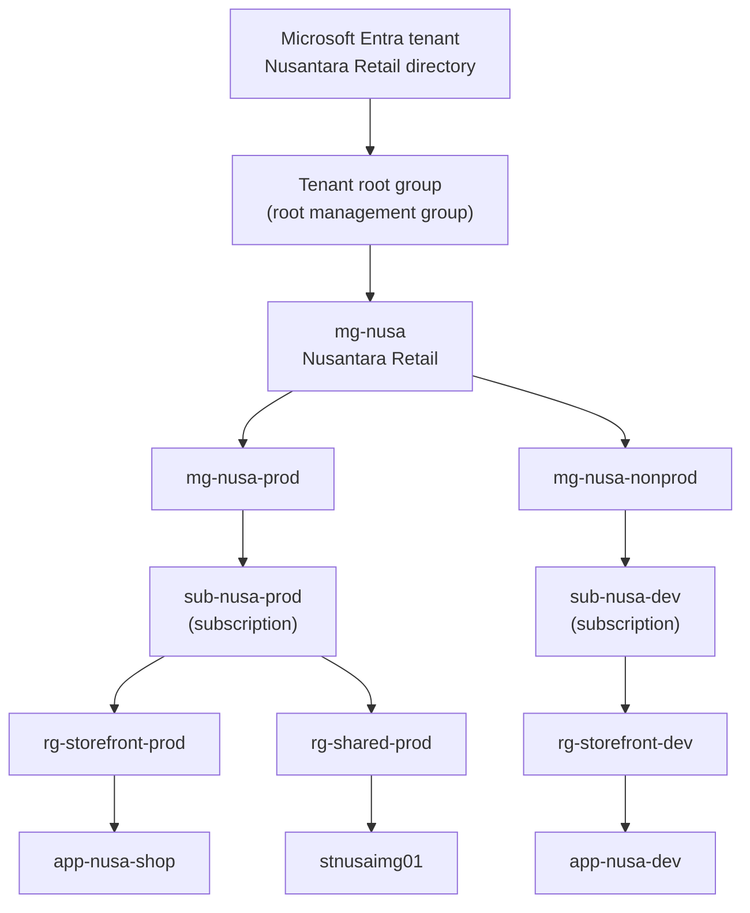
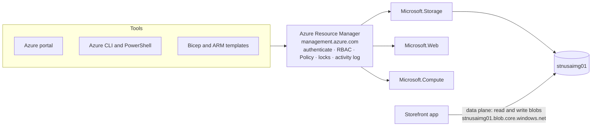

# Lunch 04 · Resource Hierarchy and Azure Resource Manager (Basic)

> **Track:** Core month · **Level:** Basic · **Part 1:** Foundations
> **Time:** 60 minutes · **Prerequisite lunches:** 01
> **AZ-900 skill area:** Describe Azure architecture and services
> **Lab:** [Lab 04 · Organise Nusantara Retail](../../labs/04-resource-hierarchy-basic/README.md) — about 40 minutes · cost 💲

| ⏱ Minutes | Segment |
|---:|---|
| 5 | Scenario and objectives |
| 25 | Reading |
| 15 | Demo: interactive animation (+ optional walkthrough video) |
| 5 | Knowledge check |
| 5 | Key takeaways and lab preview |
| 5 | Buffer — finish your lunch 🍜 |

## 🍱 Today's menu

By the end of this lunch you will be able to:

- **Explain** the levels of the Azure resource hierarchy, from the Microsoft Entra tenant down to a single resource, and
  what each level is for.
- **Describe** how Azure Resource Manager handles every management request, and tell control-plane operations from
  data-plane operations.
- **Read** a resource ID and **predict** which roles, policies, locks, budgets and tags apply to a resource through its
  scope.
- **Organise** resources with resource groups, naming conventions, tags and locks, and find them again with Azure
  Resource Graph.

## 🏪 Meanwhile at Nusantara Retail

Three weeks of experiments have left their mark. The lab subscription now holds a resource group called `test`, two
more called `rg1` and `rg-new`, a virtual machine named `server-baru-final2` and a storage account called
`dewitest123`. Nobody remembers which of them belong to the storefront.

Requests are piling up on your desk. The finance team wants to see what the storefront costs, separately from the new
stock-sync project. Rizky, the contractor, needs to manage the storefront and nothing else. Pak Budi wants a guarantee
that nobody, not even an administrator in a hurry, can delete the storage account that will hold every product photo.
And Ibu Sari wants rules such as "customer data stays in Jakarta" to be set once and enforced everywhere.

None of these requests is about a particular service. They are all about **structure**. Today's question: **how should
Nusantara Retail organise its Azure estate so that access, rules and costs follow the structure automatically?**

---

## 📖 Reading (≈25 minutes)

### 1. Six levels, from tenant to resource

Every Azure resource sits at the bottom of a hierarchy, and each level above it is a place where you can attach rules
that flow down. Read it from the top:

- The **Microsoft Entra tenant** is the organisation's identity directory: users, groups and applications. Every
  subscription trusts exactly one tenant. Signing in happens here; Lunch 05 covers it in depth.
- The **root management group** sits directly under the tenant. Each tenant has exactly one, shown in the portal as
  *Tenant root group*, and its ID is the tenant ID. Every management group and subscription folds up to it, new
  subscriptions land in it by default, and it can't be moved or deleted. Nobody has access to it by default: a Global
  Administrator must first elevate their own access.
- **Management groups** are containers for subscriptions and for other management groups. A tree can be up to six
  levels deep below the root (the root and the subscription level don't count), a tenant can hold up to 10,000
  management groups, and every management group or subscription has exactly one parent.
- **Subscriptions** hold resource groups and are the unit of billing and scale (more on that below).
- **Resource groups** are containers for resources that share a lifecycle.
- **Resources** are the things you actually use and pay for: virtual machines, storage accounts, web apps, databases.



| Level | Main purpose | Rules worth remembering | Nusantara Retail example |
|---|---|---|---|
| Microsoft Entra tenant | Identities and sign-in | Each subscription trusts exactly one tenant | The company directory |
| Root management group | Top of the governance tree | ID equals the tenant ID; can't be moved or deleted; no access by default | Tenant root group |
| Management groups | Group subscriptions to apply rules at scale | Up to six levels below the root; one parent each | mg-nusa, mg-nusa-prod, mg-nusa-nonprod |
| Subscriptions | Billing, quota and access boundary | One parent management group; trusts one tenant | sub-nusa-prod, sub-nusa-dev |
| Resource groups | Lifecycle container | Each resource in exactly one group; no nesting | rg-storefront-prod, rg-shared-prod |
| Resources | The services you use | Type comes from a resource provider; most names are permanent | app-nusa-shop, stnusaimg01 |

Subscriptions deserve a closer look, because they are three boundaries at once. They are a **billing boundary**: usage
is collected per subscription and rolls up to the billing account above it, so separate subscriptions give you clean
cost separation without any tagging discipline. They are a **scale boundary**: quotas and limits, such as how many
vCPUs you may run in a region, apply per subscription, so an experiment in development can't eat production's quota.
And they are a natural **access and policy boundary**. That is why the most common first step is simply two
subscriptions, one for production and one for everything else.

> [!IMPORTANT]
> Management groups are tenant-wide. The first time anyone uses them, Azure creates the root management group and
> places every existing subscription under it, and unless an administrator has turned on hierarchy protection, any
> user in the tenant can create management groups. Practise only in your own lab tenant, never in a company tenant,
> and never move a work subscription around to "see what happens".

### 2. Azure Resource Manager: one front door for every tool

In Lunch 01 you saw that the portal, the Azure CLI, Azure PowerShell and every SDK send their requests to **Azure
Resource Manager (ARM)**. It's worth knowing what ARM does with each request, because every rule in this lunch is
enforced there. ARM authenticates the caller with a Microsoft Entra token, checks Azure RBAC role assignments at the
target scope and every scope above it, evaluates Azure Policy, checks resource locks, records the operation in the
activity log, and only then hands the request to the right **resource provider**. Because every tool goes through the
same API, they all get the same answers: the portal has no secret powers that the CLI lacks.

A resource provider is the service behind a family of resource types, named by a **namespace** such as
`Microsoft.Compute`, `Microsoft.Network`, `Microsoft.Storage` or `Microsoft.Web`. Each provider offers **resource types**,
so the full type of a storage account is `Microsoft.Storage/storageAccounts`. Some types are children of others: a blob
container is `Microsoft.Storage/storageAccounts/blobServices/containers`. Each type also publishes its **API versions**
(dated, such as `2024-01-01`) and the regions where it's available, which is exactly what you queried in Lab 03.

Everything ARM handles is the **control plane**: creating, configuring and deleting resources through
`https://management.azure.com`. Using a resource is the **data plane**: reading a blob from
`https://stnusaimg01.blob.core.windows.net`, querying a database, or connecting to a VM over SSH. Data-plane requests go
straight to the service's own endpoint and are governed by that service's own authorization: Microsoft Entra data
roles, access keys, shared access signatures or database logins. Two consequences follow. The data plane keeps working
even if the control plane is briefly unavailable, so your shop stays open. And rules enforced by ARM, such as locks,
don't automatically protect what happens on the data plane.



Because every control-plane write passes through ARM, the **activity log** becomes a reliable record of who created,
changed or deleted what, and when, at every scope. When someone asks "who deleted the test VM on Friday?", that is
where you look (Lunch 16).

ARM also understands *desired state*. When you send it a template that describes resources, it works out what to
create and what already exists, so deploying the same file twice gives the same result. That idea powers infrastructure
as code with Bicep in Lunch 20.

### 3. Scopes, inheritance and resource IDs

A **scope** is the place where you attach a setting: a management group, a subscription, a resource group or a single
resource. The rule that makes the hierarchy useful is inheritance: settings flow down to everything below, including
things created later. Assign the finance team a reader role on `mg-nusa-prod` and they can read every subscription,
resource group and resource beneath it, even next year's. Put a lock on `rg-shared-prod` and every resource added to
that group later is protected too. But not everything flows down:

| Setting | Can be attached at | Flows down? | Watch out for |
|---|---|---|---|
| Azure RBAC role assignment | Management group, subscription, resource group, resource | Yes | Permissions from all scopes add up; assign as low as practical (Lunch 05) |
| Azure Policy assignment | Management group, subscription, resource group | Yes, with exemptions possible | Denials happen at ARM, before anything is built (Lunch 18) |
| Resource lock | Subscription, resource group, resource (not management groups) | Yes; the most restrictive lock wins | Blocks everyone, Owners included |
| Budget | Management group (not for every agreement type), subscription, resource group | Covers the cost of everything inside | Sends alerts; it doesn't stop spending (Lunch 19) |
| Tag | Subscription, resource group, resource (not management groups) | **No** | Copy or enforce tags with Azure Policy |

Every scope, and every resource, has an address called a **resource ID**. It is the path from the subscription down to
the resource, and it's what scripts, templates, role assignments, locks and alerts use to point at things:

```text
/subscriptions/8f2a…41c7/resourceGroups/rg-shared-prod/providers/Microsoft.Storage/storageAccounts/stnusaimg01
```

| Segment | Example | What it tells you |
|---|---|---|
| `/subscriptions/{id}` | `/subscriptions/8f2a…41c7` | Which subscription, and therefore which tenant and bill |
| `/resourceGroups/{name}` | `/resourceGroups/rg-shared-prod` | Which resource group: the lifecycle and a scope |
| `/providers/{namespace}` | `/providers/Microsoft.Storage` | Which resource provider serves it |
| `/{type}` | `/storageAccounts` | The resource type within that provider |
| `/{name}` | `/stnusaimg01` | The resource name |

The higher scopes use the same pattern. A subscription is `/subscriptions/{id}`, a resource group is
`/subscriptions/{id}/resourceGroups/{name}`, and a management group is
`/providers/Microsoft.Management/managementGroups/{id}`. Child resources add more type-and-name pairs to their parent's
ID, for example `…/storageAccounts/stnusaimg01/blobServices/default/containers/images`. Locks and role assignments are
*extension resources* that hang off another ID: a lock on that account lives at
`…/stnusaimg01/providers/Microsoft.Authorization/locks/{lock name}`. The segment names are case-insensitive, so you will
see both `resourceGroups` and `resourcegroups` in real output; compare IDs without caring about case.

### 4. Resource groups, moves, names and tags

A **resource group** should hold resources that share a lifecycle: you deploy, update and delete them together. A few
rules follow from that design:

- Each resource lives in exactly one resource group. Resource groups can't be nested, and they can't be renamed.
- A resource group has a location, which is where Azure stores its metadata. Its resources may live in other regions,
  but keeping them in the same region is simpler; if the group's region is unavailable, Resource Manager reroutes
  control-plane requests to a backup region.
- Deleting a resource group deletes everything inside it. That is the cleanup superpower the labs rely on, and exactly
  why production groups deserve a lock.
- A resource can still talk to resources in other groups. The storefront in `rg-storefront-prod` reads photos from the
  storage account in `rg-shared-prod`, because the two have different owners and lifecycles.

A common beginner mistake is to group by resource type: all VMs in `rg-vms`, all databases in `rg-databases`. It looks
tidy until you need to delete one application, give one team access to its own pieces, or see what one workload costs.
Group by workload and environment instead, plus a group for genuinely shared services, and let the resource names and
tags tell you what each item is.

**Moving** a resource between resource groups or subscriptions (within the same tenant) is possible for many resource
types, and it changes less than you might fear. The resource stays in its region and keeps running; only its resource
group or subscription, and therefore its resource ID, changes, so update any script, dashboard or alert that uses the
old ID. While the move runs, both resource groups are locked against creates, updates and deletes: usually for
minutes, at most four hours. Not every type can move (NAT gateways and AKS clusters are examples at the time of
writing), child resources always travel with their parent, and Azure validates the request first. Role assignments
made directly on the moved resource don't come along, while the resource's own tags do. A read-only lock on either
resource group blocks the move entirely.

**Names** deserve a plan, because most of them can't be changed after creation. The Cloud Adoption Framework (CAF)
suggests building names from a few components: a short abbreviation of the resource type, the workload, the
environment, sometimes the region, and an instance number. That gives names such as `rg-storefront-prod`,
`vm-web-prod-001` and `vnet-shared-idc-001`. Common abbreviations are `rg`, `vm`, `vnet`, `snet`, `nsg`, `pip`, `st`
(storage account), `kv` (key vault) and `mg` (management group). Some names must be unique across all of Azure because
they become DNS names: a storage account name, for instance, is 3 to 24 lowercase letters and digits, without hyphens.
Keep anything that might change, such as the owner or the cost centre, out of names and put it in tags.

**Tags** are name-value labels on resources, resource groups and subscriptions (but not on management groups), up to
50 per item. They drive cost reports, automation and searches. Tag names are case-insensitive, but values are
case-sensitive, so `ecommerce` and `Ecommerce` show up as two different cost centres. Tags are stored as plain text and
appear in cost exports and logs, so never put secrets or personal data in them. And the rule that surprises everyone:
**tags are not inherited**. A tag on a resource group does not appear on the resources inside it. If every resource
must carry the group's cost centre, use Azure Policy to copy or enforce it (Lunch 18).

> [!TIP]
> Agree on a short list of mandatory tags, such as `costCenter`, `env`, `owner` and `app`, with fixed spellings and
> allowed values, before the first production deployment. Retagging hundreds of resources later is slow and
> error-prone, and the cost reports for the months in between stay messy forever.

### 5. Locks and Azure Resource Graph

A **resource lock** protects resources from accidents, regardless of who is signed in. There are two kinds:

| Lock (CLI name) | Portal name | Blocks | Still allowed |
|---|---|---|---|
| `CanNotDelete` | Delete | Deleting the locked resource, or anything under a locked scope | Reading and changing settings |
| `ReadOnly` | Read-only | Deleting and every change, including some actions that feel like reads | Reading (GET requests) |

Locks can be set on a subscription, a resource group or a resource, and they are inherited by everything below; when
locks at several levels apply, the most restrictive one wins. A lock overrides permissions, so even an Owner has to
remove the lock before deleting. Only roles that include the `Microsoft.Authorization/locks/*` actions, such as Owner
and User Access Administrator, can create or remove locks; a Contributor can't. And a `CanNotDelete` lock on a single
resource stops its whole resource group from being deleted: Azure doesn't do partial deletes.

**The ReadOnly surprise.** ARM enforces locks on the control plane by looking at the type of request. Reads (GET) pass.
Creates, updates and deletes are blocked, and so are **POST** actions, because ARM can't know whether a POST changes
something. Many operations that feel like reads are POST actions: listing a storage account's access keys is a POST,
deliberately, because the keys give full access to the data and shouldn't come back from an ordinary read. Starting
or restarting a VM, scaling an App Service plan and moving resources in or out of a locked group are blocked too. A
ReadOnly lock on a production resource group can therefore break deployments, automation and even an application that
fetches its storage keys at startup. Use `CanNotDelete` for "don't delete this" and role assignments for "don't change
this".

> [!WARNING]
> Locks protect resources, not the data inside them. A `CanNotDelete` or `ReadOnly` lock on a storage account doesn't
> stop someone with data access from deleting blobs through the data plane. Protect data with least-privilege data
> roles, soft delete, versioning and immutability (Lunch 24).

**Azure Resource Graph** answers the question "what do we have, and where?" across every subscription and management
group you can read, in seconds. You query it with a subset of the Kusto Query Language (KQL). The `Resources` table
holds resources, and `ResourceContainers` holds subscriptions, resource groups and management groups:

```kusto
Resources
| where tags.costCenter == 'ecommerce'
| project name, type, resourceGroup, location
```

You can run queries in the portal's Resource Graph Explorer, with `az graph query` in the Azure CLI (its extension
installs itself the first time) or from PowerShell. Resource Graph is read-only, it only shows what your roles allow
you to see, and it returns up to 1,000 records per query by default, with paging for more.

### 6. How it fits together for Nusantara Retail

You can now turn the pile of requests into a structure. Under the Tenant root group, create `mg-nusa` for the company
and two children, `mg-nusa-prod` and `mg-nusa-nonprod`. Production runs in `sub-nusa-prod`; development, testing and
Rizky's work run in `sub-nusa-dev`. Inside production, the web app lives in `rg-storefront-prod` and the product-photo
storage account in `rg-shared-prod`, because other apps, such as the stores' tablets, will use it too.

Then the rules attach themselves to the right scopes. The finance team gets a reader role on `mg-nusa-prod`. An Azure
Policy assignment there allows only Indonesia Central, which you chose in Lunch 03. A `CanNotDelete` lock on
`rg-shared-prod` answers Pak Budi. Rizky gets a contributor role on `rg-storefront-dev` and nothing else (Lunch 05).
Every resource carries `costCenter`, `env`, `owner` and `app` tags, a budget watches each subscription (Lunch 19), and a
saved Resource Graph query lists anything that is missing a `costCenter` tag. In the lab you will build a small slice
of this design yourself.

> [!NOTE]
> **Pause and think:** next year Dewi creates a new subscription for a loyalty-card app. Will the finance team's
> reader role and the location policy on `mg-nusa-prod` apply to it automatically? What has to happen first?

Going deeper: Lunch 31 · Resource Hierarchy and Governance (Advanced) designs a full landing-zone management group
hierarchy and applies governance at scale.

---

## 🎬 Demo (≈15 minutes)

1. **Interactive animation (≈6–8 min):** [Open the demo](https://stefpin.github.io/azure-fundamentals-lunches/demos/04-resource-hierarchy-basic.html) —
   press ▶ Play or step through it at your own pace. Offline? Download
   [`docs/demos/04-resource-hierarchy-basic.html`](../../docs/demos/04-resource-hierarchy-basic.html) and open it in
   any browser.
2. **Walkthrough video (≤ 6 min):** _coming soon_ — [read the walkthrough script](demo-video-script.md).

What to watch for:

- The hierarchy building level by level, from the tenant down to individual resources.
- Every request passing through Azure Resource Manager before a resource provider does any work.
- A role at a management group, a policy at a subscription and a lock on a resource group flowing down to everything
  below them, while tags stay where you put them.
- The resource ID of the storage account taken apart, segment by segment.

## ✅ Knowledge check (≈5 minutes)

1. The finance team must be able to read every production resource, including subscriptions that will be added to
   production later. Where do you assign their role?
   <details><summary>Show answer</summary>

   On the `mg-nusa-prod` management group. *Why:* role assignments are inherited by every subscription, resource
   group and resource below the scope, including ones created or moved there later.

   </details>
2. Pak Budi puts a `ReadOnly` lock on `rg-shared-prod`. The next morning the storefront can't fetch the storage account
   keys and an operator can't restart a VM in that group. What happened?
   <details><summary>Show answer</summary>

   Both operations are POST actions, and a ReadOnly lock blocks every control-plane request except reads. *Why:*
   ARM can't tell whether a POST changes something, so it blocks them all; a `CanNotDelete` lock would have protected
   the group without breaking them.

   </details>
3. Dewi tags `rg-storefront-prod` with `costCenter=ecommerce`, but the cost report grouped by `costCenter` shows nothing
   for the web app inside it. Why?
   <details><summary>Show answer</summary>

   Tags are not inherited: the web app itself has no `costCenter` tag. *Why:* tags stay on the item you put them on;
   tag the resources directly or use Azure Policy to copy the tag from the resource group.

   </details>
4. A script saves the storage account's resource ID. After you move the account from `rg-storefront-prod` to
   `rg-shared-prod`, the script fails with "resource not found". The account still works for customers. Explain.
   <details><summary>Show answer</summary>

   The resource ID contains the resource group name, so the move gave the account a new ID; the region, data and
   endpoints didn't change. *Why:* a move only changes the resource group or subscription segment of the ID, so update
   everything that refers to the old one.

   </details>
5. With a `CanNotDelete` lock on the storage account, can a user who holds a data role still delete blobs inside it?
   <details><summary>Show answer</summary>

   Yes. *Why:* locks apply to control-plane operations through Azure Resource Manager; deleting a blob is a data-plane
   operation, so protect data with least-privilege data roles, soft delete and versioning.

   </details>

## 🧠 Key takeaways

- The hierarchy runs **tenant → root management group → management groups (up to six levels) → subscriptions →
  resource groups → resources**, and every item has exactly one parent.
- **Azure Resource Manager** is the single front door for management: it authenticates, applies RBAC, Policy and
  locks, logs the request and calls the resource provider. Using a resource happens on the separate **data plane**.
- Roles, policies and locks **flow down** from the scope where you set them, and a budget covers everything below its
  scope; **tags don't inherit**.
- A **resource ID** spells out subscription, resource group, provider, type and name, so moving a resource changes its
  ID but never its region.
- Keep order with **CAF-style names**, a short list of **mandatory tags**, the right **lock** (beware ReadOnly) and
  **Azure Resource Graph** queries.

## 🔬 Your lab: Organise Nusantara Retail

On your own time, you will create two tagged resource groups and a storage account, take its resource ID apart and see
for yourself that resource group tags don't reach the resources inside. You will watch a `CanNotDelete` lock stop a
deletion and a `ReadOnly` lock stop something that looks like a simple read, move the account to another resource
group, and find everything again with Azure Resource Graph. Creating a management group is an optional extra for
learners with their own tenant.

- ⏱ About 40 minutes · 💲 · works on its own (no earlier lab needed)
- 👉 [Start Lab 04](../../labs/04-resource-hierarchy-basic/README.md)

## 📚 Go further

- [What is Azure Resource Manager?](https://learn.microsoft.com/azure/azure-resource-manager/management/overview) —
  scopes, resource groups, resource group locations and how Resource Manager stays resilient.
- [What are Azure management groups?](https://learn.microsoft.com/azure/governance/management-groups/overview) — the
  root management group, the limits and the permissions needed to build and change the hierarchy.
- [Lock your Azure resources to protect your infrastructure](https://learn.microsoft.com/azure/azure-resource-manager/management/lock-resources) —
  the full list of operations that locks block, including the ReadOnly surprises.
- [Define your naming convention](https://learn.microsoft.com/azure/cloud-adoption-framework/ready/azure-best-practices/resource-naming) —
  the Cloud Adoption Framework's naming components, with links to the abbreviation list.

---

⬅️ [Lunch 03 · Azure Global Infrastructure: Regions, Availability Zones and Region Pairs](../03-global-infrastructure/README.md) · 🏠 [Course home](../../README.md) · [Lunch 05 · Identity and Access (Basic)](../05-identity-access-basic/README.md) ➡️

<sub>Last validated: October 2026 · Spotted something out of date? [Open an issue](../../CONTRIBUTING.md).</sub>
