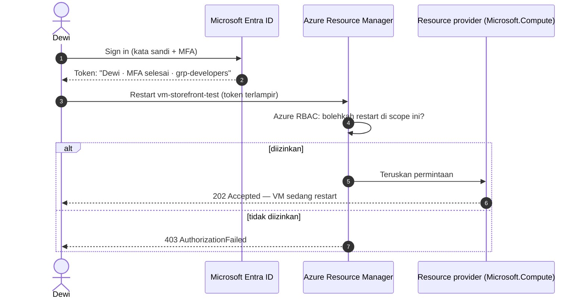
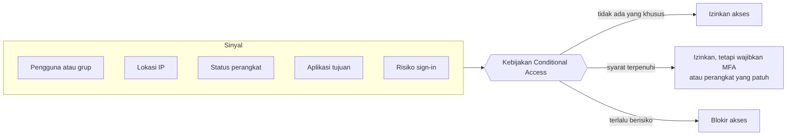
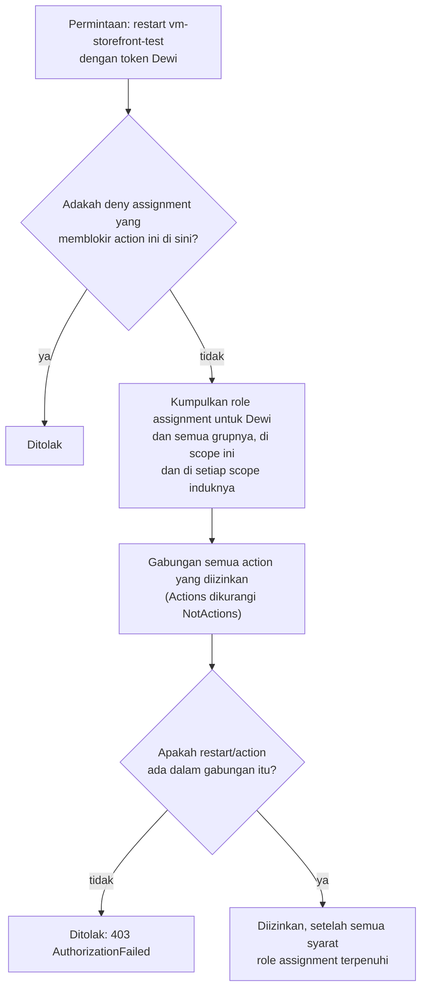

# Makan Siang 05 · Identitas dan Akses (Dasar)

🇬🇧 [Read in English](README.md)

> **Jalur:** Bulan inti · **Level:** Dasar · **Bagian 1:** Fondasi
> **Waktu:** 60 menit · **Makan siang prasyarat:** 04
> **Area keterampilan AZ-900:** Menjelaskan arsitektur dan layanan Azure
> **Lab:** [Lab 05 · Beri kontraktor akses secukupnya](../../labs/05-identity-access-basic/README.id.md) — sekitar 40 menit · biaya 💲
> **Penulis:** Stefanus Pinarta · [Tentang penulis](../../README.id.md#tentang-penulis)

| ⏱ Menit | Segmen |
|---:|---|
| 5 | Skenario dan tujuan |
| 25 | Bacaan |
| 15 | Demo: animasi interaktif (+ video panduan opsional) |
| 5 | Uji pemahaman |
| 5 | Poin penting dan pratinjau lab |
| 5 | Waktu cadangan — habiskan makan siang Anda 🍜 |

## 🍱 Menu hari ini

Setelah makan siang ini, Anda akan mampu:

- **Menjelaskan** perbedaan antara autentikasi dan otorisasi, serta menyebutkan layanan Azure yang menangani masing-masing.
- **Menggambarkan** Microsoft Entra ID (*ID Microsoft Entra*) — tenant, pengguna, grup, tamu, dan app registration — lalu membandingkannya dengan Active Directory Domain Services yang berjalan on-premises (di server milik perusahaan sendiri, bukan di cloud).
- **Membandingkan** MFA (*autentikasi multifaktor*), sign-in passwordless (*tanpa kata sandi*), single sign-on (*sistem masuk tunggal*), dan Conditional Access (*Akses Bersyarat*), serta menyebutkan risiko yang dikurangi oleh masing-masing.
- **Memperkirakan** apa yang bisa dilakukan seseorang di Azure berdasarkan role assignment-nya, dengan memakai tiga konsep: security principal, role definition, dan scope.
- **Memilih** antara role Microsoft Entra dan role Azure RBAC (*kontrol akses berbasis peran*), lalu menerapkan prinsip hak akses minimum (least privilege).

## 🏪 Sementara itu di Nusantara Retail

Rizky, seorang kontraktor dari perusahaan outsourcing, mulai bekerja hari Senin. Tugasnya: membantu Dewi memindahkan lingkungan uji (test environment) toko online ke Azure. Jumat sore, Dewi punya usul: "Paling gampang, kasih saja login saya ke dia. Atau jadikan dia Owner subscription (*langganan*) — dijamin dia tidak bakal mentok."

Ibu Sari tidak sengaja mendengar dan langsung mengajukan dua pertanyaan. "Kalau Rizky memakai akun Dewi, bagaimana kita tahu siapa yang mengubah apa?" Lalu: "Kalau kontraknya habis tiga bulan lagi, bagaimana kita memastikan aksesnya juga ikut berakhir?"

Pak Budi menambahkan pertanyaan ketiga. Kantor pusat sudah punya akun pengguna di Active Directory on-premises, yang berjalan di server sebelah pantry. Apakah akun-akun itu juga berlaku di Azure?

Anda menyadari bahwa sebenarnya ini satu pertanyaan yang sama, hanya ditanyakan dengan tiga cara. Sebelum ada yang membangun apa pun lagi di Azure, Anda butuh gambaran yang jelas: **siapa** yang boleh masuk, **bagaimana** mereka membuktikan identitasnya, dan **apa** yang boleh mereka lakukan setelah berada di dalam.

Pertanyaan hari ini: *Bagaimana cara mempersilakan orang masuk ke Azure — dan memberi setiap orang tepat akses yang mereka butuhkan, tidak lebih?*

---

## 📖 Bacaan (≈25 menit)

### 1. Dua pertanyaan: siapa Anda, dan apa yang boleh Anda lakukan?

Setiap kali seseorang menyentuh Azure, ada dua pemeriksaan terpisah yang terjadi.

**Autentikasi** (authentication, sering disingkat *authN*) menjawab pertanyaan *"Siapa Anda, dan bisakah Anda membuktikannya?"* Inilah momen saat Anda mengetik kata sandi, menyetujui sign-in (proses masuk ke akun) di ponsel, atau menyentuh security key — kunci keamanan fisik yang bentuknya mirip flashdisk.

**Otorisasi** (authorization, *authZ*) menjawab *"Sekarang kami sudah tahu siapa Anda — apa yang boleh Anda lakukan di sini?"* Pemeriksaan ini diulang untuk setiap permintaan, bahkan lama setelah Anda selesai sign-in.

Bayangkan kantor pusat Nusantara Retail di Jakarta. Petugas di meja keamanan lobi mencocokkan kartu identitas dengan wajah Anda — itulah autentikasi. Kartu akses yang kemudian Anda terima hanya membuka sebagian pintu: ruang keuangan, ya; ruang server, tidak. Itulah otorisasi. Membuktikan siapa diri Anda tidak otomatis membuka semua pintu.

Di Azure, kedua tugas itu dipegang oleh dua layanan yang berbeda:

- **Microsoft Entra ID** melakukan autentikasi. Layanan ini memeriksa kredensial (bukti identitas, misalnya kata sandi), menerapkan kebijakan sign-in, lalu menerbitkan **token** — pernyataan yang ditandatangani secara digital dan hanya berlaku untuk waktu terbatas, misalnya "ini Dewi, dia sudah menyelesaikan autentikasi multifaktor, dan dia anggota grup-grup berikut".
- **Azure Resource Manager** (ARM), satu-satunya control plane (lapisan kendali tempat semua permintaan pengelolaan masuk) yang sudah Anda kenal di Makan Siang 04, melakukan otorisasi. Setiap permintaan — dari portal, Azure CLI (alat baris perintah), PowerShell, atau deployment Bicep — tiba di ARM dengan token terlampir. ARM lalu memakai **Azure role-based access control (Azure RBAC)** untuk memutuskan apakah identitas tersebut boleh melakukan tindakan itu pada resource (*sumber daya*) itu.

Ada dua konsekuensi penting. Pertama, sign-in saja tidak memberi akses ke apa pun — autentikasi hanya menghasilkan token, dan token tidak membuka pintu mana pun tanpa role assignment (penetapan role) di belakangnya. Kedua, karena setiap permintaan diotorisasi satu per satu, perubahan akses seseorang berlaku pada permintaan berikutnya (biasanya dalam hitungan menit) tanpa ada yang perlu menyentuh server. Tidak ada jaringan kantor yang bisa diakali lewat pintu belakang: di cloud, **identitas adalah perimeter** — garis pertahanan utamanya.

### 2. Microsoft Entra ID: direktori di balik setiap sign-in

Microsoft Entra ID (dulu bernama Azure Active Directory) adalah layanan identitas cloud milik Microsoft. Direktori yang sama dipakai oleh Microsoft 365, portal Azure, dan ribuan aplikasi SaaS (software as a service, *perangkat lunak sebagai layanan*) untuk memproses sign-in.

**Tenant** adalah instans Entra ID yang khusus dan terisolasi milik organisasi Anda. Ibaratnya satu gedung kantor dengan daftar penghuni, kartu akses, dan satpamnya sendiri: penghuni gedung sebelah tidak tercantum di sana. Tenant datang dengan domain awal seperti `nusantararetail.onmicrosoft.com`, dan nanti Anda bisa menambahkan domain sendiri yang sudah diverifikasi (misalnya `nusantararetail.co.id`). Seperti yang Anda lihat di Makan Siang 04, tenant berada di puncak hierarki resource: setiap subscription Azure memercayai tepat satu tenant untuk urusan identitas, sedangkan satu tenant bisa menaungi banyak subscription. Jika Anda mendaftar akun gratis dengan akun Microsoft pribadi, Azure otomatis membuatkan tenant untuk Anda dan menjadikan Anda **Global Administrator** (role tertinggi di direktori) — itulah sebabnya Lab 05 dijalankan di tenant pribadi tersebut, tidak pernah di tenant perusahaan.

Di dalam sebuah tenant, Anda akan menemukan beberapa jenis objek:

- **Pengguna (users)** — orang yang punya akun di direktori Anda, seperti Dewi dan Ibu Sari.
- **Grup (groups)** — kumpulan pengguna dan objek lain. **Security group** adalah jenis grup yang Anda pakai untuk memberi akses; grup Microsoft 365 menambahkan kotak surat dan file bersama. Keanggotaannya diatur secara manual atau dihitung otomatis dari aturan (dynamic membership, yang membutuhkan lisensi Microsoft Entra ID P1).
- **Tamu (guests)** — orang dari luar organisasi yang masuk dengan akun *milik mereka sendiri*: Entra ID perusahaan mereka, akun Microsoft, atau penyedia identitas lain. Mereka muncul di direktori Anda dengan tipe pengguna *Guest*.
- **App registration dan service principal** — identitas untuk perangkat lunak, bukan untuk manusia. Pipeline yang men-deploy toko online juga butuh identitas; Anda akan berkenalan dengan managed identity di Makan Siang 15 dan pipeline tanpa kata sandi di Makan Siang 22.

**Active Directory Domain Services (AD DS)** on-premises milik Pak Budi memang punya nama keluarga yang sama dengan Entra ID, tetapi keduanya dibangun untuk dunia yang berbeda:

| | Active Directory Domain Services (on-premises) | Microsoft Entra ID (cloud) |
|---|---|---|
| Dibangun untuk | Komputer dan server di jaringan perusahaan | Aplikasi web, SaaS, dan layanan cloud melalui internet |
| Protokol | Kerberos, NTLM, LDAP | HTTPS dengan OpenID Connect, OAuth 2.0, dan SAML |
| Struktur | Forest, domain, dan organisational unit (OU) | Tenant datar berisi pengguna, grup, dan aplikasi; administrative unit untuk pendelegasian |
| Perangkat | Domain join dan Group Policy | Entra join atau registrasi perangkat; pengaturan lewat Microsoft Intune |
| Siapa yang mengoperasikan | Anda: domain controller, patching, backup | Microsoft menjalankan layanannya; Anda mengelola isinya |

Deretan singkatan di baris protokol hanyalah nama "bahasa" untuk sign-in: Kerberos, NTLM (NT LAN Manager), dan LDAP (Lightweight Directory Access Protocol) adalah bahasa jaringan kantor, sedangkan OpenID Connect, OAuth 2.0, dan SAML (Security Assertion Markup Language) adalah bahasa sign-in di web.

Kebanyakan perusahaan tidak memilih salah satu; mereka menghubungkan keduanya. **Microsoft Entra Connect** (Sync) dan **Microsoft Entra Cloud Sync** yang lebih ringan menyalin pengguna dan grup dari AD DS ke Entra ID, sehingga staf kantor pusat bisa masuk ke Azure dan Microsoft 365 dengan akun yang sudah mereka pakai sehari-hari di kantor. Inilah yang disebut **hybrid identity** (identitas hibrid). Untuk aplikasi lama yang masih membutuhkan Kerberos, LDAP, atau server yang di-join ke domain di Azure, **Microsoft Entra Domain Services** menyediakan domain terkelola (managed domain), sehingga Anda tidak perlu membangun dan mem-patch sendiri VM (*komputer virtual*) untuk domain controller.

> [!TIP]
> Entra ID tersedia dalam beberapa edisi. **Free** (sudah termasuk di setiap subscription Azure) mencakup pengguna, grup, single sign-on, dan standar MFA gratis yang disebut *security defaults*. **Microsoft Entra ID P1** menambahkan Conditional Access dan dynamic group; **P2** menambahkan perlindungan berbasis risiko dan Privileged Identity Management. Semua yang ada di lab hari ini bisa dikerjakan dengan edisi Free.

### 3. Membuktikan siapa Anda: MFA, passwordless, SSO, dan Conditional Access

Kata sandi saja itu lemah: orang memakai ulang kata sandi yang sama di banyak tempat, penyerang mencoba kata sandi pasaran ke ribuan akun sekaligus (*password spray*), dan halaman sign-in palsu yang meyakinkan berhasil mengumpulkan kata sandi hingga jutaan.

**Multifactor authentication (MFA)** mewajibkan bukti kedua dari jenis yang berbeda: sesuatu yang Anda **ketahui** (kata sandi atau PIN), sesuatu yang Anda **miliki** (ponsel atau security key), atau sesuatu yang **melekat pada diri** Anda (sidik jari atau wajah). Sebenarnya Anda sudah akrab dengan konsep ini di ATM: kartu adalah sesuatu yang Anda miliki, PIN adalah sesuatu yang Anda ketahui. Orang yang hanya mengintip PIN Anda tetap tidak bisa menarik uang tanpa kartunya. Dengan aplikasi Microsoft Authenticator, layar sign-in menampilkan sebuah angka yang harus Anda ketik di aplikasi. *Number matching* (pencocokan angka) ini menggagalkan penyerang yang membombardir Anda dengan permintaan persetujuan, berharap Anda akhirnya menekan "approve" hanya supaya notifikasinya berhenti.

Dua fakta membuat MFA kini tidak bisa dihindari di Azure:

- **Security defaults** otomatis aktif di tenant baru. Fitur ini mewajibkan setiap pengguna mendaftar MFA (sejak Juli 2024 tidak ada lagi masa tenggang 14 hari), mewajibkan MFA untuk administrator, memblokir protokol lama (legacy) yang tidak mendukung MFA, dan melindungi sign-in ke portal Azure, Azure CLI, dan Azure PowerShell.
- **Mandatory MFA untuk Azure** (MFA wajib) diberlakukan Microsoft dalam dua fase: sejak Oktober 2024 untuk sign-in ke portal Azure, Microsoft Entra admin center, dan Intune admin center; lalu — diluncurkan bertahap mulai 1 Oktober 2025 — untuk operasi create, update, dan delete melalui Azure CLI, PowerShell, alat infrastructure as code (*infrastruktur sebagai kode*), dan REST API (antarmuka pemrograman Azure). Workload identity (identitas untuk aplikasi dan otomasi) — managed identity dan service principal — tidak terkena aturan ini. Itu satu alasan lagi untuk tidak pernah menjalankan otomasi dengan akun milik seseorang.

Sign-in **passwordless** melangkah lebih jauh dan menghilangkan kata sandi sama sekali:

- **Windows Hello for Business** — PIN atau biometrik yang terikat pada perangkat Windows Anda.
- **Passkey (FIDO2)** — kredensial yang tersimpan di security key fisik, di aplikasi Microsoft Authenticator, atau disinkronkan oleh penyedia seperti Apple iCloud Keychain atau Google Password Manager. FIDO2 adalah standar terbuka untuk sign-in tanpa kata sandi. Passkey hanya berfungsi untuk situs tempat ia dibuat, sehingga halaman sign-in palsu tidak bisa memakainya: passkey bersifat *phishing-resistant* (tahan phishing).
- **Certificate-based authentication** (autentikasi berbasis sertifikat), untuk organisasi yang sudah menjalankan public key infrastructure (PKI, sistem pengelolaan sertifikat digital).

**Single sign-on (SSO)** berarti satu kali sign-in ke Entra ID membuka semua aplikasi yang terhubung — portal Azure, Microsoft 365, dan aplikasi SaaS seperti sistem penggajian atau back office mesin kasir (point of sale, POS). Mirip satu kartu uang elektronik yang bisa dipakai di gerbang tol, KRL, dan parkir: Anda tidak perlu membawa kartu berbeda untuk setiap gerbang. Lebih sedikit kata sandi berarti lebih sedikit yang bisa dicuri. SSO juga menjawab pertanyaan Ibu Sari: nonaktifkan satu akun, dan akses ke semua yang terhubung dengannya langsung berhenti.

| Metode | Melindungi dari | Lisensi | Contoh di Nusantara Retail |
|---|---|---|---|
| Security defaults | Password spray, serangan lewat protokol lama, admin tanpa MFA | Free | Standar dasar untuk seluruh tenant sejak hari pertama |
| MFA dengan number matching | Kata sandi yang dicuri atau ditebak, "MFA fatigue" (kelelahan menerima notifikasi MFA) | Free | Setiap staf dan kontraktor |
| Passkey, Windows Hello | Phishing, termasuk halaman sign-in palsu | Free (security key fisik berbayar) | Akun Pak Budi dan administrator lainnya |
| Single sign-on | Pemakaian ulang kata sandi, offboarding yang terlupa | Free | Satu akun untuk Azure, Microsoft 365, dan back office POS |
| Conditional Access | Sign-in berisiko sesuai konteks: perangkat, lokasi, aplikasi | P1 (kebijakan berbasis risiko: P2) | Kontraktor wajib MFA; aplikasi lama diblokir |

Security defaults itu ibarat baju *all size*: satu ukuran untuk semua orang. **Conditional Access** adalah mesin kebijakan Entra ID untuk saat Anda butuh aturan yang lebih bernuansa. Setiap kebijakan berbentuk pernyataan jika-maka (if-then) yang dievaluasi saat sign-in, *setelah* faktor pertama (biasanya kata sandi) diperiksa:

**Sinyal** (signals) mencakup pengguna beserta grupnya, asal permintaan, status perangkat, aplikasi yang dibuka, dan — dengan P2 — skor risiko yang dihitung otomatis. **Keputusan** (decision) bisa berupa blokir, izinkan, atau izinkan hanya jika syarat tambahan terpenuhi, misalnya MFA atau perangkat yang dikelola perusahaan. **Penegakan** (enforcement) terjadi saat sign-in dan selama sesi yang berjalan sesudahnya. Conditional Access membutuhkan Microsoft Entra ID P1, dan Anda mematikan security defaults ketika kebijakan buatan Anda sendiri menggantikannya. Makan Siang 22 membangun kebijakan-kebijakan ini langkah demi langkah.

Rizky bekerja untuk perusahaan outsourcing yang punya tenant Entra sendiri. Daripada membuatkan kata sandi baru untuknya di direktori Anda, Anda bisa mengundangnya sebagai tamu **B2B collaboration** (kolaborasi business-to-business): dia masuk dengan akun perusahaannya, Anda yang menentukan apa saja yang boleh dia jangkau, dan ketika perusahaannya menonaktifkan akunnya, aksesnya ke Nusantara Retail ikut berakhir. Ibaratnya tamu kantor yang menitipkan KTP-nya sendiri di lobi untuk mendapat kartu tamu, bukan meminjam kartu karyawan. Untuk para pembeli di toko online — pelanggan, bukan staf — **Microsoft Entra External ID** menyediakan fitur pendaftaran dan sign-in pelanggan di tenant eksternal yang terpisah. (Azure AD B2C, layanan identitas pelanggan versi lama, tidak lagi dijual ke pelanggan baru sejak 1 Mei 2025.)

### 4. Azure RBAC: siapa boleh melakukan apa, dan di mana

Setelah Rizky berhasil sign in, Azure RBAC yang menentukan apa yang boleh dia lakukan. Setiap **role assignment** menghubungkan tiga hal:

1. **Security principal** — *siapa*: pengguna, grup, service principal, atau managed identity.
2. **Role definition** — *apa*: daftar operasi yang diizinkan, lengkap dengan namanya. **Actions** adalah operasi manajemen seperti `Microsoft.Compute/virtualMachines/restart/action`; **NotActions** dikurangkan dari Actions; **DataActions** mencakup data di dalam sebuah resource, misalnya membaca blob.
3. **Scope** — *di mana*: management group (*grup manajemen*), subscription, resource group (*grup sumber daya*), atau satu resource tertentu.

Assignment **diwariskan ke bawah**, persis seperti hierarki di Makan Siang 04. Reader di level subscription berarti akses baca ke setiap resource group dan resource di dalamnya. Contributor di `rg-storefront-test` berarti kendali penuh atas resource di grup itu — dan tidak ada akses sama sekali di tempat lain.

Begini cara ARM memutuskan, setiap kali sebuah permintaan tiba:

Ada tiga aturan yang bisa ditarik dari gambar itu:

- **Izin bersifat aditif.** Akses efektif Anda adalah **gabungan** (union) dari semua role yang diberikan kepada Anda dan kepada grup-grup Anda, di resource itu dan di setiap scope di atasnya. Reader di sebuah resource group tidak "membatasi" role Contributor yang Anda pegang di subscription; Anda memegang keduanya, sehingga secara efektif Anda tetap Contributor di sana. Bayangkan setiap role sebagai satu anak kunci di gantungan kunci Anda: menambah kunci "hanya boleh melihat" tidak membuat kunci "boleh mengubah" hilang.
- **Deny assignment selalu menang.** **Deny assignment** memblokir action tertentu meskipun ada role yang mengizinkannya — ibarat segel dari pengelola gedung yang tetap menutup sebuah pintu, berapa pun kunci yang Anda bawa. Anda tidak bisa membuat deny assignment sendiri; Azure yang membuatnya, misalnya saat sebuah **deployment stack** (Makan Siang 20) memakai deny settings untuk melindungi resource yang dikelolanya.
- **Tanpa role, tanpa akses.** Jika tidak ada assignment yang mencakup action tersebut, jawabannya 403, apa pun jabatan orang itu.

Azure punya ratusan built-in role (role bawaan yang siap pakai). Lima di antaranya bersifat umum dan layak Anda hafal di luar kepala; sisanya masing-masing khusus untuk satu layanan:

| Built-in role | Bisa mengelola resource? | Bisa memberi akses ke orang lain? | Penggunaan umum di Nusantara Retail |
|---|---|---|---|
| **Owner** | Ya, semuanya | Ya, role apa pun | Dua orang yang ditunjuk per subscription — tidak lebih |
| **Contributor** | Ya, semuanya | Tidak | Tim Dewi, di resource group development miliknya sendiri |
| **Reader** | Tidak, hanya melihat | Tidak | Auditor dan tim keuangan |
| **User Access Administrator** | Tidak | Ya, role apa pun | Jarang: tugas khusus pengelolaan akses |
| **Role Based Access Control Administrator** | Tidak | Ya, hanya role assignment Azure | Ketua tim yang mengelola akses ke resource group timnya sendiri |
| Virtual Machine Contributor | Hanya VM, bukan jaringan atau penyimpanannya | Tidak | Operator shift malam yang me-restart VM |
| Network Contributor | Hanya jaringan | Tidak | Pak Budi, yang mengelola virtual network (*jaringan virtual*) dan NSG (network security group) |
| Storage Blob Data Reader | Membaca *data* blob (sebuah role data) | Tidak | Aplikasi pelaporan yang membaca ekspor data penjualan |

Perhatikan baris terakhir. Owner dan Contributor mengelola storage *account* (*akun penyimpanan*)-nya, tetapi membaca blob di dalamnya dengan sign-in Entra ID membutuhkan role data — Anda akan memakainya di Makan Siang 07.

> [!WARNING]
> **Kesalahan umum:** memberi Owner atau Contributor di scope subscription "biar cepat mulai dulu" (dan tidak pernah dibereskan); memberi role ke perorangan, bukan ke grup (mustahil ditinjau belakangan); memakai satu akun beramai-ramai (tidak ada jejak audit, dan MFA-nya pun tidak jelas milik siapa); dan menghapus pengguna sebelum mencabut role assignment-nya, sehingga tersisa entri yatim berlabel "Identity not found". Ingat juga bahwa perubahan role bisa butuh waktu hingga 10 menit untuk berlaku — sign out lalu sign in lagi sebelum Anda menyimpulkan ada yang rusak.

### 5. Dua jenis role, dan kebiasaan least privilege

Ada satu set role lain yang hampir selalu membingungkan orang di awal. Role Azure RBAC mengendalikan *resource* Azure; **role Microsoft Entra** mengendalikan *direktori* itu sendiri.

| | Role Microsoft Entra | Role Azure RBAC |
|---|---|---|
| Mengendalikan akses ke | Objek direktori: pengguna, grup, aplikasi, domain, lisensi, pengaturan tenant | Resource Azure: VM, jaringan, penyimpanan, database, dan seterusnya |
| Contoh | Global Administrator, User Administrator, Application Administrator, Billing Administrator | Owner, Contributor, Reader, Virtual Machine Contributor |
| Scope | Seluruh tenant, satu administrative unit, atau satu objek (misalnya satu aplikasi) | Management group, subscription, resource group, atau resource |
| Tempat menetapkannya | Microsoft Entra admin center (*Roles and administrators*), Microsoft Graph | *Access control (IAM)* di portal Azure, Azure CLI, PowerShell, ARM template (*templat ARM*), dan Bicep |
| Pemegang yang lazim | Tim identitas dan helpdesk Anda | Siapa pun yang membangun atau mengoperasikan workload |
| Custom role | Didukung | Didukung (Makan Siang 22) |

Secara default, kedua set role ini tidak saling tumpang tindih. Seorang Global Administrator bisa me-reset kata sandi siapa pun, tetapi tidak punya akses ke resource Azure. Dalam keadaan darurat, Global Administrator bisa melakukan **elevate access**, yang memberinya role User Access Administrator di root scope (`/`) — mencakup setiap management group dan subscription di tenant — sehingga dia bisa memulihkan subscription yang tidak bisa lagi dikelola orang lain. Pakai, bereskan masalahnya, lalu matikan lagi. Role administrator subscription klasik (Service Administrator dan Co-Administrator) sudah sepenuhnya dipensiunkan; kini Azure RBAC adalah satu-satunya model.

Dengan begitu banyak role yang tersedia, aturan pemandunya adalah **least privilege** (prinsip hak akses minimum): berikan role terkecil, di scope tersempit, untuk waktu tersingkat yang masih memungkinkan seseorang menyelesaikan pekerjaannya. Ibaratnya saat rumah Anda direnovasi: tukang mendapat kunci pintu samping dan dapur selama proyek berjalan, bukan kunci kamar tidur dan brankas — dan kuncinya dikembalikan begitu proyek selesai. Dalam praktiknya:

- Berikan role kepada **grup**, bukan perorangan; orang masuk atau keluar tim cukup dengan satu perubahan keanggotaan.
- Utamakan **role khusus layanan** (Virtual Machine Contributor) daripada role umum (Contributor).
- Utamakan scope **resource group** daripada scope subscription.
- Batasi pemegang **Owner** sesedikit mungkin, dan tinjau secara rutin siapa saja yang memegangnya.
- Cabut role assignment **sebelum** Anda menghapus principal-nya.

Least privilege adalah salah satu dari tiga prinsip **Zero Trust**, bersama *verify explicitly* (verifikasi secara eksplisit: autentikasi dan otorisasi setiap permintaan dengan memakai semua sinyal yang tersedia) dan *assume breach* (anggap pembobolan sudah terjadi: batasi radius kerusakan dan awasi penyalahgunaan). Anda baru saja bertemu ketiganya: MFA dan Conditional Access melakukan verifikasi eksplisit, scope RBAC yang sempit menegakkan least privilege, dan pemeriksaan per permintaan berarti token yang dicuri hanya bisa menjangkau apa yang bisa dijangkau pemiliknya. Makan Siang 15 menerapkan Zero Trust pada defense in depth (*pertahanan mendalam*), dan Makan Siang 22 menambahkan akses just-in-time (akses yang diberikan hanya saat dibutuhkan).

### 6. Bagaimana semuanya menyatu untuk Nusantara Retail

Kembali ke Jumat sore itu. Alih-alih membagikan kata sandi Dewi atau mengobral role Owner, Anda membuat sketsa rencana:

- **Rizky** mendapat identitasnya sendiri — tamu B2B jika perusahaannya memakai Entra ID, atau akun member di tenant Anda jika tidak. Di lab, Anda akan menyimulasikan Rizky dengan pengguna uji.
- Rizky bergabung ke security group **grp-nusa-contractors**, dan grup itulah — bukan Rizky — yang mendapat role: pertama **Reader** di `rg-storefront-test` supaya dia bisa mempelajari lingkungannya, lalu **Contributor** di resource group yang sama saat migrasi dimulai. Dia tidak bisa menyentuh production, tidak bisa melihat bagian lain subscription, dan tidak bisa memberi akses kepada siapa pun.
- **Security defaults** (atau, setelah Nusantara Retail membeli P1, sebuah kebijakan Conditional Access) memastikan dia sign in dengan MFA.
- **Dewi** berhenti meminjamkan akunnya. Aksesnya sendiri datang melalui **grp-developers**.
- **Pak Budi** menghubungkan AD DS on-premises dengan Entra Connect Sync, sehingga staf kantor pusat memakai satu akun di mana-mana.

Pertanyaan Ibu Sari — "kalau kontraknya selesai, bagaimana aksesnya ikut selesai?" — kini punya jawaban satu kalimat: keluarkan Rizky dari grup (atau biarkan perusahaannya menonaktifkan akunnya), dan setiap izin yang datang lewat grup itu langsung hilang sekaligus. Sementara itu, activity log mencatat bahwa Rizky-lah, bukan Dewi, yang melakukan setiap perubahan.

> [!NOTE]
> **Renungkan sejenak:** Dewi adalah anggota *grp-developers* (Reader di subscription) dan *grp-storefront-ops* (Virtual Machine Contributor di `rg-storefront-test`). Bisakah dia me-restart VM di `rg-storefront-prod`? Bagaimana dengan VM di `rg-storefront-test`? Bisakah dia menghapus resource group `rg-storefront-test` itu sendiri?

Hari ini kita sudah meletakkan fondasinya. **Makan Siang 22 · Identitas dan Akses (Lanjutan)** melanjutkan dengan managed identity secara mendalam, pipeline tanpa kata sandi, kebijakan Conditional Access, Privileged Identity Management, dan custom role.

---

## 🎬 Demo (≈15 menit)

1. **Animasi interaktif (≈6–8 menit):** [Buka demo](https://stefpin.github.io/azure-fundamentals-lunches/demos/05-identity-access-basic.html?lang=id) —
   tekan ▶ Putar atau telusuri langkah demi langkah sesuai kecepatan Anda. Sedang offline? Unduh
   [`docs/demos/05-identity-access-basic.html`](../../docs/demos/05-identity-access-basic.html) lalu buka di browser apa pun.
2. **Video panduan (≤ 6 menit):** _segera hadir_ — [baca naskah video](demo-video-script.id.md).

Yang perlu diperhatikan:

- Autentikasi terjadi sekali, saat sign-in; otorisasi terjadi pada setiap permintaan.
- Azure Resource Manager memeriksa deny assignment lebih dulu, lalu mengumpulkan role assignment dari setiap scope dan menjumlahkannya.
- Solusi pertama yang diusulkan (Owner di subscription) memang akan berhasil — dan tetap merupakan jawaban yang salah.
- Deny assignment mengalahkan role apa pun, bahkan role yang mencakup action tersebut.
- Conditional Access menentukan *bagaimana* Rizky boleh sign in, sebelum RBAC sempat melihat satu pun permintaannya.

## ✅ Uji pemahaman (≈5 menit)

1. Rizky berhasil sign in dengan MFA, tetapi ketika mencoba menambahkan aturan ke sebuah network security group di `rg-storefront-test`, dia mendapat `AuthorizationFailed`. Pemeriksaan mana yang gagal — autentikasi atau otorisasi — dan layanan mana yang mengambil keputusan itu?
   

Lihat jawaban

   Otorisasi, yang diputuskan oleh Azure Resource Manager dengan Azure RBAC. *alasannya:* sign-in-nya (autentikasi oleh Microsoft Entra ID) berhasil; kode 403 berarti tidak ada role yang diberikan kepadanya atau kepada grupnya, di scope itu maupun di atasnya, yang mencakup action write tersebut.

   

2. Dewi memegang Contributor di subscription dan Reader di `rg-storefront-prod`. Apa yang bisa dia lakukan di `rg-storefront-prod`?
   

Lihat jawaban

   Semua yang bisa dilakukan Contributor di sana: membuat, mengubah, dan menghapus resource. *alasannya:* Azure RBAC bersifat aditif — akses efektif adalah gabungan semua assignment di resource itu dan di atasnya, sehingga assignment Reader tidak menambah maupun mengurangi apa pun; hanya deny assignment yang bisa mencabut action yang sudah diizinkan.

   

3. Ketua tim Anda minta dijadikan Global Administrator "supaya saya bisa membuat VM di Azure". Apa yang Anda jelaskan, dan apa yang Anda tawarkan sebagai gantinya?
   

Lihat jawaban

   Global Administrator adalah role Microsoft Entra untuk mengelola direktori; secara default role ini tidak memberi akses ke resource Azure. Tawarkan role Azure seperti Virtual Machine Contributor, yang diberikan ke grup tim tersebut di resource group yang tepat. *alasannya:* role Entra dan role Azure RBAC adalah dua sistem yang terpisah, dan elevate access hanya dimaksudkan untuk keadaan darurat.

   

4. Nusantara Retail ingin kontraktor menyelesaikan MFA setiap kali mereka sign in dari perangkat yang tidak dikelola perusahaan, sementara staf yang memakai laptop kantor lebih jarang diminta MFA. Security defaults atau Conditional Access — dan lisensi apa yang dibutuhkan?
   

Lihat jawaban

   Conditional Access, yang membutuhkan Microsoft Entra ID P1. *alasannya:* security defaults hanya bisa aktif atau nonaktif untuk semua orang; Conditional Access menggabungkan sinyal seperti keanggotaan grup dan status perangkat menjadi keputusan yang disesuaikan.

   

5. Kontrak Rizky berakhir dan seorang rekan langsung menghapus akun penggunanya. Dua minggu kemudian, halaman *Access control (IAM)* di resource group menampilkan assignment Contributor untuk "Identity not found". Apa yang salah, dan urutan apa yang lebih baik?
   

Lihat jawaban

   Role assignment-nya tertinggal. Keluarkan Rizky dari grup yang memegang role tersebut (atau cabut assignment langsungnya) terlebih dahulu, baru hapus atau nonaktifkan akunnya. *alasannya:* menghapus sebuah principal tidak ikut menghapus role assignment-nya; assignment itu menjadi entri yatim yang mengotori access review.

   

## 🧠 Poin penting

- Autentikasi membuktikan siapa Anda (Microsoft Entra ID menerbitkan token); otorisasi memutuskan apa yang boleh Anda lakukan (Azure Resource Manager memeriksa Azure RBAC pada setiap permintaan).
- Tenant adalah instans Entra ID milik organisasi Anda — berisi pengguna, grup, tamu, dan identitas aplikasi — dan setiap subscription memercayai tepat satu tenant.
- MFA tidak lagi opsional di Azure: security defaults dan mandatory MFA mewajibkannya, passkey dan Windows Hello membuat sign-in tahan phishing, dan Conditional Access (P1) menambahkan kendali jika-maka.
- Role assignment = security principal + role definition + scope; assignment diwariskan ke bawah dan saling menjumlah, sedangkan deny assignment mengalahkan semuanya.
- Role Entra mengelola direktori dan role Azure mengelola resource; terapkan least privilege dengan grup, scope yang sempit, role yang spesifik, dan Owner yang sangat sedikit.

## 🗒️ Catatan lapangan dari Stefanus

> **Setiap permintaan akses punya pertanyaan keempat.** Role assignment mencatat tiga hal: siapa, role apa, dan di scope mana. Saya selalu menambahkan pertanyaan keempat: *sampai kapan?* Soalnya, role assignment biasa tidak pernah kedaluwarsa dengan sendirinya. Jadi, setiap kali memberi akses, saya menuliskan alasan dan tanggal berakhirnya di kolom deskripsi assignment, memastikan grupnya punya pemilik yang jelas, lalu memasang tanggal itu di kalender sang pemilik grup. Kontraktor adalah kasus yang paling penting: proyek sering selesai diam-diam, dan jarang ada yang repot membuka tiket untuk mencabut akses. Sebelum bilang "sudah siap", saya membuka *Check access* dan membaca akses apa yang benar-benar dimiliki orang itu. Akses yang tidak ada pemiliknya tidak akan kedaluwarsa — ia hanya makin tua, seperti kunci serep yang lupa ditarik kembali.

## 🔬 Lab Anda: Beri kontraktor akses secukupnya

Di tenant Microsoft Entra milik Anda sendiri, Anda akan membuat pengguna uji yang berperan sebagai Rizky, memasukkannya ke grup kontraktor, lalu memberi grup itu role Reader dan kemudian Contributor di satu resource group saja. Anda akan sign in sebagai Rizky di jendela browser privat untuk merasakan bedanya, menampilkan akses efektifnya dengan Azure CLI, dan sengaja menaruh role di scope yang salah supaya Anda terlatih menemukan dan memperbaikinya. Inilah langkah-langkah persis yang akan Anda lakukan untuk setiap rekan kerja, kontraktor, dan pipeline baru mulai sekarang.

- ⏱ Sekitar 40 menit · 💲 · bisa dikerjakan terpisah (tidak perlu lab sebelumnya)
- 👉 [Mulai Lab 05](../../labs/05-identity-access-basic/README.id.md)

## 📚 Pelajari lebih lanjut

- [Microsoft Learn: Apa itu Azure role-based access control (Azure RBAC)?](https://learn.microsoft.com/azure/role-based-access-control/overview) — langkah-langkah evaluasi dan model aditifnya, lengkap dengan diagram resmi dari Microsoft.
- [Microsoft Learn: Role Azure, role Microsoft Entra, dan role administrator subscription klasik](https://learn.microsoft.com/azure/role-based-access-control/rbac-and-directory-admin-roles) — perbandingan paling lengkap, termasuk elevate access.
- [Microsoft Learn: Security defaults di Microsoft Entra ID](https://learn.microsoft.com/entra/fundamentals/security-defaults) — persis apa saja yang diwajibkan standar dasar gratis ini di tenant Anda.
- [Microsoft Learn: Apa itu Conditional Access?](https://learn.microsoft.com/entra/identity/conditional-access/overview) — sinyal, keputusan, dan kebijakan yang umum dipakai.

---

⬅️ [Makan Siang 04 · Hierarki Resource dan Azure Resource Manager (Dasar)](../04-resource-hierarchy-basic/README.id.md) · 🏠 [Beranda kursus](../../README.id.md) · [Makan Siang 06 · Virtual Machines (Dasar)](../06-virtual-machines-basic/README.id.md) ➡️

Terakhir divalidasi: Oktober 2026 · Menemukan informasi yang sudah usang? [Buka issue](../../CONTRIBUTING.md).
