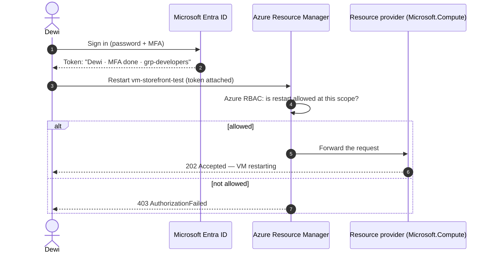
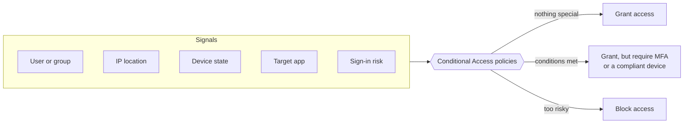
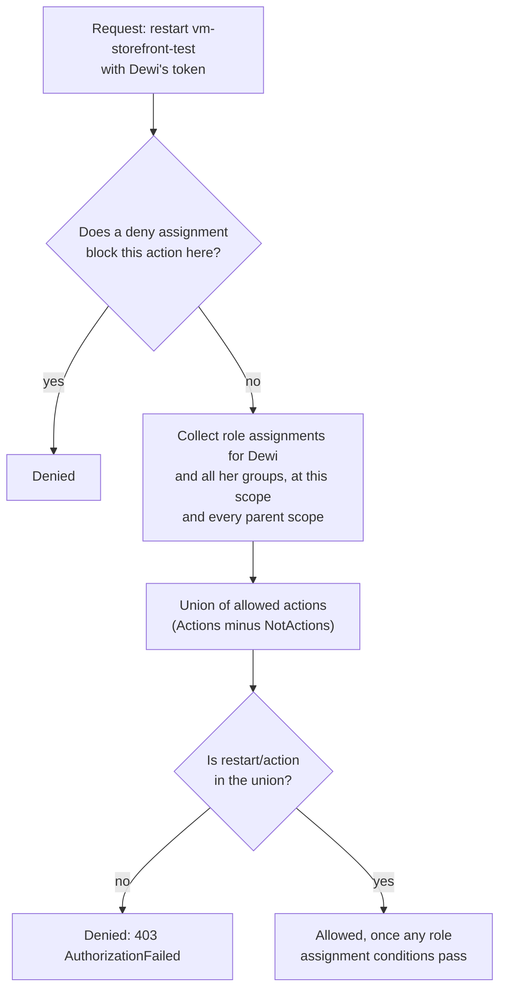

# Lunch 05 · Identity and Access (Basic)

> **Track:** Core month · **Level:** Basic · **Part 1:** Foundations
> **Time:** 60 minutes · **Prerequisite lunches:** 04
> **AZ-900 skill area:** Describe Azure architecture and services
> **Lab:** [Lab 05 · Give a contractor just enough access](../../labs/05-identity-access-basic/README.md) — about 40 minutes · cost 💲

| ⏱ Minutes | Segment |
|---:|---|
| 5 | Scenario and objectives |
| 25 | Reading |
| 15 | Demo: interactive animation (+ optional walkthrough video) |
| 5 | Knowledge check |
| 5 | Key takeaways and lab preview |
| 5 | Buffer — finish your lunch 🍜 |

## 🍱 Today's menu

By the end of this lunch you will be able to:

- **Explain** the difference between authentication and authorization, and name the Azure service that handles each.
- **Describe** Microsoft Entra ID — tenants, users, groups, guests and app registrations — and compare it with on-premises Active Directory Domain Services.
- **Compare** MFA, passwordless sign-in, single sign-on and Conditional Access, and say which risk each one reduces.
- **Predict** what someone can do in Azure from their role assignments, using security principal, role definition and scope.
- **Choose** between Microsoft Entra roles and Azure RBAC roles, and apply least privilege.

## 🏪 Meanwhile at Nusantara Retail

Rizky, an outsourced contractor, starts on Monday. His job: help Dewi move the storefront's test environment into Azure. On Friday afternoon Dewi has a suggestion: "Easiest thing is to give him my login. Or make him Owner of the subscription — then he'll never get stuck."

Ibu Sari overhears and asks two questions. "If Rizky uses your account, how do we know who changed what?" And: "When his contract ends in three months, how do we make sure his access ends too?"

Pak Budi adds a third. Head office already has user accounts in the on-premises Active Directory on the server next to the pantry. Do those count in Azure?

You realise it's the same question asked three ways. Before anyone builds anything else in Azure, you need a clear model of **who** can sign in, **how** they prove it, and **what** they're allowed to do once they're inside.

Today's question: *How do you let people into Azure — and give each of them exactly the access they need, and nothing more?*

---

## 📖 Reading (≈25 minutes)

### 1. Two questions: who are you, and what may you do?

Every time someone touches Azure, two separate checks happen.

**Authentication** (often shortened to *authN*) answers *"Who are you, and can you prove it?"* It's the moment you type a password, approve a sign-in on your phone, or touch a security key.

**Authorization** (*authZ*) answers *"Now that we know who you are, what are you allowed to do here?"* It's checked again on every single request, long after you've signed in.

Think of Nusantara Retail's head office in Jakarta. The security desk in the lobby compares your ID card with your face — that's authentication. The badge you receive then opens some doors but not others: the finance office, yes; the server room, no. That's authorization. Proving who you are doesn't open every door.

In Azure, the two jobs belong to two different services:

- **Microsoft Entra ID** authenticates. It checks credentials, applies sign-in policies and issues a **token** — a signed, time-limited statement such as "this is Dewi, she completed multifactor authentication, and she belongs to these groups".
- **Azure Resource Manager** (ARM), the single control plane from Lunch 04, authorizes. Every request — from the portal, the Azure CLI, PowerShell or a Bicep deployment — arrives at ARM with a token attached, and ARM uses **Azure role-based access control (Azure RBAC)** to decide whether that identity may perform that action on that resource.

Two consequences matter. First, signing in doesn't grant access to anything by itself — authentication only earns you a token, and a token opens no doors without role assignments behind it. Second, because every request is authorized individually, a change to someone's access applies to their next requests (usually within minutes) without anyone touching a server. There is no office network to sneak around: in the cloud, **identity is the perimeter**.

### 2. Microsoft Entra ID: the directory behind every sign-in

Microsoft Entra ID (formerly Azure Active Directory) is Microsoft's cloud identity service. It's the same directory that Microsoft 365, the Azure portal and thousands of SaaS applications use to sign people in.

A **tenant** is your organisation's dedicated, isolated instance of Entra ID. It comes with an initial domain such as `nusantararetail.onmicrosoft.com`, and you can add your own verified domain later (for example `nusantararetail.co.id`). As Lunch 04 showed, the tenant sits at the top of the resource hierarchy: every Azure subscription trusts exactly one tenant for its identities, while one tenant can hold many subscriptions. If you signed up for your free account with a personal Microsoft account, Azure created a tenant for you and made you its **Global Administrator** — which is why Lab 05 runs in that personal tenant and never in a company one.

Inside a tenant you'll find several kinds of objects:

- **Users** — people with an account in your directory, such as Dewi and Ibu Sari.
- **Groups** — collections of users and other objects. **Security groups** are what you use to grant access; Microsoft 365 groups add a shared mailbox and files. Membership is assigned by hand or calculated from rules (dynamic membership, which needs a Microsoft Entra ID P1 licence).
- **Guests** — people from outside your organisation who sign in with their *own* account: their company's Entra ID, a Microsoft account or another provider. They appear in your directory with the user type *Guest*.
- **App registrations and service principals** — identities for software rather than people. The pipeline that deploys the storefront needs an identity too; you'll meet managed identities in Lunch 15 and passwordless pipelines in Lunch 22.

Pak Budi's on-premises **Active Directory Domain Services (AD DS)** shares a family name with Entra ID, but the two were built for different worlds:

| | Active Directory Domain Services (on-premises) | Microsoft Entra ID (cloud) |
|---|---|---|
| Built for | Computers and servers on a company network | Web apps, SaaS and cloud services over the internet |
| Protocols | Kerberos, NTLM, LDAP | HTTPS with OpenID Connect, OAuth 2.0 and SAML |
| Structure | Forests, domains and organisational units (OUs) | A flat tenant of users, groups and apps; administrative units for delegation |
| Devices | Domain join and Group Policy | Entra join or registration; settings through Microsoft Intune |
| Who runs it | You: domain controllers, patching, backups | Microsoft runs the service; you manage what's in it |

Most companies don't choose one or the other; they connect them. **Microsoft Entra Connect** (Sync) and the lighter **Microsoft Entra Cloud Sync** copy users and groups from AD DS into Entra ID, so head-office staff sign in to Azure and Microsoft 365 with the account they already use at work. This is **hybrid identity**. For older applications that still need Kerberos, LDAP or domain-joined servers in Azure, **Microsoft Entra Domain Services** provides a managed domain, so you don't build and patch your own domain controller VMs.

> [!TIP]
> Entra ID comes in editions. **Free** (included with every Azure subscription) covers users, groups, single sign-on and the free MFA baseline called *security defaults*. **Microsoft Entra ID P1** adds Conditional Access and dynamic groups; **P2** adds risk-based protection and Privileged Identity Management. Everything in today's lab works on Free.

### 3. Proving who you are: MFA, passwordless, SSO and Conditional Access

Passwords alone are weak: people reuse them, attackers try common ones against thousands of accounts (*password spray*), and convincing fake sign-in pages collect them by the million.

**Multifactor authentication (MFA)** requires a second, different kind of evidence: something you **know** (a password or PIN), something you **have** (your phone or a security key) or something you **are** (a fingerprint or face). With the Microsoft Authenticator app, the sign-in screen shows a number that you type into the app. This *number matching* defeats attackers who bombard you with approval requests, hoping you'll tap "approve" just to make them stop.

Two facts make MFA unavoidable in Azure today:

- **Security defaults** are switched on in new tenants. They require every user to register for MFA (since July 2024 there's no 14-day grace period), require MFA for administrators, block legacy protocols that can't do MFA, and protect sign-ins to the Azure portal, Azure CLI and Azure PowerShell.
- **Mandatory MFA for Azure** is enforced by Microsoft in two phases: since October 2024 for sign-ins to the Azure portal, Microsoft Entra admin center and Intune admin center, and — rolling out from October 1, 2025 — for create, update and delete operations through the Azure CLI, PowerShell, infrastructure-as-code tools and the REST API. Workload identities — managed identities and service principals — aren't affected, one more reason never to run automation under a person's account.

**Passwordless** sign-in goes further and removes the password altogether:

- **Windows Hello for Business** — a PIN or biometric tied to your Windows device.
- **Passkeys (FIDO2)** — credentials kept on a hardware security key, in the Microsoft Authenticator app, or synced by a provider such as Apple iCloud Keychain or Google Password Manager. A passkey only works for the site it was created for, so a fake sign-in page can't use it: passkeys are *phishing-resistant*.
- **Certificate-based authentication**, for organisations that already run a public key infrastructure.

**Single sign-on (SSO)** means one sign-in to Entra ID opens every connected application — the Azure portal, Microsoft 365, and SaaS apps such as payroll or the point-of-sale back office. Fewer passwords means fewer to steal. It also answers Ibu Sari: disable one account, and access to everything connected to it stops at once.

| Method | What it protects against | Licence | Nusantara Retail example |
|---|---|---|---|
| Security defaults | Password spray, legacy-protocol attacks, admins without MFA | Free | Baseline for the whole tenant from day one |
| MFA with number matching | Stolen or guessed passwords, "MFA fatigue" | Free | Every staff member and contractor |
| Passkeys, Windows Hello | Phishing, including fake sign-in pages | Free (hardware keys cost money) | Pak Budi's and other administrators' accounts |
| Single sign-on | Password reuse, forgotten offboarding | Free | One account for Azure, Microsoft 365 and the POS back office |
| Conditional Access | Risky sign-ins in context: device, location, app | P1 (risk-based policies: P2) | Contractors must use MFA; legacy apps blocked |

Security defaults are one size fits all. **Conditional Access** is Entra ID's policy engine for when you need nuance. Each policy is an if-then statement evaluated at sign-in, *after* the first factor (usually the password) has been checked:

**Signals** include the user and their groups, where the request comes from, the device's state, the application being opened and, with P2, a calculated risk score. The **decision** is to block, to grant, or to grant only when extra requirements are met, such as MFA or a company-managed device. **Enforcement** happens in the sign-in and in the session that follows. Conditional Access needs Microsoft Entra ID P1, and you switch off security defaults when your own policies replace them. Lunch 22 builds policies step by step.

Rizky works for an outsourcing firm with its own Entra tenant. Instead of creating a password for him in your directory, you can invite him as a **B2B collaboration** guest: he signs in with his company account, you decide what he can reach, and when his employer disables his account, his access to Nusantara Retail ends too. For the storefront's shoppers — customers, not staff — **Microsoft Entra External ID** provides customer sign-up and sign-in in a separate external tenant. (Azure AD B2C, the older customer-identity service, hasn't been sold to new customers since May 1, 2025.)

### 4. Azure RBAC: who can do what, where

Once Rizky is signed in, Azure RBAC decides what he can do. Every **role assignment** connects three things:

1. A **security principal** — *who*: a user, a group, a service principal or a managed identity.
2. A **role definition** — *what*: a named list of permitted operations. **Actions** are management operations such as `Microsoft.Compute/virtualMachines/restart/action`; **NotActions** are subtracted from them; **DataActions** cover the data inside a resource, such as reading blobs.
3. A **scope** — *where*: a management group, a subscription, a resource group or a single resource.

Assignments **inherit downwards**, exactly like the hierarchy in Lunch 04. Reader on the subscription means read access to every resource group and resource in it. Contributor on `rg-storefront-test` means full control of that group's resources — and nothing anywhere else.

Here is how ARM decides, every time a request arrives:

Three rules fall out of that picture:

- **Permissions are additive.** Your effective access is the **union** of every role assigned to you and to your groups, at the resource and at every scope above it. Reader on a resource group doesn't "limit" the Contributor role you hold on the subscription; you simply have both, so you're effectively a Contributor there.
- **Deny assignments win.** A **deny assignment** blocks specific actions even when a role allows them. You can't create your own; Azure creates them, for example when a **deployment stack** (Lunch 20) uses deny settings to protect the resources it manages.
- **No role, no access.** If no assignment includes the action, the answer is 403, whatever the person's job title.

Azure has hundreds of built-in roles. Five are general-purpose and worth knowing by heart; the rest belong to one service each:

| Built-in role | Can manage resources? | Can grant access to others? | Typical use at Nusantara Retail |
|---|---|---|---|
| **Owner** | Yes, everything | Yes, any role | Two named people per subscription — no more |
| **Contributor** | Yes, everything | No | Dewi's team, on its own development resource group |
| **Reader** | No, view only | No | Auditors and the finance team |
| **User Access Administrator** | No | Yes, any role | Rarely: a dedicated access-management duty |
| **Role Based Access Control Administrator** | No | Yes, Azure role assignments only | Team leads who manage access to their own resource group |
| Virtual Machine Contributor | VMs only, not their network or storage | No | A night operator who restarts VMs |
| Network Contributor | Networks only | No | Pak Budi, managing virtual networks and NSGs |
| Storage Blob Data Reader | Reads blob *data* (a data role) | No | The reporting app that reads sales exports |

Notice the last row. Owner and Contributor manage the storage *account*, but reading its blobs with an Entra ID sign-in needs a data role — you'll use one in Lunch 07.

> [!WARNING]
> **Common mistakes:** granting Owner or Contributor at subscription scope "just to get started" (it never gets cleaned up); assigning roles to individuals instead of groups (impossible to review later); sharing one account between people (no audit trail, no MFA story); and deleting a user before removing their role assignments, which leaves orphaned entries labelled "Identity not found". Also remember that role changes can take up to 10 minutes to apply — sign out and back in before you decide something is broken.

### 5. Two kinds of roles, and the least-privilege habit

A second set of roles confuses almost everyone at first. Azure RBAC roles control Azure *resources*; **Microsoft Entra roles** control the *directory* itself.

| | Microsoft Entra roles | Azure RBAC roles |
|---|---|---|
| Controls access to | Directory objects: users, groups, apps, domains, licences, tenant settings | Azure resources: VMs, networks, storage, databases and so on |
| Examples | Global Administrator, User Administrator, Application Administrator, Billing Administrator | Owner, Contributor, Reader, Virtual Machine Contributor |
| Scope | The whole tenant, an administrative unit, or one object (such as a single app) | Management group, subscription, resource group or resource |
| Where you assign them | Microsoft Entra admin center (*Roles and administrators*), Microsoft Graph | *Access control (IAM)* in the Azure portal, Azure CLI, PowerShell, ARM templates and Bicep |
| Typical holders | Your identity and helpdesk team | Whoever builds or operates workloads |
| Custom roles | Supported | Supported (Lunch 22) |

By default the two sets don't overlap. A Global Administrator can reset anyone's password but has no access to Azure resources. In an emergency, a Global Administrator can **elevate access**, which grants them User Access Administrator at the root scope (`/`) — every management group and subscription in the tenant — so they can recover a subscription nobody else can manage. Use it, fix the problem, and switch it off again. The classic subscription administrator roles (Service Administrator and Co-Administrator) are fully retired; Azure RBAC is the only model now.

With so many roles available, the guiding rule is **least privilege**: grant the smallest role, at the narrowest scope, for the shortest time that still lets someone do the job. In practice:

- Assign roles to **groups**, not people; joining or leaving a team then becomes one membership change.
- Prefer a **service-specific role** (Virtual Machine Contributor) over a general one (Contributor).
- Prefer **resource group** scope over subscription scope.
- Keep **Owner** rare, and review who holds it regularly.
- Remove role assignments **before** you delete the principal.

Least privilege is one of the three principles of **Zero Trust**, alongside *verify explicitly* (authenticate and authorize every request using all available signals) and *assume breach* (limit the blast radius and watch for misuse). You've just met all three: MFA and Conditional Access verify explicitly, narrow RBAC scopes enforce least privilege, and per-request checks mean a stolen token reaches only what its owner could reach. Lunch 15 applies Zero Trust to defense in depth, and Lunch 22 adds just-in-time access.

### 6. How it fits together for Nusantara Retail

Back to Friday afternoon. Instead of sharing Dewi's password or handing out Owner, you sketch a plan:

- **Rizky** gets his own identity — a B2B guest if his company has Entra ID, otherwise a member account in your tenant. In the lab you'll simulate him with a test user.
- He joins a security group, **grp-nusa-contractors**, and the group — not Rizky — gets a role: first **Reader** on `rg-storefront-test` so he can study the environment, then **Contributor** on the same resource group when the migration starts. He can't touch production, can't see the rest of the subscription and can't grant access to anyone.
- **Security defaults** (or, once Nusantara Retail buys P1, a Conditional Access policy) make sure he signs in with MFA.
- **Dewi** stops sharing her account. Her own access comes through **grp-developers**.
- **Pak Budi** connects the on-premises AD DS with Entra Connect Sync, so head-office staff use one account everywhere.

Ibu Sari's question — "when the contract ends, how does the access end?" — now has a one-line answer: remove Rizky from the group (or let his company disable his account), and every permission that came through it disappears at once. Meanwhile the activity log records that Rizky, not Dewi, made each change.

> [!NOTE]
> **Pause and think:** Dewi is a member of *grp-developers* (Reader on the subscription) and *grp-storefront-ops* (Virtual Machine Contributor on `rg-storefront-test`). Can she restart a VM in `rg-storefront-prod`? One in `rg-storefront-test`? Can she delete the resource group `rg-storefront-test` itself?

Today laid the foundation. **Lunch 22 · Identity and Access (Advanced)** continues with managed identities in depth, passwordless pipelines, Conditional Access policies, Privileged Identity Management and custom roles.

---

## 🎬 Demo (≈15 minutes)

1. **Interactive animation (≈6–8 min):** [Open the demo](https://stefpin.github.io/azure-fundamentals-lunches/demos/05-identity-access-basic.html) —
   press ▶ Play or step through it at your own pace. Offline? Download
   [`docs/demos/05-identity-access-basic.html`](../../docs/demos/05-identity-access-basic.html) and open it in any browser.
2. **Walkthrough video (≤ 6 min):** _coming soon_ — [read the walkthrough script](demo-video-script.md).

What to watch for:

- Authentication happens once, at sign-in; authorization happens on every request.
- Azure Resource Manager checks deny assignments first, then collects role assignments from every scope and adds them up.
- The first fix someone suggests (Owner on the subscription) would work — and is still the wrong answer.
- A deny assignment beats any role, even one that includes the action.
- Conditional Access decides *how* Rizky may sign in before RBAC ever sees one of his requests.

## ✅ Knowledge check (≈5 minutes)

1. Rizky signs in successfully with MFA, but when he tries to add a rule to a network security group in `rg-storefront-test` he gets `AuthorizationFailed`. Which check failed — authentication or authorization — and which service made the decision?
   

Show answer

   Authorization, decided by Azure Resource Manager using Azure RBAC. *Why:* his sign-in (authentication by Microsoft Entra ID) worked; the 403 means no role assigned to him or his groups, at that scope or above, includes the write action.

   

2. Dewi has Contributor on the subscription and Reader on `rg-storefront-prod`. What can she do in `rg-storefront-prod`?
   

Show answer

   Everything a Contributor can do there: create, change and delete resources. *Why:* Azure RBAC is additive — effective access is the union of all assignments at the resource and above, so the Reader assignment neither adds nor removes anything; only a deny assignment could take an allowed action away.

   

3. Your team lead asks to be made Global Administrator "so I can create VMs in Azure". What do you explain, and what do you offer instead?
   

Show answer

   Global Administrator is a Microsoft Entra role for managing the directory; by default it grants no access to Azure resources. Offer an Azure role such as Virtual Machine Contributor, assigned to the team's group at the right resource group. *Why:* Entra roles and Azure RBAC roles are separate systems, and elevate access is meant for emergencies only.

   

4. Nusantara Retail wants contractors to complete MFA every time they sign in from a device the company doesn't manage, while staff on company laptops are prompted less often. Security defaults or Conditional Access — and which licence?
   

Show answer

   Conditional Access, which needs Microsoft Entra ID P1. *Why:* security defaults are simply on or off for everyone; Conditional Access combines signals such as group membership and device state into tailored decisions.

   

5. Rizky's contract ends and a colleague deletes his user account straight away. Two weeks later the resource group's *Access control (IAM)* page lists a Contributor assignment for "Identity not found". What went wrong, and what is the better order?
   

Show answer

   The role assignment was left behind. Remove Rizky from the group that holds the role (or remove his direct assignments) first, then delete or disable the account. *Why:* deleting a principal doesn't delete its role assignments; they become orphaned entries that clutter access reviews.

   

## 🧠 Key takeaways

- Authentication proves who you are (Microsoft Entra ID issues a token); authorization decides what you may do (Azure Resource Manager checks Azure RBAC on every request).
- A tenant is your organisation's instance of Entra ID — users, groups, guests and app identities — and every subscription trusts exactly one tenant.
- MFA is no longer optional in Azure: security defaults and mandatory MFA enforce it, passkeys and Windows Hello make sign-in phishing-resistant, and Conditional Access (P1) adds if-then control.
- A role assignment is security principal + role definition + scope; assignments inherit downwards and add up, and deny assignments override them.
- Entra roles manage the directory and Azure roles manage resources; practise least privilege with groups, narrow scopes, specific roles and very few Owners.

## 🔬 Your lab: Give a contractor just enough access

In your own Microsoft Entra tenant you'll create a test user who plays Rizky, put him in a contractors group, and give the group Reader and then Contributor on a single resource group. You'll sign in as Rizky in a private browser window to feel the difference, list his effective access with the Azure CLI, and deliberately put a role at the wrong scope so you can spot and fix it. These are the exact moves you'll make for every new colleague, contractor and pipeline from now on.

- ⏱ About 40 minutes · 💲 · works on its own (no earlier lab needed)
- 👉 [Start Lab 05](../../labs/05-identity-access-basic/README.md)

## 📚 Go further

- [Microsoft Learn: What is Azure role-based access control (Azure RBAC)?](https://learn.microsoft.com/azure/role-based-access-control/overview) — the evaluation steps and the additive model, with Microsoft's own diagrams.
- [Microsoft Learn: Azure roles, Microsoft Entra roles, and classic subscription administrator roles](https://learn.microsoft.com/azure/role-based-access-control/rbac-and-directory-admin-roles) — the definitive comparison, including elevate access.
- [Microsoft Learn: Security defaults in Microsoft Entra ID](https://learn.microsoft.com/entra/fundamentals/security-defaults) — exactly what the free baseline enforces in your tenant.
- [Microsoft Learn: What is Conditional Access?](https://learn.microsoft.com/entra/identity/conditional-access/overview) — signals, decisions and common policies.

---

⬅️ [Lunch 04 · Resource Hierarchy and Azure Resource Manager (Basic)](../04-resource-hierarchy-basic/README.md) · 🏠 [Course home](../../README.md) · [Lunch 06 · Virtual Machines (Basic)](../06-virtual-machines-basic/README.md) ➡️

Last validated: October 2026 · Spotted something out of date? [Open an issue](../../CONTRIBUTING.md).
