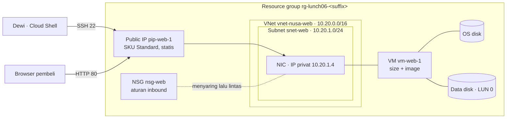
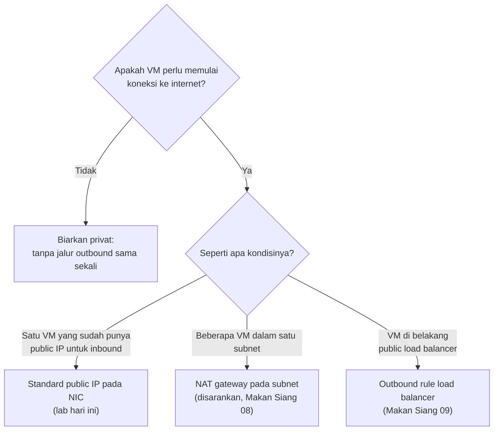
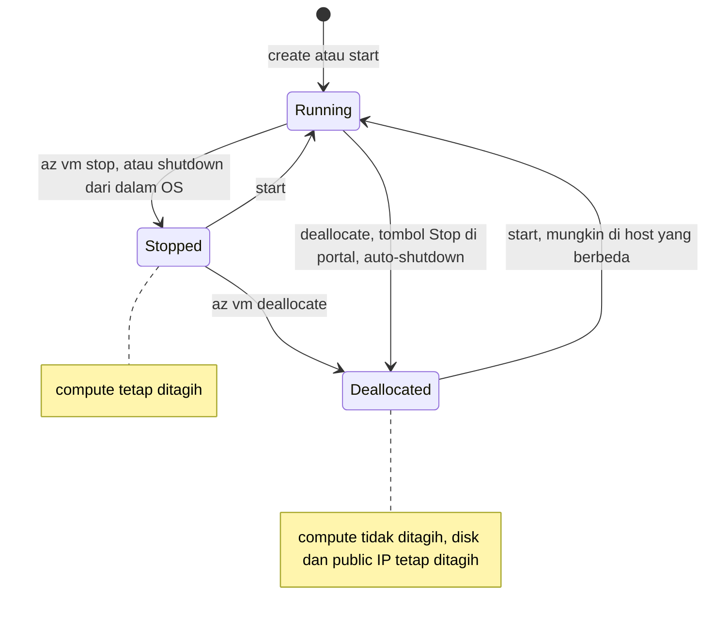

# Makan Siang 06 · Virtual Machines (Dasar)

🇬🇧 [Read in English](README.md)

> **Jalur:** Bulan inti · **Level:** Dasar · **Bagian 2:** Infrastruktur inti
> **Waktu:** 60 menit · **Makan siang prasyarat:** 01, 03, 04
> **Area keterampilan AZ-900:** Menjelaskan arsitektur dan layanan Azure
> **Lab:** [Lab 06 · VM web server pertama Anda](../../labs/06-virtual-machines-basic/README.id.md) — sekitar 45 menit · biaya 💲💲
> **Penulis:** Stefanus Pinarta · [Tentang penulis](../../README.id.md#tentang-penulis)

| ⏱ Menit | Segmen |
|---:|---|
| 5 | Skenario dan tujuan |
| 25 | Bacaan |
| 15 | Demo: animasi interaktif (+ video panduan opsional) |
| 5 | Uji pemahaman |
| 5 | Poin penting dan pratinjau lab |
| 5 | Waktu cadangan — habiskan makan siang Anda 🍜 |

## 🍱 Menu hari ini

Setelah makan siang ini, Anda akan mampu:

- **Memutuskan** kapan virtual machine (VM, *komputer virtual*) berbasis IaaS (infrastructure as a service, *infrastruktur sebagai layanan*) adalah alat yang tepat untuk sebuah workload (beban kerja: aplikasi atau layanan yang Anda jalankan), dan apa saja yang tetap Anda kelola sendiri.
- **Menyebutkan** setiap resource yang dibuat Azure untuk sebuah VM — image, size, disk, network interface, virtual network (*jaringan virtual*), public IP, dan network security group — serta menjelaskan fungsi masing-masing.
- **Memilih** keluarga size VM dan tipe managed disk, termasuk kapan size burstable seri B cocok dipakai.
- **Membandingkan** cara-cara untuk sign in dan terhubung ke VM, serta menjelaskan mengapa virtual network baru membutuhkan akses outbound (lalu lintas keluar) yang eksplisit.
- **Menjelaskan** power state dan tagihannya, resizing, auto-shutdown, serta opsi harga utama untuk VM.

## 🏪 Sementara itu di Nusantara Retail

Senin, pukul 08.15. Server toko online di sebelah pantry kembali berdengung keras, dan Pak Budi sudah menaruh kipas angin meja di depannya, "untuk hari ini saja". Ibu Sari sudah membaca catatan konsep cloud Anda dari Makan Siang 02 dan punya permintaan sederhana: "Sebelum kita merancang ulang apa pun, bisakah setidaknya toko kita dipindahkan dari kotak itu ke Azure?"

Dewi bersemangat. "Isinya cuma Ubuntu dan nginx. Kasih saya satu server di cloud, sore ini juga situsnya saya salin ke sana." Pak Budi tidak seantusias itu. Dia ingin tahu siapa yang boleh sign in, port mana saja yang akan terbuka ke internet, dan apakah server baru itu masih bisa mengunduh update keamanan. Lalu tim keuangan melontarkan pertanyaan yang dari tadi dihindari semua orang: "Apakah kita tetap bayar di malam hari, saat tidak ada yang belanja?"

Tugas Anda hari ini adalah menyewa server pertama itu dengan benar. Apa sebenarnya yang Anda dapatkan — dan Anda bayar — ketika membuat sebuah virtual machine di Azure?

---

## 📖 Bacaan (≈25 menit)

### 1. Kapan virtual machine adalah alat yang tepat

**Virtual machine (VM)** adalah komputer yang dijalankan Azure untuk Anda di atas server fisik miliknya. Anda memilih image sistem operasi (OS) dan sebuah size (ukuran), Azure mencarikan host (server fisik) yang masih punya kapasitas kosong, dan beberapa menit kemudian Anda punya mesin yang bisa Anda masuki. Inilah bentuk paling murni dari **infrastructure as a service (IaaS)**: Microsoft memiliki gedung, host fisik, hypervisor (perangkat lunak yang membagi satu server fisik menjadi banyak VM), dan jaringan fisik; Anda memiliki semuanya mulai dari sistem operasi ke atas — patch, firewall di dalam OS, web server, aplikasi, dan datanya. Dalam gambaran *model tanggung jawab bersama* (shared responsibility model) dari Makan Siang 02, VM adalah pilihan cloud yang meninggalkan pekerjaan paling banyak di sisi Anda.

Ibaratnya menyewa ruko kosong: pemilik menyediakan bangunan, listrik, dan jalan di depannya, tetapi rak, kasir, kebersihan, dan gembok di dalam toko sepenuhnya urusan Anda. Kalau Anda ingin semuanya beres dan tinggal pakai, Anda menyewa kios siap pakai di mal — itulah layanan platform yang akan kita temui nanti.

Lalu, mengapa memilih opsi yang paling banyak pekerjaannya? Karena kadang kendali lebih penting daripada kenyamanan:

- **Lift and shift.** Toko online sudah berjalan di Ubuntu dengan nginx. Memindahkannya ke VM apa adanya — disebut **rehosting** — hampir tidak butuh perubahan kode, sehingga Nusantara Retail bisa meninggalkan ruang pantry bulan ini dan memodernisasi belakangan.
- **Kendali penuh atas sistem operasi.** Sebagian perangkat lunak butuh kernel module tertentu, agent dari vendor, atau lisensi yang terikat pada OS.
- **Perangkat lunak yang tidak pernah dirancang untuk cloud.** Aplikasi bisnis lama yang mengharapkan path disk yang tetap, sebuah Windows service, atau hostname yang tidak berubah paling nyaman berjalan di VM.
- **Lingkungan berumur pendek.** Developer bisa membuat, merusak, dan menghapus server uji dalam hitungan menit.

Jika yang Anda inginkan hanyalah menjalankan aplikasi web, layanan platform seperti Azure App Service (Makan Siang 10), sebuah container (*kontainer*, Makan Siang 13), atau sebuah function (*fungsi*, Makan Siang 14) biasanya lebih hemat tenaga, karena Azure yang mem-patch platformnya dan mengurus scaling-nya untuk Anda. Kebiasaan yang baik: pilih VM saat Anda butuh kendali, dan tuliskan alasannya. Catatan itu kelak memberi tahu Anda kapan saatnya memodernisasi.

### 2. Komponen penyusunnya: VM adalah sekumpulan resource

Saat Anda memilih **Create** di portal atau menjalankan `az vm create`, Azure Resource Manager tidak membuat satu benda saja. Ia membuat sekeluarga kecil resource terpisah di resource group (*grup sumber daya*) Anda, masing-masing dengan resource ID sendiri, pengaturan sendiri, dan — kadang-kadang — baris tagihan sendiri. Mengenal keluarga ini adalah pembeda antara subscription (*langganan*) yang rapi dan tumpukan disk yang terlupakan. Mirip memesan nasi kotak: satu pesanan, tetapi isinya nasi, lauk, sayur, dan kerupuk yang terpisah. Bedanya, sisa nasi kotak tidak mengirim tagihan; disk yang tertinggal mengirim tagihan setiap bulan.

| Komponen | Apa itu | Contoh di Nusantara Retail | Hati-hati dengan |
|---|---|---|---|
| **Image** | Templat untuk OS disk, dari Azure Marketplace atau buatan Anda sendiri | Ubuntu Server 24.04 LTS (long-term support) | Pilih versi yang masih didukung dan terbaru |
| **Size** | vCPU (CPU virtual), memori, penyimpanan lokal, bandwidth, dan fitur | Standard_B2ats_v2 | Tidak semua size tersedia di setiap region (*wilayah*) atau availability zone (*zona ketersediaan*) |
| **OS disk** | Managed disk yang dibuat dari image | 30 GiB berisi Ubuntu dan nginx | Tetap ditagih meskipun VM sedang mati |
| **Data disk** | Managed disk tambahan yang Anda pasang (attach), format, dan mount | 8 GiB untuk foto produk | Azure yang memasangnya; Anda yang memformatnya |
| **Temporary disk** | Penyimpanan lokal di host fisik, jika size-nya punya | Tidak ada di size Basv2 | Terhapus saat VM pindah host — jangan pernah menyimpan data di sana |
| **Network interface (NIC)** | Menghubungkan VM ke subnet dan menyimpan IP privatnya | 10.20.1.4 | Setiap VM butuh minimal satu |
| **Virtual network dan subnet** | Ruang alamat privat Anda di Azure | vnet-nusa-web, 10.20.0.0/16 | Hindari tumpang tindih dengan 10.0.0.0/16 milik kantor pusat |
| **Public IP address** | Alamat yang menghadap internet, SKU Standard | pip-web-1 | SKU Basic sudah dipensiunkan pada 30 September 2025 |
| **Network security group (NSG)** | Aturan allow dan deny untuk NIC atau subnet | nsg-web | Standard public IP tetap tertutup sampai NSG mengizinkan lalu lintas |

**Image** menentukan apa yang mendarat di OS disk. VM Generation 2 baru yang dibuat dari portal, CLI, atau PowerShell kini memakai **Trusted Launch** secara default — Secure Boot ditambah virtual TPM (Trusted Platform Module, chip keamanan dalam versi virtual) yang melindungi proses boot — tanpa biaya tambahan. Makan Siang 23 akan membahasnya lagi.

Ada dua pelajaran praktis dari tabel ini. Pertama, jika Anda membiarkan `az vm create` mengarang jaringannya sendiri, ia memilih 10.0.0.0/16 — persis rentang kantor pusat milik Pak Budi. Hari ini tidak masalah, tetapi akan menyakitkan pada hari Anda menghubungkan kedua jaringan itu (Makan Siang 26), jadi lab menetapkan rentangnya sendiri. Kedua, menghapus VM tidak selalu ikut menghapus disk, NIC, dan public IP-nya; portal menampilkan opsi "delete with VM", dan sisa-sisanya terus menelan biaya. Di lab, menghapus seluruh resource group adalah jalan keluar yang bersih.

### 3. Memilih size dan disk

**Size** sebuah VM menentukan jumlah vCPU, memori, disk lokal (jika ada), jumlah maksimum data disk, dan bandwidth jaringan. Nama size terlihat seperti kode rahasia, tetapi sebenarnya mengikuti pola. Pada `Standard_B2ats_v2`, **B** adalah keluarganya, **2** adalah jumlah vCPU, **a** berarti prosesor AMD (**p** berarti Arm), **t** berarti memori yang sangat kecil (tiny), **s** berarti bisa memakai disk Premium SSD, dan **v2** adalah versi serinya. Huruf **d** pada nama berarti size tersebut punya temporary disk lokal.

| Keluarga | Dioptimalkan untuk | Workload umum | Contoh di Nusantara Retail |
|---|---|---|---|
| **B** — burstable | CPU dasar rendah dengan lonjakan singkat | Web server kecil, dev/test, proof of concept | VM toko online yang pertama |
| **D** — general purpose | CPU dan memori seimbang | Sebagian besar aplikasi production, app server, database kecil | API inventaris yang bebannya stabil |
| **E** — memory optimised | Memori lebih besar per vCPU | Database relasional, cache, analitik in-memory | SQL Server yang lebih besar nanti |
| **F** — compute optimised | CPU lebih banyak per GiB memori | Batch job, web tier yang berat di CPU, game server | Perhitungan ulang harga setiap malam |
| **L** — storage optimised | Disk lokal yang besar dan cepat | Database NoSQL, big data, data warehouse | Cluster pencarian produk |
| **M** — very large memory | RAM berukuran terabyte | SAP HANA, database in-memory yang sangat besar | Tidak dibutuhkan — cukup untuk diketahui |
| **N** — GPU | Prosesor grafis (graphics processing unit) NVIDIA atau AMD | Training dan inference AI, rendering, workstation grafis | Model pengenalan gambar |

Size **burstable seri B** layak dibahas lebih dalam, karena murah dan mudah disalahgunakan. Setiap size punya **baseline** — porsi vCPU yang selalu boleh dipakai. Saat pemakaian di bawah baseline, VM menabung **CPU credit**; saat di atasnya, VM membelanjakan credit itu. Satu credit kira-kira setara satu vCPU yang berjalan 100% selama satu menit. Sebuah `Standard_B2ats_v2` punya baseline 20%, mulai dengan 60 credit, mengumpulkan hingga 24 credit per jam saat menganggur, dan bisa menabung hingga 576. Jika kedua vCPU-nya bekerja habis-habisan, VM menghabiskan sekitar 1,6 credit per menit, sehingga VM yang baru dibuat bisa berlari kencang sekitar 35–40 menit. Ketika credit-nya habis, Azure menurunkan kecepatannya (throttle) kembali ke baseline sampai VM mengumpulkan credit lagi. Ibaratnya uang saku dan celengan: baseline adalah uang saku harian yang selalu ada, sedangkan credit adalah isi celengan dari hari-hari yang hemat. Saat ada keperluan besar, celengan dipecah; kalau celengan kosong, Anda kembali hidup dari uang saku saja. Pola ini cocok untuk toko online — sebagian besar waktu sepi, dengan puncak singkat — tetapi tidak untuk laporan tiga jam yang terus menyibukkan CPU. Pantau metrik **CPU Credits Remaining**. Satu catatan lagi: size seri B generasi awal (seperti B1s) sudah berstatus End of Life — sejak Juli 2026 subscription baru tidak bisa men-deploy-nya, dan size itu pensiun pada 15 November 2028 — sehingga rancangan baru memakai Bsv2, Basv2, atau Bpsv2.

> [!TIP]
> Sebelum memilih, tampilkan daftar size yang benar-benar bisa dipakai subscription Anda di sebuah region:
> `az vm list-skus --location southeastasia --size Standard_B --resource-type virtualMachines --output table`.
> Kolom `Restrictions` memberi tahu Anda jika sebuah size tidak ditawarkan untuk Anda atau tidak tersedia di suatu zona.

Setiap disk VM adalah **managed disk**: Azure yang menyimpan dan mereplikasinya untuk Anda, dan Anda tinggal memilih tipenya.

| Tipe disk | Paling cocok untuk | Bisa menjadi OS disk? | Perlu diketahui |
|---|---|---|---|
| **Standard HDD** | Backup, data yang jarang dipakai | Ya, tetapi dipensiunkan untuk OS disk pada 8 September 2028 | Paling murah; latensinya naik-turun |
| **Standard SSD** | Web server, aplikasi ringan, dev/test | Ya | Pilihan default yang masuk akal untuk VM kecil |
| **Premium SSD** | Aplikasi production dan database | Ya | Tingkatan ukurannya tetap; butuh size dengan huruf **s** di namanya |
| **Premium SSD v2** | Database yang butuh performa yang bisa diatur | Tidak — hanya data disk | Kapasitas, IOPS, dan throughput diatur terpisah |
| **Ultra Disk** | I/O paling menuntut, seperti SAP HANA | Tidak — hanya data disk | Ubah performa tanpa me-restart VM |

Sekadar penjelasan singkatannya: HDD (hard disk drive) adalah disk dengan piringan berputar, SSD (solid-state drive) adalah penyimpanan flash yang jauh lebih cepat, dan IOPS (input/output operations per second) adalah jumlah operasi baca-tulis (I/O) per detik.

Anda membayar ukuran yang Anda pesan (provisioned), dibulatkan ke atas ke tingkatan ukuran berikutnya, entah disknya penuh atau kosong. Standard SSD dan Premium SSD juga tersedia dalam versi zone-redundant (ZRS, zone-redundant storage). Pilihan disk bahkan memengaruhi janji uptime: saat tulisan ini dibuat (Oktober 2026), satu VM yang semua disknya Premium SSD atau Ultra Disk mendapat SLA (service level agreement, janji tingkat layanan) konektivitas 99,9%, Standard SSD memberi 99,5%, dan Standard HDD hanya 95% — periksa
[perjanjian tingkat layanan (SLA)](https://www.microsoft.com/licensing/docs/view/Service-Level-Agreements-SLA-for-Online-Services)
untuk angka terbaru.

### 4. Masuk, dan keluar

Pertama, **autentikasi** — cara Anda membuktikan identitas kepada sistem operasi:

- **SSH key pair** (sepasang kunci untuk SSH, Secure Shell — jalur terenkripsi untuk mengendalikan server dari jauh) adalah default untuk Linux. `--generate-ssh-keys` membuat sepasang kunci di `~/.ssh`; Azure hanya menyimpan public key di VM, dan private key tidak pernah meninggalkan tangan Anda. Ibaratnya gembok dan kuncinya: public key adalah gembok yang boleh dipasang di mana saja, private key adalah satu-satunya kunci yang bisa membukanya.
- **Kata sandi** wajib untuk Windows dan bisa dipakai di Linux. Hindari di Linux; kalau terpaksa memakainya, buat secara acak (generate).
- **Login Microsoft Entra ID** (*ID Microsoft Entra*) memungkinkan orang sign in dengan identitas perusahaannya. Akses diberikan dengan role Azure RBAC (*kontrol akses berbasis peran*) seperti *Virtual Machine User Login* atau *Virtual Machine Administrator Login* (Makan Siang 05). Saat kontrak Rizky berakhir, Anda cukup menghapus satu role assignment — tidak ada kunci yang harus diburu satu per satu.

Lalu, **cara terhubung**:

- **SSH** (port 22) untuk Linux dan **RDP** (Remote Desktop Protocol, port 3389) untuk Windows membutuhkan jalur jaringan dan aturan NSG.
- **Azure Bastion** adalah jump host (server perantara untuk masuk ke server lain) terkelola di dalam virtual network Anda. Anda terhubung dari browser, dan VM sama sekali tidak butuh public IP. SKU (tingkatan produk) Developer yang gratis cocok untuk dev/test di region tertentu (Southeast Asia salah satunya) dan melayani satu VM sekaligus; Basic, Standard, dan Premium adalah SKU berbayar untuk production.
- **Run Command** menjalankan skrip di dalam VM melalui Azure VM agent, tanpa port inbound apa pun. Lab memakainya untuk me-mount disk.
- **Serial console** memberi Anda konsol teks melalui boot diagnostics, bahkan saat jaringan di dalam VM sedang rusak.

Lalu lintas masuk (inbound) bertemu dengan **NSG**. Aturan default-nya mengizinkan lalu lintas dari dalam virtual network dan dari probe load balancer Azure, lalu menolak semua yang lain — termasuk apa pun dari internet. Bayangkan satpam kompleks perumahan dengan daftar tamu: siapa pun yang namanya tidak ada di daftar tidak boleh masuk, sesopan apa pun dia mengetuk. Untuk VM Linux, `az vm create` juga menambahkan aturan yang mengizinkan SSH dari mana saja — praktis untuk lab, berisiko di production, tempat Anda akan membatasi alamat sumbernya atau memakai Bastion. Lalu lintas web di port 80 tetap diblokir sampai Anda menambahkan aturan, misalnya dengan `az vm open-port`. Makan Siang 08 membahas NSG secara tuntas.

Lalu lintas keluar (outbound) berubah belakangan ini, dan perubahan ini sering mengejutkan orang.

> [!IMPORTANT]
> Virtual network yang dibuat dengan versi API Azure yang dirilis setelah 31 Maret 2026 — dan portal sudah melakukannya —
> memakai **private subnet**: VM tidak mendapat akses internet outbound secara default. VM yang harus menjangkau internet (untuk
> `apt-get update`, aktivasi Windows, atau memanggil API eksternal) membutuhkan metode yang eksplisit: public IP pada VM, NAT
> gateway (network address translation) pada subnet, atau outbound rule pada load balancer. Virtual network yang sudah ada tidak diubah.

VM toko online hari ini punya Standard public IP sendiri, jadi ia punya akses outbound eksplisit dan bisa memasang nginx. Hapus IP itu tanpa menambahkan NAT gateway, maka `apt-get` akan menggantung begitu saja.

### 5. Hidup bersama VM: power state, tagihan, resizing, dan auto-shutdown

VM berpindah-pindah di antara beberapa **power state** (status daya), dan hanya sebagian yang menghentikan meteran compute.

| Power state | Apa yang terjadi | Compute ditagih? |
|---|---|---|
| Starting | VM sedang booting | Ya |
| Running | Kondisi kerja normal | Ya |
| Stopping | OS sedang dimatikan | Ya |
| Stopped (allocated) | OS mati, tetapi VM masih menempati tempatnya di host | **Ya** |
| Deallocating | Azure sedang melepaskan kapasitas host | Tidak |
| Deallocated | Yang tersisa hanya disk dan alamat IP | Tidak — disk dan public IP tetap ditagih |

> [!WARNING]
> Shutdown dari dalam sistem operasi (`sudo shutdown -h now`) atau menjalankan `az vm stop` membuat VM berada dalam status
> **Stopped (allocated) — dan tetap ditagih untuk compute**. Gunakan tombol **Stop** di portal, `az vm deallocate`, atau
> auto-shutdown, yang semuanya melakukan deallocate.

Ibaratnya parkir di mal: mematikan mesin mobil di dalam gedung parkir tidak menghentikan argo parkir, karena Anda masih menempati slotnya (stopped). Argo baru berhenti setelah Anda keluar dari gedung (deallocated). Barang yang Anda titipkan di loker — disk dan public IP — tetap dikenai biaya sewa loker.

Deallocation mempertahankan managed disk Anda, dan Standard public IP tetap memegang alamatnya, karena Standard IP selalu statis. Apa pun yang ada di temporary disk akan hilang, dan start berikutnya bisa saja mendarat di host fisik yang berbeda.

**Resizing** adalah vertical scaling (penskalaan vertikal): Anda mengubah size, Azure me-restart VM, dan VM kembali dengan resource yang lebih besar atau lebih kecil. `az vm list-vm-resize-options` menampilkan size yang tersedia di hardware cluster tempat VM Anda berjalan saat ini. Jika size yang Anda inginkan tidak ada di daftar, lakukan deallocate pada VM terlebih dahulu supaya Azure bisa menempatkannya di mana saja dalam region tersebut. Ketika satu VM yang lebih besar sudah tidak cukup, Anda melakukan scale *out* — menambah jumlah VM di belakang load balancer (Makan Siang 09) atau scale set (*Kumpulan Skala Komputer Virtual*, Makan Siang 23).

**Auto-shutdown** melakukan deallocate pada VM di jam yang sama setiap hari dan bisa mengirim e-mail kepada Anda sebelumnya. Portal membiarkan Anda memilih zona waktu; CLI mengharapkan UTC (Coordinated Universal Time, acuan waktu dunia), jadi pukul 19.00 di Jakarta (UTC+7) ditulis `1200`. Fitur ini sempurna untuk VM uji dan berbahaya untuk apa pun yang dipakai pelanggan.

Ada dua cara mengonfigurasi VM tanpa login yang akan sering muncul di kursus ini. **cloud-init** membaca "custom data" saat boot pertama VM Linux untuk memasang paket, menulis file, dan menjalankan perintah. **VM extension** adalah add-on kecil yang dipasang oleh Azure VM agent — Custom Script extension, Azure Monitor Agent, login Microsoft Entra, dan masih banyak lagi. Image dari Marketplace sudah menyertakan agent tersebut.

### 6. Membayar VM, dan artinya bagi Nusantara Retail

Compute hanya ditagih selama VM dialokasikan (allocated); disk dan public IP ditagih selama keduanya ada; data yang keluar dari Azure dan lisensi Windows ikut menambah tagihan. Lima opsi pembelian mengubah harga bagian compute:

| Opsi | Cara kerjanya | Cocok untuk | Contoh di Nusantara Retail |
|---|---|---|---|
| **Pay-as-you-go** (*model berbasis penggunaan*) | Tanpa komitmen; bayar sesuai waktu VM dialokasikan | Lab, pengujian, workload baru | Minggu-minggu pertama setelah migrasi |
| **Reservations** | Berkomitmen pada satu size VM di satu region selama satu atau tiga tahun | Server stabil yang tidak akan berubah | Toko online setelah size-nya mantap |
| **Azure savings plan for compute** | Berkomitmen pada pengeluaran per jam selama satu atau tiga tahun, lintas size dan region | Pengeluaran stabil yang bentuknya bisa berubah | Campuran VM dan App Service di masa depan |
| **Spot** | Kapasitas sisa dengan diskon besar; bisa dikeluarkan (evicted) dengan pemberitahuan 30 detik; tanpa SLA | Batch job yang boleh terputus, dev/test | Job thumbnail foto di malam hari (Makan Siang 23) |
| **Azure Hybrid Benefit** | Memakai ulang lisensi Windows Server atau SQL Server yang memenuhi syarat (juga subscription RHEL dan SLES, yaitu Red Hat Enterprise Linux dan SUSE Linux Enterprise Server) | VM Windows dan SQL Server | Server Windows back office |

Ibaratnya mencari tempat tinggal: pay-as-you-go seperti menginap di hotel per malam, reservation seperti kontrak kos setahun yang jauh lebih murah asalkan Anda yakin akan tinggal, dan Spot seperti kamar sisa berharga miring yang bisa diminta dikosongkan dengan pemberitahuan 30 detik. Makan Siang 19 mengubah opsi-opsi ini menjadi strategi biaya.

Inilah rencana langkah pertama untuk Nusantara Retail. Production akan berjalan di **Indonesia Central** (Jakarta) agar data pelanggan tetap berada di dalam negeri; lab memakai Southeast Asia karena pilihan layanannya paling lengkap. Toko online mendapat satu VM Ubuntu 24.04 dengan size burstable B2ats_v2, karena trafiknya naik-turun tetapi sebagian besar rendah. OS disk-nya Premium SSD demi SLA 99,9% untuk satu VM; foto produk disimpan di data disk terpisah. NSG mengizinkan HTTP dan HTTPS dari internet, dan SSH hanya dari kantor pusat — atau tidak dari mana pun setelah Bastion terpasang. Public IP milik VM memberinya akses outbound eksplisit yang dibutuhkan untuk update. Salinan uji mendapat auto-shutdown dan di-deallocate pada malam hari; VM production tidak.

Itu menjawab pertanyaan tim keuangan, tetapi belum menjawab pertanyaan sang direktur, Ibu Sari: *"Kalau server itu mati, berapa lama kita tidak bisa jualan?"* Satu VM tetaplah satu titik kegagalan (single point of failure): 99,9% berarti ada jatah downtime sekitar 43 menit dalam sebulan 30 hari, dan maintenance terencana atau kerusakan host bisa me-restart VM itu. Jaringan (Makan Siang 08), load balancing (Makan Siang 09), dan scale set (Makan Siang 23) menghapus titik lemah itu selangkah demi selangkah.

> [!NOTE]
> **Renungkan sejenak:** Dewi mengusulkan auto-shutdown pukul 19.00 WIB untuk VM toko online production demi menghemat
> biaya. Apa yang terjadi pada pembeli yang berbelanja selepas makan malam — dan VM Nusantara Retail mana yang *seharusnya*
> mendapat auto-shutdown?

➡️ Availability set (*set ketersediaan*) dan availability zone, scale set dengan autoscale, custom image, Spot VM, serta patching dalam skala besar dilanjutkan di
[Makan Siang 23 · Virtual Machines (Lanjutan)](../23-virtual-machines-advanced/README.id.md).

---

## 🎬 Demo (≈15 menit)

1. **Animasi interaktif (≈6–8 menit):** [Buka demo](https://stefpin.github.io/azure-fundamentals-lunches/demos/06-virtual-machines-basic.html?lang=id) —
   tekan ▶ Putar atau telusuri langkah demi langkah sesuai kecepatan Anda. Sedang offline? Unduh
   [`docs/demos/06-virtual-machines-basic.html`](../../docs/demos/06-virtual-machines-basic.html) lalu buka di browser apa pun.
2. **Video panduan (≤ 6 menit):** _segera hadir_ — [baca naskah video](demo-video-script.id.md).

Yang perlu diperhatikan:

- Bagaimana satu perintah `az vm create` berubah menjadi resource-resource terpisah: virtual network, public IP, NSG, NIC, VM, dan OS disk.
- Mengapa paket SSH lolos melewati NSG sementara permintaan HTTP pertama dibuang — dan satu aturan mana yang mengubah hal itu.
- Bagaimana VM menjangkau mirror paket Ubuntu melalui public IP-nya sendiri (akses outbound eksplisit).
- Meteran mana yang tetap berjalan setelah `az vm stop`, dan meteran mana yang masih berjalan setelah `az vm deallocate`.

## ✅ Uji pemahaman (≈5 menit)

1. Dewi selesai menguji pukul 18.00 dan menjalankan `sudo shutdown -h now` di dalam VM uji. Keesokan paginya, tim keuangan
   bertanya mengapa VM itu ditagih untuk compute sepanjang malam. Apa yang terjadi, dan apa yang seharusnya dia lakukan?
   

Lihat jawaban

   Shutdown dari dalam OS membuat VM berada dalam status **Stopped (allocated)**, yang tetap ditagih untuk compute. Seharusnya
   dia melakukan deallocate — dengan tombol Stop di portal, `az vm deallocate`, atau auto-shutdown — *alasannya:* hanya
   deallocation yang melepaskan kapasitas host yang ditagih oleh meteran compute.

   

2. Sebuah laporan penjualan malam hari membuat kedua vCPU pada VM `Standard_B2ats_v2` bekerja 100% selama tiga jam. Setelah
   sekitar 40 menit, VM menjadi sangat lambat. Mengapa, dan apa yang akan Anda ubah?
   

Lihat jawaban

   VM menghabiskan CPU credit-nya dan kecepatannya diturunkan ke baseline 20%. Gunakan size non-burstable seperti VM seri D
   (seimbang) atau seri F (compute optimised) untuk pekerjaan CPU yang terus-menerus — *alasannya:* size seri B dirancang untuk
   workload yang sebagian besar waktunya sepi dan hanya sesekali melonjak singkat.

   

3. Pak Budi membuat virtual network baru dengan API terbaru, menambahkan VM tanpa public IP, dan `apt-get update`
   menggantung. Tidak ada masalah lain. Apa yang kurang?
   

Lihat jawaban

   Metode outbound yang eksplisit. Virtual network baru memakai private subnet, sehingga VM membutuhkan NAT gateway pada subnet
   (pilihan yang umum), outbound rule load balancer, atau public IP sendiri — *alasannya:* akses outbound default tidak lagi
   diberikan kepada VM di private subnet.

   

4. Anda menginginkan SLA single-VM tertinggi untuk toko online production. Tipe disk apa yang bisa Anda pakai untuk OS disk dan
   untuk data disk?
   

Lihat jawaban

   OS disk Premium SSD, dengan data disk Premium SSD, Premium SSD v2, atau Ultra Disk — *alasannya:* SLA single-instance tertinggi
   (99,9% saat tulisan ini dibuat) mensyaratkan penyimpanan kelas premium, dan Premium SSD v2 serta Ultra Disk tidak bisa menjadi OS disk.

   

5. Rizky, seorang kontraktor outsourcing, harus memecahkan masalah di VM toko online selama satu minggu. Pak Budi tidak ingin port 22
   terbuka ke internet atau SSH key dibagikan ke sana kemari. Apa yang Anda siapkan?
   

Lihat jawaban

   Azure Bastion (atau Run Command untuk tugas berbasis skrip) ditambah login Microsoft Entra ID, dengan role assignment
   *Virtual Machine User Login* untuk Rizky yang Anda cabut setelah seminggu — *alasannya:* Bastion tidak membutuhkan port inbound
   publik, dan akses yang terikat pada identitas serta role RBAC mudah diberikan dan dicabut.

   

## 🧠 Poin penting

- VM adalah IaaS: Azure menjalankan hardware dan hypervisor; Anda memiliki OS, patch, perangkat lunak, dan datanya.
- "Satu VM" sebenarnya sekumpulan resource — VM, OS disk, data disk, NIC, virtual network, Standard public IP, dan NSG — dan
  sisa-sisanya terus menelan biaya sampai Anda menghapusnya.
- Pilih keluarga size sesuai workload (B untuk beban yang melonjak-lonjak, D seimbang, E memori, F compute, L penyimpanan,
  M memori sangat besar, N GPU) dan tipe disk sesuai kebutuhan I/O dan SLA Anda.
- Lalu lintas inbound membutuhkan aturan NSG; lalu lintas outbound dari virtual network baru membutuhkan metode eksplisit —
  public IP, NAT gateway, atau outbound rule load balancer.
- Stopped bukan deallocated: hanya deallocation yang menghentikan meteran compute, dan disk serta public IP tetap ditagih
  sampai dihapus.

## 🗒️ Catatan lapangan dari Stefanus

> **Pertanyaan jam dua pagi.** Dalam setiap design review, saya mengajukan satu pertanyaan untuk setiap VM: *seharusnya VM ini
> dalam kondisi apa pada pukul 02.00?* Kalau jawabannya "mati", saya ingin ada auto-shutdown atau jadwal yang melakukan deallocate
> — bukan sekadar janji, dan bukan shutdown dari dalam sistem operasi, karena cara itu membiarkan meteran compute tetap berjalan.
> Kalau jawabannya "sudah tidak ada", saya menghapus resource group-nya, bukan cuma VM-nya, sebab disk dan public IP yatim adalah
> baris tagihan kecil yang diam-diam lolos dari bersih-bersih yang terburu-buru. Dan kalau jawabannya "sibuk", saya memeriksa
> keluarga size-nya sebelum ada yang mengutak-atik kode: VM burstable yang kehabisan CPU credit kelihatannya persis seperti bug.

## 🔬 Lab Anda: VM web server pertama Anda

Anda akan membuat VM Ubuntu dengan Azure CLI, masuk lewat SSH dari Cloud Shell, memasang nginx dan menerbitkan halaman
Nusantara Retail, membuka port 80, menambahkan dan me-mount data disk, me-resize VM, menjadwalkan auto-shutdown, dan
menyaksikan perbedaan antara stopped dan deallocated. Satu kerusakan yang disengaja — menghapus aturan port 80 — mengajari
Anda cara melacak situs web yang tiba-tiba berhenti menjawab.

- ⏱ Sekitar 45 menit · 💲💲 biaya kecil selama resource berjalan · bisa dikerjakan terpisah (tidak perlu lab sebelumnya)
- 👉 [Mulai Lab 06](../../labs/06-virtual-machines-basic/README.id.md)

## 📚 Pelajari lebih lanjut

- [Microsoft Learn: Ikhtisar size virtual machine](https://learn.microsoft.com/azure/virtual-machines/sizes/overview) — setiap keluarga dan seri, lengkap dengan aturan penamaan yang sudah diurai.
- [Microsoft Learn: Tipe managed disk Azure](https://learn.microsoft.com/azure/virtual-machines/disks-types) — batas performa dan kapan memilih setiap tipe disk.
- [Microsoft Learn: Status dan status penagihan Azure Virtual Machines](https://learn.microsoft.com/azure/virtual-machines/states-billing) — tabel resmi power state dan penagihan.
- [Microsoft Learn: Akses outbound default di Azure](https://learn.microsoft.com/azure/virtual-network/ip-services/default-outbound-access) — private subnet dan opsi outbound eksplisit.

---

⬅️ [Makan Siang 05 · Identitas dan Akses (Dasar)](../05-identity-access-basic/README.id.md) · 🏠 [Beranda kursus](../../README.id.md) · [Makan Siang 07 · Penyimpanan (Dasar)](../07-storage-basic/README.id.md) ➡️

Terakhir divalidasi: Oktober 2026 · Menemukan informasi yang sudah usang? [Buka issue](../../CONTRIBUTING.md).
