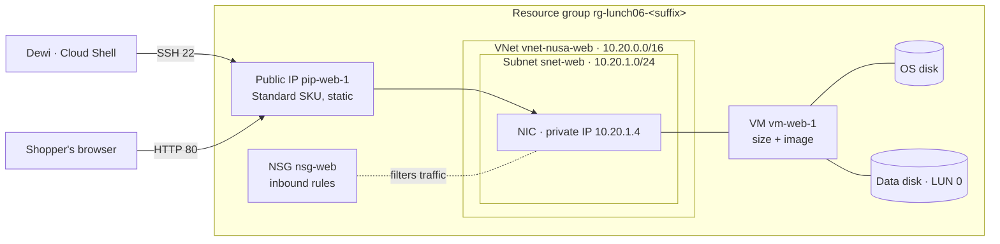
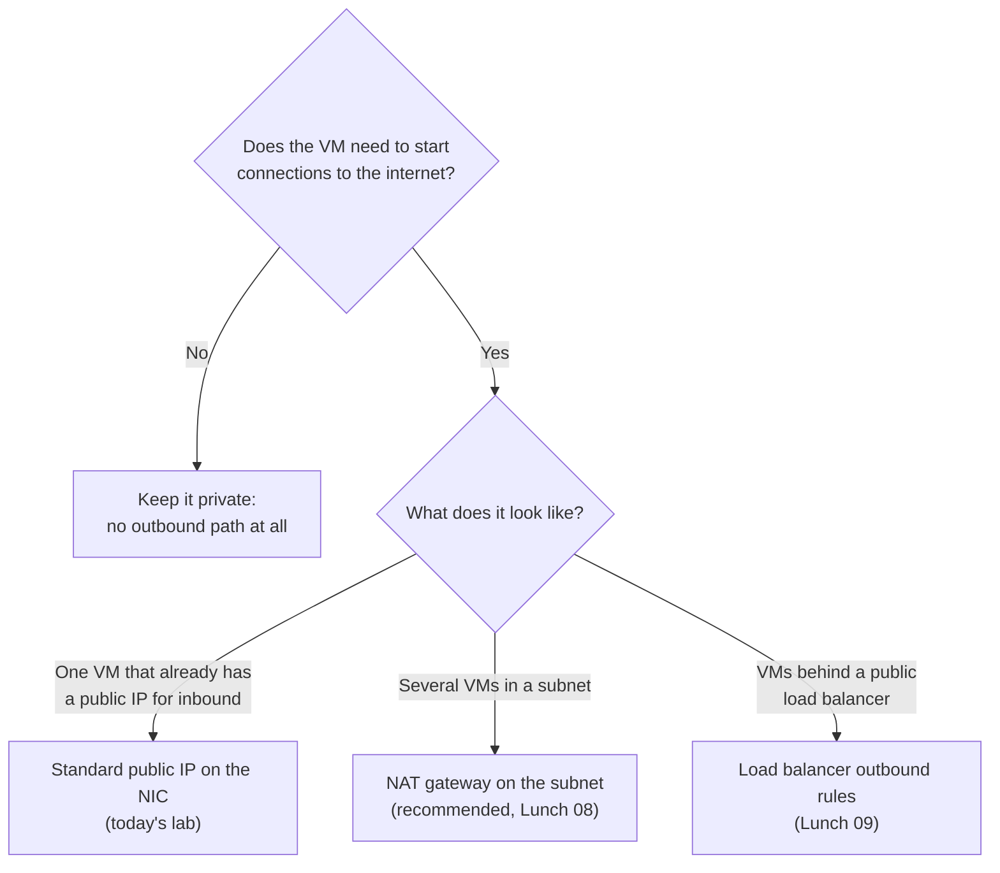
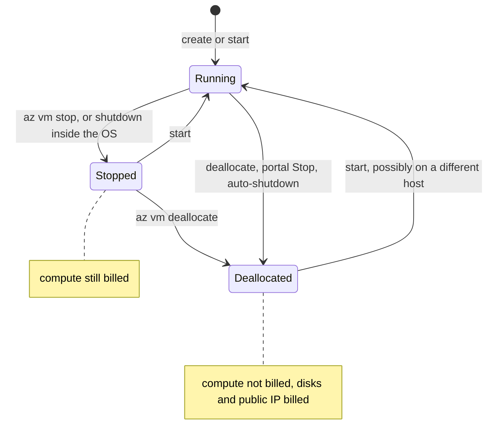

# Lunch 06 · Virtual Machines (Basic)

🇮🇩 [Baca dalam Bahasa Indonesia](README.id.md)

> **Track:** Core month · **Level:** Basic · **Part 2:** Core infrastructure
> **Time:** 60 minutes · **Prerequisite lunches:** 01, 03, 04
> **AZ-900 skill area:** Describe Azure architecture and services
> **Lab:** [Lab 06 · Your first web server VM](../../labs/06-virtual-machines-basic/README.md) — about 45 minutes · cost 💲💲
> **Author:** Stefanus Pinarta · [About the author](../../README.md#about-the-author)

| ⏱ Minutes | Segment |
|---:|---|
| 5 | Scenario and objectives |
| 25 | Reading |
| 15 | Demo: interactive animation (+ optional walkthrough video) |
| 5 | Knowledge check |
| 5 | Key takeaways and lab preview |
| 5 | Buffer — finish your lunch 🍜 |

## 🍱 Today's menu

By the end of this lunch you will be able to:

- **Decide** when an IaaS virtual machine is the right tool for a workload, and what you still manage yourself.
- **Name** every resource Azure creates for a VM — image, size, disks, network interface, virtual network, public IP and network security group — and explain what each one does.
- **Choose** a VM size family and a managed disk type, including when a burstable B-series size is a good fit.
- **Compare** the ways to sign in to and connect to a VM, and explain why new virtual networks need explicit outbound access.
- **Explain** power states and billing, resizing, auto-shutdown and the main VM pricing options.

## 🏪 Meanwhile at Nusantara Retail

Monday, 08:15. The storefront server next to the pantry is humming loudly again, and Pak Budi has placed a desk fan in
front of it "just for today". Ibu Sari has read your cloud-concepts notes from Lunch 02 and has a simple request:
"Before we redesign anything, can we at least get the shop off that box and into Azure?"

Dewi is excited. "It's only Ubuntu and nginx. Give me a server in the cloud and I'll copy the site over this
afternoon." Pak Budi is less excited. He wants to know who can sign in, which ports will be open to the internet, and
whether the new server can still download security updates. Then the finance team asks the question everyone was
avoiding: "Will we keep paying for it at night, when nobody is shopping?"

Your job today is to rent that first server properly. What exactly do you get — and pay for — when you create a
virtual machine in Azure?

---

## 📖 Reading (≈25 minutes)

### 1. When a virtual machine is the right tool

A **virtual machine (VM)** is a computer that Azure runs for you on its own physical servers. You choose an operating
system image and a size, Azure finds a host with free capacity, and a few minutes later you have a machine you can sign
in to. It is the purest form of **infrastructure as a service (IaaS)**: Microsoft owns the buildings, the physical
hosts, the hypervisor and the physical network; you own everything from the operating system upwards — patches, the
firewall inside the OS, the web server, the application and its data. In the shared-responsibility picture from
Lunch 02, a VM is the cloud option that leaves the most work on your side of the line.

So why pick the option with the most work? Because sometimes control matters more than convenience:

- **Lift and shift.** The storefront already runs on Ubuntu with nginx. Moving it to a VM — called **rehosting** —
  needs almost no code changes, so Nusantara Retail can leave the pantry room this month and modernise later.
- **Full control of the operating system.** Some software needs a particular kernel module, a vendor agent, or a
  licence tied to the OS.
- **Software that was never built for the cloud.** Older business applications that expect a fixed disk path, a
  Windows service or a fixed hostname are happiest on a VM.
- **Short-lived environments.** Developers can create, break and delete test servers in minutes.

If all you want is to run a web application, a platform service such as Azure App Service (Lunch 10), a container
(Lunch 13) or a function (Lunch 14) usually costs less effort, because Azure patches and scales the platform for you.
A good habit: choose a VM when you need control, and write down why. That note will tell you when it is time to
modernise.

### 2. The building blocks: a VM is a bundle of resources

When you select **Create** in the portal or run `az vm create`, Azure Resource Manager does not create one thing. It
creates a small family of separate resources in your resource group, each with its own resource ID, its own settings
and — sometimes — its own line on the bill. Knowing the family is the difference between a tidy subscription and a
pile of forgotten disks.

| Building block | What it is | Nusantara Retail example | Watch out for |
|---|---|---|---|
| **Image** | Template for the OS disk, from Azure Marketplace or your own | Ubuntu Server 24.04 LTS | Choose a supported, current version |
| **Size** | vCPUs, memory, local storage, bandwidth and features | Standard_B2ats_v2 | Not every size exists in every region or zone |
| **OS disk** | Managed disk created from the image | 30 GiB holding Ubuntu and nginx | Billed even while the VM is off |
| **Data disk** | Extra managed disks you attach, format and mount | 8 GiB for product images | Azure attaches it; you format it |
| **Temporary disk** | Local storage on the physical host, if the size has one | None on Basv2 sizes | Wiped when the VM moves host — never keep data there |
| **Network interface (NIC)** | Connects the VM to a subnet and holds its private IP | 10.20.1.4 | Every VM needs at least one |
| **Virtual network and subnet** | Your private address space in Azure | vnet-nusa-web, 10.20.0.0/16 | Avoid overlap with head office's 10.0.0.0/16 |
| **Public IP address** | Internet-facing address, Standard SKU | pip-web-1 | Basic SKU was retired on September 30, 2025 |
| **Network security group (NSG)** | Allow and deny rules for a NIC or subnet | nsg-web | Standard public IPs stay closed until an NSG allows traffic |

The **image** decides what lands on the OS disk. New Generation 2 VMs created from the portal, the CLI or PowerShell
now use **Trusted Launch** by default — Secure Boot plus a virtual TPM that protect the boot process — at no extra
cost. Lunch 23 returns to it.

Two practical lessons follow from this table. First, if you let `az vm create` invent the network, it picks
10.0.0.0/16 — exactly Pak Budi's head-office range. Harmless today, painful on the day you connect the two networks
(Lunch 26), so the lab names its own range. Second, deleting a VM does not always delete its disks, NIC and public IP;
the portal shows "delete with VM" options, and leftovers keep costing money. In labs, deleting the whole resource
group is the clean way out.

### 3. Choosing a size and a disk

A VM **size** fixes the number of vCPUs, the memory, any local disk, the maximum number of data disks and the network
bandwidth. Size names look cryptic but follow a pattern. In `Standard_B2ats_v2`, **B** is the family, **2** is the
number of vCPUs, **a** means an AMD processor (**p** would mean Arm), **t** means a tiny amount of memory, **s** means
it can use Premium SSD disks, and **v2** is the version of the series. A **d** in a name means the size has a local
temporary disk.

| Family | Optimised for | Typical workloads | Nusantara Retail example |
|---|---|---|---|
| **B** — burstable | Low baseline CPU with short bursts | Small web servers, dev/test, proofs of concept | The first storefront VM |
| **D** — general purpose | Balanced CPU and memory | Most production apps, app servers, small databases | A steady inventory API |
| **E** — memory optimised | More memory per vCPU | Relational databases, caches, in-memory analytics | A larger SQL Server later |
| **F** — compute optimised | More CPU per GiB of memory | Batch jobs, CPU-heavy web tiers, game servers | Nightly price recalculation |
| **L** — storage optimised | Large, fast local disks | NoSQL databases, big data, data warehouses | A product-search cluster |
| **M** — very large memory | Terabytes of RAM | SAP HANA, very large in-memory databases | Not needed — good to know |
| **N** — GPU | NVIDIA or AMD graphics processors | AI training and inference, rendering, graphic workstations | An image-recognition model |

**Burstable B-series** sizes deserve a closer look, because they are cheap and easy to misuse. Each size has a
**baseline** — a share of its vCPUs it can always use. Below the baseline the VM banks **CPU credits**; above it, the VM
spends them. One credit is roughly one vCPU running at 100% for one minute. A `Standard_B2ats_v2` has a baseline of
20%, starts with 60 credits, earns up to 24 credits an hour while idle and can bank up to 576. If both vCPUs run flat
out, it spends about 1.6 credits per minute, so a brand-new VM can sprint for roughly 35–40 minutes. When the credits
run out, Azure throttles it back to the baseline until it earns more. That suits the storefront — mostly quiet, with
short peaks — but not a three-hour report that keeps the CPU busy. Watch the **CPU Credits Remaining** metric. One more
note: the original B-series sizes (such as B1s) are End of Life — since July 2026 new subscriptions can't deploy them,
and they retire on November 15, 2028 — so new designs use Bsv2, Basv2 or Bpsv2.

> [!TIP]
> Before you choose, list the sizes your subscription can actually use in a region:
> `az vm list-skus --location southeastasia --size Standard_B --resource-type virtualMachines --output table`.
> The `Restrictions` column tells you when a size is not offered to you or not available in a zone.

Every VM disk is a **managed disk**: Azure stores and replicates it for you, and you pick its type.

| Disk type | Best for | Can be the OS disk? | Good to know |
|---|---|---|---|
| **Standard HDD** | Backups, rarely used data | Yes, but retiring for OS disks on September 8, 2028 | Cheapest; latency varies |
| **Standard SSD** | Web servers, light apps, dev/test | Yes | A sensible default for small VMs |
| **Premium SSD** | Production apps and databases | Yes | Fixed size tiers; needs a size with **s** in its name |
| **Premium SSD v2** | Databases that need tunable performance | No — data disks only | Set capacity, IOPS and throughput separately |
| **Ultra Disk** | The most demanding I/O, such as SAP HANA | No — data disks only | Change performance without restarting the VM |

You pay for the provisioned size, rounded up to the next size tier, whether the disk is full or empty. Standard SSD
and Premium SSD also come in zone-redundant (ZRS) versions. Disk choice even affects the uptime promise: at the time of
writing (October 2026), a single VM whose disks are all Premium SSD or Ultra Disk has a 99.9% connectivity SLA, Standard
SSD gives 99.5% and Standard HDD only 95% — check the
[service level agreements](https://www.microsoft.com/licensing/docs/view/Service-Level-Agreements-SLA-for-Online-Services)
for current figures.

### 4. Getting in, and getting out

First, **authentication** — how you prove who you are to the operating system:

- **SSH key pairs** are the default for Linux. `--generate-ssh-keys` creates a pair in `~/.ssh`; Azure stores only the
  public key on the VM, and the private key never leaves you.
- **Passwords** are required for Windows and possible on Linux. Avoid them on Linux; if you must use one, generate it.
- **Microsoft Entra ID login** lets people sign in with their company identity. Access is granted with Azure RBAC roles
  such as *Virtual Machine User Login* or *Virtual Machine Administrator Login* (Lunch 05). When Rizky's contract ends,
  you remove a role assignment — no keys to hunt down.

Then, **connecting**:

- **SSH** (port 22) for Linux and **RDP** (port 3389) for Windows need a network path and an NSG rule.
- **Azure Bastion** is a managed jump host inside your virtual network. You connect from the browser, and the VM needs
  no public IP at all. The free Developer SKU suits dev/test in selected regions (Southeast Asia is one) and handles
  one VM at a time; Basic, Standard and Premium are paid SKUs for production.
- **Run Command** executes a script inside the VM through the Azure VM agent, with no inbound port. The lab uses it to
  mount a disk.
- **Serial console** gives you a text console through boot diagnostics, even when networking inside the VM is broken.

Inbound traffic meets the **NSG**. Its default rules allow traffic from inside the virtual network and from Azure's load
balancer probe, then deny everything else — including anything from the internet. For a Linux VM, `az vm create` also adds a rule that
allows SSH from anywhere — convenient for a lab, risky in production, where you would restrict the source address or use
Bastion. Web traffic on port 80 stays blocked until you add a rule, for example with `az vm open-port`. Lunch 08
covers NSGs properly.

Outbound traffic has changed recently, and it surprises people.

> [!IMPORTANT]
> Virtual networks created with Azure API versions released after March 31, 2026 — and the portal already does this —
> use **private subnets**: VMs get no default outbound internet access. A VM that must reach the internet (for
> `apt-get update`, Windows activation or calling an external API) needs an explicit method: a public IP on the VM, a
> NAT gateway on the subnet, or load balancer outbound rules. Existing virtual networks are not changed.

Today's storefront VM has its own Standard public IP, so it has explicit outbound access and can install nginx. Remove
that IP without adding a NAT gateway, and `apt-get` simply hangs.

### 5. Living with a VM: power states, billing, resizing and auto-shutdown

A VM moves through **power states**, and only some of them stop the compute meter.

| Power state | What is happening | Compute billed? |
|---|---|---|
| Starting | The VM is booting | Yes |
| Running | Normal working state | Yes |
| Stopping | The OS is shutting down | Yes |
| Stopped (allocated) | The OS is off, but the VM still holds its place on the host | **Yes** |
| Deallocating | Azure is releasing the host capacity | No |
| Deallocated | Only the disks and IP addresses remain | No — disks and public IPs are still billed |

> [!WARNING]
> Shutting down from inside the operating system (`sudo shutdown -h now`) or running `az vm stop` leaves the VM
> **Stopped (allocated) — and still billed for compute**. Use the portal's **Stop** button, `az vm deallocate` or
> auto-shutdown, which all deallocate.

Deallocation keeps your managed disks and a Standard public IP keeps its address, because Standard IPs are always
static. Anything on the temporary disk is lost, and the next start may land on a different physical host.

**Resizing** is vertical scaling: you change the size, Azure restarts the VM, and it comes back with more or fewer
resources. `az vm list-vm-resize-options` shows the sizes available on the hardware cluster where your VM runs today.
If the size you want is missing, deallocate the VM first so Azure can place it anywhere in the region. When one bigger
VM is no longer enough, you scale *out* instead — more VMs behind a load balancer (Lunch 09) or a scale set (Lunch 23).

**Auto-shutdown** deallocates a VM at the same time every day and can email you first. The portal lets you choose a
time zone; the CLI expects UTC, so 19:00 in Jakarta (UTC+7) is `1200`. It is perfect for test VMs and dangerous for
anything customers use.

Two ways to configure a VM without logging in will appear throughout the course. **cloud-init** reads "custom data"
on the first boot of a Linux VM to install packages, write files and run commands. **VM extensions** are small add-ons
installed by the Azure VM agent — the Custom Script extension, the Azure Monitor Agent, Microsoft Entra login and many
more. Marketplace images already include the agent.

### 6. Paying for VMs, and what it means for Nusantara Retail

Compute is billed only while a VM is allocated; disks and public IPs are billed while they exist; data leaving Azure
and Windows licences add to the bill. Five purchase options change the price of the compute part:

| Option | How it works | Good for | Nusantara Retail example |
|---|---|---|---|
| **Pay-as-you-go** | No commitment; pay for the time the VM is allocated | Labs, tests, new workloads | The first weeks after migration |
| **Reservations** | Commit to a VM size in a region for one or three years | Steady servers that won't change | The storefront once its size is settled |
| **Azure savings plan for compute** | Commit to an hourly spend for one or three years, across sizes and regions | Steady spend that may change shape | A future mix of VMs and App Service |
| **Spot** | Spare capacity at a deep discount; evicted with 30 seconds' notice; no SLA | Interruptible batch jobs, dev/test | Overnight image-thumbnail jobs (Lunch 23) |
| **Azure Hybrid Benefit** | Reuse eligible Windows Server or SQL Server licences (also RHEL and SLES subscriptions) | Windows and SQL Server VMs | The back-office Windows server |

Lunch 19 turns these into a cost strategy.

Here is the first-step plan for Nusantara Retail. Production will run in **Indonesia Central** (Jakarta) to keep
customer data in the country; the labs use Southeast Asia for the widest service choice. The storefront gets one
Ubuntu 24.04 VM on a burstable B2ats_v2 size, because traffic is spiky but mostly low. Its OS disk is Premium SSD for
the 99.9% single-VM SLA; product images live on a separate data disk. The NSG allows HTTP and HTTPS from the
internet, and SSH only from head office — or nobody at all once Bastion is in place. The VM's public IP gives it the
explicit outbound access it needs for updates. Test copies get auto-shutdown and are deallocated at night; the
production VM does not.

That answers finance, but not yet the director. A single VM is still a single point of failure: 99.9% allows about 43
minutes of downtime in a 30-day month, and planned maintenance or a host failure can restart it. Networking (Lunch 08),
load balancing (Lunch 09) and scale sets (Lunch 23) remove that weak spot step by step.

> [!NOTE]
> **Pause and think:** Dewi suggests enabling auto-shutdown at 19:00 WIB on the production storefront VM to save
> money. What happens to the shoppers who browse after dinner — and which of Nusantara Retail's VMs *should* get
> auto-shutdown instead?

➡️ Availability sets and zones, scale sets with autoscale, custom images, Spot VMs and patching at scale continue in
[Lunch 23 · Virtual Machines (Advanced)](../23-virtual-machines-advanced/README.md).

---

## 🎬 Demo (≈15 minutes)

1. **Interactive animation (≈6–8 min):** [Open the demo](https://stefpin.github.io/azure-fundamentals-lunches/demos/06-virtual-machines-basic.html) —
   press ▶ Play or step through it at your own pace. Offline? Download
   [`docs/demos/06-virtual-machines-basic.html`](../../docs/demos/06-virtual-machines-basic.html) and open it in any browser.
2. **Walkthrough video (≤ 6 min):** _coming soon_ — [read the walkthrough script](demo-video-script.md).

What to watch for:

- How one `az vm create` command turns into separate resources: virtual network, public IP, NSG, NIC, VM and OS disk.
- Why the SSH packet passes the NSG while the first HTTP request is dropped — and which single rule changes that.
- How the VM reaches the Ubuntu package mirror through its own public IP (explicit outbound access).
- Which meter keeps running after `az vm stop`, and which one is still running after `az vm deallocate`.

## ✅ Knowledge check (≈5 minutes)

1. Dewi finished testing at 18:00 and ran `sudo shutdown -h now` inside the test VM. Next morning, finance asks why
   the VM was billed for compute all night. What happened, and what should she do instead?
   

Show answer

   Shutting down from inside the OS leaves the VM **Stopped (allocated)**, which is still billed for compute. She should
   deallocate it — the portal's Stop button, `az vm deallocate` or auto-shutdown — *why:* only deallocation releases the
   host capacity that the compute meter charges for.

   

2. A nightly sales report keeps both vCPUs of a `Standard_B2ats_v2` VM at 100% for three hours. After about 40 minutes
   it becomes painfully slow. Why, and what would you change?
   

Show answer

   The VM used up its CPU credits and was throttled to its 20% baseline. Use a non-burstable size such as a D-series
   (balanced) or F-series (compute optimised) VM for sustained CPU work — *why:* B-series sizes are designed for
   workloads that are quiet most of the time and burst only briefly.

   

3. Pak Budi creates a new virtual network with the current API, adds a VM without a public IP, and `apt-get update`
   hangs. Nothing else is wrong. What is missing?
   

Show answer

   An explicit outbound method. New virtual networks use private subnets, so the VM needs a NAT gateway on the subnet
   (the usual choice), load balancer outbound rules, or its own public IP — *why:* default outbound access is no longer
   given to VMs in private subnets.

   

4. You want the highest single-VM SLA for the production storefront. Which disk types can you use for the OS disk and
   for the data disk?
   

Show answer

   A Premium SSD OS disk, with Premium SSD, Premium SSD v2 or Ultra Disk data disks — *why:* the top single-instance SLA
   (99.9% at the time of writing) requires premium-class storage, and Premium SSD v2 and Ultra Disk cannot be OS disks.

   

5. Rizky, an outsourced contractor, must troubleshoot the storefront VM for one week. Pak Budi does not want port 22
   open to the internet or SSH keys handed around. What do you set up?
   

Show answer

   Azure Bastion (or Run Command for scripted tasks) plus Microsoft Entra ID login, with a *Virtual Machine User Login*
   role assignment for Rizky that you remove after the week — *why:* Bastion needs no public inbound port, and
   access tied to an identity and an RBAC role is easy to grant and revoke.

   

## 🧠 Key takeaways

- A VM is IaaS: Azure runs the hardware and hypervisor; you own the OS, patches, software and data.
- "One VM" is a bundle of resources — VM, OS disk, data disks, NIC, virtual network, Standard public IP and NSG — and
  leftovers keep costing money until you delete them.
- Pick the size family for the workload (B for bursty, D balanced, E memory, F compute, L storage, M huge memory,
  N GPU) and the disk type for the I/O and SLA you need.
- Inbound traffic needs an NSG rule; outbound traffic from new virtual networks needs an explicit method — a public IP,
  a NAT gateway or load balancer outbound rules.
- Stopped is not deallocated: only deallocation stops the compute meter, and disks and public IPs are billed until
  deleted.

## 🗒️ Field notes from Stefanus

> **The two-in-the-morning question.** In design reviews I ask one question about every VM: *what state should it be in
> at two in the morning?* If the answer is "off", I want auto-shutdown or a schedule that deallocates it — not a
> promise, and not a shutdown from inside the operating system, which leaves the compute meter running. If the answer is
> "gone", I delete the resource group, not just the VM, because orphaned disks and public IP addresses are the quiet
> line items that survive a hasty cleanup. And if the answer is "busy", I check the size family before anyone touches
> the code: a burstable VM that has used up its CPU credits looks exactly like a bug.

## 🔬 Your lab: Your first web server VM

You will create an Ubuntu VM with the Azure CLI, SSH in from Cloud Shell, install nginx and publish a Nusantara Retail
page, open port 80, add and mount a data disk, resize the VM, schedule auto-shutdown, and watch the difference between
stopped and deallocated. A deliberate break — deleting the port-80 rule — shows you how to trace a website that
suddenly stops answering.

- ⏱ About 45 minutes · 💲💲 small charges while running · works on its own (no earlier lab needed)
- 👉 [Start Lab 06](../../labs/06-virtual-machines-basic/README.md)

## 📚 Go further

- [Microsoft Learn: Virtual machine sizes overview](https://learn.microsoft.com/azure/virtual-machines/sizes/overview) — every family and series, with the naming rules decoded.
- [Microsoft Learn: Azure managed disk types](https://learn.microsoft.com/azure/virtual-machines/disks-types) — performance limits and when to choose each disk type.
- [Microsoft Learn: States and billing status of Azure Virtual Machines](https://learn.microsoft.com/azure/virtual-machines/states-billing) — the official power-state and billing table.
- [Microsoft Learn: Default outbound access in Azure](https://learn.microsoft.com/azure/virtual-network/ip-services/default-outbound-access) — private subnets and the explicit outbound options.

---

⬅️ [Lunch 05 · Identity and Access (Basic)](../05-identity-access-basic/README.md) · 🏠 [Course home](../../README.md) · [Lunch 07 · Storage (Basic)](../07-storage-basic/README.md) ➡️

Last validated: October 2026 · Spotted something out of date? [Open an issue](../../CONTRIBUTING.md).
