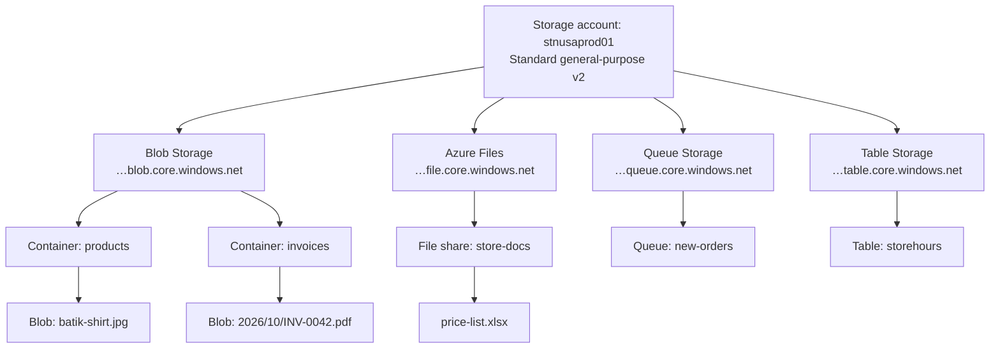
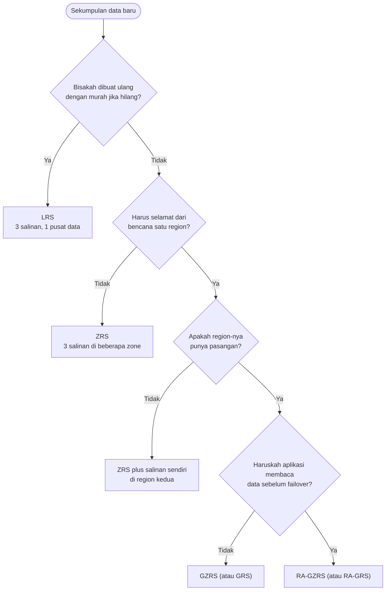
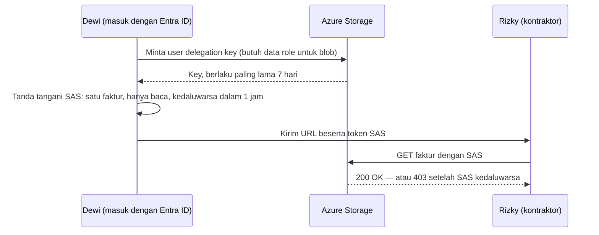

# Makan Siang 07 · Penyimpanan (Dasar)

🇬🇧 [Read in English](README.md)

> **Jalur:** Bulan inti · **Level:** Dasar · **Bagian 2:** Infrastruktur inti
> **Waktu:** 60 menit · **Makan siang prasyarat:** 03, 05
> **Area keterampilan AZ-900:** Menjelaskan arsitektur dan layanan Azure
> **Lab:** [Lab 07 · Menyimpan gambar produk dan faktur](../../labs/07-storage-basic/README.id.md) — sekitar 45 menit · biaya 💲
> **Penulis:** Stefanus Pinarta · [Tentang penulis](../../README.id.md#tentang-penulis)

| ⏱ Menit | Segmen |
|---:|---|
| 5 | Skenario dan tujuan |
| 25 | Bacaan |
| 15 | Demo: animasi interaktif (+ video panduan opsional) |
| 5 | Uji pemahaman |
| 5 | Poin penting dan pratinjau lab |
| 5 | Waktu cadangan — habiskan makan siang Anda 🍜 |

## 🍱 Menu hari ini

Setelah makan siang ini, Anda akan mampu:

- **Menjelaskan** apa itu storage account (*akun penyimpanan*), empat layanan data apa saja yang ditawarkannya, dan jenis account mana yang cocok untuk sebuah beban kerja.
- **Membandingkan** LRS, ZRS, GRS, dan GZRS (beserta varian read-access-nya) berdasarkan kegagalan yang sanggup dilewati masing-masing.
- **Memilih** access tier (*tingkatan penyimpanan*) untuk blob — hot, cool, cold, atau archive — serta menjelaskan masa simpan minimum dan rehidrasi (rehydration).
- **Memutuskan** cara orang dan aplikasi masuk: Microsoft Entra ID (*ID Microsoft Entra*) dengan data role, shared key, shared access signature, atau (jarang sekali) akses anonim.
- **Menentukan** alat yang tepat untuk memindahkan data: Storage browser, Azure Storage Explorer, AzCopy, Azure File Sync, atau Azure Data Box.

## 🏪 Sementara itu di Nusantara Retail

Dewi membuka laporan disk server toko online dan langsung meringis. Empat puluh ribu foto produk, PDF faktur selama
tujuh tahun, dan satu folder daftar harga untuk toko-toko cabang, semuanya tinggal di satu disk fisik yang sama, di
ruangan sebelah pantry. Cadangan (backup) versi Pak Budi adalah sebuah flashdisk USB yang ikut pulang bersamanya setiap
Jumat sore — itu pun kalau beliau ingat.

Tim keuangan menambah satu bumbu cerita: aturan pajak mewajibkan faktur disimpan selama sepuluh tahun, padahal hampir
tidak ada yang membuka faktur lagi setelah bulan pertama. Sementara itu, foto produk diunduh ribuan kali sehari, dan
setiap kepala toko ingin daftar harga minggu ini tersedia di sebuah drive bersama.

Ibu Sari lalu melontarkan pertanyaan yang sejak tadi dihindari semua orang: *"Kalau ruangan itu kebanjiran, apakah foto
dan faktur kita ikut hilang?"*

Pertanyaan hari ini: **di mana Nusantara Retail sebaiknya menyimpan file-filenya supaya disk yang rusak, gedung yang
kebanjiran, bahkan bencana regional sekalipun tidak membuatnya hilang — tanpa membayar harga premium
untuk faktur yang tidak pernah dibaca?**

---

## 📖 Bacaan (≈25 menit)

### 1. Storage account: satu nama, empat layanan

**Storage account** adalah resource (*sumber daya*) Azure yang menampung objek-objek data Anda. Ia
memberi Anda sebuah namespace — ruang nama — yang unik di seluruh dunia: nama account menjadi bagian dari setiap URL,
misalnya `https://stnusaprod01.blob.core.windows.net`. Itulah sebabnya aturan penamaannya ketat: 3 sampai 24 karakter,
hanya huruf kecil dan angka, dan tidak boleh ada storage account lain di Azure yang sudah memakainya. Ibaratnya nama domain
website: kalau nama yang Anda incar sudah diambil orang lain, Anda harus mencari nama lain. Seperti resource lainnya,
account ini berada di satu region (*wilayah*) dan satu resource group (*grup sumber daya*), dan dikelola oleh Azure
Resource Manager (Makan Siang 04).

Satu account menyediakan empat layanan data, masing-masing dengan endpoint (alamat akses) sendiri:

- **Blob Storage** menyimpan objek — gambar, PDF, video, cadangan, log — yang di Azure disebut *blob* (dari *binary
  large object*, objek biner berukuran besar), di dalam **container**. Container adalah wadah yang datar, tanpa folder
  sungguhan; nama seperti `2026/10/INV-0042.pdf` hanya *terlihat* seperti jalur folder. Blob ada tiga jenis:
  **block blob** untuk file biasa (hampir semua yang Anda unggah), **append blob** yang hanya bisa bertambah di bagian
  akhir (ideal untuk log), dan **page blob** yang memungkinkan baca-tulis acak di posisi mana pun (format di balik
  hard disk virtual).
- **Azure Files** menyediakan file share terkelola yang bisa di-mount (dipasang sebagai drive) oleh komputer melalui
  **SMB** (Server Message Block — untuk Windows, Linux, dan macOS) atau **NFS** (Network File System — untuk Linux,
  pada premium share berbasis SSD). Layanan ini menggantikan "drive S:" klasik di file server kantor.
- **Queue Storage** menampung pesan-pesan sederhana, masing-masing hingga 64 KiB, agar satu bagian aplikasi bisa
  mengoper pekerjaan ke bagian lain — misalnya "pesanan baru 1042 siap dikemas" (selengkapnya di Makan Siang 14).
  Mirip kertas pesanan yang ditancapkan berderet di dapur warung: kasir menaruh, juru masak mengambil satu per satu.
- **Table Storage** adalah penyimpanan key-attribute tanpa skema (schemaless) untuk catatan kecil yang terstruktur,
  misalnya jam buka toko. "Tanpa skema" artinya setiap baris boleh punya kolom yang berbeda-beda.

Saat membuat account, Anda memilih **jenis** (type) dan **performance tier**-nya. Account Standard berjalan di atas
hard disk dan harganya dihitung untuk kapasitas; account premium berjalan di atas SSD dan harganya dihitung untuk
kecepatan. Jenis account tidak bisa diubah belakangan — Anda harus membuat account baru lalu menyalin datanya ke sana.

| Jenis account | Layanan | Opsi redundansi | Cocok untuk |
|---|---|---|---|
| Standard general-purpose v2 | Blob, Files, Queue, Table | LRS, ZRS, GRS, RA-GRS, GZRS, RA-GZRS | Hampir semua kebutuhan — pilihan default |
| Premium block blobs | Block blob dan append blob | LRS, ZRS | Banyak objek kecil, jumlah transaksi tinggi, latensi rendah |
| Premium file shares | Azure Files (SMB dan NFS) | LRS, ZRS | File share perusahaan yang cepat, share NFS |
| Premium page blobs | Hanya page blob | LRS, ZRS | Beban kerja khusus bergaya disk |

Jenis account lama — general-purpose v1 dan account Blob Storage versi legacy — sedang dipensiunkan; upgrade ke
general-purpose v2 alih-alih membuat yang baru. Managed disk untuk virtual machine (*komputer virtual*) dari Makan Siang
06 juga memakai Azure Storage di balik layar, tetapi Anda mengelolanya sebagai resource disk, bukan lewat storage account.

### 2. Redundansi: berapa salinan, dan di mana

Azure Storage selalu menyimpan minimal tiga salinan data Anda. Yang Anda pilih adalah *di mana* salinan-salinan itu
tinggal, dan pilihan itulah yang menentukan kegagalan mana yang bisa Anda hadapi dengan santai. Redundansi (*opsi
redundansi*) adalah pengaturan untuk seluruh account, jadi data dengan kebutuhan berbeda sering ditempatkan di account
yang berbeda pula.

Bayangkan Anda menyimpan tiga lembar fotokopi ijazah. Kalau ketiganya ada di satu laci, Anda aman dari satu lembar yang
sobek, tetapi tidak dari banjir yang merendam rumah. Kalau satu lembar disimpan di rumah, satu di kantor, dan satu di
rumah orang tua — masih satu kota — banjir di satu tempat tidak menghabisi semuanya. Dan kalau satu salinan lagi
dititipkan ke saudara di kota lain, bencana besar di kota Anda pun tidak membuat ijazah itu lenyap. Kira-kira begitulah
perbedaan LRS, ZRS, dan GRS/GZRS:

- **Locally redundant storage (LRS)** menyimpan tiga salinan di dalam satu pusat data (datacenter). LRS
  melindungi dari drive, server, atau rak yang rusak, dan Microsoft merancangnya untuk durabilitas — ketahanan data
  agar tidak hilang — minimal 99,999999999% (sebelas angka sembilan) per tahun. Namun, kebakaran atau banjir di gedung
  itu bisa membuat semua salinan tidak dapat diakses — atau bahkan hilang. Ini opsi termurah.
- **Zone-redundant storage (ZRS)** menulis setiap perubahan secara sinkron — serentak, sebelum dinyatakan berhasil — ke
  tiga (atau lebih) availability zone (*zona ketersediaan*) di region tersebut (Makan Siang 03). Sebuah penulisan baru
  dianggap berhasil setelah semua zone yang tersedia menerimanya. Kalau satu zone padam total, proses baca dan tulis
  tetap berjalan dari zone lain. Durabilitasnya: minimal dua belas angka sembilan.
- **Geo-redundant storage (GRS)** memakai LRS di region primer dan menyalin data secara *asinkron* — menyusul beberapa
  saat kemudian — ke region sekunder pasangannya (*pasangan wilayah*), tempat data disimpan lagi dengan LRS.
  **Geo-zone-redundant storage (GZRS)** melakukan hal yang sama, tetapi dengan ZRS di region primer. Keduanya dirancang
  untuk durabilitas minimal enam belas angka sembilan.

Dalam kondisi normal, salinan sekunder tidak bisa dibaca. Jika region primer tidak tersedia, Anda (atau, dalam kasus
ekstrem, Microsoft) melakukan **failover**: DNS diperbarui sehingga region sekunder menjadi primer yang baru. Karena
replikasinya asinkron, data yang paling akhir ditulis mungkin belum sampai; **Last Sync Time** pada account memberi tahu sampai
titik waktu mana salinan sekunder sudah lengkap. Varian read-access, **RA-GRS** dan **RA-GZRS**, memungkinkan aplikasi
membaca dari endpoint `-secondary` kapan saja — berguna kalau toko harus tetap menampilkan produk selama gangguan yang
melanda satu region.

| Opsi | Tempat salinan berada | Disk atau server rusak | Pusat data rusak | Zone rusak | Region rusak | Durabilitas per tahun |
|---|---|---|---|---|---|---|
| LRS | 3 di satu pusat data | ✅ | ❌ | ❌ | ❌ | ≥ 11 angka sembilan |
| ZRS | 3 tersebar di beberapa zone | ✅ | ✅ | ✅ | ❌ | ≥ 12 angka sembilan |
| GRS / RA-GRS | LRS + LRS di region pasangan | ✅ | ⚠️ | ⚠️ | ⚠️ | ≥ 16 angka sembilan |
| GZRS / RA-GZRS | ZRS + LRS di region pasangan | ✅ | ✅ | ✅ | ⚠️ | ≥ 16 angka sembilan |

✅ data tetap tersedia · ❌ data tidak tersedia, mungkin hilang · ⚠️ data aman di region sekunder, tetapi penulisan baru
bisa dilanjutkan hanya setelah failover; dengan RA-GRS atau RA-GZRS, aplikasi bisa langsung membaca salinan sekunder.

Ada satu jebakan untuk Nusantara Retail. Geo-redundancy bergantung pada **region pasangan** (paired region), sedangkan
Indonesia Central (Jakarta) tidak punya pasangan. Saat tulisan ini dibuat, pilihan yang tersisa di sana hanya LRS dan
ZRS; kalau Anda butuh salinan di luar region, Anda harus mereplikasi datanya sendiri — misalnya dengan object
replication atau backup ke Southeast Asia (Makan Siang 17 dan 24). Selalu periksa opsi apa saja yang ditawarkan region
Anda.

> [!WARNING]
> **Redundansi bukan cadangan (backup).** Setiap salinan mencerminkan kondisi terkini yang sama: kalau seseorang
> menghapus atau menimpa sebuah faktur, ketiga (atau keenam) salinannya ikut berubah dalam sekejap. Perlindungan dari
> kesalahan manusia dan ransomware datang dari soft delete, versioning, immutability, dan backup — inti dari Makan
> Siang 24 dan Makan Siang 17.

### 3. Access tier blob: membayar untuk menyimpan atau membayar untuk mengakses

Foto produk dibaca ribuan kali sehari; faktur tahun 2019 mungkin tidak akan pernah dibuka lagi. Mengenakan tarif yang
sama untuk keduanya berarti membuang uang, karena itu block blob punya **access tier**.
Bayangkan jungkat-jungkit: ketika harga *menyimpan* satu gigabyte turun, harga *membacanya* naik.

Ibaratnya cara sebuah toko menyimpan barang. Barang laris dipajang di rak depan: gampang diambil, tetapi tempatnya
mahal. Stok musim lalu masuk gudang belakang, lebih murah tetapi perlu jalan sebentar. Arsip lama dikirim ke gudang
sewaan di luar kota: sewanya murah sekali, tetapi setiap kali butuh satu dus, Anda harus memesan truk dan menunggu
berjam-jam. Keempat tier Azure bekerja dengan logika yang sama:

- **Hot** — harga penyimpanan tertinggi dan harga akses terendah. Blob baru masuk ke sini kecuali Anda memilih lain.
- **Cool** — penyimpanan lebih murah, pembacaan lebih mahal, untuk data yang Anda simpan minimal **30 hari**.
- **Cold** — lebih murah lagi, untuk data yang Anda simpan minimal **90 hari** dan jarang dibaca, tetapi tetap ingin
  bisa diambil seketika.
- **Archive** — penyimpanan termurah, tetapi blob-nya **offline**: Anda bisa melihatnya di daftar dan membaca
  metadatanya, tetapi tidak isinya. Simpan minimal **180 hari**.

Masa minimum itu ditegakkan lewat biaya **early deletion** (penghapusan dini). Hapus, timpa, atau pindahkan blob
archive setelah 45 hari, dan Anda tetap membayar sisa 135 harinya, dihitung secara prorata. Persis seperti kos-kosan
dengan kontrak minimal enam bulan: pindah setelah satu setengah bulan pun, sisa sewanya tetap ditagih. Hot, cool, dan
cold adalah tier online dengan akses dalam hitungan milidetik; cool, cold, dan archive juga mengenakan biaya per
gigabyte yang Anda baca.

Untuk membaca blob archive, Anda harus melakukan **rehydrate** (rehidrasi) — "membangunkan" blob itu kembali ke tier
online — entah dengan mengubah tier-nya atau dengan menyalinnya ke blob baru (menyalin menghindari biaya early
deletion, karena blob asli di archive tetap di tempatnya). Prioritas standard bisa memakan waktu hingga 15 jam;
prioritas high bisa selesai dalam waktu kurang dari satu jam untuk objek di bawah 10 GB, dengan harga lebih mahal dan
tanpa jaminan. Satu batasan lagi: tier archive hanya tersedia di account LRS, GRS, dan RA-GRS — tidak di ZRS, GZRS,
atau RA-GZRS.

| Tier | Online? | Masa simpan minimum | Harga penyimpanan | Harga akses | Contoh di Nusantara |
|---|---|---|---|---|---|
| Hot | Ya, milidetik | — | Tertinggi | Terendah | Foto produk saat ini |
| Cool | Ya, milidetik | 30 hari | Lebih rendah | Lebih tinggi | Foto musim lalu |
| Cold | Ya, milidetik | 90 hari | Lebih rendah lagi | Lebih tinggi lagi | Faktur tahun lalu |
| Archive | Tidak — rehydrate dulu (berjam-jam) | 180 hari | Terendah | Tertinggi | Faktur yang lebih tua dari setahun |

Tier diatur per blob, saat mengunggah atau sesudahnya, dan setiap account punya tier default (hot, cool, atau cold —
tidak pernah archive). Tier hanya berlaku untuk block blob. Memindahkan blob satu per satu secara manual jelas tidak
praktis dalam jumlah besar, jadi Azure menawarkan dua jenis otomatisasi: aturan **lifecycle management** ("pindahkan
ke cool setelah 30 hari, hapus setelah sepuluh tahun"), yang dibahas di Makan Siang 24, dan **smart tier**, yang
mengamati pola akses lalu memindahkan blob antara hot, cool, dan cold untuk Anda. Saat tulisan ini dibuat, smart tier
sudah generally available di region publik untuk account zone-redundant, dan fitur ini tidak pernah memakai archive.

> [!TIP]
> Hitung harga sebuah tier dengan pola akses *Anda sendiri*, bukan sekadar tarif per gigabyte. Pustaka foto 10 GB yang
> dibaca sepanjang hari lebih murah di hot; 2 TB faktur yang dibaca dua kali setahun lebih cocok di cold atau archive.
> [Pricing calculator](https://azure.microsoft.com/pricing/calculator/) (*kalkulator harga*) menunjukkan kedua sisi
> jungkat-jungkit itu.

### 4. Siapa yang boleh masuk: pilihan otorisasi

Setiap permintaan ke data Anda harus diotorisasi — diperiksa apakah memang boleh — dan Azure Storage memberi beberapa
cara untuk melakukannya. Ingat pembagian **control plane** dan **data plane** dari Makan Siang 04: control plane adalah
urusan *mengelola* resource, data plane adalah urusan *isi* datanya. Ibaratnya pengelola gedung perkantoran: ia boleh
mengatur lift, listrik, dan renovasi, tetapi tidak otomatis boleh membuka brankas para penyewa. Seorang Owner bisa
membuat account dan mengubah pengaturannya, tetapi untuk membaca blob dengan identitas Microsoft
Entra dibutuhkan **data role** — role dalam Azure RBAC (role-based access control, *kontrol akses berbasis peran*) —
misalnya Storage Blob Data Reader, Storage Blob Data Contributor, atau Storage Blob Data Owner. Penetapan role yang
baru bisa butuh beberapa menit sebelum berlaku.

| Metode | Cara membuktikan akses | Cocok untuk | Waspadai |
|---|---|---|---|
| Microsoft Entra ID + Azure RBAC | Token untuk user, grup, atau managed identity, dicocokkan dengan data role | Orang dan aplikasi — default yang direkomendasikan | Tetapkan data role, jangan hanya Owner |
| Shared Key (account key) | Salah satu dari dua key untuk seluruh account menandatangani permintaan | Alat lama yang membutuhkannya | Satu key membuka segalanya di account |
| User delegation SAS | Token di URL yang ditandatangani dengan key yang diperoleh lewat Entra ID | Tautan berbatas waktu untuk satu blob atau container | Berlaku paling lama 7 hari |
| Service SAS atau account SAS | Token di URL yang ditandatangani dengan account key | Aplikasi lama (legacy) | Sulit dicabut tanpa merotasi key |
| Akses baca anonim | Tanpa kredensial sama sekali | Konten yang memang publik | Mati secara default — biarkan tetap mati |

**Shared Key** patut diwaspadai: setiap account punya dua key, dan siapa pun yang memegang salah satunya bisa membaca,
mengubah, atau menghapus segalanya. Siapa pun yang punya izin "list keys" — sudah termasuk dalam role Owner dan
Contributor — bisa mengambilnya. Rotasi key secara berkala, simpan di Key Vault kalau Anda memang harus memakainya
(Makan Siang 15), dan di Makan Siang 24 Anda akan melihat cara mematikan Shared Key.

**Shared access signature (SAS)** adalah token yang ditempelkan di ujung URL dan memberi izin tertentu (read, write,
list…) atas resource tertentu sampai waktu kedaluwarsa. Ada tiga jenis. **User delegation SAS** ditandatangani dengan
key yang Anda minta menggunakan kredensial Entra Anda, jadi tidak ada account key yang terlibat dan tautannya tidak
bisa memberi izin melebihi hak Anda sendiri. **Service SAS** (satu layanan) dan **account SAS** (satu atau beberapa
layanan) ditandatangani dengan account key. Siapa pun yang memegang SAS bisa memakainya, jadi buat masa berlakunya
singkat, berikan izin sesedikit mungkin, dan selalu gunakan HTTPS.

Bayangkan sebuah apartemen. Account key adalah kunci induk yang membuka semua unit, sedangkan SAS ibarat kartu akses
tamu yang hanya membuka satu lantai dan mati tengah malam nanti. Kalau kartu tamu hilang, kerugiannya terbatas; kalau
kunci induk yang hilang, seluruh gedung terancam.

**Akses baca anonim** memungkinkan siapa saja membaca blob di sebuah container tanpa kredensial. Account baru tidak
mengizinkannya, dan pengaturan di tingkat account mengalahkan pengaturan container mana pun. Biarkan tetap begitu,
kecuali kontennya memang benar-benar publik.

Dua pengaturan melindungi data saat berpindah di jaringan (in transit): **secure transfer required** (hanya HTTPS,
aktif secara default) dan **minimum TLS version**, yang sebaiknya Anda setel ke TLS 1.2. TLS (Transport Layer
Security) adalah protokol enkripsi di balik ikon gembok HTTPS di browser. Portal sudah menyetelnya secara default,
tetapi Azure CLI membiarkan properti itu kosong kecuali Anda mengisinya, karena itu lab menyetelnya secara eksplisit.
Data yang tersimpan (at rest) selalu dienkripsi dengan key yang dikelola Microsoft. Secara default, public endpoint
(*titik akhir publik*) account menerima koneksi dari jaringan mana pun — otorisasi tetap berlaku — sedangkan firewall
dan private endpoint (*titik akhir privat*) dibahas di Makan Siang 24.

> [!IMPORTANT]
> Perlakukan account key dan URL SAS seperti kata sandi. Jangan pernah menempelkannya ke chat, email, atau kode sumber.
> Kalau salah satunya bocor, rotasi key-nya — atau, untuk user delegation SAS, cabut (revoke) delegation key-nya — dan
> anggap datanya sudah terbaca orang lain.

### 5. Memindahkan data masuk dan keluar

Memilih alat sebagian besar soal *berapa banyak* datanya, *seberapa sering* dipindahkan, dan *seberapa bagus jaringan
Anda*.

- **Storage browser** di Azure portal sangat pas untuk unggahan cepat, mengubah tier sebuah blob, atau membuat SAS.
- **Azure Storage Explorer** adalah aplikasi desktop gratis untuk Windows, macOS, dan Linux yang bisa menjelajahi blob,
  file, queue, dan table di banyak account sekaligus. Untuk transfer, di balik layar ia memakai AzCopy.
- **AzCopy** adalah alat command-line yang dibuat untuk penyalinan massal dan lewat skrip. Ia mentransfer file secara
  paralel, bisa melanjutkan pekerjaan yang gagal, dan menyalin langsung antar-account dari server ke server. AzCopy
  sudah terpasang di Azure Cloud Shell dan melakukan autentikasi dengan Entra ID (`azcopy login`, atau dengan
  "meminjam" sesi masuk Azure CLI) atau dengan SAS. `azcopy sync` mencerminkan (mirror) isi sebuah folder.
- **Azure CLI** (`az storage blob upload`, `upload-batch`) cukup untuk segelintir file di dalam skrip.
- **Azure File Sync** menjaga file server Windows on-premises (di gedung sendiri) tetap sinkron dengan sebuah file
  share Azure. Dengan **cloud tiering**, hanya file yang sering dipakai yang tetap disimpan di disk lokal; sisanya
  diambil dari Azure saat dibutuhkan, sehingga setiap cabang melihat file yang sama.
- **Azure Data Box** mengirimkan perangkat yang tangguh dan terenkripsi ke tempat Anda ketika jaringan menjadi
  hambatannya. Microsoft merekomendasikannya untuk transfer di atas sekitar 40 TB dengan konektivitas terbatas. Saat
  tulisan ini dibuat, perangkat generasi terbaru berkapasitas 120 TB atau 525 TB, dan **Data Box Disk** mengirim
  hingga lima SSD 8 TB per pesanan (khusus impor). Data Box Heavy sudah dipensiunkan.

| Alat | Paling cocok untuk | Antarmuka | Contoh di Nusantara Retail |
|---|---|---|---|
| Storage browser | Unggahan sekali-sekali, tier, SAS | Azure portal | Dewi membetulkan satu foto yang salah |
| Storage Explorer | Menjelajahi banyak account | Aplikasi desktop | Tim keuangan memeriksa faktur yang diarsipkan |
| AzCopy | Penyalinan massal atau terjadwal | Command line | Unggahan foto baru setiap malam |
| Azure File Sync | File server hibrida | Agent di Windows Server | Share kantor pusat disinkronkan ke Azure |
| Keluarga Data Box | Puluhan atau ratusan TB secara offline | Perangkat yang dikirim | Arsip kertas hasil pindaian dari Surabaya |

Hitungan cepat menunjukkan mengapa Data Box ada. Sepuluh terabyte lewat jalur 100 Mbps yang dipakai penuh tanpa henti
butuh sekitar sembilan hari; lima puluh terabyte lewat 50 Mbps butuh sekitar tiga bulan. Ibaratnya pindah rumah: satu
kardus bisa dibawa naik ojek, tetapi isi satu rumah butuh truk ekspedisi — kalau dipaksa naik motor, Anda akan
bolak-balik berbulan-bulan. Untuk memindahkan server, aplikasi, dan database secara utuh, titik awalnya adalah Azure
Migrate, tetapi itu cerita untuk makan siang lain.

### 6. Bagaimana semuanya menyatu untuk Nusantara Retail

Kembali ke ruang server Ibu Sari yang dikhawatirkan kebanjiran. Inilah desain yang Anda sketsakan untuknya, dengan
asumsi data produksi tetap di Indonesia Central demi residensi data (data harus tetap berada di Indonesia):

- **Foto produk** masuk ke account general-purpose v2 dengan **ZRS** dan tier hot. Kalau satu zone gagal, website
  tetap bisa memuat gambar. Kelak, smart tier bisa otomatis "mendinginkan" foto produk yang sudah tidak dijual.
- **Faktur** adalah kasus yang menarik. Tim keuangan ingin biayanya murah sekaligus aman dari kebakaran pusat data.
  ZRS selamat dari kebakaran tetapi tidak bisa memakai archive; LRS bisa memakai archive tetapi hanya tinggal di satu
  gedung. Anda mengusulkan ZRS dengan tier cold, ditambah salinan hasil replikasi di Southeast Asia setelah Makan
  Siang 24 menambahkan fitur-fitur perlindungannya — dan Anda mencatat kompromi (trade-off) itu secara tertulis.
- **Daftar harga toko** pindah ke sebuah share **Azure Files**. Pak Budi memasang Azure File Sync di server kantor
  pusat, sehingga staf tetap memakai huruf drive yang sudah biasa mereka pakai, sementara salinan induknya tinggal di
  Azure.
- **Akses** memakai Entra ID di mana-mana. Aplikasi toko online mendapat managed identity dengan role Storage Blob Data
  Reader (Makan Siang 15). Ketika Rizky, sang kontraktor, butuh satu faktur, Dewi mengirim **user delegation SAS**
  hanya-baca yang kedaluwarsa dalam satu jam. Akses anonim tetap mati, dan minimum TLS version-nya 1.2.
- **Migrasi** 3 TB foto yang sudah ada berjalan dengan AzCopy lewat jaringan kantor dalam beberapa hari. Adapun
  60 TB faktur kertas hasil pindaian dari gudang lama di Surabaya dikirim dengan Data Box.

> [!NOTE]
> **Renungkan sejenak:** Tim keuangan meminta penyimpanan semurah mungkin untuk faktur sepuluh tahun, tetap di
> Indonesia, dan aman sekalipun satu pusat data terbakar. Archive membutuhkan LRS atau GRS, dan Indonesia Central tidak
> punya pasangan untuk GRS. Kombinasi redundansi, tier, dan salinan tambahan mana yang akan Anda rekomendasikan — dan
> risiko mana yang bersedia Anda terima?

Kini Anda sudah menjawab separuh pertama pertanyaan Ibu Sari: file-file itu selamat dari disk yang mati maupun pusat
data yang lumpuh, dan Anda membayar setiap file sesuai cara pemakaiannya. Yang belum Anda cegah adalah seseorang yang
*menghapus* atau *mengenkripsi* file-file itu. Makan siang berikutnya, Makan Siang 08, membangun jaringan tempat
layanan-layanan Anda akan tinggal.

➡️ **Siap untuk yang lebih dalam?** [Makan Siang 24 · Penyimpanan (Lanjutan)](../24-storage-advanced/README.id.md)
menambahkan soft delete, versioning, immutability, aturan lifecycle, private endpoint, dan failover.

---

## 🎬 Demo (≈15 menit)

1. **Animasi interaktif (≈6–8 menit):** [Buka demo](https://stefpin.github.io/azure-fundamentals-lunches/demos/07-storage-basic.html?lang=id) —
   tekan ▶ Putar atau telusuri langkah demi langkah sesuai kecepatan Anda. Sedang offline? Unduh
   [`docs/demos/07-storage-basic.html`](../../docs/demos/07-storage-basic.html) lalu buka di browser apa saja.
2. **Video panduan (≤ 6 menit):** _segera hadir_ — [baca naskah video](demo-video-script.id.md).

Yang perlu diperhatikan:

- Kegagalan mana yang sanggup dilewati setiap opsi redundansi: satu disk, satu pusat data, satu zone, satu region utuh.
- Mengapa data geo-redundant baru tersedia *setelah* failover — kecuali Anda memilih varian read-access.
- Bagaimana jungkat-jungkit miring dari hot ke archive: penyimpanan makin murah, sementara setiap pembacaan makin mahal
  dan makin lambat.
- Berapa lama rehidrasi dari tier archive bisa berlangsung, dan dua cara melakukannya.

## ✅ Uji pemahaman (≈5 menit)

1. Foto produk untuk toko online harus tetap tersedia kalau satu availability zone di Indonesia Central gagal. Anggaran
   jadi pertimbangan, dan region itu tidak punya region pasangan. Opsi redundansi mana yang Anda pilih?
   

Lihat jawaban

   **ZRS.** *Alasannya:* ZRS menyimpan tiga salinan sinkron di tiga zone, sehingga baca dan tulis tetap berjalan saat
   satu zone gagal; lagi pula, opsi geo-redundant memang tidak tersedia tanpa region pasangan.

   

2. Seorang auditor membutuhkan faktur tahun 2019 yang tersimpan di tier archive — hari ini juga. Apa yang Anda lakukan,
   dan apa yang perlu Anda sampaikan kepada auditor soal waktunya?
   

Lihat jawaban

   Lakukan rehydrate dengan **prioritas high**, idealnya dengan **menyalinnya** ke blob baru di tier hot. Sampaikan
   bahwa prioritas high bisa selesai dalam waktu kurang dari satu jam untuk blob di bawah 10 GB, tetapi tidak dijamin.
   *Alasannya:* blob archive bersifat offline sampai direhidrasi; menyalin juga menghindari biaya early deletion.

   

3. Rizky, sang kontraktor, perlu mengunduh satu faktur sore ini. Dewi berpikir untuk mengirimkan account key kepadanya.
   Apa yang sebaiknya ia lakukan?
   

Lihat jawaban

   Buat **user delegation SAS** dengan izin read untuk satu blob itu saja dan masa berlaku yang singkat. *Alasannya:*
   SAS ini ditandatangani dengan kredensial Entra, bukan account key; cakupan dan waktunya terbatas, dan bisa dicabut,
   sedangkan account key akan membuka seluruh account.

   

4. Dewi adalah Owner dari subscription (*langganan*), tetapi `az storage blob list --auth-mode login` gagal dengan
   error izin. Mengapa?
   

Lihat jawaban

   Owner adalah role **control plane**. *Alasannya:* membaca data blob dengan identitas Entra membutuhkan **data role**
   seperti Storage Blob Data Reader atau Contributor — dan penetapan role yang baru bisa butuh beberapa menit sebelum
   berlaku.

   

5. Sebuah gudang di Surabaya menyimpan 50 TB dokumen hasil pindaian di NAS (network-attached storage) dan hanya punya
   jalur internet 50 Mbps. Apa cara paling praktis untuk memasukkan data itu ke Azure?
   

Lihat jawaban

   Pesan **Azure Data Box**, salin datanya secara lokal, lalu kirim kembali perangkatnya; setelah itu gunakan AzCopy
   atau alat serupa untuk file yang berubah sesudahnya. *Alasannya:* lewat 50 Mbps, unggahannya akan makan waktu
   kira-kira tiga bulan, dan Data Box memang dirancang untuk puluhan terabyte dengan bandwidth terbatas.

   

## 🧠 Poin penting

- Storage account adalah namespace yang unik di seluruh dunia untuk data Blob, Files, Queue, dan Table; pilih Standard
  general-purpose v2 kecuali Anda butuh performa SSD.
- Redundansi menentukan kegagalan mana yang bisa Anda lewati: LRS (perangkat keras), ZRS (satu zone), GRS dan GZRS
  (satu region, setelah failover — atau langsung untuk pembacaan dengan RA-). Redundansi bukan backup.
- Access tier menukar harga penyimpanan dengan harga akses; cool, cold, dan archive punya masa minimum 30, 90, dan
  180 hari, dan archive butuh rehidrasi berjam-jam.
- Utamakan Microsoft Entra ID dengan data role; kalau terpaksa berbagi tautan, gunakan user delegation SAS yang
  berumur pendek, dan biarkan akses anonim tetap mati.
- Pilih alat pemindahan data berdasarkan ukuran dan bandwidth: portal atau Storage Explorer untuk pekerjaan kecil,
  AzCopy untuk skrip dan data massal, Azure File Sync untuk file server hibrida, Data Box untuk puluhan terabyte.

## 🗒️ Catatan lapangan dari Stefanus

> **Tiga salinan dari file yang terhapus tetap saja nol file.** Setiap kali meninjau desain storage, saya mengajukan dua
> pertanyaan untuk setiap account. Pertama: *kegagalan apa yang harus bisa dilewati data ini?* Jawaban itulah yang
> memilihkan hurufnya — LRS, ZRS, atau GZRS — bukan kebiasaan, apalagi nilai default Azure CLI yang diam-diam memberi
> Anda RA-GRS. Kedua: *siapa yang bisa menghapus atau menimpa data ini tanpa sengaja, dan bagaimana kita akan tahu?*
> Redundansi menyalin kekeliruan sama setianya dengan menyalin data, jadi soft delete dan versioning masuk daftar
> periksa sebelum go-live, bukan setelah musibah pertama. Satu lagi: redundansi, key, dan aturan jaringan berlaku untuk
> seluruh account. Karena itu saya mengelompokkan data menurut kebutuhannya, bukan menurut tim pemiliknya — foto produk
> dan faktur sepuluh tahun jarang akur kalau disuruh tinggal serumah.

## 🔬 Lab Anda: Menyimpan gambar produk dan faktur

Di waktu luang, Anda akan membangun account general-purpose v2 yang aman (TLS 1.2, tanpa akses anonim), memberi diri
Anda sendiri sebuah data role, mengunggah faktur dengan Azure CLI dan gambar produk dengan AzCopy, memindahkan satu
blob ke cool dan satu ke archive, membagikan sebuah gambar lewat user delegation SAS berdurasi satu jam yang Anda uji
dengan `curl`, serta membuat share Azure Files untuk daftar harga toko. Anda juga akan sengaja merusak sebuah SAS dan
membaca error 403 yang muncul.

- ⏱ Sekitar 45 menit · 💲 · bisa dikerjakan terpisah (tidak perlu lab sebelumnya)
- 👉 [Mulai Lab 07](../../labs/07-storage-basic/README.id.md)

## 📚 Pelajari lebih lanjut

- [Microsoft Learn: Ikhtisar storage account](https://learn.microsoft.com/azure/storage/common/storage-account-overview) — jenis account, aturan penamaan, dan endpoint dalam satu halaman.
- [Microsoft Learn: Redundansi Azure Storage](https://learn.microsoft.com/azure/storage/common/storage-redundancy) — angka durabilitas resmi dan tabel skenario gangguan.
- [Microsoft Learn: Access tier untuk data blob](https://learn.microsoft.com/azure/storage/blobs/access-tiers-overview) — masa minimum, early deletion, dan detail penagihan.
- [Microsoft Learn: Memberi akses terbatas dengan shared access signature](https://learn.microsoft.com/azure/storage/common/storage-sas-overview) — jenis-jenis SAS dan praktik terbaiknya.

---

⬅️ [Makan Siang 06 · Virtual Machines (Dasar)](../06-virtual-machines-basic/README.id.md) · 🏠 [Beranda kursus](../../README.id.md) · [Makan Siang 08 · Virtual Networking (Dasar)](../08-networking-basic/README.id.md) ➡️

Terakhir divalidasi: Oktober 2026 · Menemukan informasi yang sudah usang? [Buka issue](../../CONTRIBUTING.md).
