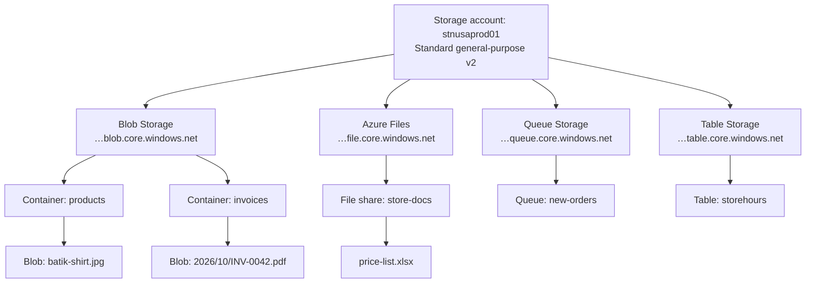
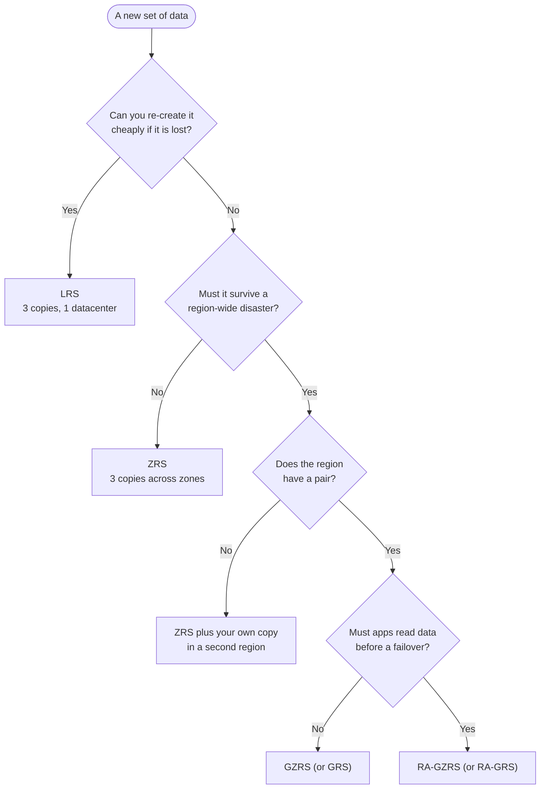
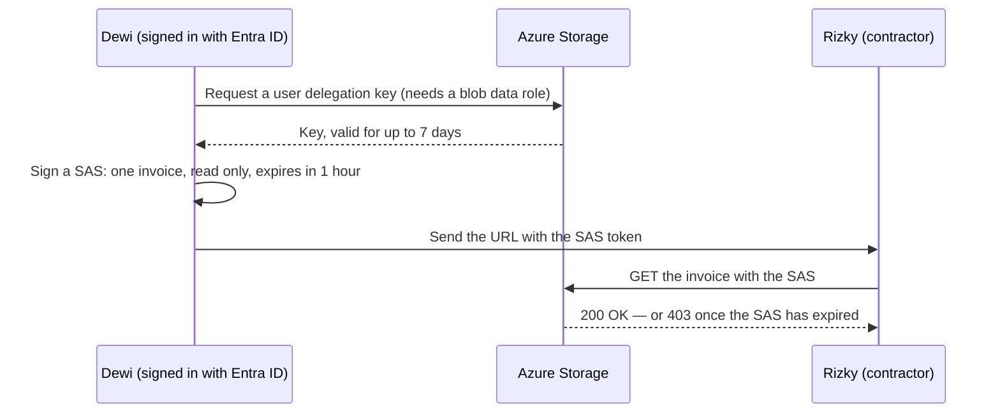

# Lunch 07 · Storage (Basic)

> **Track:** Core month · **Level:** Basic · **Part 2:** Core infrastructure
> **Time:** 60 minutes · **Prerequisite lunches:** 03, 05
> **AZ-900 skill area:** Describe Azure architecture and services
> **Lab:** [Lab 07 · Store product images and invoices](../../labs/07-storage-basic/README.md) — about 45 minutes · cost 💲

| ⏱ Minutes | Segment |
|---:|---|
| 5 | Scenario and objectives |
| 25 | Reading |
| 15 | Demo: interactive animation (+ optional walkthrough video) |
| 5 | Knowledge check |
| 5 | Key takeaways and lab preview |
| 5 | Buffer — finish your lunch 🍜 |

## 🍱 Today's menu

By the end of this lunch you will be able to:

- **Explain** what a storage account is, which four data services it offers and which account type fits a workload.
- **Compare** LRS, ZRS, GRS and GZRS (and their read-access variants) by the failures each one survives.
- **Choose** a blob access tier — hot, cool, cold or archive — and explain minimum storage durations and rehydration.
- **Decide** how people and apps get in: Microsoft Entra ID with data roles, shared keys, shared access signatures or (rarely) anonymous access.
- **Pick** the right tool to move data: Storage browser, Azure Storage Explorer, AzCopy, Azure File Sync or Azure Data Box.

## 🏪 Meanwhile at Nusantara Retail

Dewi opens the storefront server's disk report and winces. Forty thousand product photos, seven years of invoice PDFs
and a folder of price lists for the stores all live on the same physical disk in the room next to the pantry. Pak Budi's
backup is a USB drive that goes home with him on Friday afternoons — when he remembers.

The finance team adds a twist: tax rules mean invoices must be kept for ten years, but almost nobody opens an invoice
after the first month. Meanwhile, the product photos are downloaded thousands of times a day, and every store manager
wants this week's price list on a shared drive.

Ibu Sari asks the question everyone is avoiding: *"If that room floods, do we lose the photos and the invoices too?"*

Today's question: **where should Nusantara Retail keep its files so that a broken disk, a flooded building or even a
regional disaster doesn't lose them — without paying premium prices for invoices nobody reads?**

---

## 📖 Reading (≈25 minutes)

### 1. Storage accounts: one name, four services

A **storage account** is the Azure resource that holds your data objects. It gives you a globally unique namespace: the
account name becomes part of every URL, such as `https://stnusaprod01.blob.core.windows.net`. That is why the name has
strict rules — 3 to 24 characters, lowercase letters and numbers only, and no other storage account anywhere in Azure
may already use it. Like every resource, the account lives in one region and one resource group, and Azure Resource
Manager manages it (Lunch 04).

One account exposes four data services, each with its own endpoint:

- **Blob Storage** stores objects — images, PDFs, videos, backups, logs — inside **containers**. A container is a flat
  bucket; a name such as `2026/10/INV-0042.pdf` only *looks* like a folder path. Blobs come in three types:
  **block blobs** for ordinary files (almost everything you upload), **append blobs** that can only grow at the end
  (ideal for logs), and **page blobs** that allow random reads and writes (the format behind virtual hard disks).
- **Azure Files** offers managed file shares that computers mount over **SMB** (Windows, Linux and macOS) or **NFS**
  (Linux, on SSD-based premium shares). It replaces the classic "S: drive" on an office file server.
- **Queue Storage** holds simple messages, each up to 64 KiB, so one part of an application can hand work to another —
  for example "new order 1042 is ready to pack" (more in Lunch 14).
- **Table Storage** is a schemaless key-attribute store for small, structured records such as store opening hours.

When you create an account you choose its **type** and **performance tier**. Standard accounts run on hard disks and
are priced for capacity; premium accounts run on SSDs and are priced for speed. You can't change the type later — you
would create a new account and copy the data across.

| Account type | Services | Redundancy options | Use it for |
|---|---|---|---|
| Standard general-purpose v2 | Blob, Files, Queue, Table | LRS, ZRS, GRS, RA-GRS, GZRS, RA-GZRS | Almost everything — the default choice |
| Premium block blobs | Block and append blobs | LRS, ZRS | Many small objects, high transaction rates, low latency |
| Premium file shares | Azure Files (SMB and NFS) | LRS, ZRS | Fast enterprise file shares, NFS shares |
| Premium page blobs | Page blobs only | LRS, ZRS | Specialised disk-style workloads |

Older account kinds — general-purpose v1 and legacy Blob Storage accounts — are being retired; upgrade them to
general-purpose v2 rather than creating new ones. Managed disks for virtual machines (Lunch 06) also use Azure Storage
under the hood, but you manage them as disk resources, not through a storage account.

### 2. Redundancy: how many copies, and where

Azure Storage always keeps at least three copies of your data. Your choice is *where* those copies live, and that
decides which failure you can shrug off. Redundancy is a setting of the whole account, so data with different needs
often goes into different accounts.

- **Locally redundant storage (LRS)** keeps three copies inside one datacenter. It protects against a failed drive,
  server or rack, and Microsoft designs it for at least 99.999999999% (eleven nines) durability per year. A fire or
  flood in that building, though, could make every copy unavailable — or lose them. It is the cheapest option.
- **Zone-redundant storage (ZRS)** writes each change synchronously to three (or more) availability zones in the
  region (Lunch 03). A write succeeds only when all available zones have it. If a whole zone goes dark, reads and writes
  carry on from the others. Durability: at least twelve nines.
- **Geo-redundant storage (GRS)** keeps LRS in the primary region and copies the data *asynchronously* to the paired
  secondary region, where it is stored with LRS again. **Geo-zone-redundant storage (GZRS)** does the same, but with
  ZRS in the primary region. Both are designed for at least sixteen nines.

The secondary copy is not readable during normal operation. If the primary region becomes unavailable, you (or, in
extreme cases, Microsoft) **fail over**: DNS is updated so the secondary becomes the new primary. Because replication is
asynchronous, the newest writes may not have arrived yet; the account's **Last Sync Time** tells you up to which moment
the secondary is complete. The read-access variants, **RA-GRS** and **RA-GZRS**, let applications read from a
`-secondary` endpoint at any time — useful when the shop must keep showing products during a regional outage.

| Option | Where the copies live | Disk or server fails | Datacenter fails | Zone fails | Region fails | Durability per year |
|---|---|---|---|---|---|---|
| LRS | 3 in one datacenter | ✅ | ❌ | ❌ | ❌ | ≥ 11 nines |
| ZRS | 3 across zones | ✅ | ✅ | ✅ | ❌ | ≥ 12 nines |
| GRS / RA-GRS | LRS + LRS in paired region | ✅ | ⚠️ | ⚠️ | ⚠️ | ≥ 16 nines |
| GZRS / RA-GZRS | ZRS + LRS in paired region | ✅ | ✅ | ✅ | ⚠️ | ≥ 16 nines |

✅ data stays available · ❌ data unavailable, possibly lost · ⚠️ data is safe in the secondary region, but writes resume
only after a failover; with RA-GRS or RA-GZRS, apps can read the secondary copy immediately.

There is a catch for Nusantara Retail. Geo-redundancy depends on a **paired region**, and Indonesia Central (Jakarta)
has no pair. At the time of writing that leaves LRS and ZRS there; if you need an off-region copy, you replicate the data
yourself — for example with object replication or a backup to Southeast Asia (Lunches 17 and 24). Always check which
options your region offers.

> [!WARNING]
> **Redundancy is not backup.** Every copy reflects the same current state: if someone deletes or overwrites an invoice,
> all three (or six) copies change within moments. Protection against mistakes and ransomware comes from soft delete,
> versioning, immutability and backups — the heart of Lunch 24 and Lunch 17.

### 3. Blob access tiers: paying for storage or paying for access

Product photos are read thousands of times a day; a 2019 invoice may never be opened again. Charging both the same
would waste money, so block blobs have **access tiers**. Think of a seesaw: as the price of *keeping* a gigabyte goes
down, the price of *reading* it goes up.

- **Hot** — the highest storage price and the lowest access price. New blobs land here unless you choose otherwise.
- **Cool** — cheaper storage, pricier reads, for data you keep at least **30 days**.
- **Cold** — cheaper again, for data you keep at least **90 days** and rarely read, but still want instantly.
- **Archive** — the cheapest storage, but the blob is **offline**: you can list it and read its metadata, not its
  content. Keep it at least **180 days**.

Those minimums are enforced through an **early deletion** charge. Delete, overwrite or move an archived blob after 45
days, and you pay for the remaining 135 days anyway, prorated. Hot, cool and cold are online tiers with
millisecond access; cool, cold and archive also charge per gigabyte you read.

To read an archived blob you **rehydrate** it to an online tier, either by changing its tier or by copying it to a new
blob (copying avoids the early deletion charge, because the archived original stays put). Standard priority can take up
to 15 hours; high priority may finish in under an hour for objects smaller than 10 GB, at a higher price and without a
guarantee. One more restriction: the archive tier works only in LRS, GRS and RA-GRS accounts — not in ZRS, GZRS or
RA-GZRS.

| Tier | Online? | Minimum stay | Storage price | Access price | Nusantara example |
|---|---|---|---|---|---|
| Hot | Yes, milliseconds | — | Highest | Lowest | Current product photos |
| Cool | Yes, milliseconds | 30 days | Lower | Higher | Last season's photos |
| Cold | Yes, milliseconds | 90 days | Lower still | Higher still | Last year's invoices |
| Archive | No — rehydrate first (hours) | 180 days | Lowest | Highest | Invoices older than a year |

You set a tier per blob, when you upload or later, and each account has a default tier (hot, cool or cold — never
archive). Tiers apply only to block blobs. Moving blobs by hand doesn't scale, so Azure offers two kinds of automation:
**lifecycle management** rules ("move to cool after 30 days, delete after ten years"), covered in Lunch 24, and
**smart tier**, which watches access patterns and shuffles blobs between hot, cool and cold for you. At the time of
writing, smart tier is generally available in public regions for zone-redundant accounts, and it never uses archive.

> [!TIP]
> Price a tier with *your* access pattern, not just the per-gigabyte rate. A 10 GB photo library that is read all day
> is cheaper in hot; 2 TB of invoices read twice a year belongs in cold or archive. The
> [pricing calculator](https://azure.microsoft.com/pricing/calculator/) shows both sides of the seesaw.

### 4. Who gets in: authorization options

Every request to your data must be authorized, and Azure Storage gives you several ways to do it. Remember the
**control plane** versus **data plane** split from Lunch 04. An Owner can create the account and change its settings,
but reading blobs with a Microsoft Entra identity needs a **data role**, such as Storage Blob Data Reader, Storage Blob
Data Contributor or Storage Blob Data Owner. New role assignments can take a few minutes to become effective.

| Method | How it proves access | Good for | Watch out for |
|---|---|---|---|
| Microsoft Entra ID + Azure RBAC | A token for a user, group or managed identity, checked against data roles | People and apps — the recommended default | Assign data roles, not just Owner |
| Shared Key (account keys) | One of two account-wide keys signs the request | Old tools that need it | A key unlocks everything in the account |
| User delegation SAS | A URL token signed with a key obtained through Entra ID | Time-limited links for one blob or container | Valid for at most 7 days |
| Service or account SAS | A URL token signed with an account key | Legacy apps | Hard to revoke without rotating keys |
| Anonymous read access | No credentials at all | Truly public content | Off by default — keep it off |

**Shared Key** deserves respect: each account has two keys, and anyone holding one can read, change or delete
everything. Anyone with the "list keys" permission — included in Owner and Contributor — can fetch them. Rotate keys,
store them in Key Vault if you must use them (Lunch 15), and in Lunch 24 you will see how to switch Shared Key off.

A **shared access signature (SAS)** is a token appended to a URL that grants specific permissions (read, write, list…)
on a specific resource until an expiry time. There are three kinds. A **user delegation SAS** is signed with a key that
you request using your Entra credentials, so no account key is involved and the link can't grant more than you
are allowed to do. A **service SAS** (one service) and an **account SAS** (one or more services) are signed with an
account key. Whoever holds a SAS can use it, so keep lifetimes short, grant the fewest permissions possible and always
use HTTPS.

**Anonymous read access** lets anyone read a container's blobs without credentials. New accounts disallow it, and the
account-level setting overrides any container setting. Keep it that way unless the content is genuinely public.

Two settings protect data in transit: **secure transfer required** (HTTPS only, on by default) and the **minimum TLS
version**, which you should set to TLS 1.2. The portal does this by default, but the Azure CLI leaves the property
unset unless you pass it, so the lab sets it explicitly. Data at rest is always encrypted with Microsoft-managed keys.
By default the account's public endpoint accepts connections from any network — authorization still applies — and
firewalls and private endpoints come in Lunch 24.

> [!IMPORTANT]
> Treat account keys and SAS URLs like passwords. Never paste them into chat, email or source code. If one leaks,
> rotate the keys — or, for user delegation SAS, revoke the delegation keys — and assume the data was read.

### 5. Moving data in and out

Choosing a tool is mostly a question of *how much* data, *how often* and *how good your network is*.

- **Storage browser** in the Azure portal is perfect for a quick upload, changing a blob's tier or generating a SAS.
- **Azure Storage Explorer** is a free desktop app for Windows, macOS and Linux that browses blobs, files, queues and
  tables across many accounts. It uses AzCopy under the hood for transfers.
- **AzCopy** is a command-line tool built for bulk and scripted copies. It transfers files in parallel, can resume a
  failed job and copies server-to-server between accounts. It is preinstalled in Azure Cloud Shell and authenticates
  with Entra ID (`azcopy login`, or by borrowing the Azure CLI's sign-in) or with a SAS. `azcopy sync` mirrors a folder.
- The **Azure CLI** (`az storage blob upload`, `upload-batch`) is fine for a handful of files inside scripts.
- **Azure File Sync** keeps on-premises Windows file servers synchronized with an Azure file share. With **cloud
  tiering**, only frequently used files stay on the local disk; the rest are fetched from Azure on demand, so every
  branch sees the same files.
- **Azure Data Box** ships you a rugged, encrypted device when the network is the bottleneck. Microsoft recommends it
  for transfers larger than about 40 TB with limited connectivity. At the time of writing, the next-generation devices
  hold 120 TB or 525 TB, and **Data Box Disk** sends up to five 8 TB SSDs per order (import only). Data Box Heavy has
  been retired.

| Tool | Best for | Interface | Example at Nusantara Retail |
|---|---|---|---|
| Storage browser | One-off uploads, tiers, SAS | Azure portal | Dewi fixes one wrong photo |
| Storage Explorer | Browsing many accounts | Desktop app | Finance checks archived invoices |
| AzCopy | Bulk or scheduled copies | Command line | Nightly upload of new photos |
| Azure File Sync | Hybrid file servers | Agent on Windows Server | Head-office share synced to Azure |
| Data Box family | Tens or hundreds of TB offline | Shipped device | Scanned paper archive from Surabaya |

Some quick arithmetic shows why Data Box exists. Ten terabytes over a 100 Mbps link running flat out takes about nine
days; fifty terabytes over 50 Mbps takes about three months. For moving whole servers, apps and databases, Azure
Migrate is the starting point, but that is a story for another lunch.

### 6. How it fits together for Nusantara Retail

Back to Ibu Sari's flooded server room. Here is the design you sketch for her, assuming production data stays in
Indonesia Central for data-residency reasons:

- **Product photos** go into a general-purpose v2 account with **ZRS** and the hot tier. If one zone fails, the website
  keeps loading images. Smart tier could later cool down photos of discontinued products automatically.
- **Invoices** are the interesting case. Finance wants them cheap and safe from a datacenter fire. ZRS survives the
  fire but can't use archive; LRS can use archive but lives in one building. You propose ZRS with the cold tier, plus a
  replicated copy in Southeast Asia once Lunch 24 adds the protection features — and you write the trade-off down.
- **Store price lists** move to an **Azure Files** share. Pak Budi installs Azure File Sync on the head-office server, so
  staff keep their familiar drive letter while the master copy lives in Azure.
- **Access** uses Entra ID everywhere. The storefront app gets a managed identity with Storage Blob Data Reader
  (Lunch 15). When Rizky, the contractor, needs one invoice, Dewi sends a read-only **user delegation SAS** that expires
  in an hour. Anonymous access stays off, and the minimum TLS version is 1.2.
- **Migration** of the existing 3 TB of photos runs with AzCopy over the office line in a few days. The 60 TB of
  scanned paper invoices from the old Surabaya warehouse ships on a Data Box instead.

> [!NOTE]
> **Pause and think:** Finance asks for the cheapest possible storage for ten years of invoices, kept in Indonesia,
> safe even if one datacenter burns down. Archive needs LRS or GRS, and Indonesia Central has no pair for GRS. Which
> combination of redundancy, tier and extra copies would you recommend — and which risk would you accept?

You have now answered the first half of Ibu Sari's question: the files survive a dead disk or a lost datacenter,
and you pay for each file according to how it is used. What you haven't stopped yet is someone *deleting* or
*encrypting* those files. The next lunch, Lunch 08, builds the network that your services will live in.

➡️ **Ready for more?** [Lunch 24 · Storage (Advanced)](../24-storage-advanced/README.md) adds soft delete, versioning,
immutability, lifecycle rules, private endpoints and failover.

---

## 🎬 Demo (≈15 minutes)

1. **Interactive animation (≈6–8 min):** [Open the demo](https://stefpin.github.io/azure-fundamentals-lunches/demos/07-storage-basic.html) —
   press ▶ Play or step through it at your own pace. Offline? Download
   [`docs/demos/07-storage-basic.html`](../../docs/demos/07-storage-basic.html) and open it in any browser.
2. **Walkthrough video (≤ 6 min):** _coming soon_ — [read the walkthrough script](demo-video-script.md).

What to watch for:

- Which failures each redundancy option survives: a disk, a datacenter, a zone, a whole region.
- Why geo-redundant data is available only *after* a failover — unless you chose a read-access variant.
- How the seesaw tips from hot to archive: storage gets cheaper while every read gets more expensive and slower.
- How long rehydration from the archive tier can take, and the two ways to do it.

## ✅ Knowledge check (≈5 minutes)

1. Product photos for the storefront must stay available if one availability zone in Indonesia Central fails. Budget
   matters, and the region has no paired region. Which redundancy option do you choose?
   

Show answer

   **ZRS.** It keeps three synchronous copies in three zones, so reads and writes continue when a zone fails; the
   geo-redundant options aren't available without a paired region anyway.

   

2. An auditor needs a 2019 invoice that sits in the archive tier — today. What do you do, and what should you tell the
   auditor about timing?
   

Show answer

   Rehydrate it with **high priority**, ideally by **copying** it to a new blob in the hot tier. High priority may finish
   in under an hour for blobs under 10 GB, but it isn't guaranteed, because archived blobs are offline until rehydrated;
   copying also avoids the early deletion charge.

   

3. Rizky, the contractor, needs to download one invoice this afternoon. Dewi considers sending him the account key.
   What should she do instead?
   

Show answer

   Generate a **user delegation SAS** with read permission on that single blob and a short expiry. It is signed with
   Entra credentials instead of the account key, limited in scope and time, and revocable; the account key would unlock
   the whole account.

   

4. Dewi is Owner of the subscription, yet `az storage blob list --auth-mode login` fails with a permissions error. Why?
   

Show answer

   Owner is a **control-plane** role. Reading blob data with an Entra identity needs a **data role** such as Storage
   Blob Data Reader or Contributor — and a new role assignment can take a few minutes to take effect.

   

5. A warehouse in Surabaya has 50 TB of scanned documents on a NAS and a 50 Mbps internet line. What is the most
   practical way to get the data into Azure?
   

Show answer

   Order an **Azure Data Box**, copy the data locally and ship it back; then use AzCopy or a similar tool for files that
   change afterwards. Over 50 Mbps the upload would take roughly three months, and Data Box is designed for tens of
   terabytes with limited bandwidth.

   

## 🧠 Key takeaways

- A storage account is a globally unique namespace for Blob, Files, Queue and Table data; choose Standard
  general-purpose v2 unless you need SSD performance.
- Redundancy decides which failure you survive: LRS (hardware), ZRS (a zone), GRS and GZRS (a region, after failover —
  or for reads at once with RA-). Redundancy is not a backup.
- Access tiers trade storage price against access price; cool, cold and archive have 30-, 90- and 180-day minimums, and
  archive needs hours of rehydration.
- Prefer Microsoft Entra ID with data roles; when you must share a link, use a short-lived user delegation SAS, and keep
  anonymous access off.
- Pick the data-movement tool by size and bandwidth: portal or Storage Explorer for small jobs, AzCopy for scripts and
  bulk, Azure File Sync for hybrid file servers, Data Box for tens of terabytes.

## 🔬 Your lab: Store product images and invoices

On your own time you will build a secure general-purpose v2 account (TLS 1.2, no anonymous access), give yourself a
data role, upload invoices with the Azure CLI and product images with AzCopy, move one blob to cool and one to archive,
share an image through a one-hour user delegation SAS that you test with `curl`, and create an Azure Files share for the
stores' price lists. You will also break a SAS on purpose and read the 403 error that comes back.

- ⏱ About 45 minutes · 💲 · works on its own (no earlier lab needed)
- 👉 [Start Lab 07](../../labs/07-storage-basic/README.md)

## 📚 Go further

- [Microsoft Learn: Storage account overview](https://learn.microsoft.com/azure/storage/common/storage-account-overview) — account types, naming rules and endpoints in one place.
- [Microsoft Learn: Azure Storage redundancy](https://learn.microsoft.com/azure/storage/common/storage-redundancy) — the official durability figures and the outage-scenario table.
- [Microsoft Learn: Access tiers for blob data](https://learn.microsoft.com/azure/storage/blobs/access-tiers-overview) — minimum durations, early deletion and billing details.
- [Microsoft Learn: Grant limited access with shared access signatures](https://learn.microsoft.com/azure/storage/common/storage-sas-overview) — SAS types and best practices.

---

⬅️ [Lunch 06 · Virtual Machines (Basic)](../06-virtual-machines-basic/README.md) · 🏠 [Course home](../../README.md) · [Lunch 08 · Virtual Networking (Basic)](../08-networking-basic/README.md) ➡️

Last validated: October 2026 · Spotted something out of date? [Open an issue](../../CONTRIBUTING.md).
