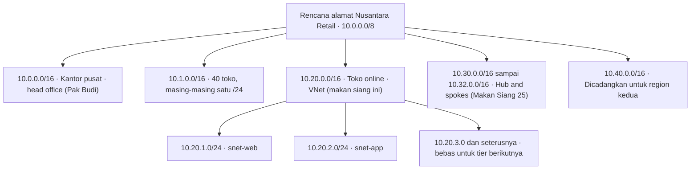
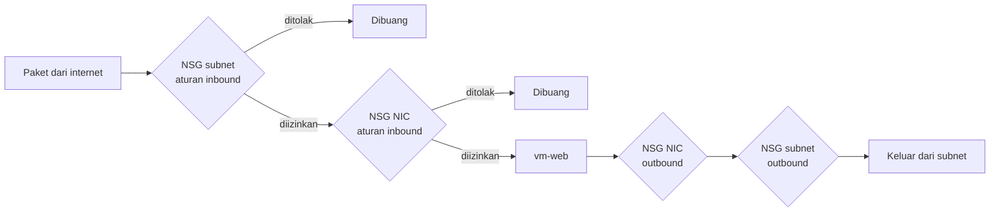
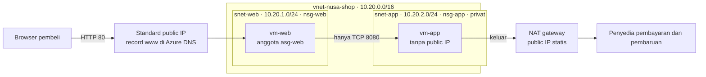

# Makan Siang 08 · Virtual Networking (Dasar)

🇬🇧 [Read in English](README.md)

> **Jalur:** Bulan inti · **Level:** Dasar · **Bagian 2:** Infrastruktur inti
> **Waktu:** 60 menit · **Makan siang prasyarat:** 01, 06
> **Area keterampilan AZ-900:** Menjelaskan arsitektur dan layanan Azure
> **Lab:** [Lab 08 · Membangun jaringan Nusantara Retail](../../labs/08-networking-basic/README.id.md) — sekitar 50 menit · biaya 💲💲
> **Penulis:** Stefanus Pinarta · [Tentang penulis](../../README.id.md#tentang-penulis)

| ⏱ Menit | Segmen |
|---:|---|
| 5 | Skenario dan tujuan |
| 25 | Bacaan |
| 15 | Demo: animasi interaktif (+ video panduan opsional) |
| 5 | Uji pemahaman |
| 5 | Poin penting dan pratinjau lab |
| 5 | Waktu cadangan — habiskan makan siang Anda 🍜 |

## 🍱 Menu hari ini

Setelah makan siang ini, Anda akan mampu:

- **Menjelaskan** bagaimana sebuah virtual network (*jaringan virtual*), address space-nya, dan subnet-subnetnya saling terkait, serta membaca notasi CIDR tanpa kalkulator.
- **Merencanakan** skema alamat IP untuk Nusantara Retail yang tidak akan pernah bertabrakan dengan jaringan kantor pusat.
- **Memprediksi** apakah sebuah paket diizinkan oleh network security group, dengan memakai prioritas, aturan default, service tag, dan application security group.
- **Memilih** metode outbound (jalan keluar) yang eksplisit untuk subnet privat, dan menjelaskan mengapa virtual network baru tidak lagi bisa menjangkau internet secara default.
- **Menggunakan** Azure DNS dan Network Watcher untuk menerbitkan nama dan memecahkan masalah lalu lintas berdasarkan bukti, bukan tebakan.

## 🏪 Sementara itu di Nusantara Retail

Selasa, pukul 12.05. VM (*komputer virtual*) toko online dari Makan Siang 06 sudah berjalan, dan Dewi sudah
menginginkan lebih. "Website dan logika pesanan seharusnya tidak tinggal di satu mesin yang terbuka ke mana-mana. Beri saya web tier
yang bisa dijangkau pembeli, dan app tier yang bahkan tidak bisa *dilihat* siapa pun dari internet."

Pak Budi datang membawa diagram cetak yang kertasnya sudah agak menguning. "Kantor pusat sudah memakai 10.0.0.0/16
selama dua belas tahun. Suatu hari nanti kita akan tersambung ke Azure. Kalau alamatnya sama, tidak ada yang bisa
dirutekan — dan saya tidak mau jadi orang yang mengganti penomoran empat puluh toko." Sebelum ia pergi, Rizky si
kontraktor mengirim pesan chat: bisakah SSH dibuka "dari mana saja, seminggu saja"? Ibu Sari hanya ingin tahu satu
hal: apakah semua ini akan lebih aman daripada server di sebelah pantry?

Hari ini Anda merancang jaringan tempat toko online akan tinggal. Bagaimana memberinya alamat privat yang terencana
dengan baik, di mana hanya lalu lintas yang Anda kehendaki yang bisa mengalir — masuk maupun keluar?

---

## 📖 Bacaan (≈25 menit)

### 1. Virtual network dan rencana alamat

**Virtual network (VNet)** adalah jaringan privat yang Anda definisikan di dalam satu region (*wilayah*) Azure. Semua
yang Anda tempatkan di dalamnya — VM, internal load balancer, private endpoint (*titik akhir privat*) — mendapat
alamat IP privat dari rentang yang Anda pilih, dan tidak ada apa pun dari luar yang bisa masuk kecuali Anda
mengizinkannya. Sebuah VNet membentang di semua availability zone (*zona ketersediaan*) di region-nya, jadi web
server di zone 1 bisa berbicara dengan app server di zone 3 tanpa pengaturan tambahan. VNet-nya sendiri gratis; Anda
membayar untuk apa yang berjalan di dalamnya dan untuk beberapa jenis lalu lintas.

Bayangkan VNet sebagai kompleks perumahan berpagar dengan satpam di gerbangnya. Rumah-rumah di dalamnya punya nomor
sendiri, warga bebas saling berkunjung, dan orang luar baru bisa masuk kalau diizinkan. Subnet, yang akan kita bahas
sebentar lagi, adalah blok-blok di dalam kompleks itu: Blok A untuk web server, Blok B untuk app server.

Rentang alamat yang boleh dipakai sebuah VNet disebut **address space**, ditulis dalam **notasi CIDR** (Classless
Inter-Domain Routing). CIDR tampak lebih seram daripada aslinya. Sebuah alamat IPv4 terdiri dari 32 bit. Angka setelah
garis miring menyatakan berapa banyak bit yang dikunci — itulah bagian jaringan. Sisa bitnya bebas Anda bagikan. Jadi
`10.20.0.0/16` mengunci 16 bit pertama (`10.20`) dan menyisakan 16 bit bebas: 2¹⁶ = 65.536 alamat, dari `10.20.0.0`
sampai `10.20.255.255`. Setiap kali angka setelah garis miring bertambah satu, ukuran bloknya terbelah dua. Ibaratnya
nomor telepon rumah: kode area 021 sudah pasti milik Jakarta, sedangkan digit sesudahnya bebas dibagikan ke
pelanggan. Makin panjang bagian yang dikunci, makin sedikit nomor yang tersisa untuk dibagikan.

| Blok CIDR | Jumlah alamat | Bisa dipakai di subnet Azure | Penggunaan umum di Nusantara Retail |
|---|---:|---:|---|
| /16 | 65.536 | (dibagi menjadi subnet) | Satu VNet per lingkungan (produksi, uji coba…) |
| /24 | 256 | 251 | Satu tier, misalnya web server |
| /26 | 64 | 59 | Subnet khusus untuk Azure Bastion atau firewall |
| /27 | 32 | 27 | Tier kecil dengan beberapa VM |
| /29 | 8 | 3 | Subnet terkecil yang diizinkan Azure |

Pilih address space dari rentang privat yang didefinisikan dalam RFC 1918 — dokumen standar internet yang menyisihkan
rentang khusus untuk jaringan internal: `10.0.0.0/8`, `172.16.0.0/12`, dan `192.168.0.0/16`. Azure juga memperlakukan
rentang bersama `100.64.0.0/10` sebagai privat. Beberapa rentang terlarang, misalnya `127.0.0.0/8` (loopback),
`169.254.0.0/16` (link-local), `224.0.0.0/4` (multicast), dan alamat platform `168.63.129.16`.

Aturan perencanaan terpenting adalah **tidak boleh tumpang tindih** (no overlap). Dua jaringan dengan rentang yang
tumpang tindih tidak bisa di-peering (Makan Siang 25) atau disambungkan dengan VPN — virtual private network,
sambungan privat terenkripsi (Makan Siang 26) — dan mengganti penomoran jaringan yang sedang berjalan biasanya berarti
membangunnya ulang. Bayangkan dua kompleks perumahan yang sama-sama punya "Jalan Melati No. 10", lalu pagar pemisahnya
dibongkar: kurir paket tidak akan tahu harus mengantar ke rumah yang mana. Kantor pusat Pak Budi sudah memakai
`10.0.0.0/16`, jadi toko online harus tinggal di tempat lain. Rencana yang masuk akal menyisihkan satu blok untuk
setiap keperluan, lengkap dengan ruang untuk tumbuh:

Satu /16 untuk toko online yang hari ini hanya butuh dua subnet kecil memang terlihat boros, tetapi alamat privat itu
gratis, sedangkan kehabisan alamat bisa menghabiskan satu akhir pekan Anda. Tuliskan rencananya — spreadsheet bersama
pun cukup — sebelum ada yang membuat VNet.

> [!TIP]
> Lingkungan produksi Nusantara Retail akan berjalan di Indonesia Central demi residensi data, sedangkan lab memakai
> Southeast Asia. Sebuah VNet tinggal di tepat satu region, jadi rencanakan blok alamat untuk seluruh perusahaan, bukan
> per region. Dengan begitu, region kedua bisa disambungkan belakangan tanpa bentrok.

### 2. Subnet, network interface, dan alamat IP

**Subnet** adalah sepotong dari address space VNet, misalnya `10.20.1.0/24` untuk web tier. Di subnet-lah Anda
memasang aturan keamanan, route table, dan NAT gateway, jadi subnet adalah alat utama Anda untuk memisahkan tier.
Rencanakan satu subnet per peran, bukan satu per VM.

Azure menyimpan **lima alamat di setiap subnet** untuk dirinya sendiri. Di `10.20.1.0/24`:

- `10.20.1.0` — alamat jaringan;
- `10.20.1.1` — default gateway yang disediakan Azure;
- `10.20.1.2` dan `10.20.1.3` — dipakai untuk memetakan Azure DNS ke dalam virtual network;
- `10.20.1.255` — alamat broadcast (Azure tidak mendukung broadcast, tetapi alamatnya tetap dicadangkan).

Jadi VM pertama di subnet itu mendapat `10.20.1.4`, dan sebuah /24 menampung 251 resource (*sumber daya*), bukan 256.
Beberapa layanan membutuhkan **subnet khusus** (dedicated subnet) dengan nama yang sudah ditentukan, misalnya
`GatewaySubnet` untuk VPN gateway, `AzureBastionSubnet`, dan `AzureFirewallSubnet`. Sisakan ruang untuk mereka sejak
sekarang: ukuran subnet hanya bisa diubah selama belum ada apa pun yang di-deploy di dalamnya.

VM tersambung ke subnet melalui **network interface (NIC)** — semacam kartu jaringan virtual — yang merupakan
resource Azure tersendiri. NIC menyimpan **alamat IP privat** VM, yang diberikan dari subnet secara dinamis (Azure
memilih alamat kosong berikutnya) atau statis (Anda yang memilih). Apa pun caranya, alamat itu tetap melekat pada NIC
sampai NIC dihapus, jadi "dinamis" tidak berarti alamatnya berganti saat VM di-restart. Di NIC jugalah public IP,
network security group tingkat NIC, dan keanggotaan application security group dipasang.

**Alamat public IP** juga merupakan resource tersendiri. Saat ini hanya **SKU** (varian produk) **Standard** yang
relevan: public IP SKU Basic sudah dipensiunkan pada 30 September 2025. Public IP Standard memakai alokasi statis dan
**aman secara default** (secure by default) — tidak menerima lalu lintas masuk apa pun sampai sebuah network security
group mengizinkannya. Ini kabar baik ketika Rizky meminta "SSH dari mana saja". Public IP ditagih selama resource-nya
ada, bahkan ketika tidak dipakai apa pun, jadi hapus yang sudah tidak Anda butuhkan.

Di dalam VNet, nama langsung bisa dipakai. **Azure-provided DNS**, yang dijangkau di `168.63.129.16`, memungkinkan
`vm-web` mencari `vm-app` berdasarkan nama host tanpa pengaturan apa pun. DNS (Domain Name System) adalah "buku
telepon" jaringan yang menerjemahkan nama menjadi alamat IP. Anda akan bertemu public DNS zone di bagian 5 dan private
DNS zone di Makan Siang 25.

### 3. Network security group: prioritas, aturan default, dan yang pertama cocok menang

**Network security group (NSG)** adalah daftar aturan allow (izinkan) dan deny (tolak) untuk lalu lintas yang masuk ke
atau keluar dari sebuah subnet atau NIC. Setiap aturan punya **prioritas** antara 100 dan 4096, sumber dan tujuan
(alamat IP, blok CIDR, service tag, atau application security group), port — nomor "pintu" layanan, misalnya 80 untuk
web dan 22 untuk SSH — protokol, dan tindakan (action). NSG bersifat **stateful**: kalau sebuah aturan mengizinkan
permintaan masuk, balasannya otomatis boleh keluar, begitu pula sebaliknya.

Setiap NSG juga berisi enam **aturan default**. Aturan ini tidak bisa dihapus, hanya bisa dikalahkan oleh aturan
dengan nomor yang lebih kecil:

| Prioritas | Nama | Arah | Efek |
|---:|---|---|---|
| 65000 | AllowVnetInBound | Inbound | Izinkan dari VirtualNetwork ke VirtualNetwork |
| 65001 | AllowAzureLoadBalancerInBound | Inbound | Izinkan health probe dari AzureLoadBalancer |
| 65500 | DenyAllInBound | Inbound | Tolak semua yang lain |
| 65000 | AllowVnetOutBound | Outbound | Izinkan dari VirtualNetwork ke VirtualNetwork |
| 65001 | AllowInternetOutBound | Outbound | Izinkan ke Internet |
| 65500 | DenyAllOutBound | Outbound | Tolak semua yang lain |

Baca tabel itu dua kali. Secara default, VM di dalam VNet bisa saling berbicara dengan bebas, boleh memulai koneksi ke
internet (kalau jalurnya ada — lihat bagian 4), dan tidak menerima apa pun dari internet.

**Cara evaluasinya sederhana dan tegas.** Azure mengurutkan aturan berdasarkan prioritas, nomor terkecil lebih dulu,
lalu memeriksanya satu per satu. **Aturan pertama yang cocok** dengan paket itulah yang memutuskan, dan evaluasi
berhenti. Deny di prioritas 200 mengalahkan allow di 300, sekalipun allow itu lebih spesifik. Karena itu, "izinkan
8080 dari web tier, tolak sisa VNet" membutuhkan allow dengan nomor yang lebih kecil daripada deny-nya.

Ibaratnya satpam kompleks yang memegang buku aturan bernomor. Ia membaca dari nomor terkecil, dan begitu menemukan
aturan yang cocok dengan tamu di depannya, ia langsung bertindak tanpa membuka halaman berikutnya. Tamu yang sudah
dipersilakan masuk boleh keluar lagi tanpa diperiksa ulang — itulah arti stateful.

Anda bisa memasang NSG di **subnet**, di **NIC**, atau di keduanya. Kalau keduanya ada, sebuah paket harus lolos dari
keduanya:

Untuk lalu lintas masuk (inbound), NSG subnet diperiksa lebih dulu, baru NSG NIC; untuk lalu lintas keluar
(outbound), urutannya terbalik. Tidak adanya allow di salah satu tingkat sudah cukup untuk memblokir lalu lintas —
lolos dari satpam gerbang belum tentu dibukakan pintu oleh pemilik rumah. Kebanyakan tim memilih NSG di subnet saja:
satu tempat untuk dibaca, satu tempat untuk diaudit. Ingat bahwa `az vm create` yang serba cepat atau wizard di portal
bisa diam-diam menambahkan NSG tingkat NIC untuk Anda — sumber klasik keluhan "port-nya sudah saya buka, kok masih
tertutup".

Dua fitur membuat kumpulan aturan tetap ringkas dan mudah dibaca. **Service tag** adalah nama yang dikelola Microsoft
untuk sekelompok alamat: `Internet`, `VirtualNetwork`, `AzureLoadBalancer`, `Storage`, `Sql`, `AzureCloud`, serta
varian regional seperti `Storage.SoutheastAsia`. Anda cukup menulis `Internet` alih-alih ribuan prefiks alamat, dan
Microsoft menjaga daftarnya tetap mutakhir. **Application security group (ASG)** memungkinkan Anda memberi nama pada
sebuah peran: masukkan NIC semua web server ke `asg-web`, lalu tulis "izinkan `asg-web` ke subnet app di port 8080".
Ketika Dewi menambah web server ketiga, ia cukup memasukkan NIC-nya ke grup itu, tanpa mengubah satu aturan pun. Semua
NIC dalam satu ASG harus berada di VNet yang sama.

Terakhir, Azure bisa menampilkan **effective security rules** sebuah NIC — gabungan aturan subnet dan NIC, dengan
service tag dan ASG yang sudah dijabarkan menjadi alamat sungguhan. Kalau ragu, baca tampilan itu, bukan catatan Anda
sendiri.

> [!WARNING]
> Tiga kesalahan NSG yang paling sering kami jumpai: membuka SSH (Secure Shell) atau RDP (Remote Desktop Protocol) ke
> `Any` "untuk sementara" (gunakan Azure Bastion atau Run Command sebagai gantinya), menaruh aturan deny di nomor yang
> lebih kecil daripada allow yang seharusnya dilengkapinya, dan melupakan NSG tingkat NIC yang diam-diam memblokir apa
> yang diizinkan NSG subnet. IP flow verify (bagian 5) menyebutkan dengan tepat aturan mana yang memutuskan.

### 4. Akses keluar: private subnet dan jalan keluar yang eksplisit

Selama bertahun-tahun, VM tanpa public IP tetap bisa menjangkau internet. Azure diam-diam memberinya alamat **default
outbound access** yang dimiliki Microsoft dan bisa berubah sewaktu-waktu. Praktis, tetapi implisit, tidak bisa
diprediksi, dan bertentangan dengan prinsip Zero Trust (jangan percaya begitu saja, selalu verifikasi).

Perilaku default itu sedang dihapus untuk jaringan baru. Virtual network yang dibuat dengan versi API yang dirilis
setelah **31 Maret 2026** secara default memakai **private subnet** (subnet privat) — subnet tanpa akses internet
keluar default — dan Azure portal sudah membuat subnet dengan cara itu. VNet yang sudah ada tidak diubah. Di private
subnet, VM tetap bisa menjangkau resource lain di VNet dan memakai Azure DNS, tetapi tidak bisa menjangkau public
endpoint (*titik akhir publik*) sampai Anda memberinya **metode outbound yang eksplisit**:

| Metode | Gunakan ketika | Waspadai |
|---|---|---|
| **NAT gateway** di subnet | Sebagian besar kasus: setiap VM di subnet berbagi satu atau beberapa public IP statis milik Anda | Ditagih per jam dan per GB yang diproses; satu NAT gateway per subnet; tidak pernah menerima koneksi masuk |
| **Public IP di NIC VM** | Satu VM yang juga harus bisa dijangkau dari internet | Membuka jalan masuk sekaligus jalan keluar; kunci dengan NSG |
| **Outbound rule di load balancer** | VM sudah berada di backend pool sebuah Standard public load balancer (Makan Siang 09) | Lebih banyak pengaturan yang harus dikelola, misalnya alokasi port SNAT (source NAT) |
| **Firewall atau appliance lewat route** | Semua lalu lintas keluar harus diinspeksi dan dicatat secara terpusat (Makan Siang 25) | Anda membayar appliance-nya dan harus merutekan lalu lintas melewatinya |

**NAT gateway** (NAT = Network Address Translation, penerjemahan alamat jaringan) adalah metode yang direkomendasikan
Microsoft untuk sebagian besar kasus. Anda memasangnya di sebuah subnet dan memberinya satu atau beberapa public IP
Standard (hingga 16) atau sebuah public IP prefix. Setelah itu, setiap VM di subnet tersebut memakai alamat-alamat itu
untuk koneksi keluar — tanpa perlu route table. Balasan bisa kembali masuk; koneksi masuk yang tidak diminta tidak akan
pernah bisa. Ibaratnya sambungan telepon kantor lewat operator: semua karyawan menelepon keluar dengan nomor kantor yang
sama, tetapi orang luar tidak bisa langsung menelepon ke meja karyawan tertentu. Karena alamat keluarnya statis,
penyedia pembayaran Nusantara Retail bisa memasukkannya ke allow list (daftar alamat yang diizinkan). NAT gateway
**Standard** berjalan di satu zone saja; SKU **StandardV2** bersifat zone-redundant dan membutuhkan public IP
StandardV2. NAT gateway juga lebih diutamakan: koneksi keluar baru dari subnet-nya akan melewatinya, bahkan dari VM
yang punya public IP sendiri.

> [!IMPORTANT]
> Aturan NSG yang *mengizinkan* lalu lintas keluar tidak menciptakan *jalur*. `AllowInternetOutBound` ada di setiap
> NSG, tetapi VM di private subnet tanpa NAT gateway atau public IP tetap tidak bisa menjangkau internet. Ibaratnya
> punya SIM tetapi jalannya belum dibangun: izin mengemudi Anda sah, namun tetap tidak ada jalan untuk dilalui. Ketika
> akses keluar gagal, periksa jalurnya, bukan hanya aturannya. Kalau Anda mengubah subnet yang sudah ada dari private
> menjadi non-private atau sebaliknya, hentikan (stop/deallocate) lalu nyalakan lagi VM-VM di dalamnya agar
> perubahannya berlaku.

### 5. Nama dan diagnostik: Azure DNS dan Network Watcher

**Azure DNS** meng-host DNS zone di name server global milik Microsoft. **Public DNS zone** menyimpan record untuk
domain milik Anda, misalnya `nusantararetail.co.id`. Saat zone dibuat, Azure memberinya empat name server dengan nama
seperti `ns1-01.azure-dns.com` dan `ns2-01.azure-dns.net`. Zone itu baru terlihat di internet setelah Anda
**mendelegasikan** domainnya: Anda memperbarui record NS domain tersebut di registrar domain (tempat Anda membeli
domain) agar menunjuk ke keempat server itu. Sebelum itu, Anda tetap bisa menguji dengan bertanya langsung ke name
server Azure memakai `nslookup` — persis seperti yang dilakukan di lab.

Di dalam zone, Anda membuat **record set**: `A` memetakan nama ke alamat IPv4, `AAAA` ke IPv6, `CNAME` menjadikan satu
nama sebagai alias dari nama lain, `MX` mengurus email, dan `TXT` menyimpan teks verifikasi. Setiap record punya
**time to live (TTL)** yang memberi tahu resolver berapa lama jawaban boleh disimpan di cache: buat singkat, misalnya
300 detik, selama konfigurasi masih sering berubah. **Alias record** bisa menunjuk langsung ke sebuah resource Azure
seperti public IP, dan ikut berubah kalau alamatnya berubah.

Resolusi nama *di dalam* VNet adalah pengaturan yang terpisah. Secara default, VNet memakai **Azure-provided name
resolution**: VM mengirim pertanyaan ke `168.63.129.16`, yang menjawab untuk nama host VM di VNet yang sama dan juga
menerjemahkan nama-nama di internet publik. Anda bisa mengganti VNet agar memakai **custom DNS server** — misalnya
domain controller di kantor pusat Pak Budi setelah VPN tersedia. VM baru mengambil perubahan itu saat memperbarui DHCP
lease-nya (DHCP adalah layanan yang membagikan alamat IP), jadi rencanakan restart. Perhatikan bahwa resolusi bawaan
Azure tidak menembus batas VNet: nama di VNet yang di-peering membutuhkan private DNS zone atau server DNS Anda sendiri.

Dua gagasan terkait akan muncul lagi nanti dalam kursus ini. **Private DNS zone** menyimpan nama yang hanya bisa
di-resolve oleh VNet Anda. Lalu, layanan PaaS (*platform sebagai layanan*) seperti Azure Storage secara default punya
**public endpoint** di internet; **private endpoint** memberi layanan tersebut alamat IP privat di dalam VNet Anda
sebagai gantinya. Makan Siang 24 dan 25 mempraktikkan keduanya.

Ketika lalu lintas berulah, andalkan **Azure Network Watcher**. Azure mengaktifkannya secara otomatis di setiap region
tempat Anda membuat VNet, dan alat-alatnya menjawab pertanyaan yang presisi:

| Alat | Pertanyaan yang dijawabnya |
|---|---|
| **IP flow verify** | Apakah paket ini boleh masuk ke atau keluar dari VM saya, dan aturan NSG mana yang memutuskan? |
| **NSG diagnostics** | Pertanyaan yang sama untuk VM, scale set, dan application gateway, dengan service tag sebagai sumber |
| **Effective security rules** | Seperti apa gabungan aturan di NIC ini saat ini? |
| **Next hop** | Ke mana Azure akan mengirim paket untuk tujuan ini? |
| **Connection troubleshoot** | Bisakah VM ini membuka koneksi ke VM, alamat, atau URL itu, dan di mana gagalnya? |
| **Packet capture** | Apa persisnya yang lewat di kabel? |
| **Flow logs** | Aliran mana saja yang diizinkan atau ditolak dari waktu ke waktu? Gunakan **VNet flow logs**: NSG flow logs sudah tidak bisa dibuat lagi dan pensiun pada 30 September 2027. |

### 6. Bagaimana semuanya menyatu untuk Nusantara Retail

Inilah jaringan yang akan Anda bangun di lab, sekaligus jaringan tempat Dewi akan men-deploy toko online:

Mari kita telusuri beberapa paket. Permintaan HTTP dari seorang pembeli sampai ke `vm-web` karena `nsg-web` mengizinkan
TCP 80 dari service tag `Internet` ke `asg-web`. Percobaan SSH Rizky dari sebuah kafe menabrak NSG yang sama, tidak
cocok dengan aturan apa pun sebelum `DenyAllInBound`, lalu dibuang; untuk perbaikan sesekali, ia memakai Run Command
saja. `vm-web` memanggil app tier di port 8080 dan lolos lewat aturan `nsg-app` di prioritas 100. Port lain dari dalam
VNet menabrak deny di prioritas 4000, jauh sebelum aturan default `AllowVnetInBound` di 65000 sempat tercapai.
`vm-app` tidak punya public IP dan berada di private subnet, jadi satu-satunya jalan keluarnya adalah NAT gateway,
dengan satu alamat yang bisa diprediksi. Pembeli menemukan situsnya lewat record `www` dan `shop` di Azure DNS. Dan
ketika ada yang rusak, IP flow verify memberi tahu aturan mana yang patut disalahkan.

Pertanyaan Ibu Sari adalah apakah ini lebih aman daripada server di sebelah pantry. Jawaban jujurnya: kini internet
hanya melihat satu port di satu mesin, app tier tidak terlihat dari luar, dan setiap pengecualian adalah aturan
tertulis yang punya nama dan prioritas.

Tim keuangan pasti akan bertanya berapa biayanya. VNet, subnet, NSG, dan ASG gratis. Anda membayar untuk VM, untuk
setiap public IP selama resource-nya ada, untuk NAT gateway (per jam ditambah per GB yang diprosesnya), untuk DNS zone
(per zone per bulan ditambah jumlah query), dan untuk data yang keluar dari Azure. Jangan menulis angka-angka ini di
slide hanya berdasarkan ingatan — masukkan desainnya ke pricing calculator (*kalkulator harga*), dan hapus resource lab
begitu Anda selesai.

> [!NOTE]
> **Renungkan sejenak:** Misalkan Dewi membangun VNet toko online di `10.0.0.0/16` karena alamat itu terasa akrab. Hari
> ini semuanya berjalan lancar. Apa yang rusak pada hari Pak Budi menyambungkan kantor pusat ke Azure, dan berapa
> ongkos perbaikannya?

Di makan siang berikutnya, Anda menempatkan dua web server di belakang sebuah Standard load balancer agar toko tetap
hidup saat satu server gagal. Siap untuk peering, routing, dan private endpoint? Lanjutkan dengan
[Makan Siang 25 · Virtual Networking (Lanjutan)](../25-networking-advanced/README.id.md).

---

## 🎬 Demo (≈15 menit)

1. **Animasi interaktif (≈6–8 menit):** [Buka demo](https://stefpin.github.io/azure-fundamentals-lunches/demos/08-networking-basic.html?lang=id) —
   tekan ▶ Putar atau telusuri langkah demi langkah sesuai kecepatan Anda. Sedang offline? Unduh
   [`docs/demos/08-networking-basic.html`](../../docs/demos/08-networking-basic.html) lalu buka di browser apa saja.
2. **Video panduan (≤ 6 menit):** _segera hadir_ — [baca naskah video](demo-video-script.id.md).

Yang perlu diperhatikan:

- Urutan gerbangnya: saat masuk, NSG subnet diperiksa sebelum NSG NIC, dan keduanya harus mengizinkan.
- Pemeriksa aturan (rule evaluator): nomor terkecil diperiksa lebih dulu, dan kecocokan pertama mengakhiri evaluasi.
- App tier yang privat: NSG-nya mengizinkan lalu lintas keluar ke internet, tetapi tidak ada yang bisa keluar sampai
  NAT gateway muncul.

## ✅ Uji pemahaman (≈5 menit)

1. Dewi butuh subnet untuk sekitar 20 VM dan ingin sedikit ruang cadangan. Apakah /27 cukup besar?
   

Lihat jawaban

   Ya. Sebuah /27 punya 32 alamat; Azure mencadangkan 5, sehingga tersisa 27 untuk VM. *Alasannya:* Azure selalu
   menyimpan empat alamat pertama dan alamat terakhir di setiap subnet.

   

2. Rizky berkata: "NSG NIC di `vm-web` sudah mengizinkan SSH dari IP saya, tetapi saya tetap tidak bisa tersambung."
   NSG subnet hanya punya satu aturan allow untuk HTTP ditambah aturan-aturan default. Apa yang terjadi?
   

Lihat jawaban

   Untuk lalu lintas masuk, NSG subnet dievaluasi lebih dulu. Tidak ada aturan di sana yang mengizinkan TCP 22, jadi
   `DenyAllInBound` (65500) membuang paketnya sebelum NSG NIC sempat diperiksa. *Alasannya:* sebuah paket harus
   diizinkan di setiap tingkat yang dilewatinya. (Perbaikan yang lebih baik adalah tidak membuka SSH sama sekali —
   gunakan Run Command atau Azure Bastion.)

   

3. `nsg-app` berisi *200 Deny-VNet-Inbound* (sumber VirtualNetwork, port apa saja) dan *300 Allow-Web-8080* (sumber
   `asg-web`, port 8080). Web server tidak bisa menjangkau aplikasi di port 8080. Apa yang Anda ubah?
   

Lihat jawaban

   Beri allow nomor yang lebih kecil daripada deny — misalnya 100 untuk allow dan 4000 untuk deny. *Alasannya:* aturan
   diperiksa mulai dari nomor terkecil, dan kecocokan pertama yang menang, jadi saat ini deny-lah yang cocok lebih dulu.

   

4. Pada Oktober 2026 Anda membuat VNet baru dengan Azure CLI. `vm-app` tidak punya public IP dan NSG-nya hanya berisi
   aturan default, tetapi VM itu tidak bisa mengunduh pembaruan. Apa perbaikan yang direkomendasikan?
   

Lihat jawaban

   Pasang NAT gateway dengan public IP Standard di subnet app. *Alasannya:* VNet baru memakai private subnet tanpa
   default outbound access, dan `AllowInternetOutBound` hanya mengizinkan lalu lintas — aturan itu tidak menciptakan
   jalur ke internet.

   

5. Anda membuat zone `nusantararetail.co.id` di Azure DNS dengan record `www`. Perintah
   `nslookup www.nusantararetail.co.id ns1-03.azure-dns.com` berhasil, tetapi pelanggan mendapat pesan "can't find".
   Apa yang kurang?
   

Lihat jawaban

   Delegasi: di registrar domain, atur record NS domain itu ke empat name server Azure DNS milik zone tersebut.
   *Alasannya:* resolver di internet hanya bertanya ke name server yang ditunjuk oleh zone induknya.

   

## 🧠 Poin penting

- Rencanakan alamat untuk seluruh perusahaan lebih dulu: rentang privat RFC 1918 yang tidak tumpang tindih dengan
  kantor pusat (`10.0.0.0/16`) maupun jaringan masa depan, karena mengganti penomoran belakangan berarti membangun ulang.
- Setiap subnet menyerahkan lima alamat kepada Azure, jadi VM pertama mendapat `.4`; sisakan ruang untuk subnet khusus
  seperti `AzureBastionSubnet`.
- Aturan NSG berprioritas 100 sampai 4096 dan kecocokan pertama yang menang; aturan default berada di 65000 ke atas.
  Untuk inbound, NSG subnet diperiksa sebelum NSG NIC, dan keduanya harus mengizinkan. Service tag dan ASG membuat
  aturan tetap ringkas.
- Public IP Standard tertutup sampai sebuah NSG membukanya, dan VNet baru mendapat private subnet: beri mereka jalan
  keluar yang eksplisit, biasanya NAT gateway. Allow di NSG adalah izin, bukan jalur.
- Azure DNS meng-host public zone (delegasikan di registrar Anda), dan Network Watcher — IP flow verify, effective
  security rules, next hop, VNet flow logs — mengubah tebakan menjadi bukti.

## 🗒️ Catatan lapangan dari Stefanus

> **Aturan "sementara" wajib punya pemilik dan tanggal berakhir.** Saat meninjau jaringan, saya membaca aturan NSG dari
> nomor terkecil ke atas, persis seperti Azure membacanya. Untuk setiap aturan allow, saya bertanya: *siapa yang
> memintanya, dan kapan aturan ini boleh dihapus?* Kalau tidak ada yang tahu, aturan itu kandidat kuat untuk dibuang.
> Aturan sementara ibarat kunci rumah yang dipinjamkan ke tukang renovasi: kalau tidak dicatat kapan harus kembali, ia
> akan beredar selamanya. Kebiasaan saya: beri nama aturan sesuai tujuannya, misalnya `Allow-Web-To-App-8080`, lalu
> tulis nama peminta dan tanggal tinjauan di kolom description. Dan ketika ada yang tidak tersambung, saya tidak
> menyentuh satu aturan pun sebelum IP flow verify atau effective security rules menunjukkan aturan mana yang
> memutuskan. Mengubah aturan berdasarkan firasat adalah cara tercepat melahirkan deny "siluman" berikutnya.

## 🔬 Lab Anda: Membangun jaringan Nusantara Retail

Anda membangun jaringan toko online dari ujung ke ujung: sebuah VNet dengan subnet web dan subnet app yang privat, NSG
dan sebuah application security group, VM web yang publik dan VM app yang privat, serta NAT gateway yang memberi app
tier jalan keluar yang bisa diprediksi. Anda membuktikan setiap aturan dengan lalu lintas sungguhan dan dengan IP flow
verify, menerbitkan nama `www` dan `shop` di sebuah public DNS zone, lalu merusak app tier dengan aturan deny
"siluman" berprioritas lebih tinggi (nomornya lebih kecil) — dan menemukannya.

- ⏱ Sekitar 50 menit · 💲💲 biaya kecil selama resource berjalan · bisa dikerjakan terpisah (tidak perlu lab sebelumnya)
- 👉 [Mulai Lab 08](../../labs/08-networking-basic/README.id.md)

## 📚 Pelajari lebih lanjut

- [Microsoft Learn: Ikhtisar network security group Azure](https://learn.microsoft.com/azure/virtual-network/network-security-groups-overview) — properti aturan, aturan default, dan pertimbangan platform dalam satu halaman.
- [Microsoft Learn: Apa itu Azure NAT Gateway?](https://learn.microsoft.com/azure/nat-gateway/nat-overview) — SKU, batasan, timer, dan bagaimana NAT gateway dibandingkan dengan metode outbound lainnya.
- [Microsoft Learn: Apa itu Azure Network Watcher?](https://learn.microsoft.com/azure/network-watcher/network-watcher-overview) — setiap alat diagnostik, lengkap dengan tautan ke quickstart.
- [Microsoft Learn: Quickstart — membuat Azure DNS zone dan record dengan Azure CLI](https://learn.microsoft.com/azure/dns/dns-getstarted-cli) — alur zone-dan-nslookup yang sama dengan lab.

---

⬅️ [Makan Siang 07 · Penyimpanan (Dasar)](../07-storage-basic/README.id.md) · 🏠 [Beranda kursus](../../README.id.md) · [Makan Siang 09 · Load Balancing (Dasar): Azure Load Balancer](../09-load-balancing-basic/README.id.md) ➡️

Terakhir divalidasi: Oktober 2026 · Menemukan informasi yang sudah usang? [Buka issue](../../CONTRIBUTING.md).
