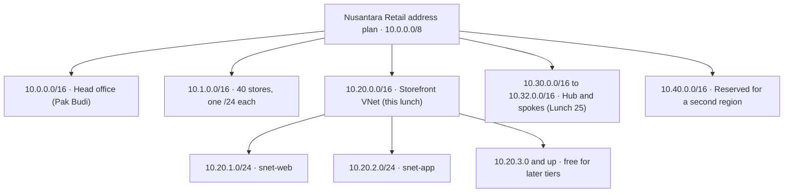
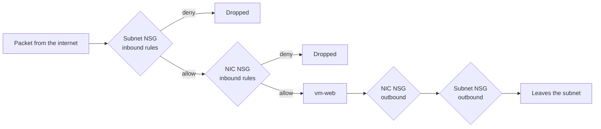
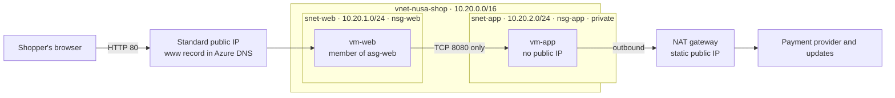

# Lunch 08 · Virtual Networking (Basic)

> **Track:** Core month · **Level:** Basic · **Part 2:** Core infrastructure
> **Time:** 60 minutes · **Prerequisite lunches:** 01, 06
> **AZ-900 skill area:** Describe Azure architecture and services
> **Lab:** [Lab 08 · Build Nusantara Retail's network](../../labs/08-networking-basic/README.md) — about 50 minutes · cost 💲💲

| ⏱ Minutes | Segment |
|---:|---|
| 5 | Scenario and objectives |
| 25 | Reading |
| 15 | Demo: interactive animation (+ optional walkthrough video) |
| 5 | Knowledge check |
| 5 | Key takeaways and lab preview |
| 5 | Buffer — finish your lunch 🍜 |

## 🍱 Today's menu

By the end of this lunch you will be able to:

- **Explain** how a virtual network, its address space and its subnets fit together, and read CIDR notation without a calculator.
- **Plan** an IP address scheme for Nusantara Retail that will never collide with the head-office network.
- **Predict** whether a packet is allowed by network security groups, using priorities, default rules, service tags and application security groups.
- **Choose** an explicit outbound method for a private subnet, and explain why new virtual networks no longer reach the internet by default.
- **Use** Azure DNS and Network Watcher to publish names and to troubleshoot traffic with evidence instead of guesses.

## 🏪 Meanwhile at Nusantara Retail

Tuesday, 12:05. The storefront VM from Lunch 06 is running, and Dewi already wants more. "The website and the order
logic shouldn't live on the same exposed machine. Give me a web tier that shoppers can reach and an app tier nobody on
the internet can even see."

Pak Budi arrives with a printed diagram, slightly yellow with age. "Head office has used 10.0.0.0/16 for twelve years.
One day we will connect to Azure. If you pick the same addresses, nothing will route — and I will not be the one
renumbering forty stores." Before he leaves, Rizky the contractor sends a chat message: could you open SSH "from
anywhere, just for a week"? Ibu Sari only wants to know whether all this will be safer than the server next to the
pantry.

Today you design the network the storefront will live in. How do you give it private, well-planned addresses where
only the traffic you intend can flow — in and out?

---

## 📖 Reading (≈25 minutes)

### 1. Virtual networks and address plans

A **virtual network (VNet)** is a private network that you define inside one Azure region. Everything you place in it
— VMs, internal load balancers, private endpoints — gets a private IP address from ranges you choose, and nothing
outside can reach in unless you allow it. A VNet stretches across all the availability zones of its region, so a web
server in zone 1 can talk to an app server in zone 3 without extra setup. The VNet itself is free; you pay for what runs
inside it and for some kinds of traffic.

The ranges a VNet may use are its **address space**, written in **CIDR notation** (Classless Inter-Domain Routing).
CIDR looks scarier than it is. An IPv4 address has 32 bits. The number after the slash says how many of those bits are
fixed — the network part. The remaining bits are yours to hand out. So `10.20.0.0/16` fixes the first 16 bits (`10.20`)
and leaves 16 bits free: 2¹⁶ = 65,536 addresses, from `10.20.0.0` to `10.20.255.255`. Every time the number after the
slash grows by one, the block halves.

| CIDR block | Addresses | Usable in an Azure subnet | Typical use at Nusantara Retail |
|---|---:|---:|---|
| /16 | 65,536 | (split into subnets) | One VNet per environment |
| /24 | 256 | 251 | A tier such as the web servers |
| /26 | 64 | 59 | Dedicated subnets for Azure Bastion or a firewall |
| /27 | 32 | 27 | A small tier with a handful of VMs |
| /29 | 8 | 3 | The smallest subnet Azure allows |

Pick address spaces from the private ranges defined in RFC 1918: `10.0.0.0/8`, `172.16.0.0/12` and `192.168.0.0/16`.
Azure also treats the shared range `100.64.0.0/10` as private. A few ranges are off limits, such as `127.0.0.0/8`
(loopback), `169.254.0.0/16` (link-local), `224.0.0.0/4` (multicast) and the platform address `168.63.129.16`.

The most important planning rule is **no overlap**. Two networks with overlapping ranges can't be peered (Lunch 25) or
joined with a VPN (Lunch 26), and renumbering a running network usually means rebuilding it. Pak Budi's head office
already owns `10.0.0.0/16`, so the storefront must live elsewhere. A sensible plan reserves a block per purpose, with
room to grow:

A /16 for a storefront that needs two small subnets today looks generous, but private addresses cost nothing and
running out costs a weekend. Write the plan down — a shared spreadsheet is fine — before anyone creates a VNet.

> [!TIP]
> Production for Nusantara Retail would run in Indonesia Central for data residency, while the labs use Southeast Asia.
> A VNet lives in exactly one region, so plan address blocks for the whole company, not per region. A second region can
> then be connected later without a clash.

### 2. Subnets, network interfaces and IP addresses

A **subnet** is a slice of the VNet's address space, such as `10.20.1.0/24` for the web tier. Subnets are where you
attach security rules, route tables and NAT gateways, so they are your main tool for separating tiers. Plan one subnet
per role, not one per VM.

Azure keeps **five addresses in every subnet** for itself. In `10.20.1.0/24`:

- `10.20.1.0` — the network address;
- `10.20.1.1` — the default gateway that Azure provides;
- `10.20.1.2` and `10.20.1.3` — used to map Azure DNS into the virtual network;
- `10.20.1.255` — the broadcast address (Azure doesn't support broadcast, but the address stays reserved).

So the first VM in that subnet gets `10.20.1.4`, and a /24 holds 251 resources, not 256. Some services need a
**dedicated subnet** with a fixed name, for example `GatewaySubnet` for VPN gateways, `AzureBastionSubnet` and
`AzureFirewallSubnet`. Leave room for them now: you can only resize a subnet while nothing is deployed in it.

A VM connects to a subnet through a **network interface (NIC)**, which is a separate Azure resource. The NIC holds the
VM's **private IP address**, assigned from the subnet either dynamically (Azure picks the next free one) or statically
(you pick). Either way the address stays with the NIC until you delete it, so "dynamic" doesn't mean it changes on
reboot. The NIC is also where a public IP, a NIC-level network security group and application security group
membership are attached.

A **public IP address** is its own resource too. Only the **Standard SKU** matters today: Basic SKU public IPs were
retired on September 30, 2025. Standard public IPs use static allocation and are **secure by default** — they accept no
inbound traffic until a network security group allows it. That is good news when Rizky asks for "SSH from anywhere". A
public IP is billed while it exists, even when nothing uses it, so delete the ones you no longer need.

Inside the VNet, names just work. **Azure-provided DNS**, reached at `168.63.129.16`, lets `vm-web` look up `vm-app` by
host name with no setup. You meet public DNS zones in section 5 and private DNS zones in Lunch 25.

### 3. Network security groups: priorities, defaults and first match wins

A **network security group (NSG)** is a list of allow and deny rules for traffic entering or leaving a subnet or a NIC.
Each rule has a **priority** between 100 and 4096, a source and a destination (an IP address, a CIDR block, a service
tag or an application security group), ports, a protocol and an action. NSGs are **stateful**: if a rule lets a request
in, the reply goes back out automatically, and the other way round.

Every NSG also contains six **default rules**. You can't delete them, only override them with lower-numbered rules:

| Priority | Name | Direction | Effect |
|---:|---|---|---|
| 65000 | AllowVnetInBound | Inbound | Allow from VirtualNetwork to VirtualNetwork |
| 65001 | AllowAzureLoadBalancerInBound | Inbound | Allow health probes from AzureLoadBalancer |
| 65500 | DenyAllInBound | Inbound | Deny everything else |
| 65000 | AllowVnetOutBound | Outbound | Allow from VirtualNetwork to VirtualNetwork |
| 65001 | AllowInternetOutBound | Outbound | Allow to Internet |
| 65500 | DenyAllOutBound | Outbound | Deny everything else |

Read that table twice. By default, VMs in a VNet can talk to each other freely, may start connections to the internet
(if a path exists — see section 4), and receive nothing from the internet.

**Evaluation is simple and strict.** Azure sorts the rules by priority, lowest number first, and checks them one by
one. The **first rule that matches** the packet decides, and evaluation stops. A deny at priority 200 beats an allow at
300, even when the allow is more specific. That's why "allow 8080 from the web tier, deny the rest of the VNet" needs
the allow at a lower number than the deny.

You can attach an NSG to a **subnet**, to a **NIC**, or to both. When both exist, a packet must pass both:

Inbound, the subnet NSG goes first and the NIC NSG second; outbound, it's the reverse. A missing allow at either level
blocks the traffic. Most teams prefer subnet NSGs only: one place to read, one place to audit. Remember that a quick
`az vm create` or portal wizard may add a NIC-level NSG for you — a classic source of "I opened the port and it's still
closed".

Two features keep rule sets short and readable. **Service tags** are Microsoft-maintained names for groups of
addresses: `Internet`, `VirtualNetwork`, `AzureLoadBalancer`, `Storage`, `Sql`, `AzureCloud`, and regional variants
such as `Storage.SoutheastAsia`. You write `Internet` instead of thousands of prefixes, and Microsoft keeps the list
current. **Application security groups (ASGs)** let you name a role: put the NICs of all web servers into `asg-web`,
then write "allow `asg-web` to the app subnet on 8080". When Dewi adds a third web server, she adds its NIC to the group
and no rule changes. All NICs in one ASG must sit in the same VNet.

Finally, Azure can show the **effective security rules** of a NIC — the merged view of subnet and NIC rules, with
service tags and ASGs expanded into real addresses. When in doubt, read those rather than your own notes.

> [!WARNING]
> The three NSG mistakes we see most: opening SSH or RDP to `Any` "temporarily" (use Azure Bastion or Run Command
> instead), placing a deny rule at a lower number than the allow it was meant to complement, and forgetting a NIC-level
> NSG that silently blocks what the subnet NSG allows. IP flow verify (section 5) names the exact rule that decided.

### 4. Outbound access: private subnets and explicit egress

For years, a VM without a public IP could still reach the internet. Azure quietly gave it a **default outbound
access** address that Microsoft owned and could change at any time. Convenient, but implicit, unpredictable and at odds
with Zero Trust.

That default is going away for new networks. Virtual networks created with API versions released after **March 31,
2026** default to **private subnets** — subnets without default outbound internet access — and the Azure portal
already creates subnets that way. Existing VNets are not changed. In a private subnet a VM can still reach other
resources in the VNet and use Azure DNS, but it can't reach public endpoints until you give it an **explicit outbound
method**:

| Method | Use it when | Watch out for |
|---|---|---|
| **NAT gateway** on the subnet | Most cases: every VM in the subnet shares one or more static public IPs you own | Billed per hour and per GB processed; one NAT gateway per subnet; never accepts inbound connections |
| **Public IP on the VM's NIC** | A single VM that must also be reachable from the internet | Opens a way in as well as out; lock it down with an NSG |
| **Load balancer outbound rules** | The VMs already sit in a Standard public load balancer's backend pool (Lunch 09) | More settings to manage, such as SNAT port allocation |
| **Firewall or appliance via a route** | All outbound traffic must be inspected and logged centrally (Lunch 25) | You pay for the appliance and must route traffic through it |

The **NAT gateway** is the method Microsoft recommends for most cases. You attach it to a subnet and give it one or
more Standard public IPs (up to 16) or a public IP prefix. Every VM in that subnet then uses those addresses for
outbound connections — no route table needed. Replies come back; unsolicited inbound connections never do. Because the
outbound address is static, Nusantara Retail's payment provider can add it to an allow list. A **Standard** NAT gateway
runs in a single zone; the **StandardV2** SKU is zone-redundant and needs StandardV2 public IPs. A NAT gateway also
takes precedence: new outbound connections from its subnet use it, even from VMs that have their own public IP.

> [!IMPORTANT]
> An NSG rule that *allows* outbound traffic doesn't create a *path*. `AllowInternetOutBound` is in every NSG, yet a VM
> in a private subnet without a NAT gateway or public IP still can't reach the internet. When outbound fails, check the
> path as well as the rules. If you switch an existing subnet between private and non-private, stop (deallocate) and
> start its VMs so the change applies to them.

### 5. Names and diagnostics: Azure DNS and Network Watcher

**Azure DNS** hosts DNS zones on Microsoft's global name servers. A **public DNS zone** holds the records for a domain
you own, such as `nusantararetail.co.id`. When you create the zone, Azure assigns it four name servers with names like
`ns1-01.azure-dns.com` and `ns2-01.azure-dns.net`. The zone only becomes visible on the internet after you **delegate**
the domain: you update its NS records at your domain registrar so they point to those four servers. Until then you can
still test by asking an Azure name server directly with `nslookup` — exactly what the lab does.

Inside a zone you create **record sets**: `A` maps a name to an IPv4 address, `AAAA` to IPv6, `CNAME` makes one name an
alias of another, `MX` handles mail and `TXT` holds verification strings. Each has a **time to live (TTL)** that tells
resolvers how long to cache the answer: keep it short, such as 300 seconds, while things change. An **alias record**
can point straight at an Azure resource such as a public IP, and follows it if the address changes.

Name resolution *inside* a VNet is a separate setting. By default a VNet uses **Azure-provided name resolution**: VMs
send queries to `168.63.129.16`, which answers for VM host names in the same VNet and resolves public internet names
too. You can switch a VNet to **custom DNS servers** instead — for example Pak Budi's head-office domain
controllers once a VPN exists. VMs pick up the change when they renew their DHCP lease, so plan a restart. Note that
Azure-provided resolution doesn't cross VNet boundaries: names in a peered VNet need a private DNS zone or your own DNS
servers.

Two related ideas return later in the course. **Private DNS zones** hold names that only your VNets can resolve. And
PaaS services such as Azure Storage have **public endpoints** on the internet by default; a **private endpoint** gives
such a service a private IP address inside your VNet instead. Lunches 24 and 25 put both to work.

When traffic misbehaves, reach for **Azure Network Watcher**. Azure enables it automatically in each region where you
create a VNet, and its tools answer precise questions:

| Tool | Question it answers |
|---|---|
| **IP flow verify** | Is this packet allowed to or from my VM, and which NSG rule decided? |
| **NSG diagnostics** | The same question for VMs, scale sets and application gateways, with service tags as sources |
| **Effective security rules** | What is the merged rule set on this NIC right now? |
| **Next hop** | Where will Azure send a packet for this destination? |
| **Connection troubleshoot** | Can this VM open a connection to that VM, address or URL, and where does it fail? |
| **Packet capture** | What exactly is on the wire? |
| **Flow logs** | Which flows were allowed or denied over time? Use **VNet flow logs**: NSG flow logs can no longer be created and retire on September 30, 2027. |

### 6. How it fits together for Nusantara Retail

Here is the network you will build in the lab, and the one Dewi will deploy the storefront into:

Walk a few packets through it. A shopper's HTTP request reaches `vm-web` because `nsg-web` allows TCP 80 from the
`Internet` service tag to `asg-web`. Rizky's SSH attempt from a café hits the same NSG, matches nothing before
`DenyAllInBound`, and is dropped; for the occasional fix he uses Run Command instead. `vm-web` calls the app tier on
port 8080 and passes `nsg-app`'s rule at priority 100. Any other port from inside the VNet hits a deny at priority 4000,
long before the default `AllowVnetInBound` at 65000 is reached. `vm-app` has no public IP and sits in a private subnet,
so its only way out is the NAT gateway, with one predictable address. Shoppers find the site through the `www` and
`shop` records in Azure DNS. And when something breaks, IP flow verify tells you which rule to blame.

Ibu Sari's question was whether this is safer than the pantry server. The honest answer: the internet now sees one port
on one machine, the app tier is invisible from outside, and every exception is a written rule with a name and a
priority.

The finance team will ask what it costs. The VNet, subnets, NSGs and ASGs are free. You pay for the VMs, for each
public IP while it exists, for the NAT gateway (per hour plus per GB it processes), for the DNS zone (per zone per month
plus queries) and for data leaving Azure. None of these numbers belong in a slide deck from memory — put the design
into the pricing calculator, and delete lab resources the moment you finish.

> [!NOTE]
> **Pause and think:** Suppose Dewi had built the storefront VNet on `10.0.0.0/16` because the address looked familiar.
> Everything works today. What breaks on the day Pak Budi connects head office to Azure, and what would the fix cost?

In the next lunch you put two web servers behind a Standard load balancer so the shop survives a server failure. Ready
for peering, routing and private endpoints? Continue with [Lunch 25 · Virtual Networking (Advanced)](../25-networking-advanced/README.md).

---

## 🎬 Demo (≈15 minutes)

1. **Interactive animation (≈6–8 min):** [Open the demo](https://stefpin.github.io/azure-fundamentals-lunches/demos/08-networking-basic.html) —
   press ▶ Play or step through it at your own pace. Offline? Download
   [`docs/demos/08-networking-basic.html`](../../docs/demos/08-networking-basic.html) and open it in any browser.
2. **Walkthrough video (≤ 6 min):** _coming soon_ — [read the walkthrough script](demo-video-script.md).

What to watch for:

- The order of the gates: on the way in, the subnet NSG is checked before the NIC NSG, and both must allow.
- The rule evaluator: the lowest number is checked first, and the first match ends the evaluation.
- The private app tier: its NSG allows outbound internet traffic, yet nothing leaves until a NAT gateway appears.

## ✅ Knowledge check (≈5 minutes)

1. Dewi needs a subnet for about 20 VMs and wants a little headroom. Is a /27 big enough?
   

Show answer

   Yes. A /27 has 32 addresses; Azure reserves 5, which leaves 27 for VMs. *Why:* Azure always keeps the first four
   addresses and the last address of every subnet.

   

2. Rizky says: "The NIC NSG on `vm-web` allows SSH from my IP, but I still can't connect." The subnet NSG has only an
   HTTP allow rule plus the defaults. What is happening?
   

Show answer

   The subnet NSG is evaluated first for inbound traffic. Nothing there allows TCP 22, so `DenyAllInBound` (65500) drops
   the packet before the NIC NSG is consulted. *Why:* a packet must be allowed at every level it meets. (The better fix
   is not to open SSH at all — use Run Command or Azure Bastion.)

   

3. `nsg-app` contains *200 Deny-VNet-Inbound* (source VirtualNetwork, any port) and *300 Allow-Web-8080* (source
   `asg-web`, port 8080). The web servers can't reach the app on 8080. What do you change?
   

Show answer

   Give the allow a lower number than the deny — for example 100 for the allow and 4000 for the deny. *Why:* rules are
   checked from the lowest number up, and the first match wins, so the deny currently matches first.

   

4. In October 2026 you create a new VNet with the Azure CLI. `vm-app` has no public IP and its NSG has only the default
   rules, yet it can't download updates. What is the recommended fix?
   

Show answer

   Attach a NAT gateway with a Standard public IP to the app subnet. *Why:* new VNets use private subnets without
   default outbound access, and `AllowInternetOutBound` only permits traffic — it doesn't create a path to the internet.

   

5. You created the zone `nusantararetail.co.id` in Azure DNS with a `www` record. `nslookup www.nusantararetail.co.id
   ns1-03.azure-dns.com` works, but customers get "can't find". What's missing?
   

Show answer

   Delegation: at the domain registrar, set the domain's NS records to the four Azure DNS name servers of the zone.
   *Why:* resolvers on the internet only ask the name servers that the parent zone points them to.

   

## 🧠 Key takeaways

- Plan addresses for the whole company first: private RFC 1918 ranges with no overlap with head office (`10.0.0.0/16`)
  or future networks, because renumbering later means rebuilding.
- Every subnet gives five addresses to Azure, so the first VM gets `.4`; leave room for dedicated subnets such as
  `AzureBastionSubnet`.
- NSG rules run from priority 100 to 4096 and the first match wins; default rules sit at 65000 and above. Inbound, the
  subnet NSG comes before the NIC NSG, and both must allow. Service tags and ASGs keep rules short.
- Standard public IPs are closed until an NSG opens them, and new VNets get private subnets: give them an explicit way
  out, usually a NAT gateway. An NSG allow is permission, not a path.
- Azure DNS hosts public zones (delegate them at your registrar), and Network Watcher — IP flow verify, effective
  security rules, next hop, VNet flow logs — turns guessing into evidence.

## 🔬 Your lab: Build Nusantara Retail's network

You build the storefront network end to end: a VNet with private web and app subnets, NSGs and an application
security group, a public web VM and a private app VM, and a NAT gateway that gives the app tier a predictable way out.
You prove each rule with real traffic and with IP flow verify, publish `www` and `shop` names in a public DNS zone, and
then break the app tier with a sneaky higher-priority deny rule — and find it.

- ⏱ About 50 minutes · 💲💲 small charges while running · works on its own (no earlier lab needed)
- 👉 [Start Lab 08](../../labs/08-networking-basic/README.md)

## 📚 Go further

- [Microsoft Learn: Azure network security groups overview](https://learn.microsoft.com/azure/virtual-network/network-security-groups-overview) — rule properties, the default rules and platform considerations on one page.
- [Microsoft Learn: What is Azure NAT Gateway?](https://learn.microsoft.com/azure/nat-gateway/nat-overview) — SKUs, limits, timers and how NAT gateway ranks against other outbound methods.
- [Microsoft Learn: What is Azure Network Watcher?](https://learn.microsoft.com/azure/network-watcher/network-watcher-overview) — every diagnostic tool, with links to quickstarts.
- [Microsoft Learn: Quickstart — create an Azure DNS zone and record using Azure CLI](https://learn.microsoft.com/azure/dns/dns-getstarted-cli) — the same zone-and-nslookup flow as the lab.

---

⬅️ [Lunch 07 · Storage (Basic)](../07-storage-basic/README.md) · 🏠 [Course home](../../README.md) · [Lunch 09 · Load Balancing (Basic): Azure Load Balancer](../09-load-balancing-basic/README.md) ➡️

Last validated: October 2026 · Spotted something out of date? [Open an issue](../../CONTRIBUTING.md).
