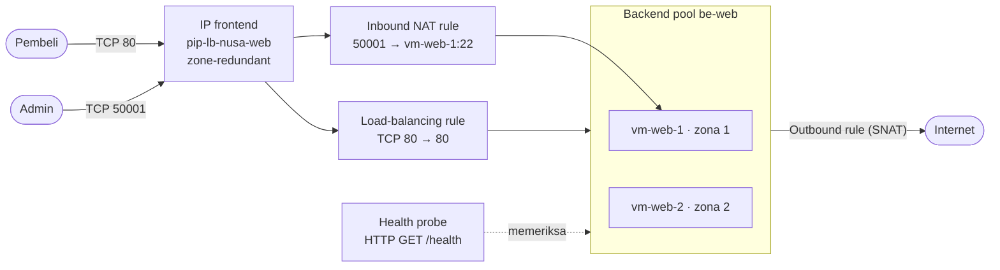
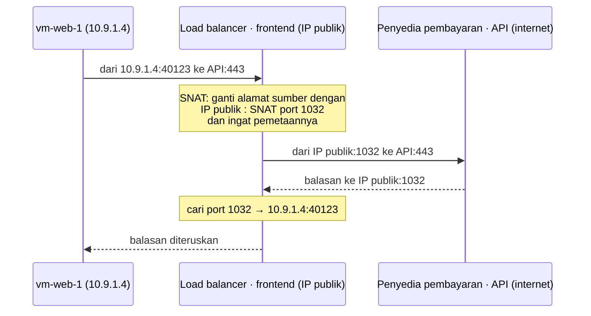

# Makan Siang 09 · Load Balancing (Dasar): Azure Load Balancer

🇬🇧 [Read in English](README.md)

> **Jalur:** Bulan inti · **Level:** Dasar · **Bagian 2:** Infrastruktur inti
> **Waktu:** 60 menit · **Makan siang prasyarat:** 03, 06, 08
> **Area keterampilan AZ-900:** Menjelaskan arsitektur dan layanan Azure
> **Lab:** [Lab 09 · Menjaga toko tetap buka saat server gagal](../../labs/09-load-balancing-basic/README.id.md) — sekitar 50 menit · biaya 💲💲
> **Penulis:** Stefanus Pinarta · [Tentang penulis](../../README.id.md#tentang-penulis)

| ⏱ Menit | Segmen |
|---:|---|
| 5 | Skenario dan tujuan |
| 25 | Bacaan |
| 15 | Demo: animasi interaktif (+ video panduan opsional) |
| 5 | Uji pemahaman |
| 5 | Poin penting dan pratinjau lab |
| 5 | Waktu cadangan — habiskan makan siang Anda 🍜 |

## 🍱 Menu hari ini

Setelah makan siang ini, Anda akan mampu:

- **Menjelaskan** mengapa load balancer adalah langkah pertama dari "satu server" menuju "selalu buka", dan apa arti
  *layer 4*.
- **Menguraikan** bagian-bagian Azure Standard Load Balancer: frontend, backend pool, health probe, load-balancing rule,
  inbound NAT rule, dan outbound rule.
- **Memilih** antara load balancer publik dan internal, serta di antara mode-mode distribusinya.
- **Menjelaskan** dengan bahasa sederhana cara kerja koneksi keluar (outbound) dan SNAT, serta mengapa jaringan baru
  membutuhkan metode outbound yang eksplisit.
- **Mengenali** kapan Application Gateway, Front Door, atau Traffic Manager menjadi alat yang lebih tepat.

## 🏪 Sementara itu di Nusantara Retail

Dewi sudah mengerjakan PR-nya. Toko online kini berjalan di dua virtual machine (*komputer virtual*) Ubuntu: `vm-web-1`
di availability zone (*zona ketersediaan*) 1 dan `vm-web-2` di zona 2, di dalam subnet privat yang dirancang Pak Budi
pada Makan Siang 08. Masalahnya tinggal satu: pembeli hanya mengenal satu alamat, dan saat ini alamat itu mengarah ke
`vm-web-1`. Kalau VM itu di-restart untuk patching, toko pun tutup, padahal kembarannya yang sehat walafiat sedang
menganggur di zona sebelah.

Dalam rapat hari Senin, Ibu Sari bicara blak-blakan. "Dua server tidak ada gunanya kalau pelanggan hanya bisa menemukan
satu. Lagi pula, kata Pak Budi, sekarang dia bahkan tidak bisa login ke server-server itu karena keduanya tidak punya
alamat publik lagi." Rizky, sang kontraktor, menambahkan bahwa sejak perubahan jaringan, server-server itu juga gagal
mengunduh update keamanan. Tiga keluhan, satu akar masalah: server-server itu tidak punya pintu depan bersama.

Pertanyaan hari ini: **bagaimana memberi dua server satu alamat, mengirim pembeli hanya ke server yang sehat, dan tetap
membiarkan administrator serta update keluar-masuk dengan aman?**

---

## 📖 Bacaan (≈25 menit)

### 1. Satu alamat, banyak server: mengapa perlu load balancing

Server tunggal adalah **titik kegagalan tunggal** (*single point of failure*): begitu server itu berhenti, layanannya
ikut berhenti. Di Makan Siang 02 Anda sudah berkenalan dengan dua cara untuk tumbuh. **Scale up** (memakai VM yang lebih
besar) punya batas atas dan tetap menyisakan satu mesin saja. **Scale out** (menambah jumlah VM) tidak punya batas
seperti itu, tetapi memunculkan pertanyaan baru: setiap pelanggan harus berbicara dengan server yang mana?

**Load balancer** (*penyeimbang beban*) menjawab pertanyaan itu. Ia memegang satu alamat, menerima lalu lintas untuk
seluruh kelompok server, lalu meneruskan setiap koneksi baru ke salah satu dari beberapa server. Ia juga terus memeriksa
server mana yang sehat, sehingga server yang rusak diam-diam berhenti menerima pelanggan.

Bayangkan kantor cabang bank dengan beberapa teller. Nasabah cukup tahu satu pintu masuk, lalu mesin antrean memanggil
nomor mereka ke loket yang sedang buka. Kalau seorang teller istirahat, lampu loketnya dipadamkan dan tidak ada nomor
yang dipanggil ke sana, sementara nasabah tetap masuk lewat pintu yang sama. Load balancer adalah mesin antrean itu, dan
health probe—yang akan kita bahas sebentar lagi—adalah cara mesin itu tahu loket mana yang lampunya menyala.

Satu komponen ini memberi Nusantara Retail empat hal sekaligus:

- **Ketersediaan.** VM yang gagal, layanan web yang crash, atau bahkan satu availability zone yang lumpuh tidak lagi
  membuat toko tutup.
- **Skala.** Saat promo 12.12 tiba, Dewi cukup menambahkan VM ketiga ke kelompok itu, bukan mengganti servernya.
- **Pemeliharaan tanpa downtime.** Pak Budi bisa mem-patch `vm-web-1` sementara `vm-web-2` menanggung semua lalu lintas,
  jadi toko tetap buka tanpa *downtime* (waktu henti).
- **Alamat yang stabil.** Pembeli, record DNS (entri "buku telepon" internet yang menerjemahkan nama domain menjadi
  alamat IP), dan daftar izin (allow list) milik penyedia pembayaran tetap memakai satu alamat IP, sementara server di
  belakangnya datang dan pergi.

Load balancer berbeda-beda dalam hal *seberapa banyak isi percakapan yang mereka pahami*. Orang jaringan
menggambarkannya dengan lapisan (layer) model OSI, yaitu cara baku membagi komunikasi jaringan menjadi tujuh lapisan.
Anda hanya perlu dua di antaranya. Ibaratnya pengiriman paket: load balancer layer 4 seperti kurir yang hanya membaca
label alamat di luar paket lalu mengantarnya tanpa pernah membukanya, sedangkan load balancer layer 7 seperti
resepsionis kantor yang membuka amplop, membaca isi suratnya, lalu memutuskan surat itu harus diantar ke bagian mana.

| | Layer 4 (transport) | Layer 7 (aplikasi) |
|---|---|---|
| Apa yang dilihatnya | alamat IP, port, dan protokol (TCP atau UDP) | request HTTP itu sendiri: host name, path URL, header, cookie |
| Apa yang dilakukannya dengan koneksi | meneruskan paket langsung ke satu server | mengakhiri koneksi dari klien dan membuka koneksi baru ke server (sebagai *proxy*, alias perantara) |
| Bisakah mengarahkan `/images` ke server lain? | tidak — ia tidak pernah membaca URL | ya |
| Bisakah mendekripsi HTTPS atau menjalankan web application firewall (WAF, penyaring serangan terhadap aplikasi web)? | tidak | ya |
| Siapa yang dilihat server sebagai klien | alamat IP klien yang sebenarnya | alamat proxy (IP klien disimpan di sebuah header) |
| Contoh di Azure | **Azure Load Balancer** | Application Gateway, Front Door |

**Azure Load Balancer** adalah load balancer layer 4 milik Azure. Ia menangani lalu lintas TCP atau UDP apa pun, bukan
hanya lalu lintas web; hampir tidak menambah jeda karena tidak pernah membuka atau membaca data Anda; dan sanggup
menampung jutaan aliran koneksi (*flow*). Ini layanan *regional*: satu load balancer melayani resource (*sumber daya*)
di satu region (*wilayah*); ada juga tier global, lihat bagian 5. Karena tidak membaca isi request, load balancer ini
juga paling mudah dinalar cara kerjanya, sehingga tepat dijadikan titik awal.

> [!IMPORTANT]
> Azure Load Balancer tersedia dalam SKU (varian produk) **Standard** dan **Gateway**. SKU **Basic** — beserta alamat IP
> publik Basic — sudah **dipensiunkan pada 30 September 2025**. Tutorial lama yang memakai `--sku Basic` tidak berlaku
> lagi. Seluruh kursus ini memakai Standard, yang menambahkan dukungan availability zone, jaringan yang *secure by
> default* (aman sejak awal), outbound rule, dan SLA (*service level agreement*, janji ketersediaan dari Microsoft)
> sebesar 99,99% (periksa halaman SLA untuk syarat-syaratnya).

### 2. Anatomi Standard load balancer

Load balancer adalah sekumpulan kecil bagian bernama yang saling merujuk. Begitu Anda mengenal bagian-bagiannya, wizard
di portal, CLI, dan file Bicep akan terlihat sama saja.

| Komponen | Apa itu | Contoh di Nusantara Retail |
|---|---|---|
| **Frontend IP configuration** | alamat yang dihubungi klien; bisa publik (sebuah Standard public IP) atau privat (IP dari sebuah subnet) | `fe-web` yang memakai IP publik `pip-lb-nusa-web` |
| **Backend pool** | kelompok server yang bisa menerima lalu lintas, didefinisikan lewat NIC (kartu jaringan virtual) atau alamat IP-nya | `be-web` yang berisi NIC milik `vm-web-1` dan `vm-web-2` |
| **Health probe** | pemeriksaan kesehatan berulang terhadap setiap anggota pool; hanya anggota yang sehat yang mendapat koneksi baru | `probe-http`: HTTP GET `/health` di port 80 setiap 5 detik |
| **Load-balancing rule** | memetakan IP dan port frontend ke backend pool dan port-nya, dengan memakai sebuah probe | `rule-http`: TCP 80 di frontend → port 80 di pool |
| **Inbound NAT rule** | meneruskan satu port frontend ke satu VM tertentu (port forwarding alias penerusan port, bukan pembagian beban) | `nat-ssh-vm1`: port frontend 50001 → port 22 di `vm-web-1` |
| **Outbound rule** | membiarkan anggota pool menjangkau internet melalui IP frontend, dengan jumlah port yang Anda alokasikan | `rule-outbound`: 10.000 port sumber per VM |

**Publik atau internal?** Frontend-lah yang menentukan jenis load balancer Anda:

| | Load balancer publik | Load balancer internal |
|---|---|---|
| Frontend | sebuah alamat IP publik Standard | sebuah alamat IP privat dari salah satu subnet Anda |
| Siapa yang bisa menjangkaunya | siapa pun di internet (disaring oleh NSG) | klien di dalam virtual network (*jaringan virtual*), jaringan yang di-peering (disambungkan langsung), dan jaringan on-premises (milik kantor sendiri) yang terhubung lewat VPN atau ExpressRoute (sambungan privat ke Azure) |
| Penggunaan umum | tier web toko online | API pesanan di belakang tier web, klaster database, appliance firewall (perangkat firewall khusus) |
| Memberi backend akses internet? | bisa, melalui outbound rule | tidak; gunakan NAT gateway atau load balancer publik terpisah |

Nusantara Retail kelak akan memakai keduanya: load balancer publik di depan server web, dan load balancer internal di
depan subnet aplikasi dari Makan Siang 08, sehingga API pesanan—layanan yang dipanggil situs web untuk mencatat
pesanan—tidak pernah terekspos ke internet.

Dua perilaku Standard sering mengejutkan pendatang baru. Pertama, Standard load balancer bersifat **secure by default**:
lalu lintas masuk diblokir sampai sebuah network security group (NSG)—daftar aturan firewall yang dipasang pada subnet
atau NIC—mengizinkannya. NSG melihat alamat IP asli pembeli, karena load balancer layer 4 tidak mengganti alamat sumber.
Kedua, **backend pool** bisa didefinisikan berdasarkan NIC atau alamat IP. Pool yang dibangun dari NIC adalah pilihan
yang direkomendasikan untuk virtual machine dan menghasilkan perilaku outbound yang paling bisa diprediksi.

### 3. Health probe dan cara lalu lintas dibagi

Load balancer hanya secerdas **health probe**-nya, yaitu pemeriksaan kesehatan yang ia jalankan terus-menerus. Setiap
beberapa detik, platform mengirim probe ke setiap anggota pool dan mencatat jawabannya. Standard load balancer
mendukung tiga jenis probe:

| Jenis probe | Dianggap sehat jika… | Cocok untuk |
|---|---|---|
| **TCP** | server menyelesaikan jabat tangan (handshake) TCP di port tersebut | layanan TCP apa pun; probe ini hanya membuktikan ada sesuatu yang mendengarkan |
| **HTTP** | HTTP GET ke path Anda menghasilkan `200 OK` | server web; biarkan aplikasi sendiri yang memutuskan apakah ia sehat |
| **HTTPS** | seperti HTTP, tetapi lewat TLS (protokol enkripsi di balik HTTPS) | server web yang hanya mendengarkan di HTTPS (tanpa sertifikat klien) |

Beberapa detail patut diingat:

- **Probe datang dari `168.63.129.16`.** Dalam aturan NSG, sumber ini diwakili oleh **service tag** (label nama untuk
  sekelompok alamat milik layanan Azure) **AzureLoadBalancer**. Aturan NSG bawaan mengizinkannya, tetapi aturan buatan
  sendiri yang "menolak semuanya" dengan prioritas lebih tinggi (angka prioritas lebih kecil) akan diam-diam memblokir
  probe—dan semua server pun terlihat mati.
- **Interval** probe bisa diatur, minimal 5 detik. Portal menyarankan 5 detik; CLI dan template memakai default 15
  detik. Untuk probe HTTP, jawaban apa pun selain `200` langsung menandai server sebagai *down*; probe yang sama sekali
  tidak mendapat balasan akan timeout paling lama setelah 30 detik.
- **Probe yang gagal hanya memengaruhi koneksi baru.** Pembeli yang sudah terhubung ke server yang bermasalah tetap
  memegang koneksi TCP-nya sampai koneksi itu ditutup atau timeout; koneksi baru dikirim ke anggota yang sehat. Jika
  *semua* anggota down, Standard load balancer tidak mengirim koneksi baru ke mana pun.
- **Periksa sesuatu yang bermakna.** Probe TCP di port 80 tetap hijau walaupun aplikasi web mengembalikan error. Probe
  HTTP ke halaman `/health` yang dikendalikan aplikasi bisa berkata "keluarkan saya dari giliran" sebelum pemeliharaan.

> [!TIP]
> Beri setiap aplikasi halaman `/health` yang ringan, lalu periksa lewat HTTP. Biarkan halaman itu memeriksa apa yang
> dibutuhkan server itu sendiri (ruang disk, konfigurasinya sendiri), tetapi berhati-hatilah memeriksa dependensi
> bersama: kalau `/health` gagal setiap kali database bersama sedang lambat, semua server gagal bersamaan dan load
> balancer tidak punya tujuan untuk mengirim siapa pun.

Bagaimana load balancer memilih server untuk setiap koneksi baru? Secara default, ia menghitung *hash*—semacam rumus
yang selalu mengubah masukan yang sama menjadi angka yang sama—dari lima nilai yang disebut **5-tuple**: IP sumber, port
sumber, IP tujuan, port tujuan, dan protokol. Koneksi yang sama selalu menghasilkan hash yang sama dan jatuh ke server
yang sama, sehingga paket-paket dari satu percakapan tetap bersama. Koneksi baru dari browser yang sama memakai port
sumber baru, jadi bisa saja mendarat di server yang lain. Di antara ribuan pembeli, cara ini membagi beban secara
merata; tetapi jika hanya ada segelintir klien di balik satu proxy kantor, pembagiannya bisa berat sebelah.

| Mode distribusi | Hash dari | Perilaku | Gunakan saat |
|---|---|---|---|
| **None** (default, *berbasis hash*) | 5-tuple | setiap koneksi baru bisa menuju server sehat mana pun | aplikasi tidak menyimpan data sesi di server |
| **Client IP** | IP sumber + IP tujuan | satu IP klien selalu menuju server yang sama | aplikasi lama menyimpan keranjang belanja di memori server |
| **Client IP and protocol** | IP sumber + IP tujuan + protokol | sama, tetapi per protokol | aplikasi membuka sesi TCP dan UDP yang saling terkait dan harus bertemu di satu server |

*Session persistence* (dua mode "Client IP" di atas) adalah solusi tambal sulam, bukan desain. Jika sebuah server
gagal, sesinya tetap hilang; banyak pembeli di balik satu operator seluler atau proxy kantor terlihat seperti satu IP
klien; dan menambah server akan mengocok ulang semua orang. Solusi yang tahan lama adalah menyimpan status sesi
(*session state*) di luar VM, misalnya di database atau cache (penyimpanan data sementara yang sangat cepat).
Ibaratnya warung makan dengan beberapa pelayan: kalau setiap pelayan hanya mengingat pesanan di kepalanya sendiri,
pelanggan harus selalu dilayani pelayan yang sama—dan begitu pelayan itu pulang, pesanannya ikut hilang. Warung yang
rapi menulis pesanan di nota yang ditempel di dapur, sehingga pelayan mana pun bisa melanjutkan. Database atau cache
adalah nota bersama itu.

Dua pengaturan rule lagi penting dalam praktik. **Idle timeout** (secara default 4 menit) menutup koneksi TCP yang tidak
mengirim apa-apa; Anda bisa menaikkannya dalam batas tertentu, dan sebaiknya aktifkan **TCP reset** agar kedua ujung
koneksi diberi tahu tentang penutupan itu, alih-alih baru mengetahuinya belakangan. **HA ports**, pengaturan rule
lainnya, dibahas di bagian 5.

### 4. Masuk dan keluar: inbound NAT rule, outbound rule, dan SNAT

**Masuk ke satu server tertentu.** Load-balancing rule membagi lalu lintas, tetapi administrator yang ingin SSH (login
jarak jauh lewat baris perintah) ke `vm-web-1` perlu menjangkau *VM itu* secara spesifik. **Inbound NAT rule** (NAT
singkatan dari *network address translation*, penerjemahan alamat jaringan) meneruskan satu port frontend ke port milik
satu VM: hubungi IP frontend di port 50001, dan Anda tiba di `vm-web-1` pada port 22. NSG mengevaluasi paket yang sudah
diterjemahkan, jadi NSG harus mengizinkan port 22, idealnya hanya dari satu alamat admin. Bentuk rule yang lebih baru
menargetkan seluruh backend pool dengan sebuah rentang port dan memberi setiap anggota port frontend-nya sendiri;
*inbound NAT pool* versi lama berbasis pool yang dipakai scale set (*Kumpulan Skala Komputer Virtual*) akan pensiun pada
30 September 2027. Untuk administrasi sehari-hari, Azure Bastion (Makan Siang 06) adalah kebiasaan yang lebih aman —
tidak ada port manajemen yang terekspos ke internet sama sekali.

**Keluar.** Server juga memulai percakapan: mengunduh update, memanggil penyedia pembayaran, mengirim e-mail lewat
layanan e-mail. Di Makan Siang 08 Anda telah belajar bahwa virtual network yang dibuat dengan versi API yang dirilis
setelah 31 Maret 2026 secara default mendapat **subnet privat**, sehingga VM tidak punya akses internet implisit, dan
bahwa Standard load balancer tidak menambahkan akses itu dengan sendirinya. Harus ada sesuatu yang menyediakan akses
keluar secara eksplisit.

Sesuatu itu memakai **SNAT** — *source network address translation*, penerjemahan alamat sumber. Bayangkan operator
telepon (PABX) di kantor pusat. Dua ratus karyawan berbagi satu nomor telepon publik. Saat seorang karyawan menelepon ke
luar, operator mencatat saluran mana yang dipakai panggilan itu, sehingga ketika pihak seberang menjawab, panggilan
disambungkan ke meja yang benar. Nomor publik itu adalah IP frontend; setiap "saluran" adalah sebuah **SNAT port**.
Satu IP publik menyediakan sekitar 64.000 port seperti itu untuk koneksi keluar, dipakai bersama oleh semua VM yang
menggunakannya.

Setiap koneksi simultan ke IP dan port tujuan yang *sama* membutuhkan SNAT port-nya sendiri. Server yang membuka ribuan
koneksi singkat ke satu API tanpa memakainya ulang bisa kehabisan jatahnya — **SNAT port exhaustion** — dan panggilan
keluar yang baru pun gagal, sementara bagian lain VM tampak baik-baik saja. Ibaratnya semua saluran PABX sedang sibuk:
telepon kantor tetap hidup, tetapi tak seorang pun bisa menelepon ke luar.

**Outbound rule** adalah cara Anda mengambil kendali. Anda memilih IP frontend mana yang dipakai, backend pool mana yang
boleh keluar, protokolnya, idle timeout (4–120 menit), dan—yang terpenting—berapa banyak SNAT port yang didapat setiap
VM, dalam kelipatan 8. Dua VM bisa menerima masing-masing hingga 32.000 port dari satu IP; menambah IP frontend berarti
menambah port. Tanpa outbound rule, load-balancing rule masih bisa memberi akses keluar secara implisit, tetapi dengan
alokasi default yang kecil (maksimal 1.024 port per VM, lebih sedikit lagi pada pool yang besar). Microsoft menyarankan
agar Anda tidak mengandalkannya.

Pilihan akses keluar, diurutkan dari yang terbaik:

| Metode | Catatan |
|---|---|
| **NAT gateway** pada subnet | pilihan yang direkomendasikan: layanan khusus untuk lalu lintas keluar, dengan alokasi port dinamis, mudah diskalakan, dan diutamakan di atas metode lain |
| **IP publik pada VM** | cocok untuk satu server khusus; setiap VM mendapat alamatnya sendiri yang terekspos |
| **Outbound rule load balancer** | baik bila VM sudah berada di belakang load balancer publik; Anda yang menentukan jumlah port |
| Load-balancing rule tanpa outbound rule | implisit, alokasinya kecil dan tetap — hindari untuk production |
| Default outbound access | implisit dan bisa berubah; tidak tersedia di subnet privat — hindari |

> [!WARNING]
> Saat Anda menambahkan outbound rule yang memakai IP frontend yang sama dengan sebuah load-balancing rule, rule itu
> harus menonaktifkan outbound SNAT (`--disable-outbound-snat true`); jika tidak, pembuatan outbound rule akan gagal.
> Kesalahan sebaliknya lebih menyakitkan: SNAT di rule dinonaktifkan tetapi outbound rule lupa dibuat, maka VM
> kehilangan akses internet — update dan panggilan pembayaran gagal, sementara situs webnya sendiri tampak sehat.

### 5. Zona dan varian khusus: HA ports, gateway, dan load balancer global

**Zona.** Di Makan Siang 03 Anda sudah mengenal resource zone-redundant dan zonal. Frontend load balancer bisa salah
satu dari keduanya. Frontend **zone-redundant** dilayani dari semua zona di region tersebut, sehingga tetap hidup jika
salah satu zona hilang; frontend **zonal** terikat pada satu zona dan ikut gagal bersama zona itu. IP publik Standard
yang dibuat dengan zona 1, 2, dan 3 bersifat zone-redundant, dan Microsoft kini memperlakukan IP publik Standard yang
dibuat tanpa zona sebagai zone-redundant di region yang memiliki zona. Sebarkan juga VM backend ke beberapa zona,
seperti yang dilakukan Dewi. Frontend yang selamat dari kegagalan zona tidak menolong apa-apa jika kedua server justru
berada di zona yang gagal itu.

**HA ports** (HA = *high availability*). Pada Standard load balancer *internal*, sebuah rule dengan protokol *All* dan
port 0 membagi setiap aliran TCP dan UDP di semua port. Begitulah appliance firewall di jaringan hub (jaringan pusat yang
menjadi simpul bagi jaringan lain) dibuat memiliki ketersediaan tinggi (Makan Siang 25): satu rule, semua lalu lintas,
dan sebuah probe yang mencerminkan kesehatan seluruh appliance.

**Gateway Load Balancer.** SKU tersendiri untuk menyisipkan network virtual appliance (perangkat jaringan virtual) dari
pihak ketiga — firewall, sistem deteksi intrusi, penganalisis paket — secara transparan ke jalur lalu lintas. Anda
*merangkainya* (chain) ke frontend load balancer publik atau ke IP publik sebuah VM, dan lalu lintas akan mampir ke
appliance tersebut sebelum mencapai aplikasi Anda, tanpa route table (tabel rute yang menentukan ke mana paket dikirim)
yang perlu dipelihara.

**Load balancer global (lintas region).** Standard load balancer juga bisa dibuat pada tier *global*. Ia menawarkan satu
IP publik statis **anycast**—satu alamat yang sama diumumkan dari banyak region Azure sekaligus—dan backend pool-nya
berisi load balancer publik regional. Pembeli masuk ke jaringan Microsoft di region terdekat yang ikut serta, lalu
dikirim ke deployment regional terdekat yang sehat; jika sebuah region gagal, lalu lintas berpindah (failover) dalam
hitungan detik karena tidak ada caching DNS yang terlibat—alamatnya tidak pernah berubah, jadi tidak perlu menunggu
catatan DNS lama kedaluwarsa. Load balancer ini tetap bekerja di layer 4, hanya mendukung frontend publik, dan harus
dibuat di salah satu *home region* (region "rumah") yang terdaftar (Southeast Asia dan East Asia termasuk di dalamnya;
periksa dokumentasi untuk yang lain). Makan Siang 27 membandingkannya dengan pilihan global layer 7.

### 6. Memilih load balancer — dan pintu depan baru Nusantara Retail

Azure punya empat layanan load balancing utama, dan memilih di antaranya adalah topik favorit di ujian maupun wawancara
kerja. Dua pertanyaan menyelesaikan sebagian besar pekerjaan: *apakah ini lalu lintas web yang membutuhkan fitur
layer 7?* dan *apakah cakupannya regional atau global?*

| | Azure Load Balancer | Application Gateway | Azure Front Door | Traffic Manager |
|---|---|---|---|---|
| Layer | 4 (TCP/UDP) | 7 (HTTP/HTTPS) | 7 (HTTP/HTTPS) | DNS |
| Cakupan | regional (tier global untuk lintas region) | regional | global, di edge Microsoft (titik jaringan Microsoft yang dekat dengan pengguna) | global |
| Melihat lalu lintas Anda? | meneruskannya begitu saja | ya, sebagai proxy di jaringan Anda | ya, sebagai proxy di edge | tidak — ia hanya menjawab query DNS |
| Fitur khas | protokol apa pun, latensi sangat rendah, outbound rule, HA ports | routing berdasarkan path dan host, terminasi TLS, WAF, autoscale | caching, failover global yang cepat, WAF, TLS di edge | routing priority, weighted, performance, dan geographic |
| Contoh di Nusantara Retail | VM web hari ini; API pesanan internal | `/images/*` ke aplikasi gambar, dengan WAF | pembeli dari Medan sampai Makassar | failover DNS antara dua region |

Makan siang ini membangun kolom pertama. Makan Siang 27 membahas tiga lainnya secara mendalam, termasuk cara
menggabungkannya — misalnya Front Door di depan Application Gateway.

Inilah desain Nusantara Retail setelah hari ini. Sebuah Standard load balancer publik, `lb-nusa-web`, memegang IP
frontend yang zone-redundant. Backend pool-nya berisi NIC milik `vm-web-1` (zona 1) dan `vm-web-2` (zona 2). Sebuah
probe HTTP menanyakan `/health` kepada setiap server setiap 5 detik, dan sebuah rule mengirim TCP 80 hanya ke server
yang sehat. Sebuah inbound NAT rule memberi Pak Budi akses SSH darurat ke `vm-web-1` dari IP kantor sampai Bastion hadir,
dan sebuah outbound rule membiarkan kedua server menjangkau mirror update (server penyedia salinan paket update) dan
penyedia pembayaran melalui IP publik yang sama — alamat yang bisa dimasukkan penyedia pembayaran ke daftar izinnya.
Jawaban atas pertanyaan Ibu Sari, *"Kalau server itu mati, berapa lama kita tidak bisa jualan?"*, kini berubah: jika
satu server mati, pembeli tidak merasakan apa-apa selain halaman yang dimuat ulang; jika satu zona gagal, toko tetap
buka; jika seluruh region gagal, itu cerita untuk Makan Siang 17 dan 27.

Untuk production, desain yang sama akan berjalan di **Indonesia Central** (Jakarta), yang memiliki tiga availability
zone dan menyimpan data pelanggan di Indonesia. Lab memakai Southeast Asia karena ketersediaan layanannya paling luas;
desainnya identik.

> [!NOTE]
> **Renungkan sejenak:** Penyedia pembayaran Nusantara Retail hanya menerima panggilan dari alamat IP yang dikenal.
> Alamat mana yang akan dilihat penyedia itu ketika `vm-web-2` memanggilnya hari ini — dan apa yang berubah jika Dewi
> mengganti outbound rule dengan NAT gateway yang memiliki IP publiknya sendiri?

Pasangan lanjutan: [Makan Siang 27 · Load Balancing (Lanjutan): Application Gateway, Front Door, dan Traffic Manager](../27-load-balancing-advanced/README.id.md) membahas
Application Gateway, Front Door, dan Traffic Manager.

---

## 🎬 Demo (≈15 menit)

1. **Animasi interaktif (≈6–8 menit):** [Buka demo](https://stefpin.github.io/azure-fundamentals-lunches/demos/09-load-balancing-basic.html?lang=id) —
   tekan ▶ Putar atau jalankan langkah demi langkah sesuai kecepatan Anda. Sedang offline? Unduh
   [`docs/demos/09-load-balancing-basic.html`](../../docs/demos/09-load-balancing-basic.html) dan buka di browser apa pun.
2. **Video panduan (≤ 6 menit):** _segera hadir_ — [baca naskah video](demo-video-script.id.md).

Yang perlu diperhatikan:

- Koneksi baru tersebar ke kedua zona; probe yang gagal mengeluarkan sebuah server dari giliran, dan probe yang kembali
  berhasil memasukkannya lagi.
- Inbound NAT rule selalu mendarat di VM yang sama — ini port forwarding, bukan pembagian beban.
- Tanpa metode outbound, server terkurung di dalam; outbound rule menerjemahkan alamat mereka menjadi IP frontend.

## ✅ Uji pemahaman (≈5 menit)

1. Kode toko online lama milik Dewi menyimpan setiap keranjang belanja di memori server web. Sejak load balancer aktif,
   sebagian pelanggan kehilangan keranjangnya di tengah proses checkout. Apa yang bisa Anda ubah pada load balancer
   hari ini, dan apa solusi jangka panjang yang lebih baik?
   

Lihat jawaban

   Ubah rule ke session persistence **Client IP**; untuk jangka panjang, simpan status sesi di luar VM (di database atau
   cache) — *alasannya:* hash 5-tuple bawaan bisa mengirim setiap koneksi baru ke server yang berbeda.

   

2. Rizky menambahkan aturan *Deny-All-Inbound* (prioritas 200) ke `nsg-web` untuk "memperketat keamanan". Aturan
   *Allow-HTTP-Internet* (prioritas 100) masih ada, tetapi dalam hitungan detik toko online berhenti menjawab lewat load
   balancer. Kedua VM masih menyajikan halaman jika diakses secara lokal. Apa yang terjadi?
   

Lihat jawaban

   Aturan deny itu memblokir **health probe** dari `168.63.129.16` (service tag *AzureLoadBalancer*), sehingga semua
   anggota ditandai down. Izinkan *AzureLoadBalancer* dengan angka prioritas di bawah 200 — *alasannya:* aturan bawaan
   yang mengizinkan probe berprioritas 65001 dan kalah dari aturan deny buatan sendiri mana pun.

   

3. Pak Budi membuat inbound NAT rule dari port frontend 50001 ke port 22 di `vm-web-1`, serta aturan NSG yang
   mengizinkan TCP **50001** dari IP kantornya. SSH tetap timeout. Apa yang salah?
   

Lihat jawaban

   NSG harus mengizinkan port tujuan **22** — *alasannya:* NSG mengevaluasi paket setelah load balancer menerjemahkan
   port-nya.

   

4. Setelah desain ulang jaringan, server web berada di subnet privat di belakang load balancer, dan rule-nya
   menonaktifkan outbound SNAT. Kini update keamanan gagal. Sebutkan dua cara memperbaikinya.
   

Lihat jawaban

   Tambahkan **outbound rule** untuk backend pool, atau pasang **NAT gateway** pada subnet (direkomendasikan) —
   *alasannya:* subnet privat tidak punya akses keluar default, dan Standard load balancer tidak memberikannya kecuali
   Anda mengonfigurasinya.

   

5. Nusantara Retail ingin `shop.nusantararetail.co.id/images/*` dilayani oleh pool server gambar tersendiri, dan ingin
   ada web application firewall di depan semuanya. Apakah Azure Load Balancer alat yang tepat?
   

Lihat jawaban

   Bukan — gunakan **Application Gateway** (regional) atau **Azure Front Door** (global), yang dibahas di Makan Siang 27;
   *alasannya:* load balancer layer 4 tidak pernah membaca path URL, sehingga tidak bisa merutekan berdasarkan path
   maupun memeriksa isi request.

   

## 🧠 Poin penting

- Load balancer memberi sekelompok server **satu alamat** dan mengirim koneksi baru hanya ke anggota yang **sehat**;
  Azure Load Balancer melakukannya di **layer 4**, untuk lalu lintas TCP atau UDP apa pun.
- Gunakan SKU **Standard** (Basic sudah pensiun pada 30 September 2025). SKU ini secure by default: NSG harus
  mengizinkan lalu lintas klien dan probe AzureLoadBalancer.
- Bagian-bagiannya selalu sama: **IP frontend, backend pool, health probe, load-balancing rule**, ditambah **inbound NAT
  rule** untuk menjangkau satu VM dan **outbound rule** untuk membiarkan pool keluar.
- **Hash 5-tuple** membagi koneksi; **session persistence** menempelkan sebuah IP klien ke satu server, tetapi tidak
  menggantikan kebiasaan menyimpan status di luar VM.
- Akses keluar harus **eksplisit**: tentukan jumlah SNAT port dengan **outbound rule**, atau lebih baik gunakan **NAT
  gateway**. Frontend zone-redundant ditambah VM di beberapa zona akan selamat dari kegagalan satu zona.

## 🗒️ Catatan lapangan dari Stefanus

> **Failover yang belum pernah diuji baru sebatas janji.** Setiap kali meninjau desain yang memakai load balancer,
> pertanyaan pertama saya selalu sama: *kapan terakhir kali Anda sengaja mematikan salah satu servernya?* Kalau
> jawabannya "belum pernah", saya belum berani menyebut sistem itu memiliki ketersediaan tinggi. Kebiasaan saya sebelum
> go-live: matikan layanan web di tiap backend secara bergiliran, pada jam kerja, sambil seluruh tim ikut menonton.
> Probe harus mengeluarkan server itu dalam hitungan detik, dan toko harus tetap melayani. Lalu uji juga jalan
> keluarnya, karena kegagalan di sisi ini tidak berisik: dari dalam setiap VM, panggil API pembayaran atau mirror
> update, dan periksa alamat publik mana yang terlihat di sisi mereka. Satu lagi: kalau semua backend mendadak "sakit"
> bersamaan, periksa probe dan NSG dulu sebelum menyentuh server mana pun.

## 🔬 Lab Anda: Menjaga toko tetap buka saat server gagal

`setup.sh` menyiapkan dua VM web di zona 1 dan 2, tanpa IP publik. Anda membangun Standard load balancer publik dengan
frontend zone-redundant, probe, dan rule; menyaksikan request tersebar ke kedua zona; menghentikan satu server web; lalu
melihat toko tetap buka. Setelah itu Anda menambahkan inbound NAT rule untuk SSH dan outbound rule agar kedua server
bisa menjangkau internet — inti desain yang nanti dikembangkan oleh capstone Makan Siang 21.

- ⏱ Sekitar 50 menit · 💲💲 biaya kecil selama resource berjalan · bisa dikerjakan terpisah (tidak perlu lab sebelumnya)
- 👉 [Mulai Lab 09](../../labs/09-load-balancing-basic/README.id.md)

## 📚 Pelajari lebih lanjut

- [Microsoft Learn: Health probe Azure Load Balancer](https://learn.microsoft.com/azure/load-balancer/load-balancer-custom-probe-overview) — jenis probe, interval, dan apa yang terjadi pada koneksi ketika probe gagal.
- [Microsoft Learn: Source Network Address Translation (SNAT) untuk koneksi keluar](https://learn.microsoft.com/azure/load-balancer/load-balancer-outbound-connections) — pilihan outbound yang diurutkan, SNAT port, dan cara menghindari kehabisan port.
- [Microsoft Learn: SKU Azure Load Balancer](https://learn.microsoft.com/azure/load-balancer/skus) — apa yang ditawarkan Standard dan pemberitahuan pensiunnya Basic.
- [Azure Architecture Center: Pilihan load balancing](https://learn.microsoft.com/azure/architecture/guide/technology-choices/load-balancing-overview) — panduan resmi untuk memilih di antara load balancer Azure; cuplikan awal Makan Siang 27.

---

⬅️ [Makan Siang 08 · Virtual Networking (Dasar)](../08-networking-basic/README.id.md) · 🏠 [Beranda kursus](../../README.id.md) · [Makan Siang 10 · Aplikasi Web dengan Azure App Service](../10-app-service/README.id.md) ➡️

Terakhir divalidasi: Oktober 2026 · Menemukan informasi yang sudah usang? [Buka issue](../../CONTRIBUTING.md).
