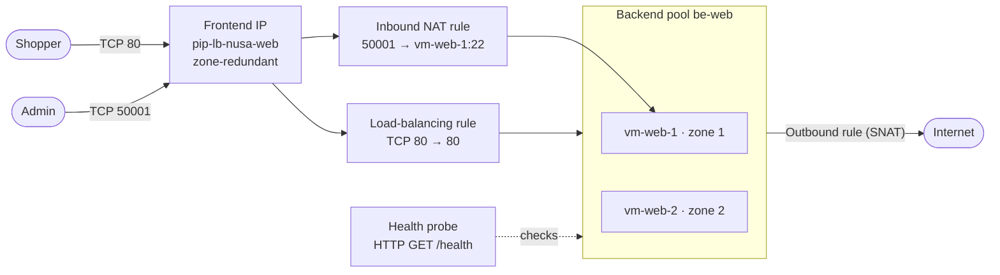
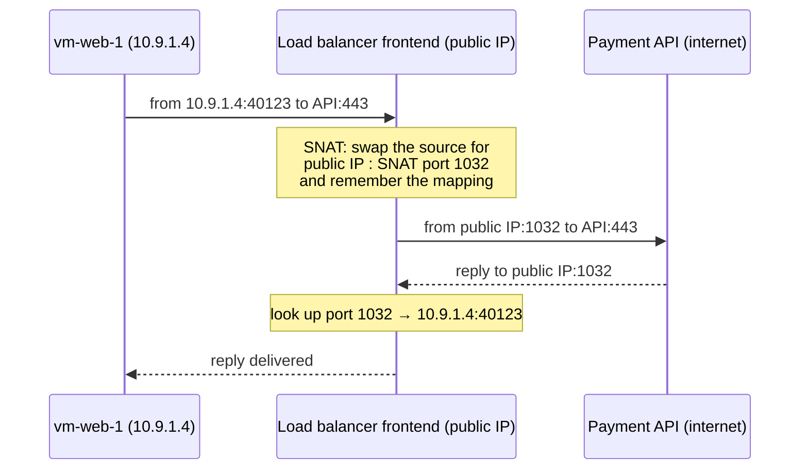

# Lunch 09 · Load Balancing (Basic): Azure Load Balancer

> **Track:** Core month · **Level:** Basic · **Part 2:** Core infrastructure
> **Time:** 60 minutes · **Prerequisite lunches:** 03, 06, 08
> **AZ-900 skill area:** Describe Azure architecture and services
> **Lab:** [Lab 09 · Keep the shop open when a server fails](../../labs/09-load-balancing-basic/README.md) — about 50 minutes · cost 💲💲

| ⏱ Minutes | Segment |
|---:|---|
| 5 | Scenario and objectives |
| 25 | Reading |
| 15 | Demo: interactive animation (+ optional walkthrough video) |
| 5 | Knowledge check |
| 5 | Key takeaways and lab preview |
| 5 | Buffer — finish your lunch 🍜 |

## 🍱 Today's menu

By the end of this lunch you will be able to:

- **Explain** why a load balancer is the first step from "one server" to "always open", and what *layer 4* means.
- **Describe** the parts of an Azure Standard Load Balancer: frontend, backend pool, health probe, load-balancing
  rule, inbound NAT rule and outbound rule.
- **Choose** between a public and an internal load balancer, and between the distribution modes.
- **Explain** in plain words how outbound connections and SNAT work, and why new networks need an explicit outbound method.
- **Recognise** when Application Gateway, Front Door or Traffic Manager is the better tool.

## 🏪 Meanwhile at Nusantara Retail

Dewi has done her homework. The storefront now runs on two Ubuntu VMs, `vm-web-1` in availability zone 1 and
`vm-web-2` in zone 2, inside the private subnet Pak Budi designed in Lunch 08. There is just one problem: shoppers
know only one address, and right now it points at `vm-web-1`. If that VM reboots for patching, the shop is closed
even though a perfectly good twin is idling in the next zone.

Ibu Sari is direct about it at the Monday meeting. "Two servers are no use if customers can only find one. And
Pak Budi says he can't even log in to them now that they have no public addresses." Rizky, the contractor, adds that
the servers also fail to download security updates since the network change. Three complaints, one root cause: the
servers have no shared front door.

Today's question: **how do you give two servers one address, send shoppers only to servers that are healthy, and
still let administrators and updates get in and out safely?**

---

## 📖 Reading (≈25 minutes)

### 1. One address, many servers: why load balance

A single server is a **single point of failure**: when it stops, the service stops. In Lunch 02 you met two ways to
grow. Scaling **up** (a bigger VM) has a ceiling and still leaves you with one machine. Scaling **out** (more VMs) has no
such ceiling, but it raises a new question: which server should each customer talk to?

A **load balancer** answers that question. It owns one address, receives traffic for the whole group, and passes each
new connection to one of several servers. It also keeps checking which servers are healthy, so a broken one quietly
stops receiving customers. That one component gives Nusantara Retail four things at once:

- **Availability.** A failed VM, a crashed web service or a whole failed availability zone no longer closes the shop.
- **Scale.** When the 12.12 sale arrives, Dewi adds a third VM to the group instead of replacing the server.
- **Maintenance without downtime.** Pak Budi can patch `vm-web-1` while `vm-web-2` carries the traffic.
- **A stable address.** Shoppers, DNS records and the payment provider's allow list keep using one IP address while
  servers come and go behind it.

Load balancers differ in *how much of the conversation they understand*. Networking people describe this with the
layers of the OSI model. You only need two of them:

| | Layer 4 (transport) | Layer 7 (application) |
|---|---|---|
| What it looks at | IP addresses, ports and protocol (TCP or UDP) | the HTTP request itself: host name, URL path, headers, cookies |
| What it does with a connection | passes packets straight through to one server | ends the client's connection and opens a new one to the server (a *proxy*) |
| Can it route `/images` to other servers? | no — it never reads the URL | yes |
| Can it decrypt HTTPS or run a web application firewall? | no | yes |
| What the server sees as the client | the real client IP address | the proxy's address (client IP in a header) |
| Azure examples | **Azure Load Balancer** | Application Gateway, Front Door |

**Azure Load Balancer** is Azure's layer 4 load balancer. It works with any TCP or UDP traffic, not only web
traffic, adds very little delay because it never opens or reads your data, and scales to millions of flows. It is a
*regional* service: one load balancer serves resources in one region (a global tier exists too; see section 5).
Because it doesn't read requests, it is also the simplest load balancer to reason about, which makes it the right
place to start.

> [!IMPORTANT]
> Azure Load Balancer comes in **Standard** and **Gateway** SKUs. The **Basic** SKU — and Basic public IP addresses —
> were **retired on September 30, 2025**. Older tutorials that use `--sku Basic` no longer apply. Everything in this
> course uses Standard, which adds availability zones, secure-by-default networking, outbound rules and a 99.99 % SLA
> (check the SLA page for its conditions).

### 2. Anatomy of a Standard load balancer

A load balancer is a small set of named parts that refer to each other. Once you know the parts, the portal wizard,
the CLI and a Bicep file all look the same.

| Component | What it is | Nusantara Retail example |
|---|---|---|
| **Frontend IP configuration** | the address clients connect to; public (a Standard public IP) or private (an IP from a subnet) | `fe-web` using the public IP `pip-lb-nusa-web` |
| **Backend pool** | the group of servers that can receive traffic, defined by their NICs or their IP addresses | `be-web` with the NICs of `vm-web-1` and `vm-web-2` |
| **Health probe** | a repeated check of each pool member; only healthy members get new connections | `probe-http`: HTTP GET `/health` on port 80 every 5 seconds |
| **Load-balancing rule** | maps a frontend IP and port to a backend pool and port, using a probe | `rule-http`: TCP 80 on the frontend → port 80 on the pool |
| **Inbound NAT rule** | forwards one frontend port to one specific VM (port forwarding, not balancing) | `nat-ssh-vm1`: frontend port 50001 → `vm-web-1` port 22 |
| **Outbound rule** | lets pool members reach the internet through the frontend IP, with ports you allocate | `rule-outbound`: 10,000 source ports per VM |

**Public or internal?** The frontend decides which kind of load balancer you have:

| | Public load balancer | Internal load balancer |
|---|---|---|
| Frontend | a Standard public IP address | a private IP address from one of your subnets |
| Who can reach it | anyone on the internet (filtered by NSGs) | clients inside the virtual network, peered networks and on-premises networks connected by VPN or ExpressRoute |
| Typical use | the storefront web tier | the order API behind the web tier, a database cluster, firewall appliances |
| Gives backends internet access? | can, through outbound rules | no; use a NAT gateway or a separate public load balancer |

Nusantara Retail will eventually use both: a public load balancer in front of the web servers and an internal one in
front of the app subnet from Lunch 08, so the order API is never exposed to the internet.

Two Standard behaviours surprise newcomers. First, a Standard load balancer is **secure by default**: inbound traffic is
blocked until a network security group (NSG) on the subnet or NIC allows it. The NSG sees the shopper's real IP address,
because a layer 4 load balancer does not replace the source address. Second, the **backend pool** can be defined by NIC or
by IP address. Pools built from NICs are the recommended choice for virtual machines and give the most predictable
outbound behaviour.

### 3. Health probes and how traffic is shared

A load balancer is only as smart as its **health probe**. Every few seconds the platform sends a probe to every pool
member and records the answer. Standard load balancers support three probe types:

| Probe type | Healthy when… | Good for |
|---|---|---|
| **TCP** | the server completes the TCP handshake on the port | any TCP service; it proves only that something is listening |
| **HTTP** | an HTTP GET on your path returns `200 OK` | web servers; let the application decide whether it is healthy |
| **HTTPS** | like HTTP, but over TLS | web servers that only listen on HTTPS (no client certificates) |

Some details are worth remembering:

- **Probes come from `168.63.129.16`.** In NSG rules this source is represented by the **AzureLoadBalancer** service
  tag. A default NSG rule allows it, but a home-made "deny everything" rule with a higher priority silently blocks the
  probes, and then every server looks dead.
- **The interval** is configurable, with a minimum of 5 seconds. The portal suggests 5 seconds; the CLI and templates
  default to 15. For HTTP probes, any answer other than `200` marks the server down immediately; a probe that gets no
  reply at all times out after 30 seconds at most.
- **A failed probe affects new connections only.** Shoppers already connected to the failing server keep their TCP
  connection until it closes or times out; new connections go to healthy members. If *every* member is down, a
  Standard load balancer sends no new connections anywhere.
- **Probe something meaningful.** A TCP probe on port 80 stays green when the web application returns errors. An HTTP
  probe on a `/health` page that the application controls can say "take me out of rotation" before maintenance.

> [!TIP]
> Give every application a cheap `/health` page and probe it over HTTP. Make it check what the server itself needs
> (disk space, its own configuration), but be careful about checking shared dependencies: if `/health` fails whenever
> the shared database is slow, every server fails at once and the load balancer has nowhere to send anyone.

How does the load balancer choose a server for each new connection? By default it computes a hash of five values — the
**5-tuple**: source IP, source port, destination IP, destination port and protocol. The same connection always hashes to
the same server, so packets of one conversation stay together. A new connection from the same browser uses a new
source port, so it can land on the other server. Across thousands of shoppers this spreads load evenly; with only a
handful of clients behind one company proxy, the spread can be lopsided.

| Distribution mode | Hash of | Behaviour | Use it when |
|---|---|---|---|
| **None** (default, *hash-based*) | 5-tuple | each new connection may go to any healthy server | the application keeps no session data on the server |
| **Client IP** | source IP + destination IP | one client IP keeps going to the same server | a legacy app stores the shopping cart in server memory |
| **Client IP and protocol** | source IP + destination IP + protocol | the same, per protocol | an app opens related TCP and UDP sessions that must meet on one server |

*Session persistence* (the two "Client IP" modes) is a crutch, not a design. If a server fails, its sessions are lost
anyway; many shoppers behind one mobile carrier or office proxy look like a single client IP; and adding a server
reshuffles everybody. The durable fix is to keep session state outside the VMs, for example in a database or cache.

Two more rule settings matter in practice. The **idle timeout** (4 minutes by default) closes TCP connections that send
nothing; you can raise it within limits, and you should enable **TCP reset** so both ends hear about the closure
instead of discovering it later. **HA ports**, another rule setting, appear in section 5.

### 4. Getting in and getting out: inbound NAT rules, outbound rules and SNAT

**Getting in to one server.** Load-balancing rules spread traffic, but an administrator who wants to SSH to `vm-web-1`
needs to reach *that* VM. An **inbound NAT rule** forwards one frontend port to one VM's port: connect to the frontend IP
on port 50001 and you arrive at `vm-web-1` on port 22. The NSG evaluates the translated packet, so it must allow
port 22, ideally from a single admin address. A newer form of the rule targets a whole backend pool with a port range
and assigns each member its own frontend port; the older pool-based *inbound NAT pools* used by scale sets retire on
September 30, 2027. For day-to-day administration, Azure Bastion (Lunch 06) is the safer habit — no management port
is exposed to the internet at all.

**Getting out.** Servers also start conversations: downloading updates, calling the payment provider, sending e-mail
through a mail service. In Lunch 08 you learned that virtual networks created with API versions released after
March 31, 2026 get **private subnets** by default, so VMs have no implicit internet access, and that a Standard load
balancer adds none by itself. Something must provide outbound access explicitly.

That something uses **SNAT** — source network address translation. Think of the head office switchboard. Two hundred
employees share one public phone number. When an employee calls out, the operator notes which line the call used, so
that when the other party answers, the call is put through to the right desk. The public number is the frontend IP;
each "line" is a **SNAT port**. One public IP offers about 64,000 of them for outbound connections, shared by all the
VMs that use it.

Each simultaneous connection to the *same* destination IP and port needs its own SNAT port. A server that opens
thousands of short connections to one API, without reusing them, can run out of its share — **SNAT port exhaustion** —
and new outbound calls fail while the rest of the VM looks fine.

An **outbound rule** is how you take control. You choose which frontend IPs to use, which backend pool may leave, the
protocols, an idle timeout (4–120 minutes) and, most importantly, how many SNAT ports each VM gets, in multiples of 8.
Two VMs could receive up to 32,000 ports each from one IP; adding frontend IPs adds ports. Without an outbound rule,
a load-balancing rule can still provide outbound access implicitly, but with a small default allocation (at most 1,024
ports per VM, fewer in large pools). Microsoft recommends against relying on that.

The options for outbound access, best first:

| Method | Notes |
|---|---|
| **NAT gateway** on the subnet | the recommended choice: dynamic port allocation, scales well, takes precedence over the others |
| **Public IP on the VM** | fine for a single special server; every VM gets its own exposed address |
| **Load balancer outbound rules** | good when the VMs already sit behind a public load balancer; you size the ports |
| Load-balancing rule without outbound rules | implicit, small fixed allocation — avoid for production |
| Default outbound access | implicit and changing; not available in private subnets — avoid |

> [!WARNING]
> When you add an outbound rule that uses the same frontend IP as a load-balancing rule, the rule must have outbound
> SNAT disabled (`--disable-outbound-snat true`), otherwise creating the outbound rule fails. The reverse mistake
> hurts more: disable SNAT on the rule but forget the outbound rule, and the VMs lose internet access — updates and
> payment calls fail while the website itself looks healthy.

### 5. Zones and special flavours: HA ports, gateway and global load balancers

**Zones.** In Lunch 03 you met zone-redundant and zonal resources. A load balancer frontend can be either. A
**zone-redundant** frontend is served from all zones of the region, so it survives the loss of any one of them; a
**zonal** frontend is pinned to one zone and fails with it. Standard public IPs created with zones 1, 2 and 3 are
zone-redundant, and Microsoft now treats Standard public IPs created without a zone as zone-redundant in regions that
have zones. Spread the backend VMs across zones too, as Dewi did. A frontend that survives a zone failure does not help
if both servers sat in that zone.

**HA ports.** On an *internal* Standard load balancer, a rule with protocol *All* and port 0 balances every TCP and UDP
flow on every port. That is how firewall appliances in a hub network are made highly available (Lunch 25): one rule,
all traffic, and a probe that reflects the health of the whole appliance.

**Gateway Load Balancer.** A separate SKU for inserting third-party network virtual appliances — firewalls, intrusion
detection, packet analysers — transparently into the path. You *chain* it to a public load balancer frontend or a VM's
public IP, and traffic visits the appliances before reaching your application, with no route tables to maintain.

**Global (cross-region) load balancer.** A Standard load balancer can also be created in the *global* tier. It offers
one static **anycast** public IP that is advertised from many Azure regions, and its backend pool contains regional
public load balancers. Shoppers enter Microsoft's network at the nearest participating region and are sent to the
closest healthy regional deployment; if a region fails, traffic moves within seconds because no DNS caching is
involved. It is still layer 4, supports public frontends only, and must be created in one of a list of *home regions*
(Southeast Asia and East Asia are on it; check the documentation for others). Lunch 27 compares it with the global
layer 7 options.

### 6. Choosing your load balancer — and Nusantara's new front door

Azure has four main load balancing services, and choosing between them is a favourite exam and interview topic. Two
questions do most of the work: *is it web traffic that needs layer 7 features?* and *is it regional or global?*

| | Azure Load Balancer | Application Gateway | Azure Front Door | Traffic Manager |
|---|---|---|---|---|
| Layer | 4 (TCP/UDP) | 7 (HTTP/HTTPS) | 7 (HTTP/HTTPS) | DNS |
| Scope | regional (global tier for cross-region) | regional | global, at Microsoft's edge | global |
| Sees your traffic? | passes it through | yes, as a proxy in your network | yes, as a proxy at the edge | no — it only answers DNS queries |
| Signature features | any protocol, very low latency, outbound rules, HA ports | path and host routing, TLS termination, WAF, autoscale | caching, fast global failover, WAF, edge TLS | priority, weighted, performance and geographic routing |
| Nusantara Retail example | today's web VMs; the internal order API | `/images/*` to an images app, with a WAF | shoppers from Medan to Makassar | DNS failover between two regions |

This lunch builds the first column. Lunch 27 covers the other three in depth, including how they combine — Front
Door in front of Application Gateway, for example.

Here is Nusantara Retail's design after today. A Standard public load balancer, `lb-nusa-web`, owns a zone-redundant
frontend IP. Its backend pool holds the NICs of `vm-web-1` (zone 1) and `vm-web-2` (zone 2). An HTTP probe asks each
server for `/health` every 5 seconds, and a rule sends TCP 80 to healthy servers only. An inbound NAT rule gives Pak
Budi emergency SSH to `vm-web-1` from the office IP until Bastion arrives, and an outbound rule lets both servers reach
the update mirrors and the payment provider through the same public IP — which the payment provider can put on its
allow list. The answer to Ibu Sari's question has changed: if one server dies, shoppers notice nothing beyond a retried
page; if a zone fails, the shop stays open; if the whole region fails, that is a story for Lunches 17 and 27.

For production, the same design would run in **Indonesia Central** (Jakarta), which has three availability zones and
keeps customer data in Indonesia. The labs use Southeast Asia for the widest service availability; the design is
identical.

> [!NOTE]
> **Pause and think:** Nusantara Retail's payment provider allows calls only from known IP addresses. Which address
> will the provider see when `vm-web-2` calls it today — and what would change if Dewi replaced the outbound rule with
> a NAT gateway that has its own public IP?

Advanced partner: [Lunch 27 · Load Balancing (Advanced)](../27-load-balancing-advanced/README.md) covers Application
Gateway, Front Door and Traffic Manager.

---

## 🎬 Demo (≈15 minutes)

1. **Interactive animation (≈6–8 min):** [Open the demo](https://stefpin.github.io/azure-fundamentals-lunches/demos/09-load-balancing-basic.html) —
   press ▶ Play or step through it at your own pace. Offline? Download
   [`docs/demos/09-load-balancing-basic.html`](../../docs/demos/09-load-balancing-basic.html) and open it in any browser.
2. **Walkthrough video (≤ 6 min):** _coming soon_ — [read the walkthrough script](demo-video-script.md).

What to watch for:

- New connections spread across both zones; a failed probe takes a server out and a passing one brings it back.
- The inbound NAT rule always lands on the same VM — port forwarding, not balancing.
- Without an outbound method the servers are stuck inside; the outbound rule translates them to the frontend IP.

## ✅ Knowledge check (≈5 minutes)

1. Dewi's old storefront code keeps each shopping cart in the web server's memory. Since the load balancer went live,
   some customers lose their cart halfway through checkout. What can you change on the load balancer today, and what is
   the better long-term fix?
   

Show answer

   Switch the rule to **Client IP** session persistence; long term, keep session state outside the VMs (a database or
   cache). *Why:* the default 5-tuple hash can send each new connection to a different server.

   

2. Rizky adds a rule *Deny-All-Inbound* (priority 200) to `nsg-web` to "tighten security". The rule
   *Allow-HTTP-Internet* (priority 100) is still there, yet within seconds the storefront stops answering through the
   load balancer. Both VMs serve pages locally. What happened?
   

Show answer

   The deny rule blocks the **health probes** from `168.63.129.16` (service tag *AzureLoadBalancer*), so every member is
   marked down. Allow *AzureLoadBalancer* with a priority number below 200. *Why:* the default probe allow rule has
   priority 65001 and loses to any custom deny.

   

3. Pak Budi creates an inbound NAT rule from frontend port 50001 to `vm-web-1` port 22 and an NSG rule allowing TCP
   **50001** from his office IP. SSH still times out. What is wrong?
   

Show answer

   The NSG must allow destination port **22**. *Why:* the NSG evaluates the packet after the load balancer has translated
   the port.

   

4. After a network redesign the web servers sit in a private subnet behind the load balancer, and the rule has
   outbound SNAT disabled. Security updates now fail. Give two ways to fix it.
   

Show answer

   Add an **outbound rule** for the backend pool, or attach a **NAT gateway** to the subnet (recommended). *Why:* private
   subnets have no default outbound access, and a Standard load balancer gives none unless you configure it.

   

5. Nusantara Retail wants `shop.nusantararetail.co.id/images/*` served by a separate pool of image servers and wants a
   web application firewall in front of everything. Is Azure Load Balancer the right tool?
   

Show answer

   No — use **Application Gateway** (regional) or **Azure Front Door** (global), covered in Lunch 27. *Why:* a layer 4
   load balancer never reads the URL path, so it can neither route by path nor inspect requests.

   

## 🧠 Key takeaways

- A load balancer gives a group of servers **one address** and sends new connections only to **healthy** members; Azure
  Load Balancer does it at **layer 4**, for any TCP or UDP traffic.
- Use the **Standard** SKU (Basic retired on September 30, 2025). It is secure by default: NSGs must allow client traffic
  and the AzureLoadBalancer probes.
- The parts are always the same: **frontend IP, backend pool, health probe, load-balancing rule**, plus **inbound NAT
  rules** to reach one VM and **outbound rules** to let the pool out.
- The **5-tuple hash** spreads connections; **session persistence** pins a client IP to a server but doesn't replace
  keeping state off the VMs.
- Outbound access must be **explicit**: size SNAT ports with **outbound rules** or prefer a **NAT gateway**. A
  zone-redundant frontend plus VMs in several zones survives a zone failure.

## 🔬 Your lab: Keep the shop open when a server fails

`setup.sh` gives you two web VMs in zones 1 and 2 with no public IPs. You build a Standard public load balancer with a
zone-redundant frontend, probe and rule, watch requests spread across both zones, stop one web server and see the shop
stay open. Then you add an inbound NAT rule for SSH and an outbound rule so both servers can reach the internet — the
core of the design the Lunch 21 capstone builds on.

- ⏱ About 50 minutes · 💲💲 small charges while running · works on its own (no earlier lab needed)
- 👉 [Start Lab 09](../../labs/09-load-balancing-basic/README.md)

## 📚 Go further

- [Microsoft Learn: Azure Load Balancer health probes](https://learn.microsoft.com/azure/load-balancer/load-balancer-custom-probe-overview) — probe types, intervals and what happens to connections when probes fail.
- [Microsoft Learn: Source Network Address Translation (SNAT) for outbound connections](https://learn.microsoft.com/azure/load-balancer/load-balancer-outbound-connections) — the outbound options ranked, SNAT ports and how to avoid exhaustion.
- [Microsoft Learn: Azure Load Balancer SKUs](https://learn.microsoft.com/azure/load-balancer/skus) — what Standard offers and the Basic retirement notice.
- [Azure Architecture Center: Load balancing options](https://learn.microsoft.com/azure/architecture/guide/technology-choices/load-balancing-overview) — the official guide to choosing between Azure's load balancers; a preview of Lunch 27.

---

⬅️ [Lunch 08 · Virtual Networking (Basic)](../08-networking-basic/README.md) · 🏠 [Course home](../../README.md) · [Lunch 10 · Web Apps with Azure App Service](../10-app-service/README.md) ➡️

Last validated: October 2026 · Spotted something out of date? [Open an issue](../../CONTRIBUTING.md).
