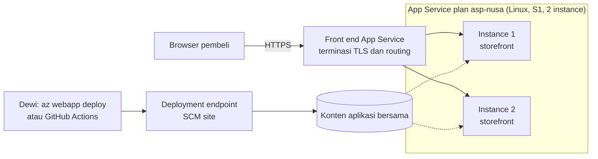
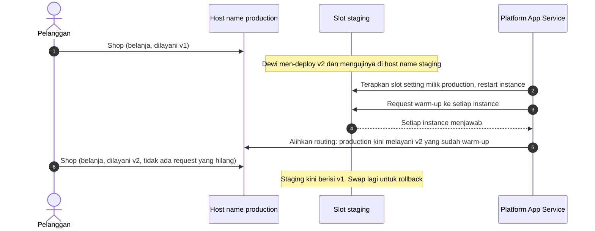

# Makan Siang 10 · Aplikasi Web dengan Azure App Service

🇬🇧 [Read in English](README.md)

> **Jalur:** Bulan inti · **Level:** Dasar · **Bagian 3:** Layanan platform dan data
> **Waktu:** 60 menit · **Makan siang prasyarat:** 02, 06 (09 membantu)
> **Area keterampilan AZ-900:** Menjelaskan arsitektur dan layanan Azure
> **Lab:** [Lab 10 · Memindahkan toko online ke PaaS](../../labs/10-app-service/README.id.md) — sekitar 45 menit · biaya 💲 (💲💲 untuk tantangan tambahan slot)
> **Penulis:** Stefanus Pinarta · [Tentang penulis](../../README.id.md#tentang-penulis)

| ⏱ Menit | Segmen |
|---:|---|
| 5 | Skenario dan tujuan |
| 25 | Bacaan |
| 15 | Demo: animasi interaktif (+ video panduan opsional) |
| 5 | Uji pemahaman |
| 5 | Poin penting dan pratinjau lab |
| 5 | Waktu cadangan — habiskan makan siang Anda 🍜 |

## 🍱 Menu hari ini

Setelah makan siang ini, Anda akan mampu:

- **Menjelaskan** apa saja yang dijalankan Azure App Service untuk Anda, bagaimana sebuah request sampai ke kode Anda,
  dan apa yang tetap menjadi tugas Anda.
- **Memilih** tier App Service plan, serta menentukan kapan harus scale up dan kapan scale out.
- **Mengonfigurasi** aplikasi dengan app setting dan merilisnya dengan aman melalui deployment slot dan swap.
- **Membandingkan** App Service dengan virtual machine, Azure Container Apps, dan Azure Static Web Apps untuk suatu
  beban kerja.

## 🏪 Sementara itu di Nusantara Retail

Jumat, pukul 21.40. Dewi masih di kantor. Sejak Makan Siang 09, toko online berjalan di dua virtual machine
(*komputer virtual*) di belakang load balancer, dan berhasil melewati kegagalan server pertamanya tanpa kehilangan satu
penjualan pun. Harga yang harus dibayar adalah Jumat malamnya: patch Ubuntu di satu VM, keluarkan VM itu dari pool,
update Python, perpanjang sertifikat, restart nginx, masukkan kembali, lalu ulangi di VM satunya. "Saya ini developer,"
keluhnya, "tapi waktu saya lebih banyak habis untuk mengurus server daripada menulis fitur checkout."

Pada hari Senin, Ibu Sari menambahkan kekhawatiran kedua. Harbolnas, Hari Belanja Online Nasional setiap 12.12, tinggal
delapan minggu lagi. Tahun lalu puncak lalu lintasnya berlangsung sekitar empat jam, dan Ibu Sari tidak mau membayar
sepanjang tahun untuk server yang ukurannya disiapkan demi satu malam. Dewi juga ingin merilis halaman checkout baru
sebelum promo itu, tanpa harus menutup toko untuk melakukannya.

Pertanyaan hari ini: **bisakah Azure menjalankan server web untuk kita, membesarkannya saat promo, dan membiarkan Dewi
merilis kode baru tanpa downtime?**

---

## 📖 Bacaan (≈25 menit)

### 1. Platform as a service untuk aplikasi web

Di Makan Siang 06 Anda menyewa sebuah virtual machine dan menjadi penanggung jawab atas semua yang ada di atas perangkat
keras: sistem operasi, runtime bahasa pemrograman (mesin yang menjalankan kode, misalnya interpreter Python), server
web, patch keamanan, dan rencana scaling. **Azure App Service** menggeser garis itu. App Service adalah **platform as a
service (PaaS)** (*platform sebagai layanan*) untuk beban kerja HTTP: situs web, REST API (antarmuka yang dipanggil
program lain lewat HTTP), dan back end (sisi server) untuk aplikasi mobile. Microsoft menjalankan dan mem-patch sistem
operasi, runtime bahasa, dan front end web; Anda membawa kode dan konfigurasi. Anda tetap memegang data Anda, akses
pengguna Anda, pengaturan aplikasi Anda, dan tentu saja, bug Anda. Penggeser *model tanggung jawab bersama* dari Makan
Siang 02 sudah bergeser satu langkah besar ke kanan.

Ibaratnya tempat tinggal. Menyewa VM seperti mengontrak rumah kosong: Anda sendiri yang memperbaiki genteng bocor,
mengurus pompa air, dan memanggil tukang listrik. App Service seperti tinggal di kos eksklusif: pemiliknya mengurus
bangunan, listrik, air, dan keamanan, sedangkan Anda cukup membawa koper berisi kode. Tetapi kamar Anda tetap urusan
Anda: kalau pintunya dibiarkan terbuka, itu bukan salah pemilik kos.

App Service menjalankan **.NET, Java (Java SE, Tomcat, dan JBoss), Node.js, Python, dan PHP** di Windows atau Linux.
Python hanya berjalan di Linux. Jika stack Anda (kombinasi bahasa dan runtime) tidak ada di daftar, atau aplikasi Anda
sudah dikemas sebagai image (paket berisi aplikasi beserta semua kebutuhannya), App Service juga bisa menjalankan
**custom container** (*kontainer*). Platform ini mengenal setiap stack bawaannya: ketika Dewi men-deploy kode Python,
App Service bisa menginstal paket-paket dari `requirements.txt` dan menjalankan aplikasinya dengan Gunicorn, sebuah
server web untuk production, tanpa Dewi perlu menulis skrip startup.

Bagaimana sebuah request sampai ke kode? Setiap region (*wilayah*) Azure menjalankan App Service di atas kelompok server
yang besar. **Front end**—lapisan server terdepan milik App Service—menerima setiap request yang masuk untuk alamat
aplikasi Anda, seperti `app-nusa-ab12c.azurewebsites.net` atau `www.nusantararetail.co.id`. (Aplikasi yang dibuat di
portal mendapat nama default yang lebih panjang, berisi bagian acak dan nama region, sehingga tak seorang pun di luar
organisasi Anda bisa membuat ulang nama itu.) Front end mengakhiri TLS (enkripsi di balik gembok HTTPS), memutuskan
instance mana yang harus menangani request, lalu meneruskannya. **Worker** adalah virtual machine yang menjalankan kode
Anda; worker yang dicadangkan khusus untuk Anda membentuk **App Service plan** Anda. Setiap worker yang menjalankan
aplikasi Anda disebut **instance**. File yang Anda deploy disimpan di penyimpanan bersama, sehingga worker mana pun
milik Anda bisa menjalankan aplikasi Anda. Sebuah **deployment endpoint** terpisah (*SCM site*, juga dikenal sebagai
Kudu) menerima kode baru dari CLI, dari GitHub Actions, atau dari portal.

Anda tidak pernah login ke worker itu untuk mem-patch-nya. Ketika patch Python atau Ubuntu yang baru keluar,
platform-lah yang menggulirkannya. Ketika perangkat keras sebuah worker rusak, platform memindahkan aplikasi Anda ke
worker yang sehat. Itulah pertukarannya: Anda melepaskan kendali atas mesin, dan sebagai gantinya seluruh "shift malam"
mengurus server pun lenyap.

Pertukaran ini punya batas-batas yang perlu Anda ketahui sebelum memindahkan sebuah beban kerja. Aplikasi Anda hanya
bisa dijangkau lewat HTTP dan HTTPS, bukan lewat port sembarang, jadi layanan yang mendengarkan di port TCP-nya sendiri
lebih cocok ditempatkan di tempat lain. Anda tidak bisa menginstal paket sistem operasi ke dalam stack bawaan; jika
aplikasi membutuhkannya, buatlah custom container. Pekerjaan latar belakang yang berjalan berjam-jam tidak cocok
dijalankan di dalam sebuah request web: App Service punya WebJobs untuk tugas latar belakang, dan Makan Siang 14
memperkenalkan Azure Functions untuk pekerjaan berbasis event (dipicu oleh kejadian, misalnya pesanan baru masuk). Dan
platform tidak bisa memperbaiki query database yang lambat, kebocoran memori (*memory leak*), atau password yang
ter-commit ke Git (tersimpan di riwayat kode). Semua itu tetap urusan Anda.

> [!TIP]
> TLS berakhir di front end, jadi kode Anda menerima HTTP biasa ditambah header `X-Forwarded-Proto` yang memberi tahu
> apakah pengunjung memakai HTTPS. Jangan menulis sendiri pengalihan dari HTTP ke HTTPS: aktifkan pengaturan **HTTPS
> Only** dan biarkan front end yang melakukannya.

### 2. App Service plan: komputasi yang Anda bayar

Setiap aplikasi berjalan di dalam sebuah **App Service plan**. Plan menentukan region, sistem operasi, **pricing tier**
(tingkatan harga), **ukuran instance**, dan **jumlah instance**. Beberapa aplikasi bisa berbagi satu plan, dan kalau
begitu mereka juga berbagi instance-nya: toko online dan portal admin untuk staf bisa menumpang di dua worker yang sama.
Aplikasi-aplikasi dalam satu plan di-scale bersama, karena scaling mengubah plan, bukan aplikasinya.

Dari situ lahir aturan tagihan paling penting dalam makan siang ini: **Anda membayar plan, bukan aplikasinya**. Pada
tier dedicated (mesin khusus untuk Anda, tidak dibagi dengan pelanggan lain), setiap instance ditagih per jam, entah
aplikasi di atasnya sedang sibuk, menganggur, atau dihentikan. Tier Free memang gratis, dengan batasan yang ketat.
Ibaratnya menyewa mobil beserta sopirnya per jam: argo berjalan selama mobil itu Anda sewa, tidak peduli berapa
penumpangnya atau apakah mereka sedang tidur di jok belakang. Menurunkan satu penumpang tidak menghentikan argo; yang
menghentikannya hanyalah mengembalikan mobil. Plan adalah mobilnya, aplikasi adalah penumpangnya. Tier juga menentukan
fitur apa saja yang Anda dapatkan:

| Tier | Komputasi | Maks. instance | Autoscale | Deployment slot | Custom domain dengan TLS | Penggunaan umum |
|---|---|---|---|---|---|---|
| **Free (F1)** | Bersama (shared), 60 menit CPU per hari | 1 | Tidak | Tidak | Tidak (hanya `azurewebsites.net`) | Belajar, demo singkat |
| **Shared (D1)** | Bersama, hanya Windows | 1 | Tidak | Tidak | Tidak ada TLS untuk custom domain | Situs hobi yang mungil |
| **Basic (B1–B3)** | Dedicated | 3, manual | Tidak | Tidak | Ya | Dev/test, situs production kecil |
| **Standard (S1–S3)** | Dedicated | 10 | Ya | 5 per aplikasi | Ya | Sebagian besar aplikasi web production |
| **Premium v3 dan v4** | Dedicated, perangkat keras lebih cepat, opsi yang dioptimalkan untuk memori | 30 | Ya | 20 per aplikasi | Ya | Production yang sibuk, aplikasi yang lebih besar |
| **Isolated v2** | Dedicated, di dalam virtual network Anda sendiri (App Service Environment v3) | 100 | Ya | 20 per aplikasi | Ya | Isolasi jaringan yang ketat, skala sangat besar |

Angka-angka ini adalah batas yang dipublikasikan saat tulisan ini dibuat (Oktober 2026); periksa halaman batas (limits)
App Service sebelum Anda merancang dengan berpatokan padanya. Dua baris layak dilihat dua kali untuk Nusantara Retail.
Basic punya komputasi dedicated, tetapi tanpa **deployment slot** dan tanpa **autoscale**. Standard adalah tier pertama
yang punya keduanya, itulah sebabnya Standard biasanya menjadi titik awal untuk toko production.

Ada dua cara untuk mendapatkan tenaga lebih:

- **Scale up** (vertikal): pindahkan plan ke ukuran yang lebih besar atau tier yang lebih tinggi, misalnya dari S1 ke S2
  atau ke P1v3. Setiap instance mendapat CPU dan memori lebih banyak, atau plan mendapat fitur tambahan. Anda tidak perlu
  men-deploy ulang apa pun, meskipun aplikasinya akan di-restart.
- **Scale out** (horizontal): tambahkan instance berukuran sama, misalnya dari satu menjadi tiga. Anda bisa melakukannya
  secara manual (Basic ke atas), dengan aturan **autoscale** yang bereaksi terhadap metrik seperti CPU atau terhadap
  jadwal (Standard ke atas), atau, pada plan Premium v2, v3, dan v4, dengan **automatic scaling**, di mana platform yang
  memutuskan berdasarkan lalu lintas HTTP.

Bayangkan antrean kasir minimarket menjelang Lebaran. Pemilik toko bisa mengganti mesin kasir dengan yang lebih cepat
(scale up), atau membuka dua kasir tambahan yang sama persis (scale out). Cara kedua bisa terus ditambah selama masih
ada meja, dan kasir tambahan bisa ditutup lagi setelah keramaian usai—kemampuan membesar dan menyusut sesuai kebutuhan
inilah yang disebut *elastisitas*.

Bagaimana memilih ukuran? Mulailah dari yang kecil, ukur CPU dan memori di bawah beban yang realistis, lalu sesuaikan;
mengganti tier nanti cukup beberapa menit, bukan sebuah migrasi. Lingkungan development dan test bisa berbagi satu plan
Basic. Production layak mendapat plan sendiri, agar uji coba yang sibuk tidak memperlambat toko. Plan yang berjalan
sepanjang tahun bisa dibeli dengan diskon lewat reservation atau Azure savings plan for compute—keduanya berupa komitmen
pemakaian jangka panjang dengan imbalan harga lebih murah (Makan Siang 19 membandingkan pilihan-pilihannya). Di region
yang memiliki availability zone (*zona ketersediaan*) (Makan Siang 03), tier yang lebih tinggi juga bisa menyebarkan
instance sebuah plan ke beberapa zona, sehingga kegagalan satu zona tidak menutup toko; periksa tier mana dan berapa
jumlah instance minimum yang dibutuhkan zone redundancy di region Anda.

Scale out hanya berjalan mulus jika aplikasinya **stateless** (tidak menyimpan status apa pun di server). Jika kode Dewi
menyimpan keranjang belanja di memori proses server web, pembeli yang request berikutnya mendarat di instance lain akan
melihat keranjang kosong. Status (*state*) seharusnya disimpan di database atau cache (Makan Siang 11 dan 12). App
Service bisa "menempelkan" sebuah browser ke satu instance dengan cookie afinitas (*affinity cookie*), tetapi itu solusi
tambal sulam, bukan desain.

> [!WARNING]
> Menghentikan (stop) sebuah web app (*aplikasi web*) **tidak** menghentikan tagihan. Instance milik plan tetap
> berjalan dan tetap ditagih sampai Anda menurunkan plan ke tier Free atau menghapusnya. Di lab, hapus seluruh
> resource group (*grup sumber daya*).

### 3. Memasukkan kode dan mengatur konfigurasi dengan benar

Deploy berarti memindahkan hasil build kode Anda (kode yang sudah siap dijalankan) ke worker. App Service menawarkan
beberapa jalur, dan semuanya berakhir di deployment endpoint yang sama:

| Opsi | Cara kerjanya | Gunakan saat |
|---|---|---|
| `az webapp up` | Satu perintah yang membuat resource group, plan, dan aplikasi, men-zip folder saat ini, lalu men-deploy-nya | Anda ingin deployment pertama yang cepat. Azure CLI 2.87 (Juni 2026) secara resmi menandainya deprecated (usang); perintah ini masih berjalan |
| `az webapp create` + `az webapp deploy` | Anda membuat resource secara eksplisit, lalu mengunggah paket zip. Dengan `SCM_DO_BUILD_DURING_DEPLOYMENT=true`, App Service menginstal dependensi Anda | Skrip, lab, dan pipeline sederhana |
| GitHub Actions atau Azure Pipelines | Setiap push memicu build, test, dan deploy, idealnya ke slot staging | Pengembangan dalam tim dan rilis yang bisa diulang |
| Deployment Center | Halaman portal yang menghubungkan repositori dan menuliskan workflow untuk Anda | Penyiapan CI/CD (build dan deploy otomatis setiap kali kode berubah) pertama Anda, tanpa menulis YAML (format file konfigurasi workflow) |
| Container image | App Service menarik image dari Azure Container Registry atau registry lain (gudang penyimpanan image) | Anda sudah mengirimkan aplikasi sebagai container |

Apa yang terjadi pada paket zip Python setelah diunggah? Jika build automation aktif, sistem build App Service membuat
virtual environment (folder terisolasi berisi paket Python milik aplikasi) dan menjalankan `pip install` untuk semua
yang tercantum di `requirements.txt`. Saat aplikasi dimulai, container Linux mencari proyek Django (`wsgi.py`) atau
aplikasi Flask di `app.py` atau `application.py`, lalu menjalankan Gunicorn untuknya. Apa pun yang tidak biasa, seperti
aplikasi FastAPI, membutuhkan startup command (perintah untuk menjalankan aplikasi) di general settings. Jika tidak
menemukan apa-apa, container akan menyajikan halaman default — kejutan yang umum setelah deployment dari folder yang
salah.

Konfigurasi adalah separuh lainnya dari sebuah rilis. Kode toko online yang sama seharusnya bisa berjalan sebagai toko
sungguhan di production dan sebagai toko uji coba di staging, jadi nilai-nilai yang berbeda antarlingkungan disimpan di
luar kode:

- **App settings** adalah pasangan nama–nilai yang diserahkan App Service kepada kode Anda sebagai **environment
  variable** (variabel lingkungan) saat aplikasi dimulai. Kode Python Dewi membaca `os.environ["STORE_NAME"]`. Mengubah
  sebuah setting akan me-restart aplikasi, sehingga nilai baru berlaku dalam hitungan detik.
- **Connection strings** adalah daftar terpisah untuk koneksi database, juga diekspos sebagai environment variable
  (dengan awalan yang menyebutkan jenis database-nya).
- **Key Vault references** memungkinkan sebuah setting menunjuk ke secret (data rahasia, misalnya password) di Azure Key
  Vault alih-alih menyimpan secret itu sendiri. Nilainya berbentuk `@Microsoft.KeyVault(SecretUri=...)`, dan **managed
  identity** milik aplikasi—identitas yang dikelola Azure, sehingga aplikasi bisa membuktikan siapa dirinya tanpa
  password—membaca secret yang sebenarnya. Tak seorang pun perlu menempelkan password ke portal lagi (Makan Siang 15).
- **General settings** memilih versi runtime, startup command, **HTTPS Only**, versi TLS minimum, **Always On** (Basic
  ke atas) yang menjaga aplikasi tetap termuat di antara request, dan path **health check** (alamat yang dipanggil App
  Service untuk memeriksa kesehatan setiap instance).

Ketika terjadi masalah, App Service memberi Anda beberapa jendela untuk mengintip ke dalam aplikasi. **Log stream**
menampilkan apa yang ditulis aplikasi ke konsolnya, secara langsung, di portal atau dengan `az webapp log tail`.
*Diagnose and solve problems* menjalankan pemeriksaan siap pakai untuk crash, respons lambat, dan kesalahan
konfigurasi. **Application Insights** merekam setiap request, panggilan ke dependensi, dan exception (error di dalam
kode) untuk dianalisis kemudian; Makan Siang 16 dan 30 membahasnya lebih dalam.

### 4. Deployment slot dan swap

Men-deploy langsung ke production punya dua masalah. Selama instance di-restart dan "dipanaskan" (*warm-up*) dengan kode
baru, pelanggan pertama mendapat jawaban lambat atau error. Dan jika kode baru itu rusak, setiap pelanggan melihatnya
sekaligus, dan satu-satunya cara "membatalkannya" adalah deployment berikutnya.

**Deployment slot** memecahkan keduanya. Slot adalah aplikasi hidup dengan host name (nama alamat web) sendiri, misalnya
`app-nusa-ab12c-staging.azurewebsites.net`, yang berjalan di plan yang sama dan di **instance yang sama** dengan
production. Slot tersedia mulai Standard (5 per aplikasi) serta Premium dan Isolated (20 per aplikasi). Slot tidak
menambah biaya, tetapi memang memakai sebagian CPU dan memori milik plan. Dewi men-deploy versi 2 ke slot `staging`,
mengujinya di alamatnya sendiri sementara pelanggan tetap berbelanja lewat versi 1, lalu meminta App Service melakukan
**swap** (menukar) staging ke production:

Production tetap menyajikan kode lama sampai setiap instance staging selesai di-restart dengan setting production dan
menjawab sebuah request warm-up. Baru setelah itu App Service mengalihkan routing, sehingga tidak ada request yang
hilang. Jika bagian keuangan menemukan bug setengah jam kemudian, Dewi cukup melakukan swap lagi: versi sebelumnya masih
ter-deploy di slot staging, jadi versi itu di-warm-up dan dikembalikan dalam satu atau dua menit, tanpa deploy ulang dan
tanpa downtime. Untuk kehati-hatian ekstra, **swap with preview** berhenti sejenak setelah langkah setting, sehingga Anda
bisa menguji staging dengan konfigurasi production sebelum menyelesaikan swap.

Ibaratnya restoran dengan dua dapur. Koki menyiapkan menu baru di dapur cadangan dan mencicipinya dulu, sementara tamu
tetap dilayani dari dapur utama. Begitu semua kompor di dapur cadangan sudah panas dan hidangannya siap, para pelayan
cukup beralih mengambil pesanan dari sana. Kalau menu baru ternyata keasinan, pelayan kembali ke dapur lama—yang
kompornya masih menyala.

Apa yang ikut berpindah bersama kode saat swap, dan apa yang tetap tinggal di slot? App settings dan connection strings
ikut berpindah, kecuali Anda menandainya sebagai **deployment slot setting** (sering disebut setting *sticky*, alias
"lengket" pada slotnya). Begitulah caranya staging mempertahankan koneksi ke database uji cobanya sendiri: tandai
sebagai sticky, maka koneksi itu tidak akan pernah sampai ke production. Beberapa hal selalu tinggal di slotnya,
termasuk custom domain, sertifikat TLS, **HTTPS Only**, pengaturan scale, access restrictions, dan managed identity. Slot
juga bisa menerima sebagian lalu lintas sungguhan, misalnya 10 persen pembeli, untuk menguji perubahan pada pengguna
nyata sebelum swap penuh. Satu detail untuk Linux: auto swap, yang melakukan swap otomatis setelah setiap deployment ke
sebuah slot, hanya tersedia untuk aplikasi Windows.

Begini cara Dewi bisa merencanakan checkout baru untuk Harbolnas. Senin, pipeline men-deploy versi 2 ke staging. Selasa,
tim menguji alamat staging, lalu mengarahkan 10 persen pembeli sungguhan ke sana selama sehari. Rabu malam, jauh sebelum
promo dimulai, Dewi melakukan swap dan memantau tingkat error. Jika ada yang terlihat janggal, ia melakukan swap balik
dalam satu menit. Selama promo berlangsung, tidak ada yang men-deploy apa pun: rilis paling aman adalah rilis yang
selesai lebih awal.

### 5. Domain, keamanan, dan jaringan sekilas

Toko online membutuhkan nama domainnya sendiri (custom domain) dan gembok HTTPS, sementara portal admin tidak boleh
terbuka untuk seluruh internet. App Service punya satu blok bangunan untuk setiap kebutuhan itu:

| Fitur | Arah | Apa yang Anda dapatkan | Tier |
|---|---|---|---|
| HTTPS Only dan versi TLS minimum | Masuk (inbound) | Mengalihkan HTTP ke HTTPS dan menolak versi TLS lama | Semua |
| Custom domain dengan managed certificate | Masuk | `www.nusantararetail.co.id` dengan sertifikat gratis yang diperpanjang otomatis (bukan wildcard, yaitu sertifikat untuk semua subdomain sekaligus) | Basic ke atas |
| Autentikasi bawaan (built-in authentication) | Masuk | Sign-in dengan Microsoft Entra ID (*ID Microsoft Entra*), Google, GitHub, dan lainnya sebelum request apa pun mencapai kode Anda | Semua |
| Access restrictions | Masuk | Mengizinkan atau menolak lalu lintas berdasarkan rentang IP, service tag, atau subnet | Semua |
| Private endpoint (*titik akhir privat*) | Masuk | Alamat IP privat di virtual network (*jaringan virtual*) Anda; akses publik bisa dimatikan | Basic, Standard, Premium |
| Virtual network integration | Keluar (outbound) | Aplikasi bisa menjangkau resource privat, seperti database di balik private endpoint | Basic ke atas |
| Managed identity | Keluar | Aplikasi mendapat identitas Entra ID-nya sendiri untuk memanggil Key Vault, Storage, atau SQL tanpa secret | Semua |

Autentikasi bawaan, sering disebut "Easy Auth", sangat praktis untuk portal admin yang khusus staf: dengan beberapa
pengaturan, semua orang harus sign-in dengan akun Nusantara Retail mereka sebelum halaman pertama dimuat. Access
restrictions bisa mengizinkan portal admin hanya dari alamat IP publik kantor pusat, atau mengizinkan toko online hanya
melalui Azure Front Door (Makan Siang 27). Private endpoint dan virtual network integration akan muncul lagi di Makan
Siang 25. Anda tidak perlu memakai semuanya di hari pertama, tetapi ada baiknya tahu bahwa setiap masalah sudah punya
sakelarnya masing-masing.

### 6. App Service atau yang lain? Pilihan Nusantara Retail

App Service bukan satu-satunya tempat untuk menjalankan situs web di Azure. Berikut perbandingannya dengan para
tetangganya:

| | Virtual machine | App Service | Container Apps | Static Web Apps |
|---|---|---|---|---|
| **Yang Anda kelola** | OS, runtime, server web, patch, desain scaling | Kode, setting, ukuran plan dan jumlah instance | Container image, aturan scale | Kode front-end dan API kecil |
| **Yang Anda deploy** | Perangkat lunak yang diinstal di VM | Paket kode atau container | Container image (sebagai revision) | File statis yang di-build dari repositori Git |
| **Scaling** | Scale set (Makan Siang 23) | Instance dalam plan, autoscale | Replika dari nol ke atas dengan aturan berbasis event | Konten disajikan otomatis dari banyak lokasi di seluruh dunia |
| **Yang Anda bayar** | Jam VM dan disk | Instance plan (tier Free untuk belajar) | Resource yang dipakai per detik, atau workload profile dedicated | Paket gratis atau paket Standard berbayar |
| **Pilih jika** | Anda butuh kendali penuh atas OS atau perangkat lunak lama | Anda meng-host aplikasi web dan API pada stack yang didukung | Anda menjalankan microservice, background worker, atau container berbasis event | Anda menerbitkan single-page app dan situs statis |
| **Contoh di Nusantara** | Layanan lama yang menyinkronkan terminal POS (mesin kasir) di toko-toko | Toko online dan portal admin | Microservice inventaris dan rekomendasi (Makan Siang 13) | Microsite promo 12.12 |

Tiga pertanyaan menyelesaikan sebagian besar kasus. Apakah Anda butuh kendali atas sistem operasi, atau perangkat lunak
yang hanya bisa diinstal di server? Pakai VM. Apakah sama sekali tidak ada kode di sisi server? Static Web Apps lebih
sederhana dan lebih murah. Apakah beban kerjanya berupa sekumpulan container yang harus di-scale secara terpisah, mungkin
sampai nol? Lihatlah Container Apps. Untuk aplikasi web klasik atau API dengan bahasa yang didukung, App
Service biasanya menjadi jalan tersingkat menuju production.

Untuk toko online, pilihannya adalah App Service di Linux dengan stack Python. Di production, Nusantara Retail akan
memakai setidaknya tier Standard dengan dua instance atau lebih demi ketersediaan, sebuah aturan autoscale untuk
Harbolnas, slot staging untuk setiap rilis, HTTPS Only dengan managed certificate di `www.nusantararetail.co.id`, dan Key
Vault reference untuk secret. Data pelanggan harus tetap di Indonesia, jadi production akan berjalan di Indonesia
Central (Jakarta), setelah dipastikan bahwa tier yang dipilih tersedia di sana. Lab memakai Southeast Asia, tempat semua
tier tersedia.

Memindahkan tier web tidak ikut memindahkan data. Database produk masih berada di server lama di samping pantry, dan itu
tugas makan siang berikutnya: Azure SQL, di Makan Siang 11. Makan siang selanjutnya menambahkan container (13),
serverless function (*fungsi*) untuk alur pemrosesan pesanan (14), dan pintu depan global dengan web application
firewall di depan App Service (27).

> [!NOTE]
> **Renungkan sejenak:** Kode Dewi saat ini menyimpan keranjang setiap pembeli di sebuah dictionary Python di dalam
> proses server web. Apa yang terjadi pada sebuah keranjang ketika autoscale menambahkan instance kedua, dan apa yang
> terjadi ketika Dewi melakukan swap versi baru ke production? Di mana keranjang itu seharusnya disimpan?

---

## 🎬 Demo (≈15 menit)

1. **Animasi interaktif (≈6–8 menit):** [Buka demo](https://stefpin.github.io/azure-fundamentals-lunches/demos/10-app-service.html?lang=id) —
   tekan ▶ Putar atau jalankan langkah demi langkah sesuai kecepatan Anda. Sedang offline? Unduh
   [`docs/demos/10-app-service.html`](../../docs/demos/10-app-service.html) dan buka di browser apa pun.
2. **Video panduan (≤ 6 menit):** _segera hadir_ — [baca naskah video](demo-video-script.id.md).

Yang perlu diperhatikan:

- Setiap request melewati front end terlebih dahulu; worker di plan Anda hanya menjalankan kode Anda.
- Autoscale menambahkan instance berukuran sama, dan front end langsung mulai memakainya.
- Slot staging berjalan di instance yang sama dengan production, dan swap baru terjadi setelah setiap instance selesai
  warm-up.
- Swap balik adalah tombol "undo": versi sebelumnya masih ter-deploy di slot staging.

## ✅ Uji pemahaman (≈5 menit)

1. Toko online dan portal admin berbagi satu plan Standard S1 dengan dua instance. Untuk menghemat biaya selama akhir
   pekan, Dewi menghentikan aplikasi portal admin. Berapa banyak tagihannya turun?
   

Lihat jawaban

   Tidak turun sama sekali. Untuk berhemat, lakukan scale in atau scale down pada plan, atau pindahkan portal admin ke
   plan yang lebih murah — *alasannya:* Anda membayar instance milik plan, dan menghentikan satu aplikasi tetap
   membiarkan kedua instance berjalan.

   

2. Ibu Sari menginginkan rilis tanpa downtime melalui slot staging dan scaling otomatis untuk Harbolnas, dengan harga
   serendah mungkin. Tier terendah mana yang menawarkan keduanya?
   

Lihat jawaban

   Standard (misalnya S1) — *alasannya:* Standard adalah tier pertama yang memiliki deployment slot (lima per aplikasi)
   dan autoscale; Basic punya instance dedicated, tetapi tidak punya kedua fitur itu.

   

3. Setelah sebuah swap, toko online di production mulai menulis pesanan ke database *uji coba*. Apa yang salah, dan
   bagaimana Anda mencegahnya?
   

Lihat jawaban

   Connection string database tidak ditandai sebagai deployment slot setting, sehingga ikut berpindah bersama kode saat
   swap. Cegah dengan menandai setting yang khas untuk tiap lingkungan sebagai slot setting — *alasannya:* setting yang
   ditandai seperti itu tetap tinggal di slotnya.

   

4. Rizky, sang kontraktor, menaruh password database di `app.py`. Dewi memindahkannya ke sebuah app setting. Kepala tim
   keamanan menyarankan Key Vault reference sebagai gantinya. Mengapa itu lebih baik lagi?
   

Lihat jawaban

   Dengan Key Vault reference, secret hanya tinggal di Key Vault, tempat aksesnya dikendalikan, dicatat, dan secret-nya
   dirotasi; aplikasi membacanya dengan managed identity miliknya — *alasannya:* app setting menyimpan secret itu
   sendiri, sehingga siapa pun yang bisa membaca konfigurasi aplikasi bisa membaca password-nya.

   

5. Microsite promo 12.12 milik tim marketing berupa HTML, CSS, dan JavaScript biasa yang dihasilkan oleh sebuah static
   site tool. Mereka ingin situs itu cepat bagi pembeli di seluruh Indonesia dan semurah mungkin. App Service, Container
   Apps, atau Static Web Apps?
   

Lihat jawaban

   Static Web Apps: layanan ini menyajikan file statis dari banyak lokasi yang dekat dengan pengunjung, punya paket
   gratis, dan membuat lingkungan pratinjau untuk setiap pull request — *alasannya:* tidak ada kode sisi server yang
   perlu di-host, jadi App Service akan berlebihan.

   

## 🧠 Poin penting

- App Service adalah PaaS untuk aplikasi web dan API: Microsoft menjalankan OS, runtime, dan front end yang mengakhiri
  TLS; Anda memegang kode, setting, data, dan keputusan siapa yang mendapat akses.
- Anda membayar App Service plan (tier × ukuran × jumlah instance), bukan aplikasinya. Menghentikan aplikasi tidak
  menghentikan tagihan, dan Free F1 hanya untuk belajar.
- Scale up untuk instance yang lebih besar atau fitur yang lebih banyak; scale out untuk instance yang lebih banyak.
  Deployment slot dan autoscale dimulai dari tier Standard, dan scale out membutuhkan aplikasi yang stateless.
- App settings menjadi environment variable; secret tempatnya di Key Vault reference; nilai yang khas untuk tiap
  lingkungan sebaiknya menjadi slot setting yang sticky.
- Deployment slot memungkinkan Anda menguji di perangkat keras production dan melakukan swap tanpa downtime, dan swap
  balik adalah rollback cepat yang tidak perlu deploy ulang.

## 🗒️ Catatan lapangan dari Stefanus

> **Latih tombol "undo" sebelum Anda membutuhkannya.** Swap pertama pada setiap aplikasi production baru selalu saya
> perlakukan sebagai gladi resik, bukan rilis: perubahan kecil yang tidak berbahaya saya taruh di staging, saya swap ke
> production, lalu langsung saya swap balik sambil mencatat waktunya. Dengan begitu tim melihat sendiri bahwa rollback
> benar-benar bekerja, dan setting yang seharusnya sticky ketahuan selagi taruhannya masih kecil. Dua kebiasaan membuat
> gladi ini mudah. Setiap aplikasi yang saya deploy menampilkan versinya dan nama instance yang melayani request di
> sebuah halaman kecil, jadi setelah swap atau scale out saya melihat fakta, bukan menebak-nebak. Dan menjelang promo
> besar seperti Harbolnas, saya menuliskan siapa yang boleh menekan *Swap* dan dalam kondisi apa, karena rollback yang
> harus menunggu rapat dulu sudah tidak bisa disebut cepat.

## 🔬 Lab Anda: Memindahkan toko online ke PaaS

Anda akan men-deploy toko online Python milik Nusantara Retail ke App Service plan Linux pada tier Free dengan
`az webapp up`, mengonfigurasi nama toko sebagai app setting, memaksa HTTPS, dan menyaksikan log stream. Setelah itu
Anda sengaja menghapus sebuah setting yang wajib ada, membaca log untuk menemukan penyebabnya, lalu memperbaikinya. Di
tantangan tambahan opsional, Anda pindah ke Standard, men-deploy versi 2 ke slot staging, lalu melakukan swap ke
production sementara sebuah skrip memastikan tidak ada request yang gagal.

- ⏱ Sekitar 45 menit · 💲 gratis di F1 (💲💲 untuk tantangan tambahan slot) · bisa dikerjakan terpisah (tidak perlu lab sebelumnya)
- 👉 [Mulai Lab 10](../../labs/10-app-service/README.id.md)

## 📚 Pelajari lebih lanjut

- [Microsoft Learn: App Service plan di Azure](https://learn.microsoft.com/azure/app-service/overview-hosting-plans) — cara plan ditagih, cara aplikasi berbagi plan, dan cara melakukan scaling.
- [Microsoft Learn: Menyiapkan lingkungan staging di Azure App Service](https://learn.microsoft.com/azure/app-service/deploy-staging-slots) — setiap langkah swap, setting sticky, dan pengaturan routing lalu lintas.
- [Microsoft Learn: Mengonfigurasi aplikasi Python Linux untuk Azure App Service](https://learn.microsoft.com/azure/app-service/configure-language-python) — build, startup command, dan log stream untuk aplikasi Python.

---

⬅️ [Makan Siang 09 · Load Balancing (Dasar): Azure Load Balancer](../09-load-balancing-basic/README.id.md) · 🏠 [Beranda kursus](../../README.id.md) · [Makan Siang 11 · Database Relasional (Dasar): Azure SQL](../11-relational-databases-basic/README.id.md) ➡️

Terakhir divalidasi: Oktober 2026 · Menemukan informasi yang sudah usang? [Buka issue](../../CONTRIBUTING.md).
