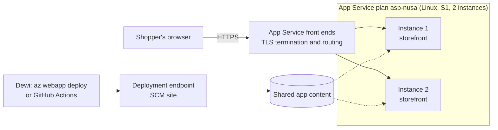
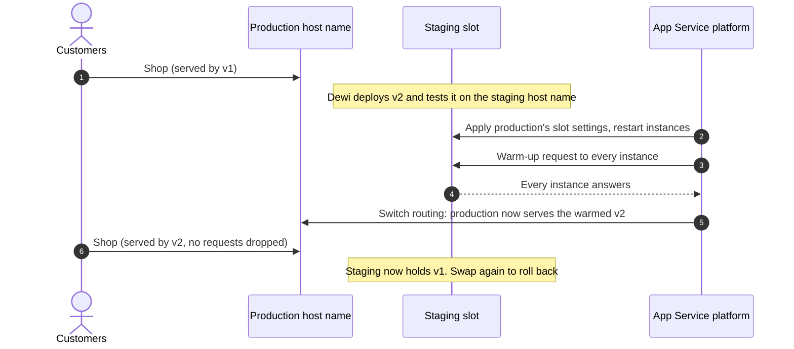

# Lunch 10 · Web Apps with Azure App Service

> **Track:** Core month · **Level:** Basic · **Part 3:** Platform services and data
> **Time:** 60 minutes · **Prerequisite lunches:** 02, 06 (09 helps)
> **AZ-900 skill area:** Describe Azure architecture and services
> **Lab:** [Lab 10 · Move the storefront to PaaS](../../labs/10-app-service/README.md) — about 45 minutes · cost 💲 (💲💲 for the slot stretch)

| ⏱ Minutes | Segment |
|---:|---|
| 5 | Scenario and objectives |
| 25 | Reading |
| 15 | Demo: interactive animation (+ optional walkthrough video) |
| 5 | Knowledge check |
| 5 | Key takeaways and lab preview |
| 5 | Buffer — finish your lunch 🍜 |

## 🍱 Today's menu

By the end of this lunch you will be able to:

- **Explain** what Azure App Service runs for you, how a request reaches your code, and what stays your job.
- **Choose** an App Service plan tier, and decide when to scale up and when to scale out.
- **Configure** an app with app settings and release it safely through a deployment slot and a swap.
- **Compare** App Service with virtual machines, Azure Container Apps and Azure Static Web Apps for a given workload.

## 🏪 Meanwhile at Nusantara Retail

Friday, 21:40. Dewi is still in the office. Since Lunch 09 the storefront runs on two virtual machines behind a load
balancer, and it survived its first server failure without a single lost sale. The price is her Friday nights: patch
Ubuntu on one VM, take it out of the pool, update Python, renew the certificate, restart nginx, put it back, repeat on
the other one. "I'm a developer," she sighs, "and I spend more time looking after servers than writing the checkout."

On Monday, Ibu Sari adds a second worry. Harbolnas, Indonesia's 12.12 online shopping day, is eight weeks away. Last
year the traffic peak lasted about four hours, and she doesn't want to pay all year for servers sized for one evening.
Dewi also wants to release a new checkout page before the sale, without taking the shop offline to do it.

Today's question: **can Azure run the web servers for us, grow them for the sale, and let Dewi ship new code with no
downtime?**

---

## 📖 Reading (≈25 minutes)

### 1. Platform as a service for web apps

In Lunch 06 you rented a virtual machine and became responsible for everything above the hardware: the operating
system, the language runtime, the web server, security patches and the scaling plan. **Azure App Service** moves that
line. It is a **platform as a service (PaaS)** for HTTP workloads: websites, REST APIs and mobile back ends. Microsoft
runs and patches the operating system, the language runtimes and the web front ends; you bring code and configuration.
You still own your data, your users' access, your app's settings and, of course, your bugs. The shared-responsibility
slider from Lunch 02 has moved one big step to the right.

App Service runs **.NET, Java (Java SE, Tomcat and JBoss), Node.js, Python and PHP** on Windows or Linux. Python runs
on Linux only. If your stack isn't on the list, or you already package the app as an image, App Service also runs a
**custom container**. The platform knows each built-in stack: when Dewi deploys Python code, App Service can install
the packages from `requirements.txt` and start the app with Gunicorn, a production web server, without her writing a
startup script.

How does a request reach the code? Each Azure region runs App Service on large groups of servers. **Front ends** take
every incoming request for your app's address, such as `app-nusa-ab12c.azurewebsites.net` or
`www.nusantararetail.co.id`. (Apps created in the portal get a longer default name that includes a random part and the
region, so nobody outside your organization can ever recreate it.) They terminate TLS, decide which instance should
handle the request and forward it.
**Workers** are the virtual machines that run your code; the ones reserved for you form your **App Service plan**.
Your deployed files live on shared storage, so any of your workers can start your app. A separate **deployment
endpoint** (the *SCM site*, also known as Kudu) accepts new code from the CLI, from GitHub Actions or from the portal.

You never sign in to those workers to patch them. When a new Python or Ubuntu patch is out, the platform rolls it out.
When a worker's hardware fails, the platform moves your app to a healthy one. That is the trade: you give up control
over the machine, and in return the whole night shift of server care disappears.

The trade has edges you should know before you move a workload. Your app is reachable over HTTP and HTTPS only, not on
arbitrary ports, so a service that listens on its own TCP port belongs elsewhere. You can't install operating-system
packages into the built-in stacks; if the app needs them, build a custom container. Work that runs for hours in the
background doesn't belong in a web request: App Service has WebJobs for background tasks, and Lunch 14 introduces
Azure Functions for event-driven jobs. And the platform can't fix a slow database query, a memory leak or a password
committed to Git. Those stay yours.

> [!TIP]
> TLS ends at the front ends, so your code receives plain HTTP plus an `X-Forwarded-Proto` header that says whether the
> visitor used HTTPS. Don't write your own HTTP-to-HTTPS redirect: switch on the **HTTPS Only** setting and let the
> front ends do it.

### 2. App Service plans: the compute you pay for

Every app runs in an **App Service plan**. The plan defines the region, the operating system, the **pricing tier**,
the **instance size** and the **number of instances**. Several apps can share one plan, and then they share its
instances: the storefront and the staff admin portal could sit on the same two workers. Apps in a plan scale together,
because scaling changes the plan, not the app.

That gives the most important billing rule of this lunch: **you pay for the plan, not for the apps**. In the dedicated
tiers, each instance is billed per hour whether the apps on it are busy, idle or stopped. The Free tier is free, with
strict limits. The tier also decides which features you get:

| Tier | Compute | Max instances | Autoscale | Deployment slots | Custom domain with TLS | Typical use |
|---|---|---|---|---|---|---|
| **Free (F1)** | Shared, 60 CPU minutes a day | 1 | No | No | No (`azurewebsites.net` only) | Learning, quick demos |
| **Shared (D1)** | Shared, Windows only | 1 | No | No | No TLS for custom domains | Tiny hobby sites |
| **Basic (B1–B3)** | Dedicated | 3, manual | No | No | Yes | Dev/test, small production sites |
| **Standard (S1–S3)** | Dedicated | 10 | Yes | 5 per app | Yes | Most production web apps |
| **Premium v3 and v4** | Dedicated, faster hardware, memory-optimized options | 30 | Yes | 20 per app | Yes | Busy production, larger apps |
| **Isolated v2** | Dedicated, inside your own virtual network (App Service Environment v3) | 100 | Yes | 20 per app | Yes | Strict network isolation, very large scale |

The numbers are the published limits at the time of writing (October 2026); check the App Service limits page before
you design around them. Two rows deserve a second look for Nusantara Retail. Basic has dedicated compute but no
**deployment slots** and no **autoscale**. Standard is the first tier with both, which is why it's the usual starting
point for a production shop.

There are two ways to get more power:

- **Scale up** (vertical): move the plan to a bigger size or a higher tier, for example from S1 to S2 or to P1v3. Each
  instance gets more CPU and memory, or the plan gains features. You don't redeploy anything, though the apps restart.
- **Scale out** (horizontal): add instances of the same size, for example from one to three. You can do it by hand
  (Basic and up), with **autoscale** rules that react to metrics such as CPU or to a schedule (Standard and up), or, on
  Premium v2, v3 and v4 plans, with **automatic scaling**, where the platform decides based on HTTP traffic.

How do you pick a size? Start small, measure CPU and memory under realistic load, then adjust; changing the tier later
takes minutes, not a migration. Development and test environments can share one Basic plan. Production deserves its
own plan, so that a busy test run can't slow the shop down. A plan that runs all year can be bought at a discount with
reservations or the Azure savings plan for compute (Lunch 19 compares the options). In regions with availability zones
(Lunch 03), higher tiers can also spread a plan's instances across zones, so one zone failure doesn't close the shop;
check which tiers and minimum instance counts zone redundancy needs in your region.

Scale out only works smoothly if the app is **stateless**. If Dewi's code kept shopping carts in the memory of the web
server process, a shopper whose next request lands on another instance would see an empty cart. State belongs in a
database or a cache (Lunches 11 and 12). App Service can pin a browser to one instance with an affinity cookie, but
that's a crutch, not a design.

> [!WARNING]
> Stopping a web app does **not** stop the bill. The plan's instances keep running and keep being charged until you
> scale the plan down to the Free tier or delete it. In the labs, delete the whole resource group.

### 3. Getting code in and configuration right

Deploying means getting a build of your code onto the workers. App Service offers several routes, and they all end at
the same deployment endpoint:

| Option | How it works | Use it when |
|---|---|---|
| `az webapp up` | One command that creates the group, plan and app, zips the current folder and deploys it | You want a quick first deployment. Azure CLI 2.87 (June 2026) formally deprecated it; it still runs |
| `az webapp create` + `az webapp deploy` | You create the resources explicitly, then upload a zip package. With `SCM_DO_BUILD_DURING_DEPLOYMENT=true`, App Service installs your dependencies | Scripts, labs and simple pipelines |
| GitHub Actions or Azure Pipelines | Every push builds, tests and deploys, ideally to a staging slot | Team development and repeatable releases |
| Deployment Center | A portal page that connects a repository and writes the workflow for you | Your first CI/CD setup, without writing YAML |
| Container image | App Service pulls an image from Azure Container Registry or another registry | You already ship the app as a container |

What happens to a Python zip package after upload? If build automation is on, App Service's build system creates a
virtual environment and runs `pip install` for everything in `requirements.txt`. When the app starts, the Linux
container looks for a Django project (`wsgi.py`) or a Flask app in `app.py` or `application.py` and starts Gunicorn
for it. Anything unusual, such as a FastAPI app, needs a startup command in the general settings. If it finds nothing,
it serves a default page, which is a common surprise after a deployment from the wrong folder.

Configuration is the other half of a release. The same storefront code should run as the real shop in production and
as a test shop in staging, so values that differ between environments live outside the code:

- **App settings** are name–value pairs that App Service hands to your code as **environment variables** when it
  starts. Dewi's Python code reads `os.environ["STORE_NAME"]`. Changing a setting restarts the app, so the new value
  takes effect within seconds.
- **Connection strings** are a separate list for database connections, also exposed as environment variables (with a
  prefix that names the database type).
- **Key Vault references** let a setting point at a secret in Azure Key Vault instead of holding the secret. The value
  looks like `@Microsoft.KeyVault(SecretUri=...)`, and the app's **managed identity** reads the real secret. Nobody
  needs to paste a password into the portal again (Lunch 15).
- **General settings** pick the runtime version, the startup command, **HTTPS Only**, the minimum TLS version,
  **Always On** (Basic and up), which keeps the app loaded between requests, and a **health check** path.

When something goes wrong, App Service gives you several windows into the app. The **log stream** shows what the app
writes to its console, live, in the portal or with `az webapp log tail`. *Diagnose and solve problems* runs ready-made
checks for crashes, slow responses and configuration mistakes. **Application Insights** records every request,
dependency call and exception for later analysis; Lunches 16 and 30 go deeper.

### 4. Deployment slots and swaps

Deploying straight into production has two problems. While the instances restart and warm up with the new code, the
first customers get slow answers or errors. And if the new code is broken, every customer sees it at once, and the
"undo" is another deployment.

A **deployment slot** solves both. A slot is a live app with its own host name, for example
`app-nusa-ab12c-staging.azurewebsites.net`, that runs in the same plan on the **same instances** as production. Slots
come with Standard (5 per app) and Premium and Isolated (20 per app). They cost nothing extra, but they do use some of
the plan's CPU and memory. Dewi deploys version 2 to the `staging` slot, tests it on its own address while customers
keep buying through version 1, and then asks App Service to **swap** staging into production:

Production keeps serving the old code until every staging instance has restarted with production's settings and
answered a warm-up request. Only then does App Service switch the routing, so no request is dropped. If finance spots a
bug half an hour later, Dewi swaps again: the previous version is still deployed in the staging slot, so it is warmed
up and switched back in a minute or two, with no redeployment and no downtime. For extra caution, a **swap with
preview** pauses after the settings step so you can test staging with the production configuration before you
complete the swap.

What travels with the code during a swap, and what stays with the slot? App settings and connection strings travel,
unless you mark them as **deployment slot settings** (often called *sticky* settings). That is how staging keeps its own
test database connection: mark it sticky, and it never ends up in production. Some things always stay with the slot,
including custom domain names, TLS certificates, **HTTPS Only**, scale settings, access restrictions and managed
identities. Slots can also take a share of live traffic, such as 10 percent of shoppers, for testing a change on real
users before a full swap. One Linux detail: auto swap, which swaps automatically after every deployment to a slot, is
available for Windows apps only.

Here's how Dewi could plan the new checkout for Harbolnas. On Monday, the pipeline deploys version 2 to staging. On
Tuesday, the team tests the staging address and then routes 10 percent of real shoppers to it for a day. On Wednesday
night, well before the sale, Dewi swaps and watches the error rate. If anything looks wrong, she swaps back within a
minute. During the sale itself nobody deploys anything: the safest release is the one you finish early.

### 5. Domains, security and networking at a glance

The storefront needs its own name and an HTTPS padlock, and the admin portal must not be open to the whole internet.
App Service has a building block for each:

| Feature | Direction | What it gives you | Tiers |
|---|---|---|---|
| HTTPS Only and minimum TLS version | Inbound | Redirects HTTP to HTTPS and refuses old TLS versions | All |
| Custom domain with a managed certificate | Inbound | `www.nusantararetail.co.id` with a free, auto-renewed certificate (not wildcard) | Basic and up |
| Built-in authentication | Inbound | Sign-in with Microsoft Entra ID, Google, GitHub and others before any request reaches your code | All |
| Access restrictions | Inbound | Allow or deny traffic by IP range, service tag or subnet | All |
| Private endpoint | Inbound | A private IP address in your virtual network; public access can be switched off | Basic, Standard, Premium |
| Virtual network integration | Outbound | The app can reach private resources, such as a database behind a private endpoint | Basic and up |
| Managed identity | Outbound | The app gets its own Entra ID identity to call Key Vault, Storage or SQL without secrets | All |

Built-in authentication, often called "Easy Auth", is handy for the staff-only admin portal: with a few settings,
everyone must sign in with their Nusantara Retail account before the first page loads. Access restrictions could allow
the admin portal only from head office's public IP address, or allow the storefront only through Azure Front Door
(Lunch 27). Private endpoints and virtual network integration come back in Lunch 25. You don't need all of these on
day one, but it helps to know that each problem already has a switch.

### 6. App Service or something else? Nusantara Retail's choice

App Service isn't the only place to run a website in Azure. Here's how it compares with its neighbours:

| | Virtual machines | App Service | Container Apps | Static Web Apps |
|---|---|---|---|---|
| **You manage** | OS, runtime, web server, patches, scaling design | Code, settings, plan size and count | Container images, scale rules | Front-end code and small APIs |
| **You deploy** | Software installed on a VM | A code package or a container | A container image (as revisions) | Static files built from a Git repository |
| **Scaling** | Scale sets (Lunch 23) | Instances in a plan, autoscale | Replicas from zero upwards with event-driven rules | Content served from many locations worldwide, automatically |
| **You pay for** | VM hours and disks | Plan instances (Free tier for learning) | Resources used per second, or dedicated workload profiles | A free plan or a paid Standard plan |
| **Pick it when** | You need full OS control or legacy software | You host web apps and APIs on a supported stack | You run microservices, background workers or event-driven containers | You publish single-page apps and static sites |
| **Nusantara example** | A legacy service that syncs the stores' POS terminals | The storefront and the admin portal | Inventory and recommendation microservices (Lunch 13) | The 12.12 promotion microsite |

Three questions settle most cases. Do you need control of the operating system, or software that only installs on a
server? Then use a VM. Is there no server-side code at all? Then Static Web Apps is simpler and cheaper. Is the
workload a set of containers that should scale independently, possibly down to zero? Then look at Container Apps. For
a classic web app or API on a supported language, App Service is usually the shortest path to production.

For the storefront, the choice is App Service on Linux with the Python stack. In production, Nusantara Retail would
use at least the Standard tier with two or more instances for availability, an autoscale rule for Harbolnas, a staging
slot for every release, HTTPS Only with a managed certificate on `www.nusantararetail.co.id`, and Key Vault references
for secrets. Customer data must stay in Indonesia, so production would run in Indonesia Central (Jakarta), after
checking that the chosen tier is offered there. The labs use Southeast Asia, where every tier is available.

Moving the web tier doesn't move the data. The product database still sits on the old server next to the pantry, and
that's next lunch's job: Azure SQL, in Lunch 11. Later lunches add containers (13), serverless functions for the
order pipeline (14) and a global front door with a web application firewall in front of App Service (27).

> [!NOTE]
> **Pause and think:** Dewi's current code keeps each shopper's cart in a Python dictionary inside the web server
> process. What happens to a cart when autoscale adds a second instance, and what happens when Dewi swaps a new version
> into production? Where should the cart live instead?

---

## 🎬 Demo (≈15 minutes)

1. **Interactive animation (≈6–8 min):** [Open the demo](https://stefpin.github.io/azure-fundamentals-lunches/demos/10-app-service.html) —
   press ▶ Play or step through it at your own pace. Offline? Download
   [`docs/demos/10-app-service.html`](../../docs/demos/10-app-service.html) and open it in any browser.
2. **Walkthrough video (≤ 6 min):** _coming soon_ — [read the walkthrough script](demo-video-script.md).

What to watch for:

- Every request passes the front ends first; the workers in your plan only run your code.
- Autoscale adds instances of the same size, and the front ends start using them straight away.
- The staging slot runs on the same instances as production, and the swap happens only after every instance is warm.
- Swapping back is the undo button: the previous version is still deployed in the staging slot.

## ✅ Knowledge check (≈5 minutes)

1. The storefront and the admin portal share one Standard S1 plan with two instances. To save money over the weekend,
   Dewi stops the admin portal app. How much does the bill drop?
   

Show answer

   It doesn't drop at all. You pay for the plan's instances, and stopping one app leaves both instances running. To
   save money, scale the plan in or down, or move the admin portal to a cheaper plan.

   

2. Ibu Sari wants zero-downtime releases through a staging slot and automatic scaling for Harbolnas, at the lowest
   possible price. Which is the lowest tier that offers both?
   

Show answer

   Standard (for example S1). It's the first tier with deployment slots (five per app) and autoscale; Basic has
   dedicated instances but neither feature.

   

3. After a swap, the production storefront starts writing orders into the *test* database. What went wrong, and how do
   you prevent it?
   

Show answer

   The database connection string wasn't marked as a deployment slot setting, so it travelled with the code during the
   swap. Mark environment-specific settings as slot settings so that they stay with their slot.

   

4. Rizky, the contractor, put the database password in `app.py`. Dewi moves it to an app setting. The security lead
   suggests a Key Vault reference instead. Why is that better still?
   

Show answer

   With a Key Vault reference, the secret lives only in Key Vault, where access is controlled, logged and rotated; the
   app reads it with its managed identity. An app setting holds the secret itself, so anyone who can read the app's
   configuration can read the password.

   

5. Marketing's 12.12 promotion microsite is plain HTML, CSS and JavaScript generated by a static site tool. They want it
   fast for shoppers all over Indonesia and as cheap as possible. App Service, Container Apps or Static Web Apps?
   

Show answer

   Static Web Apps: it serves static files from many locations close to the visitors, has a free plan and creates
   preview environments for pull requests. There is no server-side code to host, so App Service would be overkill.

   

## 🧠 Key takeaways

- App Service is PaaS for web apps and APIs: Microsoft runs the OS, the runtimes and the TLS-terminating front ends;
  you own the code, the settings, the data and who gets access.
- You pay for the App Service plan (tier × size × instances), not for the apps. Stopping an app doesn't stop the bill,
  and Free F1 is for learning only.
- Scale up for bigger instances or more features; scale out for more instances. Deployment slots and autoscale start at
  the Standard tier, and scaling out needs a stateless app.
- App settings become environment variables; secrets belong in Key Vault references; environment-specific values
  should be sticky slot settings.
- Deployment slots let you test on production hardware and swap with no downtime, and swapping back is a quick
  rollback that needs no redeployment.

## 🔬 Your lab: Move the storefront to PaaS

You'll deploy Nusantara Retail's Python storefront to a Linux App Service plan on the Free tier with `az webapp up`,
configure the store name as an app setting, force HTTPS and watch the log stream. Then you delete a required setting on
purpose, read the logs to find the cause, and fix it. In the optional stretch you move to Standard, deploy version 2 to
a staging slot and swap it into production while a script checks that no request fails.

- ⏱ About 45 minutes · 💲 free on F1 (💲💲 for the slot stretch) · works on its own (no earlier lab needed)
- 👉 [Start Lab 10](../../labs/10-app-service/README.md)

## 📚 Go further

- [Microsoft Learn: Azure App Service plans](https://learn.microsoft.com/azure/app-service/overview-hosting-plans) — how plans are billed, how apps share them and how to scale them.
- [Microsoft Learn: Set up staging environments in Azure App Service](https://learn.microsoft.com/azure/app-service/deploy-staging-slots) — every step of a swap, sticky settings and traffic routing.
- [Microsoft Learn: Configure a Linux Python app for Azure App Service](https://learn.microsoft.com/azure/app-service/configure-language-python) — the build, the startup command and the log stream for Python apps.

---

⬅️ [Lunch 09 · Load Balancing (Basic): Azure Load Balancer](../09-load-balancing-basic/README.md) · 🏠 [Course home](../../README.md) · [Lunch 11 · Relational Databases (Basic): Azure SQL](../11-relational-databases-basic/README.md) ➡️

Last validated: October 2026 · Spotted something out of date? [Open an issue](../../CONTRIBUTING.md).
