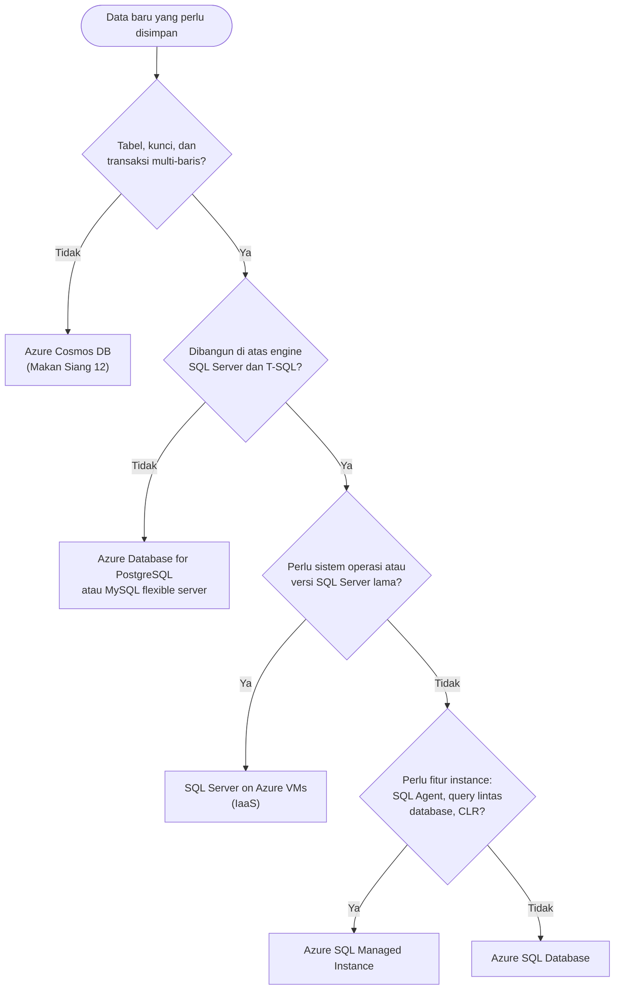
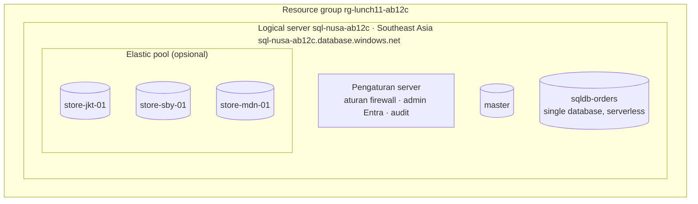
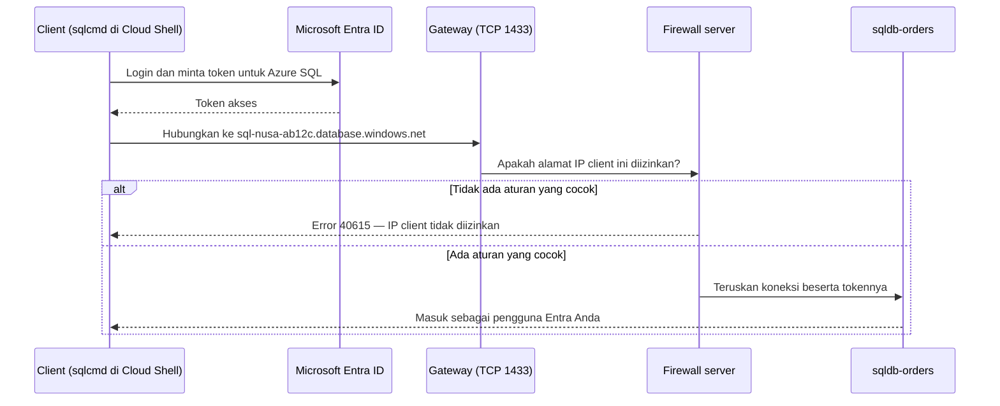

# Makan Siang 11 · Database Relasional (Dasar): Azure SQL

🇬🇧 [Read in English](README.md)

> **Jalur:** Bulan inti · **Level:** Dasar · **Bagian 3:** Layanan platform dan data
> **Waktu:** 60 menit · **Makan siang prasyarat:** 02, 05
> **Area keterampilan AZ-900:** Menjelaskan arsitektur dan layanan Azure
> **Lab:** [Lab 11 · Database pesanan Nusantara Retail](../../labs/11-relational-databases-basic/README.id.md) — sekitar 45 menit · biaya 💲
> **Penulis:** Stefanus Pinarta · [Tentang penulis](../../README.id.md#tentang-penulis)

| ⏱ Menit | Segmen |
|---:|---|
| 5 | Skenario dan tujuan |
| 25 | Bacaan |
| 15 | Demo: animasi interaktif (+ video panduan opsional) |
| 5 | Uji pemahaman |
| 5 | Poin penting dan pratinjau lab |
| 5 | Waktu cadangan — habiskan makan siang Anda 🍜 |

## 🍱 Menu hari ini

Setelah makan siang ini, Anda akan mampu:

- **Memilih** layanan database untuk sebuah beban kerja dengan membandingkan Azure SQL Database, Azure SQL Managed Instance, SQL Server on Azure VMs, Azure Database for PostgreSQL dan MySQL, serta Azure Cosmos DB.
- **Menjelaskan** apa itu logical server di Azure SQL dan bagaimana database serta elastic pool berhubungan dengannya.
- **Membandingkan** model pembelian DTU dan vCore, service tier pada model vCore, komputasi serverless, dan free offer (penawaran gratis).
- **Menguraikan** bagaimana sebuah koneksi sampai ke database — melalui gateway, firewall, dan autentikasi Microsoft Entra — serta mengapa autentikasi khusus Entra (Entra-only) adalah pilihan bawaan yang lebih aman.

## 🏪 Sementara itu di Nusantara Retail

Pada makan siang sebelumnya, Dewi sudah memindahkan kode toko online ke App Service. Namun, data pesanan masih tinggal di database SQL Server Express pada server di sebelah pantry. Satu-satunya cadangan (backup) adalah flashdisk USB yang dibawa pulang Pak Budi setiap hari Jumat — dan minggu lalu ketahuan bahwa isi flashdisk itu ternyata salinan dari tiga minggu sebelumnya. Sejak itu, Ibu Sari tidak lagi bisa tersenyum setiap kali topik ini muncul.

Semua orang punya pendapat. Dewi menginginkan database terkelola (managed) yang tidak perlu ia patch sendiri. Pak Budi khawatir soal siapa saja yang bisa menjangkaunya: saat ini, siapa pun yang tersambung ke Wi-Fi kantor dan tahu kata sandi bersama untuk akun `sa` — akun administrator bawaan SQL Server — bisa masuk. Rizky, sang kontraktor, mengusulkan "buka saja port 1433 ke internet" (port 1433 adalah "pintu" jaringan standar SQL Server) supaya tool laporannya bisa terhubung dari mana saja. Tim keuangan hanya menanyakan satu hal: berapa biayanya?

Tugas Anda hari ini: memilih layanan database yang tepat untuk data pesanan, terhubung ke sana dengan identitas Anda sendiri alih-alih kata sandi bersama, dan menjaga pintunya tetap tertutup bagi semua orang lain. **Database Azure mana yang sebaiknya menyimpan pesanan Nusantara Retail — dan siapa yang boleh melewati pintunya?**

---

## 📖 Bacaan (≈25 menit)

### 1. Relasional atau bukan? Memilih database di Azure

Setiap pesanan di toko online berubah menjadi beberapa baris data: satu baris di tabel `Orders`, beberapa baris di tabel `OrderLines` (rincian barang yang dibeli), serta tautan ke baris-baris di tabel `Customers` dan `Products`. Inilah **data relasional**: informasi yang disimpan dalam tabel dengan susunan kolom yang tetap (disebut **skema**), saling terhubung melalui kunci (key), dan diubah lewat **transaksi** yang selesai sepenuhnya atau tidak sama sekali. Saat pelanggan membayar, pencatatan pesanan, rincian barangnya, dan pengurangan stok harus berhasil bersama-sama. Janji "semua atau tidak sama sekali" ini biasanya diringkas sebagai **ACID** (*atomic, consistent, isolated, durable* — utuh, konsisten, terisolasi, dan tahan lama). Ibaratnya transfer lewat m-banking: saldo Anda berkurang dan saldo penerima bertambah — keduanya terjadi, atau tidak satu pun; tidak boleh ada uang yang "hilang di jalan" karena sinyal putus. Anda membaca dan mengubah data relasional dengan **SQL** (Structured Query Language); dialek SQL buatan Microsoft disebut **T-SQL** (Transact-SQL).

Database **non-relasional** (atau **NoSQL**) melonggarkan sebagian aturan itu demi fleksibilitas dan skala. Database jenis ini menyimpan dokumen yang bentuknya boleh berbeda dari satu item ke item lain, pasangan kunci-nilai (key-value), graf, atau keluarga kolom yang lebar (wide column family). Katalog produk — tempat kemeja batik punya atribut bahan dan motif, sementara rice cooker punya daya listrik dan kapasitas — sangat cocok dengan model dokumen. Anda akan berkenalan dengan Azure Cosmos DB, layanan NoSQL milik Azure, pada makan siang berikutnya.

Azure menyediakan beberapa "rumah" terkelola untuk data relasional, ditambah Cosmos DB untuk jenis data lainnya. Simpan baik-baik **matriks pemilihan database** berikut; tabel ini menjawab sebagian besar diskusi "kita pakai database yang mana?". Kolom **Model** menunjukkan pembagian kerjanya: PaaS (*platform sebagai layanan*) berarti Microsoft mengurus server, sistem operasi, dan mesin database (engine), sedangkan IaaS (*infrastruktur sebagai layanan*) berarti Anda mendapat sebuah virtual machine (*komputer virtual*) dan mengurus sisanya sendiri.

| Layanan | Model | Engine | Pilih jika | Pikirkan ulang jika |
|---|---|---|---|---|
| **Azure SQL Database** | PaaS | engine SQL Server, selalu versi terbaru | Anda membangun atau memodernisasi aplikasi yang "berbicara" T-SQL dan ingin Microsoft mengurus patch, backup, dan ketersediaan tinggi | Anda butuh fitur tingkat instance seperti job SQL Server Agent atau query lintas database |
| **Azure SQL Managed Instance** | PaaS, di dalam virtual network (*jaringan virtual*) Anda | engine SQL Server dengan kompatibilitas hampir 100% | Anda memindahkan apa adanya (lift and shift) aplikasi SQL Server lama yang bergantung pada fitur instance | Anda hanya butuh satu database sederhana — biayanya lebih mahal dan deployment-nya lebih lama |
| **SQL Server on Azure VMs** | IaaS | versi dan edisi SQL Server apa pun yang Anda pasang | Anda butuh akses ke sistem operasi, versi SQL Server yang lebih lama, atau perangkat lunak lain di mesin yang sama | Anda tidak ingin melakukan patch, backup, dan clustering sendiri |
| **Azure Database for PostgreSQL – flexible server** | PaaS | PostgreSQL versi komunitas | aplikasi dan tim Anda sudah memakai PostgreSQL beserta ekstensinya | kode Anda ditulis dalam T-SQL |
| **Azure Database for MySQL – flexible server** | PaaS | MySQL versi komunitas | Anda menjalankan aplikasi PHP atau LAMP stack (Linux, Apache, MySQL, PHP) seperti WordPress | Anda butuh fitur-fitur SQL Server |
| **Azure Cosmos DB** | PaaS, terdistribusi secara global | NoSQL, beberapa API | skema fleksibel, skala sangat besar, pembacaan cepat dari lokasi yang dekat dengan pengguna di seluruh dunia | Anda butuh join antarbanyak tabel dan transaksi multi-baris yang kompleks |

Opsi deployment lama bernama *single server* untuk PostgreSQL dan MySQL sudah dipensiunkan (MySQL pada September 2024, PostgreSQL pada Maret 2025). Kini **flexible server** adalah opsi yang dipakai untuk keduanya.

Memakai lebih dari satu database itu hal yang wajar. Banyak perusahaan menyimpan pesanan dan pembayaran di database relasional, lalu menaruh katalog, keranjang belanja, atau telemetri (aliran data sensor dan log) di penyimpanan NoSQL. Keahliannya terletak pada mencocokkan setiap jenis data dengan layanan yang paling sesuai, bukan memaksakan semuanya masuk ke database yang kebetulan sudah Anda kenal.

Bacalah alur keputusan di bawah ini dari atas. Alur ini menanyakan datanya terlebih dahulu, lalu engine-nya, kemudian seberapa besar kendali yang Anda butuhkan. Setiap langkah ke arah IaaS memberi Anda kendali lebih besar — sekaligus pekerjaan lebih banyak. Inilah kompromi *model tanggung jawab bersama* yang Anda pelajari di Makan Siang 02. Dua istilah di diagram mungkin masih baru: SQL Agent adalah penjadwal job bawaan SQL Server, dan CLR (Common Language Runtime) memungkinkan kode .NET berjalan di dalam database — keduanya termasuk fitur tingkat instance.

### 2. Keluarga Azure SQL dan logical server

**Azure SQL** adalah nama payung untuk tiga cara menjalankan engine SQL Server di Azure. Ketiganya memakai engine yang sama, sehingga keterampilan T-SQL, driver, dan tool Anda tetap terpakai. Yang berbeda adalah siapa yang mengerjakan urusan operasionalnya.

| Opsi deployment | Yang Anda dapatkan | Yang Anda kelola | Pilih untuk |
|---|---|---|---|
| **SQL Database — single database** | satu database yang dikelola penuh, dengan sumber daya terjamin miliknya sendiri | skema, data, dan akses | sebagian besar aplikasi baru |
| **SQL Database — elastic pool** | banyak database yang berbagi satu "kolam" (pool) sumber daya | sama seperti di atas, ditambah ukuran pool | kelompok database yang sibuk pada waktu berbeda-beda, misalnya satu database per toko atau per pelanggan sebuah produk SaaS (*perangkat lunak sebagai layanan*) |
| **SQL Managed Instance** | satu instance SQL Server utuh yang dikelola, di dalam sebuah subnet pada virtual network Anda | sama seperti di atas, ditambah jaringannya | aplikasi lama yang membutuhkan SQL Server Agent, query lintas database, atau linked server |
| **SQL Server on Azure VMs** | sebuah virtual machine dengan SQL Server terpasang (IaaS) | semuanya, mulai dari sistem operasi ke atas | kendali penuh, versi lama, perangkat lunak lain di mesin yang sama |

Pada dua opsi PaaS, Microsoft yang memasang patch pada engine, membuat backup, dan menjaga ketersediaan tinggi database. Pada VM, ekstensi SQL IaaS Agent memang menambahkan fitur manajemen di portal, tetapi menjaga VM dan SQL Server tetap ter-patch, ter-backup, dan selalu tersedia tetap menjadi tugas Anda.

SQL Database memperkenalkan satu konsep yang sering membingungkan pemula: **logical server** (server logis). Saat Anda membuat database pertama, portal juga meminta sebuah "server" dengan nama seperti `sql-nusa-ab12c`. Server ini bukan virtual machine; Anda tidak pernah login ke dalamnya ataupun memasang patch padanya. Ia adalah batas manajemen dan koneksi yang:

- memberi database Anda sebuah nama DNS (Domain Name System — "buku alamat" internet yang menerjemahkan nama menjadi alamat IP), misalnya `sql-nusa-ab12c.database.windows.net` — karena itu namanya harus unik di seluruh dunia;
- menyimpan pengaturan yang berlaku untuk setiap database di dalamnya: aturan firewall, administrator Microsoft Entra, audit, dan kebijakan koneksi (connection policy);
- berisi sebuah database kecil bernama `master` yang menyimpan metadata tingkat server.

Logical server tidak punya harga sendiri; Anda membayar per database atau per elastic pool. Database pada server yang sama boleh memakai tier dan ukuran yang berbeda-beda. Sebuah server berada di satu region (*wilayah*), begitu pula database-database di dalamnya. Anggap saja logical server seperti alamat dan pos satpam sebuah kompleks ruko: alamat dan aturan masuknya berlaku untuk semua toko di dalamnya, tetapi yang Anda bayar adalah sewa setiap tokonya, bukan alamatnya.

Mengapa ada yang memilih pool? Bayangkan empat puluh database kecil milik empat puluh toko. Setiap toko ramai pada jam bukanya sendiri dan sepi di sisa hari. Jika diukur satu per satu, setiap database butuh kapasitas yang cukup untuk jam puncaknya sendiri, dan sebagian besar kapasitas itu menganggur. Di dalam pool, mereka berbagi kapasitas yang diukur untuk puncak *gabungan* — jauh lebih kecil daripada jumlah empat puluh puncak masing-masing. Mirip food court yang memakai satu genset bersama: warung kopi ramai pagi, warung bakso ramai malam, jadi satu genset cukup untuk semuanya. Pool tidak lagi menguntungkan jika semua database mencapai puncaknya pada saat yang sama — seperti genset bersama yang kewalahan ketika semua warung ramai serentak.

### 3. Soal biaya: model pembelian, service tier, dan serverless

Azure SQL Database menawarkan dua **model pembelian** (purchasing model). Keduanya memberi Anda engine yang sama; bedanya ada pada cara Anda menentukan ukuran dan membayar.

| | Model DTU | Model vCore |
|---|---|---|
| Yang Anda beli | **DTU** (Database Transaction Unit): paket campuran CPU, memori, dan I/O (baca-tulis disk) dengan porsi tetap | sejumlah **vCore** (inti prosesor virtual) pada generasi perangkat keras pilihan, dengan penyimpanan yang diatur terpisah |
| Service tier | Basic, Standard, Premium | General Purpose, Business Critical, Hyperscale |
| Kelebihan | sederhana, harga mudah diprediksi untuk database kecil yang bebannya stabil | fleksibel; ada komputasi serverless; Azure Hybrid Benefit (potongan harga dengan lisensi SQL Server yang sudah Anda miliki) dan reservasi (diskon untuk komitmen pemakaian jangka panjang) untuk komputasi provisioned |
| Penggunaan umum | aplikasi kecil milik satu departemen, prototipe cepat | sebagian besar beban kerja produksi baru |

Ibaratnya memesan makan siang: DTU seperti paket nasi ayam yang isinya sudah ditentukan dalam satu harga, sedangkan vCore seperti prasmanan — Anda memilih sendiri porsi prosesornya, lalu penyimpanan dihitung terpisah.

Anda tidak terkunci pada satu pilihan. Sebuah database bisa pindah antar-tier, bahkan dari model DTU ke model vCore, melalui operasi scaling yang menjaga data tetap online dan hanya diakhiri dengan koneksi ulang yang singkat. Karena itu, aman untuk mulai dari ukuran kecil, lalu menyesuaikan ukurannya begitu data pemakaian yang nyata tersedia.

Di dalam model vCore, **service tier** (tingkat layanan) menentukan arsitektur di balik database Anda:

| Tier | Cara kerjanya, dalam satu kalimat | Cocok untuk |
|---|---|---|
| **General Purpose** | node komputasi tanpa status (stateless) di depan penyimpanan jarak jauh yang sangat tahan lama | sebagian besar aplikasi bisnis, pengembangan dan pengujian (dev/test); serverless dan free offer tersedia di tier ini |
| **Business Critical** | beberapa replika yang terus disinkronkan di atas penyimpanan SSD lokal yang cepat | aplikasi transaksional berlatensi rendah yang butuh failover (peralihan ke replika lain) tercepat; termasuk replika yang bisa dibaca untuk laporan |
| **Hyperscale** | komputasi dipisahkan dari lapisan terdistribusi berisi page server dan layanan log | database besar atau yang tumbuh cepat, hingga 128 TB, dengan scaling dan pemulihan yang cepat |

Berikutnya adalah **compute tier** (tingkat komputasi). Komputasi **provisioned** memesan sejumlah vCore yang tetap dan ditagih per jam, dipakai ataupun tidak. Komputasi **serverless**, yang tersedia di General Purpose dan Hyperscale, menyesuaikan diri secara otomatis di antara jumlah vCore minimum dan maksimum, dan ditagih per detik sesuai pemakaian database yang sebenarnya — contoh nyata *model berbasis penggunaan*.

General Purpose serverless juga bisa melakukan **auto-pause** (jeda otomatis): setelah beberapa waktu tanpa koneksi (disebut auto-pause delay; bawaannya 60 menit dan minimal 15 menit), database berhenti sementara, dan Anda hanya membayar penyimpanannya. Koneksi berikutnya akan membangunkannya kembali. Proses bangun (resume) biasanya kurang dari satu menit, dan selama itu percobaan koneksi pertama gagal dengan error **40613** ("database not currently available"), sehingga aplikasi perlu logika coba-ulang (retry). Ibaratnya lampu toilet mal yang memakai sensor gerak: padam sendiri saat ruangan kosong dan menyala lagi saat ada yang masuk — bedanya, "tamu" pertama yang datang ke database harus mengetuk dua kali: ketukan pertama ditolak, ketukan berikutnya baru dibukakan. Auto-pause untuk Hyperscale serverless masih berstatus preview saat tulisan ini dibuat.

Terakhir, **free offer** (penawaran gratis). Saat tulisan ini dibuat (Oktober 2026), setiap subscription (*langganan*) dapat membuat hingga sepuluh database General Purpose serverless gratis. Masing-masing mendapat jatah 100.000 vCore-detik komputasi (satu vCore-detik berarti satu vCore yang bekerja selama satu detik), 32 GB data, dan 32 GB penyimpanan backup setiap bulan, yang diperbarui selama subscription itu ada. Itu setara kira-kira 28 jam kerja satu vCore yang sibuk per bulan — lebih dari cukup untuk pengembangan dan lab. Jika jatahnya habis, Anda yang menentukan: database berhenti sementara sampai bulan berikutnya (pilihan bawaan), atau tetap berjalan dan kelebihan pemakaiannya ditagih. Database gratis punya batasan: maksimal 4 vCore, point-in-time restore hanya 7 hari, backup hanya locally redundant (semua salinannya berada di satu pusat data), serta tidak mendukung elastic pool maupun failover group. Periksa ketentuan terbarunya sebelum Anda mengandalkannya.

> [!TIP]
> Auto-pause hanya bekerja jika tidak ada yang terhubung. Jendela query atau object explorer yang dibiarkan terbuka di sebuah tool membuat database tetap terjaga — dan terus menghabiskan biaya komputasi atau jatah vCore-detik gratis. Tutup tool Anda setelah selesai, dan jika memakai free offer, pasang metric alert (*pemberitahuan*) untuk sisa jatah gratisnya.

### 4. Cara masuk: gateway, firewall, dan autentikasi Microsoft Entra

Sebuah koneksi ke Azure SQL Database harus melewati beberapa pos pemeriksaan sebelum bisa membaca satu baris pun. Bayangkan sebuah kompleks perumahan berpagar: satpam di gerbang hanya membuka palang untuk kendaraan yang pelat nomornya terdaftar (itulah firewall yang memeriksa alamat IP), lalu Anda masih harus membuka pintu rumah dengan kunci Anda sendiri (itulah autentikasi). Mobil yang tidak terdaftar sudah ditolak di gerbang — bahkan tidak sempat mengetuk pintu.

**Gateway.** Nama server diterjemahkan menjadi alamat sebuah **gateway** regional — semacam gerbang depan — yang mendengarkan di port TCP 1433. **Connection policy** (kebijakan koneksi) milik server menentukan apa yang terjadi berikutnya. Dengan **Redirect**, client diberi tahu di mana database sebenarnya berada, lalu berbicara langsung dengan node tersebut melalui port 11000–11999, sehingga latensinya (jeda waktu respons) lebih rendah. Dengan **Proxy**, setiap paket data tetap mengalir melalui gateway. Kebijakan **Default** memakai Redirect untuk client di dalam Azure dan Proxy untuk client di luar Azure.

**Firewall.** Server baru menolak semua alamat IP. Anda membukanya dengan **aturan firewall IP tingkat server** (server-level IP firewall rules), yang berlaku untuk semua database di server itu, atau dengan **aturan tingkat database** (database-level rules), yang Anda buat dengan T-SQL dan ikut terbawa ke mana pun database-nya pergi. Perubahan aturan bisa memerlukan waktu hingga lima menit untuk berlaku. Ada juga sebuah sakelar bernama **Allow Azure services and resources to access this server**. Sakelar ini membuat aturan khusus `0.0.0.0` yang mengizinkan alamat mana pun dari dalam Azure — termasuk resource di subscription milik pelanggan lain. Untuk akses yang sepenuhnya privat, nanti Anda akan memakai **private endpoint** (*titik akhir privat*), yang dibahas di Makan Siang 25 dan 28.

> [!WARNING]
> "Buka saja port 1433 ke internet" biasanya berakhir sebagai aturan dari `0.0.0.0` sampai `255.255.255.255`, atau sakelar *Allow Azure services* yang dinyalakan demi kepraktisan. Jika digabung dengan kata sandi SQL yang mudah ditebak, itulah resep klasik kebocoran data. Izinkan hanya alamat IP client tertentu, dan hapus aturan yang sudah tidak diperlukan.

**Autentikasi.** Lolos dari firewall hanya membawa Anda sampai ke tahap login. Azure SQL mendukung dua metode. **Autentikasi SQL** memakai login dan kata sandi yang disimpan di dalam engine database. **Autentikasi Microsoft Entra** memakai token — semacam tiket masuk digital berumur pendek — dari Microsoft Entra ID (*ID Microsoft Entra*; lihat Makan Siang 05). Entra membawa MFA (*autentikasi multifaktor*), Conditional Access (*Akses Bersyarat*), grup, dan — untuk aplikasi — managed identity, yaitu identitas yang dikelola Azure untuk aplikasi, sehingga tidak ada rahasia (secret) sama sekali di dalam kode.

Setiap server dapat memiliki satu **Microsoft Entra admin**: seorang pengguna atau, lebih baik lagi, sebuah grup. Begitu Anda menyalakan **Microsoft Entra-only authentication** (autentikasi khusus Entra), autentikasi SQL berhenti berfungsi untuk seluruh server, termasuk login admin SQL yang dibuat bersama server itu. Orang lain mendapat akses sebagai *contained database user* — pengguna yang terdaftar langsung di dalam database, bukan di server — yang dibuat dari identitas Entra mereka, misalnya `CREATE USER [dewi@nusantararetail.co.id] FROM EXTERNAL PROVIDER;`, lalu diberi database role seperti `db_datareader` (hanya boleh membaca data).

**Enkripsi** aktif secara bawaan di dua sisi yang penting: koneksi memakai TLS (Transport Layer Security, yang mengenkripsi data selama perjalanan di jaringan), dan setiap database baru dienkripsi saat tersimpan (at rest) dengan **transparent data encryption** (TDE) memakai kunci yang dikelola oleh layanan (service-managed key).

### 5. Backup bawaan dan tool yang akan Anda pakai

Flashdisk USB yang membuat Ibu Sari berhenti tersenyum itu akhirnya bisa pensiun. Azure SQL Database mem-backup setiap database secara otomatis: full backup (salinan lengkap) setiap minggu, differential backup (perubahan sejak full backup terakhir) setiap 12 atau 24 jam, dan backup transaction log (catatan setiap perubahan) kira-kira setiap 10 menit. Bersama-sama, ketiganya memungkinkan **point-in-time restore** (PITR) — pemulihan ke momen mana pun di dalam jendela retensi: 7 hari secara bawaan, bisa diatur dari 1 sampai 35 hari (tier Basic: maksimal 7 hari). Mirip memutar mundur rekaman CCTV ke menit tepat sebelum kejadian. Pemulihan selalu membuat database baru di samping database aslinya, sehingga Anda bisa membandingkan keduanya sebelum beralih. **Long-term retention** (retensi jangka panjang) menyimpan full backup mingguan, bulanan, atau tahunan hingga 10 tahun. Full backup pertama dimulai tepat setelah database dibuat dan biasanya selesai dalam 30 menit. Makan Siang 17 membahas strategi backup secara umum; Makan Siang 28 membahas backup Azure SQL dan pemulihan bencana (disaster recovery) lebih dalam.

Untuk berbicara dengan database, Anda memerlukan sebuah tool client:

| Tool | Berjalan di | Paling cocok untuk | Perlu diketahui |
|---|---|---|---|
| **Query editor** di portal Azure | browser Anda | query dan pengecekan cepat | mendukung autentikasi Entra dan SQL; tidak bisa terhubung ke `master`; query dihentikan (timeout) setelah 5 menit; hanya butuh port 443 |
| **VS Code** dengan **ekstensi MSSQL** | Windows, macOS, Linux | pengembangan sehari-hari | pengganti yang direkomendasikan untuk Azure Data Studio, yang dipensiunkan pada 28 Februari 2026 |
| **sqlcmd** | command line, termasuk Cloud Shell | skrip dan otomatisasi | hadir dalam dua varian (berbasis ODBC dan berbasis Go); Cloud Shell sudah menyertakan salah satunya, dan lab menunjukkan cara memakainya dengan token Entra |
| **SQL Server Management Studio** (SSMS) | Windows | administrasi lengkap | tool klasik para administrator database |

Apa pun tool-nya, pos-pos pemeriksaan dari bagian 4 tetap berlaku: alamat IP client Anda harus diizinkan oleh firewall, dan identitas Anda harus diizinkan oleh database. Ada tiga kejutan yang hampir pasti dialami setiap orang, setidaknya sekali:

- Query editor di portal terhubung dari alamat IP publik **browser** Anda, yang biasanya berbeda dari alamat Cloud Shell, sehingga masing-masing perlu aturan firewall sendiri.
- Cloud Shell bisa mendapat **alamat IP publik yang berbeda** pada sesi baru. Aturan yang kemarin berhasil bisa saja tidak cocok hari ini; pesan error-nya akan memberi tahu alamat mana yang ditolak.
- Banyak jaringan kantor memblokir **port 1433 ke arah luar** (outbound). Akibatnya, tool hanya mengalami timeout alih-alih menampilkan error yang jelas. Query editor, yang hanya membutuhkan port 443, adalah cara praktis untuk membedakan masalah jaringan dari masalah database.

### 6. Merangkai semuanya untuk Nusantara Retail

Mari kita bawa data pesanan menyusuri alur keputusan tadi. Datanya relasional, kode Dewi sudah berbicara T-SQL, tidak ada yang membutuhkan akses ke sistem operasi, dan aplikasinya tidak memakai fitur instance. Jawabannya: **Azure SQL Database**, berupa single database di tier **General Purpose**:

- **Pengembangan dan pengujian** memakai free offer, yang menjeda dirinya sendiri saat tidak ada yang bekerja.
- **Produksi** dimulai dengan General Purpose serverless selama trafiknya masih sedang-sedang saja, lalu pindah ke vCore provisioned begitu bebannya cukup stabil sehingga layak membayar ukuran tetap. Data tetap berada di **Indonesia Central** demi residensi data (data disimpan di dalam negeri); lab memakai Southeast Asia karena ketersediaan layanannya lebih luas.
- **Akses** berjalan melalui Microsoft Entra-only authentication. Entra admin-nya adalah sebuah grup, bukan perorangan. Tim Dewi mendapat contained database user dengan role secukupnya saja, dan aplikasi toko online nantinya memakai managed identity (Makan Siang 15), sehingga tidak ada kata sandi di file konfigurasi mana pun.
- **Firewall** hanya mengizinkan alamat yang dikenal. Ide Rizky untuk "membukanya ke internet" ditolak dengan sopan; nantinya sebuah private endpoint akan menggantikan akses publik.
- **Backup** berjalan otomatis, dan point-in-time restore menggantikan flashdisk USB.

Lalu bagaimana dengan pertanyaan tim keuangan? Logical server-nya sendiri gratis. Database serverless dikenai biaya komputasi per detik selama bekerja ditambah biaya penyimpanan per GB, dan tidak ada biaya komputasi selama dijeda. Database uji tidak dikenai biaya selama pemakaiannya masih di dalam jatah gratis. Gunakan pricing calculator (*kalkulator harga*) untuk mendapat angka nyata di region Anda, dan pertahankan anggaran (budget) dari Makan Siang 01.

Tim lain pun mendapat jawaban. Paket akuntansi lama milik tim keuangan memakai job SQL Server Agent dan query lintas database, jadi ia kandidat untuk **SQL Managed Instance**. Situs WordPress tim pemasaran cocok ditempatkan di **Azure Database for MySQL flexible server**. Katalog produk, dengan atribut yang terus berubah, menjadi topik makan siang berikutnya: **Azure Cosmos DB**.

> [!NOTE]
> **Renungkan sejenak:** Tool laporan Rizky berjalan di sebuah VM di Azure. Mana cara yang lebih baik untuk mengizinkannya menjangkau database: menyalakan *Allow Azure services*, menambahkan aturan firewall untuk alamat IP publik VM tersebut, atau memakai private endpoint? Selain VM Rizky, apa lagi yang ikut diizinkan masuk oleh masing-masing opsi?

Ingin lebih dalam? [Makan Siang 28 · Database Relasional (Lanjutan)](../28-relational-databases-advanced/README.id.md) membahas ketersediaan tinggi, failover group, backup secara mendalam, dan keamanan tingkat lanjut untuk Azure SQL.

---

## 🎬 Demo (≈15 menit)

1. **Animasi interaktif (≈6–8 menit):** [Buka demo](https://stefpin.github.io/azure-fundamentals-lunches/demos/11-relational-databases-basic.html?lang=id) —
   tekan ▶ Putar atau telusuri langkah demi langkah sesuai kecepatan Anda. Sedang offline? Unduh
   [`docs/demos/11-relational-databases-basic.html`](../../docs/demos/11-relational-databases-basic.html) lalu buka di browser apa pun.
2. **Video panduan (≤ 6 menit):** _segera hadir_ — [baca naskah video](demo-video-script.id.md).

Yang perlu diperhatikan:

- Bagaimana setiap pertanyaan di pohon keputusan "database yang mana?" menyingkirkan pilihan demi pilihan hingga tersisa satu layanan.
- Koneksi yang dihentikan di firewall bahkan sebelum autentikasi dimulai, dan error yang dihasilkannya.
- Di titik mana meteran komputasi berhenti saat database serverless sedang dijeda, dan apa yang dialami koneksi pertama setelah jeda itu.

## ✅ Uji pemahaman (≈5 menit)

1. Paket akuntansi tim keuangan memakai job SQL Server Agent dan query yang menggabungkan (join) tabel dari tiga database. Tim ingin berhenti mengurus patch server. Opsi deployment Azure SQL mana yang paling cocok?
   

Lihat jawaban

   **Azure SQL Managed Instance.** Opsi ini tetap menyediakan fitur tingkat instance seperti SQL Server Agent dan query lintas database, sementara Microsoft yang mengurus patch dan backup-nya — SQL Database tidak memiliki fitur-fitur itu, dan VM tetap menyisakan pekerjaan patch untuk tim.

   

2. Database uji milik Dewi dipakai sekitar satu jam sehari dan menganggur di sisa waktunya. Opsi komputasi mana yang membuat tagihannya paling rendah tanpa mengganti engine?
   

Lihat jawaban

   **General Purpose serverless dengan auto-pause** (atau free offer, yang juga serverless). Komputasi ditagih per detik selama berjalan, dan hanya penyimpanan yang ditagih selama database dijeda.

   

3. Tool laporan milik Rizky berjalan di Azure, jadi ia meminta Anda menyalakan sakelar *Allow Azure services and resources to access this server*. Apa masalahnya dengan permintaan itu?
   

Lihat jawaban

   Sakelar itu mengizinkan koneksi dari **alamat IP Azure mana pun**, termasuk resource milik pelanggan lain, bukan hanya tool Rizky. Gunakan aturan untuk alamat IP spesifik miliknya atau, lebih baik lagi, sebuah private endpoint — dan biarkan autentikasi Entra tetap aktif.

   

4. Setelah Anda mengaktifkan Microsoft Entra-only authentication, sebuah skrip lama yang masuk memakai login dan kata sandi admin SQL berhenti berfungsi. Apa yang terjadi, dan apa perbaikan yang benar?
   

Lihat jawaban

   Entra-only authentication **mematikan autentikasi SQL untuk seluruh server**, termasuk admin SQL. Berikan skrip itu sebuah identitas Entra (managed identity jika berjalan di Azure) dan contained database user dengan role secukupnya saja — jangan menyalakan kembali autentikasi SQL.

   

5. Seseorang menghapus separuh isi tabel `Orders` dua jam yang lalu. Tidak ada yang pernah mengatur backup apa pun. Bisakah baris-baris itu dikembalikan?
   

Lihat jawaban

   **Bisa.** Azure SQL Database membuat backup secara otomatis, sehingga Anda bisa menjalankan **point-in-time restore** ke momen tepat sebelum penghapusan. Pemulihan itu membuat database baru yang bisa Anda bandingkan dan salin datanya; retensi bawaannya 7 hari.

   

## 🧠 Poin penting

- Pilih database dalam tiga langkah: model datanya (relasional atau NoSQL), lalu engine-nya (SQL Server, PostgreSQL, atau MySQL), kemudian seberapa besar kendali yang Anda butuhkan (SQL Database → Managed Instance → VM).
- Logical server adalah batas koneksi dan manajemen — nama DNS, aturan firewall, Entra admin — bukan virtual machine; Anda membayar per database atau per elastic pool.
- Model vCore (General Purpose, Business Critical, Hyperscale) adalah pilihan bawaan yang fleksibel; serverless dengan auto-pause dan free offer membuat database kecil dan database pengembangan nyaris gratis.
- Setiap koneksi melewati gateway dan firewall server sebelum autentikasi: izinkan hanya alamat IP tertentu, dan gunakan Microsoft Entra-only authentication agar tidak ada kata sandi bersama.
- Backup, point-in-time restore, ketersediaan tinggi, dan enkripsi sudah tersedia bawaan; jalankan query dengan Query editor di portal, VS Code dengan ekstensi MSSQL, atau sqlcmd.

## 🗒️ Catatan lapangan dari Stefanus

> **Backup yang belum pernah dipulihkan baru sebatas kabar burung.** Backup otomatis adalah fitur terbaik Azure SQL
> Database — sekaligus yang paling mudah dianggap beres begitu saja. Karena itu, di minggu pertama setiap database baru,
> saya sengaja memulihkannya: saya memilih satu momen dari hari kemarin, menjalankan point-in-time restore ke database
> baru di samping aslinya, menghitung jumlah barisnya, dan mencatat berapa lama prosesnya. Anggap saja ini simulasi
> kebakaran di gedung kantor: lebih baik canggung saat latihan daripada panik saat kejadian. Latihan kecil ini menjawab
> hal-hal yang tidak bisa dijawab diagram: berapa lama pemulihan untuk database sebesar ini, siapa yang berwenang
> memulainya, dan bagaimana aplikasi diarahkan ke salinan hasil pemulihan yang namanya selalu baru. Jawabannya langsung
> saya tulis di runbook (buku panduan operasional) selagi masih segar. Saat masalah datang di jam yang tidak enak,
> jangan sampai ada orang yang membaca dokumentasinya untuk pertama kali.

## 🔬 Lab Anda: Database pesanan Nusantara Retail

Anda akan membuat logical server yang hanya menerima login Microsoft Entra, dengan diri Anda sendiri sebagai admin, serta database `sqldb-orders` yang gratis (atau serverless). Kemudian Anda membuka firewall untuk tepat satu alamat IP, membuat dan meng-query tabel `Orders` dari Cloud Shell dengan sqlcmd dan dari Query editor di portal, lalu terakhir sengaja merusak aturan firewall untuk melihat — dan memperbaiki — error yang akan dialami pengguna Anda.

- ⏱ Sekitar 45 menit · 💲 · bisa dikerjakan terpisah (tidak perlu lab sebelumnya)
- 👉 [Mulai Lab 11](../../labs/11-relational-databases-basic/README.id.md)

## 📚 Pelajari lebih lanjut

- [Microsoft Learn: Apa itu Azure SQL?](https://learn.microsoft.com/azure/azure-sql/azure-sql-iaas-vs-paas-what-is-overview) — tiga opsi deployment dibandingkan berdampingan, dengan tautan ke masing-masing.
- [Microsoft Learn: Deploy Azure SQL Database secara gratis](https://learn.microsoft.com/azure/azure-sql/database/free-offer) — ketentuan dan batasan free offer terbaru; periksa dulu sebelum Anda mengandalkan angka-angka di atas.
- [Microsoft Learn: Compute tier serverless untuk Azure SQL Database](https://learn.microsoft.com/azure/azure-sql/database/serverless-tier-overview) — cara kerja auto-scaling, auto-pause, dan penagihannya secara mendetail.
- [Pelatihan Microsoft Learn: Menjelajahi layanan database relasional di Azure](https://learn.microsoft.com/training/modules/explore-provision-deploy-relational-database-offerings-azure/) — modul singkat untuk pemula yang memperkuat matriks pemilihan hari ini.

---

⬅️ [Makan Siang 10 · Aplikasi Web dengan Azure App Service](../10-app-service/README.id.md) · 🏠 [Beranda kursus](../../README.id.md) · [Makan Siang 12 · NoSQL dengan Azure Cosmos DB (Dasar)](../12-cosmos-db/README.id.md) ➡️

Terakhir divalidasi: Oktober 2026 · Menemukan informasi yang sudah usang? [Buka issue](../../CONTRIBUTING.md).
