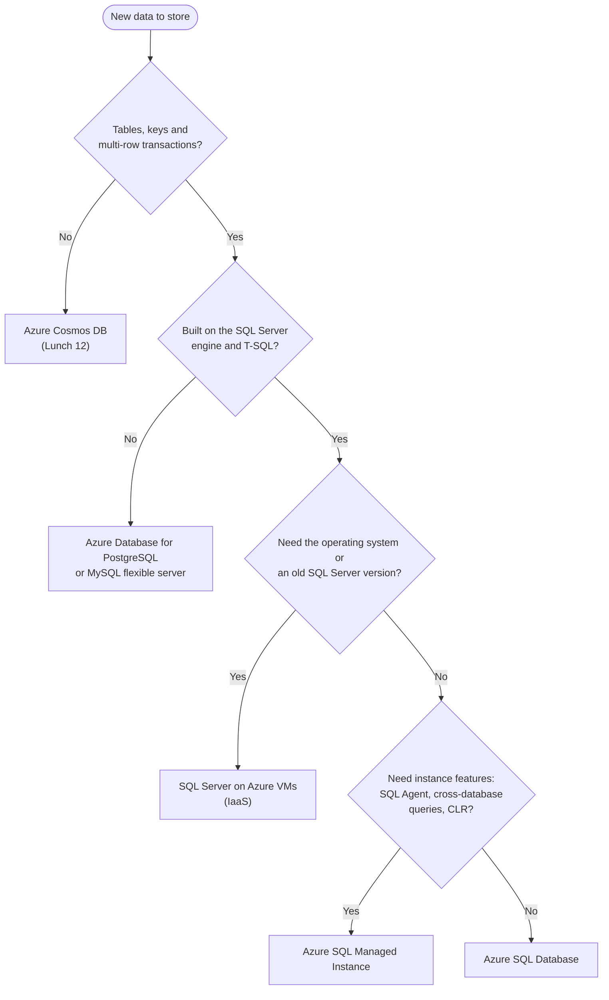
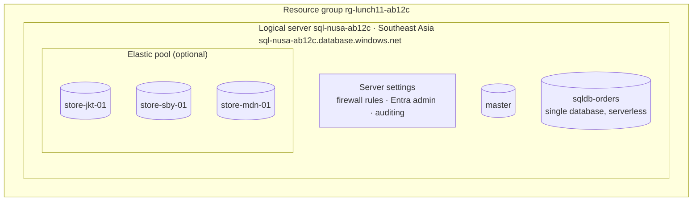
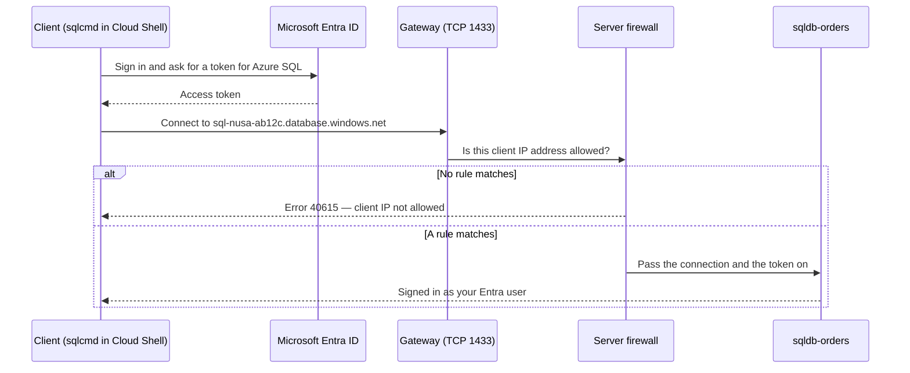

# Lunch 11 · Relational Databases (Basic): Azure SQL

🇮🇩 [Baca dalam Bahasa Indonesia](README.id.md)

> **Track:** Core month · **Level:** Basic · **Part 3:** Platform services and data
> **Time:** 60 minutes · **Prerequisite lunches:** 02, 05
> **AZ-900 skill area:** Describe Azure architecture and services
> **Lab:** [Lab 11 · Nusantara Retail's orders database](../../labs/11-relational-databases-basic/README.md) — about 45 minutes · cost 💲
> **Author:** Stefanus Pinarta · [About the author](../../README.md#about-the-author)

| ⏱ Minutes | Segment |
|---:|---|
| 5 | Scenario and objectives |
| 25 | Reading |
| 15 | Demo: interactive animation (+ optional walkthrough video) |
| 5 | Knowledge check |
| 5 | Key takeaways and lab preview |
| 5 | Buffer — finish your lunch 🍜 |

## 🍱 Today's menu

By the end of this lunch you will be able to:

- **Choose** a database service for a workload by comparing Azure SQL Database, Azure SQL Managed Instance, SQL Server on Azure VMs, Azure Database for PostgreSQL and MySQL, and Azure Cosmos DB.
- **Explain** what an Azure SQL logical server is and how databases and elastic pools relate to it.
- **Compare** the DTU and vCore purchasing models, the vCore service tiers, serverless compute and the free offer.
- **Describe** how a connection reaches a database — gateway, firewall, Microsoft Entra authentication — and why Entra-only authentication is the safer default.

## 🏪 Meanwhile at Nusantara Retail

Last lunch, Dewi moved the storefront code to App Service. The orders, however, still live in a SQL Server Express
database on the server next to the pantry. The only backup is a USB drive that Pak Budi takes home on Fridays, and last
week that drive turned out to hold a copy that was three weeks old. Ibu Sari has stopped smiling about it.

Everyone has an opinion. Dewi wants a managed database she never has to patch. Pak Budi worries about who can reach it:
today anyone on the office Wi-Fi who knows the shared `sa` password can. Rizky, the contractor, suggests "just opening
port 1433 to the internet" so his reporting tool can connect from anywhere. The finance team only asks what it will cost.

Your job today is to pick the right database service for the orders, connect to it with your own identity instead of
a shared password, and keep its door closed to everyone else. **Which Azure database should hold Nusantara Retail's
orders — and who should be allowed through the door?**

---

## 📖 Reading (≈25 minutes)

### 1. Relational or not? Choosing a database on Azure

Every order on the storefront turns into a handful of rows: one row in an `Orders` table, a few rows in an
`OrderLines` table, and links to rows in `Customers` and `Products`. That is **relational data**: information kept in
tables with a fixed set of columns (the **schema**), connected by keys, and changed by **transactions** that either
finish completely or not at all. When a customer pays, the order, its lines and the stock update must succeed
together. That all-or-nothing promise is usually summarised as **ACID** (atomic, consistent, isolated, durable). You read
and change relational data with **SQL**; Microsoft's dialect of it is called **T-SQL**.

**Non-relational** (or **NoSQL**) databases relax some of those rules in exchange for flexibility and scale. They store
documents whose shape can differ from item to item, key-value pairs, graphs or wide column families. A product
catalogue where a batik shirt has fabric and motif attributes but a rice cooker has wattage and capacity fits a
document model nicely. You will meet Azure Cosmos DB, Azure's NoSQL service, in the next lunch.

Azure offers several managed homes for relational data, plus Cosmos DB for everything else. Keep this **database
choice matrix** handy; it answers most "which database should we use?" conversations.

| Service | Model | Engine | Pick it when | Think twice when |
|---|---|---|---|---|
| **Azure SQL Database** | PaaS | SQL Server engine, always the latest version | you build or modernise an app that speaks T-SQL and want Microsoft to handle patching, backups and high availability | you need instance-level features such as SQL Server Agent jobs or queries across databases |
| **Azure SQL Managed Instance** | PaaS, inside your virtual network | SQL Server engine with near-100% compatibility | you lift and shift an existing SQL Server application that depends on instance features | you only need one simple database — it costs more and takes longer to deploy |
| **SQL Server on Azure VMs** | IaaS | any SQL Server version and edition you install | you need the operating system, an older SQL Server version, or other software on the same machine | you do not want to patch, back up and cluster it yourself |
| **Azure Database for PostgreSQL – flexible server** | PaaS | community PostgreSQL | your app and team already use PostgreSQL and its extensions | your code is written in T-SQL |
| **Azure Database for MySQL – flexible server** | PaaS | community MySQL | you run PHP or LAMP-stack apps such as WordPress | you need SQL Server features |
| **Azure Cosmos DB** | PaaS, globally distributed | NoSQL, several APIs | flexible schemas, massive scale, fast reads close to users worldwide | you need joins across many tables and complex multi-row transactions |

The older *single server* deployment option for PostgreSQL and MySQL has been retired (MySQL in September 2024,
PostgreSQL in March 2025). **Flexible server** is the option to use for both today.

Using more than one database is normal. Many companies keep orders and payments in a relational database and put a
catalogue, shopping carts or telemetry in a NoSQL store. The skill is matching each kind of data to the service that
suits it, rather than forcing everything into whichever database you already know.

Read the decision flow below from the top. It asks about the data first, then the engine, then how much control you
need. Each step towards IaaS gives you more control, and more work — exactly the shared-responsibility trade-off from
Lunch 02.

### 2. The Azure SQL family and the logical server

**Azure SQL** is the umbrella name for three ways to run the SQL Server engine in Azure. They share the same engine, so
your T-SQL skills, drivers and tools carry over. What changes is who does the operational work.

| Deployment option | What you get | You manage | Pick it for |
|---|---|---|---|
| **SQL Database — single database** | one fully managed database with its own guaranteed resources | schema, data and access | most new applications |
| **SQL Database — elastic pool** | many databases sharing one pool of resources | the same, plus the pool size | groups of databases that are busy at different times, such as one per store or per customer of a SaaS product |
| **SQL Managed Instance** | a whole managed SQL Server instance in a subnet of your virtual network | the same, plus the network | existing apps that need SQL Server Agent, cross-database queries or linked servers |
| **SQL Server on Azure VMs** | a virtual machine with SQL Server installed (IaaS) | everything from the operating system up | full control, older versions, other software on the machine |

With the two PaaS options, Microsoft patches the engine, takes the backups and keeps the database highly available.
On a VM, the SQL IaaS Agent extension adds management features in the portal, but keeping the VM and SQL Server
patched, backed up and highly available remains your job.

SQL Database introduces a concept that confuses many beginners: the **logical server**. When you create your first
database, the portal also asks for a "server" with a name such as `sql-nusa-ab12c`. It is not a virtual machine; you
never sign in to it or patch it. It is a management and connection boundary that:

- gives your databases a DNS name, for example `sql-nusa-ab12c.database.windows.net` — so the name must be globally
  unique;
- holds settings that apply to every database on it: firewall rules, the Microsoft Entra administrator, auditing and
  the connection policy;
- contains a small `master` database with server-level metadata.

The logical server has no price of its own; you pay per database or per elastic pool. Databases on the same server can
use different tiers and sizes. A server lives in one region, and so do its databases.

Why would anyone choose a pool? Imagine forty small store databases. Each store is busy at its own opening hours and
quiet the rest of the day. Sized one by one, every database needs enough capacity for its own peak, and most of that
capacity sits idle. In a pool, they share capacity sized for the *combined* peak, which is far smaller than the sum of
forty individual peaks. A pool stops paying off when the databases all peak at the same moment.

### 3. Paying for it: purchasing models, service tiers and serverless

Azure SQL Database offers two **purchasing models**. Both give you the same engine; they differ in how you size and pay.

| | DTU model | vCore model |
|---|---|---|
| What you buy | **DTUs** (Database Transaction Units): a fixed blend of CPU, memory and I/O | a number of **vCores** on a chosen hardware generation, with storage sized separately |
| Service tiers | Basic, Standard, Premium | General Purpose, Business Critical, Hyperscale |
| Strengths | simple, predictable price for small, steady databases | flexible; serverless compute; Azure Hybrid Benefit and reservations for provisioned compute |
| Typical use | a small departmental app, a quick prototype | most new production workloads |

You are not locked in. A database can move between tiers, and from the DTU model to the vCore model, with a scaling
operation that keeps the data online and ends with a short reconnect. That makes it safe to start small and resize
when real usage data arrives.

Within the vCore model, the **service tier** decides the architecture underneath your database:

| Tier | How it works, in one line | Good for |
|---|---|---|
| **General Purpose** | stateless compute nodes in front of remote, highly durable storage | most business applications, dev/test; serverless and the free offer live here |
| **Business Critical** | several replicas kept in sync on fast local SSD storage | low-latency transactional apps that need the fastest failover; includes a readable replica for reports |
| **Hyperscale** | compute separated from a distributed layer of page servers and a log service | large or fast-growing databases, up to 128 TB, with quick scaling and restores |

Next comes the **compute tier**. **Provisioned** compute reserves a fixed number of vCores, billed per hour whether
you use them or not. **Serverless** compute, available in General Purpose and Hyperscale, scales automatically
between a minimum and a maximum number of vCores and bills per second for what the database actually uses.

General Purpose serverless can also **auto-pause**: after a period with no connections (the auto-pause delay, 60
minutes by default and 15 minutes at minimum) the database pauses, and you pay only for storage. The next connection
wakes it up. Resuming usually takes under a minute, and the first connection attempt fails with error **40613**
("database not currently available") while that happens, so applications need retry logic. Auto-pause for Hyperscale
serverless was still in preview at the time of writing.

Finally, the **free offer**. At the time of writing (October 2026), every subscription can create up to ten free
General Purpose serverless databases. Each one gets 100,000 vCore-seconds of compute, 32 GB of data and 32 GB of
backup storage every month, renewed for the life of the subscription. That is about 28 hours of one busy vCore per
month — plenty for development and labs. When the allowance runs out, you choose what happens: the database pauses
until the next month (the default), or it keeps running and bills the extra usage. Free databases have limits: at most
4 vCores, 7 days of point-in-time restore, locally redundant backups only, and no elastic pools or failover groups.
Check the current terms before you rely on them.

> [!TIP]
> Auto-pause only works when nothing is connected. A query window or an object explorer left open in a tool keeps the
> database awake — and burns compute or free vCore-seconds. Close your tools when you finish, and set a metric alert on
> the free amount remaining if you use the free offer.

### 4. Getting in: gateway, firewall and Microsoft Entra authentication

A connection to Azure SQL Database passes several checkpoints before it can read a single row.

**The gateway.** The server name resolves to a regional **gateway** that listens on TCP port 1433. The server's
**connection policy** decides what happens next. With **Redirect**, the client is told where the database is really
hosted and talks to that node directly on ports 11000–11999, which lowers latency. With **Proxy**, every packet keeps
flowing through the gateway. The **Default** policy uses Redirect for clients inside Azure and Proxy for clients outside.

**The firewall.** A new server denies every IP address. You open it with **server-level IP firewall rules**, which apply
to all databases on the server, or with **database-level rules**, which you create with T-SQL and which travel with the
database. Rule changes can take up to five minutes to apply. There is also a switch called **Allow Azure services and
resources to access this server**. It creates a special `0.0.0.0` rule that admits any address inside Azure, including
resources in other customers' subscriptions. For private-only access you will later use **private endpoints**
(Lunches 25 and 28).

> [!WARNING]
> "Just open port 1433 to the internet" usually ends as a rule from `0.0.0.0` to `255.255.255.255`, or the *Allow Azure
> services* switch turned on for convenience. Combined with a guessable SQL password, that is a classic breach. Allow
> specific client IP addresses only, and remove rules you no longer need.

**Authentication.** Getting past the firewall only brings you to the sign-in. Azure SQL supports two methods.
**SQL authentication** uses a login and password stored in the database engine. **Microsoft Entra authentication**
uses tokens from Microsoft Entra ID (Lunch 05). Entra brings MFA, Conditional Access, groups and — for applications —
managed identities, which means no secrets in code at all.

Every server can have one **Microsoft Entra admin**, a user or, better, a group. Turn on **Microsoft Entra-only
authentication** and SQL authentication stops working for the whole server, including the SQL admin login created
with it. Other people get access as contained database users created from their Entra identities, for example
`CREATE USER [dewi@nusantararetail.co.id] FROM EXTERNAL PROVIDER;`, followed by a database role such as
`db_datareader`.

**Encryption** is on by default in both directions that matter: connections use TLS, and every new database is
encrypted at rest with **transparent data encryption** (TDE) using a service-managed key.

### 5. Built-in backups and the tools you will use

Pak Budi's USB drive can finally retire. Azure SQL Database backs up every database automatically: a full backup
every week, a differential backup every 12 or 24 hours, and a transaction log backup about every 10 minutes. Together
they allow **point-in-time restore** (PITR) to any moment inside the retention window — 7 days by default, adjustable
from 1 to 35 days (Basic tier: up to 7). A restore always creates a new database next to the original, so you can
compare before you switch. **Long-term retention** keeps weekly, monthly or yearly full backups for up to 10 years.
The first full backup starts right after a database is created and usually finishes within 30 minutes. Lunch 17 covers
backup strategy in general; Lunch 28 goes deeper into Azure SQL backups and disaster recovery.

To talk to the database, you need a client tool:

| Tool | Runs on | Best for | Good to know |
|---|---|---|---|
| **Query editor** in the Azure portal | your browser | quick queries and checks | supports Entra and SQL authentication; cannot connect to `master`; queries time out after 5 minutes; needs only port 443 |
| **VS Code** with the **MSSQL extension** | Windows, macOS, Linux | everyday development | the recommended replacement for Azure Data Studio, which was retired on February 28, 2026 |
| **sqlcmd** | command line, including Cloud Shell | scripts and automation | comes in two variants (ODBC-based and Go-based); Cloud Shell includes one, and the lab shows how to use it with an Entra token |
| **SQL Server Management Studio** (SSMS) | Windows | full administration | the classic tool for database administrators |

Whatever the tool, the checkpoints from section 4 still apply: your client's IP address must be allowed by the
firewall, and your identity must be allowed by the database. Three surprises catch almost everyone at least once:

- The portal Query editor connects from your **browser's** public IP address, which is usually not Cloud Shell's
  address, so each needs its own firewall rule.
- Cloud Shell can get a **different public IP address** in a new session. A rule that worked yesterday may not match
  today; the error message tells you which address was refused.
- Many office networks block **outbound port 1433**. Tools then time out instead of showing a clear error. The Query
  editor, which needs only port 443, is a handy way to tell a network problem from a database problem.

### 6. How it fits together for Nusantara Retail

Walk the orders through the decision flow. The data is relational, Dewi's code already speaks T-SQL, nobody needs the
operating system, and the app uses no instance features. The answer is **Azure SQL Database**, a single database in the
**General Purpose** tier:

- **Development and testing** use the free offer, which pauses itself when nobody is working.
- **Production** starts on General Purpose serverless while traffic is modest, then moves to provisioned vCores once
  the load is steady enough to justify paying for a fixed size. The data stays in **Indonesia Central** for
  residency; the labs use Southeast Asia for broad service availability.
- **Access** runs through Microsoft Entra-only authentication. The Entra admin is a group, not a person. Dewi's team
  gets contained database users with only the roles it needs, and the storefront app will use a managed identity
  (Lunch 15), so no password appears in any configuration file.
- **The firewall** allows only known addresses. Rizky's "open it to the internet" idea is politely declined; a private
  endpoint will replace public access later.
- **Backups** are automatic, with point-in-time restore replacing the USB drive.

And the finance team's question? The logical server itself is free. A serverless database costs compute per second
while it works plus storage per GB, and nothing for compute while it is paused. The test database costs nothing while
it stays within the free allowance. Use the pricing calculator for real numbers in your region, and keep the budget
from Lunch 01 in place.

The other teams get answers too. Finance's old accounting package uses SQL Server Agent jobs and cross-database
queries, so it is a candidate for **SQL Managed Instance**. The marketing team's WordPress site belongs on **Azure
Database for MySQL flexible server**. The product catalogue, with its ever-changing attributes, is the subject of the
next lunch: **Azure Cosmos DB**.

> [!NOTE]
> **Pause and think:** Rizky's reporting tool runs on a VM in Azure. Which is the better way to let it reach the
> database: turning on *Allow Azure services*, adding a firewall rule for the VM's public IP address, or a private
> endpoint? What does each option let in besides Rizky's VM?

Ready for more? [Lunch 28 · Relational Databases (Advanced)](../28-relational-databases-advanced/README.md) covers
high availability, failover groups, backups in depth and advanced security for Azure SQL.

---

## 🎬 Demo (≈15 minutes)

1. **Interactive animation (≈6–8 min):** [Open the demo](https://stefpin.github.io/azure-fundamentals-lunches/demos/11-relational-databases-basic.html) —
   press ▶ Play or step through it at your own pace. Offline? Download
   [`docs/demos/11-relational-databases-basic.html`](../../docs/demos/11-relational-databases-basic.html) and open it in any browser.
2. **Walkthrough video (≤ 6 min):** _coming soon_ — [read the walkthrough script](demo-video-script.md).

What to watch for:

- How each question in the "which database?" tree removes options until one service is left.
- The connection that is stopped at the firewall before authentication even starts, and the error it produces.
- Where the compute meter stops while a serverless database is paused, and what the first connection after a pause sees.

## ✅ Knowledge check (≈5 minutes)

1. Finance's accounting package uses SQL Server Agent jobs and queries that join tables across three databases. The
   team wants to stop patching servers. Which Azure SQL deployment option fits best?
   

Show answer

   **Azure SQL Managed Instance.** It keeps instance-level features such as SQL Server Agent and cross-database queries,
   while Microsoft patches and backs it up — SQL Database lacks those features, and a VM would keep the patching work.

   

2. Dewi's test database is used for about an hour a day and sits idle the rest of the time. Which compute option keeps
   the bill lowest without changing the engine?
   

Show answer

   **General Purpose serverless with auto-pause** (or the free offer, which is serverless too). Compute is billed per
   second while it runs, and only storage is billed while the database is paused.

   

3. Rizky's reporting tool runs in Azure, so he asks you to turn on *Allow Azure services and resources to access this
   server*. What is the problem with that?
   

Show answer

   The switch admits connections from **any** Azure IP address, including other customers' resources, not just
   Rizky's tool. Use a rule for his specific IP address or, better, a private endpoint — and keep Entra authentication
   on.

   

4. After you enable Microsoft Entra-only authentication, an old script that signs in with the SQL admin login and
   password stops working. What happened, and what is the right fix?
   

Show answer

   Entra-only authentication **disables SQL authentication for the whole server**, including the SQL admin. Give the
   script an Entra identity (a managed identity if it runs in Azure) and a contained database user with only the roles
   it needs — do not switch SQL authentication back on.

   

5. Someone deleted half of the `Orders` table two hours ago. Nobody configured any backup. Can you get the rows back?
   

Show answer

   **Yes.** Azure SQL Database takes automatic backups, so you can run a **point-in-time restore** to a moment just
   before the delete. It creates a new database that you can compare and copy from; the default retention is 7 days.

   

## 🧠 Key takeaways

- Choose a database in three steps: the data model (relational or NoSQL), then the engine (SQL Server, PostgreSQL or MySQL), then how much control you need (SQL Database → Managed Instance → VM).
- A logical server is a connection and management boundary — DNS name, firewall rules, Entra admin — not a virtual machine; you pay per database or elastic pool.
- The vCore model (General Purpose, Business Critical, Hyperscale) is the flexible default; serverless with auto-pause and the free offer make small and development databases close to free.
- Every connection passes the gateway and the server firewall before authentication: allow specific IP addresses only, and use Microsoft Entra-only authentication so no shared passwords exist.
- Backups, point-in-time restore, high availability and encryption are built in; query with the portal Query editor, VS Code with the MSSQL extension, or sqlcmd.

## 🗒️ Field notes from Stefanus

> **A backup you have never restored is only a rumour.** Automatic backups are the best thing about Azure SQL Database,
> and the easiest to take for granted. So in the first week of every new database I restore it on purpose: I pick a
> moment from yesterday, run a point-in-time restore next to the original, count the rows and time how long it takes.
> That small drill answers questions no diagram can: how long a restore of this size really takes, who has the
> permissions to start one, and how the application gets pointed at the restored copy, which always has a new name. I
> write the answers into the runbook while they are fresh. When something goes wrong at a bad hour, nobody should be
> reading the documentation for the first time.

## 🔬 Your lab: Nusantara Retail's orders database

You will create a logical server that accepts only Microsoft Entra sign-ins, with yourself as the admin, and a free (or
serverless) `sqldb-orders` database. Then you open the firewall for exactly one IP address, create and query an
`Orders` table from Cloud Shell with sqlcmd and from the portal Query editor, and finally break the firewall rule on
purpose to see — and fix — the error your users would get.

- ⏱ About 45 minutes · 💲 · works on its own (no earlier lab needed)
- 👉 [Start Lab 11](../../labs/11-relational-databases-basic/README.md)

## 📚 Go further

- [Microsoft Learn: What is Azure SQL?](https://learn.microsoft.com/azure/azure-sql/azure-sql-iaas-vs-paas-what-is-overview) — the three deployment options compared side by side, with links into each.
- [Microsoft Learn: Deploy Azure SQL Database for free](https://learn.microsoft.com/azure/azure-sql/database/free-offer) — the current free-offer terms and limits; check them before you rely on the numbers above.
- [Microsoft Learn: Serverless compute tier for Azure SQL Database](https://learn.microsoft.com/azure/azure-sql/database/serverless-tier-overview) — how auto-scaling, auto-pause and billing work in detail.
- [Microsoft Learn training: Explore relational database services in Azure](https://learn.microsoft.com/training/modules/explore-provision-deploy-relational-database-offerings-azure/) — a short beginner module that reinforces today's choice matrix.

---

⬅️ [Lunch 10 · Web Apps with Azure App Service](../10-app-service/README.md) · 🏠 [Course home](../../README.md) · [Lunch 12 · NoSQL with Azure Cosmos DB](../12-cosmos-db/README.md) ➡️

Last validated: October 2026 · Spotted something out of date? [Open an issue](../../CONTRIBUTING.md).
