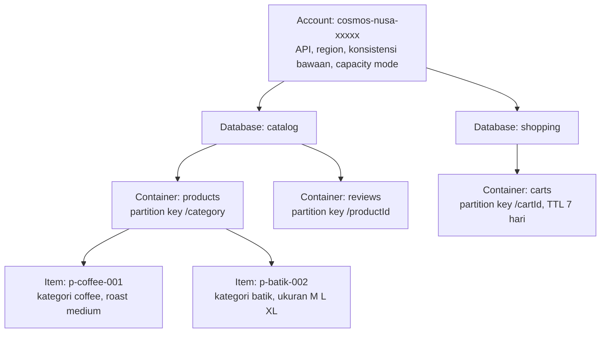
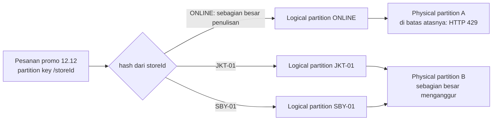
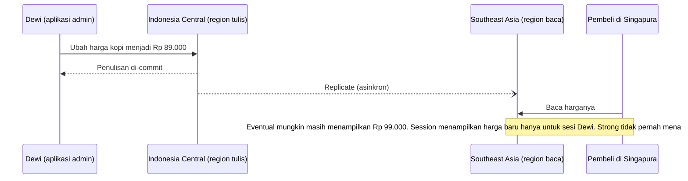

# Makan Siang 12 · NoSQL dengan Azure Cosmos DB (Dasar)

🇬🇧 [Read in English](README.md)

> **Jalur:** Bulan inti · **Level:** Dasar · **Bagian 3:** Layanan platform dan data
> **Waktu:** 60 menit · **Makan siang prasyarat:** 04, 05, 11
> **Area keterampilan AZ-900:** Menjelaskan arsitektur dan layanan Azure
> **Lab:** [Lab 12 · Katalog produk yang siap tumbuh](../../labs/12-cosmos-db/README.id.md) — sekitar 45 menit · biaya 💲
> **Penulis:** Stefanus Pinarta · [Tentang penulis](../../README.id.md#tentang-penulis)

| ⏱ Menit | Segmen |
|---:|---|
| 5 | Skenario dan tujuan |
| 25 | Bacaan |
| 15 | Demo: animasi interaktif (+ video panduan opsional) |
| 5 | Uji pemahaman |
| 5 | Poin penting dan pratinjau lab |
| 5 | Waktu cadangan — habiskan makan siang Anda 🍜 |

## 🍱 Menu hari ini

Setelah makan siang ini, Anda akan mampu:

- **Menjelaskan** empat model data NoSQL dan **memilih** API Azure Cosmos DB yang tepat untuk sebuah beban kerja.
- **Menguraikan** bagaimana account, database, container, dan item saling terkait, serta bagaimana request unit ditagih pada pengaturan provisioned, autoscale, serverless, dan free tier.
- **Memilih** partition key yang menyebarkan data dan trafik secara merata, serta **mengenali** hot partition sebelum menimbulkan masalah.
- **Membandingkan** lima consistency level (tingkat konsistensi) dan **memutuskan** kapan Cosmos DB — bukan Azure SQL — menjadi rumah yang tepat untuk data Anda.

## 🏪 Sementara itu di Nusantara Retail

Dewi meletakkan selembar hasil cetak di meja Anda: tabel `Products` dari database toko online. Tabel itu punya 140 kolom, dan di sebagian besar baris, lebih dari seratus kolomnya kosong. Kopi butuh tingkat sangrai (roast level) dan tingkat gilingan, batik butuh jenis bahan dan tabel ukuran, keranjang rotan yang baru butuh dimensi. Setiap jenis produk baru berarti satu perubahan skema lagi, satu migrasi larut malam lagi, dan — biasanya — satu bug lagi.

Tim pemasaran menginginkan aplikasi mobile sebelum promo 12.12, saat trafik katalog bisa melonjak dua puluh kali lipat dalam satu jam. Ibu Sari punya dua pertanyaan sendiri: bisakah kita membayar hanya untuk apa yang benar-benar dipakai pembeli, dan bisakah pelanggan di Medan dan Makassar membuka halaman secepat pelanggan di Jakarta?

Pesanan dan pembayaran boleh tetap di Azure SQL dari Makan Siang 11 — keduanya membutuhkan aturan relasional. Katalog lain lagi ceritanya. Pertanyaan hari ini: **di mana sebaiknya katalog yang bentuknya berubah setiap minggu, dan harus tetap cepat saat lonjakan hari promo, ditempatkan?**

---

## 📖 Bacaan (≈25 menit)

### 1. NoSQL dalam satu halaman: model data dan API Cosmos DB

Database relasional menyimpan baris-baris data di dalam tabel dengan skema tetap, menggabungkan (join) tabel saat query dijalankan, dan membungkus perubahan dalam transaksi yang bisa menyentuh banyak tabel sekaligus. Model ini sangat cocok untuk pesanan dan urusan uang. Namun, model ini kurang nyaman ketika setiap data ingin punya bentuk sendiri, atau ketika satu server tidak lagi sanggup mengimbangi beban. Bayangkan satu formulir pendaftaran yang wajib diisi oleh semua barang di toko: kopi terpaksa mengosongkan kolom "ukuran baju", batik mengosongkan kolom "tingkat sangrai". Itulah tabel 140 kolom milik Dewi.

**NoSQL** ("not only SQL" — bukan hanya SQL) melonggarkan sebagian aturan itu demi fleksibilitas dan skala. Database NoSQL biasanya menawarkan skema yang fleksibel, scale-out horizontal (menambah kapasitas dengan menambah banyak mesin, bukan memperbesar satu mesin), serta baca-tulis yang sangat cepat berdasarkan kunci. Sebagai gantinya, Anda kehilangan sebagian besar kemampuan join, dan cakupan transaksi menjadi lebih sempit. NoSQL tidak "lebih baik" daripada relasional; ia hanya menawarkan kumpulan kompromi yang berbeda. Ada empat **model data** yang umum:

| Model data | Bentuk datanya | Contoh di Nusantara Retail | API Cosmos DB |
|---|---|---|---|
| **Dokumen** | Dokumen JSON yang menjelaskan dirinya sendiri; masing-masing boleh membawa field sendiri | Kopi dengan tingkat sangrai di samping kemeja batik dengan ukurannya | API for NoSQL, API for MongoDB |
| **Key-value** (kunci-nilai) | Sebuah nilai yang diambil dengan satu kunci unik | Keranjang belanja yang dicari berdasarkan ID keranjangnya | API for Table (dan point read di API mana pun) |
| **Column-family** (keluarga kolom) | Baris lebar yang kolomnya boleh berbeda-beda, dikelompokkan ke dalam keluarga kolom | Data sensor jumlah pengunjung per toko, per menit | API for Apache Cassandra |
| **Graf** | Vertex (benda) yang dihubungkan oleh edge (hubungan) | "Pembeli yang membeli kopi juga membeli…" | API for Apache Gremlin |

**Azure Cosmos DB** adalah database NoSQL milik Azure yang dikelola penuh. Microsoft yang menjalankan server, replika, patch, dan backup-nya; Anda mendapat pengindeksan otomatis, replikasi ke region sebanyak yang Anda mau, serta komitmen latensi: baca dan tulis di bawah 10 ms pada persentil ke-99 — artinya 99 dari 100 permintaan selesai dalam waktu kurang dari 10 milidetik (dengan pengecualian untuk strong consistency di beberapa region, yang dibahas di bagian 4).

Anda memilih sebuah **API** (Application Programming Interface — "bahasa" yang dipakai aplikasi untuk berbicara dengan database) saat membuat account, dan pilihan itu tidak bisa diubah kemudian. API menentukan protokol komunikasi (wire protocol), driver, dan bahasa query yang dipakai aplikasi Anda:

- **API for NoSQL** — API asli (native) Cosmos DB: item JSON (format teks berisi pasangan nama dan nilai), bahasa query yang mirip SQL, dan fitur-fitur baru (seperti vector search) yang selalu hadir paling awal. Inilah pilihan bawaan untuk aplikasi baru.
- **API for MongoDB** — berbicara dengan protokol MongoDB, sehingga aplikasi dan tool Mongo yang sudah ada bisa pindah dengan sedikit perubahan. Penawaran MongoDB berbasis vCore menjadi produk terpisah pada November 2025: **Azure DocumentDB**.
- **API for Apache Cassandra** dan **API for Apache Gremlin** — untuk aplikasi Cassandra (CQL) dan aplikasi graf yang sudah ada.
- **API for Table** — API key-value untuk aplikasi yang ditulis untuk Azure Table Storage dan membutuhkan kecepatan atau jangkauan global yang lebih besar.

**Azure Cosmos DB for PostgreSQL** masih muncul di materi-materi lama. Layanan ini sedang menuju pensiun dan deployment baru sudah diblokir; untuk kebutuhan PostgreSQL terdistribusi, Microsoft kini mengarahkan ke elastic cluster di Azure Database for PostgreSQL.

> [!TIP]
> Mulai dari nol? Pilih **API for NoSQL**. API lainnya ada terutama untuk memindahkan aplikasi yang sudah ada tanpa harus menulis ulang. Seluruh isi makan siang ini dan lab-nya memakai API for NoSQL.

### 2. Account, container, dan request unit

Cosmos DB mengatur semuanya dalam empat tingkat:

- **Account** adalah resource tingkat teratas dengan nama yang unik secara global dan endpoint (alamat yang dipanggil aplikasi) miliknya sendiri (`https://<account>.documents.azure.com`). Region, API, consistency level bawaan, dan capacity mode adalah pengaturan di tingkat account.
- **Database** adalah ruang nama (namespace) yang mengelompokkan container. Secara opsional, database bisa membagi throughput — kapasitas pemrosesan per detik — di antara container-container-nya.
- **Container** adalah unit skala. Anda memilih **partition key**-nya saat membuatnya, dan container menyimpan kebijakan pengindeksan (indexing policy) serta **time to live (TTL)** opsional, yang menghapus item secara otomatis setelah jangka waktu tertentu — sempurna untuk keranjang belanja yang ditinggalkan. (Jangan tertukar dengan container aplikasi di Makan Siang 13; container di Cosmos DB adalah wadah data.)
- **Item** adalah satu dokumen JSON berukuran hingga 2 MB. Setiap item wajib memiliki `id`, yang harus unik di dalam nilai partition key-nya. Item dalam container yang sama tidak harus punya field yang sama: kopi dan kemeja batik bisa tinggal berdampingan.

Setiap operasi dikenai biaya dalam **request unit (RU)**, satu "mata uang" tunggal yang memadukan CPU, memori, dan I/O. Membaca satu item berukuran 1 KB berdasarkan `id` dan partition key-nya — disebut **point read** — berbiaya 1 RU. Operasi tulis lebih mahal, karena setiap penulisan juga memperbarui indeks. Biaya sebuah query bergantung pada seberapa banyak data yang harus disentuhnya. Query yang sama atas data yang sama selalu berbiaya sama, dan setiap respons melaporkan biayanya, sehingga Anda bisa mengukur alih-alih menebak. Ibaratnya pulsa telepon: setiap panggilan dan SMS memotong pulsa sesuai tarifnya, dan setelah setiap transaksi Anda bisa melihat berapa yang terpotong.

Karena itu, perencanaan kapasitas berubah menjadi latihan spreadsheet, bukan tebak-tebakan perangkat keras. Misalkan toko online melayani 300 halaman produk per detik (masing-masing satu point read, sekitar 1 RU) dan 100 halaman kategori per detik (masing-masing satu query, katakanlah 3 RU setelah Anda mengukurnya). Totalnya 300 + 300 = 600 RU/s (RU per detik) untuk pembacaan. Tambahkan operasi tulis dari pembaruan stok, bulatkan ke atas untuk menghadapi promo, dan Anda mendapat angka untuk di-provision — atau alasan untuk memilih serverless selama trafik masih kecil.

Cara Anda membayar RU bergantung pada **capacity mode** (mode kapasitas) yang Anda pilih untuk account:

| Mode | Yang Anda bayar | Cocok untuk | Perlu diwaspadai |
|---|---|---|---|
| **Provisioned, manual** | RU/s yang Anda pesan, per jam (minimal 400 RU/s per container) | Trafik yang stabil dan mudah diprediksi | Anda membayar kapasitas yang menganggur; permintaan di atas kapasitas itu dibatasi (throttled) dengan HTTP 429 |
| **Provisioned, autoscale** | RU/s tertinggi yang terpakai setiap jam, antara 10% dan 100% dari batas maksimum yang Anda tetapkan | Trafik yang naik-turun tajam, seperti promo 12.12 | Batas bawahnya 10% dari maksimum, bahkan saat menganggur |
| **Serverless** | Hanya RU yang Anda konsumsi, ditambah penyimpanan | Pengembangan, pengujian, trafik rendah atau sesekali melonjak | Hanya satu region; biaya berubah-ubah mengikuti pemakaian, jadi pantau meterannya |
| **Free tier** (diskon untuk provisioned) | Gratis untuk 1.000 RU/s dan 25 GB pertama, selama account itu ada | Belajar dan aplikasi produksi kecil | Satu account free tier per subscription, dipilih saat pembuatan; tidak tersedia untuk serverless |

Ketika sebuah permintaan membutuhkan RU/s lebih banyak daripada yang dimiliki container, Cosmos DB menjawab dengan HTTP 429 "request rate too large", dan SDK (pustaka pemrograman resmi untuk aplikasi Anda) mencoba lagi setelah jeda singkat. Sesekali mendapat 429 itu normal; 429 yang terus-menerus berarti Anda membutuhkan throughput lebih besar atau desain yang lebih baik.

> [!WARNING]
> Provisioned throughput ditagih **di setiap region** milik account: 1.000 RU/s di tiga region berarti 3.000 RU/s di tagihan. Selain itu, karena free tier hanya satu account per subscription dan hanya bisa dinyalakan saat pembuatan, sangat mudah "menghabiskannya" untuk eksperimen yang terlupakan. Periksa dulu sebelum membuat account: portal akan membuat opsi itu berwarna abu-abu jika sudah terpakai.

### 3. Partisi: satu keputusan yang tidak bisa dibatalkan

Cosmos DB melakukan scaling dengan membagi sebuah container ke banyak mesin, dan **partition key** (kunci partisi) menentukan cara pembagiannya. Semua item dengan nilai partition key yang sama membentuk satu **logical partition** (partisi logis): misalnya semua produk kopi, jika kuncinya `/category`. Sebuah logical partition dapat menampung hingga 20 GB, dan ia juga menjadi batas transaksi — sebuah stored procedure (prosedur yang disimpan dan dijalankan di dalam database) atau transactional batch hanya bisa mengubah item yang memiliki nilai partition key yang sama.

Di balik layar, Cosmos DB menghitung hash (semacam "sidik jari" berupa angka) dari setiap nilai kunci, lalu menempatkan logical partition ke **physical partition** (partisi fisik), yaitu kumpulan replika (replica set) yang benar-benar mengerjakan tugasnya. Anda tidak pernah mengelola physical partition; Cosmos DB memecahnya sendiri seiring bertambahnya data dan throughput. Yang perlu Anda ketahui adalah batas atasnya: satu physical partition melayani hingga 10.000 RU/s dan 50 GB, sehingga satu logical partition tidak akan pernah bisa memakai lebih dari itu. **Hot partition** adalah satu nilai kunci yang menerima trafik jauh lebih banyak daripada yang lain. Ia menabrak batas atas dan dibatasi (throttled), sementara partisi-partisi lain menganggur.

Ibaratnya gudang Nusantara Retail: setiap barang diberi label kategori (partition key), barang berlabel sama disimpan di rak yang sama (logical partition), dan setiap petugas gudang menjaga beberapa rak sekaligus (physical partition). Jika hampir semua pesanan meminta barang dari satu rak, petugas rak itu kewalahan sementara rekan-rekannya menganggur — itulah hot partition.

Partition key yang baik memiliki rentang nilai yang lebar, menyebarkan penyimpanan dan permintaan secara merata, tidak pernah berubah untuk sebuah item, dan muncul sebagai filter kesamaan ("sama dengan") di query-query yang paling sering Anda jalankan. Metode praktisnya: mulailah dari query, bukan dari data. Tulis lima permintaan yang paling sering dibuat aplikasi Anda, catat property mana yang menjadi filter di masing-masing permintaan, lalu cari property yang paling sering muncul. Jika tidak ada satu property pun yang cocok, Anda bisa membuat **synthetic key** (kunci sintetis) dengan menggabungkan dua nilai, misalnya `JKT-01|2026-12-12`. Berikut kandidat-kandidat milik Nusantara Retail:

| Container | Kandidat kunci | Putusan | Alasan |
|---|---|---|---|
| products | `/category` | ✅ Cocok untuk katalog | Beberapa ribu item, jauh lebih sering dibaca daripada ditulis, dan sebagian besar halaman menanyakan "semua barang di kategori ini". Nilainya sedikit, jadi awasi kategori "promo" selama masa promo. |
| products | `/id` | ⚠️ Mungkin | Sebarannya sempurna dan point read-nya murah, tetapi setiap halaman kategori menjadi cross-partition query. |
| orders | `/storeId` | ❌ Hot partition | Hanya 41 nilai, dan toko online menerima sebagian besar pesanan; riwayat satu toko juga terus tumbuh mendekati batas 20 GB. |
| orders | `/orderDate` | ❌ Hot partition | Setiap penulisan hari ini jatuh ke nilai tanggal hari ini — anti-pattern klasik. |
| orders | `/orderId` | ✅ Bagus untuk penulisan | Menyebarkan penulisan dengan sempurna dan mendukung point read berdasarkan nomor pesanan, tetapi halaman "pesanan saya" harus bertanya ke setiap partisi. |
| orders | `/customerId` | ✅ Paling cocok | Kardinalitasnya tinggi (nilai uniknya sangat banyak) dan cocok dengan halaman "pesanan saya". Jika segelintir pembeli korporat tumbuh sangat besar, gunakan hierarchical key. |

Jika sebuah query menyertakan partition key, Cosmos DB mengirimkannya ke satu physical partition saja. Jika tidak, query itu menjadi **cross-partition query** (query lintas partisi) yang menyebar ke setiap physical partition, menambah kira-kira 2–3 RU per partisi ditambah latensi ekstra. Di container kecil dengan satu physical partition, Anda nyaris tidak merasakannya; dengan lima puluh partisi, setiap pencarian menanggung overhead lima puluh kali lipat.

Partition key sebuah container tidak bisa diubah di tempat: Anda harus membuat container baru dan menyalin datanya ke sana (container copy job bisa membantu). Jika satu tingkat tidak cukup, **hierarchical partition key** (partition key bertingkat) memungkinkan Anda menggabungkan hingga tiga tingkat, misalnya `/customerId` lalu `/orderId`.

### 4. Mendunia: region dan lima consistency level

Menambahkan region ke account Cosmos DB cukup dengan satu klik atau satu perintah. Setiap region menyimpan salinan lengkap data, aplikasi Anda membaca dari region terdekat, dan RU/s provisioned berlaku di setiap region. Secara bawaan, satu region menerima penulisan dan region lainnya melayani pembacaan; dengan **multi-region writes**, setiap region menerima penulisan dan Cosmos DB menyelesaikan pembaruan yang saling bertentangan — secara bawaan, penulisan terakhirlah yang menang (last write wins). Service-managed failover (pengalihan yang dikelola layanan) dapat menjadikan region lain sebagai region tulis jika region penulisan mengalami gangguan.

Replikasi antar-region berjalan secara asinkron (tanpa saling menunggu), sehingga hukum fisika memaksa Anda memilih: seberapa segar data yang dibaca harus dijamin, dan berapa besar latensi serta biaya yang rela Anda tanggung untuk itu? Cosmos DB memberi Anda lima **consistency level** (tingkat konsistensi), dari yang terkuat hingga terlemah:

| Level | Janji kepada pembaca | Penggunaan di Nusantara Retail | Harga dari janji itu |
|---|---|---|---|
| **Strong** | Selalu membaca penulisan terbaru yang sudah di-commit (dipastikan tersimpan) | Jumlah stok untuk kemeja batik terakhir dalam flash sale | Pembacaan memakan kira-kira dua kali lipat RU; antar-region, setiap penulisan menunggu semua region; tidak boleh digabung dengan multi-region writes |
| **Bounded staleness** | Tertinggal paling banyak K versi atau T detik | Dasbor promo langsung yang boleh tertinggal hingga satu menit | Pembacaan memakan kira-kira dua kali lipat RU |
| **Session** (bawaan) | Di dalam satu sesi, Anda selalu membaca penulisan Anda sendiri, sesuai urutannya | Dewi mengubah harga dan langsung melihat perubahannya | Biayanya sama dengan level yang lebih lemah |
| **Consistent prefix** | Tidak pernah melihat penulisan dalam urutan yang salah, tetapi bisa tertinggal | Linimasa status sebuah pesanan | Pembacaan dari satu replika |
| **Eventual** | Tanpa jaminan urutan; replika-replika akhirnya akan sama seiring waktu | Penghitung jumlah tayangan produk dan "suka" | Paling murah dan paling cepat |

Bayangkan Dewi mengumumkan harga baru di grup WhatsApp keluarga besar. Dewi langsung melihat pesannya sendiri (itulah *session*), sementara saudara di Medan mungkin baru menerimanya beberapa detik kemudian (*eventual*), dan pesan-pesan selalu tiba berurutan meski kadang terlambat (*consistent prefix*). *Strong* ibarat aturan bahwa pesan baru dianggap terkirim setelah semua anggota grup menerimanya: selalu segar, tetapi pengirimnya harus menunggu.

Level bawaan diatur di tingkat account, dan Anda bisa mengubahnya kapan saja. Sebuah client kemudian boleh meminta level yang lebih lemah untuk permintaannya sendiri, tetapi tidak pernah level yang lebih kuat. Session menjadi bawaan karena cocok untuk sebagian besar aplikasi: pengguna selalu melihat perubahannya sendiri, sementara pembacaan tetap semurah dan secepat eventual.

Konsistensi juga memengaruhi pemulihan bencana (disaster recovery). Jika sebuah region hilang seluruhnya, penulisan yang belum sempat direplikasi ikut hilang bersamanya. Dokumentasi Microsoft menyebut jendela kehilangan itu di bawah 15 menit untuk session, consistent prefix, dan eventual pada account multi-region, dan nol untuk strong — itulah tepatnya alasan strong consistency membuat setiap penulisan menunggu region lain. Account multi-region juga menaikkan SLA (Service Level Agreement, jaminan ketersediaan tertulis dari Microsoft), hingga 99,999% tergantung konfigurasinya. Makan Siang 17 menyebut jendela ini sebagai **recovery point objective** (RPO) — batas data yang boleh hilang, diukur dalam satuan waktu.

> [!NOTE]
> **Renungkan sejenak:** Saat flash sale 12.12, harga sebuah kemeja batik turun tepat pukul 00.00. Pembeli di Singapura dilayani dari replika Southeast Asia. Apakah harga lama selama beberapa detik masih bisa diterima, atau setiap pembeli harus langsung melihat harga baru? Level mana yang akan Anda pilih — dan berapa harganya?

### 5. Merangkai semuanya untuk Nusantara Retail

Tiga fitur lagi membuat Cosmos DB menyenangkan untuk digunakan:

- **Pengindeksan otomatis.** Secara bawaan, setiap property dari setiap item diindeks, sehingga field baru seperti `roastLevel` langsung bisa di-query begitu muncul — tanpa perlu merancang indeks. Untuk menghemat RU pada container yang banyak ditulis, Anda bisa mengecualikan path (jalur property) yang tidak pernah Anda pakai sebagai filter.
- **Change feed.** Setiap container menyimpan catatan berurutan dari setiap penambahan dan pembaruan item (berurutan per partition key). Sebuah Azure Function (Makan Siang 14) bisa bereaksi terhadapnya: memperbarui indeks pencarian, atau memberi tahu pembeli yang menunggu bahwa batik yang tadinya habis sudah tersedia lagi. Secara bawaan, penghapusan tidak muncul di sana; mode yang ikut mencatat penghapusan membutuhkan continuous backup.
- **Backup bawaan.** Setiap account di-backup secara otomatis. Mode periodik bawaan membuat full backup setiap empat jam dan menyimpan dua yang terbaru; mode continuous menambahkan point-in-time restore untuk 7 atau 30 hari terakhir. Makan Siang 17 merangkai semua ini ke dalam rencana pemulihan bencana.

Jadi, database mana yang sebaiknya dipakai Nusantara Retail? Keduanya — masing-masing untuk hal yang paling dikuasainya:

| Pilih **Azure SQL** jika… | Pilih **Azure Cosmos DB** jika… |
|---|---|
| Datanya relasional secara alami: pesanan, pembayaran, faktur | Bentuk datanya beragam: katalog, profil, keranjang belanja |
| Anda butuh join, laporan, dan transaksi lintas banyak tabel | Anda membaca dan menulis berdasarkan kunci dengan kecepatan sangat tinggi |
| Satu region (ditambah salinan untuk pemulihan bencana) sudah cukup | Pengguna di beberapa benua butuh pembacaan lokal, atau penulisan lokal |
| Tim Anda sudah terbiasa berpikir dalam T-SQL | Anda ingin throughput yang elastis, dari serverless hingga jutaan RU/s |

Desain yang akan Anda bangun di lab: sebuah account Cosmos DB for NoSQL dengan database `catalog` dan container `products` yang dipartisi berdasarkan `/category`. Toko online Dewi membaca halaman kategori dengan satu single-partition query (query satu partisi) dan halaman produk dengan satu point read. Lingkungan pengembangan memakai **serverless**, karena biayanya nyaris nol saat menganggur; lingkungan produksi akan pindah ke **autoscale** sebelum promo, dengan batas atas yang ditentukan dari RU hasil pengukuran. Aplikasi melakukan autentikasi dengan Microsoft Entra ID (*ID Microsoft Entra*) dan sebuah data-plane role Cosmos DB — role untuk mengakses data, bukan untuk mengelola resource (Makan Siang 05 dan Makan Siang 15) — bukan dengan account key.

Lingkungan produksi akan berada di **Indonesia Central** demi residensi data. Nama dan harga produk bukan data pribadi, sehingga sebuah region baca di Southeast Asia boleh melayani pembeli di luar negeri — tetapi keranjang belanja yang menyimpan ID pelanggan perlu dicek dulu aturan residensinya.

Sebelum mulai membangun, belajarlah dari kesalahan yang paling sering dibuat tim pada aplikasi Cosmos DB pertama mereka:

- **Menjalankan setiap halaman sebagai `SELECT *` lintas semua partisi.** Cara ini berhasil di hari pertama dengan 30 item, lalu makin lambat dan makin mahal setiap kali produk bertambah. Point read dan single-partition query menjaga biayanya tetap datar.
- **Menempelkan account key ke file konfigurasi.** Satu key membuka setiap database di dalam account, dan key itu tidak pernah kedaluwarsa. Gunakan Microsoft Entra ID dengan data-plane role, dan matikan autentikasi berbasis key begitu tidak ada lagi yang membutuhkannya.
- **Membuat database dan container dari kode aplikasi.** Perlakukan keduanya sebagai infrastruktur: buat dengan CLI atau Bicep (Makan Siang 20), dan berikan aplikasi sebuah data role yang bisa membaca dan menulis item, tetapi tidak bisa mengubah bentuk account.
- **Lupa memasang TTL.** Keranjang yang ditinggalkan dan sesi yang kedaluwarsa akan menumpuk dan memakan biaya penyimpanan selamanya, kecuali TTL menghapusnya.
- **Membiarkan provisioned throughput menyala di container uji yang menganggur.** 400 RU/s ditagih setiap jam, dipakai atau tidak; serverless atau free tier lebih ramah untuk anggaran pengembangan.

---

## 🎬 Demo (≈15 menit)

1. **Animasi interaktif (≈6–8 menit):** [Buka demo](https://stefpin.github.io/azure-fundamentals-lunches/demos/12-cosmos-db.html?lang=id) —
   tekan ▶ Putar atau telusuri langkah demi langkah sesuai kecepatan Anda. Sedang offline? Unduh
   [`docs/demos/12-cosmos-db.html`](../../docs/demos/12-cosmos-db.html) lalu buka di browser apa pun.
2. **Video panduan (≤ 6 menit):** _segera hadir_ — [baca naskah video](demo-video-script.id.md).

Yang perlu diperhatikan:

- Bagaimana partition key menentukan tempat mendaratnya setiap item, dan mengapa satu nilai kunci yang sibuk berubah menjadi hot partition.
- Perbedaan antara query yang menyebutkan partition key-nya dan query yang terpaksa bertanya ke setiap partisi.
- Apa yang dilihat pembeli di Singapura di bawah eventual, session, dan strong consistency — dan berapa harga setiap pilihan.

## ✅ Uji pemahaman (≈5 menit)

1. Dewi menambahkan jenis produk baru hampir setiap minggu, masing-masing dengan atributnya sendiri. Tim sedang memulai layanan baru dari nol. API Cosmos DB mana yang sebaiknya mereka pilih?
   

Lihat jawaban

   **API for NoSQL.** API ini menyimpan item JSON tanpa skema tetap, mengindeks property baru secara otomatis, dan mendapat fitur baru paling awal; API lainnya terutama ada untuk memindahkan aplikasi MongoDB, Cassandra, Gremlin, atau Table yang sudah ada.

   

2. Sebuah container `orders` dipartisi berdasarkan `/storeId`. Selama promo 12.12, penulisan untuk toko online gagal dengan HTTP 429, padahal total RU/s container masih jauh dari habis. Apa yang terjadi, dan apa yang akan Anda ubah?
   

Lihat jawaban

   **Hot partition.** Satu nilai kunci (toko online) menerima sebagian besar penulisan dan menabrak batas atas per partisi, sementara partisi lain menganggur. Buat ulang container dengan kunci berkardinalitas tinggi seperti `/customerId` (atau hierarchical key) lalu salin datanya, karena partition key tidak bisa diubah di tempat.

   

3. Subscription lab Anda sudah punya account Cosmos DB free tier dari eksperimen lama. Anda menginginkan account berumur pendek untuk lab 45 menit yang biayanya nyaris nol. Apa yang Anda pilih?
   

Lihat jawaban

   **Account serverless.** Free tier terbatas satu account per subscription dan tidak bisa ditambahkan belakangan, sedangkan serverless hanya menagih request unit yang benar-benar Anda konsumsi ditambah penyimpanan.

   

4. Dewi harus selalu langsung melihat perubahan harga yang ia buat sendiri; pembeli lain boleh sedikit tertinggal. Consistency level mana yang paling murah tetapi tetap memenuhi kebutuhan itu?
   

Lihat jawaban

   **Session**, level bawaan. Session menjamin read-your-own-writes (Anda selalu membaca penulisan Anda sendiri) di dalam satu sesi sambil tetap membaca dari satu replika, sehingga pembacaan tidak menanggung RU dua kali lipat seperti strong atau bounded staleness.

   

5. Tim keuangan membutuhkan laporan akhir bulan yang menggabungkan (join) data pembayaran, faktur, dan pengembalian dana, dengan transaksi yang memperbarui ketiganya sekaligus. Cosmos DB atau Azure SQL?
   

Lihat jawaban

   **Azure SQL.** Datanya relasional dan membutuhkan join serta transaksi lintas banyak tabel; di Cosmos DB, transaksi terbatas pada item yang berbagi satu nilai partition key yang sama.

   

## 🧠 Poin penting

- Cosmos DB adalah database NoSQL yang dikelola penuh; pilih **API for NoSQL** untuk aplikasi baru, karena API tidak bisa diubah setelah account dibuat.
- Semuanya berbiaya **request unit**: point read 1 KB bernilai 1 RU, dan Anda membayarnya melalui kapasitas provisioned, autoscale, atau serverless — ditambah satu account free tier per subscription.
- **Partition key** adalah pintu satu arah: pilih property dengan banyak nilai, yang menyebarkan trafik secara merata dan muncul di query-query yang paling sering, atau Anda akan menciptakan hot partition.
- Lima **consistency level** menukar kesegaran data dengan latensi dan biaya; **session** adalah level bawaan dan jawaban yang tepat untuk sebagian besar aplikasi.
- Gunakan Cosmos DB untuk data yang fleksibel, cepat, dan terdistribusi global seperti katalog dan keranjang belanja, dan simpan data relasional yang sarat transaksi seperti pesanan dan pembayaran di **Azure SQL**.

## 🗒️ Catatan lapangan dari Stefanus

> **Baca struknya di setiap request.** Cosmos DB mencantumkan harga setiap operasi di dalam responsnya, dan saya
> memperlakukan angka itu seperti struk belanja. Sejak sprint pertama, saya meminta tim mencatat request charge di
> samping nama setiap query. Dalam design review, pertanyaan saya selalu sama: dari lima query tersibuk Anda, mana yang
> makin mahal ketika datanya bertambah? Point read berbiaya sama, baik untuk tiga puluh item maupun tiga puluh juta,
> dan query satu partisi hanya tumbuh seiring partisinya sendiri. Pencarian lintas partisi tumbuh seiring semuanya, dan
> di account uji yang kecil dengan satu physical partition, ia bersembunyi dengan sempurna. Karena itu saya menguji
> dengan data yang bentuknya mirip hari promo, bukan data demo, lalu membandingkan jumlah dokumen yang dimuat dengan
> yang dikembalikan. Begitu kedua angka itu mulai menjauh, tagihan biasanya segera menyusul.

## 🔬 Lab Anda: Katalog produk yang siap tumbuh

Anda akan membangun katalog Nusantara Retail di account Cosmos DB for NoSQL serverless, memberi diri Anda akses data dengan Microsoft Entra ID alih-alih key, memuat 30 produk dengan skrip Python kecil, lalu membandingkan biaya RU antara point read, single-partition query, dan cross-partition query. Anda akan menggandakan biaya sebuah pembacaan dengan mengubah consistency level, lalu memperbaiki query pencarian yang mahal dengan menambahkan partition key.

- ⏱ Sekitar 45 menit · 💲 gratis atau nyaris gratis · bisa dikerjakan terpisah (tidak perlu lab sebelumnya)
- 👉 [Mulai Lab 12](../../labs/12-cosmos-db/README.id.md)

## 📚 Pelajari lebih lanjut

- [Microsoft Learn: Partisi dan penskalaan horizontal di Azure Cosmos DB](https://learn.microsoft.com/azure/cosmos-db/partitioning) —
  logical partition dan physical partition, anti-pattern, serta strategi partition key yang dibandingkan berdampingan.
- [Microsoft Learn: Consistency level di Azure Cosmos DB](https://learn.microsoft.com/azure/cosmos-db/consistency-levels) —
  jaminan persis di balik setiap level, termasuk quorum read (pembacaan dari beberapa replika sekaligus) dan RPO dari setiap pilihan.
- [Microsoft Learn: Request Unit di Azure Cosmos DB](https://learn.microsoft.com/azure/cosmos-db/request-units) — apa saja
  yang memengaruhi biaya RU dan bagaimana setiap capacity mode menagihnya.

---

⬅️ [Makan Siang 11 · Database Relasional (Dasar): Azure SQL](../11-relational-databases-basic/README.id.md) · 🏠 [Beranda kursus](../../README.id.md) · [Makan Siang 13 · Containers (Dasar): Container Registry, Container Instances, dan Container Apps](../13-containers-basic/README.id.md) ➡️

Terakhir divalidasi: Oktober 2026 · Menemukan informasi yang sudah usang? [Buka issue](../../CONTRIBUTING.md).
