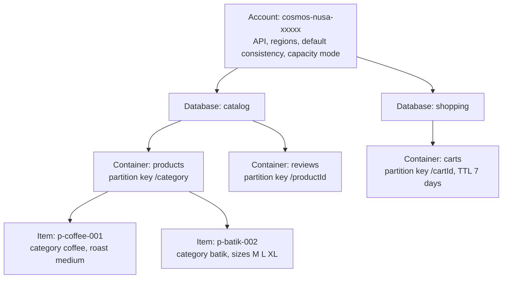
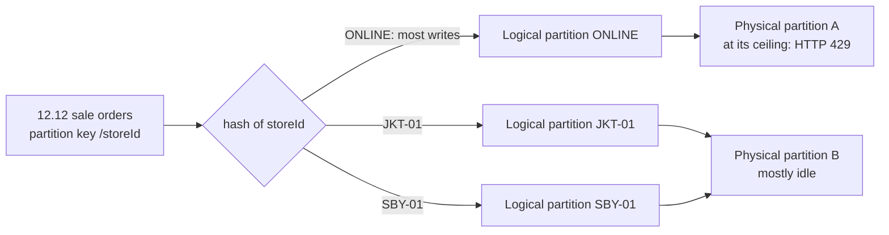
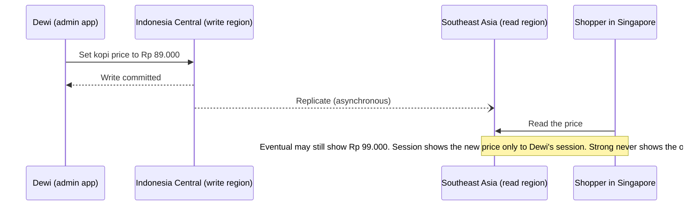

# Lunch 12 · NoSQL with Azure Cosmos DB (Basic)

🇮🇩 [Baca dalam Bahasa Indonesia](README.id.md)

> **Track:** Core month · **Level:** Basic · **Part 3:** Platform services and data
> **Time:** 60 minutes · **Prerequisite lunches:** 04, 05, 11
> **AZ-900 skill area:** Describe Azure architecture and services
> **Lab:** [Lab 12 · A product catalogue that scales](../../labs/12-cosmos-db/README.md) — about 45 minutes · cost 💲
> **Author:** Stefanus Pinarta · [About the author](../../README.md#about-the-author)

| ⏱ Minutes | Segment |
|---:|---|
| 5 | Scenario and objectives |
| 25 | Reading |
| 15 | Demo: interactive animation (+ optional walkthrough video) |
| 5 | Knowledge check |
| 5 | Key takeaways and lab preview |
| 5 | Buffer — finish your lunch 🍜 |

## 🍱 Today's menu

By the end of this lunch you will be able to:

- **Explain** the four NoSQL data models and **choose** the right Azure Cosmos DB API for a workload.
- **Describe** how accounts, databases, containers and items fit together, and how request units are billed in
  provisioned, autoscale, serverless and free-tier setups.
- **Choose** a partition key that spreads data and traffic evenly, and **spot** a hot partition before it hurts.
- **Compare** the five consistency levels and **decide** when Cosmos DB, rather than Azure SQL, is the right home for
  your data.

## 🏪 Meanwhile at Nusantara Retail

Dewi drops a printout on your desk: the `Products` table from the storefront database. It has 140 columns, and most rows
leave more than a hundred of them empty. Coffee needs a roast level and a grind, batik needs a fabric and a size chart,
the new rattan baskets need dimensions. Every new product type means another schema change, another late-night
migration and, usually, another bug.

Marketing wants a mobile app before the 12.12 sale, when catalogue traffic can jump twentyfold in an hour. Ibu Sari has
two questions of her own: can we pay only for what shoppers actually use, and can customers in Medan and Makassar get
pages as fast as customers in Jakarta?

Orders and payments can stay in Azure SQL from Lunch 11 — they need relational rules. The catalogue is a different
animal. Today's question: **where should a catalogue that changes shape every week, and must stay fast during a
sale-day spike, live?**

---

## 📖 Reading (≈25 minutes)

### 1. NoSQL in one page: data models and Cosmos DB APIs

A relational database stores rows in tables with a fixed schema, joins tables at query time and wraps changes in
transactions that can touch many tables. That model is excellent for orders and money. It is less comfortable when every
record wants a different shape, or when one server can no longer keep up.

**NoSQL** ("not only SQL") databases relax some of those rules to gain flexibility and scale. They usually offer a
flexible schema, horizontal scale-out across many machines, and very fast reads and writes by key. In exchange you give
up most joins, and transactions shrink to a smaller scope. NoSQL is not "better" than relational; it is a different set
of trade-offs. There are four common **data models**:

| Data model | Shape of the data | Nusantara Retail example | Cosmos DB API |
|---|---|---|---|
| **Document** | Self-describing JSON documents; each can carry its own fields | A coffee with a roast level next to a batik shirt with sizes | API for NoSQL, API for MongoDB |
| **Key-value** | A value fetched by one unique key | A shopping cart looked up by its cart ID | API for Table (and point reads in any API) |
| **Column-family** | Wide rows whose columns can differ, grouped into families | Footfall-sensor readings per store, per minute | API for Apache Cassandra |
| **Graph** | Vertices (things) joined by edges (relationships) | "Shoppers who bought kopi also bought…" | API for Apache Gremlin |

**Azure Cosmos DB** is Azure's fully managed NoSQL database. Microsoft runs the servers, replicas, patching and backups;
you get automatic indexing, replication to as many regions as you like, and a latency commitment: reads and writes under
10 ms at the 99th percentile (with an exception for strong consistency across several regions, covered in section 4).

You pick an **API** when you create an account, and you can't change it later. The API decides which wire protocol,
drivers and query language your application uses:

- **API for NoSQL** — the native API: JSON items, a SQL-like query language, and new features (such as vector search)
  first. It is the default choice for new applications.
- **API for MongoDB** — speaks the MongoDB wire protocol, so existing Mongo apps and tools move across with few changes.
  The vCore-based MongoDB offering became a separate product in November 2025: **Azure DocumentDB**.
- **API for Apache Cassandra** and **API for Apache Gremlin** — for existing Cassandra (CQL) and graph applications.
- **API for Table** — a key-value API for apps written for Azure Table Storage that need more speed or global reach.

**Azure Cosmos DB for PostgreSQL** still appears in older material. It is on a retirement path and new deployments are
blocked; Microsoft points distributed PostgreSQL work to elastic clusters in Azure Database for PostgreSQL instead.

> [!TIP]
> Starting from scratch? Choose **API for NoSQL**. The other APIs exist mainly to bring existing applications across
> without a rewrite. Everything in this lunch and its lab uses API for NoSQL.

### 2. Accounts, containers and request units

Cosmos DB organises everything in four levels:

- The **account** is the top-level resource with a globally unique name and its own endpoint
  (`https://<account>.documents.azure.com`). Regions, the API, the default consistency level and the capacity mode are
  account settings.
- A **database** is a namespace that groups containers. It can optionally share throughput between its containers.
- A **container** is the unit of scale. You choose its **partition key** when you create it, and it holds the indexing
  policy and optional **time to live (TTL)**, which deletes items automatically after a set period — perfect for
  abandoned carts.
- An **item** is one JSON document of up to 2 MB. Every item needs an `id`, which must be unique within its partition
  key value. Items in the same container don't need the same fields: the coffee and the batik shirt live side by side.

Every operation costs **request units (RUs)**, a single currency that blends CPU, memory and I/O. Reading one 1 KB item
by its `id` and partition key — a **point read** — costs 1 RU. Writes cost more, because every write also updates the
indexes. A query's cost depends on how much data it has to touch. The same query over the same data always costs the
same, and every response reports its charge, so you can measure instead of guess.

That makes capacity planning a spreadsheet exercise rather than a hardware guess. Suppose the storefront serves 300
product pages per second (one point read each, about 1 RU) and 100 category pages per second (one query each, say
3 RU after you measure it). That is 300 + 300 = 600 RU/s of reads. Add the writes from stock updates, round up for the
sale, and you have a number to provision — or a reason to choose serverless while traffic is still small.

How you pay for RUs depends on the **capacity mode** you choose for the account:

| Mode | You pay for | Good for | Watch out for |
|---|---|---|---|
| **Provisioned, manual** | The RU/s you reserve, per hour (at least 400 RU/s per container) | Steady, predictable traffic | You pay for idle capacity; requests above it are throttled with HTTP 429 |
| **Provisioned, autoscale** | The highest RU/s used each hour, between 10% and 100% of a maximum you set | Spiky traffic, such as the 12.12 sale | The floor is 10% of the maximum, even when idle |
| **Serverless** | Only the RUs you consume, plus storage | Development, testing, low or bursty traffic | Single region only; costs vary with usage, so watch the meter |
| **Free tier** (a discount on provisioned) | Nothing for the first 1,000 RU/s and 25 GB, for the lifetime of the account | Learning and small production apps | One free-tier account per subscription, chosen at creation; not available for serverless |

When a request needs more RU/s than the container has, Cosmos DB answers with HTTP 429 "request rate too large" and the
SDK retries after a short wait. Occasional 429s are normal; constant 429s mean you need more throughput or a better
design.

> [!WARNING]
> Provisioned throughput is billed **in every region** of the account: 1,000 RU/s in three regions is 3,000 RU/s on the
> bill. And because free tier is one account per subscription and can only be switched on at creation time, it is easy
> to "use it up" on a forgotten experiment. Check before you create: the portal greys the option out if it's taken.

### 3. Partitioning: the one decision you can't undo

Cosmos DB scales by splitting a container across many machines, and the **partition key** decides how. All items with
the same partition key value form a **logical partition**: every coffee product when the key is `/category`. A logical
partition holds up to 20 GB, and it is also the boundary for transactions — a stored procedure or transactional batch
can only change items that share one partition key value.

Behind the scenes, Cosmos DB hashes each key value and places logical partitions on **physical partitions**, the replica
sets that do the work. You never manage physical partitions; Cosmos DB splits them as data and throughput grow. What you
need to know is their ceiling: one physical partition serves up to 10,000 RU/s and 50 GB, so a single logical partition
can never use more than that. A **hot partition** is one key value that receives far more traffic than the rest. It hits
the ceiling and gets throttled while the other partitions sit idle.

A good partition key has a wide range of values, spreads both storage and requests evenly, never changes for an item,
and appears as an equality filter in your most frequent queries. The practical method is to start from the queries, not
from the data: list the five requests your app makes most often, note which property each one filters on, and look for
the property that appears in most of them. When no single property works, you can build a **synthetic key** by joining
two values, such as `JKT-01|2026-12-12`. Here are Nusantara Retail's candidates:

| Container | Candidate key | Verdict | Why |
|---|---|---|---|
| products | `/category` | ✅ Fine for a catalogue | A few thousand items, read-heavy, and most pages ask "everything in this category". Few values, so keep an eye on a "promo" category during the sale. |
| products | `/id` | ⚠️ Possible | Perfect spread and cheap point reads, but every category page becomes a cross-partition query. |
| orders | `/storeId` | ❌ Hot partition | Only 41 values, and the online store takes most orders; one store's history also grows toward the 20 GB limit. |
| orders | `/orderDate` | ❌ Hot partition | Every write today lands on today's value — the classic anti-pattern. |
| orders | `/orderId` | ✅ Good for writes | Spreads writes perfectly and supports point reads by order number, but "show my orders" must ask every partition. |
| orders | `/customerId` | ✅ Best fit | High cardinality and matches the "my orders" page. If a few corporate buyers grow huge, use hierarchical keys. |

When a query includes the partition key, Cosmos DB sends it to one physical partition. When it doesn't, it becomes a
**cross-partition query** that fans out to every physical partition, adding roughly 2–3 RU per partition plus extra
latency. In a small container with one physical partition you barely notice; with fifty partitions, every search costs
fifty times the overhead.

You can't change a container's partition key in place: you create a new container and copy the data across (container
copy jobs help). If one level isn't enough, **hierarchical partition keys** let you combine up to three levels, such as
`/customerId` then `/orderId`.

### 4. Going global: regions and the five consistency levels

Adding a region to a Cosmos DB account takes a single click or command. Each region holds a full copy of the data, your
application reads from the nearest one, and provisioned RU/s apply in every region. By default one region accepts writes
and the others serve reads; with **multi-region writes**, every region accepts writes and Cosmos DB resolves conflicting
updates — by default, the last write wins. Service-managed failover can promote another region if the write region goes
down.

Replication between regions is asynchronous, so physics forces a choice: how fresh must a read be, and how much latency
and cost will you accept for it? Cosmos DB gives you five **consistency levels**, from strongest to weakest:

| Level | What a reader is promised | Nusantara Retail use | Price of the promise |
|---|---|---|---|
| **Strong** | Always the latest committed write | Stock count for the very last batik in a flash sale | Reads cost about twice the RUs; across regions every write waits for all regions; not allowed with multi-region writes |
| **Bounded staleness** | Lags behind by at most K versions or T seconds | Live sale dashboard that may be up to a minute old | Reads cost about twice the RUs |
| **Session** (default) | Within one session you always read your own writes, in order | Dewi edits a price and sees her change immediately | Same cost as the weaker levels |
| **Consistent prefix** | Never sees writes out of order, but may lag | An order's status timeline | Single-replica reads |
| **Eventual** | No ordering guarantee; replicas converge over time | Product view counters and "likes" | Cheapest and fastest |

The default level is set on the account, and you can change it at any time. A client can then ask for a weaker level
for its own requests, but never a stronger one. Session is the default because it suits most applications: a user always
sees their own changes, while reads stay as cheap and fast as eventual.

Consistency also shapes disaster recovery. If a whole region is lost, the writes that hadn't replicated yet are lost
with it. Microsoft's documentation puts that window at under 15 minutes for session, consistent prefix and eventual in a
multi-region account, and at zero for strong — which is exactly why strong consistency makes every write wait for the
other regions. Multi-region accounts also raise the availability SLA, up to 99.999% depending on the configuration.
Lunch 17 calls this window the **recovery point objective**.

> [!NOTE]
> **Pause and think:** During the 12.12 flash sale, the price of a batik shirt drops at exactly 00:00. Shoppers in
> Singapore are served from the Southeast Asia replica. Is a few seconds of old price acceptable, or must every shopper
> see the new price instantly? Which level would you choose — and what would it cost?

### 5. How it fits together for Nusantara Retail

Three more features make Cosmos DB pleasant to work with:

- **Automatic indexing.** By default every property of every item is indexed, so new fields like `roastLevel` are
  queryable the moment they appear — no index design required. To save RUs on write-heavy containers, you can exclude
  paths you never filter on.
- **Change feed.** Every container keeps an ordered record of inserts and updates (ordered per partition key). An Azure
  Function (Lunch 14) can react to it: refresh the search index, or tell waiting shoppers that a sold-out batik is back
  in stock. By default deletes don't appear; a mode that captures them requires continuous backup.
- **Built-in backups.** Every account is backed up automatically. The default periodic mode takes a full backup every
  four hours and keeps the latest two; continuous mode adds point-in-time restore for the last 7 or 30 days. Lunch
  17 puts these into a disaster recovery plan.

So which database should Nusantara Retail use? Both, each for what it does best:

| Choose **Azure SQL** when… | Choose **Azure Cosmos DB** when… |
|---|---|
| Data is naturally relational: orders, payments, invoices | Records vary in shape: catalogues, profiles, carts |
| You need joins, reports and transactions across many tables | You read and write by key at very high speed |
| One region (plus a DR copy) is enough | Users on several continents need local reads, or local writes |
| Your team already thinks in T-SQL | You want elastic throughput, from serverless to millions of RU/s |

The design you will build in the lab: a Cosmos DB for NoSQL account with a `catalog` database and a `products`
container partitioned by `/category`. Dewi's storefront reads a category page with one single-partition query and a
product page with one point read. Development uses **serverless**, because it costs nearly nothing when idle;
production would move to **autoscale** before the sale, with a ceiling sized from measured RUs. The app authenticates
with Microsoft Entra ID and a Cosmos DB data-plane role (Lunch 05 and Lunch 15), not with account keys.

Production would live in **Indonesia Central** for data residency. Product names and prices aren't personal data, so a
read region in Southeast Asia could serve shoppers abroad — carts holding customer IDs deserve a residency check first.

Before you build, learn from the mistakes teams make most often with their first Cosmos DB app:

- **Running every page as a `SELECT *` across all partitions.** It works on day one with 30 items and gets slower and
  more expensive with every product you add. Point reads and single-partition queries keep the cost flat.
- **Pasting account keys into configuration files.** A key opens every database in the account, and it never expires.
  Use Microsoft Entra ID with a data-plane role, and disable key-based authentication once nothing needs it.
- **Creating databases and containers from application code.** Treat them as infrastructure: create them with the CLI
  or Bicep (Lunch 20), and give the app a data role that can read and write items but not reshape the account.
- **Forgetting TTL.** Abandoned carts and expired sessions pile up and cost storage forever unless a TTL removes them.
- **Leaving provisioned throughput on idle test containers.** 400 RU/s bills every hour, used or not; serverless or
  the free tier is kinder to a development budget.

---

## 🎬 Demo (≈15 minutes)

1. **Interactive animation (≈6–8 min):** [Open the demo](https://stefpin.github.io/azure-fundamentals-lunches/demos/12-cosmos-db.html) —
   press ▶ Play or step through it at your own pace. Offline? Download
   [`docs/demos/12-cosmos-db.html`](../../docs/demos/12-cosmos-db.html) and open it in any browser.
2. **Walkthrough video (≤ 6 min):** _coming soon_ — [read the walkthrough script](demo-video-script.md).

What to watch for:

- How the partition key decides where every item lands, and why a single busy key value becomes a hot partition.
- The difference between a query that names its partition key and one that has to ask every partition.
- What a shopper in Singapore sees under eventual, session and strong consistency — and what each choice costs.

## ✅ Knowledge check (≈5 minutes)

1. Dewi adds a new product type almost every week, each with its own attributes. The team is starting a new service
   from scratch. Which Cosmos DB API should they choose?
   

Show answer

   **API for NoSQL.** It stores schema-free JSON items, indexes new properties automatically and gets new features
   first; the other APIs mainly exist to move existing MongoDB, Cassandra, Gremlin or Table apps across.

   

2. An `orders` container is partitioned by `/storeId`. During the 12.12 sale, writes for the online store fail with
   HTTP 429, even though the container's total RU/s are far from used up. What is happening, and what would you change?
   

Show answer

   **A hot partition.** One key value (the online store) receives most writes and hits the per-partition ceiling while
   other partitions idle. Re-create the container with a high-cardinality key such as `/customerId` (or hierarchical
   keys) and copy the data, because a partition key can't be changed in place.

   

3. Your lab subscription already has a free-tier Cosmos DB account from a past experiment. You want a short-lived
   account for a 45-minute lab that costs almost nothing. What do you choose?
   

Show answer

   **A serverless account.** Free tier is limited to one account per subscription and can't be added later, while
   serverless bills only the request units you actually consume plus storage.

   

4. Dewi must always see her own price changes immediately; other shoppers can lag a little. Which consistency level is
   the cheapest that meets the need?
   

Show answer

   **Session**, the default. It guarantees read-your-own-writes within a session while keeping single-replica reads,
   so reads don't cost the double RUs of strong or bounded staleness.

   

5. The finance team needs month-end reports joining payments, invoices and refunds, with transactions that update all
   three together. Cosmos DB or Azure SQL?
   

Show answer

   **Azure SQL.** The data is relational and needs multi-table joins and transactions; in Cosmos DB, transactions are
   limited to items that share one partition key value.

   

## 🧠 Key takeaways

- Cosmos DB is a fully managed NoSQL database; choose **API for NoSQL** for new apps, because the API can't be changed
  after the account is created.
- Everything costs **request units**: a 1 KB point read is 1 RU, and you pay for them through provisioned, autoscale or
  serverless capacity — plus one free-tier account per subscription.
- The **partition key** is a one-way door: pick a property with many values that spreads traffic evenly and appears in
  your most common queries, or you'll build a hot partition.
- Five **consistency levels** trade freshness against latency and cost; **session** is the default and the right
  answer for most apps.
- Use Cosmos DB for flexible, fast, globally distributed data such as catalogues and carts, and keep relational,
  transaction-heavy data like orders and payments in **Azure SQL**.

## 🗒️ Field notes from Stefanus

> **Read the receipt on every request.** Cosmos DB reports the price of every operation in its response, and I treat
> that number like a receipt. From the first sprint I ask teams to log the request charge next to the name of each
> query, and in design reviews I ask one question: which of your five busiest queries gets more expensive as the data
> grows? A point read costs the same with thirty items or thirty million, and a single-partition query grows only with
> its own partition. A cross-partition search grows with everything, and in a small test account with one physical
> partition it hides perfectly. So I test with data shaped like sale day, not like the demo, and I compare documents
> loaded with documents returned. When those two numbers drift apart, the bill is about to follow.

## 🔬 Your lab: A product catalogue that scales

You'll build Nusantara Retail's catalogue in a serverless Cosmos DB for NoSQL account, give yourself data access with
Microsoft Entra ID instead of keys, load 30 products with a small Python script, and compare the RU cost of point reads,
single-partition queries and cross-partition queries. You'll double the cost of a read by changing the consistency
level, then fix an expensive search query by adding the partition key.

- ⏱ About 45 minutes · 💲 free or close to free · works on its own (no earlier lab needed)
- 👉 [Start Lab 12](../../labs/12-cosmos-db/README.md)

## 📚 Go further

- [Microsoft Learn: Partitioning and horizontal scaling in Azure Cosmos DB](https://learn.microsoft.com/azure/cosmos-db/partitioning) —
  logical and physical partitions, anti-patterns and the partition key strategies side by side.
- [Microsoft Learn: Consistency levels in Azure Cosmos DB](https://learn.microsoft.com/azure/cosmos-db/consistency-levels) —
  the precise guarantees behind each level, including quorum reads and the RPO of each choice.
- [Microsoft Learn: Request Units in Azure Cosmos DB](https://learn.microsoft.com/azure/cosmos-db/request-units) — what
  drives RU charges and how capacity modes bill them.

---

⬅️ [Lunch 11 · Relational Databases (Basic): Azure SQL](../11-relational-databases-basic/README.md) · 🏠 [Course home](../../README.md) · [Lunch 13 · Containers (Basic): Container Registry, Container Instances and Container Apps](../13-containers-basic/README.md) ➡️

Last validated: October 2026 · Spotted something out of date? [Open an issue](../../CONTRIBUTING.md).
