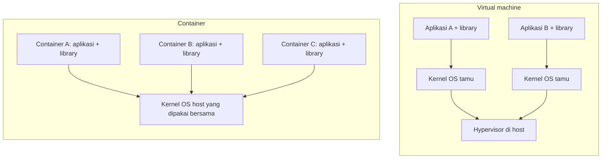
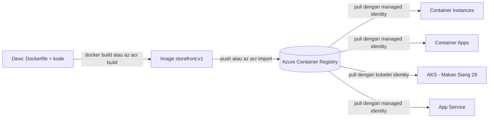
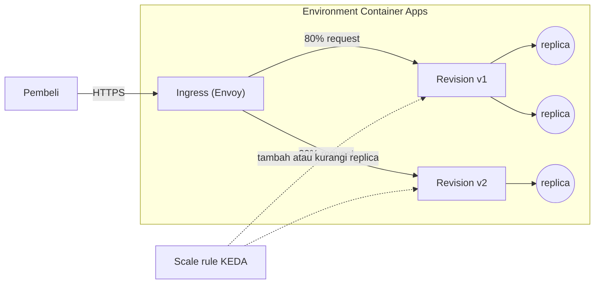

# Makan Siang 13 · Containers (Dasar): Container Registry, Container Instances, dan Container Apps

🇬🇧 [Read in English](README.md)

> **Jalur:** Bulan inti · **Level:** Dasar · **Bagian 3:** Layanan platform dan data
> **Waktu:** 60 menit · **Makan siang prasyarat:** 02, 10
> **Area keterampilan AZ-900:** Menjelaskan arsitektur dan layanan Azure
> **Lab:** [Lab 13 · Mengemas toko online](../../labs/13-containers-basic/README.id.md) — sekitar 45 menit · biaya 💲
> **Penulis:** Stefanus Pinarta · [Tentang penulis](../../README.id.md#tentang-penulis)

| ⏱ Menit | Segmen |
|---:|---|
| 5 | Skenario dan tujuan |
| 25 | Bacaan |
| 15 | Demo: animasi interaktif (+ video panduan opsional) |
| 5 | Uji pemahaman |
| 5 | Poin penting dan pratinjau lab |
| 5 | Waktu cadangan — habiskan makan siang Anda 🍜 |

## 🍱 Menu hari ini

Setelah makan siang ini, Anda akan mampu:

- Menjelaskan apa bedanya container (*kontainer*) dengan virtual machine (*komputer virtual*), dan mengapa sebuah image
  membuat deployment selalu bisa diulang dengan hasil yang sama.
- Menjelaskan image, tag, digest, dan registry, serta memilih tier dan metode sign-in Azure Container Registry.
- Menjelaskan cara Azure Container Apps memakai environment, revision, ingress, dan scale rule, termasuk kemampuan
  menyusut hingga nol (scale to zero).
- Memilih antara Azure Container Instances, Azure Container Apps, Azure Kubernetes Service, dan App Service untuk sebuah
  beban kerja container.

## 🏪 Sementara itu di Nusantara Retail

Dewi baru saja menulis ulang halaman produk toko online, dan di laptopnya halaman-halaman itu melesat secepat kilat. Di
server uji, halaman yang sama justru crash: server itu memakai runtime Python yang lebih lama dan tidak punya salah satu
library pengolah gambar. Kalimat "di laptop saya jalan, kok" kini menjadi kalimat paling mahal di kantor. Pak Budi
menghabiskan malam-malamnya mencocokkan versi library satu per satu, sementara Rizky, sang kontraktor, ingin
"masukkan saja semuanya ke Kubernetes".

Ibu Sari punya kekhawatiran lain. Saat promo Harbolnas 12.12, trafik melonjak sepuluh kali lipat selama beberapa jam;
sebaliknya, pukul tiga pagi pada hari Selasa biasa hampir tidak ada yang berbelanja. Ia tidak mau membayar server
seukuran musim promo sepanjang tahun. Ada pula job malam yang mengimpor harga dari pemasok selama sepuluh menit, lalu
menganggur sepanjang sisa hari.

Hari ini Anda menjawab dua pertanyaan. Bagaimana mengemas toko online sekali saja agar berjalan sama persis di mana pun?
Dan layanan Azure mana yang sebaiknya menjalankan kemasan itu, agar kita membayar untuk pembeli yang datang, bukan untuk
server yang menganggur?

---

## 📖 Bacaan (≈25 menit)

### 1. Container dalam satu gambar

**Container** adalah sebuah proses yang sedang berjalan dan membawa sendiri kode aplikasi, runtime, dan library-nya,
terpisah dari semua proses lain di mesin yang sama. Berbeda dengan virtual machine, container tidak membawa kernel
sistem operasinya sendiri. Kernel adalah inti sistem operasi, bagian yang mengatur CPU, memori, dan file. Semua
container di satu host memakai bersama kernel milik host tersebut, dan kernel itu sendirilah yang memasang pagar di
antara mereka: setiap container hanya melihat file dan prosesnya sendiri, dan hanya boleh memakai CPU dan memori yang
dijatahkan kepadanya.

Ibaratnya rumah kontrakan dan kos-kosan. Virtual machine seperti mengontrak satu rumah utuh: fondasi, dapur, dan
meteran listriknya milik sendiri. Container seperti kamar kos: setiap penghuni punya kamar berkunci dengan perabotnya
sendiri (aplikasi dan library-nya), tetapi semua kamar berdiri di atas fondasi yang sama dan memakai listrik serta air
dari gedung yang sama (kernel host). Pemilik kos, yaitu kernel, memastikan tidak ada penghuni yang bisa masuk ke kamar
orang lain atau memakai listrik melebihi jatahnya.

Satu pilihan desain itu menjelaskan hampir semua perbedaan yang akan Anda temui. VM harus mem-boot seluruh sistem
operasi, sehingga butuh beberapa menit untuk menyala dan image disk-nya berukuran gigabyte. Container cukup menjalankan
sebuah proses, sehingga siap dalam hitungan detik, dan kemasannya sering kali hanya berukuran puluhan atau ratusan
megabyte. Di perangkat keras yang sama, jauh lebih banyak container yang muat dibandingkan VM. Itulah sebabnya penyedia
cloud bisa menyewakan container kepada Anda per detik.

Kemasan yang Anda kirimkan disebut **container image**: sistem file berlapis yang hanya bisa dibaca (read-only),
ditambah sedikit metadata, misalnya perintah yang harus dijalankan dan environment variable bawaannya. Cara membangun
image itu Anda tuliskan dalam sebuah file teks bernama **Dockerfile**. Setiap instruksi menambahkan satu **layer**
(lapisan), dan layer disimpan dalam cache serta bisa dipakai bersama. Karena itu, perubahan kode biasanya hanya
membangun ulang dan mengunggah layer teratas yang tipis, bukan runtime di bawahnya.

```dockerfile
FROM python:3.12-slim                  # base layer: OS libraries and the Python runtime
WORKDIR /app
COPY requirements.txt .
RUN pip install -r requirements.txt    # dependency layer, rebuilt only when requirements change
COPY . .                               # your code: the layer that changes most often
EXPOSE 8080                            # documents the port; it does not open anything by itself
CMD ["gunicorn", "--bind", "0.0.0.0:8080", "app:app"]
```

Cara mudah mengingat bedanya: image itu ibarat paket masak (meal kit) yang masih tersegel, dengan semua bahan sudah
ditakar; **container** adalah paket itu setelah dimasak dan dihidangkan. Masak paket yang sama di seratus dapur, dan
hasilnya tetap hidangan yang sama. Itulah persis yang dibutuhkan Dewi. Laptopnya, environment uji, dan production
semuanya menjalankan image yang sama, sehingga "di laptop saya jalan" berubah menjadi "di dalam image jalan".



| | Virtual machine (Makan Siang 06) | Container |
|---|---|---|
| Apa yang divirtualisasi | Perangkat keras; setiap VM menjalankan kernel OS-nya sendiri | Sistem operasi; semua container memakai bersama kernel host |
| Waktu menyala yang umum | Beberapa menit | Beberapa detik |
| Ukuran kemasan yang umum | Gigabyte | Megabyte hingga beberapa ratus megabyte |
| Cara memperbarui | Menambal (patch) OS tamu dan aplikasi yang sedang berjalan di tempat | Membangun image baru lalu mengganti container-nya |
| Tempat data (state) disimpan | Sering kali di disk VM | Di luar container: database, storage, atau volume yang di-mount |
| Cocok untuk | Lift-and-shift, kendali penuh atas OS, perangkat lunak lama (legacy) | API, front end web, microservice, job singkat |

Dari sini lahir dua kebiasaan. Pertama, perlakukan container sebagai barang sekali pakai: jangan pernah "memperbaiki"
container yang sedang berjalan secara manual, karena container pengganti berikutnya tidak akan membawa perbaikan Anda.
Ubahlah image-nya. Kedua, simpan data di luar container, yaitu di Azure SQL, Azure Cosmos DB, atau Azure Storage
(Makan Siang 07, 11, dan 12), supaya kehilangan sebuah container tidak pernah berarti kehilangan pesanan.

### 2. Image, tag, dan Azure Container Registry

**Registry** adalah tempat menyimpan dan membagikan image, semacam gudang image. Di dalamnya, sebuah **repository**
menampung versi-versi dari satu image (misalnya `storefront`), dan setiap versi membawa satu atau beberapa **tag**
seperti `v1` atau `2026.10.23`. Setiap image juga punya **digest**, yaitu hash SHA-256 dari isinya. Hash adalah semacam
sidik jari digital yang dihitung dari isi file: ubah satu byte saja, sidik jarinya ikut berubah. Tag adalah label yang
bisa dipindah; digest tidak pernah berubah. Referensi image yang lengkap dibaca seperti alamat:
`acrnusa12345.azurecr.io/storefront:v1` berarti login server, repository, dan tag.

Bayangkan rak di minimarket. Tag itu seperti papan "PROMO MINGGU INI" yang digantung di rak: minggu depan papan yang
sama bisa dipindah ke barang lain. Digest lebih mirip barcode yang tercetak di kemasan: ia menempel pada isinya dan
tidak bisa dipindah ke barang lain.

Registry publik menyimpan image yang boleh ditarik (pull) siapa saja: Docker Hub, GitHub Container Registry, dan
Microsoft Artifact Registry (`mcr.microsoft.com`), tempat Microsoft menerbitkan image-nya sendiri, termasuk contoh
aplikasi web yang akan Anda pakai di lab. Image buatan Anda sendiri sebaiknya disimpan di registry privat. **Azure
Container Registry (ACR)** adalah registry privat terkelola milik Azure: ia berada di subscription (*langganan*) dan
region (*wilayah*) Anda, dekat dengan layanan yang menarik image darinya, dan menyimpan container image, Helm chart
(paket aplikasi untuk Kubernetes), serta artefak OCI (Open Container Initiative, standar terbuka untuk format container)
lainnya di balik sign-in Microsoft Entra ID (*ID Microsoft Entra*).

| Tier | Penyimpanan yang disertakan | Yang menonjol | Pakai saat |
|---|---|---|---|
| Basic | 10 GiB | API dan sign-in Entra ID yang sama dengan tier lain; throughput paling rendah | Belajar, lab, tim kecil |
| Standard | 100 GiB | Penyimpanan dan throughput lebih besar, anonymous pull, artifact cache rule | Sebagian besar beban kerja production |
| Premium | 500 GiB | Geo-replication, private endpoint, customer-managed key, aturan jaringan, connected registry | Beberapa region, jaringan privat, data yang diatur regulasi |

Ketiga tier itu secara default bersifat zone-redundant (datanya disalin ke beberapa zona) di region yang memiliki
availability zone (*zona ketersediaan*), dan Anda bisa mengganti tier di kemudian hari tanpa downtime (turun dari
Premium berarti Anda harus melepas dulu fitur-fitur yang hanya ada di Premium). Penyimpanan di atas jatah yang
disertakan ditagih per GiB, jadi hapuslah tag lama yang tidak lagi Anda perlukan.

Ada tiga cara memasukkan image ke ACR:

- **Push** image yang Anda bangun secara lokal dengan Docker: `az acr login`, lalu `docker push`.
- **Import** image dari registry lain dengan `az acr import`. Penyalinannya terjadi di dalam Azure, jadi Anda sama
  sekali tidak memerlukan Docker. Cara inilah yang dipakai di lab.
- **Build di cloud** dengan **ACR Tasks**: `az acr build` mengunggah folder kode sumber Anda dan membangun image-nya di
  Azure. Tasks juga bisa membangun ulang secara otomatis setiap kali Anda melakukan commit ke Git atau ketika base image
  mendapat patch keamanan.

> [!IMPORTANT]
> Saat tulisan ini dibuat (Oktober 2026), eksekusi ACR Tasks dihentikan sementara untuk subscription yang memakai kredit
> gratis Azure; build akan gagal dengan `TasksOperationsNotAllowed`. Karena itulah lab mengimpor image publik dan
> menjadikan build di cloud sebagai tambahan opsional. Periksa dokumentasi ACR Tasks untuk status terbarunya.

Siapa yang boleh menarik image? Manusia melakukan sign-in dengan Entra ID (`az acr login`). Layanan Azure sebaiknya
memakai **managed identity**, yaitu identitas yang dibuat dan dikelola Azure untuk sebuah layanan, yang memegang role
**AcrPull** pada registry, sehingga tidak ada kata sandi di mana pun. ACR juga punya **admin user**, yaitu satu username
dan kata sandi yang dipakai bersama; fitur ini nonaktif secara default dan sebaiknya tetap nonaktif, kecuali untuk
eksperimen singkat. Mode penetapan role yang lebih baru, "RBAC Registry + ABAC Repository Permissions", memungkinkan Anda
membatasi akses hingga ke masing-masing repository (RBAC adalah role-based access control atau *kontrol akses berbasis
peran*, sedangkan ABAC adalah kontrol akses berbasis atribut). Microsoft menyatakan mode ini akan menjadi default; dalam
mode itu, role AcrPull versi lama diabaikan dan Anda menetapkan role Container Registry Repository Reader sebagai
gantinya.



Satu catatan tentang tag `latest`: itu hanya nama bawaan, bukan jaminan bahwa image-nya yang paling baru. Gunakan tag
yang eksplisit saat men-deploy, seperti `v1` atau sebuah tanggal, agar Anda selalu tahu apa yang sedang berjalan dan
bisa kembali (roll back) ke tag sebelumnya dalam hitungan detik.

### 3. Azure Container Instances: satu container, sekarang juga

**Azure Container Instances (ACI)** adalah jalan terpendek dari sebuah image menuju container yang berjalan. Anda cukup
menyebutkan image-nya, jumlah core CPU dan memori, port, serta (opsional) sebuah **DNS name label**. Beberapa detik
kemudian, container sudah menjawab di `label.region.azurecontainer.io`. Anda tidak pernah melihat VM ataupun cluster,
dan Anda membayar per detik untuk CPU dan memori yang dialokasikan selama container berjalan.

Unit yang Anda deploy disebut **container group**: satu atau beberapa container di host yang sama yang berbagi
jaringan, volume penyimpanan, dan siklus hidup, mirip pod di Kubernetes. Group yang berisi lebih dari satu container
tersedia untuk container Linux; pasangan yang umum adalah aplikasi ditambah container pembantu kecil yang mengirimkan
log. Setiap
group diisolasi di tingkat hypervisor, sehingga tetangga di perangkat keras yang sama tidak bisa mengintip ke dalamnya.

**Restart policy** (kebijakan restart) memberi tahu ACI apa yang harus dilakukan ketika prosesnya berhenti. `Always`,
nilai default-nya, cocok untuk web server. `OnFailure` hanya mencoba lagi bila terjadi error. `Never` cocok untuk
pekerjaan yang berjalan sampai selesai, seperti impor harga malam hari milik Nusantara Retail: job berjalan sepuluh
menit, keluar, dan meteran biaya pun berhenti.

Operasional sehari-harinya juga ringkas. `az container logs` menampilkan apa yang dicetak oleh proses,
`az container attach` mengalirkan output itu secara langsung, dan `az container exec` membuka shell di dalam container
yang sedang berjalan ketika Anda perlu melihat-lihat. Pengaturan dikirim sebagai environment variable; yang sensitif
ditandai sebagai secure agar tersembunyi dari properti resource. Anda juga bisa me-mount share Azure Files bila container
memerlukan file yang harus tetap ada setelah container itu hilang. Ada dua batasan yang sering menjebak: ACI hanya
menjalankan image x64 (AMD64), jadi image yang di-build khusus untuk ARM di laptop tidak akan bisa start; dan image yang
sangat besar memperlambat setiap start karena harus ditarik terlebih dahulu.

ACI sengaja dibuat sederhana, dan kesederhanaan itu juga menjadi batasannya. ACI tidak melakukan autoscale, tidak
membagi beban (load balancing) di antara beberapa salinan, dan tidak punya revision maupun sertifikat terkelola; untuk
menjalankan lima salinan, Anda harus membuat lima container group. Alamat IP publik sebuah group bisa berubah setelah
restart, jadi selalu gunakan nama DNS-nya. Untuk menarik image dari ACR privat, ACI memerlukan user-assigned managed
identity (identitas yang Anda buat sebagai resource tersendiri) yang memegang AcrPull; ACI tidak bisa memakai
system-assigned identity (identitas yang melekat pada satu resource dan ikut terhapus bersamanya) untuk menarik image.

Beberapa opsi yang lebih baru dibangun di atas mesin yang sama: **Spot container** menjalankan pekerjaan yang boleh
diinterupsi dengan harga diskon, **confidential container** melindungi data selama berada di memori, **NGroups** menjaga
sekumpulan container group yang saling terkait tetap berjalan dengan rolling upgrade di beberapa zona, dan **virtual
node** memungkinkan cluster AKS "meluberkan" pod ke ACI saat beban memuncak. Bagi Nusantara Retail, ACI cocok untuk
impor harga, uji cepat image dari vendor, atau build agent yang berumur pendek.

### 4. Azure Container Apps: aplikasi serverless yang bisa menyusut hingga nol

**Azure Container Apps** menjalankan aplikasi web, API, background worker, dan job dari container image di atas
platform serverless, artinya Anda sama sekali tidak mengurus server. Di balik layar, layanan ini memakai Kubernetes dan
proyek open source (KEDA untuk penskalaan berbasis event, Envoy untuk ingress, dan Dapr untuk komponen dasar
microservice), tetapi Anda tidak pernah diminta untuk mengelola, meng-upgrade, atau bahkan melihat API Kubernetes.

Ada empat komponen dasar yang penting:

- **Environment** (lingkungan) adalah batas aman yang mengelilingi sekelompok aplikasi. Aplikasi dalam satu environment
  berbagi satu virtual network (*jaringan virtual*) dan satu workspace Log Analytics, serta bisa saling memanggil
  berdasarkan nama. Jenis default-nya adalah **workload profiles environment**, yang menyediakan profil serverless
  **Consumption** ditambah profil **Dedicated** opsional dengan perangkat keras yang dicadangkan khusus.
- **Container app** adalah aplikasi Anda. Konfigurasinya (ingress, secret, sign-in ke registry, revision mode) berlaku
  untuk seluruh aplikasi.
- **Revision** adalah snapshot template aplikasi yang tidak bisa diubah (immutable): image, environment variable, CPU
  dan memori, serta scale rule. Mengubah apa pun di template akan membuat revision baru; mengubah ingress, secret, atau
  pembagian trafik tidak.
- **Replica** adalah satu salinan revision yang sedang berjalan. Replica datang dan pergi mengikuti naik-turunnya beban.

**Ingress** adalah pintu masuk yang menerbitkan aplikasi Anda ke luar. External ingress memberinya alamat HTTPS publik
di `azurecontainerapps.io`, lengkap dengan sertifikat yang diurus untuk Anda; internal ingress membuatnya hanya bisa
dijangkau dari dalam environment atau virtual network Anda. Anda juga menyatakan **target port**: port tempat proses
Anda mendengarkan (listen) di dalam container. Ibaratnya alamat di kompleks perumahan: ingress adalah gerbang kompleks,
target port adalah nomor rumahnya. Kurir yang lolos gerbang tetapi mengetuk nomor rumah yang salah tetap tidak akan
bertemu penghuninya.

> [!WARNING]
> Kesalahan paling umum pada deployment pertama adalah target port yang salah. Jika image mendengarkan di port 80
> tetapi Anda mengatur 8080, platform tidak bisa menjangkau aplikasi Anda: revision tidak pernah menjadi sehat
> (healthy) dan setiap request gagal. `EXPOSE` di Dockerfile hanyalah dokumentasi, jadi periksa dokumentasi image-nya
> dan atur target port agar cocok.

Setiap revision diskalakan di antara jumlah replica minimum dan maksimum, secara default 0 dan 10 (saat tulisan ini
dibuat, Anda bisa mengatur hingga 1.000). **Scale rule** (aturan penskalaan) menentukan kapan replica ditambah:
**HTTP rule** memantau jumlah request bersamaan (concurrent) per replica (default 10), TCP rule memantau koneksi, dan
custom rule bisa memakai scaler KEDA apa pun, misalnya panjang antrean Service Bus. Hitungannya sederhana: 45 request
bersamaan dengan target 10 menghasilkan ceil(45 ÷ 10) = 5 replica (ceil berarti pembulatan ke atas), dengan batas atas
sesuai maksimum yang Anda tetapkan.

Bayangkan kasir supermarket. Manajer membuka satu kasir untuk setiap sepuluh pembeli yang mengantre, paling banyak lima
kasir. Saat toko sepi di tengah malam, semua kasir ditutup dan tidak ada yang digaji hanya untuk berdiri menunggu.

Dengan minimum nol, aplikasi yang sepi akan menyusut hingga nol replica setelah masa tenang (cool-down, default 300
detik) dan tidak dikenai biaya compute selama "tidur". Konsekuensinya adalah **cold start**: request pertama setelah
masa sepi harus menunggu beberapa detik sementara sebuah replica dinyalakan. Dalam bahasa supermarket tadi: pembeli
pertama setelah semua kasir tutup harus menunggu sebentar sampai seorang kasir datang dan menyalakan mesinnya. Aplikasi
production yang harus menjawab seketika mengatur minimum satu atau dua; replica yang menganggur pada jumlah minimum itu
ditagih dengan tarif idle yang lebih rendah.



**Revision mode** mengatur cara rilis. Dalam mode **single** (default), revision baru mengambil alih begitu siap,
sehingga pembaruan berlangsung tanpa downtime. Dalam mode **multiple**, beberapa revision tetap aktif dan Anda membagi
trafik berdasarkan persentase, misalnya 80% ke v1 yang sudah terbukti dan 20% ke v2 yang baru (disebut canary release),
lalu menaikkannya ke 100% setelah Anda yakin. Mode labels, yang masih berstatus preview saat tulisan ini dibuat,
menambahkan label bernama seperti `staging`.

Ibaratnya rumah makan yang mencoba resep rendang baru: mula-mula resep itu disajikan ke dua dari sepuluh meja saja.
Kalau tamu suka, semua meja mendapat resep baru; kalau ada yang mengeluh, resep lama kembali dipakai tanpa membuat
seisi rumah makan kacau.

Dua fitur lain layak Anda kenal namanya. **Dapr** adalah sidecar opsional, yaitu proses pendamping yang berjalan di
samping aplikasi Anda, yang memberi kode Anda API standar untuk panggilan antarlayanan, pengiriman pesan
publish-subscribe, dan penyimpanan state, sehingga kode tidak terikat pada satu message broker tertentu. **Jobs**
menjalankan container sampai selesai, baik sesuai permintaan, terjadwal, maupun saat event datang, sehingga menjadi
pilihan kedua untuk impor harga malam hari.

Pada plan Consumption, Anda membayar per detik untuk vCPU dan memori yang dipakai replica, ditambah biaya kecil per
sejuta request. Setiap subscription mendapat jatah gratis bulanan (saat tulisan ini dibuat: 180.000 vCPU-detik,
360.000 GiB-detik, dan 2 juta request; satu vCPU-detik berarti satu CPU virtual terpakai selama satu detik), dan itulah
sebabnya lab ini hampir tidak memakan biaya.

### 5. Memilih tempat container Anda berjalan

Image yang sama bisa berjalan di empat layanan Azure yang berbeda. Bedanya terletak pada seberapa banyak platform yang
Anda dapatkan, dan seberapa banyak platform yang harus Anda urus sendiri.

| | Container Instances | Container Apps | Azure Kubernetes Service | App Service (Web App for Containers) |
|---|---|---|---|---|
| Gambaran sederhananya | Satu container group, sesuai permintaan | Aplikasi dan job serverless | Cluster Kubernetes terkelola milik Anda sendiri | Web hosting terkelola yang menjalankan image Anda |
| Yang Anda urus | Setiap container group | Aplikasi, revision, dan scale rule | Node, upgrade, add-on, dan objek Kubernetes (lebih sedikit dengan AKS Automatic) | App Service plan dan pengaturan aplikasi |
| Penskalaan | Tidak ada bawaan; buat lebih banyak group | Otomatis berdasarkan HTTP, TCP, atau event, hingga nol | Autoscaler pod dan node yang Anda konfigurasi | Manual atau autoscale pada plan; tidak bisa menyusut hingga nol |
| Yang Anda bayar | Per detik vCPU dan memori | Per detik pemakaian ditambah request (dengan jatah gratis), atau profil Dedicated | VM node, ditambah biaya pada tier Standard dan Premium | Instance plan, sibuk ataupun menganggur |
| API Kubernetes | Tidak | Tidak | Ya | Tidak |
| Paling cocok untuk | Job, uji cepat, build agent, kapasitas tambahan saat lonjakan | Microservice, API, worker berbasis event, aplikasi yang sering menganggur | Tim platform, Helm chart dan operator, kendali yang sangat detail | Aplikasi web klasik yang menginginkan deployment slot dan sign-in bawaan |

Bacalah tabel itu dari kiri ke kanan sebagai "makin banyak kendali, makin besar tanggung jawab". Mulailah dari layanan
paling sederhana yang memenuhi kebutuhan. Untuk sebagian besar beban kerja container baru milik Nusantara Retail,
jawabannya adalah Container Apps.

Pindahlah ke **AKS** (Makan Siang 29) ketika Anda membutuhkan API Kubernetes itu sendiri: vendor mengirimkan perangkat
lunaknya sebagai Helm chart dengan operator khusus, Anda memerlukan agent di setiap node (DaemonSet), Anda ingin kendali
presisi atas perangkat keras node atau service mesh, atau tim platform akan menjalankan banyak aplikasi untuk banyak
tim di satu cluster bersama. Pilih **App Service** (Makan Siang 10) ketika aplikasinya berupa situs web klasik dan Anda
lebih menghargai deployment slot, autentikasi bawaan, dan custom domain daripada kendali di tingkat container; container
di sini hanyalah format kemasan Anda. Function (*fungsi*) berbasis event juga bisa berjalan di dalam container, dan itu
dibahas di Makan Siang 14.

### 6. Bagaimana semuanya menyatu untuk Nusantara Retail

Inilah rencana yang Anda bawa kembali kepada Ibu Sari:

- **Satu registry.** Sebuah ACR bernama `acrnusa…` menyimpan semua image. Lab memakai Basic; production dimulai dengan
  Standard dan baru pindah ke Premium jika tim membutuhkan private endpoint (*titik akhir privat*) atau region kedua.
  Image diberi tag versi yang eksplisit, layanan menarik image dengan managed identity, dan admin user tetap nonaktif.
- **Toko online di Container Apps.** External ingress dengan target port yang benar, sebuah HTTP scale rule, dan batas
  maksimum yang diukur untuk promo 12.12. Environment uji memakai minimum nol agar hemat; production memakai minimum
  satu atau dua, menerima biaya idle yang kecil supaya pembeli pertama di pagi hari tidak pernah menunggu.
- **Rilis yang lebih aman.** Multiple revision mode memungkinkan Dewi mengirim 20% pembeli ke versi baru, memantau
  tingkat error-nya, lalu menaikkannya ke 100%, atau mengembalikannya ke 0% dalam hitungan detik.
- **Impor harga malam hari.** Job Container Apps yang terjadwal, atau ACI dengan restart policy `Never`. Cara mana pun
  yang dipilih, tagihannya hanya untuk sepuluh menit, bukan dua puluh empat jam.
- **Data tetap di luar.** Pesanan tetap di Azure SQL dan katalog di Cosmos DB; secret pindah ke Key Vault di Makan
  Siang 15. Container bisa diganti kapan saja tanpa kehilangan apa pun.

Aturan residensi data (di negara mana data boleh disimpan) tetap berlaku. Production akan berjalan di Indonesia Central
(Jakarta), sedangkan lab memakai Southeast Asia karena ketersediaan layanannya paling luas. Sebelum memutuskan,
pastikan setiap layanan dan fitur yang Anda perlukan tersedia di region pilihan Anda.

> [!NOTE]
> **Renungkan sejenak:** aplikasi toko online memiliki minimum nol replica. Pukul 07.00, sebuah notifikasi push
> mendatangkan 2.000 pembeli dalam satu menit. Apa yang terjadi pada beberapa request pertama, satu pengaturan apa yang
> akan Anda ubah untuk production, dan berapa biaya yang timbul dari perubahan itu?

➡️ **Untuk pendalaman:** [Makan Siang 29 · Containers (Lanjutan): Azure Kubernetes Service](../29-containers-advanced-aks/README.id.md)
membawa image yang sama ke cluster Kubernetes yang lengkap.

---

## 🎬 Demo (≈15 menit)

1. **Animasi interaktif (≈6–8 menit):** [Buka demo](https://stefpin.github.io/azure-fundamentals-lunches/demos/13-containers-basic.html?lang=id) —
   tekan ▶ Putar atau telusuri langkah demi langkah sesuai kecepatan Anda. Sedang offline? Unduh
   [`docs/demos/13-containers-basic.html`](../../docs/demos/13-containers-basic.html) lalu buka di browser apa saja.
2. **Video panduan (≤ 6 menit):** _segera hadir_ — [baca naskah video](demo-video-script.id.md).

Yang perlu diperhatikan:

- Image yang sama berpindah dari laptop Dewi ke registry, lalu ke dua layanan berbeda, tanpa berubah sedikit pun.
- Penghitung replica bergerak 0 → 1 → 5 → 0 seiring pembeli datang dan pergi, dan request pertama yang menanggung
  cold start.
- Pembagian 80/20 memerlukan dua revision yang aktif, sedangkan target port yang salah merusak semua revision sekaligus.

## ✅ Uji pemahaman (≈5 menit)

1. Container impor harga milik seorang vendor berjalan sekitar sepuluh menit setiap malam, lalu berhenti. Layanan mana
   yang paling sederhana dan cocok, dan pengaturan apa yang membuat tagihannya berhenti saat pekerjaan selesai?
   <details><summary>Lihat jawaban</summary>

   Azure Container Instances dengan restart policy `Never` (job Container Apps yang terjadwal juga bisa) — *alasannya:*
   ACI menagih per detik selama container group berjalan, jadi job sepuluh menit hanya dibayar sepuluh menit.

   </details>
2. Anda men-deploy sebuah container app dengan target port 80, tetapi web server di dalam image mendengarkan di port
   8080. Apa yang Anda lihat, dan bagaimana memperbaikinya?
   <details><summary>Lihat jawaban</summary>

   Revision tidak pernah menjadi sehat dan request gagal. Perbaikannya, atur target port ingress ke 8080 —
   *alasannya:* ingress meneruskan request ke port yang tidak didengarkan oleh siapa pun, padahal target port harus
   sama dengan port tempat proses mendengarkan.

   </details>
3. Ibu Sari bertanya berapa biaya container app toko online pada pukul 03.00 ketika tidak ada yang berbelanja.
   Minimumnya nol replica. Apa jawaban Anda?
   <details><summary>Lihat jawaban</summary>

   Biaya compute-nya nol — *alasannya:* tanpa request, revision menyusut hingga nol replica, dan pada plan Consumption
   nol replica tidak dikenai biaya compute. Konsekuensinya adalah cold start beberapa detik bagi pembeli pertama setelah
   masa sepi.

   </details>
4. Nusantara Retail ingin registry-nya hanya bisa dijangkau melalui private endpoint dan direplikasi ke region kedua.
   Tier ACR mana yang dibutuhkan?
   <details><summary>Lihat jawaban</summary>

   Premium — *alasannya:* private endpoint dan geo-replication adalah fitur khusus Premium; Basic dan Standard tidak
   menyediakan keduanya.

   </details>
5. Dewi mengubah toko online ke multiple revision mode lalu men-deploy v2. Semenit kemudian, semua pembeli melihat v2,
   bukan hanya 20% dari mereka. Mengapa, dan apa yang sebaiknya ia lakukan lain kali?
   <details><summary>Lihat jawaban</summary>

   Trafik belum dikunci ke v1 sebelum deployment — *alasannya:* aturan trafik masih mengirim 100% ke revision terbaru,
   dan v2 menjadi revision terbaru. Lain kali, kunci 100% trafik ke v1 sebelum men-deploy v2, uji v2 di URL
   revision-nya sendiri, lalu atur pembagian 80/20.

   </details>

## 🧠 Poin penting

- Container image mengemas aplikasi beserta dependensinya dalam layer yang tidak bisa diubah; build sekali, jalankan
  image yang sama di mana pun, dan deploy tag yang eksplisit, bukan `latest`.
- Azure Container Registry adalah registry privat Anda: Basic untuk belajar, Standard untuk sebagian besar production,
  Premium untuk geo-replication dan private endpoint. Layanan menarik image dengan managed identity, dan admin user
  tetap nonaktif.
- Azure Container Instances menjalankan container group dalam hitungan detik dengan tagihan per detik, tetapi tanpa
  autoscaling atau load balancing; ideal untuk job dan uji cepat.
- Azure Container Apps menambahkan environment, revision yang tidak bisa diubah, ingress HTTPS, scale rule hingga nol,
  dan pembagian trafik, tanpa Kubernetes yang perlu Anda kelola. Pastikan target port-nya benar.
- Pilih platform paling ringan yang memenuhi kebutuhan: Container Instances, lalu Container Apps, lalu AKS untuk API
  Kubernetes yang lengkap; App Service bila yang Anda jalankan hanyalah sebuah situs web.

## 🗒️ Catatan lapangan dari Stefanus

> **Perbaiki resepnya, bukan masakannya.** Aturan saya soal container itu sederhana: apa pun yang saya temukan saat
> membuka shell di dalam container yang sedang berjalan harus masuk ke Dockerfile hari itu juga. Shell itu untuk
> melihat-lihat, bukan untuk memperbaiki, karena replica berikutnya lahir dari image dan tidak ingat satu pun perubahan
> manual Anda. Warung yang sambalnya keasinan tidak cukup mengakali satu piring; resepnya yang harus dibetulkan.
> Dalam design review, saya selalu bertanya: apa yang hilang kalau container ini lenyap sekarang juga? Jawaban
> yang saya cari hanya satu: "tidak ada". Foto unggahan di folder lokal, keranjang belanja di memori, atau log yang tak
> pernah keluar dari container berarti ada yang salah tempat. Satu lagi: baca Dockerfile seteliti Anda membaca kode.
> Kata sandi yang pernah disalin ke layer awal tetap bisa dibaca siapa pun yang bisa menarik image itu, walaupun
> instruksi berikutnya menghapus filenya.

## 🔬 Lab Anda: Mengemas toko online

Anda akan membuat registry privat lalu mengimpor sebuah image web contoh ke dalamnya, menjalankan image itu dalam
hitungan detik di Container Instances, kemudian men-deploy-nya ke Container Apps dengan menarik image dari registry
Anda memakai managed identity, bukan kata sandi. Anda akan mengirim trafik yang cukup untuk melihat replica bertambah
dari nol ke lima lalu kembali lagi, merilis revision kedua ke 20% request, dan memperbaiki target port yang rusak.
Inilah semua yang dibutuhkan Nusantara Retail agar berhenti berkata "di laptop saya jalan, kok".

- ⏱ Sekitar 45 menit · 💲 · bisa dikerjakan terpisah (tidak perlu lab sebelumnya)
- 👉 [Mulai Lab 13](../../labs/13-containers-basic/README.id.md)

## 📚 Pelajari lebih lanjut

- [Microsoft Learn: Membandingkan Container Apps dengan opsi container Azure lainnya](https://learn.microsoft.com/azure/container-apps/compare-options) — panduan Microsoft sendiri tentang kapan memilih setiap layanan.
- [Microsoft Learn: Mengatur aturan penskalaan di Azure Container Apps](https://learn.microsoft.com/azure/container-apps/scale-app) — semua jenis rule, nilai default-nya, dan cara keputusan penskalaan diambil.
- [Microsoft Learn: Fitur dan batasan SKU Azure Container Registry](https://learn.microsoft.com/azure/container-registry/container-registry-skus) — tabel tier terkini, batasannya, dan cara mengganti tier.
- [Microsoft Learn: Apa itu Azure Container Instances?](https://learn.microsoft.com/azure/container-instances/container-instances-overview) — container group, Spot container dan confidential container, NGroups, serta virtual node.

---

⬅️ [Makan Siang 12 · NoSQL dengan Azure Cosmos DB (Dasar)](../12-cosmos-db/README.id.md) · 🏠 [Beranda kursus](../../README.id.md) · [Makan Siang 14 · Serverless: Azure Functions, Logic Apps, dan Event Grid](../14-serverless/README.id.md) ➡️

<sub>Terakhir divalidasi: Oktober 2026 · Menemukan informasi yang sudah usang? [Buka issue](../../CONTRIBUTING.md).</sub>
