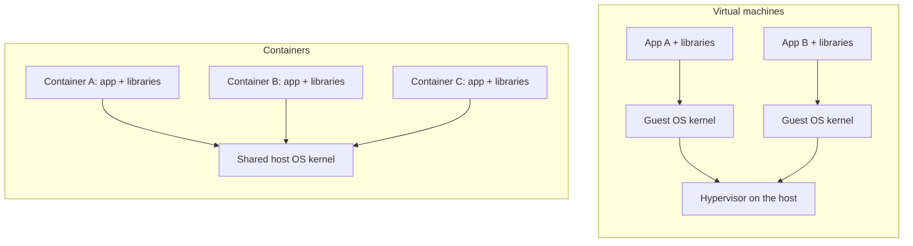
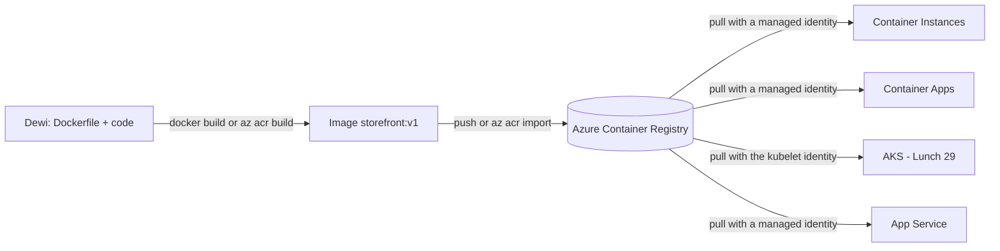
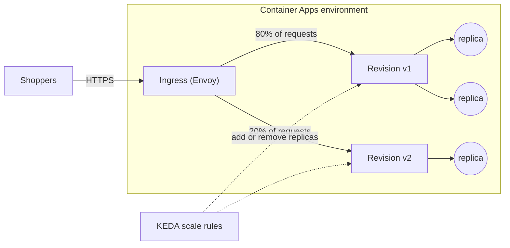

# Lunch 13 · Containers (Basic): Container Registry, Container Instances and Container Apps

🇮🇩 [Baca dalam Bahasa Indonesia](README.id.md)

> **Track:** Core month · **Level:** Basic · **Part 3:** Platform services and data
> **Time:** 60 minutes · **Prerequisite lunches:** 02, 10
> **AZ-900 skill area:** Describe Azure architecture and services
> **Lab:** [Lab 13 · Package the storefront](../../labs/13-containers-basic/README.md) — about 45 minutes · cost 💲
> **Author:** Stefanus Pinarta · [About the author](../../README.md#about-the-author)

| ⏱ Minutes | Segment |
|---:|---|
| 5 | Scenario and objectives |
| 25 | Reading |
| 15 | Demo: interactive animation (+ optional walkthrough video) |
| 5 | Knowledge check |
| 5 | Key takeaways and lab preview |
| 5 | Buffer — finish your lunch 🍜 |

## 🍱 Today's menu

By the end of this lunch you will be able to:

- Explain how a container differs from a virtual machine and why an image makes a deployment repeatable.
- Describe images, tags, digests and registries, and choose an Azure Container Registry tier and sign-in method.
- Explain how Azure Container Apps uses environments, revisions, ingress and scale rules, including scale to zero.
- Choose between Azure Container Instances, Azure Container Apps, Azure Kubernetes Service and App Service for a given container workload.

## 🏪 Meanwhile at Nusantara Retail

Dewi has rewritten the storefront's product pages, and on her laptop they fly. On the test server they crash: the
server has an older Python runtime and is missing an image library. "It works on my machine" has become the most
expensive sentence in the office. Pak Budi spends his evenings matching library versions by hand, and Rizky, the
contractor, wants to "just put everything in Kubernetes".

Ibu Sari has a different worry. During the Harbolnas 12.12 sale, traffic jumps tenfold for a few hours; at three in the
morning on a normal Tuesday almost nobody shops. She does not want to pay for sale-sized servers all year. There is also
a nightly job that imports supplier prices for ten minutes and then sits idle for the rest of the day.

Today you answer two questions. How do we package the storefront once so that it runs the same everywhere? And which
Azure service should run that package, so that we pay for shoppers rather than for idle servers?

---

## 📖 Reading (≈25 minutes)

### 1. Containers in one picture

A **container** is a running process that carries its own application code, runtime and libraries, kept apart from
every other process on the same machine. Unlike a virtual machine, a container does not bring its own operating system
kernel. All containers on a host share the host's kernel, and the kernel itself fences them off: each container sees
only its own files and processes and may use only the CPU and memory it was given.

That one design choice explains almost every difference you will meet. A VM boots a whole operating system, so it takes
minutes to start and its disk image is measured in gigabytes. A container starts a process, so it is ready in seconds,
and its package is often tens or hundreds of megabytes. Many more containers than VMs fit on the same hardware, which is
why cloud providers can rent you containers by the second.

The package you ship is a **container image**: a read-only, layered file system plus a little metadata, such as the
command to run and the default environment variables. You describe how to build it in a text file called a
**Dockerfile**. Each instruction adds a **layer**, and layers are cached and shared, so a code change usually rebuilds
and uploads only the thin top layer, not the runtime underneath.

```dockerfile
FROM python:3.12-slim                  # base layer: OS libraries and the Python runtime
WORKDIR /app
COPY requirements.txt .
RUN pip install -r requirements.txt    # dependency layer, rebuilt only when requirements change
COPY . .                               # your code: the layer that changes most often
EXPOSE 8080                            # documents the port; it does not open anything by itself
CMD ["gunicorn", "--bind", "0.0.0.0:8080", "app:app"]
```

A handy way to remember the difference: the image is a sealed meal kit with every ingredient measured; a **container**
is that kit cooked and served. Cook the same kit in a hundred kitchens and you get the same dish, which is exactly what
Dewi needs. Her laptop, the test environment and production all run the same image, so "works on my machine" turns into
"works in the image".



| | Virtual machine (Lunch 06) | Container |
|---|---|---|
| What is virtualized | The hardware; every VM runs its own OS kernel | The operating system; containers share the host kernel |
| Typical start time | Minutes | Seconds |
| Typical package size | Gigabytes | Megabytes to a few hundred megabytes |
| How you update | Patch the running guest OS and app in place | Build a new image and replace the container |
| Where state lives | Often on the VM's disks | Outside the container: a database, storage or a mounted volume |
| Good for | Lift-and-shift, full OS control, legacy software | APIs, web front ends, microservices, short jobs |

Two habits follow. First, treat containers as disposable: never "fix" a running container by hand, because the next
replacement will not have your fix. Change the image instead. Second, keep data outside the container, in Azure SQL,
Azure Cosmos DB or Azure Storage (Lunches 07, 11 and 12), so that losing a container never loses an order.

### 2. Images, tags and Azure Container Registry

A **registry** stores and serves images. Inside it, a **repository** holds the versions of one image (for example
`storefront`), and each version carries one or more **tags** such as `v1` or `2026.10.23`. Every image also has a
**digest**, a SHA-256 hash of its content. A tag is a movable label; a digest never changes. A full image reference
reads like an address: `acrnusa12345.azurecr.io/storefront:v1` means login server, repository and tag.

Public registries hold images that anyone can pull: Docker Hub, GitHub Container Registry and Microsoft Artifact
Registry (`mcr.microsoft.com`), where Microsoft publishes its own images, including the sample web app you will use in
the lab. Your own images belong in a private registry. **Azure Container Registry (ACR)** is Azure's managed private
registry: it lives in your subscription and your region, close to the services that pull from it, and it stores
container images, Helm charts and other OCI artifacts behind Microsoft Entra ID sign-in.

| Tier | Included storage | What stands out | Use it when |
|---|---|---|---|
| Basic | 10 GiB | Same APIs and Entra ID sign-in as the other tiers; lowest throughput | Learning, labs, small teams |
| Standard | 100 GiB | More storage and throughput, anonymous pull, artifact cache rules | Most production workloads |
| Premium | 500 GiB | Geo-replication, private endpoints, customer-managed keys, network rules, connected registries | Several regions, private networks, regulated data |

All three tiers are zone redundant by default in regions with availability zones, and you can change tier later
without downtime (moving down from Premium means removing Premium-only features first). Storage beyond the included
amount is charged per GiB, so delete old tags you no longer need.

There are three ways to get an image into ACR:

- **Push** an image you built locally with Docker: `az acr login`, then `docker push`.
- **Import** an image from another registry with `az acr import`. The copy happens inside Azure, so you need no Docker
  at all. This is what the lab does.
- **Build in the cloud** with **ACR Tasks**: `az acr build` uploads your source folder and builds the image in Azure.
  Tasks can also rebuild automatically when you commit to Git or when a base image gets a security patch.

> [!IMPORTANT]
> At the time of writing (October 2026), ACR Tasks runs are paused for subscriptions that use Azure free credits; a
> build fails with `TasksOperationsNotAllowed`. That is why the lab imports a public image and keeps the cloud build
> as an optional extra. Check the ACR Tasks documentation for the current status.

Who may pull? People sign in with Entra ID (`az acr login`). Azure services should use a **managed identity** that holds
the **AcrPull** role on the registry, so no password exists anywhere. ACR also has an **admin user**, a single shared
username and password; it is off by default and should stay off outside quick experiments. A newer
role-assignment mode, "RBAC Registry + ABAC Repository Permissions", lets you scope access to individual repositories.
Microsoft says it will become the default; in that mode the legacy AcrPull role is ignored and you assign Container
Registry Repository Reader instead.



A word about the `latest` tag: it is only a default name, not a promise that the image is the newest. Deploy explicit
tags such as `v1` or a date, so you always know what is running and can roll back to the previous tag in seconds.

### 3. Azure Container Instances: one container, right now

**Azure Container Instances (ACI)** is the shortest path from an image to a running container. You name the image, the
CPU cores and memory, the ports and, optionally, a **DNS name label**. Seconds later the container answers at
`label.region.azurecontainer.io`. You never see a VM or a cluster, and you pay per second for the CPU and memory
allocated while it runs.

The unit you deploy is a **container group**: one or more containers on the same host that share a network, storage
volumes and a lifecycle, much like a pod in Kubernetes. Multi-container groups are available for Linux containers; a
typical pair is an app plus a small log-shipping helper. Each group is isolated at the hypervisor level, so a neighbour
on the same hardware cannot see into it.

A **restart policy** tells ACI what to do when the process ends. `Always`, the default, suits web servers. `OnFailure`
retries only after errors. `Never` suits run-to-completion work, such as Nusantara Retail's nightly price import: the
job runs for ten minutes, exits, and the meter stops.

Day-to-day operations stay small too. `az container logs` shows what the process printed, `az container attach` streams
that output live, and `az container exec` opens a shell inside a running container when you need to look around. You
pass settings as environment variables, mark sensitive ones as secure so they are hidden from the resource's
properties, and mount an Azure Files share when the container needs files that outlive it. Two limits catch people
out: ACI runs x64 (AMD64) images only, so an image built only for ARM on a laptop will not start, and a very large
image slows every start because it must be pulled first.

ACI is deliberately simple, and that simplicity is also its limit. It does not autoscale, it does not load-balance
across copies, and it has no revisions or managed certificates; to run five copies you create five container groups.
A group's public IP address can change after a restart, so always use the DNS name. To pull from a private ACR, ACI
needs a user-assigned managed identity with AcrPull; it cannot use a system-assigned identity for image pulls.

Newer options build on the same engine: **Spot containers** run interruptible work at a discount, **confidential
containers** protect data while it is in memory, **NGroups** keep a set of related container groups running with
rolling upgrades across zones, and **virtual nodes** let an AKS cluster burst pods into ACI. For Nusantara Retail, ACI
fits the price import, a quick test of a vendor's image, or a short-lived build agent.

### 4. Azure Container Apps: serverless apps that scale to zero

**Azure Container Apps** runs web apps, APIs, background workers and jobs from container images on a serverless
platform. Under the hood it uses Kubernetes and open-source projects (KEDA for event-driven scaling, Envoy for ingress
and Dapr for microservice building blocks), but it never asks you to manage, upgrade or even see the Kubernetes API.

Four building blocks matter:

- An **environment** is a secure boundary around a group of apps. Apps in one environment share a virtual network and
  a Log Analytics workspace and can call each other by name. The default type is a **workload profiles environment**,
  which offers the serverless **Consumption** profile plus optional **Dedicated** profiles with reserved hardware.
- A **container app** is your application. Its configuration (ingress, secrets, registry sign-in, revision mode)
  applies to the whole app.
- A **revision** is an immutable snapshot of the app's template: image, environment variables, CPU and memory, and scale
  rules. Changing anything in the template creates a new revision; changing ingress, secrets or the traffic split does
  not.
- A **replica** is one running copy of a revision. Replicas come and go as load changes.

**Ingress** publishes the app. External ingress gives it a public HTTPS address on `azurecontainerapps.io`, with the
certificate handled for you; internal ingress keeps it reachable only inside the environment or your virtual network.
You also declare the **target port**: the port your process listens on inside the container.

> [!WARNING]
> The most common first-deployment mistake is a wrong target port. If the image listens on 80 and you set 8080, the
> platform cannot reach your app: the revision never becomes healthy and every request fails. `EXPOSE` in a Dockerfile
> is documentation only, so check the image's documentation and set the target port to match.

Each revision scales between a minimum and a maximum number of replicas, by default 0 and 10 (at the time of writing
you can configure up to 1,000). **Scale rules** decide when to add replicas: an **HTTP rule** watches concurrent
requests per replica (10 by default), a TCP rule watches connections, and a custom rule can use any KEDA scaler, such as
Service Bus queue length. The arithmetic is simple: 45 concurrent requests with a target of 10 gives
ceil(45 ÷ 10) = 5 replicas, capped at your maximum.

With a minimum of zero, a quiet app scales to zero after a cool-down (300 seconds by default) and costs nothing for
compute while it sleeps. The trade-off is a **cold start**: the first request after a quiet spell waits a few seconds
while a replica starts. Production apps that must answer instantly set a minimum of one or two; replicas that sit idle
at that minimum are billed at a reduced idle rate.



The **revision mode** controls releases. In **single** mode (the default) a new revision takes over once it is ready,
which gives zero-downtime updates. In **multiple** mode several revisions stay active and you split traffic by
percentage, for example 80% on the proven v1 and 20% on the new v2 (a canary release), then move to 100% when you are
confident. A labels mode, in preview at the time of writing, adds named labels such as `staging`.

Two more features are worth knowing by name. **Dapr** is an optional sidecar that gives your code standard APIs for
service-to-service calls, publish and subscribe messaging and state, so the code is not tied to one message broker.
**Jobs** run containers to completion on demand, on a schedule or when events arrive, which makes them a second option
for the nightly price import.

On the Consumption plan you pay per second for the vCPU and memory your replicas use, plus a small charge per million
requests. Each subscription gets a monthly free grant (at the time of writing, 180,000 vCPU-seconds, 360,000 GiB-seconds
and 2 million requests), which is why the lab costs next to nothing.

### 5. Choosing where your container runs

The same image can run on four different Azure services. The difference is how much platform you get, and how much
platform you have to look after.

| | Container Instances | Container Apps | Azure Kubernetes Service | App Service (Web App for Containers) |
|---|---|---|---|---|
| Mental model | One container group, on demand | Serverless apps and jobs | Your own managed Kubernetes cluster | Managed web hosting that runs your image |
| You look after | Each container group | Apps, revisions and scale rules | Nodes, upgrades, add-ons and Kubernetes objects (less with AKS Automatic) | The App Service plan and app settings |
| Scaling | None built in; create more groups | Automatic by HTTP, TCP or events, down to zero | Pod and node autoscalers you configure | Manual or autoscale of the plan; no scale to zero |
| You pay for | Per second of vCPU and memory | Per second of use plus requests (free grant), or Dedicated profiles | The node VMs, plus a fee on the Standard and Premium tiers | Plan instances, whether busy or idle |
| Kubernetes API | No | No | Yes | No |
| Best for | Jobs, quick tests, build agents, burst capacity | Microservices, APIs, event-driven workers, apps that idle | Platform teams, Helm charts and operators, fine-grained control | Classic web apps that want deployment slots and built-in sign-in |

Read the table from left to right as "more control, more responsibility". Start with the simplest service that meets
the requirement. For most of Nusantara Retail's new container workloads, that is Container Apps.

Move to **AKS** (Lunch 29) when you need the Kubernetes API itself: a vendor ships its software as a Helm chart with
custom operators, you need agents on every node (DaemonSets), you want precise control over node hardware or a service
mesh, or a platform team will run many applications for many teams on one shared cluster. Choose **App Service** (Lunch
10) when the app is a classic website and you value deployment slots, built-in authentication and custom domains more
than container-level control; the container is then simply your packaging format. Event-driven functions can also run
in containers, which Lunch 14 covers.

### 6. How it fits together for Nusantara Retail

Here is the plan you take back to Ibu Sari:

- **One registry.** An ACR named `acrnusa…` holds every image. The labs use Basic; production starts on Standard and
  moves to Premium only if the team needs private endpoints or a second region. Images get explicit version tags,
  services pull with managed identities, and the admin user stays off.
- **The storefront on Container Apps.** External ingress on the right target port, an HTTP scale rule and a maximum
  sized for the 12.12 sale. The test environment keeps a minimum of zero to save money; production keeps a minimum of
  one or two, accepting a small idle charge so that the first shopper of the morning never waits.
- **Safer releases.** Multiple revision mode lets Dewi send 20% of shoppers to a new version, watch the error rate, and
  then move to 100%, or back to 0% in seconds.
- **The nightly price import.** A scheduled Container Apps job, or ACI with the `Never` restart policy. Either way it
  bills for ten minutes, not twenty-four hours.
- **Data stays outside.** Orders stay in Azure SQL and the catalogue in Cosmos DB; secrets move to Key Vault in
  Lunch 15. Containers can be replaced at any moment without losing anything.

Data residency still applies. Production would run in Indonesia Central (Jakarta), while the labs use Southeast Asia for
the broadest service availability. Before you commit, check that each service and feature you need is offered in your
chosen region.

> [!NOTE]
> **Pause and think:** the storefront app has a minimum of zero replicas. At 07:00 a push notification brings
> 2,000 shoppers in one minute. What happens to the first few requests, which single setting would you change for
> production, and what does that change cost?

➡️ **Going deeper:** [Lunch 29 · Containers (Advanced): Azure Kubernetes Service](../29-containers-advanced-aks/README.md)
takes the same images onto a full Kubernetes cluster.

---

## 🎬 Demo (≈15 minutes)

1. **Interactive animation (≈6–8 min):** [Open the demo](https://stefpin.github.io/azure-fundamentals-lunches/demos/13-containers-basic.html) —
   press ▶ Play or step through it at your own pace. Offline? Download
   [`docs/demos/13-containers-basic.html`](../../docs/demos/13-containers-basic.html) and open it in any browser.
2. **Walkthrough video (≤ 6 min):** _coming soon_ — [read the walkthrough script](demo-video-script.md).

What to watch for:

- The same image travels from Dewi's laptop to the registry and on to two different services without changing.
- The replica counter goes 0 → 1 → 5 → 0 as shoppers arrive and leave, and the first request pays the cold start.
- The 80/20 split needs two active revisions, while a wrong target port breaks every revision at once.

## ✅ Knowledge check (≈5 minutes)

1. A vendor's price-import container runs for about ten minutes every night and then exits. Which service is the
   simplest fit, and which setting makes it stop billing when the work is done?
   <details><summary>Show answer</summary>

   Azure Container Instances with the restart policy `Never` (a scheduled Container Apps job also works). ACI bills per
   second while the container group runs, so a ten-minute job costs ten minutes.

   </details>
2. You deploy a container app with target port 80, but the image's web server listens on port 8080. What do you see,
   and how do you fix it?
   <details><summary>Show answer</summary>

   The revision never becomes healthy and requests fail, because ingress forwards to a port where nothing listens. Set
   the ingress target port to 8080; the target port must match the port the process listens on.

   </details>
3. Ibu Sari asks what the storefront container app costs at 03:00 when nobody is shopping. Its minimum is zero replicas.
   What do you tell her?
   <details><summary>Show answer</summary>

   With no requests the revision scales to zero replicas, and on the Consumption plan zero replicas incur no compute
   charges. The trade-off is a cold start of a few seconds for the first shopper after the quiet spell.

   </details>
4. Nusantara Retail wants its registry reachable only through a private endpoint and replicated to a second region.
   Which ACR tier does it need?
   <details><summary>Show answer</summary>

   Premium. Private endpoints and geo-replication are Premium-only features; Basic and Standard offer neither.

   </details>
5. Dewi switches the storefront to multiple revision mode and deploys v2. A minute later every shopper sees v2, not 20%
   of them. Why, and what should she do next time?
   <details><summary>Show answer</summary>

   The traffic rule still sent 100% to the latest revision, and v2 became the latest. Pin 100% of traffic to v1 before
   deploying v2, test v2 on its own revision URL, then set the 80/20 split.

   </details>

## 🧠 Key takeaways

- A container image packages the app and its dependencies in immutable layers; build once, run the same image
  everywhere, and deploy explicit tags rather than `latest`.
- Azure Container Registry is your private registry: Basic for learning, Standard for most production, Premium for
  geo-replication and private endpoints. Services pull with managed identities, and the admin user stays off.
- Azure Container Instances runs a container group in seconds with per-second billing, but with no autoscaling or load
  balancing; it is ideal for jobs and quick tests.
- Azure Container Apps adds environments, immutable revisions, HTTPS ingress, scale rules down to zero and traffic
  splitting, with no Kubernetes to manage. Get the target port right.
- Pick the least platform that meets the need: Container Instances, then Container Apps, then AKS for the full
  Kubernetes API; App Service when it is simply a website.

## 🗒️ Field notes from Stefanus

> **Fix the recipe, not the dish.** My rule for containers is simple: whatever I learn by opening a shell inside a
> running container goes back into the Dockerfile the same day. The shell is for looking around, never for repairs,
> because the next replica starts from the image and forgets every manual change. In design reviews I ask one question
> about each container: what do we lose if it disappears right now? Any answer other than "nothing" means something
> lives in the wrong place, such as uploaded photos in a local folder, shopping carts held in memory or logs that never
> leave the container. And I read the Dockerfile as carefully as the code: a password copied into an early layer stays
> readable to anyone who can pull the image, even if a later instruction deletes the file.

## 🔬 Your lab: Package the storefront

You will create a private registry and import a sample web image into it, run that image in seconds on Container
Instances, and then deploy it to Container Apps, pulling from your registry with a managed identity rather than a
password. You will push enough traffic to watch replicas scale from zero to five and back, release a second revision to
20% of requests, and fix a broken target port. It is everything Nusantara Retail needs to stop saying "works on my
machine".

- ⏱ About 45 minutes · 💲 · works on its own (no earlier lab needed)
- 👉 [Start Lab 13](../../labs/13-containers-basic/README.md)

## 📚 Go further

- [Microsoft Learn: Comparing Container Apps with other Azure container options](https://learn.microsoft.com/azure/container-apps/compare-options) — Microsoft's own guidance on when to pick each service.
- [Microsoft Learn: Set scaling rules in Azure Container Apps](https://learn.microsoft.com/azure/container-apps/scale-app) — every rule type, the defaults and how scaling decisions are made.
- [Microsoft Learn: Azure Container Registry SKU features and limits](https://learn.microsoft.com/azure/container-registry/container-registry-skus) — the current tier table, limits and how to change tier.
- [Microsoft Learn: What is Azure Container Instances?](https://learn.microsoft.com/azure/container-instances/container-instances-overview) — container groups, Spot and confidential containers, NGroups and virtual nodes.

---

⬅️ [Lunch 12 · NoSQL with Azure Cosmos DB](../12-cosmos-db/README.md) · 🏠 [Course home](../../README.md) · [Lunch 14 · Serverless: Azure Functions, Logic Apps and Event Grid](../14-serverless/README.md) ➡️

<sub>Last validated: October 2026 · Spotted something out of date? [Open an issue](../../CONTRIBUTING.md).</sub>
