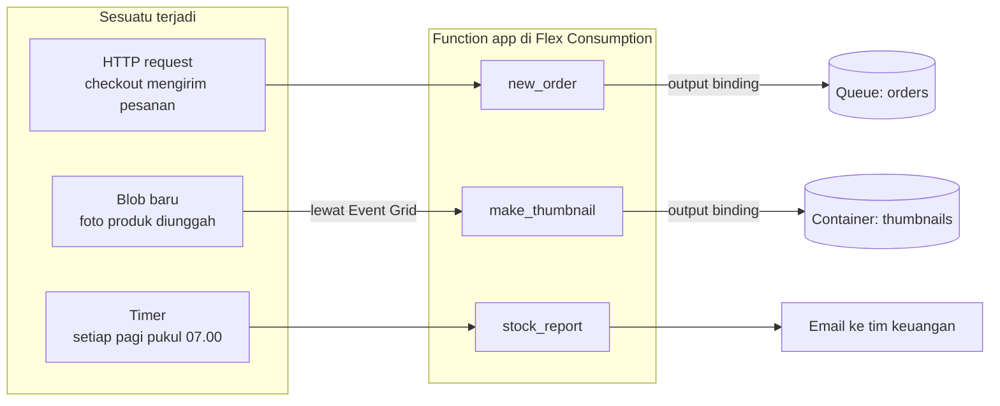
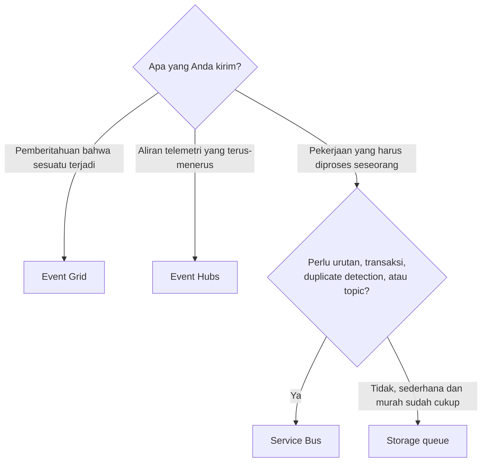

# Makan Siang 14 · Serverless: Azure Functions, Logic Apps, dan Event Grid

🇬🇧 [Read in English](README.md)

> **Jalur:** Bulan inti · **Level:** Dasar · **Bagian 3:** Layanan platform dan data
> **Waktu:** 60 menit · **Makan siang prasyarat:** 02, 07, 10 (13 akan membantu)
> **Area keterampilan AZ-900:** Menjelaskan arsitektur dan layanan Azure
> **Lab:** [Lab 14 · Menanggapi pesanan baru secara otomatis](../../labs/14-serverless/README.id.md) — sekitar 50 menit · biaya 💲
> **Penulis:** Stefanus Pinarta · [Tentang penulis](../../README.id.md#tentang-penulis)

| ⏱ Menit | Segmen |
|---:|---|
| 5 | Skenario dan tujuan |
| 25 | Bacaan |
| 15 | Demo: animasi interaktif (+ video panduan opsional) |
| 5 | Uji pemahaman |
| 5 | Poin penting dan pratinjau lab |
| 5 | Waktu cadangan — habiskan makan siang Anda 🍜 |

## 🍱 Menu hari ini

Setelah makan siang ini, Anda akan mampu:

- **Menjelaskan** arti serverless, apa yang Anda peroleh, dan kompromi apa saja (cold start, batas waktu, kode
  stateless) yang Anda terima.
- **Menguraikan** cara Azure Functions memakai trigger dan binding, serta **memilih** hosting plan: Flex Consumption,
  Premium, Dedicated, atau Container Apps.
- **Memilih** antara Event Grid, Service Bus, Event Hubs, dan Storage queues untuk sebuah event atau pesan.
- **Memutuskan** kapan sebuah pekerjaan cocok dibuat sebagai workflow Logic Apps dan kapan sebagai function
  (*fungsi*).

## 🏪 Sementara itu di Nusantara Retail

Toko online kini berjalan di App Service, dan Harbolnas sudah di depan mata. Dewi sedang membaca catatan insiden tahun
lalu. Ketika pembeli mengklik *Bayar*, toko online mengerjakan semuanya di dalam satu request itu: menyimpan pesanan,
mengirim email ke gudang, menambahkan poin loyalitas, dan memesan kurir. Pada 12.12 tahun lalu, API milik perusahaan
kurir melambat, sehingga setiap checkout ikut melambat, dan sebagian pembeli akhirnya menyerah.

Tim marketing punya sakit kepala yang lebih kecil. Setiap malam mereka mengunggah ratusan foto produk baru, dan sebuah
VM kecil mengubah ukurannya menjadi thumbnail. VM itu bekerja sekitar dua puluh menit sehari dan menganggur sepanjang
sisa waktunya, dengan tagihan yang terus berjalan selama dua puluh empat jam penuh. Sementara itu, tim keuangan ingin
menerima laporan stok di inbox mereka setiap pagi, dan tidak ada yang sempat menulis satu skrip lagi untuk itu.

Pertanyaan hari ini: **bagaimana kita menanggapi hal-hal yang terjadi — pesanan baru, foto baru, jam tujuh pagi — tanpa
server yang menunggu-nunggu dan tanpa membuat pelanggan menunggu?**

---

## 📖 Bacaan (≈25 menit)

### 1. Arti serverless yang sebenarnya

**Serverless** tidak berarti servernya tidak ada. Artinya, server tidak pernah menjadi urusan Anda: Anda tidak
memilihnya, tidak menentukan ukurannya, tidak menambalnya (patch), dan tidak menjaganya tetap menyala. Anda menyerahkan
sepotong kode atau sebuah workflow (alur kerja) kepada platform dan menyebutkan kapan ia harus berjalan; platform
mencarikan daya komputasi (compute), menjalankannya, lalu melepasnya lagi. Ada tiga ciri yang mendefinisikannya:

- **Berbasis event (event-driven).** Kode berjalan karena sesuatu terjadi: sebuah HTTP request, timer, file baru, atau
  pesan di dalam queue (antrean).
- **Skala otomatis, hingga nol.** Satu event mendapat satu instance; seribu event mendapat lebih banyak; tanpa event,
  tidak ada instance sama sekali.
- **Bayar per eksekusi.** Pada plan bergaya consumption (*model berbasis penggunaan*), Anda membayar eksekusi dan waktu
  komputasi yang dipakainya, bukan jam-jam menganggur.

Ibaratnya ojek online. Anda tidak perlu membeli motor, mengganti oli, atau membayar parkir bulanan; Anda cukup memesan
saat butuh, seorang pengemudi datang, dan Anda membayar per perjalanan. Tidak ada perjalanan, tidak ada biaya. Saat jam
sibuk, aplikasi mendatangkan lebih banyak pengemudi; sesekali Anda perlu menunggu sebentar sampai pengemudi tiba, dan
itulah gambaran cold start yang akan kita bahas sebentar lagi.

Pada penggeser model tanggung jawab bersama dari Makan Siang 02, serverless berada lebih jauh ke kanan daripada App
Service: dengan web app (*aplikasi web*), Anda masih memilih plan dan jumlah instance; dengan function serverless,
umumnya tidak.

Komprominya nyata, dan sebaiknya Anda mengenalnya sebelum 12.12. Function yang sudah menyusut ke nol butuh sejenak untuk
menyala ketika event berikutnya tiba; jeda itu disebut **cold start**. Eksekusi punya batas waktu, dan function yang
dipicu HTTP harus menjawab dalam 230 detik, berapa pun timeout yang diizinkan plan-nya. Instance datang dan pergi, jadi
kode harus **stateless**, yaitu tidak menyimpan status di dalam dirinya: apa pun yang perlu disimpan masuk ke
penyimpanan, queue, atau database. Dan bayar per eksekusi memang murah untuk pekerjaan yang datang dalam lonjakan, tetapi
bisa lebih mahal daripada plan tetap untuk trafik yang tidak pernah berhenti.

Jadi serverless bukan jawaban untuk segalanya. Toko online itu sendiri, yang sibuk sepanjang hari dengan trafik stabil
dan sesi pengguna yang panjang, lebih nyaman di App Service (Makan Siang 10). Job transcoding video yang membuat CPU
sibuk selama satu jam lebih cocok di container (*kontainer*) atau VM (*komputer virtual*). Serverless bersinar untuk
pekerjaan kecil, datang dalam lonjakan, dan berbentuk event, yang jumlahnya puluhan di setiap toko: memvalidasi
pesanan, mengubah ukuran foto, mengirim struk, merapikan file lama di malam hari.



### 2. Azure Functions: trigger, binding, dan kode Anda

**Azure Functions** menjalankan potongan-potongan kecil kode, yang disebut *function*, sebagai tanggapan atas event.
Setiap function punya tepat satu **trigger** (pemicu), yaitu event yang memulainya, dan **binding** dalam jumlah berapa
pun, yaitu sambungan deklaratif ke data. Deklaratif berarti Anda cukup menyatakan apa yang Anda butuhkan, bukan menulis
cara mengambilnya. *Input binding* menyerahkan data kepada kode Anda saat mulai berjalan, misalnya sebuah dokumen dari
Cosmos DB. *Output binding* mengambil sebuah nilai dari kode Anda dan menuliskannya ke suatu tempat, misalnya pesan
queue atau sebuah blob. Binding menghilangkan kode boilerplate (kode rutin yang selalu sama): tidak perlu membuat client
library, tidak perlu mengurus koneksi, dan tidak perlu menulis loop retry untuk kasus-kasus sederhana.

Ibaratnya dapur warung makan. Trigger adalah nota pesanan yang masuk ke dapur; tanpa nota, koki tidak memasak. Binding
adalah pelayan: ia mengantarkan bahan ke meja koki (input) dan membawa piring yang sudah jadi ke meja pelanggan
(output). Koki, yaitu kode Anda, cukup fokus memasak.

Trigger yang umum antara lain **HTTP**, **timer** (dengan jadwal CRON, format penulisan jadwal yang berasal dari
Unix), **Blob storage**, **Queue storage**, **Service Bus**, **Event Hubs**, **Event Grid**, dan change feed
**Cosmos DB**. Berikut inti function yang Anda deploy di lab hari ini, dalam model pemrograman Python v2, tempat
decorator (baris yang diawali `@`) menyatakan trigger dan binding-nya:

```python
@app.route(route="orders", methods=["POST"])                                         # trigger: HTTP POST /api/orders
@app.queue_output(arg_name="msg", queue_name="orders", connection="OrdersStorage")  # output binding
def new_order(req: func.HttpRequest, msg: func.Out[str]) -> func.HttpResponse:
    order = req.get_json()
    msg.set(json.dumps(order))            # the Functions host writes the queue message
    return func.HttpResponse("queued", status_code=200)
```

Nilai `connection` bukanlah connection string, yaitu teks yang berisi alamat sekaligus kunci rahasia. Nilai itu adalah
*nama* sebuah koneksi yang dicari platform di pengaturan aplikasi, dan koneksi terbaik sama sekali tidak menyimpan
secret: pengaturan seperti `OrdersStorage__queueServiceUri` memberi tahu host untuk memakai **managed identity** milik
aplikasi, dan sebuah role assignment menentukan apa saja yang boleh dilakukan identitas itu.

Trigger berbeda-beda dalam cara event-nya tiba. Sebagian **di-push** (didorong): HTTP request atau event Event Grid
dikirimkan ke function Anda begitu hal itu terjadi. Sebagian lagi **di-pull** (ditarik): trigger Queue storage memeriksa
(polling) queue secara berkala, dan makin jarang memeriksa selama queue-nya kosong. Di Flex Consumption, trigger Blob
storage memakai Event Grid sebagai sumbernya, sehingga file baru tiba sebagai event yang di-push, bukan ditemukan
dengan memindai isi container.

Function HTTP juga punya **authorization level** (tingkat otorisasi). *Anonymous* membolehkan siapa saja memanggil;
*function* mewajibkan **function key**, yaitu secret bersama yang dikirim di header `x-functions-key` atau di parameter
query `code`; *admin* mewajibkan master key. Key sudah memadai untuk satu layanan yang memanggil layanan lain, seperti
di lab hari ini. API publik layak mendapat perlindungan lebih: sign-in dengan Microsoft Entra ID (*ID Microsoft Entra*)
melalui autentikasi bawaan yang sudah Anda kenal di Makan Siang 10, atau Azure API Management di depannya.

Function dikelompokkan ke dalam sebuah **function app**, unit yang Anda deploy, konfigurasi, dan skalakan. Semua
function dalam satu function app berbagi pengaturan, hosting plan, dan versi runtime-nya. Setiap function app juga
memerlukan sebuah **storage account** (*akun penyimpanan*) untuk pembukuannya sendiri: key, checkpoint trigger, dan,
pada plan terbaru, paket deployment itu sendiri.

Anda bisa menulis function dalam **C#**, **JavaScript dan TypeScript**, **Python**, **Java**, dan **PowerShell**, dan
*custom handler* memungkinkan bahasa lain ikut bergabung. Untuk C#, gunakan *isolated worker model*: dukungan untuk
in-process model yang lebih lama berakhir pada 10 November 2026. Developer menjalankan host Functions yang sama di
laptop mereka dengan Azure Functions Core Tools (`func start`) atau VS Code; pengaturan lokal disimpan di file
`local.settings.json` yang tidak pernah di-deploy dan tidak pernah boleh masuk ke Git.

Ketika sebuah pekerjaan terdiri atas beberapa langkah yang harus tetap utuh meski terjadi restart, misalnya *pesan
stok, tagih kartu, pesan kurir, tunggu konfirmasi gudang*, lihatlah **Durable Functions**. Sebuah *orchestrator
function* menjabarkan langkah-langkah itu dalam kode biasa, dan platform menyimpan kemajuannya setelah setiap langkah.
Pola seperti chaining (merangkai langkah berurutan), fan-out dan fan-in (memecah pekerjaan menjadi banyak tugas paralel
lalu mengumpulkan hasilnya), serta menunggu persetujuan manusia cukup ditulis dalam beberapa baris, bukan dengan state
machine buatan sendiri.

### 3. Hosting plan: tempat function Anda berjalan

Kodenya sama di mana pun; **hosting plan**-lah yang menentukan cara penskalaannya, biayanya, dan cara ia terhubung ke
jaringan:

| Plan | Skala dan batasan | Cold start | Jaringan | Yang Anda bayar | Pilih saat |
|---|---|---|---|---|---|
| **Flex Consumption** | Berbasis event, per kelompok function, hingga 1.000 instance; hanya Linux | Berkurang; always-ready instance opsional menghilangkannya | Integrasi virtual network (*jaringan virtual*), private endpoint (*titik akhir privat*) | Waktu eksekusi × memori instance, ditambah jumlah eksekusi (dengan jatah gratis bulanan), ditambah always-ready instance bila ada | Default untuk aplikasi serverless baru |
| **Premium** | Berbasis event dengan worker yang sudah dipanaskan (prewarmed); minimal satu instance selalu menyala | Tidak ada untuk instance yang sudah hangat | Integrasi virtual network, private endpoint | Core dan memori dari instance yang berjalan | Trafik stabil, sama sekali tanpa cold start, container Linux kustom |
| **Dedicated** (App Service plan) | Manual atau autoscale, seperti web app | Tidak ada dengan Always On | Sama seperti App Service | Instance plan, seperti di Makan Siang 10 | Anda sudah membayar plan yang kapasitasnya masih tersisa, atau butuh tagihan tetap |
| **Container Apps** | Replica berbasis event, bisa menyusut ke nol | Saat sudah menyusut ke nol | Environment Container Apps | Harga Container Apps | Function berdampingan dengan container lain, image kustom, GPU |
| **Consumption** (legacy) | Berbasis event; Windows saat ini, versi Linux akan dipensiunkan | Ya | Tanpa integrasi virtual network | Eksekusi dan waktu komputasi | Hanya untuk aplikasi Windows yang sudah ada |

**Flex Consumption** adalah plan yang direkomendasikan Microsoft untuk aplikasi serverless baru. Plan ini berjalan di
Linux dan memungkinkan Anda memilih memori instance (512 MB, 2.048 MB, atau 4.096 MB) serta **maximum instance count**,
yaitu batas atas jumlah instance, yang melindungi anggaran (budget) Anda sekaligus sistem apa pun yang menjadi tujuan
tulisan function tersebut. Plan ini menyusut ke nol saat menganggur. Untuk function HTTP yang peka terhadap latensi, Anda bisa menjaga
satu atau beberapa **always-ready instance** tetap hangat, dengan biaya dasar. Dua batasan yang perlu diketahui: satu
function app per Flex Consumption plan, dan tidak ada deployment slot.

Bagaimana bayar per eksekusi dihitung? Tagihan menghitung memori setiap instance dikalikan dengan waktu yang dipakainya
untuk menjalankan kode Anda, dalam satuan **GB-detik** (GB-seconds), ditambah jumlah eksekusi; setiap eksekusi dihitung
minimal satu detik. Misalkan function thumbnail berjalan 300 kali semalam, satu per satu, masing-masing dua detik di
instance 2.048 MB: hasilnya 300 × 2 detik × 2 GB = 1.200 GB-detik dan 300 eksekusi, dan sama sekali nol untuk 23 jam
sisanya. Masukkan angka Anda sendiri ke pricing calculator (*kalkulator harga*); jatah gratis bulanan sering kali
menutup seluruh biaya beban kerja kecil.

Cold start perlu direncanakan, bukan ditanggapi dengan panik. Jaga paket deployment tetap kecil, impor library berat
hanya di tempat yang benar-benar membutuhkannya, dan ukur latensi request pertama setelah masa sepi. Kalau hal itu
penting, misalnya untuk checkout, tambahkan always-ready instance di Flex Consumption atau pindahkan function tersebut ke
Premium. Untuk job foto malam hari, satu detik waktu start sama sekali tidak menjadi masalah.

Plan **Consumption** yang lebih lama kini disebut legacy (warisan). Hosting di Linux pada plan Consumption akan
dipensiunkan pada 30 September 2028 dan tidak lagi menerima versi bahasa baru, jadi aplikasi Python baru sebaiknya
dimulai di Flex Consumption. Premium cocok untuk aplikasi yang sibuk hampir sepanjang hari dan sama sekali tidak bisa
menoleransi cold start. Dedicated masuk akal bila Anda sudah membayar App Service plan yang kapasitasnya masih tersisa.

> [!WARNING]
> Serverless bukan berarti tanpa biaya. Function yang menulis ke queue yang sama dengan yang memicunya, atau function
> HTTP publik yang dibombardir bot, bisa terus menambah instance dan membengkakkan tagihan dalam hitungan jam. Tetapkan
> maximum instance count, wajibkan key atau sign-in pada function HTTP, dan biarkan alert anggaran dari Lab 01 tetap
> menyala.

### 4. Logic Apps: workflow dari balok-balok penyusun

Tidak semua otomatisasi memerlukan kode. **Azure Logic Apps** menyusun **workflow** dari balok-balok penyusun di sebuah
designer visual, di portal atau di VS Code. Setiap workflow dimulai dengan tepat satu **trigger** (jadwal, HTTP request,
email baru, file baru) yang diikuti oleh **action** (tindakan): memanggil API, menerapkan kondisi, mengulang untuk
setiap item, mengirim email, mengirim posting ke Teams, menulis baris ke database. Di balik designer, setiap workflow
adalah sebuah definisi JSON, jadi Anda bisa menyimpannya di Git.

Kekuatan supernya adalah **connector** (konektor), jumlahnya lebih dari 1.400 saat tulisan ini dibuat. Connector
*built-in* berjalan di dalam runtime Logic Apps: jadwal, panggilan HTTP, kondisi, loop, dan kode inline. Connector
*managed* adalah proxy yang dijalankan Microsoft untuk layanan seperti Office 365 Outlook, Teams, SharePoint,
Salesforce, SAP, dan server SFTP; Anda cukup sign-in sekali, lalu workflow memakai koneksi tersimpan itu. Setiap
eksekusi (run) dicatat di **run history**, lengkap dengan input, output, dan durasi setiap langkah, sehingga Anda bisa
melihat persis di mana sebuah run gagal lalu mengirimkannya ulang (resubmit). Error juga menjadi bagian dari desain:
setiap action punya **retry policy** untuk kegagalan sementara, dan pengaturan *run after* membuat sebuah langkah hanya
berjalan ketika langkah sebelumnya gagal atau kehabisan waktu, misalnya untuk mengirim email ke engineer yang sedang
piket, alih-alih gagal diam-diam.

Logic Apps hadir dalam dua jenis resource:

| | Consumption | Standard |
|---|---|---|
| **Berjalan di** | Azure Logic Apps multitenant, dipakai bersama pelanggan lain | Runtime single-tenant di Workflow Service Plan, App Service Environment v3, atau infrastruktur Anda sendiri |
| **Workflow per resource** | Satu | Banyak, stateful dan stateless |
| **Penagihan** | Per eksekusi trigger dan action | Hosting plan, ditambah transaksi storage untuk workflow stateful |
| **Jaringan** | Jaringan multitenant bersama | Integrasi virtual network dan private endpoint |
| **Cocok untuk** | Memulai, volume rendah atau yang sesekali melonjak | Volume lebih tinggi, jaringan privat, pengembangan lokal |

Bagaimana memilih antara Logic Apps dan Functions? Keduanya serverless, dan keduanya bekerja sama dengan baik:

| | Azure Functions | Azure Logic Apps |
|---|---|---|
| **Gaya** | Kode lebih dulu: C#, Python, JavaScript, dan lainnya | Designer lebih dulu, low code; JSON di balik layar |
| **Paling kuat untuk** | Logika kustom, pemrosesan data, penanganan event bervolume tinggi | Mengorkestrasi langkah-langkah lintas banyak sistem dengan connector |
| **Cara terhubung** | Trigger dan binding untuk layanan Azure, SDK untuk sisanya | 1.400+ connector, termasuk Office 365, SAP, Salesforce, dan SFTP |
| **State jangka panjang** | Durable Functions | Bawaan: workflow stateful dengan run history |
| **Contoh di Nusantara** | Memvalidasi pesanan, mengubah ukuran foto | Laporan stok pagi lewat email, persetujuan untuk pesanan besar |

Sebuah workflow bisa memanggil function untuk langkah yang berat di sisi kode, dan sebuah function bisa memulai
workflow. Bagi pengguna bisnis yang ingin mengotomatiskan tugas mereka sendiri di Microsoft 365, **Power Automate**
memakai ekosistem connector yang sama tanpa perlu mengurus subscription Azure; Logic Apps adalah saudaranya yang
di-hosting di Azure dan dikelola oleh tim TI.

### 5. Event dan pesan: Event Grid, Service Bus, Event Hubs, dan Storage queues

Desain serverless selalu mengoper informasi ke sana kemari, dan Azure punya empat layanan untuk itu. Memilih dengan
tepat dimulai dari satu pembedaan. **Event** (peristiwa) adalah pemberitahuan ringan bahwa sesuatu telah terjadi:
*sebuah foto diunggah*, *sebuah VM dihapus*. Penerbitnya tidak peduli siapa yang bereaksi, atau apakah ada yang
bereaksi. **Message** (pesan) membawa data yang diharapkan diproses oleh seseorang: *ini pesanan JKT-1001; tolong
kirimkan*. Pengirimnya mengandalkan penerima untuk menjalankan tugasnya.

Ibaratnya, event seperti pengumuman di grup WhatsApp RT: "Besok pagi air PAM mati." Warga boleh bereaksi, misalnya
menampung air, atau cuek saja. Pesan lebih mirip surat perintah kerja yang diserahkan kepada seorang tukang: pekerjaan
itu memang harus dikerjakan, dan pengirimnya menunggu hasilnya.

| Layanan | Model | Paling cocok untuk | Fitur utama | Contoh di Nusantara |
|---|---|---|---|---|
| **Event Grid** | Mendorong (push) event ke subscriber | Bereaksi terhadap perubahan di resource Azure dan aplikasi Anda sendiri | Filter berdasarkan jenis event dan subjek, event bawaan dari layanan Azure, retry dan dead-lettering, HTTP dan MQTT | "Sebuah foto produk diunggah" → function thumbnail |
| **Storage queues** | Queue sederhana yang diperiksa (polling) oleh consumer | Tumpukan pekerjaan yang murah dan sederhana antarkomponen | Pesan hingga 64 KB, kapasitas sangat besar, bagian dari storage account | "Pesanan JKT-1001 dibuat" → pemroses pesanan |
| **Service Bus** | Message broker kelas enterprise: queue dan topic | Transaksi bisnis yang tidak boleh hilang, terduplikasi, atau tertukar urutannya | First-in-first-out dengan session, duplicate detection, transaksi, dead-letter queue, topic dengan subscription | Pembayaran dan reservasi stok untuk setiap pesanan |
| **Event Hubs** | Stream terpartisi yang dibaca consumer sesuai kecepatannya sendiri | Jutaan event per detik: telemetri dan analitik | Partisi, consumer group, endpoint yang kompatibel dengan Kafka, Capture ke storage | Clickstream dari toko online, telemetri dari mesin kasir di 40 toko |



Event Grid punya kosakatanya sendiri. **Topic** adalah tempat event diterbitkan: *system topic* membawa event dari
layanan Azure, misalnya event *blob created* dari sebuah storage account, sedangkan *custom topic* membawa event dari
aplikasi Anda sendiri. **Event subscription** meneruskan event yang cocok ke sebuah **handler**: function, webhook,
queue, Event Hubs, dan lainnya. Filter pada jenis event atau subjeknya menjaga handler tetap tenang, misalnya hanya
untuk file berakhiran `.jpg` di container `product-images`. Jika handler gagal, Event Grid mencoba lagi dengan jeda
yang makin panjang, dan bisa melakukan **dead-letter**, yaitu memindahkan event yang tidak bisa dikirim ke sebuah
storage container, supaya tidak ada yang hilang diam-diam.

Layanan-layanan ini sering dikombinasikan, bukan dipilih satu untuk semua keperluan. Nusantara Retail bisa memakai
Event Grid untuk mengabarkan *ada foto yang masuk*, Storage queue untuk pesanan baru hari ini, Service Bus untuk
pembayaran nanti, dan Event Hubs untuk clickstream yang ingin dianalisis tim marketing.

### 6. Menyatukan semuanya untuk Nusantara Retail

Beginilah cara gagasan hari ini menjawab tiga masalah dari cerita tadi.

**Checkout yang tidak menunggu.** Toko online mengirim setiap pesanan ke function yang dipicu HTTP, `new_order`, yang
memvalidasinya, memasukkannya ke queue `orders`, lalu langsung menjawab. Function kedua, yang dipicu oleh queue itu,
mengerjakan bagian yang lambat: mengirim email ke gudang, menambah poin loyalitas, memesan kurir. Jika API kurir lambat
saat 12.12, queue hanya akan memanjang sebentar dan pembeli tidak menyadarinya. Jika ada satu pesanan yang terus gagal,
trigger queue mencobanya lagi (lima kali secara default), lalu memindahkannya ke queue *poison*, tempat seseorang bisa
memeriksanya alih-alih kehilangannya.

Ibaratnya restoran cepat saji: kasir menerima pesanan, memberi nomor antrean, lalu melayani pelanggan berikutnya. Kasir
tidak berdiri menunggu burger matang. Dapur bekerja dengan kecepatannya sendiri; kalau dapur sedang kewalahan, deretan
nomor antrean hanya bertambah panjang, tetapi kasir tetap melayani.

**Thumbnail tanpa VM yang menganggur.** Foto produk masuk ke Blob storage. Event Grid menerbitkan event *blob created*,
dan function thumbnail di Flex Consumption berjalan sekali untuk setiap foto. Ketika tim marketing mengunggah tiga ratus
foto sekaligus, platform menambah instance selama beberapa menit; setelah itu ia kembali menyusut ke nol, dan tagihan
pun berhenti bersamanya. VM pengubah ukuran foto itu bisa dihapus.

**Laporan tanpa developer.** Sebuah Logic App Consumption dengan recurrence trigger pukul 07.00 memanggil function
laporan stok yang kecil melalui HTTP, memeriksa sebuah kondisi (*adakah produk yang stoknya di bawah sepuluh unit?*),
lalu memakai connector Office 365 Outlook dan Teams untuk mengabari para manajer toko. Tim keuangan bisa membaca run
history-nya sendiri.

Dua kebiasaan membuat desain ini bisa dipercaya. Koneksi memakai **managed identity**, bukan key, di mana pun
memungkinkan (Makan Siang 15 membahasnya lebih dalam). Dan setiap consumer (penerima pesan) ditulis agar tetap aman
ketika pesan yang sama datang dua kali, karena queue dan event dikirim **at least once** (minimal sekali). Dalam
praktiknya, itu berarti sesekali ada duplikat, tetapi tidak pernah ada yang hilang diam-diam.

Bayangkan notifikasi transfer di aplikasi m-banking yang masuk dua kali untuk transaksi yang sama. Kasir yang teliti
mencocokkan nomor referensinya dulu sebelum mencatat pembayaran, supaya uang yang sama tidak tercatat dua kali.
Consumer Anda perlu melakukan hal yang sama dengan ID pesanan.

> [!NOTE]
> **Renungkan sejenak:** toko online kini menampilkan *"Terima kasih atas pesanan Anda"* bahkan sebelum gudang melihat
> pesanan itu. Apa yang dijamin oleh queue, dan apa yang harus dilakukan pemroses pesanan jika pesanan yang sama datang
> dua kali?

Makan siang berikutnya, Esensi Keamanan, mengeluarkan secret dari file-file konfigurasi yang tersisa dengan Key Vault
dan managed identity, serta melihat platform dari sudut pandang penyerang.

---

## 🎬 Demo (≈15 menit)

1. **Animasi interaktif (≈6–8 menit):** [Buka demo](https://stefpin.github.io/azure-fundamentals-lunches/demos/14-serverless.html?lang=id) —
   tekan ▶ Putar atau telusuri langkah demi langkah sesuai kecepatan Anda. Sedang offline? Unduh
   [`docs/demos/14-serverless.html`](../../docs/demos/14-serverless.html) lalu buka di browser apa saja.
2. **Video panduan (≤ 6 menit):** _segera hadir_ — [baca naskah video](demo-video-script.id.md).

Yang perlu diperhatikan:

- Foto yang diunggah berubah menjadi sebuah event kecil; yang bekerja dan menulis thumbnail adalah function-nya, bukan
  event-nya.
- Penghitung instance naik selama lonjakan dan turun kembali ke nol sesudahnya, begitu pula tagihannya.
- Event yang gagal tidak hilang: ia dicoba ulang, lalu di-dead-letter agar bisa diperiksa seseorang.
- Logic App menyala satu langkah demi satu langkah, persis seperti yang dicatat di run history-nya.

## ✅ Uji pemahaman (≈5 menit)

1. Function thumbnail berjalan sekitar 2.000 kali pada 12.12 dan nyaris tidak berjalan pada hari-hari lain. Function
   itu harus menjangkau storage account yang hanya mengizinkan trafik dari sebuah virtual network. Hosting plan mana
   yang paling cocok?
   <details><summary>Lihat jawaban</summary>

   Flex Consumption — *alasannya:* plan ini menyusut ke nol di antara lonjakan, ditagih per eksekusi, dan mendukung
   integrasi virtual network, yang tidak dimiliki plan Consumption versi legacy.

   </details>
2. Sebuah function milik tim keuangan, yang dipicu lewat HTTP, menyusun laporan penjualan besar yang memakan waktu
   sekitar enam menit. Pemanggilnya terus-menerus kehabisan waktu (timeout), padahal plan-nya mengizinkan eksekusi
   panjang. Mengapa, dan desain apa yang lebih baik?
   <details><summary>Lihat jawaban</summary>

   Batas waktu khusus untuk HTTP — *alasannya:* function yang dipicu HTTP harus menjawab dalam 230 detik, berapa pun
   timeout plan-nya. Desain yang lebih baik: terima request-nya, taruh pekerjaannya di queue (atau mulai orkestrasi
   Durable Functions), langsung kembalikan jawaban, dan biarkan pemanggil mengambil laporannya ketika sudah siap.

   </details>
3. Pesan pembayaran harus diproses berurutan untuk setiap pelanggan, tidak pernah dua kali, dan penagihan serta
   pembaruan stok harus berhasil atau gagal bersama-sama. Storage queue, Service Bus, Event Hubs, atau Event Grid?
   <details><summary>Lihat jawaban</summary>

   Service Bus — *alasannya:* session memberikan urutan first-in-first-out per pelanggan, duplicate detection membuang
   pesan yang berulang, dan transaksi mengelompokkan operasi-operasinya. Storage queues tidak punya satu pun fitur ini,
   sedangkan Event Grid dan Event Hubs menyelesaikan masalah yang berbeda.

   </details>
4. Setiap pagi, tim toko ingin tingkat stok diperiksa dan, jika ada yang menipis, sebuah email dikirim ke manajer toko
   serta sebuah posting muncul di Teams. Tidak ada developer yang sedang senggang. Apa yang akan Anda gunakan?
   <details><summary>Lihat jawaban</summary>

   Logic App Consumption: trigger Recurrence, action HTTP atau connector database untuk membaca stok, sebuah kondisi,
   serta connector Office 365 Outlook dan Teams — *alasannya:* workflow ini dirakit di designer, bukan ditulis sebagai
   kode, dan ditagih per action.

   </details>
5. Sebuah function yang dipicu queue crash berulang kali karena satu pesan pesanan yang formatnya rusak. Apa yang
   terjadi pada pesan itu?
   <details><summary>Lihat jawaban</summary>

   Pesan itu akhirnya dipindahkan ke poison queue — *alasannya:* trigger queue mencobanya ulang; setelah lima percobaan
   gagal (nilai default `maxDequeueCount`), host memindahkannya ke poison queue yang namanya sama dengan queue asal
   ditambah `-poison` di belakangnya, sehingga pesan itu tidak lagi menghambat pesan lain dan bisa diperiksa.

   </details>

## 🧠 Poin penting

- Serverless berarti kode berbasis event, penskalaan otomatis hingga nol, dan tagihan per eksekusi, dengan imbalan cold
  start, batas waktu, dan desain stateless.
- Sebuah function punya satu trigger dan binding dalam jumlah berapa pun; nama koneksi menunjuk ke pengaturan aplikasi,
  dan koneksi terbaik memakai managed identity, bukan secret.
- Flex Consumption adalah plan default untuk aplikasi serverless baru (Linux, hingga 1.000 instance, dukungan virtual
  network, always-ready instance opsional). Premium, Dedicated, dan Container Apps melayani kebutuhan instance yang
  selalu hangat, beban yang stabil, atau container, sedangkan Consumption sudah berstatus legacy.
- Logic Apps mengorkestrasi workflow dengan 1.400+ connector (Consumption ditagih per action; Standard bersifat
  single-tenant dengan banyak workflow per resource). Functions menangani kode kustom, dan keduanya berpadu dengan baik.
- Event memberi tahu (Event Grid), pesan meminta (Storage queues, Service Bus), dan stream mengalir (Event Hubs). Pilih
  berdasarkan kebutuhan urutan, jaminan pengiriman, dan volume, lalu rancang consumer untuk pengiriman at-least-once.

## 🗒️ Catatan lapangan dari Stefanus

> **Setiap pesan gagal harus punya pemilik.** Retry, poison queue, dan dead-letter adalah jaring pengaman desain
> serverless, dan jebakan yang paling sering saya lihat adalah jaring yang tidak pernah diperiksa siapa pun. Karena itu,
> dalam design review saya menanyakan hal yang sama untuk setiap trigger: setelah percobaan terakhir gagal, pesannya
> pergi ke mana, siapa yang tahu, dan dari mana ia tahu? Kalau jawabannya "menumpuk di poison queue sampai kebetulan
> ada yang melihat", saya pasang alert dulu sebelum menambah function baru. Ibaratnya gudang paket retur: kalau tidak
> pernah dibuka, isinya sama saja dengan hilang. Dua pertanyaan berikutnya: apa yang terjadi kalau pesan ini datang dua
> kali, dan apa yang mencegah function ini menambah instance tanpa batas? Saya ingin melihat pengecekan ID pesanan dan
> maximum instance count yang tertulis jelas, bukan sekadar diasumsikan.

## 🔬 Lab Anda: Menanggapi pesanan baru secara otomatis

Anda akan membuat function app di plan Flex Consumption, memberinya managed identity dan koneksi tanpa kata sandi
(passwordless) ke sebuah Storage queue, lalu men-deploy function Python yang sudah disediakan, yang memvalidasi pesanan
dan memasukkannya ke queue melalui output binding. Anda akan mengujinya dengan `curl`, mengintip isi queue, dan
menambahkan Logic App Consumption yang mengirim pesanan heartbeat setiap 15 menit. Lalu sebuah pengaturan yang terhapus
merusak alur pesanan, dan Anda memakai log untuk mencari tahu penyebabnya.

- ⏱ Sekitar 50 menit · 💲 gratis atau hampir gratis · bisa dikerjakan terpisah (tidak perlu lab sebelumnya)
- 👉 [Mulai Lab 14](../../labs/14-serverless/README.id.md)

## 📚 Pelajari lebih lanjut

- [Microsoft Learn: Opsi hosting Azure Functions](https://learn.microsoft.com/azure/azure-functions/functions-scale) — perbandingan lengkap plan, batasan, penskalaan, dan perilaku cold start.
- [Microsoft Learn: Hosting Azure Functions di plan Flex Consumption](https://learn.microsoft.com/azure/azure-functions/flex-consumption-plan) — ukuran instance, always-ready instance, penagihan, dan batasan terkini.
- [Microsoft Learn: Memilih antara Azure Event Grid, Event Hubs, dan Service Bus](https://learn.microsoft.com/azure/service-bus-messaging/compare-messaging-services) — event versus pesan, berdampingan.
- [Microsoft Learn: Apa itu Azure Logic Apps?](https://learn.microsoft.com/azure/logic-apps/logic-apps-overview) — workflow, connector, serta Consumption versus Standard.

---

⬅️ [Makan Siang 13 · Containers (Dasar): Container Registry, Container Instances, dan Container Apps](../13-containers-basic/README.id.md) · 🏠 [Beranda kursus](../../README.id.md) · [Makan Siang 15 · Esensi Keamanan: Defense in Depth, Key Vault, dan Defender for Cloud (Dasar)](../15-security-essentials/README.id.md) ➡️

<sub>Terakhir divalidasi: Oktober 2026 · Menemukan informasi yang sudah usang? [Buka issue](../../CONTRIBUTING.md).</sub>
