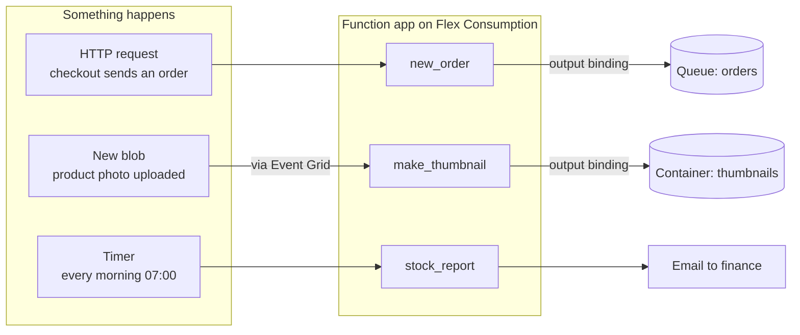
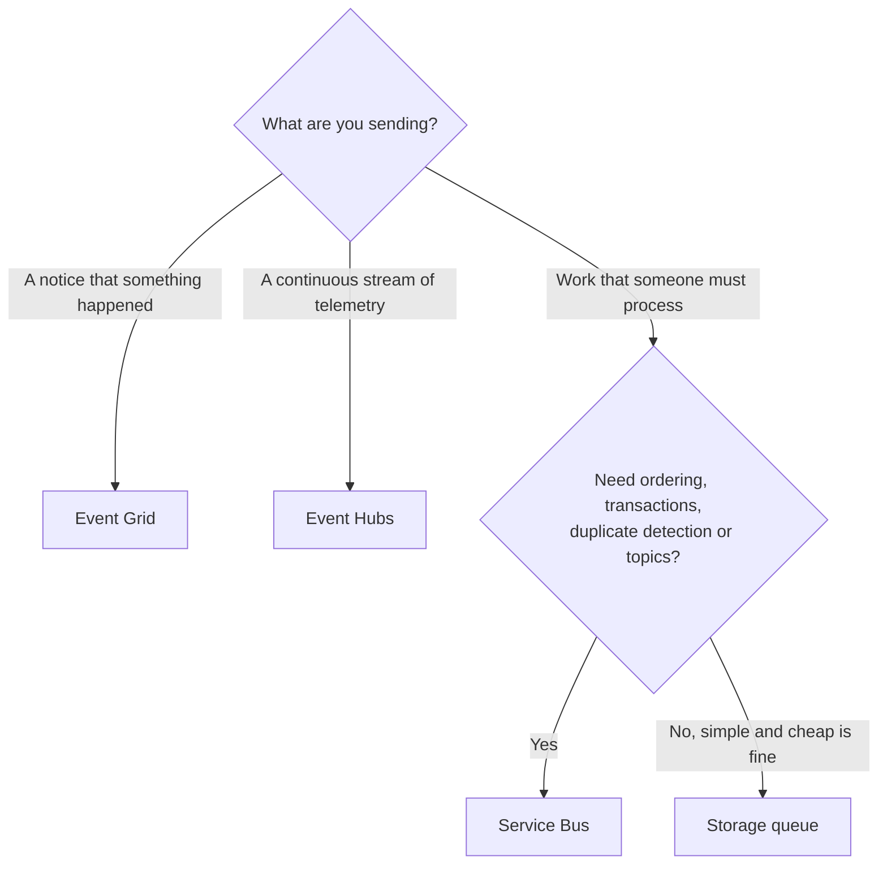

# Lunch 14 · Serverless: Azure Functions, Logic Apps and Event Grid

🇮🇩 [Baca dalam Bahasa Indonesia](README.id.md)

> **Track:** Core month · **Level:** Basic · **Part 3:** Platform services and data
> **Time:** 60 minutes · **Prerequisite lunches:** 02, 07, 10 (13 helps)
> **AZ-900 skill area:** Describe Azure architecture and services
> **Lab:** [Lab 14 · React to new orders automatically](../../labs/14-serverless/README.md) — about 50 minutes · cost 💲
> **Author:** Stefanus Pinarta · [About the author](../../README.md#about-the-author)

| ⏱ Minutes | Segment |
|---:|---|
| 5 | Scenario and objectives |
| 25 | Reading |
| 15 | Demo: interactive animation (+ optional walkthrough video) |
| 5 | Knowledge check |
| 5 | Key takeaways and lab preview |
| 5 | Buffer — finish your lunch 🍜 |

## 🍱 Today's menu

By the end of this lunch you will be able to:

- **Explain** what serverless means, what you gain and which trade-offs (cold starts, time limits, stateless code) you
  accept.
- **Describe** how Azure Functions uses triggers and bindings, and **choose** a hosting plan: Flex Consumption,
  Premium, Dedicated or Container Apps.
- **Choose** between Event Grid, Service Bus, Event Hubs and Storage queues for an event or a message.
- **Decide** when a job belongs in a Logic Apps workflow and when in a function.

## 🏪 Meanwhile at Nusantara Retail

The storefront now runs on App Service, and Harbolnas is coming. Dewi has been reading last year's incident notes. When
a shopper clicks *Pay*, the storefront does everything inside that one request: it saves the order, emails the
warehouse, adds loyalty points and books a courier. On 12.12 last year the courier's API slowed down, so every checkout
slowed down with it, and some shoppers gave up.

Marketing has a smaller headache. Every night they upload hundreds of new product photos, and a small VM resizes them
into thumbnails. It works for about twenty minutes a day and idles for the rest, on a bill that runs for all
twenty-four hours. Meanwhile the finance team would like a stock report in their inbox every morning, and nobody has
time to write another script for it.

Today's question: **how do we react to things that happen — a new order, a new photo, seven o'clock in the morning —
without servers that wait around and without making customers wait?**

---

## 📖 Reading (≈25 minutes)

### 1. What serverless really means

**Serverless** doesn't mean there are no servers. It means the servers are never your problem: you don't choose them,
size them, patch them or keep them running. You hand the platform a piece of code or a workflow and say when it should
run; the platform finds the compute, runs it and takes it away again. Three traits define it:

- **Event-driven.** Code runs because something happened: an HTTP request, a timer, a new file, a message in a queue.
- **Automatic scale, down to zero.** One event gets one instance; a thousand events get more; no events get none.
- **Pay per execution.** In consumption-style plans you pay for the executions and the compute time they use, not for
  idle hours.

On the shared-responsibility slider from Lunch 02, serverless sits even further right than App Service: with a web
app you still choose a plan and an instance count; with a serverless function you mostly don't.

The trade-offs are real, and it pays to know them before 12.12. A function that has scaled to zero needs a moment to
start when the next event arrives; that delay is a **cold start**. Executions have time limits, and an HTTP-triggered
function must answer within 230 seconds, however long the plan's timeout is. Instances come and go, so code must be
**stateless**: anything worth keeping goes to storage, a queue or a database. And pay-per-execution is cheap for bursty
work but can cost more than a fixed plan for traffic that never stops.

So serverless is not the answer to everything. The storefront itself, busy all day with steady traffic and long user
sessions, is happier on App Service (Lunch 10). A video-transcoding job that keeps a CPU busy for an hour fits a
container or a VM better. Serverless shines for the small, spiky, event-shaped jobs that every shop has dozens of:
validating an order, resizing a photo, sending a receipt, tidying up old files at night.



### 2. Azure Functions: triggers, bindings and your code

**Azure Functions** runs small pieces of code, called *functions*, in response to events. Each function has exactly one
**trigger**, the event that starts it, and any number of **bindings**, declarative connections to data. An *input
binding* hands your code data when it starts, such as a document from Cosmos DB. An *output binding* takes a value from
your code and writes it somewhere, such as a queue message or a blob. Bindings remove the boilerplate: no client
libraries to create, no connection handling, no retry loops for the simple cases.

Common triggers include **HTTP**, **timer** (on a CRON schedule), **Blob storage**, **Queue storage**, **Service Bus**,
**Event Hubs**, **Event Grid** and the **Cosmos DB** change feed. Here is the heart of the function you deploy in
today's lab, in the Python v2 programming model, where decorators declare the trigger and bindings:

```python
@app.route(route="orders", methods=["POST"])                                         # trigger: HTTP POST /api/orders
@app.queue_output(arg_name="msg", queue_name="orders", connection="OrdersStorage")  # output binding
def new_order(req: func.HttpRequest, msg: func.Out[str]) -> func.HttpResponse:
    order = req.get_json()
    msg.set(json.dumps(order))            # the Functions host writes the queue message
    return func.HttpResponse("queued", status_code=200)
```

The `connection` value is not a connection string. It's the *name* of a connection that the platform looks up in the
app's settings, and the best connections hold no secret at all: a setting such as `OrdersStorage__queueServiceUri`
tells the host to use the app's **managed identity**, and a role assignment decides what that identity may do.

Triggers differ in how events arrive. Some are **pushed**: an HTTP request or an Event Grid event is delivered to your
function the moment it happens. Others are **pulled**: a Queue storage trigger polls the queue, checking less often
while it stays empty. On Flex Consumption, the Blob storage trigger uses Event Grid as its source, so new files arrive
as pushed events instead of being discovered by scanning a container.

HTTP functions also have an **authorization level**. *Anonymous* lets anyone call; *function* requires a **function
key**, a shared secret sent in the `x-functions-key` header or the `code` query parameter; *admin* requires the master
key. Keys are fine for one service calling another, as in today's lab. A public API deserves more: sign-in with
Microsoft Entra ID through the built-in authentication you met in Lunch 10, or Azure API Management in front.

Functions are grouped into a **function app**, the unit you deploy, configure and scale. All functions in a function
app share its settings, its hosting plan and its runtime version. Every function app also needs a **storage account**
for its own bookkeeping: keys, trigger checkpoints and, in the newest plan, the deployment package itself.

You can write functions in **C#**, **JavaScript and TypeScript**, **Python**, **Java** and **PowerShell**, and *custom
handlers* let other languages join in. For C#, use the *isolated worker model*: support for the older in-process model
ends on November 10, 2026. Developers run the same Functions host on their laptops with Azure Functions Core Tools
(`func start`) or VS Code; local settings live in a `local.settings.json` file that is never deployed and never
belongs in Git.

When a job has several steps that must survive restarts, such as *reserve stock, charge the card, book the courier,
wait for the warehouse to confirm*, look at **Durable Functions**. An *orchestrator function* describes the steps in
ordinary code, and the platform saves its progress after each step. Patterns such as chaining, fan-out and fan-in, and
waiting for a human approval become a few lines instead of a home-made state machine.

### 3. Hosting plans: where your functions run

The code is the same everywhere; the **hosting plan** decides how it scales, what it costs and how it connects:

| Plan | Scale and limits | Cold starts | Networking | You pay for | Choose it when |
|---|---|---|---|---|---|
| **Flex Consumption** | Event-driven, per function group, up to 1,000 instances; Linux only | Reduced; optional always-ready instances remove them | Virtual network integration, private endpoints | Execution time × instance memory, plus executions (with a monthly free grant), plus any always-ready instances | Default for new serverless apps |
| **Premium** | Event-driven with prewarmed workers; at least one instance always on | None for warm instances | Virtual network integration, private endpoints | Cores and memory of the running instances | Steady traffic, no cold starts at all, custom Linux containers |
| **Dedicated** (App Service plan) | Manual or autoscale, like a web app | None with Always On | As App Service | The plan's instances, like Lunch 10 | You already pay for a plan with spare capacity, or need a fixed bill |
| **Container Apps** | Event-driven replicas, can scale to zero | When scaled to zero | The Container Apps environment | Container Apps pricing | Functions next to other containers, custom images, GPUs |
| **Consumption** (legacy) | Event-driven; Windows today, Linux version retiring | Yes | No virtual network integration | Executions and compute time | Existing Windows apps only |

**Flex Consumption** is Microsoft's recommended plan for new serverless apps. It runs on Linux and lets you choose the
instance memory (512 MB, 2,048 MB or 4,096 MB) and a **maximum instance count** that caps how far it scales, which
protects both your budget and whatever the function writes to. It scales to zero when idle. For latency-sensitive HTTP
functions you can keep one or more **always-ready instances** warm, at a baseline cost. Two limits to know: one
function app per Flex Consumption plan, and no deployment slots.

How does pay-per-execution add up? Billing counts the memory of each instance multiplied by the time it spends running
your code, in **GB-seconds**, plus the number of executions; each execution counts for at least one second. Suppose the
thumbnail function runs 300 times a night, one after another, for two seconds each on 2,048 MB instances: that's
300 × 2 s × 2 GB = 1,200 GB-seconds and 300 executions, and nothing at all for the other 23 hours. Put your own numbers into the pricing
calculator; the monthly free grant often covers small workloads completely.

Cold starts deserve a plan rather than a panic. Keep the deployment package small, import heavy libraries only where
they're needed, and measure the first-request latency after a quiet period. If it matters, for checkout for example,
add an always-ready instance on Flex Consumption or move that function to Premium. For a nightly photo job, a second of
start-up time doesn't matter at all.

The older **Consumption** plan is now called legacy. Hosting on Linux in the Consumption plan retires on September 30,
2028 and receives no new language versions, so new Python apps should start on Flex Consumption. Premium suits apps
that are busy most of the day and can't tolerate any cold start. Dedicated makes sense when you already pay for an
App Service plan with spare capacity.

> [!WARNING]
> Serverless isn't costless. A function that writes to the same queue that triggers it, or a public HTTP function
> hammered by bots, can scale out and run up a bill in hours. Set a maximum instance count, require keys or sign-in on
> HTTP functions, and keep the budget alerts from Lab 01 switched on.

### 4. Logic Apps: workflows from building blocks

Not every automation needs code. **Azure Logic Apps** builds **workflows** from building blocks in a visual designer,
in the portal or in VS Code. Every workflow starts with exactly one **trigger** (a schedule, an HTTP request, a new
email, a new file) followed by **actions**: call an API, apply a condition, loop over items, send an email, post to
Teams, write a row to a database. Behind the designer, each workflow is a JSON definition, so you can keep it in Git.

Its superpower is **connectors**, more than 1,400 of them at the time of writing. *Built-in* connectors run inside the
Logic Apps runtime: schedules, HTTP calls, conditions, loops and inline code. *Managed* connectors are Microsoft-run
proxies for services such as Office 365 Outlook, Teams, SharePoint, Salesforce, SAP and SFTP servers; you sign in once,
and the workflow uses that saved connection. Every run is recorded in the **run history**, with the inputs, outputs and
duration of each step, so you can see exactly where a run failed and resubmit it. Errors are part of the design, too:
each action has a **retry policy** for temporary failures, and a *run after* setting lets a step run only when an
earlier step failed or timed out, for example to email the on-call engineer instead of failing silently.

Logic Apps comes in two resource types:

| | Consumption | Standard |
|---|---|---|
| **Runs in** | Multitenant Azure Logic Apps, shared with other customers | Single-tenant runtime on a Workflow Service Plan, an App Service Environment v3, or your own infrastructure |
| **Workflows per resource** | One | Many, stateful and stateless |
| **Billing** | Per trigger and action execution | The hosting plan, plus storage transactions for stateful workflows |
| **Networking** | Shared, multitenant network | Virtual network integration and private endpoints |
| **Good for** | Getting started, low or spiky volume | Higher volume, private networks, local development |

How do you choose between Logic Apps and Functions? Both are serverless, and they work well together:

| | Azure Functions | Azure Logic Apps |
|---|---|---|
| **Style** | Code first: C#, Python, JavaScript and more | Designer first, low code; JSON under the hood |
| **Strongest at** | Custom logic, data processing, high-volume event handling | Orchestrating steps across many systems with connectors |
| **Connecting to things** | Triggers and bindings for Azure services, SDKs for the rest | 1,400+ connectors, including Office 365, SAP, Salesforce and SFTP |
| **Long-running state** | Durable Functions | Built in: stateful workflows with run history |
| **Nusantara example** | Validate an order, resize a photo | Morning stock report by email, an approval for large orders |

A workflow can call a function for the code-heavy step, and a function can start a workflow. For business users who
want to automate their own tasks in Microsoft 365, **Power Automate** uses the same connector ecosystem without any
Azure subscription work; Logic Apps is the Azure-hosted, IT-managed sibling.

### 5. Events and messages: Event Grid, Service Bus, Event Hubs and Storage queues

Serverless designs pass information around, and Azure has four services for it. Choosing well starts with one
distinction. An **event** is a lightweight notification that something happened: *a photo was uploaded*, *a VM was
deleted*. The publisher doesn't care who reacts, or whether anyone does. A **message** carries data that someone is
expected to process: *here is order JKT-1001; please ship it*. The sender relies on the receiver doing its job.

| Service | Model | Best for | Key features | Nusantara example |
|---|---|---|---|---|
| **Event Grid** | Pushes events to subscribers | Reacting to changes in Azure resources and your own apps | Filters by event type and subject, built-in events from Azure services, retries and dead-lettering, HTTP and MQTT | "A product photo was uploaded" → thumbnail function |
| **Storage queues** | Simple queue that consumers poll | A cheap, simple backlog of work between components | Messages up to 64 KB, very large capacity, part of a storage account | "Order JKT-1001 placed" → order processor |
| **Service Bus** | Enterprise message broker: queues and topics | Business transactions that must not be lost, duplicated or reordered | First-in-first-out with sessions, duplicate detection, transactions, dead-letter queue, topics with subscriptions | Payment and stock reservation for each order |
| **Event Hubs** | Partitioned stream that consumers read at their own pace | Millions of events per second: telemetry and analytics | Partitions, consumer groups, a Kafka-compatible endpoint, Capture to storage | Clickstream from the storefront, telemetry from 40 stores' tills |



Event Grid has a vocabulary of its own. A **topic** is where events are published: a *system topic* carries events
from an Azure service, such as a storage account's *blob created* events, and a *custom topic* carries your own apps'
events. An **event subscription** routes matching events to a **handler**: a function, a webhook, a queue, Event Hubs
and others. Filters on the event type or subject keep handlers quiet, for example only for files ending in `.jpg` in
the `product-images` container. If a handler fails, Event Grid retries with growing pauses, and it can **dead-letter**
undeliverable events to a storage container so that nothing disappears silently.

The services are often combined rather than chosen once for everything. Nusantara Retail could use Event Grid to say
*a photo arrived*, a Storage queue for new orders today, Service Bus for payments later, and Event Hubs for the
clickstream that marketing wants to analyse.

### 6. Putting it together for Nusantara Retail

Here is how today's ideas answer the three problems from the story.

**Checkout that doesn't wait.** The storefront sends each order to an HTTP-triggered function, `new_order`, which
validates it, drops it into the `orders` queue and answers at once. A second function, triggered by that queue, does
the slow work: email the warehouse, add loyalty points, book the courier. If the courier's API is slow on 12.12, the
queue simply grows for a while and shoppers don't notice. If one order keeps failing, the queue trigger retries it
(five attempts by default) and then moves it to a *poison* queue, where someone can inspect it instead of losing it.

**Thumbnails without an idle VM.** Product photos land in Blob storage. Event Grid publishes a *blob created* event,
and a thumbnail function on Flex Consumption runs once per photo. When marketing uploads three hundred photos at once,
the platform adds instances for a few minutes; afterwards it scales back to zero, and the bill stops with it. The
resize VM can be deleted.

**A report without a developer.** A Consumption Logic App with a 07:00 recurrence trigger calls a small stock-report
function over HTTP, checks a condition (*any product below ten units?*) and uses the Office 365 Outlook and Teams
connectors to tell the store managers. Finance can read the run history themselves.

Two habits make this design trustworthy. Connections use **managed identities** instead of keys wherever possible
(Lunch 15 goes deeper). And every consumer is written to be safe when the same message arrives twice, because queues
and events deliver **at least once**. In practice that means an occasional duplicate, never a silent loss.

> [!NOTE]
> **Pause and think:** the storefront now shows *"Thank you for your order"* before the warehouse has even seen it.
> What does the queue guarantee, and what must the order processor do if the same order arrives twice?

Next lunch, Security Essentials, takes the secrets out of the remaining configuration files with Key Vault and managed
identities, and looks at the platform from an attacker's point of view.

---

## 🎬 Demo (≈15 minutes)

1. **Interactive animation (≈6–8 min):** [Open the demo](https://stefpin.github.io/azure-fundamentals-lunches/demos/14-serverless.html) —
   press ▶ Play or step through it at your own pace. Offline? Download
   [`docs/demos/14-serverless.html`](../../docs/demos/14-serverless.html) and open it in any browser.
2. **Walkthrough video (≤ 6 min):** _coming soon_ — [read the walkthrough script](demo-video-script.md).

What to watch for:

- An uploaded photo becomes a small event; the function, not the event, does the work and writes the thumbnail.
- The instance counter climbs during the burst and falls back to zero afterwards, and so does the bill.
- A failing event isn't lost: it is retried, then dead-lettered for someone to inspect.
- The Logic App lights up one step at a time, exactly as its run history records it.

## ✅ Knowledge check (≈5 minutes)

1. The thumbnail function runs about 2,000 times on 12.12 and hardly at all on other days. It must reach a storage
   account that only allows traffic from a virtual network. Which hosting plan fits best?
   <details><summary>Show answer</summary>

   Flex Consumption. It scales to zero between bursts, bills per execution and supports virtual network integration,
   which the legacy Consumption plan doesn't.

   </details>
2. A finance function, triggered over HTTP, builds a large sales report that takes about six minutes. Callers keep
   timing out, even though the plan allows long executions. Why, and what's a better design?
   <details><summary>Show answer</summary>

   An HTTP-triggered function must respond within 230 seconds, whatever the plan's timeout. Accept the request, put the
   work on a queue (or start a Durable Functions orchestration), return at once, and let the caller fetch the report
   when it's ready.

   </details>
3. Payment messages must be processed in order for each customer, never twice, and the charge and the stock update must
   succeed or fail together. Storage queue, Service Bus, Event Hubs or Event Grid?
   <details><summary>Show answer</summary>

   Service Bus: sessions give first-in-first-out ordering per customer, duplicate detection drops repeats, and
   transactions group the operations. Storage queues have none of these, and Event Grid and Event Hubs solve different
   problems.

   </details>
4. Every morning the stores team wants the stock levels checked and, if anything is low, an email to the store manager
   and a post in Teams. No developer is free. What would you use?
   <details><summary>Show answer</summary>

   A Consumption Logic App: a Recurrence trigger, an HTTP action or a database connector to read stock, a condition,
   and the Office 365 Outlook and Teams connectors. It's built in the designer and billed per action.

   </details>
5. A queue-triggered function crashes on one malformed order message, again and again. What happens to that message?
   <details><summary>Show answer</summary>

   The queue trigger retries it; after five failed attempts (the default `maxDequeueCount`), the host moves it to a
   poison queue named after the original queue with `-poison` at the end, so it stops blocking the others and can be
   inspected.

   </details>

## 🧠 Key takeaways

- Serverless means event-driven code, automatic scaling down to zero and pay-per-execution billing, in exchange for cold
  starts, time limits and stateless design.
- A function has one trigger and any number of bindings; connection names point at app settings, and the best
  connections use a managed identity instead of a secret.
- Flex Consumption is the default plan for new serverless apps (Linux, up to 1,000 instances, virtual network support,
  optional always-ready instances). Premium, Dedicated and Container Apps cover warm, steady or container needs, and
  Consumption is legacy.
- Logic Apps orchestrates workflows with 1,400+ connectors (Consumption bills per action; Standard is single-tenant
  with many workflows per resource). Functions handle custom code, and the two combine well.
- Events tell (Event Grid), messages ask (Storage queues, Service Bus) and streams flow (Event Hubs). Choose by ordering,
  delivery and volume needs, and design consumers for at-least-once delivery.

## 🗒️ Field notes from Stefanus

> **Every dead letter needs a reader.** Retries, poison queues and dead-letter containers are the safety net of a
> serverless design, and the trap I see most often is a net that nobody checks. So in design reviews I ask the same
> thing about every trigger: where does a message go after its last failed attempt, who finds out, and how? If the
> honest answer is "it sits in a poison queue until someone happens to look", I add an alert before I add another
> function. A dead letter that nobody reads is just a slower way of losing an order. Two more questions follow: what
> happens if this message arrives twice, and what stops this function from scaling out forever? I want an order ID
> check and a maximum instance count, written down rather than assumed.

## 🔬 Your lab: React to new orders automatically

You'll create a function app on the Flex Consumption plan, give it a managed identity and a passwordless connection to
a Storage queue, and deploy the provided Python function that validates orders and queues them through an output
binding. You'll test it with `curl`, peek at the queue, and add a Consumption Logic App that sends a heartbeat order
every 15 minutes. Then a deleted setting breaks the pipeline, and you use the logs to find out why.

- ⏱ About 50 minutes · 💲 free or close to free · works on its own (no earlier lab needed)
- 👉 [Start Lab 14](../../labs/14-serverless/README.md)

## 📚 Go further

- [Microsoft Learn: Azure Functions hosting options](https://learn.microsoft.com/azure/azure-functions/functions-scale) — the full comparison of plans, limits, scaling and cold-start behaviour.
- [Microsoft Learn: Azure Functions Flex Consumption plan hosting](https://learn.microsoft.com/azure/azure-functions/flex-consumption-plan) — instance sizes, always-ready instances, billing and current limitations.
- [Microsoft Learn: Choose between Azure Event Grid, Event Hubs, and Service Bus](https://learn.microsoft.com/azure/service-bus-messaging/compare-messaging-services) — events versus messages, side by side.
- [Microsoft Learn: What is Azure Logic Apps?](https://learn.microsoft.com/azure/logic-apps/logic-apps-overview) — workflows, connectors, and Consumption versus Standard.

---

⬅️ [Lunch 13 · Containers (Basic): Container Registry, Container Instances and Container Apps](../13-containers-basic/README.md) · 🏠 [Course home](../../README.md) · [Lunch 15 · Security Essentials: Defense in Depth, Key Vault and Defender for Cloud](../15-security-essentials/README.md) ➡️

<sub>Last validated: October 2026 · Spotted something out of date? [Open an issue](../../CONTRIBUTING.md).</sub>
