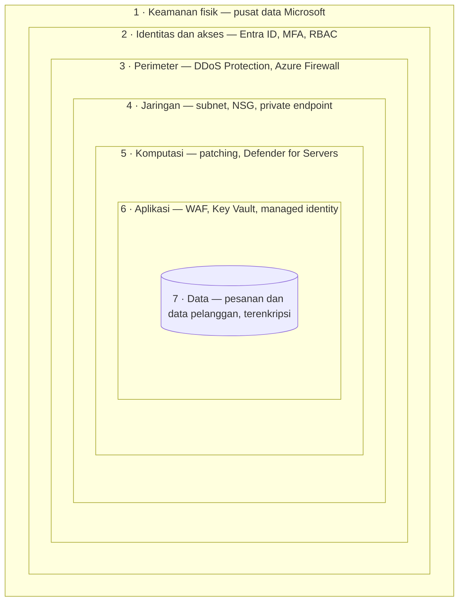
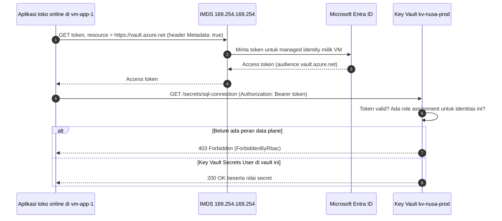

# Makan Siang 15 · Esensi Keamanan: Defense in Depth, Key Vault, dan Defender for Cloud (Dasar)

🇬🇧 [Read in English](README.md)

> **Jalur:** Bulan inti · **Level:** Dasar · **Bagian 4:** Keamanan, operasional, dan tata kelola
> **Waktu:** 60 menit · **Makan siang prasyarat:** 04, 05, 06 (08 membantu)
> **Area keterampilan AZ-900:** Menjelaskan arsitektur dan layanan Azure
> **Lab:** [Lab 15 · Keluarkan kata sandi dari file konfigurasi](../../labs/15-security-essentials/README.id.md) — sekitar 45 menit · biaya 💲💲
> **Penulis:** Stefanus Pinarta · [Tentang penulis](../../README.id.md#tentang-penulis)

| ⏱ Menit | Segmen |
|---:|---|
| 5 | Skenario dan tujuan |
| 25 | Bacaan |
| 15 | Demo: animasi interaktif (+ video panduan opsional) |
| 5 | Uji pemahaman |
| 5 | Poin penting dan pratinjau lab |
| 5 | Waktu cadangan — habiskan makan siang Anda 🍜 |

## 🍱 Menu hari ini

Setelah makan siang ini, Anda akan mampu:

- **Menjelaskan** defense in depth (*pertahanan mendalam*) dan menyebutkan layanan Azure yang melindungi setiap lapisannya.
- **Menerapkan** tiga prinsip Zero Trust dan model tanggung jawab bersama pada sebuah keputusan desain.
- **Membandingkan** apa yang diberikan Microsoft Defender for Cloud (*Microsoft Defender untuk Cloud*) secara gratis dengan
  tambahan dari paket Defender berbayar.
- **Memilih** cara menyimpan secret, key, dan sertifikat di Azure Key Vault, serta menjelaskan RBAC permission model
  (RBAC: *kontrol akses berbasis peran*), soft delete, dan purge protection.
- **Menjelaskan** bagaimana sebuah managed identity mendapatkan token, dan mengapa cara ini mengeluarkan kata sandi dari
  kode.

## 🏪 Sementara itu di Nusantara Retail

Rizky, sang kontraktor, butuh bantuan rekannya untuk memperbaiki sebuah bug di toko online. Ia pun mengompres folder
proyek menjadi file zip dan mengirimkannya lewat aplikasi chat. Dewi menyadari masalahnya semenit terlambat: file zip itu
berisi `appsettings.json`, dan di dalamnya tertulis kata sandi database pesanan dalam teks biasa, tanpa disamarkan
sedikit pun. Lebih parah lagi, file yang sama sudah dua tahun tersimpan di repositori Git, dan kata sandi yang sama
dipakai di tiga server.

Ibu Sari langsung mengadakan rapat singkat. "Siapa lagi yang memegang kata sandi ini? Dan bagaimana kita bisa tahu?"
Pak Budi mengingatkan bahwa firewall di kantor pusat sudah memblokir para penyerang. Anda tidak begitu yakin satu tembok
bisa disebut rencana: firewall tidak membaca isi file zip.

Pertanyaan hari ini: **bagaimana melindungi toko secara berlapis, sehingga satu kesalahan tidak langsung berujung
kebobolan — dan bagaimana mengeluarkan data rahasia dari file untuk selamanya?**

---

## 📖 Bacaan (≈25 menit)

### 1. Defense in depth dan Zero Trust: jangan mengandalkan satu tembok

**Defense in depth** berarti menumpuk beberapa kontrol keamanan yang saling independen, sehingga penyerang yang berhasil
melewati satu kontrol masih harus berhadapan dengan kontrol berikutnya. Setiap lapisan punya tugas: menghentikan
serangan, memperlambatnya, atau setidaknya membuat cukup banyak "keributan" sehingga ada yang menyadarinya. Benteng
zaman dulu bekerja dengan cara ini: ada parit, tembok, gerbang, dan penjaga. Keamanan cloud bekerja dengan cara yang
sama, hanya saja buayanya lebih sedikit.

Bayangkan rumah di sebuah kompleks perumahan. Ada satpam di portal kompleks, pagar bergembok di depan rumah, pintu yang
terkunci, lalu brankas di dalam kamar untuk perhiasan dan sertifikat tanah. Maling yang lolos dari satpam masih harus
memanjat pagar, membobol pintu, lalu membongkar brankas, dan setiap langkah memberi tetangga kesempatan untuk melihat
dan berteriak. Tidak ada lapisan yang sempurna; kekuatannya ada pada tumpukannya.

Kisi-kisi keterampilan AZ-900 menggambarkan tujuh lapisan, dari luar ke dalam. Bayangkan sebuah bawang dengan data Anda
di bagian intinya:

Tabel berikut memetakan setiap lapisan ke fitur Azure yang Anda temui di kursus ini.

| Lapisan | Melindungi dari | Fitur Azure (contoh) | Siapa yang mengurusnya |
|---|---|---|---|
| 1. Keamanan fisik | Orang yang menyusup ke pusat data atau membawa kabur sebuah disk | Kontrol akses pusat data, kamera, penghancuran disk secara aman | Microsoft |
| 2. Identitas dan akses | Kata sandi yang dicuri atau lemah, akses yang terlalu luas | Microsoft Entra ID (*ID Microsoft Entra*), MFA (*autentikasi multifaktor*), Conditional Access (*Akses Bersyarat*), Azure RBAC, Privileged Identity Management | Anda (Microsoft yang menjalankan layanannya) |
| 3. Perimeter | Banjir lalu lintas dan serangan dari internet | Azure DDoS Protection, Azure Firewall | Bersama |
| 4. Jaringan | Penyerang yang bergerak menyamping dari satu mesin ke mesin lain | Virtual network (*jaringan virtual*) dan subnet, network security group (NSG), private endpoint (*titik akhir privat*) | Anda |
| 5. Komputasi | Virtual machine (*komputer virtual*) yang belum di-patch atau terbuka ke internet | Azure Update Manager, Defender for Servers, Azure Bastion, tanpa IP publik | Anda (untuk IaaS) |
| 6. Aplikasi | Bug, serangan injeksi, secret di dalam kode | Web Application Firewall, Azure Key Vault, managed identity, praktik penulisan kode yang aman | Anda |
| 7. Data | Data yang terbaca oleh orang yang salah, bahkan setelah bocor | Enkripsi saat disimpan dan saat dikirim, customer-managed key, Microsoft Purview, cadangan (backup) | Anda |

Perhatikan kolom terakhir. Microsoft mengamankan lapisan fisik dan platformnya sendiri; hampir semua yang ada di dalam
subscription (*langganan*) Anda adalah tugas Anda. Ini kembali ke **model tanggung jawab bersama** (shared responsibility
model) dari Makan Siang 02. Pada IaaS (*infrastruktur sebagai layanan*), Anda juga harus menambal (patch) sistem
operasi; pada PaaS (*platform sebagai layanan*), Microsoft yang mengerjakannya sehingga porsi Anda menyusut. Data, akun,
dan identitas tetap menjadi tanggung jawab Anda di model mana pun.

**Zero Trust** adalah pola pikir di balik defense in depth modern. Pola pikir ini membuang anggapan lama bahwa segala
sesuatu di dalam jaringan perusahaan otomatis bisa dipercaya, dan bertumpu pada tiga prinsip:

- **Verifikasi secara eksplisit (verify explicitly).** Putuskan setiap permintaan akses dengan memakai semua sinyal yang
  Anda punya: siapa penggunanya, faktor kedua (misalnya kode di aplikasi ponsel), kesehatan perangkat, lokasi, dan
  seberapa sensitif hal yang hendak dibuka.
- **Gunakan akses dengan hak minimum (use least privilege access).** Berikan peran terkecil, pada cakupan terkecil, untuk
  waktu sesingkat mungkin. Inilah prinsip hak akses minimum (least privilege), misalnya RBAC di Makan Siang 05 dan akses
  just-in-time (akses yang dibuka hanya saat dibutuhkan) di Makan Siang 22.
- **Anggap sudah kebobolan (assume breach).** Rancang sistem seolah-olah penyerang sudah berada di dalam: pisahkan
  jaringan menjadi beberapa segmen, enkripsi data, jauhkan secret dari jangkauan, dan awasi log.

Firewall Pak Budi adalah kontrol di lapisan perimeter. Firewall itu berguna, tetapi tidak berdaya menghadapi kata sandi
yang terselip di dalam file zip. Itu masalah identitas dan aplikasi, sehingga butuh kontrol di lapisan-lapisan tersebut.

### 2. Microsoft Defender for Cloud: pelatih sekaligus penjaga

Memahami lapisan-lapisan itu satu hal; memeriksa ratusan pengaturan secara manual di subscription yang terus tumbuh
adalah hal lain. **Microsoft Defender for Cloud** melakukan pemeriksaan itu untuk Anda. Layanan ini adalah platform
perlindungan aplikasi yang dibangun khusus untuk cloud (cloud-native application protection platform) dengan dua tugas
utama:

- **Cloud security posture management (CSPM)**, atau manajemen postur keamanan cloud, adalah sang pelatih. CSPM terus
  membandingkan resource (*sumber daya*) Anda dengan praktik terbaik keamanan, lalu memberi tahu apa yang perlu
  diperbaiki.
- **Cloud workload protection** (perlindungan beban kerja cloud) adalah sang penjaga. **Paket Defender** (Defender plans)
  yang berbayar mengawasi workload yang sedang berjalan dan memunculkan **security alert** (*pemberitahuan* keamanan)
  ketika terjadi sesuatu yang mencurigakan, misalnya percobaan brute-force (menebak kata sandi berulang-ulang) pada
  sebuah VM atau lonjakan pembacaan yang tidak wajar dari sebuah key vault.

Setiap subscription Azure dapat memakai **foundational CSPM** tanpa biaya. Fitur ini menilai resource Anda berdasarkan
**Microsoft cloud security benchmark** (kumpulan praktik terbaik keamanan dari Microsoft), mengubah setiap pemeriksaan
yang gagal menjadi sebuah **recommendation** (rekomendasi) lengkap dengan langkah perbaikannya (sering kali ada tombol
*Fix*), lalu merangkum hasilnya menjadi **secure score**: sebuah persentase yang makin tinggi berarti makin sedikit
risiko yang teridentifikasi. Defender for Cloud menghitung ulang setiap kontrol keamanan kira-kira setiap delapan jam,
jadi perbaikan Anda tidak langsung menaikkan skor. Pada saat tulisan ini dibuat, ada dua tampilan skor: secure score
klasik di Azure portal, dan Cloud Secure Score yang lebih baru dan berbasis risiko di portal Microsoft Defender, yang
menimbang seberapa terbuka dan seberapa kritis setiap aset.

| | Foundational CSPM | Defender CSPM | Paket perlindungan workload |
|---|---|---|---|
| Harga | Gratis | Berbayar, per resource yang ditagih | Berbayar, per resource yang dilindungi: server, storage account (*akun penyimpanan*), database… |
| Pertanyaan utama | "Apa yang salah konfigurasi?" | "Risiko mana yang benar-benar bisa merugikan kita?" | "Apakah ada yang sedang menyerang kita saat ini?" |
| Yang Anda dapatkan | Inventaris aset, rekomendasi, secure score, alat perbaikan, otomatisasi alur kerja | Analisis jalur serangan (attack path analysis), cloud security explorer, pemindaian kerentanan dan secret tanpa agen, postur keamanan data, penilaian kepatuhan terhadap regulasi, tata kelola | Security alert dari Defender for Servers (Plan 1 atau 2), Storage, Databases, Containers, App Service, Key Vault, Resource Manager, APIs, dan AI services |
| Kapan diaktifkan | Sejak hari pertama | Untuk lingkungan produksi yang lebih besar | Untuk workload produksi yang penting bagi Anda |

> [!TIP]
> **Tips biaya.** Paket berbayar menagih setiap resource yang dilindungi selama paket itu aktif. Di subscription untuk
> lab, cukup lihat halaman paket, tetapi biarkan paket berbayar tetap nonaktif. Untuk produksi, buat perkiraan dulu
> dengan pricing calculator (*kalkulator harga*), lalu aktifkan paket hanya untuk workload yang benar-benar Anda jalankan.

Rekomendasi dikelompokkan ke dalam **security control** (kontrol keamanan) dengan nama seperti *Enable MFA*, *Secure
management ports*, *Apply system updates*, dan *Encrypt data in transit*. Sebuah resource baru dianggap sehat untuk
suatu kontrol jika lolos dari *setiap* rekomendasi di kontrol tersebut. Jadi, memperbaiki separuh temuan pada sebuah VM
tidak menghasilkan poin apa pun, sedangkan memperbaiki akar masalahnya untuk semua resource (misalnya dengan policy yang
memblokir IP publik pada server aplikasi) memberi Anda poin satu kontrol penuh. Setiap rekomendasi menampilkan resource
yang terdampak, risikonya, serta langkah perbaikan atau Azure Policy yang memperbaikinya dalam skala besar (Makan Siang
18).

Perlakukan secure score sebagai daftar pekerjaan yang diurutkan berdasarkan dampak, bukan nilai rapor yang harus
dikejar, dan gunakan trennya untuk menunjukkan kepada Ibu Sari bahwa toko makin aman dari bulan ke bulan. Defender for
Cloud juga sedang pindah ke portal Microsoft Defender, berdampingan dengan Microsoft Sentinel, agar tim keamanan dapat
bekerja di satu tempat.

### 3. Azure Key Vault: satu brankas untuk secret, key, dan sertifikat

File zip Rizky memperlihatkan masalah sebenarnya dari secret, yaitu data rahasia seperti kata sandi, connection string,
atau API key, yang disimpan di dalam file: file selalu tersalin ke mana-mana, ke Git, ke cadangan, ke grup chat, dan ke
laptop. Ibaratnya kunci rumah yang digandakan di tukang duplikat kunci di pasar: begitu salinannya beredar, Anda tidak
pernah tahu berapa banyak yang ada dan di tangan siapa saja. **Azure Key Vault** memberi setiap secret satu rumah,
lengkap dengan kontrol akses, pengelolaan versi, dan log audit, sehingga aplikasi mengambil secret saat berjalan (run
time) alih-alih membawanya ke mana-mana. Sebuah vault menyimpan tiga jenis objek:

| Objek | Apa itu | Contoh di Nusantara Retail | Perlu diketahui |
|---|---|---|---|
| **Secret** | String pendek apa pun yang sensitif; pemanggil yang berwenang menerima kembali nilainya | Connection string database pesanan, API key milik payment gateway | Setiap pembaruan membuat versi baru; tetapkan tanggal kedaluwarsa |
| **Key** | Kunci kriptografi untuk enkripsi/dekripsi, menandatangani/memverifikasi, membungkus/membuka bungkus (wrap/unwrap) | Customer-managed key yang mengenkripsi storage account untuk faktur | Private key tidak pernah keluar dari vault; Anda meminta Key Vault yang menjalankan operasinya |
| **Certificate** | Sertifikat X.509 (format standar sertifikat digital) beserta kebijakan dan siklus hidupnya | Sertifikat TLS untuk domain toko online | Key Vault dapat memperbarui sertifikat dari penerbit (issuer) yang terintegrasi dan memberi peringatan sebelum kedaluwarsa |

Vault tersedia dalam dua tingkatan: **Standard** untuk key yang dilindungi perangkat lunak, dan **Premium**, yang
menambahkan key yang dilindungi hardware security module (HSM), yaitu perangkat keras khusus yang tahan bongkar untuk
menyimpan dan memakai kunci kriptografi. Untuk HSM khusus yang hanya dipakai satu tenant (satu organisasi pelanggan),
ada layanan terpisah, Azure Key Vault Managed HSM. Microsoft merekomendasikan **satu vault per aplikasi per lingkungan**,
misalnya `kv-nusa-prod` dan `kv-nusa-dev`, supaya kebocoran di lingkungan pengembangan tidak pernah membuka produksi.

**Dua bidang, dua jenis izin.** Seperti setiap resource Azure, sebuah vault memiliki **control plane** atau bidang
kontrol (membuat, mengonfigurasi, dan menghapus vault melalui Azure Resource Manager) dan **data plane** atau bidang
data (membaca dan menulis secret itu sendiri di `https://<vault-name>.vault.azure.net`). Control plane selalu memakai
Azure RBAC. Untuk data plane, **Azure RBAC permission model** (model izin Azure RBAC) adalah pilihan default dan yang
direkomendasikan: versi Azure CLI saat ini membuat vault dengan model tersebut kecuali Anda memilih sebaliknya, dan
mulai Key Vault API versi 2026-02-01 model ini menjadi default untuk setiap vault baru. Model lama, **access policy**,
masih berfungsi, tetapi RBAC memungkinkan Anda mengelola akses di satu tempat, pada cakupan (scope) apa pun, dengan
alat yang sama seperti bagian Azure lainnya.

Hal ini sering mengejutkan: menjadi **Owner** subscription tidak membuat Anda bisa membaca secret. Owner adalah peran
(role) control plane. Untuk bekerja dengan secret, Anda butuh peran data plane, misalnya:

- **Key Vault Secrets User** membaca nilai secret — persis yang dibutuhkan sebuah aplikasi.
- **Key Vault Secrets Officer** membuat, memperbarui, menghapus, dan membaca secret — untuk orang yang mengelolanya.
- **Key Vault Administrator** menjalankan semua operasi data plane pada key, secret, dan sertifikat.
- **Key Vault Reader** membaca metadata (informasi tentang objek, seperti nama dan tanggal kedaluwarsa), tetapi tidak
  pernah membaca nilai secret.

Ibaratnya ibu kos: ia berhak mengecat kamar, mengganti gembok pintu, bahkan membongkar lemari, karena itu urusan
bangunan (control plane). Namun, ia tidak otomatis berhak membuka kotak terkunci milik penghuni dan membaca isinya (data
plane). Meski begitu, seorang Owner tetap bisa memberi dirinya sendiri peran data, satu alasan lagi untuk menjaga daftar
Owner tetap pendek.

**Jaringan dan pencatatan.** Secara default, vault baru menerima permintaan dari jaringan mana pun, walaupun setiap
permintaan tetap membutuhkan identitas dan peran yang valid. Untuk produksi, tutup public endpoint (*titik akhir
publik*) dengan firewall vault dan izinkan hanya virtual network tertentu, atau akses vault melalui private endpoint
(Makan Siang 24 dan 25). Lalu kirim log audit vault ke Log Analytics workspace (ruang kerja untuk menyimpan dan
menelusuri log) dengan sebuah diagnostic setting, sehingga pertanyaan "siapa yang membaca kata sandi database pesanan
Selasa lalu?" punya jawaban (Makan Siang 16). Beri setiap secret tanggal kedaluwarsa, dan rotasikan (ganti secara
berkala) dengan menambahkan versi baru: aplikasi yang membaca "versi terbaru" akan memakainya tanpa perubahan kode. App
Service bahkan dapat mengambilkan nilai dari Key Vault reference di app settings untuk Anda (Makan Siang 10).

**Soft delete dan purge protection.** Menghapus vault atau secret bukanlah akhir cerita. **Soft delete** (hapus
sementara) aktif di setiap vault baru dan tidak dapat dimatikan: vault dan objek yang dihapus tetap dapat dipulihkan
selama masa retensi yang dipilih saat pembuatan, yaitu 7 sampai 90 hari (default-nya 90), dan selama itu nama vault tetap
dicadangkan. Melakukan **purge** berarti menghapus secara permanen sebelum masa tersebut berakhir. **Purge protection**
bersifat opsional: sekali diaktifkan, fitur ini tidak dapat dinonaktifkan lagi, dan tidak seorang pun, bahkan Owner,
bisa melakukan purge sebelum masa retensi lewat. Banyak layanan yang mengenkripsi data dengan kunci milik Anda sendiri
mewajibkannya. Mudahnya, soft delete mirip Recycle Bin di laptop; purge protection membuat Recycle Bin itu mustahil
dikosongkan sebelum waktunya.

> [!IMPORTANT]
> Purge protection adalah pintu satu arah. Aktifkan untuk vault produksi, terutama vault yang menyimpan kunci enkripsi.
> Di lab, biarkan nonaktif (seperti di Lab 15) agar Anda bisa melakukan purge pada vault dan langsung memakai lagi namanya.

### 4. Managed identity: tanpa secret di dalam kode

Key Vault menyelesaikan urusan penyimpanan, tetapi memunculkan teka-teki baru: aplikasi harus masuk (sign in) ke Key
Vault untuk membaca secret-nya, dan proses masuk itu kedengarannya membutuhkan… secret lain lagi. Orang keamanan
menyebutnya masalah "secret zero", yaitu secret pertama yang dibutuhkan untuk membuka semua secret lainnya.

**Managed identity** (identitas terkelola) memutus lingkaran itu. Managed identity adalah identitas di Microsoft Entra ID,
tepatnya sebuah service principal (identitas untuk aplikasi atau layanan, bukan untuk manusia), yang dibuat Azure untuk
sebuah resource, dengan kredensial yang disimpan dan dirotasi oleh Azure. Kode Anda tidak pernah melihat kredensial itu.
Ada dua jenis:

| | System-assigned | User-assigned |
|---|---|---|
| Cara membuatnya | Aktifkan pada satu resource | Buat sebagai resource Azure tersendiri (`id-…`) |
| Siklus hidup | Ikut terhapus bersama resource-nya | Tetap ada sampai Anda menghapusnya |
| Bisa dipakai bersama oleh beberapa resource | Tidak | Ya |
| Cocok untuk | Satu aplikasi di satu VM atau App Service | Banyak instance yang butuh akses yang sama, atau akses yang harus diberikan sebelum resource-nya ada |

**Cara kerja alur token.** Di sebuah VM Azure, aplikasi meminta access token (tiket digital yang membuktikan identitas
pemegangnya untuk waktu terbatas) ke sebuah endpoint lokal, yaitu **Azure Instance Metadata Service (IMDS)** di
`169.254.169.254`. Alamat itu hanya bisa dijangkau dari dalam VM, dan permintaannya wajib membawa header
`Metadata: true`, yang melindungi dari permintaan palsu. Aplikasi menyebutkan **audience**, yaitu layanan tujuan token
tersebut, misalnya `https://vault.azure.net`. Azure memperoleh token dari Microsoft Entra ID untuk identitas VM itu,
lalu mengembalikannya. Setelah itu aplikasi memanggil Key Vault dengan token tersebut, dan Key Vault memeriksa dua hal
secara berurutan:

1. **Autentikasi (authentication)** — apakah tokennya valid, belum kedaluwarsa, dan diterbitkan untuk Key Vault? Token
   untuk audience yang salah mendapat HTTP **401 Unauthorized**.
2. **Otorisasi (authorization)** — apakah identitas ini memegang peran data plane di vault ini? Jika tidak, jawabannya
   HTTP **403 Forbidden** dengan kode galat internal `ForbiddenByRbac`.

Bayangkan Anda bertamu ke gedung perkantoran. Resepsionis di lobi (IMDS), yang hanya bisa didatangi dari dalam gedung,
memberi Anda kartu akses yang hanya berlaku untuk satu lantai (audience) dan kedaluwarsa sore nanti. Di lantai tujuan,
satpam (Key Vault) memeriksa dua hal. Pertama, apakah kartunya asli dan memang untuk lantai ini; kartu untuk lantai lain
ditolak di pintu (401). Kedua, apakah nama Anda ada di daftar tamu ruangan itu; kartu asli pun tetap ditolak jika nama
Anda tidak terdaftar (403).

> [!WARNING]
> **Kesalahan umum:** meng-commit secret ke Git dengan rencana "nanti saja dirotasi"; satu vault dipakai bersama untuk
> semua aplikasi dan lingkungan; memberi aplikasi peran Key Vault Administrator "supaya jalan dulu"; dan sibuk men-debug
> error 403 yang sebenarnya akan hilang sendiri, karena role assignment (penetapan peran) yang baru butuh beberapa menit
> untuk menyebar ke seluruh sistem. Simpan juga secret di cache memori: membaca Key Vault pada setiap permintaan web itu
> lambat dan bisa menabrak batas layanan.

Ingat di mana batas kepercayaan berada: kode **apa pun** yang berjalan di VM dapat meminta token milik VM itu ke IMDS.
Managed identity membuktikan "permintaan ini berasal dari vm-app-1", bukan "permintaan ini berasal dari proses aplikasi
toko online". Karena itu, jaga agar peran setiap identitas tetap kecil, jangan memakai satu VM bersama-sama untuk
aplikasi yang tidak saling terkait, dan lindungi VM itu sendiri (lapisan 5) secermat Anda melindungi vault.

Secret terbaik adalah tidak ada secret sama sekali. Azure SQL, Azure Storage, dan banyak layanan lain menerima token
Entra ID secara langsung, sehingga managed identity milik toko online bisa masuk ke database pesanan tanpa kata sandi
di mana pun (Makan Siang 11). Key Vault pun cukup menyimpan hal yang benar-benar harus tetap rahasia, seperti API key
dari penyedia layanan pembayaran. Azure SDK (pustaka pemrograman resmi untuk Azure) menyembunyikan proses pertukaran
token di balik `DefaultAzureCredential`; Makan Siang 22 membahasnya lebih dalam.

### 5. Enkripsi, perlindungan di tepi jaringan, dan pusat operasi keamanan

**Enkripsi saat data disimpan (encryption at rest)** aktif secara default. Azure Storage, managed disk, dan database
Azure SQL yang baru (melalui Transparent Data Encryption) mengenkripsi data dengan **platform-managed key** (kunci yang
dikelola platform) tanpa pengaturan apa pun. Ketika regulator, atau Ibu Sari, menginginkan kendali lebih, beralihlah ke
**customer-managed key** (kunci yang dikelola pelanggan) yang disimpan di Key Vault. Azure memakai envelope encryption
(enkripsi amplop): sebuah key di vault Anda membungkus kunci-kunci yang mengenkripsi data, sehingga menonaktifkan key
Anda membuat data tidak dapat dibaca. Untuk VM, gunakan **encryption at host**, yang juga melindungi disk sementara dan
cache; Azure Disk Encryption yang lebih lama dijadwalkan pensiun pada 15 September 2028, jadi jangan memulai proyek baru
dengannya.

**Enkripsi saat data dikirim (encryption in transit)** berarti TLS (Transport Layer Security, protokol pengaman
koneksi yang juga dipakai HTTPS) di setiap koneksi: aplikasi web yang hanya menerima HTTPS, versi TLS minimum pada
storage account dan database, serta IPsec VPN (terowongan terenkripsi melalui internet) atau ExpressRoute (koneksi
privat khusus ke Azure) dengan enkripsi untuk sambungan ke kantor pusat (Makan Siang 26).

Di tepi jaringan, tiga layanan keamanan jaringan menjalankan tugas yang berbeda. **Azure Firewall** adalah firewall
terkelola yang stateful (mengingat status setiap koneksi) untuk lalu lintas antarjaringan dan ke internet, tersedia
dalam SKU (varian produk) Basic, Standard, dan Premium (Makan Siang 25). **Web Application Firewall (WAF)** di
Application Gateway atau Azure Front Door memeriksa permintaan HTTP dan memblokir serangan umum seperti SQL injection,
yaitu penyisipan perintah database berbahaya lewat kolom input (Makan Siang 27). **Azure DDoS Protection** meredam
banjir lalu lintas yang diarahkan ke alamat IP publik (DDoS, distributed denial of service, adalah serangan dari banyak
perangkat sekaligus untuk membuat layanan kewalahan). Layanan ini tersedia dalam tiga tingkatan:

| Tingkatan DDoS | Yang Anda dapatkan | Biaya | Cocok untuk |
|---|---|---|---|
| Infrastructure protection | Deteksi dan mitigasi yang selalu aktif terhadap serangan volumetrik umum di setiap IP publik | Sudah termasuk, tanpa pengaturan | Semua workload |
| DDoS IP Protection | Mitigasi yang disesuaikan untuk setiap IP yang dilindungi, plus metrik, alert, laporan mitigasi, dan flow log | Per IP publik yang dilindungi | Beberapa IP publik yang kritis bagi bisnis |
| DDoS Network Protection | Semua fitur IP Protection, plus dukungan DDoS rapid response, perlindungan biaya (cost protection), dan diskon WAF | Per paket, dengan harga per 100 IP publik yang dilindungi | Banyak endpoint publik di berbagai subscription |

**Microsoft Sentinel** berada di atas semua ini. Sentinel adalah layanan **SIEM** (security information and event
management, yaitu pengumpulan dan analisis informasi serta kejadian keamanan) dan **SOAR** (security orchestration,
automation and response, yaitu orkestrasi dan otomatisasi respons keamanan) milik Microsoft yang dibangun khusus untuk
cloud. Sentinel mengumpulkan log dan alert dari Entra ID, Azure, Defender for Cloud, dan sumber lain, menghubungkannya
menjadi insiden, lalu menjalankan playbook (alur respons otomatis) yang dibangun di atas Logic Apps untuk merespons
secara otomatis. Kini Sentinel berada di portal Microsoft Defender; Microsoft telah mengumumkan bahwa setelah 31 Maret
2027 Sentinel tidak lagi didukung di Azure portal.

### 6. Menyatukan semuanya untuk Nusantara Retail

Inilah rencana yang Anda bawa kembali kepada Ibu Sari, lapis demi lapis:

- **Identitas:** MFA dan Conditional Access untuk setiap akun staf. Akses Rizky dibatasi pada satu resource group
  (*grup sumber daya*) dan berakhir bersama kontraknya (Makan Siang 05 dan 22).
- **Perimeter dan jaringan:** DDoS infrastructure protection sudah tersedia gratis. Server aplikasi tidak lagi
  memiliki IP publik; admin memakai Run Command (menjalankan skrip di VM tanpa login) atau Bastion (akses SSH/RDP
  lewat browser). WAF di depan toko online menyusul kemudian.
- **Aplikasi:** satu vault per lingkungan, `kv-nusa-prod` dan `kv-nusa-dev`, dengan RBAC permission model dan purge
  protection aktif di produksi. Aplikasi toko online membaca secret-nya melalui system-assigned managed identity yang
  memegang **Key Vault Secrets User** hanya di vault-nya sendiri. Dewi memegang Secrets Officer di vault dev.
- **Data:** encryption at rest tetap aktif, dan database pesanan beralih ke autentikasi khusus Entra (Entra-only
  authentication) (Makan Siang 11).
- **Postur keamanan:** foundational CSPM aktif. Tim meninjau rekomendasi teratas setiap Senin dan melaporkan secure
  score setiap bulan; paket berbayar menyusul kemudian, dimulai dari server produksi.

Lalu, bagaimana dengan kata sandi yang bocor? Ganti dulu di database, baru simpan nilai barunya hanya di Key Vault.
Secret yang pernah masuk ke Git harus dianggap sudah menjadi milik publik.

> [!NOTE]
> **Renungkan sejenak:** bulan depan laptop Rizky, yang masih menyimpan file zip lama itu, dicuri. Setelah perubahan
> hari ini, lapisan mana saja yang masih melindungi database pesanan, dan mengapa kata sandi di dalam zip itu kini tidak
> ada harganya?

Di makan siang berikutnya, Anda akan belajar mengawasi semua ini dengan Azure Monitor. Makan Siang 22, 24, 25, dan 27
membahas lebih dalam managed identity, private endpoint, Azure Firewall, dan WAF.

---

## 🎬 Demo (≈15 menit)

1. **Animasi interaktif (≈6–8 menit):** [Buka demo](https://stefpin.github.io/azure-fundamentals-lunches/demos/15-security-essentials.html?lang=id) —
   tekan ▶ Putar atau telusuri langkah demi langkah sesuai kecepatan Anda. Sedang offline? Unduh
   [`docs/demos/15-security-essentials.html`](../../docs/demos/15-security-essentials.html) lalu buka di browser apa pun.
2. **Video panduan (≤ 6 menit):** _segera hadir_ — [baca naskah video](demo-video-script.id.md).

Yang perlu diperhatikan:

- Lima serangan berhenti di lima lapisan yang berbeda; tidak ada satu kontrol pun yang mengerjakan semuanya sendirian.
- Permintaan pertama ke Key Vault lolos autentikasi tetapi tidak lolos otorisasi: token yang valid tetap mendapat 403
  sampai ada role assignment.
- Setelah role assignment dibuat, file konfigurasi hanya menyimpan penunjuk ke vault, tidak pernah kata sandinya.

## ✅ Uji pemahaman (≈5 menit)

1. Dewi adalah Owner di subscription Nusantara Retail. Ia membuka `kv-nusa-dev`, yang memakai Azure RBAC permission
   model, lalu mendapat pesan "The operation is not allowed by RBAC" saat menampilkan daftar secret. Apa yang salah, dan
   bagaimana perbaikan yang sesuai prinsip least privilege?
   

Lihat jawaban

   Owner adalah peran control plane dan tidak memberikan akses data plane sama sekali. Berikan Dewi peran **Key Vault
   Secrets Officer** pada cakupan `kv-nusa-dev`. *alasannya:* membaca atau menulis secret membutuhkan peran data plane,
   sebesar apa pun kewenangan Anda di control plane.

   

2. Aplikasi toko online di sebuah VM harus membaca satu connection string. Opsi A: simpan client secret milik sebuah
   service principal di environment variable. Opsi B: aktifkan system-assigned managed identity dan berikan peran Key
   Vault Secrets User di vault tersebut. Mana yang Anda pilih?
   

Lihat jawaban

   Opsi B. Tidak ada kredensial di kode, konfigurasi, maupun environment variable; Azure yang merotasinya; dan perannya
   hanya bisa membaca (read-only) di satu vault. *alasannya:* managed identity menghilangkan masalah "secret zero".

   

3. Ibu Sari bertanya: "Kalau kita hanya ingin secure score dan daftar rekomendasi, berapa biaya Defender for Cloud untuk
   kita?"
   

Lihat jawaban

   Tidak ada biaya sama sekali: foundational CSPM gratis. Defender CSPM (jalur serangan, prioritas risiko) dan paket
   perlindungan workload (alert ancaman) berbayar. *alasannya:* penilaian postur keamanan berdasarkan Microsoft cloud
   security benchmark sudah termasuk.

   

4. Seorang administrator tidak sengaja menghapus `kv-nusa-prod`. Vault itu memiliki purge protection yang aktif dan masa
   retensi 90 hari. Seorang rekan ingin melakukan purge, lalu membuat vault baru dengan nama yang sama. Apa yang terjadi?
   

Lihat jawaban

   Purge ditolak dan namanya tetap dicadangkan, tetapi vault dapat dipulihkan dengan `az keyvault recover`, lengkap
   dengan secret-nya. *alasannya:* dengan purge protection aktif, tidak seorang pun bisa menghapus vault secara permanen
   sebelum masa retensinya berakhir.

   

5. Aplikasi A di sebuah VM mendapat HTTP 401 `AKV10022: Invalid audience` dari Key Vault. Aplikasi B di VM lain mendapat
   HTTP 403 `ForbiddenByRbac`. Pemeriksaan mana yang gagal pada masing-masing kasus?
   

Lihat jawaban

   Aplikasi A gagal pada **autentikasi**: ia meminta token untuk audience yang salah (misalnya Azure Resource Manager,
   bukan `https://vault.azure.net`). Aplikasi B lolos autentikasi tetapi gagal pada **otorisasi**: identitasnya tidak
   memiliki peran data plane di vault tersebut. *alasannya:* Key Vault memeriksa siapa Anda sebelum memeriksa apa yang
   boleh Anda lakukan.

   

## 🧠 Poin penting

- Defense in depth menumpuk kontrol-kontrol yang independen di tujuh lapisan; Zero Trust menambahkan verifikasi
  eksplisit, hak akses minimum (least privilege), dan anggapan sudah kebobolan (assume breach).
- Foundational CSPM di Defender for Cloud gratis dan memberikan rekomendasi serta secure score; Defender CSPM dan paket
  perlindungan workload menambahkan prioritas risiko dan deteksi ancaman dengan biaya tambahan.
- Key Vault menyimpan secret, key, dan sertifikat. Gunakan satu vault per aplikasi per lingkungan, RBAC permission
  model, dan purge protection di produksi. Soft delete selalu aktif.
- Owner tidak cukup untuk membaca secret: aplikasi butuh **Key Vault Secrets User**, sedangkan orang yang mengelola
  secret butuh **Key Vault Secrets Officer**.
- Managed identity mendapatkan token dari IMDS, sehingga kode tidak menyimpan kredensial apa pun, dan dengan autentikasi
  Entra ke layanan seperti Azure SQL, banyak secret hilang sepenuhnya.

## 🗒️ Catatan lapangan dari Stefanus

> **Setiap secret butuh gladi resik.** Di setiap review desain, saya selalu menanyakan hal yang sama untuk setiap
> kredensial: *seandainya malam ini kredensial itu nyasar ke grup WhatsApp alumni, berapa lama sampai ia tidak berguna
> lagi, dan siapa yang akan mengurusnya?* Kalau jawaban jujurnya "harus men-deploy ulang beberapa aplikasi, dan tidak ada
> yang tahu di mana saja ia dipakai", desainnya belum selesai. Karena itu, sebelum go-live saya sengaja merotasi setiap
> secret sekali, pada sore yang tenang: ganti di sumbernya, simpan nilai barunya sebagai versi baru di Key Vault, lalu
> pastikan aplikasi memakainya tanpa perubahan kode. Rotasi yang belum pernah dilatih tidak bisa diandalkan saat
> insiden. Kalau gladi resiknya terasa menyiksa, bagi saya itu tanda untuk mengganti secret tersebut dengan managed
> identity: tidak ada yang bisa bocor, tidak ada yang perlu kami rotasi.

## 🔬 Lab Anda: Keluarkan kata sandi dari file konfigurasi

`setup.sh` membangun server aplikasi Nusantara Retail persis seperti kondisinya hari ini: sebuah VM Linux kecil tanpa IP
publik, dengan kata sandi database yang tersimpan di file konfigurasi. Anda akan membuat key vault dengan RBAC
permission model, menyimpan connection string yang baru, mengaktifkan managed identity milik VM, lalu menyaksikan
permintaan pertamanya gagal dengan 403. Setelah itu Anda memberikan peran **Key Vault Secrets User**, berhasil membaca
secret dari dalam VM, menghapus kata sandi dari file, dan meninjau secure score Anda di Defender for Cloud.

- ⏱ Sekitar 45 menit · 💲💲 · bisa dikerjakan terpisah (tidak perlu lab sebelumnya)
- 👉 [Mulai Lab 15](../../labs/15-security-essentials/README.id.md)

## 📚 Pelajari lebih lanjut

- [Microsoft Learn: Memberikan akses ke key, sertifikat, dan secret Key Vault dengan kontrol akses berbasis peran Azure](https://learn.microsoft.com/azure/key-vault/general/rbac-guide) — setiap peran data plane dan cara menetapkannya.
- [Microsoft Learn: Apa itu Cloud Security Posture Management (CSPM)](https://learn.microsoft.com/azure/defender-for-cloud/concept-cloud-security-posture-management) — perbandingan fitur demi fitur antara foundational CSPM dan Defender CSPM.
- [Microsoft Learn: Cara memakai managed identity untuk resource Azure di VM Azure guna memperoleh access token](https://learn.microsoft.com/entra/identity/managed-identities-azure-resources/how-to-use-vm-token) — permintaan token ke IMDS dalam beberapa bahasa pemrograman, lengkap dengan penanganan galat.
- [Microsoft Learn: Enkripsi data saat disimpan di Azure](https://learn.microsoft.com/azure/security/fundamentals/encryption-atrest) — perbandingan platform-managed key dan customer-managed key, serta envelope encryption.

---

⬅️ [Makan Siang 14 · Serverless: Azure Functions, Logic Apps, dan Event Grid](../14-serverless/README.id.md) · 🏠 [Beranda kursus](../../README.id.md) · [Makan Siang 16 · Pemantauan (Dasar): Azure Monitor, Alert, Service Health, dan Advisor](../16-monitoring-basic/README.id.md) ➡️

Terakhir divalidasi: Oktober 2026 · Menemukan informasi yang sudah usang? [Buka issue](../../CONTRIBUTING.md).
