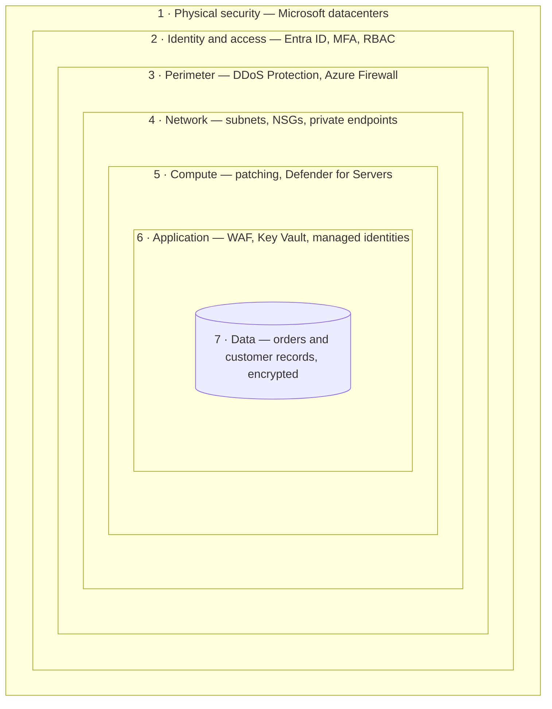
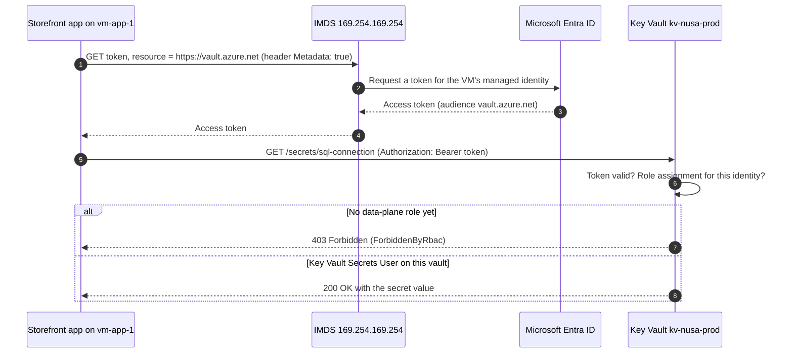

# Lunch 15 · Security Essentials: Defense in Depth, Key Vault and Defender for Cloud (Basic)

> **Track:** Core month · **Level:** Basic · **Part 4:** Secure, operate and govern
> **Time:** 60 minutes · **Prerequisite lunches:** 04, 05, 06 (08 helps)
> **AZ-900 skill area:** Describe Azure architecture and services
> **Lab:** [Lab 15 · Get the password out of the config file](../../labs/15-security-essentials/README.md) — about 45 minutes · cost 💲💲

| ⏱ Minutes | Segment |
|---:|---|
| 5 | Scenario and objectives |
| 25 | Reading |
| 15 | Demo: interactive animation (+ optional walkthrough video) |
| 5 | Knowledge check |
| 5 | Key takeaways and lab preview |
| 5 | Buffer — finish your lunch 🍜 |

## 🍱 Today's menu

By the end of this lunch you will be able to:

- **Explain** defense in depth and name the Azure services that protect each layer.
- **Apply** the three Zero Trust principles and the shared responsibility model to a design decision.
- **Compare** what Microsoft Defender for Cloud gives you for free with what the paid Defender plans add.
- **Choose** how to store secrets, keys and certificates in Azure Key Vault, and explain the RBAC permission model, soft delete and purge protection.
- **Describe** how a managed identity gets a token, and why that takes passwords out of code.

## 🏪 Meanwhile at Nusantara Retail

Rizky, the contractor, needs a colleague to fix a bug in the storefront, so he zips the project folder and sends it
through a chat app. Dewi spots the problem a minute too late: the zip contains `appsettings.json`, and in it sits the
password for the orders database, in plain text. Worse, the same file has lived in the Git repository for two years,
and the same password is used on three servers.

Ibu Sari calls a short meeting. "Who else has this password? And how would we even know?" Pak Budi points out that the
head-office firewall blocks attackers. You are not so sure that one wall is a plan: firewalls don't read zip files.

Today's question: **how do we protect the shop in layers, so that one mistake isn't a breach — and how do we get
secrets out of files for good?**

---

## 📖 Reading (≈25 minutes)

### 1. Defense in depth and Zero Trust: no single wall

**Defense in depth** means stacking several independent security controls, so that an attacker who gets past one
still faces the next. Each layer has a job: stop the attack, slow it down, or at least make enough noise that someone
notices. Old castles worked this way, with a moat, walls, a gate and guards. Cloud security works the same way, with
fewer crocodiles.

The AZ-900 skills outline describes seven layers, from the outside in. Picture an onion with your data at the centre:

The table maps each layer to the Azure features you meet in this course.

| Layer | Protects against | Azure features (examples) | Who looks after it |
|---|---|---|---|
| 1. Physical security | Someone entering a datacenter or walking off with a disk | Datacenter access control, cameras, secure disk destruction | Microsoft |
| 2. Identity and access | Stolen or weak passwords, too much access | Microsoft Entra ID, MFA, Conditional Access, Azure RBAC, Privileged Identity Management | You (Microsoft runs the service) |
| 3. Perimeter | Floods and attacks from the internet | Azure DDoS Protection, Azure Firewall | Shared |
| 4. Network | An attacker moving sideways between machines | Virtual networks and subnets, network security groups, private endpoints | You |
| 5. Compute | Unpatched or exposed virtual machines | Azure Update Manager, Defender for Servers, Azure Bastion, no public IPs | You (for IaaS) |
| 6. Application | Bugs, injection attacks, secrets in code | Web Application Firewall, Azure Key Vault, managed identities, secure coding | You |
| 7. Data | Data read by the wrong person, even after a leak | Encryption at rest and in transit, customer-managed keys, Microsoft Purview, backups | You |

Look at the last column. Microsoft secures the physical layer and the platform itself; almost everything inside your
subscription is your job. That is the **shared responsibility model** from Lunch 02 again. With IaaS you also patch
the operating system; with PaaS, Microsoft does that and your share shrinks. Your data, accounts and identities stay
yours in every model.

**Zero Trust** is the mindset behind modern defense in depth. It drops the old idea that everything inside the company
network can be trusted, and it rests on three principles:

- **Verify explicitly.** Decide every access request using all the signals you have: who the user is, a second factor,
  device health, location, and how sensitive the thing being opened is.
- **Use least privilege access.** Give the smallest role, at the smallest scope, for the shortest time (Lunch 05's
  RBAC, Lunch 22's just-in-time access).
- **Assume breach.** Design as if an attacker is already inside: segment networks, encrypt data, keep secrets out of
  reach and watch the logs.

Pak Budi's firewall is a perimeter control. It is useful, but it does nothing about a password inside a zip file.
That is an identity and application problem, and it needs controls at those layers.

### 2. Microsoft Defender for Cloud: a coach and a guard

Knowing the layers is one thing; checking hundreds of settings across a growing subscription by hand is another.
**Microsoft Defender for Cloud** does the checking for you. It is a cloud-native application protection platform with
two main jobs:

- **Cloud security posture management (CSPM)** is the coach. It keeps comparing your resources with security best
  practice and tells you what to fix.
- **Cloud workload protection** is the guard. Paid **Defender plans** watch running workloads and raise **security
  alerts** when something suspicious happens, such as a brute-force attempt on a VM or an unusual burst of reads from
  a key vault.

Every Azure subscription can use **foundational CSPM** at no cost. It assesses your resources against the **Microsoft
cloud security benchmark**, turns each failed check into a **recommendation** with remediation steps (often a *Fix*
button), and rolls the results into a **secure score**: a percentage where higher means less identified risk.
Defender for Cloud recalculates each security control about every eight hours, so a fix doesn't move the score
instantly. At the time of writing there are two views of the score: the classic secure score in the Azure portal, and
a newer risk-based Cloud Secure Score in the Microsoft Defender portal, which weighs how exposed and how critical each
asset is.

| | Foundational CSPM | Defender CSPM | Workload protection plans |
|---|---|---|---|
| Price | Free | Paid, per billable resource | Paid, per protected resource (server, storage account, database…) |
| Main question | "What is misconfigured?" | "Which risks could really hurt us?" | "Is someone attacking us right now?" |
| You get | Asset inventory, recommendations, secure score, remediation tools, workflow automation | Attack path analysis, cloud security explorer, agentless vulnerability and secrets scanning, data security posture, regulatory compliance assessments, governance | Security alerts from Defender for Servers (Plan 1 or 2), Storage, Databases, Containers, App Service, Key Vault, Resource Manager, APIs and AI services |
| Turn it on | From day one | For larger production estates | For the production workloads you care about |

> [!TIP]
> **Cost tip.** Paid plans bill for every protected resource for as long as they are on. In a lab subscription, look
> at the plans page but leave paid plans off. For production, estimate with the pricing calculator first, then enable
> plans for the workloads you actually run.

Recommendations are grouped into **security controls** with names such as *Enable MFA*, *Secure management ports*,
*Apply system updates* and *Encrypt data in transit*. A resource counts as healthy for a control only when it passes
every recommendation in that control, so fixing half the findings on a VM earns no points, while fixing the cause for
all resources (for example, a policy that blocks public IPs on app servers) earns the whole control. Each
recommendation shows the affected resources, the risk, and the steps or the Azure Policy that fixes it at scale
(Lunch 18).

Treat the secure score as a to-do list sorted by impact, not a grade to chase, and use its trend to show Ibu Sari that
the shop gets safer month by month. Defender for Cloud is also moving into the Microsoft Defender portal, next to
Microsoft Sentinel, so a security team can work in one place.

### 3. Azure Key Vault: one safe for secrets, keys and certificates

Rizky's zip file shows the real problem with secrets in files: files get copied — into Git, backups, chats and
laptops. **Azure Key Vault** gives every secret one home, with access control, versioning and audit logs, so
applications fetch secrets at run time instead of carrying them around. A vault holds three kinds of objects:

| Object | What it is | Nusantara Retail example | Good to know |
|---|---|---|---|
| **Secret** | Any small sensitive string; authorised callers get the value back | The orders database connection string, the payment gateway's API key | Every update creates a new version; set expiry dates |
| **Key** | A cryptographic key for encrypt/decrypt, sign/verify, wrap/unwrap | The customer-managed key that encrypts the invoice storage account | The private key never leaves the vault; you ask Key Vault to do the operation |
| **Certificate** | An X.509 certificate with its policy and lifecycle | The TLS certificate for the storefront's domain | Key Vault can renew from integrated issuers and warn before expiry |

Vaults come in two tiers: **Standard** for software-protected keys and **Premium**, which adds keys protected by
hardware security modules (HSMs). For a dedicated, single-tenant HSM there is a separate service, Azure Key Vault
Managed HSM. Microsoft recommends **one vault per application per environment**, such as `kv-nusa-prod` and
`kv-nusa-dev`, so a leak in development never exposes production.

**Two planes, two kinds of permission.** Like every Azure resource, a vault has a **control plane** (create, configure
and delete the vault through Azure Resource Manager) and a **data plane** (read and write the secrets themselves at
`https://<vault-name>.vault.azure.net`). The control plane always uses Azure RBAC. For the data plane, the **Azure RBAC
permission model** is the default and recommended choice: current Azure CLI versions create vaults with it unless you
opt out, and from Key Vault API version 2026-02-01 it is the default for every new vault. The older **access policy**
model still works, but RBAC lets you manage access in one place, at any scope, with the same tools as the rest of Azure.

This surprises people: being **Owner** of the subscription does not let you read a secret. Owner is a control-plane
role. To work with secrets you need a data-plane role, for example:

- **Key Vault Secrets User** reads secret values — exactly what an application needs.
- **Key Vault Secrets Officer** creates, updates, deletes and reads secrets — for the people who manage them.
- **Key Vault Administrator** performs every data-plane operation on keys, secrets and certificates.
- **Key Vault Reader** reads metadata but never secret values.

An Owner can still grant themselves a data role, which is one more reason to keep the list of Owners short.

**Network and logging.** By default a new vault accepts requests from any network, though every request still needs a
valid identity and role. For production, close the public endpoint with the vault firewall and allow only selected
virtual networks, or reach the vault through a private endpoint (Lunches 24 and 25). Then send the vault's audit logs
to a Log Analytics workspace with a diagnostic setting, so "who read the orders password last Tuesday?" has an answer
(Lunch 16). Give secrets expiry dates, and rotate them by adding a new version — apps that read "the latest version"
pick it up without a code change. App Service can even resolve Key Vault references in app settings for you (Lunch 10).

**Soft delete and purge protection.** Deleting a vault or a secret is not the end. **Soft delete** is on for every new
vault and can't be turned off: deleted vaults and objects stay recoverable for a retention period chosen at creation,
from 7 to 90 days (90 by default), and the vault's name stays reserved meanwhile. To **purge** is to delete permanently
before that period ends. **Purge protection** is optional: once enabled it can't be disabled, and nobody, not even an
Owner, can purge until the retention period has passed. Many services that encrypt data with your own keys require it.

> [!IMPORTANT]
> Purge protection is a one-way door. Turn it on for production vaults, especially vaults that hold encryption keys.
> In a lab, leave it off (Lab 15 does) so you can purge the vault and reuse its name straight away.

### 4. Managed identities: no secrets in code

Key Vault solves storage, but it creates a puzzle: the app must sign in to Key Vault to read its secrets, and signing
in sounds like it needs… another secret. Security people call this the "secret zero" problem.

A **managed identity** breaks the loop. It is an identity in Microsoft Entra ID (a service principal) that Azure creates
for a resource, with credentials that Azure stores and rotates. Your code never sees them. There are two kinds:

| | System-assigned | User-assigned |
|---|---|---|
| How you create it | Switch it on for one resource | Create it as its own Azure resource (`id-…`) |
| Lifecycle | Deleted together with the resource | Lives until you delete it |
| Shared between resources | No | Yes |
| Good for | One app on one VM or App Service | Many instances that need the same access, or access granted before the resources exist |

**How the token flow works.** On an Azure VM, the app asks a local endpoint, the **Azure Instance Metadata Service
(IMDS)** at `169.254.169.254`, for an access token. That address is reachable only from inside the VM, and the request
must carry the header `Metadata: true`, which protects against forged requests. The app names the **audience**, the
service the token is for, such as `https://vault.azure.net`. Azure obtains a token from Microsoft Entra ID for the
VM's identity and returns it. The app then calls Key Vault with the token, and Key Vault checks two things in order:

1. **Authentication** — is the token valid, unexpired and issued for Key Vault? A token for the wrong audience gets
   HTTP **401 Unauthorized**.
2. **Authorization** — does this identity hold a data-plane role on this vault? If not, HTTP **403 Forbidden** with the
   inner error code `ForbiddenByRbac`.

> [!WARNING]
> **Common mistakes:** committing secrets to Git and planning to "rotate later"; one shared vault for every app and
> environment; giving an app Key Vault Administrator "to make it work"; and debugging a 403 that would have fixed
> itself, because new role assignments take a few minutes to propagate. Cache secrets in memory, too — reading Key
> Vault on every web request is slow and can hit service limits.

Remember where the trust boundary sits: **any** code running on the VM can ask IMDS for the VM's tokens. A managed
identity proves "this request comes from vm-app-1", not "this request comes from the storefront process". So keep each
identity's roles small, don't share a VM between unrelated apps, and protect the VM itself (layer 5) as carefully as
the vault.

The best secret is no secret at all. Azure SQL, Azure Storage and many other services accept Entra ID tokens directly,
so the storefront's managed identity could sign in to the orders database with no password anywhere (Lunch 11). Key
Vault then holds only what really must stay a secret, like a payment provider's API key. Azure SDKs hide the token
exchange behind `DefaultAzureCredential`; Lunch 22 goes deeper.

### 5. Encryption, edge protection and a security operations centre

**Encryption at rest** is on by default. Azure Storage, managed disks and new Azure SQL databases (through Transparent
Data Encryption) encrypt data with **platform-managed keys** without any setup. When a regulator — or Ibu Sari — wants
more control, switch to **customer-managed keys** kept in Key Vault. Azure uses envelope encryption: a key in your
vault wraps the keys that encrypt the data, so disabling your key makes the data unreadable. For VMs, use **encryption
at host**, which also covers temporary disks and caches; the older Azure Disk Encryption is scheduled for retirement on
15 September 2028, so don't start new projects with it.

**Encryption in transit** means TLS on every connection: HTTPS-only web apps, a minimum TLS version on storage accounts
and databases, and an IPsec VPN or ExpressRoute with encryption for links to head office (Lunch 26).

At the edge, three network security services do different jobs. **Azure Firewall** is a managed, stateful firewall for
traffic between networks and to the internet, in Basic, Standard and Premium SKUs (Lunch 25). A **Web Application
Firewall (WAF)** on Application Gateway or Azure Front Door inspects HTTP requests and blocks common attacks such as SQL
injection (Lunch 27). **Azure DDoS Protection** absorbs floods aimed at public IP addresses, in three tiers:

| DDoS tier | What you get | Cost | Fits |
|---|---|---|---|
| Infrastructure protection | Always-on detection and mitigation of common volumetric attacks on every public IP | Included, no setup | Every workload |
| DDoS IP Protection | Mitigation tuned to each protected IP, plus metrics, alerts, mitigation reports and flow logs | Per protected public IP | A few business-critical public IPs |
| DDoS Network Protection | Everything in IP Protection, plus DDoS rapid response support, cost protection and a WAF discount | Per plan, priced per 100 protected public IPs | Many public endpoints across subscriptions |

**Microsoft Sentinel** sits on top of all this. It is Microsoft's cloud-native **SIEM** (security information and
event management) and **SOAR** (security orchestration, automation and response) service: it collects logs and alerts
from Entra ID, Azure, Defender for Cloud and other sources, correlates them into incidents, and runs playbooks built
on Logic Apps to respond automatically. Sentinel now lives in the Microsoft Defender portal; Microsoft has announced
that after 31 March 2027 it will no longer be supported in the Azure portal.

### 6. How it fits together for Nusantara Retail

Here is the plan you take back to Ibu Sari, layer by layer:

- **Identity:** MFA and Conditional Access for every staff account. Rizky's access is scoped to one resource group and
  ends with his contract (Lunches 05 and 22).
- **Perimeter and network:** DDoS infrastructure protection comes free. App servers lose their public IPs; admins use
  Run Command or Bastion. A WAF in front of the storefront follows later.
- **Application:** one vault per environment, `kv-nusa-prod` and `kv-nusa-dev`, using the RBAC permission model, with
  purge protection on in production. The storefront reads its secrets through a system-assigned managed identity that
  holds **Key Vault Secrets User** on its own vault only. Dewi holds Secrets Officer on the dev vault.
- **Data:** encryption at rest stays on, and the orders database moves to Entra-only authentication (Lunch 11).
- **Posture:** foundational CSPM is on. The team reviews the top recommendations every Monday and reports the secure
  score monthly; paid plans come later, starting with production servers.

And the leaked password? Rotate it in the database first, then store the new value only in Key Vault. A secret that
has ever been in Git must be treated as public.

> [!NOTE]
> **Pause and think:** next month Rizky's laptop, with the old zip file on it, is stolen. After today's changes, which
> layers still protect the orders database — and why is the password in that zip now worthless?

In the next lunch you'll learn to watch all of this with Azure Monitor. Lunches 22, 24, 25 and 27 go deeper into
managed identities, private endpoints, Azure Firewall and WAF.

---

## 🎬 Demo (≈15 minutes)

1. **Interactive animation (≈6–8 min):** [Open the demo](https://stefpin.github.io/azure-fundamentals-lunches/demos/15-security-essentials.html) —
   press ▶ Play or step through it at your own pace. Offline? Download
   [`docs/demos/15-security-essentials.html`](../../docs/demos/15-security-essentials.html) and open it in any browser.
2. **Walkthrough video (≤ 6 min):** _coming soon_ — [read the walkthrough script](demo-video-script.md).

What to watch for:

- Five attacks stop at five different layers — no single control does all the work.
- The first request to Key Vault is authenticated but not authorised: a valid token still gets 403 until a role exists.
- After the role assignment, the config file keeps only a pointer to the vault, never the password.

## ✅ Knowledge check (≈5 minutes)

1. Dewi is Owner of the Nusantara Retail subscription. She opens `kv-nusa-dev`, which uses the Azure RBAC permission
   model, and gets "The operation is not allowed by RBAC" when she lists secrets. What is wrong, and what is the
   least-privilege fix?
   

Show answer

   Owner is a control-plane role and grants no data-plane access. Assign Dewi **Key Vault Secrets Officer** at the
   scope of `kv-nusa-dev`. *Why:* reading or writing secrets needs a data-plane role, whatever your control-plane power.

   

2. The storefront app on a VM must read one connection string. Option A: store a service principal's client secret in
   an environment variable. Option B: enable a system-assigned managed identity and grant it Key Vault Secrets User on
   the vault. Which do you choose?
   

Show answer

   Option B. No credential exists in code, configuration or environment variables, Azure rotates it, and the role is
   read-only on one vault. *Why:* managed identities remove the "secret zero" problem.

   

3. Ibu Sari asks: "If we only want the secure score and the list of recommendations, what does Defender for Cloud cost
   us?"
   

Show answer

   Nothing: foundational CSPM is free. Defender CSPM (attack paths, risk prioritisation) and the workload protection
   plans (threat alerts) are paid. *Why:* posture assessment against the Microsoft cloud security benchmark is included.

   

4. An administrator deletes `kv-nusa-prod` by mistake. It has purge protection on and a 90-day retention period. A
   colleague wants to purge it and recreate a fresh vault with the same name. What happens?
   

Show answer

   The purge is refused and the name stays reserved, but the vault can be recovered with `az keyvault recover`, secrets
   included. *Why:* with purge protection on, nobody can permanently delete a vault before its retention period ends.

   

5. App A on one VM gets HTTP 401 `AKV10022: Invalid audience` from Key Vault. App B on another VM gets HTTP 403
   `ForbiddenByRbac`. Which check failed in each case?
   

Show answer

   App A failed **authentication**: it requested its token for the wrong audience (for example Azure Resource Manager
   instead of `https://vault.azure.net`). App B passed authentication but failed **authorization**: its identity has no
   data-plane role on the vault. *Why:* Key Vault checks who you are before what you may do.

   

## 🧠 Key takeaways

- Defense in depth stacks independent controls across seven layers; Zero Trust adds verify explicitly, least privilege
  and assume breach.
- Defender for Cloud's foundational CSPM is free and gives recommendations and a secure score; Defender CSPM and the
  workload protection plans add risk prioritisation and threat detection for a fee.
- Key Vault stores secrets, keys and certificates. Use one vault per app per environment, the RBAC permission model and,
  in production, purge protection. Soft delete is always on.
- Owner is not enough to read a secret: apps need **Key Vault Secrets User**, people who manage secrets need **Key Vault
  Secrets Officer**.
- Managed identities get tokens from IMDS, so code holds no credentials — and with Entra authentication to services such
  as Azure SQL, many secrets disappear completely.

## 🔬 Your lab: Get the password out of the config file

`setup.sh` builds Nusantara Retail's app server as it is today: a small Linux VM with no public IP and a database
password sitting in a config file. You create a key vault with the RBAC permission model, store a fresh connection
string, switch on the VM's managed identity and watch its first request fail with 403. Then you grant **Key Vault
Secrets User**, read the secret successfully from inside the VM, remove the password from the file and review your
secure score in Defender for Cloud.

- ⏱ About 45 minutes · 💲💲 · works on its own (no earlier lab needed)
- 👉 [Start Lab 15](../../labs/15-security-essentials/README.md)

## 📚 Go further

- [Microsoft Learn: Provide access to Key Vault keys, certificates, and secrets with Azure role-based access control](https://learn.microsoft.com/azure/key-vault/general/rbac-guide) — every data-plane role and how to assign it.
- [Microsoft Learn: What is Cloud Security Posture Management (CSPM)](https://learn.microsoft.com/azure/defender-for-cloud/concept-cloud-security-posture-management) — a feature-by-feature comparison of foundational CSPM and Defender CSPM.
- [Microsoft Learn: How to use managed identities for Azure resources on an Azure VM to acquire an access token](https://learn.microsoft.com/entra/identity/managed-identities-azure-resources/how-to-use-vm-token) — the IMDS token request in several languages, with error handling.
- [Microsoft Learn: Azure data encryption at rest](https://learn.microsoft.com/azure/security/fundamentals/encryption-atrest) — platform-managed versus customer-managed keys and envelope encryption.

---

⬅️ [Lunch 14 · Serverless: Azure Functions, Logic Apps and Event Grid](../14-serverless/README.md) · 🏠 [Course home](../../README.md) · [Lunch 16 · Monitoring (Basic): Azure Monitor, Alerts, Service Health and Advisor](../16-monitoring-basic/README.md) ➡️

Last validated: October 2026 · Spotted something out of date? [Open an issue](../../CONTRIBUTING.md).
