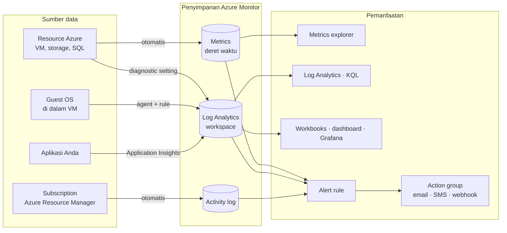
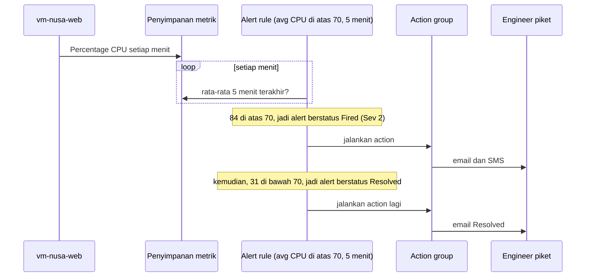
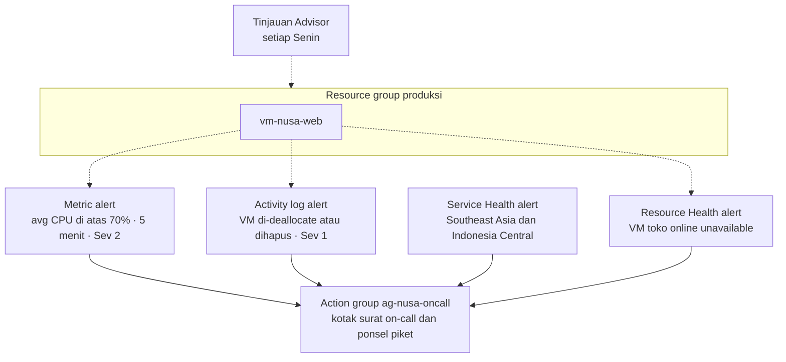

# Makan Siang 16 · Pemantauan (Dasar): Azure Monitor, Alert, Service Health, dan Advisor

🇬🇧 [Read in English](README.md)

> **Jalur:** Bulan inti · **Level:** Dasar · **Bagian 4:** Keamanan, operasional, dan tata kelola
> **Waktu:** 60 menit · **Makan siang prasyarat:** 04, 06
> **Area keterampilan AZ-900:** Menjelaskan manajemen dan tata kelola Azure
> **Lab:** [Lab 16 · Tahu lebih dulu daripada pelanggan](../../labs/16-monitoring-basic/README.id.md) — sekitar 45 menit · biaya 💲💲
> **Penulis:** Stefanus Pinarta · [Tentang penulis](../../README.id.md#tentang-penulis)

| ⏱ Menit | Segmen |
|---:|---|
| 5 | Skenario dan tujuan |
| 25 | Bacaan |
| 15 | Demo: animasi interaktif (+ video panduan opsional) |
| 5 | Uji pemahaman |
| 5 | Poin penting dan pratinjau lab |
| 5 | Waktu cadangan — habiskan makan siang Anda 🍜 |

## 🍱 Menu hari ini

Setelah makan siang ini, Anda akan mampu:

- **Menjelaskan** apa yang dikumpulkan Azure Monitor dengan sendirinya (metrik platform dan activity log) dan apa yang
  harus Anda aktifkan sendiri (resource log, data guest dari dalam sistem operasi VM, dan telemetri aplikasi).
- **Membandingkan** metrik dan log, lalu memilih yang tepat untuk pertanyaan seperti "Apakah CPU sedang sibuk?" dan
  "Siapa yang menghentikan VM ini?".
- **Memilih** antara metric alert, log search alert, dan activity log alert, serta **merancang** action group yang
  menjangkau orang yang tepat.
- **Membedakan** halaman status Azure, Service Health, dan Resource Health, serta **menggunakan** lima kategori
  rekomendasi Azure Advisor.

## 🏪 Sementara itu di Nusantara Retail

Jumat, pukul 19.40. Flash sale kemeja batik sedang ramai-ramainya, dan layanan checkout toko online masih berjalan di
satu VM Azure. Pukul 19.52, seorang pelanggan menulis di Instagram: *"Website super lambat, checkout gagal terus"*.
Empat puluh komentar kemudian, pukul 20.30, seseorang dari tim marketing meneruskan tangkapan layarnya kepada Anda. Anda
membuka portal: CPU VM itu sudah mentok di dekat 100% selama empat puluh menit.

Sabtu pagi, checkout mati lagi. Kali ini VM-nya ternyata dihentikan, dan di grup chat tim semua orang, termasuk Rizky
si kontraktor, kompak menjawab *"bukan saya"*. Pak Budi bertanya-tanya apakah Azure sendiri sedang mengalami gangguan.

Senin, Ibu Sari punya dua pertanyaan untuk Anda: "Kenapa pelanggan kita tahu lebih dulu daripada kita? Dan lain kali,
seberapa cepat Anda bisa memberi tahu saya *apa* yang terjadi dan *siapa* pelakunya?"

Hari ini Anda merancang sistem peringatan dini untuk Nusantara Retail — dan mempelajari di mana Azure menyimpan barang
buktinya.

---

## 📖 Bacaan (≈25 menit)

### 1. Azure Monitor: satu platform, empat pertanyaan

Ketika ada yang tidak beres di produksi, Anda butuh jawaban cepat untuk empat pertanyaan:

- **Apakah berjalan?** Ketersediaan (availability): apakah pelanggan bisa menjangkau toko sama sekali?
- **Apakah berjalan dengan baik?** Performa: CPU, memori, waktu respons, tingkat error.
- **Apa yang berubah, dan siapa yang mengubahnya?** Audit: perubahan ukuran (resize), penghentian, aturan yang terhapus.
- **Masalahnya di pihak kita atau di Azure?** Kesehatan platform: insiden di region (*wilayah*), atau pemeliharaan
  terencana.

**Azure Monitor** adalah layanan Azure yang mengumpulkan, menyimpan, menganalisis, dan menindaklanjuti data pemantauan
(monitoring). Layanan ini menghimpun data dari resource (*sumber daya*) Azure, dari sistem operasi di dalam VM
(*komputer virtual*) Anda, dari aplikasi Anda, dan dari subscription (*langganan*) itu sendiri. Untuk bagian
platformnya, tidak ada yang perlu di-deploy: setiap subscription sudah memilikinya. Alert (*pemberitahuan*),
Application Insights, Service Health alert, dan banyak halaman "insights" di portal adalah fitur yang dibangun di atas
satu platform ini.

Di portal, semuanya berada di bawah **Monitor**: Metrics, Logs, Alerts, Activity log, Service Health, Workbooks, dan
halaman-halaman insights. Sebagian besar resource juga menampilkan potongan data yang sama di menunya sendiri: halaman
**Metrics**, **Alerts**, dan **Activity log** milik sebuah VM hanyalah tampilan Monitor yang difilter untuk VM itu saja.

Pelajaran paling berguna bagi pemula: sebagian data pemantauan **dikumpulkan otomatis dan gratis**, sedangkan data
lainnya harus **diaktifkan** dulu, dan biasanya mulai berbayar begitu data itu masuk ke sebuah workspace.

| Data | Dikumpulkan otomatis? | Disimpan selama | Biaya pengumpulan |
|---|---|---|---|
| Metrik platform (CPU, jaringan, disk) | Ya, biasanya setiap menit | 93 hari | Tidak dikenai biaya |
| Activity log (operasi control plane) | Ya | 90 hari | Tidak dikenai biaya |
| Resource log (operasi di dalam sebuah resource) | Tidak: perlu diagnostic setting | tergantung tujuannya | ditagih di tempat tujuan |
| Log dan performance counter dari guest OS | Tidak: perlu Azure Monitor Agent (Makan Siang 30) | sesuai retensi workspace | ditagih per GB yang diserap (ingested) |
| Telemetri aplikasi (permintaan, error) | Tidak: perlu Application Insights | sesuai retensi workspace | ditagih per GB yang diserap |

Diagram berikut menunjukkan gambaran besarnya. Data masuk dari kiri, mendarat di salah satu dari tiga tempat
penyimpanan, lalu dimanfaatkan di kanan.



> [!TIP]
> Mulailah setiap investigasi dengan data yang gratis. Buka VM di portal dan lihat tab **Monitoring** atau
> **Metrics**-nya: riwayat CPU, disk, dan jaringan selama berminggu-minggu sudah tersedia, tanpa satu pengaturan pun
> diubah.

### 2. Metrik dan log: dua jenis barang bukti

**Metrik** (metrics) adalah angka yang diukur pada interval yang teratur. Setiap nilai punya cap waktu (timestamp) dan
milik satu resource, dan sebagian metrik punya **dimensi** (dimensions), yaitu label tambahan seperti nama disk atau nama
API, sehingga Anda bisa memecah sebuah grafik. Metrik disimpan di database deret waktu (time series) yang dirancang untuk
kecepatan, sehingga sangat cocok untuk grafik dan untuk alert yang harus terpicu dalam hitungan menit.

Setiap kali membaca metrik, Anda juga memilih **agregasi** (cara merangkum banyak sampel menjadi satu angka) untuk
setiap rentang waktu (time grain): **Average**, **Minimum**, **Maximum**, **Sum** (di portal disebut Total), atau
**Count**. Agregasi mengubah cerita. Bayangkan VM toko online melonjak ke CPU 100% selama sepuluh detik setiap menit,
lalu menganggur di antaranya. Untuk setiap menit, nilai maksimumnya 100%, rata-ratanya sekitar 20%, dan minimumnya
mendekati nol. Ketiga angka itu benar; masing-masing menjawab pertanyaan yang berbeda.

Untuk VM, metrik platform seperti *Percentage CPU*, *Network In Total*, dan *Disk Read Bytes* diukur oleh host Azure
(server fisik tempat VM berjalan), dari luar sistem operasi, sehingga tetap berfungsi walaupun tidak ada apa pun yang
terpasang di dalam VM. Hal yang tidak terlihat dari host, seperti ruang kosong di dalam file system, pemakaian per proses,
dan log sistem, membutuhkan Azure Monitor Agent, yang akan Anda temui di Makan Siang 30. Metrics explorer menampilkan
grafik hingga 30 hari sekaligus; geser grafiknya untuk menjangkau data yang lebih lama, dalam batas 93 hari.

**Log** adalah catatan: baris-baris dengan banyak kolom. Satu baris log bisa berbunyi "GET /checkout mengembalikan 500
dalam 2,3 detik" atau "pengguna dewi@nusantara membaca secret db-password". Log disimpan dalam tabel di sebuah **Log
Analytics workspace** dan ditelusuri dengan **Kusto Query Language (KQL)**, bahasa kueri khusus untuk data seperti ini.
Log lebih kaya daripada metrik dan bisa menjawab *yang mana*, *siapa*, dan *mengapa*, tetapi Anda membayar untuk setiap
gigabyte yang dikirim dan disimpan, dan log biasanya tiba beberapa detik hingga beberapa menit setelah kejadiannya.

Ibaratnya sebuah warung. Metrik itu seperti angka di meteran listrik token PLN: satu angka yang terus diperbarui dan
cepat dibaca, tetapi tidak bisa menjelaskan alat mana yang menyedot listrik. Log lebih mirip buku kas warung: baris demi
baris mencatat siapa membeli apa, kapan, dan berapa. Isinya jauh lebih lengkap, tetapi butuh waktu untuk ditulis dan
dibaca, dan bukunya makin lama makin tebal.

| | Metrik | Log |
|---|---|---|
| Bentuk | angka dari waktu ke waktu | baris dengan banyak kolom |
| Contoh | Percentage CPU = 87 pada pukul 19.41 | "GET /checkout mengembalikan 500 pada pukul 19.41.07" |
| Kesegaran data | mendekati real time | biasanya beberapa detik hingga beberapa menit |
| Dijelajahi dengan | Metrics explorer | Log Analytics (KQL) |
| Pertanyaan yang cocok | "Apakah CPU sedang tinggi saat ini?" | "Permintaan mana yang gagal, dan mengapa?" |
| Jenis alert | metric alert | log search alert |
| Biaya | metrik platform gratis | bayar per GB yang diserap dan disimpan |

Dua sumber data khusus layak dilihat lebih dekat.

**Activity log** (log aktivitas) mencatat setiap operasi **control plane** (operasi untuk mengelola resource itu
sendiri) di sebuah subscription: membuat, memperbarui, menghapus, menyalakan, menghentikan, dan mengubah ukuran
resource, menetapkan peran, dan sebagainya. Setiap entri berisi waktu, operasi, status, resource, dan **caller**,
yaitu pengguna atau service principal yang mengajukan permintaan itu. Activity log juga mengumpulkan event Service
Health dan Resource Health, aktivasi alert, aksi autoscale (penskalaan otomatis), rekomendasi Advisor, alert dari
Defender for Cloud (*Microsoft Defender untuk Cloud*), dan aksi Azure Policy. Activity log aktif secara default,
gratis, dan disimpan selama 90 hari, dan entrinya tidak bisa diubah atau dihapus; justru karena itulah auditor
memercayainya. Operasi yang hanya membaca, seperti membuka halaman sebuah VM, biasanya tidak dicatat. Jika Anda butuh
lebih dari 90 hari, atau ingin menelusurinya dengan KQL, ekspor activity log ke sebuah workspace dengan diagnostic
setting.

**Resource log** menggambarkan apa yang terjadi *di dalam* sebuah resource, yaitu di **data plane**. Membaca secret dari
Key Vault, mengunduh sebuah blob (file di Blob storage), atau menjalankan kueri di database adalah operasi data plane;
operasi seperti ini tidak pernah muncul di activity log. Resource log tidak dikumpulkan sampai Anda membuat **diagnostic
setting** pada resource tersebut. Diagnostic setting menentukan kategori log (atau grup kategori seperti *audit* atau
*allLogs*) dan tujuannya: Log Analytics workspace untuk kueri dan alert, storage account (*akun penyimpanan*) untuk
arsip jangka panjang yang murah, Event Hubs untuk mengalirkan data ke alat lain seperti SIEM (sistem pemantauan
keamanan), atau solusi mitra yang didukung. Setting yang sama juga bisa mengirim metrik platform ke workspace, misalnya
agar tersimpan lebih dari 93 hari.

Bayangkan sebuah kompleks perumahan. Activity log adalah buku tamu di pos satpam: siapa masuk, siapa membongkar pagar,
siapa mengganti gembok, semuanya tercatat otomatis dan tidak bisa dihapus. Namun, buku tamu itu tidak tahu apa yang
terjadi di dalam rumah. Untuk itu, Anda harus memasang CCTV sendiri di dalam rumah, dan itulah peran resource log yang
diaktifkan lewat diagnostic setting.

Berikut sekilas rasa KQL untuk menelusuri activity log yang sudah diekspor. Anda akan mempelajari bahasa ini dengan
benar di Makan Siang 30.

```kusto
AzureActivity
| where OperationNameValue has "deallocate"
| project TimeGenerated, Caller, ResourceGroup, ActivityStatusValue
```

> [!WARNING]
> Resource log **nonaktif** secara default. Tim biasanya baru menyadarinya saat insiden: auditor bertanya siapa yang
> membaca kata sandi database dari Key Vault Selasa lalu, dan tidak ada apa pun yang bisa ditunjukkan. Ingat
> pembagiannya: activity log memberi tahu siapa yang *mengubah vault*; hanya resource log yang memberi tahu siapa yang
> *membaca secret*. Buat diagnostic setting saat Anda membuat resource, atau biarkan Azure Policy mewajibkannya (Makan
> Siang 18 dan 31).

### 3. Alert: dari sinyal ke ponsel seseorang

Sebuah **alert rule** (aturan alert) punya empat bagian:

1. **Scope** (cakupan) — apa yang diawasi: satu resource, beberapa resource, sebuah resource group (*grup sumber daya*),
   atau sebuah subscription.
2. **Condition** (kondisi) — sinyal dan logikanya, misalnya "rata-rata Percentage CPU lebih besar dari 70".
3. **Actions** (tindakan) — satu atau beberapa **action group** yang dijalankan saat rule terpicu (fired).
4. **Details** (detail) — nama, deskripsi, dan **severity** (tingkat keparahan) dari Sev0 (kritis) hingga Sev4
   (verbose, sekadar informasi rinci).

Ketika kondisinya terpenuhi, Azure Monitor membuat sebuah **alert**, yaitu satu kejadian yang bisa Anda lihat, akui
(acknowledge), dan tutup di halaman Alerts, lalu menjalankan action group yang terpasang. Alert disimpan selama 30 hari.
Setiap alert membawa dua kolom status: *monitor condition* (Fired atau Resolved), yang diatur oleh Azure, dan *alert
state* (New, Acknowledged, atau Closed), yang diatur oleh tim Anda selama menangani masalahnya.

| Jenis alert | Yang diawasi | Contoh rule di Nusantara | Perilaku |
|---|---|---|---|
| Metric alert | sebuah metrik, dievaluasi setiap 1–60 menit | "CPU rata-rata di atas 70% selama 5 menit" | stateful (mengingat status) secara default: terpicu sekali, lalu resolved dengan sendirinya saat kondisinya hilang |
| Log search alert | hasil kueri KQL yang dijalankan sesuai jadwal | "Lebih dari 5 checkout gagal dalam 10 menit" | stateful secara default; bisa dibuat stateless |
| Activity log alert | event baru di activity log yang cocok dengan kondisi | "Sebuah VM di grup produksi di-deallocate" | stateless (tidak mengingat status): terpicu untuk setiap event yang cocok |

Service Health alert dan Resource Health alert juga termasuk activity log alert. Nanti di kursus ini Anda juga akan
bertemu smart detection (deteksi anomali otomatis) di Application Insights dan Prometheus alert untuk kontainer
(Prometheus adalah sistem pemantauan open source yang populer).

Perhatikan baik-baik kondisi sebuah metric alert, karena kebanyakan alert yang rusak, rusaknya di sini. "Average
Percentage CPU lebih besar dari 70, window 5 menit, frequency 1 menit" artinya: setiap menit, ambil sampel lima menit
terakhir (window), hitung rata-ratanya, lalu bandingkan hasilnya dengan 70. Ganti satu kata saja, maknanya ikut berubah:

- **Maximum** selama 5 menit: "kapan saja dalam periode itu" — peka, dan berisik kalau CPU sering melonjak sebentar.
- **Average** selama 5 menit: "secara rata-rata" — pilihan default yang masuk akal untuk CPU.
- **Minimum** selama 1 jam: "*sepanjang* satu jam penuh" — begitu ketat sehingga krisis 15 menit tidak akan pernah
  memicunya.

Ibaratnya alarm banjir yang baru berbunyi kalau air setinggi lutut bertahan selama satu jam penuh tanpa surut sedetik
pun: banjir kiriman yang merendam garasi selama 15 menit tidak akan pernah membunyikannya.

Window yang lebih panjang meredam lonjakan tetapi lambat bereaksi; window yang lebih pendek cepat bereaksi tetapi bisa
flapping (bolak-balik terpicu dan pulih). Jika beban Anda punya ritme harian, **dynamic thresholds** mempelajari seperti
apa kondisi normal untuk setiap jam dan memicu alert pada nilai yang tidak biasa, bukan pada angka tetap.

**Action group** adalah daftar bernama yang bisa dipakai ulang, berisi *siapa yang diberi tahu* dan *apa yang
dijalankan*. Notifikasinya mencakup email, SMS, panggilan suara, push notification ke aplikasi seluler Azure, dan email
ke semua orang yang memegang peran Azure Resource Manager (seperti Owner) di subscription. Aksinya mencakup webhook,
Azure Functions, Logic Apps, runbook Automation, Event Hubs, dan konektor IT service management (ITSM). Satu action group
bisa melayani banyak rule. Batas laju (rate limit) bawaan melindungi orang dari banjir notifikasi: pada saat tulisan ini
dibuat, sebuah alamat email menerima paling banyak 100 email alert per jam dari satu region, dan sebuah nomor telepon
paling banyak satu SMS setiap lima menit. Aktifkan **common alert schema** agar setiap otomatisasi menerima bentuk
payload (isi pesan) yang sama, apa pun jenis alert-nya.



Dua alat lagi membuat alerting tetap manusiawi. **Alert processing rules** (dulu disebut action rules) mengubah apa yang
terjadi setelah alert terpicu: aturan ini bisa meredam notifikasi selama jendela pemeliharaan terencana, misalnya Sabtu
pukul 01.00–03.00 saat Rizky menambal (patch) VM, atau menambahkan action group ke setiap alert di sebuah subscription.
Aturan ini tidak memengaruhi Service Health alert. Dan disiplin **severity** itu penting: kalau semuanya Sev0, berarti
tidak ada yang benar-benar Sev0.

> [!IMPORTANT]
> Alert rule tanpa action group hanya muncul di halaman Alerts di portal — tidak ada yang menerima email. Selalu pasang
> action group, dan arahkan ke kotak surat bersama (shared mailbox) atau jadwal piket on-call, bukan ke satu orang yang
> mungkin sedang cuti.

Alert rule yang baik punya empat kebiasaan yang sama. Setiap rule bisa **ditindaklanjuti** (actionable: penerimanya tahu
apa yang harus dilakukan), memakai **severity yang tepat**, menjangkau **penerima yang tepat**, dan sudah **diuji**.
Tombol *Test action group* di portal mengirim notifikasi contoh, sehingga Anda tahu bahwa email-nya masuk ke folder spam
pada hari Selasa yang tenang, bukan di tengah insiden.

Metrik platform memang gratis, tetapi tidak semua alert rule gratis: metric alert rule dan log search alert rule dikenai
biaya bulanan kecil per deret waktu (time series) yang dipantau atau per rule, dan satu subscription bisa menampung
paling banyak 100 activity log alert rule. Periksa halaman harga Azure Monitor sebelum Anda membuat ratusan rule.

### 4. Masalah Azure atau masalah kita? Service Health, Resource Health, dan Advisor

Azure memberi Anda tiga sudut pandang tentang kesehatannya sendiri, dari yang paling luas hingga yang paling sempit:

- **Halaman status Azure** (Azure status page) adalah tampilan publik dan global untuk insiden yang dampaknya luas.
  Halaman ini tidak tahu apa-apa tentang subscription Anda.
- **Service Health** bersifat personal: melaporkan layanan dan region yang *Anda* pakai. Isinya: **service issue**
  (insiden yang sedang terjadi), **planned maintenance** (pemeliharaan terencana), **health advisory** (perubahan yang
  membutuhkan tindakan Anda, seperti fitur yang akan dipensiunkan), dan **security advisory** (pemberitahuan keamanan),
  lengkap dengan kabar terbaru selama insiden dan analisis akar masalah (root-cause analysis) sesudahnya.
- **Resource Health** melihat satu resource, misalnya VM ini atau database ini, dan melaporkan **Available**,
  **Unavailable**, **Degraded**, atau **Unknown**, lengkap dengan alasannya (misalnya *platform initiated*, dipicu oleh
  platform, versus *user initiated*, dipicu oleh pengguna) dan riwayatnya.

| | Halaman status Azure | Service Health | Resource Health |
|---|---|---|---|
| Cakupan | seluruh Azure, semua region | layanan dan region milik subscription Anda | satu resource |
| Menjawab | "Apakah ada gangguan besar?" | "Apakah ada insiden atau pemeliharaan Azure yang memengaruhi layanan yang saya pakai?" | "Apakah resource *ini* sehat, dan kalau tidak, mengapa?" |
| Dipersonalisasi | tidak | ya | ya |
| Alert | tidak ada | Service Health alert | Resource Health alert |
| Contoh di Nusantara | mengecek saat terjadi gangguan besar yang ramai diberitakan | "Virtual Machines in Southeast Asia: service issue" | "vm-nusa-web: Unavailable, user initiated" |

Bayangkan listrik di rumah Anda padam. Halaman status Azure itu seperti berita nasional tentang pemadaman besar.
Service Health seperti pemberitahuan PLN untuk gardu di wilayah Anda. Resource Health seperti memeriksa MCB (sakelar
pengaman) di rumah sendiri: turun karena Anda menyalakan terlalu banyak alat (user initiated), atau karena aliran dari
PLN memang terputus (platform initiated)?

Gunakan ketiganya bersama-sama, dari yang sempit ke yang luas. Mulailah dari Resource Health pada resource yang
bermasalah: unavailability yang *user-initiated* mengarahkan Anda ke activity log; yang *platform-initiated* mengarahkan
Anda ke Service Health. Setiap subscription layak punya **Service Health alert**, yaitu activity log alert dengan cakupan
subscription, difilter untuk region dan layanan yang Anda pedulikan (Southeast Asia dan Indonesia Central untuk
Nusantara Retail), dan tersambung ke sebuah action group. Tambahkan **Resource Health alert** untuk resource yang
kritis, seperti VM toko online dan database pesanan.

**Azure Advisor** adalah konsultan gratis di portal. Advisor menganalisis konfigurasi dan pemakaian Anda, lalu memberikan
rekomendasi yang dipersonalisasi dalam lima kategori:

| Kategori | Yang dicari | Contoh di Nusantara |
|---|---|---|
| Reliability (keandalan) | risiko ketahanan dan kelangsungan layanan | "Gunakan availability zone (*zona ketersediaan*) untuk VM toko online"; "aktifkan cadangan (backup)" |
| Security (keamanan) | kelemahan, diambil dari Microsoft Defender for Cloud | "Tutup port manajemen pada VM yang terhubung ke internet" |
| Performance (performa) | resource yang membatasi kecepatan | tier disk atau database yang terlalu kecil untuk bebannya |
| Cost (biaya) | pemborosan dan peluang penghematan | "Sesuaikan ukuran atau matikan VM yang jarang terpakai"; reservasi untuk workload yang stabil |
| Operational excellence (keunggulan operasional) | kerapian proses dan deployment | "Buat Azure Service Health alert" |

Anda bisa menunda (postpone) atau mengabaikan (dismiss) sebuah rekomendasi dengan alasan tertentu, memantau kemajuan
dengan **Advisor score**, dan menerima alert saat muncul rekomendasi baru. Saran biaya dari Advisor menjadi bahan Makan
Siang 19, dan saran keamanannya adalah daftar yang sama dengan yang Anda lihat di Defender for Cloud pada Makan Siang
15. Satu keanehan bagi penulis skrip: Azure CLI dan API masih menyebut kategori reliability sebagai *HighAvailability*.

### 5. Lihat datanya, lalu satukan semuanya untuk Nusantara Retail

Data yang tidak bisa Anda lihat tidak ada gunanya pada pukul 20.00 di hari Jumat. Azure menyediakan beberapa cara untuk
melihatnya:

- **Metrics explorer** untuk grafik cepat dari satu atau beberapa metrik, yang bisa Anda sematkan (pin) ke **Azure
  dashboard**.
- **Workbooks** — laporan interaktif yang memadukan teks, grafik metrik, dan kueri log, dengan parameter seperti "pilih
  sebuah VM".
- **Azure Monitor dashboards with Grafana** (Grafana adalah alat dasbor open source yang populer), yang sudah tersedia
  di portal tanpa biaya tambahan, dan **Azure Managed Grafana**, layanan berbayar untuk tim yang juga butuh sumber
  data di luar Azure, alerting Grafana, atau laporan terjadwal.
- **Insights** — tampilan siap pakai seperti VM insights dan Application Insights.

**Application Insights** layak dikenalkan hari ini, karena masalah hari Jumat itu sebenarnya masalah aplikasi.
Application Insights adalah fitur application performance monitoring (pemantauan performa aplikasi) milik Azure
Monitor: ia mencatat setiap permintaan ke toko online, berapa lama prosesnya, apakah gagal, dependensi mana (database,
API pembayaran) yang dipanggil, dan exception (galat program) apa saja yang muncul. Fitur ini juga bisa menjalankan
**availability test** yang memanggil situs Anda dari beberapa lokasi di seluruh dunia. Resource Application Insights
yang baru menyimpan datanya di Log Analytics workspace, dan Anda menambahkannya dengan autoinstrumentation (pemasangan
otomatis tanpa mengubah kode) atau pustaka OpenTelemetry (standar terbuka untuk mengumpulkan telemetri). Makan Siang
30 membahasnya secara mendalam.

Inilah paket awal (starter kit) yang akan Anda usulkan kepada Ibu Sari:



1. Sebuah action group, `ag-nusa-oncall`, yang mengirim email ke kotak surat on-call tim TI dan SMS ke ponsel piket.
2. Metric alert pada VM toko online: CPU rata-rata di atas 70% selama lima menit, Sev 2.
3. Activity log alert: VM mana pun di resource group produksi yang di-deallocate atau dihapus, Sev 1.
4. Service Health alert untuk insiden dan pemeliharaan di region yang dipakai Nusantara Retail.
5. Resource Health alert untuk VM toko online.
6. Diagnostic setting pada Key Vault dan database pesanan, sehingga pertanyaan "siapa membaca apa" bisa dijawab.
7. Sepuluh menit setiap Senin bersama Advisor.

Dengan semua ini, cerita Jumat berikutnya akan berbeda. Ponsel piket bergetar sekitar lima menit setelah CPU mulai naik,
jauh sebelum Instagram heboh. Hari Sabtu, activity log menyebutkan nama orang yang menghentikan VM, Resource Health
memberinya label *user initiated*, dan Service Health memastikan Azure baik-baik saja. Itulah jawaban untuk dua
pertanyaan Ibu Sari: Anda akan tahu lebih dulu, dan Anda akan tahu penyebabnya.

> [!NOTE]
> **Renungkan sejenak:** Pukul 02.10, Resource Health menampilkan VM toko online sebagai *Unavailable — user
> initiated*, dan Service Health tidak menunjukkan insiden apa pun di Southeast Asia. Ke mana Anda mencari berikutnya
> untuk mengetahui siapa pelakunya, dan jenis alert apa yang akan membangunkan Anda pukul 02.01, bukan pukul 08.00?

**Pendalaman:** [Makan Siang 30 · Pemantauan (Lanjutan): Log Analytics, KQL, dan Application Insights](../30-monitoring-advanced/README.id.md) membahas secara
mendalam desain Log Analytics workspace, Azure Monitor Agent, KQL, dan Application Insights.

---

## 🎬 Demo (≈15 menit)

1. **Animasi interaktif (≈6–8 menit):** [Buka demo](https://stefpin.github.io/azure-fundamentals-lunches/demos/16-monitoring-basic.html?lang=id) —
   tekan ▶ Putar atau telusuri langkah demi langkah sesuai kecepatan Anda. Sedang offline? Unduh
   [`docs/demos/16-monitoring-basic.html`](../../docs/demos/16-monitoring-basic.html) lalu buka di browser apa pun.
2. **Video panduan (≤ 6 menit):** _segera hadir_ — [baca naskah video](demo-video-script.id.md).

Yang perlu diperhatikan:

- Bagaimana metrik berubah menjadi alert: rule merata-ratakan CPU selama lima menit, terpicu sekali, mengirim email ke
  engineer piket, lalu belakangan mengirim pesan "Resolved".
- Mengapa rule buatan Rizky tidak pernah terpicu: agregasi dan window mengubah arti "CPU tinggi".
- Bagaimana activity log menyebutkan caller yang men-deallocate VM, dan bagaimana activity log alert melaporkannya dalam
  hitungan menit.
- Perbedaan cakupan antara Service Health (layanan dan region Anda) dan Resource Health (satu resource).

## ✅ Uji pemahaman (≈5 menit)

1. Dewi ingin menerima email dalam beberapa menit setiap kali CPU VM toko online bertahan di atas 80% selama lima menit.
   Jenis alert apa yang sebaiknya ia buat, dan dengan agregasi apa?
   <details><summary>Lihat jawaban</summary>

   **Metric alert** pada *Percentage CPU* dengan agregasi **Average** dan window 5 menit. *alasannya:* metrik platform
   masuk otomatis setiap menit, sehingga metric alert bereaksi cepat tanpa agent atau workspace apa pun.

   </details>
2. Sabtu lalu VM toko online dihentikan dan di-deallocate. Ibu Sari ingin tahu nama pelakunya sebelum makan siang. Di
   mana Anda mencarinya?
   <details><summary>Lihat jawaban</summary>

   Di **activity log** (kategori Administrative): filter berdasarkan operasi *Deallocate Virtual Machine*, lalu baca
   kolom **Caller**. *alasannya:* setiap operasi control plane dicatat otomatis, lengkap dengan caller-nya, selama 90
   hari.

   </details>
3. Seorang auditor bertanya pengguna mana saja yang mengunduh PDF faktur dari Blob storage minggu lalu. Storage account
   itu sudah ada selama setahun dengan pengaturan default. Bisakah Anda menjawabnya?
   <details><summary>Lihat jawaban</summary>

   **Tidak bisa.** Unduhan adalah operasi data plane, yang hanya dicatat di **resource log**, dan resource log baru
   dikumpulkan setelah Anda membuat **diagnostic setting**. Buat sekarang agar pertanyaan serupa bisa dijawab lain kali.
   *alasannya:* activity log mencakup perubahan di control plane, bukan pembacaan data.

   </details>
4. Rizky membuat alert: "Minimum Percentage CPU lebih besar dari 70 selama 1 jam". Selama lonjakan flash sale 15 menit,
   CPU bertahan di 100%, tetapi alert itu tidak pernah terpicu. Mengapa, dan kondisi apa yang lebih baik?
   <details><summary>Lihat jawaban</summary>

   **Minimum selama satu jam** hanya terpicu jika CPU bertahan di atas 70% *sepanjang* jam itu, sehingga lonjakan 15
   menit tidak akan pernah memenuhinya. Gunakan **Average selama 5 menit** (dievaluasi setiap menit). *alasannya:*
   agregasi dan window menentukan arti "tinggi".

   </details>
5. VM toko online tidak bisa dijangkau. Resource Health menyatakan *Unavailable — platform initiated*, dan Service
   Health menampilkan service issue yang sedang aktif untuk Virtual Machines di Southeast Asia. Masalah siapa ini, dan
   apa yang harus Anda lakukan?
   <details><summary>Lihat jawaban</summary>

   Ini **masalah platform Azure**, bukan perubahan yang dibuat tim Anda. Ikuti kabar terbaru insidennya di **Service
   Health**, jalankan rencana pemulihan Anda (Makan Siang 17), dan pastikan ada **Service Health alert** agar Anda yang
   pertama tahu jika insiden berikutnya terjadi. *alasannya:* unavailability yang platform-initiated ditambah masalah
   regional yang sedang aktif menunjuk ke Azure, bukan ke konfigurasi Anda.

   </details>

## 🧠 Poin penting

- Metrik platform dan activity log dikumpulkan otomatis dan gratis; resource log, data guest OS, dan telemetri aplikasi
  harus diaktifkan dulu dan ditagih di tempat data itu mendarat.
- Metrik menjawab "berapa banyak, saat ini?" dengan cepat dan murah; log menjawab "apa, yang mana, siapa, dan mengapa?"
  dengan KQL.
- Alert rule = scope + condition + action group + severity. Agregasi dan window menentukan apakah rule itu pernah
  terpicu, dan action group menentukan apakah ada yang mendengarnya.
- Activity log memberi tahu siapa mengubah apa; Resource Health memberi tahu apakah satu resource sehat dan mengapa;
  Service Health memberi tahu tentang insiden dan pemeliharaan Azure di layanan dan region Anda.
- Azure Advisor memberikan rekomendasi gratis yang dipersonalisasi dalam lima kategori, yaitu keandalan (reliability),
  keamanan, performa, biaya, dan keunggulan operasional, jadi jadikan peninjauannya sebuah kebiasaan.

## 🗒️ Catatan lapangan dari Stefanus

> **Alert yang diabaikan tak lebih dari alarm mobil di parkiran mal.** Semua orang mendengarnya meraung, tetapi tidak
> ada yang menoleh. Supaya alert saya tidak bernasib sama, sebelum membuat alert rule saya menulis deskripsinya sebagai
> pesan untuk orang yang akan membacanya tengah malam: apa artinya, apa yang pertama kali harus dicek, dan kapan harus
> eskalasi. Kalau kalimat itu tidak bisa saya tulis, rule-nya belum siap, atau tempatnya memang di dashboard, bukan di
> kotak masuk orang. Sebulan sekali, sebelum alert-alert itu hilang dari halaman Alerts, saya menyisir semua yang pernah
> terpicu: yang tidak ditindaklanjuti siapa pun saya setel ulang, saya turunkan severity-nya, atau saya hapus. Dan saya
> tidak pernah memercayai action group yang belum diuji dari ujung ke ujung, langsung di ponsel orang yang sedang
> piket.

## 🔬 Lab Anda: Tahu lebih dulu daripada pelanggan

Anda akan membangun sistem peringatan dini pertama Nusantara Retail di sekitar sebuah VM toko online yang kecil: action
group yang mengirim email kepada Anda, metric alert CPU yang Anda picu sendiri dengan Run Command, activity log alert yang
menangkap VM yang di-deallocate, dan Service Health alert untuk subscription Anda. Setelah itu Anda akan menjawab "siapa
pelakunya?" dari activity log, meninjau rekomendasi Advisor, dan memperbaiki alert rule rusak yang tidak pernah terpicu.
Inilah pengaturan yang dibutuhkan setiap subscription produksi sejak hari pertama.

- ⏱ Sekitar 45 menit · 💲💲 · bisa dikerjakan terpisah (tidak perlu lab sebelumnya)
- 👉 [Mulai Lab 16](../../labs/16-monitoring-basic/README.id.md)

## 📚 Pelajari lebih lanjut

- [Microsoft Learn: Gambaran umum alert Azure Monitor](https://learn.microsoft.com/azure/azure-monitor/alerts/alerts-overview) — jenis-jenis alert, alert stateful versus stateless, dan bagaimana rule, processing rule, serta action group saling terhubung.
- [Microsoft Learn: Activity log di Azure Monitor](https://learn.microsoft.com/azure/azure-monitor/fundamentals/activity-log) — apa yang dicatat, berapa lama disimpan, dan cara mengekspornya ke workspace.
- [Microsoft Learn: Apa itu Azure Service Health?](https://learn.microsoft.com/azure/service-health/overview) — status Azure, Service Health, dan Resource Health secara berdampingan.
- [Microsoft Learn: Pengantar Azure Advisor](https://learn.microsoft.com/azure/advisor/advisor-overview) — lima kategori rekomendasi dan cara menindaklanjutinya.

---

⬅️ [Makan Siang 15 · Esensi Keamanan: Defense in Depth, Key Vault, dan Defender for Cloud (Dasar)](../15-security-essentials/README.id.md) · 🏠 [Beranda kursus](../../README.id.md) · [Makan Siang 17 · Pencadangan Data dan Pemulihan Bencana (Dasar)](../17-backup-disaster-recovery/README.id.md) ➡️

<sub>Terakhir divalidasi: Oktober 2026 · Menemukan informasi yang sudah usang? [Buka issue](../../CONTRIBUTING.md).</sub>
