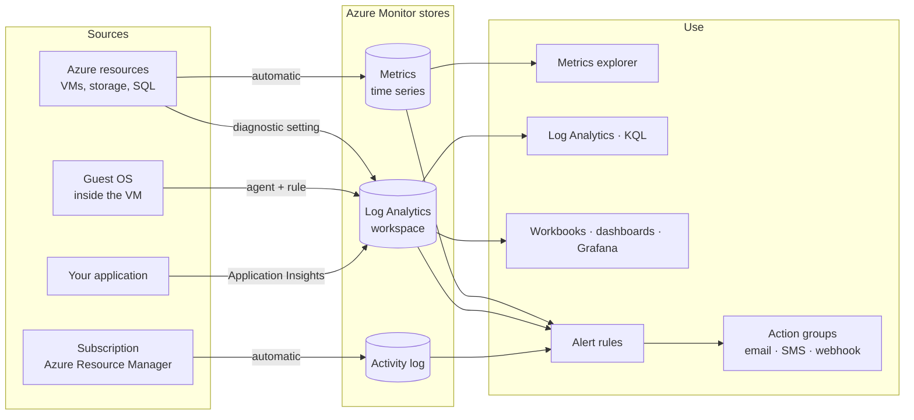
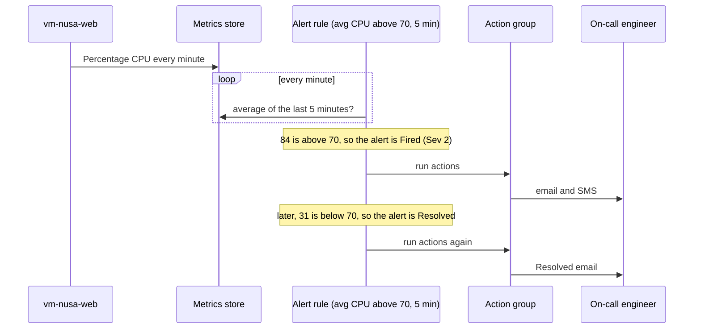
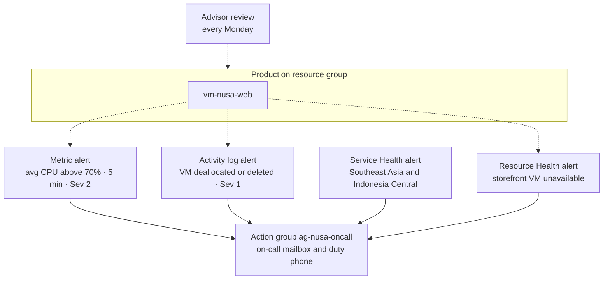

# Lunch 16 · Monitoring (Basic): Azure Monitor, Alerts, Service Health and Advisor

🇮🇩 [Baca dalam Bahasa Indonesia](README.id.md)

> **Track:** Core month · **Level:** Basic · **Part 4:** Secure, operate and govern
> **Time:** 60 minutes · **Prerequisite lunches:** 04, 06
> **AZ-900 skill area:** Describe Azure management and governance
> **Lab:** [Lab 16 · Know before customers do](../../labs/16-monitoring-basic/README.md) — about 45 minutes · cost 💲💲
> **Author:** Stefanus Pinarta · [About the author](../../README.md#about-the-author)

| ⏱ Minutes | Segment |
|---:|---|
| 5 | Scenario and objectives |
| 25 | Reading |
| 15 | Demo: interactive animation (+ optional walkthrough video) |
| 5 | Knowledge check |
| 5 | Key takeaways and lab preview |
| 5 | Buffer — finish your lunch 🍜 |

## 🍱 Today's menu

By the end of this lunch you will be able to:

- **Explain** what Azure Monitor collects on its own (platform metrics and the activity log) and what you must switch on (resource logs, guest data and application telemetry).
- **Compare** metrics and logs, and pick the right one for questions such as "Is the CPU busy?" and "Who stopped this VM?".
- **Choose** between metric, log search and activity log alerts, and **design** an action group that reaches the right people.
- **Distinguish** the Azure status page, Service Health and Resource Health, and **use** Azure Advisor's five recommendation categories.

## 🏪 Meanwhile at Nusantara Retail

Friday, 19:40. A flash sale on batik shirts is in full swing, and the storefront's checkout service still runs on one
Azure VM. At 19:52 a customer posts on Instagram: *"Website super lambat, checkout gagal terus"* — super slow, checkout
keeps failing. Forty comments later, at 20:30, someone in marketing forwards you a screenshot. You open the portal: the
VM's CPU has been pinned near 100% for forty minutes.

On Saturday morning checkout is down again. This time the VM is simply stopped, and in the team chat everyone,
Rizky the contractor included, says *"bukan saya"* — not me. Pak Budi wonders whether Azure itself had an outage.

On Monday, Ibu Sari has two questions for you: "Why did our customers know before we did? And next time, how quickly can
you tell me *what* happened and *who* did it?"

Today you design Nusantara Retail's early-warning system — and learn where Azure keeps the evidence.

---

## 📖 Reading (≈25 minutes)

### 1. Azure Monitor: one platform, four questions

When something goes wrong in production, you need fast answers to four questions:

- **Is it working?** Availability: can customers reach the shop at all?
- **Is it working well?** Performance: CPU, memory, response times, error rates.
- **What changed, and who changed it?** Audit: a resize, a stop, a deleted rule.
- **Is the problem ours or Azure's?** Platform health: an incident in the region, or planned maintenance.

**Azure Monitor** is the Azure service that collects, stores, analyses and acts on monitoring data. It gathers data from
Azure resources, from the operating systems inside your VMs, from your applications and from the subscription itself.
There is nothing to deploy for the platform part: every subscription already has it. Alerts, Application Insights,
Service Health alerts and many "insights" pages in the portal are all features built on this one platform.

In the portal, everything lives under **Monitor**: Metrics, Logs, Alerts, the Activity log, Service Health, Workbooks
and the insights pages. Most resources also show a slice of the same data in their own menu — a VM's **Metrics**,
**Alerts** and **Activity log** pages are simply the Monitor views filtered to that one VM.

The most useful beginner lesson is that some monitoring data is **collected automatically and free**, while other data
must be **switched on** — and usually costs money once it lands in a workspace.

| Data | Collected automatically? | Kept for | Cost to collect |
|---|---|---|---|
| Platform metrics (CPU, network, disk) | Yes, typically every minute | 93 days | No charge |
| Activity log (control-plane operations) | Yes | 90 days | No charge |
| Resource logs (operations inside a resource) | No: needs a diagnostic setting | depends on the destination | charged at the destination |
| Guest OS logs and performance counters | No: needs the Azure Monitor Agent (Lunch 30) | workspace retention | charged per GB ingested |
| Application telemetry (requests, errors) | No: needs Application Insights | workspace retention | charged per GB ingested |

The diagram shows the big picture. Data comes in on the left, lands in one of three stores, and is used on the right.



> [!TIP]
> Start every investigation with the free data. Open the VM in the portal and look at its **Monitoring** tab or
> **Metrics**: weeks of CPU, disk and network history are already there, without a single setting changed.

### 2. Metrics and logs: two kinds of evidence

**Metrics** are numbers measured at regular intervals. Each value has a timestamp and belongs to one resource, and some
metrics have **dimensions** — extra labels such as a disk name or an API name — so you can split a chart. Metrics live in a
time-series database built for speed, which makes them ideal for charts and for alerts that must fire within minutes.

Whenever you read a metric you also choose an **aggregation** over a time grain: **Average**, **Minimum**, **Maximum**,
**Sum** (the portal calls it Total) or **Count**. The aggregation changes the story. Imagine the storefront VM spikes to
100% CPU for ten seconds every minute and idles in between. Over each minute, the maximum is 100%, the average is about
20% and the minimum is close to zero. All three numbers are correct; they answer different questions.

For a VM, platform metrics such as *Percentage CPU*, *Network In Total* and *Disk Read Bytes* are measured by the Azure
host, outside the operating system, so they work even when nothing is installed inside the VM. What the host can't see —
free space inside the file system, per-process usage, the system log — needs the Azure Monitor Agent, which you'll meet
in Lunch 30. Metrics explorer charts up to 30 days at a time; pan the chart to reach older data within the 93 days.

**Logs** are records — rows with many columns. A log row might say "GET /checkout returned 500 in 2.3 seconds" or "user
dewi@nusantara read the secret db-password". Logs are stored in tables in a **Log Analytics workspace** and queried with
**Kusto Query Language (KQL)**. They are richer than metrics and can answer *which*, *who* and *why*, but you pay for every
gigabyte you send and keep, and they usually arrive seconds to minutes after the event.

| | Metrics | Logs |
|---|---|---|
| Shape | numbers over time | rows with many columns |
| Example | Percentage CPU = 87 at 19:41 | "GET /checkout returned 500 at 19:41:07" |
| Freshness | near real time | usually seconds to minutes |
| Explore with | Metrics explorer | Log Analytics (KQL) |
| Good question | "Is the CPU high right now?" | "Which requests failed, and why?" |
| Alert type | metric alert | log search alert |
| Cost | platform metrics are free | pay per GB ingested and retained |

Two special data sources deserve a closer look.

The **activity log** records every **control-plane** operation in a subscription: creating, updating, deleting,
starting, stopping and resizing resources, assigning roles, and so on. Each entry has a time, an operation, a status,
the resource and the **caller** — the user or service principal that made the request. It also collects Service Health
and Resource Health events, alert activations, autoscale actions, Advisor recommendations, Defender for Cloud alerts and
Azure Policy actions. The activity log is on by default, free, and kept for 90 days, and its entries can't be edited or
deleted, which is exactly why auditors trust it. Read-only operations, such as opening a VM's page, usually aren't
recorded. If you need more than 90 days, or want to query it with KQL, export it to a workspace with a diagnostic setting.

**Resource logs** describe what happens *inside* a resource — the **data plane**. Reading a secret from Key Vault,
downloading a blob, or running a query in a database are data-plane operations; they never appear in the activity log.
Resource logs aren't collected until you create a **diagnostic setting** on the resource. A diagnostic setting picks
the log categories (or a category group such as *audit* or *allLogs*) and the destinations: a Log Analytics workspace
for querying and alerting, a storage account for cheap long-term archive, Event Hubs for streaming to another tool such
as a SIEM, or a supported partner solution. The same setting can also send platform metrics to the workspace, for
example to keep them beyond 93 days.

Here is a taste of KQL against the exported activity log. You'll learn the language properly in Lunch 30.

```kusto
AzureActivity
| where OperationNameValue has "deallocate"
| project TimeGenerated, Caller, ResourceGroup, ActivityStatusValue
```

> [!WARNING]
> Resource logs are **off** by default. Teams usually discover this during an incident: the auditor asks who read the
> database password from Key Vault last Tuesday, and there is nothing to show. Remember the split — the activity log
> tells you who *changed the vault*; only resource logs tell you who *read the secret*. Create diagnostic settings when
> you create the resource, or let Azure Policy enforce them (Lunches 18 and 31).

### 3. Alerts: from a signal to someone's phone

An **alert rule** has four parts:

1. **Scope** — what to watch: one resource, several resources, a resource group or a subscription.
2. **Condition** — the signal and the logic, for example "average Percentage CPU greater than 70".
3. **Actions** — one or more **action groups** to run when the rule fires.
4. **Details** — a name, a description and a **severity** from Sev0 (critical) to Sev4 (verbose).

When the condition is met, Azure Monitor creates an **alert** — an instance you can see, acknowledge and close on the
Alerts page — and runs the attached action groups. Alerts are kept for 30 days. Each alert carries two status fields:
the *monitor condition* (Fired or Resolved), which Azure sets, and the *alert state* (New, Acknowledged or Closed),
which your team sets while it works on the problem.

| Alert type | Watches | Typical Nusantara rule | Behaviour |
|---|---|---|---|
| Metric alert | a metric, evaluated every 1–60 minutes | "Average CPU above 70% for 5 minutes" | stateful by default: fires once, resolves itself when the condition clears |
| Log search alert | the result of a KQL query on a schedule | "More than 5 failed checkouts in 10 minutes" | stateful by default; can be stateless |
| Activity log alert | new activity log events that match conditions | "A VM in the production group was deallocated" | stateless: fires for every matching event |

Service Health and Resource Health alerts are activity log alerts too. You'll also meet smart detection in Application
Insights and Prometheus alerts for containers later in the course.

Look closely at a metric alert condition, because most broken alerts are broken here. "Average Percentage CPU greater
than 70, window 5 minutes, frequency 1 minute" means: every minute, take the last five minutes of samples, average them,
and compare the result with 70. Change one word and the meaning changes:

- **Maximum** over 5 minutes: "at any moment" — sensitive, and noisy if CPU spikes briefly.
- **Average** over 5 minutes: "on average" — a sensible default for CPU.
- **Minimum** over 1 hour: "the *whole* hour" — so strict that a 15-minute crisis never triggers it.

Longer windows smooth out spikes but react slowly; shorter windows react fast but can flap. If your load has a daily
rhythm, **dynamic thresholds** learn what normal looks like for each hour and alert on unusual values instead of a fixed
number.

An **action group** is a named, reusable list of *who to tell* and *what to run*. Notifications include email, SMS,
voice calls, push notifications to the Azure mobile app, and email to everyone who holds an Azure Resource Manager role
(such as Owner) on the subscription. Actions include webhooks, Azure Functions, Logic Apps, Automation runbooks, Event
Hubs and IT service management connectors. One action group can serve many rules. Built-in rate limits protect people
from floods: at the time of writing, an email address receives no more than 100 alert emails per hour from a region,
and a phone number no more than one SMS every five minutes. Turn on the **common alert schema** so that every automation
receives the same payload shape, whatever the alert type.



Two more tools keep alerting humane. **Alert processing rules** (once called action rules) change what happens after an
alert fires: they can suppress notifications during a planned maintenance window — say, Saturday 01:00–03:00 while
Rizky patches the VMs — or add an action group to every alert in a subscription. They don't affect Service Health
alerts. And good **severity** discipline matters: if everything is Sev0, nothing is.

> [!IMPORTANT]
> An alert rule without an action group only appears on the Alerts page in the portal — nobody gets an email. Always
> attach an action group, and point it at a shared mailbox or an on-call rota, not one person who might be on leave.

Good alert rules share four habits. Each one is **actionable** (whoever receives it knows what to do), carries the
**right severity**, reaches the **right audience**, and has been **tested**. The portal's *Test action group* button
sends a sample notification, so you find out that the email lands in a spam folder on a quiet Tuesday, not during an
incident.

Platform metrics cost nothing, but alert rules are not all free: metric and log search alert rules carry a small monthly
charge per monitored time series or rule, and a subscription can hold at most 100 activity log alert rules. Check the
Azure Monitor pricing page before you create hundreds of rules.

### 4. Is it Azure or is it us? Service Health, Resource Health and Advisor

Azure gives you three views of its own health, from the widest to the narrowest:

- The **Azure status page** is a public, global view of incidents with widespread impact. It knows nothing about your
  subscription.
- **Service Health** is personalised: it reports on the services and regions *you* use. It shows **service issues**
  (incidents happening now), **planned maintenance**, **health advisories** (changes that need your action, such as a
  feature retirement) and **security advisories**, with updates during an incident and root-cause analyses afterwards.
- **Resource Health** looks at one resource — this VM, this database — and reports **Available**, **Unavailable**,
  **Degraded** or **Unknown**, with a reason (for example *platform initiated* versus *user initiated*) and a history.

| | Azure status page | Service Health | Resource Health |
|---|---|---|---|
| Scope | all of Azure, all regions | your subscription's services and regions | one resource |
| Answers | "Is there a big outage?" | "Is an Azure incident or maintenance affecting the services I use?" | "Is *this* resource healthy, and if not, why?" |
| Personalised | no | yes | yes |
| Alerts | no | Service Health alerts | Resource Health alerts |
| Nusantara example | checking during a famous outage | "Virtual Machines in Southeast Asia: service issue" | "vm-nusa-web: Unavailable, user initiated" |

Use them together, from narrow to wide. Start with Resource Health on the broken resource: a *user-initiated*
unavailability points you to the activity log; a *platform-initiated* one points you to Service Health. Every
subscription deserves a **Service Health alert** — an activity log alert scoped to the subscription, filtered to the
regions and services you care about (Southeast Asia and Indonesia Central for Nusantara Retail) and wired to an action
group. Add **Resource Health alerts** for critical resources such as the storefront VM and the orders database.

**Azure Advisor** is the free consultant in the portal. It analyses your configuration and usage and makes
personalised recommendations in five categories:

| Category | What it looks for | Nusantara example |
|---|---|---|
| Reliability | resilience and continuity risks | "Use availability zones for the storefront VMs"; "enable backup" |
| Security | weaknesses, surfaced from Microsoft Defender for Cloud | "Close management ports on internet-facing VMs" |
| Performance | resources that limit speed | a disk or database tier too small for the load |
| Cost | waste and savings | "Right-size or shut down underused VMs"; reservations for steady workloads |
| Operational excellence | process and deployment hygiene | "Create Azure Service Health alerts" |

You can postpone or dismiss a recommendation with a reason, track progress with the **Advisor score**, and get alerts
when new recommendations appear. Advisor's cost advice feeds Lunch 19, and its security advice is the same list you saw
in Defender for Cloud in Lunch 15. One quirk for scripters: the Azure CLI and API still call the reliability category
*HighAvailability*.

### 5. See it, then bring it together for Nusantara Retail

Data you can't see doesn't help at 20:00 on a Friday. Azure offers several ways to look at it:

- **Metrics explorer** for quick charts of one or more metrics, which you can pin to an **Azure dashboard**.
- **Workbooks** — interactive reports that mix text, metric charts and log queries, with parameters such as "pick a VM".
- **Azure Monitor dashboards with Grafana**, built into the portal at no extra cost, and **Azure Managed Grafana**, a paid
  service for teams that also need non-Azure data sources, Grafana alerting or scheduled reports.
- **Insights** — ready-made experiences such as VM insights and Application Insights.

**Application Insights** deserves a first look today, because the Friday problem was really an application problem.
It is Azure Monitor's application performance monitoring feature: it records every request to the storefront, how long
it took, whether it failed, which dependencies (the database, the payment API) it called, and which exceptions were
thrown. It can also run **availability tests** that call your site from several locations around the world. New
Application Insights resources store their data in a Log Analytics workspace, and you add them with autoinstrumentation
or the OpenTelemetry libraries. Lunch 30 goes deep.

Here is the starter kit you'll propose to Ibu Sari:



1. An action group, `ag-nusa-oncall`, that emails the IT on-call mailbox and texts the duty phone.
2. A metric alert on the storefront VM: average CPU above 70% for five minutes, Sev 2.
3. An activity log alert: any VM in the production resource group deallocated or deleted, Sev 1.
4. A Service Health alert for incidents and maintenance in the regions Nusantara Retail uses.
5. A Resource Health alert for the storefront VM.
6. Diagnostic settings on Key Vault and the orders database, so "who read what" is answerable.
7. Ten minutes every Monday with Advisor.

With this in place, the next Friday story changes. The duty phone buzzes about five minutes after CPU starts to climb,
long before Instagram notices. On Saturday, the activity log names the person who stopped the VM, Resource Health
labels it *user initiated*, and Service Health confirms that Azure was fine. That's the answer to Ibu Sari's two questions:
you'll know first, and you'll know why.

> [!NOTE]
> **Pause and think:** At 02:10 Resource Health shows the storefront VM as *Unavailable — user initiated*, and Service
> Health shows no incident in Southeast Asia. Where do you look next to find out who did it, and which alert type would
> have woken you at 02:01 instead of 08:00?

**Going deeper:** [Lunch 30 · Monitoring (Advanced)](../30-monitoring-advanced/README.md) covers Log Analytics workspace
design, the Azure Monitor Agent, KQL and Application Insights in depth.

---

## 🎬 Demo (≈15 minutes)

1. **Interactive animation (≈6–8 min):** [Open the demo](https://stefpin.github.io/azure-fundamentals-lunches/demos/16-monitoring-basic.html) —
   press ▶ Play or step through it at your own pace. Offline? Download
   [`docs/demos/16-monitoring-basic.html`](../../docs/demos/16-monitoring-basic.html) and open it in any browser.
2. **Walkthrough video (≤ 6 min):** _coming soon_ — [read the walkthrough script](demo-video-script.md).

What to watch for:

- How a metric becomes an alert: the rule averages five minutes of CPU, fires once, emails the on-call engineer and later
  sends a "Resolved" message.
- Why Rizky's rule never fires — the aggregation and window change what "high CPU" means.
- How the activity log names the caller who deallocated the VM, and how an activity log alert reports it within minutes.
- The difference in scope between Service Health (your services and regions) and Resource Health (one resource).

## ✅ Knowledge check (≈5 minutes)

1. Dewi wants an email within a few minutes whenever the storefront VM's CPU stays above 80% for five minutes. Which
   alert type should she create, and with which aggregation?
   <details><summary>Show answer</summary>

   A **metric alert** on *Percentage CPU* with the **Average** aggregation over a 5-minute window. *Why:* platform metrics
   arrive automatically every minute, so a metric alert reacts quickly without any agent or workspace.

   </details>
2. On Saturday the storefront VM was stopped and deallocated. Ibu Sari wants the name of the person who did it before
   lunch. Where do you look?
   <details><summary>Show answer</summary>

   In the **activity log** (Administrative category): filter on the operation *Deallocate Virtual Machine* and read the
   **Caller** field. *Why:* every control-plane operation is recorded automatically, with its caller, for 90 days.

   </details>
3. An auditor asks which users downloaded invoice PDFs from Blob storage last week. The storage account has existed for a
   year with default settings. Can you answer?
   <details><summary>Show answer</summary>

   **No.** Downloads are data-plane operations, recorded only in **resource logs**, and resource logs are collected only
   after you create a **diagnostic setting**. Create one now so the question can be answered next time. *Why:* the
   activity log covers control-plane changes, not reads of the data.

   </details>
4. Rizky created an alert: "Minimum Percentage CPU greater than 70 over 1 hour". During a 15-minute flash-sale spike the
   CPU sat at 100%, yet the alert never fired. Why, and what is a better condition?
   <details><summary>Show answer</summary>

   **Minimum over one hour** only triggers if CPU stays above 70% for the *entire* hour, so a 15-minute spike can never
   satisfy it. Use **Average over 5 minutes** (evaluated every minute). *Why:* the aggregation and window define what
   "high" means.

   </details>
5. The storefront VM is unreachable. Resource Health says *Unavailable — platform initiated*, and Service Health shows
   an active service issue for Virtual Machines in Southeast Asia. Whose problem is it, and what should you do?
   <details><summary>Show answer</summary>

   It's an **Azure platform problem**, not a change your team made. Follow the incident updates in **Service Health**,
   apply your recovery plan (Lunch 17), and make sure a **Service Health alert** exists so you hear about the next one
   first. *Why:* platform-initiated unavailability plus an active regional issue points to Azure, not to your
   configuration.

   </details>

## 🧠 Key takeaways

- Platform metrics and the activity log are collected automatically and free; resource logs, guest OS data and
  application telemetry must be switched on and are charged where they land.
- Metrics answer "how much, right now?" quickly and cheaply; logs answer "what, which, who and why?" with KQL.
- An alert rule is scope + condition + action group + severity — the aggregation and window decide whether it ever
  fires, and the action group decides whether anyone hears it.
- The activity log tells you who changed what; Resource Health tells you whether one resource is healthy and why;
  Service Health tells you about Azure incidents and maintenance in your services and regions.
- Azure Advisor gives free, personalised recommendations in five categories — reliability, security, performance,
  cost and operational excellence — so make reviewing them a habit.

## 🗒️ Field notes from Stefanus

> **An alert is a promise that someone will act.** Before I create an alert rule, I write its description as an
> instruction to the person who will read it at night: what it means, the first thing to check, and when to escalate.
> If I can't write that sentence, the rule isn't ready, or it belongs on a dashboard instead of in someone's inbox.
> Once a month, before they age out of the Alerts page, I go through every alert that fired: each one that nobody
> acted on is retuned, given a lower severity, or deleted. An inbox full of ignored alerts is worse than an empty one,
> because it teaches the team to stop reading. And I never trust an action group until I have tested it end to end, on
> the phone of whoever is actually on call.

## 🔬 Your lab: Know before customers do

You'll build Nusantara Retail's first early-warning system around a small storefront VM: an action group that emails
you, a CPU metric alert that you trigger yourself with Run Command, an activity log alert that catches a deallocated VM,
and a Service Health alert for your subscription. Then you'll answer "who did it?" from the activity log, review Advisor's
recommendations, and repair a broken alert rule that never fires. It's the setup every production subscription needs on
day one.

- ⏱ About 45 minutes · 💲💲 · works on its own (no earlier lab needed)
- 👉 [Start Lab 16](../../labs/16-monitoring-basic/README.md)

## 📚 Go further

- [Microsoft Learn: Overview of Azure Monitor alerts](https://learn.microsoft.com/azure/azure-monitor/alerts/alerts-overview) — alert types, stateful versus stateless alerts, and how rules, processing rules and action groups fit together.
- [Microsoft Learn: Activity log in Azure Monitor](https://learn.microsoft.com/azure/azure-monitor/fundamentals/activity-log) — what is recorded, how long it's kept, and how to export it to a workspace.
- [Microsoft Learn: What is Azure Service Health?](https://learn.microsoft.com/azure/service-health/overview) — Azure status, Service Health and Resource Health side by side.
- [Microsoft Learn: Introduction to Azure Advisor](https://learn.microsoft.com/azure/advisor/advisor-overview) — the five recommendation categories and how to act on them.

---

⬅️ [Lunch 15 · Security Essentials: Defense in Depth, Key Vault and Defender for Cloud](../15-security-essentials/README.md) · 🏠 [Course home](../../README.md) · [Lunch 17 · Backup and Disaster Recovery](../17-backup-disaster-recovery/README.md) ➡️

<sub>Last validated: October 2026 · Spotted something out of date? [Open an issue](../../CONTRIBUTING.md).</sub>
