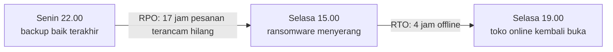
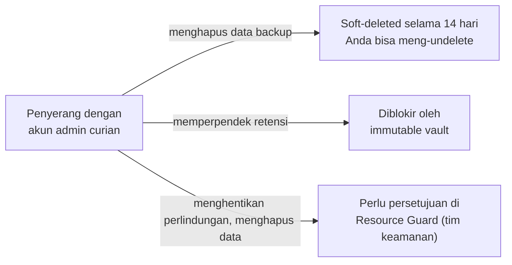
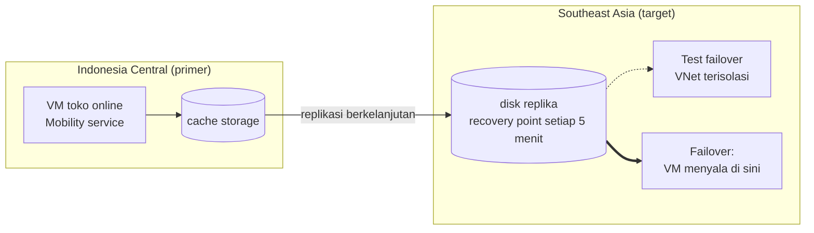

# Makan Siang 17 · Pencadangan Data dan Pemulihan Bencana (Dasar)

🇬🇧 [Read in English](README.md)

> **Jalur:** Bulan inti · **Level:** Dasar · **Bagian 4:** Keamanan, operasional, dan tata kelola
> **Waktu:** 60 menit · **Makan siang prasyarat:** 03, 06, 07
> **Area keterampilan AZ-900:** Di luar cakupan AZ-900 (keandalan dalam praktik)
> **Lab:** [Lab 17 · Latihan pemulihan data](../../labs/17-backup-disaster-recovery/README.id.md) — 60–90 menit (sebagian besar menunggu) · biaya 💲💲
> **Penulis:** Stefanus Pinarta · [Tentang penulis](../../README.id.md#tentang-penulis)

| ⏱ Menit | Segmen |
|---:|---|
| 5 | Skenario dan tujuan |
| 25 | Bacaan |
| 15 | Demo: animasi interaktif (+ video panduan opsional) |
| 5 | Uji pemahaman |
| 5 | Poin penting dan pratinjau lab |
| 5 | Waktu cadangan — habiskan makan siang Anda 🍜 |

## 🍱 Menu hari ini

Setelah makan siang ini, Anda akan mampu:

- **Membedakan** ketersediaan tinggi, cadangan (backup), dan pemulihan bencana (disaster recovery), serta **menetapkan**
  target RPO dan RTO yang bisa ditandatangani seorang direktur.
- **Memilih** antara Recovery Services vault dan Backup vault, serta **menjelaskan** backup policy, instant restore, dan
  pilihan restore untuk sebuah VM (*komputer virtual*).
- **Menjelaskan** bagaimana soft delete, immutable vault, dan multi-user authorization menjaga cadangan tetap hidup
  ketika penyerang memegang kata sandi admin.
- **Menguraikan** cara Azure Site Recovery memindahkan (failover) sebuah VM ke region (*wilayah*) lain, dan
  **merencanakan** pemulihan bencana untuk region yang tidak punya region pasangan (*pasangan wilayah*), seperti
  Indonesia Central.

## 🏪 Sementara itu di Nusantara Retail

Senin pagi, Pak Budi meneruskan sebuah berita: sembilan hari lalu, sebuah jaringan toko ritel di Surabaya
terkena serangan ransomware. Ransomware adalah program jahat yang mengunci (mengenkripsi) data korbannya lalu meminta uang
tebusan. Para penyerangnya tidak sekadar mengenkripsi server. Mereka lebih dulu masuk dengan kata sandi administrator
curian, lalu menghapus semua cadangannya. Sampai hari ini, toko online jaringan ritel itu masih belum
bisa dibuka.

Ibu Sari langsung mengumpulkan tim. "Toko online kita kan sudah pindah ke Azure," katanya, "jadi kita aman, kan?" Dewi
menjelaskan bahwa database pesanan sudah zone-redundant. Pak Budi ingat pernah menyetel "job backup" di server lama
pada tahun 2019, lalu mengaku belum pernah sekali pun mencoba me-restore-nya. Kemudian seseorang dari bagian keuangan
melontarkan pertanyaan yang tidak bisa dijawab siapa pun: kalau seluruh region Indonesia Central padam besok, di mana
toko akan berjalan, dan apakah hukum bahkan mengizinkan data pelanggan dibawa ke sana?

Pertanyaan hari ini: **berapa banyak data yang sanggup direlakan hilang oleh Nusantara Retail, seberapa cepat toko harus
kembali buka, dan layanan Azure mana yang bisa mewujudkan kedua angka itu, bahkan ketika sumber masalahnya adalah si
penyerang atau region itu sendiri?**

---

## 📖 Bacaan (≈25 menit)

### 1. Ketersediaan tinggi, cadangan, dan pemulihan bencana adalah tiga pekerjaan yang berbeda

Banyak orang memakai ketiga istilah ini seolah-olah artinya sama. Padahal ketiganya menyelesaikan masalah yang berbeda,
dan sebuah rencana membutuhkan ketiganya sekaligus.

- **Ketersediaan tinggi** (high availability, HA) menjaga layanan tetap berjalan saat terjadi kegagalan kecil yang
  umum: sebuah disk, sebuah server, satu rak, bahkan satu pusat data utuh. Anda membangunnya dengan redundansi *di
  dalam* satu region: dua VM di belakang load balancer (Makan Siang 09), storage yang zone-redundant (Makan Siang 07),
  dan database yang zone-redundant. Failover, yaitu perpindahan ke komponen lain yang masih sehat, berjalan otomatis dan
  hanya butuh hitungan detik.
- **Cadangan** (backup) adalah salinan data Anda *pada satu titik waktu*, yang disimpan terpisah dari aslinya agar Anda
  bisa kembali ke kondisi itu. Dari ketiganya, hanya cadangan yang melindungi Anda dari diri sendiri: data yang terhapus
  tanpa sengaja, file yang rusak, deployment yang keliru, atau ransomware. Ketersediaan tinggi justru menyalin sebuah
  kesalahan ke setiap replika dalam hitungan milidetik.
- **Pemulihan bencana** (disaster recovery, DR) menghidupkan kembali seluruh layanan di *tempat lain* ketika lokasi
  utama hilang atau tidak bisa dipakai, misalnya setelah gangguan yang melanda satu region penuh. Anda menyimpan
  replika di region kedua (atau di zona kedua), lalu melakukan **failover** ke sana.

Bayangkan sebuah warung makan. Ketersediaan tinggi itu seperti punya dua kompor: kalau satu mati, masakan tetap jalan di
kompor yang lain. Cadangan itu seperti fotokopi buku catatan utang pelanggan yang disimpan di rumah: kalau bukunya
tersiram kuah, Anda kembali ke salinan kemarin. Pemulihan bencana itu seperti lapak kedua di pasar lain: kalau seluruh
pasar kebanjiran, Anda pindah berjualan ke sana. Kompor kedua tidak menolong catatan yang basah, dan fotokopi catatan
tidak menolong pasar yang terendam. Karena itulah Anda butuh ketiganya.

| Apa yang salah | Ketersediaan tinggi | Cadangan | Pemulihan bencana |
|---|---|---|---|
| Host (server fisik) di bawah `vm-web-1` rusak | ✅ VM kedua tetap melayani | terlalu lambat untuk kasus ini | tidak diperlukan |
| Skrip bersih-bersih Dewi menghapus foto-foto produk | ❌ penghapusannya ikut direplikasi | ✅ restore salinan kemarin | ❌ replikanya ikut menghapus juga |
| Ransomware mengenkripsi server pesanan | ❌ | ✅ jika penyerang tidak bisa menghancurkan cadangannya | ⚠️ hanya dari recovery point yang dibuat sebelum serangan, dalam jendela waktu yang singkat |
| Gangguan satu region penuh melanda Indonesia Central | ❌ semua zona di region itu terdampak | ⚠️ hanya jika ada salinan di region lain, dan prosesnya lambat | ✅ failover ke region kedua |

Ada dua angka yang menentukan setiap keputusan di makan siang ini. **Recovery point objective (RPO)**, atau target titik
pemulihan, adalah jumlah data terbanyak yang sanggup Anda relakan hilang, diukur dalam satuan waktu. RPO 24 jam berarti
Anda menerima kehilangan perubahan data hingga satu hari, dan itulah tepatnya yang Anda dapatkan dari backup sekali
semalam. **Recovery time objective (RTO)**, atau target waktu pemulihan, adalah waktu terlama layanan boleh mati,
dihitung sejak layanan rusak sampai pelanggan bisa memakainya lagi.

Ibaratnya Anda sedang menulis skripsi dan laptop tiba-tiba mati total. RPO menjawab pertanyaan "kapan terakhir saya
menekan Save?": kalau dua jam lalu, dua jam ketikan itulah yang hilang. RTO menjawab pertanyaan "berapa lama sampai saya
bisa mengetik lagi?": meminjam laptop teman, mengunduh file terakhir, lalu melanjutkan. Yang satu mengukur data yang
hilang, yang lain mengukur waktu yang terbuang.

RPO dan RTO adalah keputusan bisnis, bukan keputusan teknis, dan semakin kecil angkanya, semakin mahal biayanya. Angka
itu juga berbeda untuk setiap sistem, jadi Nusantara Retail menetapkannya sistem demi sistem. Inilah angka yang sudah
disetujui Ibu Sari:

| Sistem | RPO | RTO | Alasan |
|---|---|---|---|
| Pesanan dan pembayaran (Azure SQL) | 5 menit | 1 jam | setiap pesanan yang hilang berarti pendapatan yang hilang dan pelanggan yang marah |
| Web server toko online | 24 jam | 4 jam | tidak menyimpan data unik dan bisa dibangun ulang |
| Katalog produk (Cosmos DB) | 4 jam | 4 jam | bisa dibangun ulang dari spreadsheet pemasok, meski lambat |
| Ekspor pesanan harian di `vm-orders` | 24 jam | 8 jam | dibuat ulang setiap malam, tetapi bagian keuangan membutuhkannya di akhir bulan |

Lalu, dari mana angka yang sebenarnya? RPO yang *benar-benar tercapai* adalah jarak antar-recovery point (titik
pemulihan, yaitu salinan yang bisa Anda pakai untuk kembali), ditambah jeda sebelum sebuah titik tersimpan dengan aman.
Dengan satu backup setiap malam pukul 22.00, kegagalan pada pukul 21.30 keesokan malamnya menghilangkan 23½ jam
perubahan. RTO yang *benar-benar tercapai* adalah jumlah dari empat langkah: menyadari ada masalah, memutuskan untuk
memulihkan, proses pemulihan itu sendiri, dan memeriksa bahwa semuanya berfungsi. Tim biasanya hanya merencanakan
langkah ketiga, padahal dua langkah pertama sering memakan waktu paling lama, apalagi pukul 3 dini hari di hari libur
nasional, misalnya saat separuh tim sedang mudik Lebaran.

> [!TIP]
> Tanyakan kepada pihak bisnis: "berapa kerugian kita jika layanan mati satu jam?" dan "berapa kerugian kita jika
> pesanan selama satu jam hilang?" Kedua harga itu memberi tahu Anda seberapa layak mengeluarkan biaya untuk memperkecil
> RTO dan RPO.

### 2. Azure Backup: vault, policy, dan restore

**Azure Backup** adalah layanan terkelola (managed service): tidak ada server backup yang harus Anda perbarui (patch),
dan tidak ada pita (tape) yang perlu Anda ganti-ganti. Layanan ini menyimpan cadangan Anda di dalam sebuah **vault** (secara
harfiah berarti "brankas"), yaitu resource (*sumber daya*) Azure tersendiri dengan kontrol aksesnya sendiri, yang
berada di luar resource yang dilindunginya. Ada dua jenis vault:

| | Recovery Services vault | Backup vault |
|---|---|---|
| Melindungi | VM Azure, SQL Server dan SAP HANA yang berjalan di VM, share Azure Files, serta server on-premises di pusat data Anda sendiri (lewat agen MARS, MABS, atau DPM) | Workload yang lebih baru, seperti Azure Blobs, Azure Disks, Azure Database for PostgreSQL flexible server, dan AKS |
| Juga menampung | Azure Site Recovery | — |
| Di Lab 17 | ✅ backup VM | — |

Anda mengelola keduanya dari hub **Resiliency** di portal (dulu bernama Azure Business Continuity Center), yang
menampilkan apa saja yang sudah terlindungi, dan apa yang belum, di seluruh vault, subscription (*langganan*), dan
region.

Sebuah **backup policy** (kebijakan pencadangan) menentukan kapan backup dibuat dan berapa lama setiap **recovery
point** disimpan. Untuk VM, **DefaultPolicy** bawaan membuat satu backup per hari dan menyimpan setiap titik harian
selama 30 hari. Policy juga bisa menambahkan titik mingguan, bulanan, dan tahunan yang disimpan hingga bertahun-tahun.
Policy **Standard** membuat backup sekali sehari; policy **Enhanced** bisa membuat backup sesering setiap empat jam dan
wajib dipakai untuk jenis disk yang lebih baru seperti Premium SSD v2 dan Ultra Disk.

Backup sebuah VM berlangsung dalam dua fase. Pertama, ekstensi Backup di VM mengambil **snapshot** (potret sesaat) dari
disk-disknya: *application-consistent* di Windows (aplikasi diminta menuntaskan tulisannya lebih dulu) dan *file-system
consistent* di Linux (sistem file-nya dijamin utuh). Snapshot itu bisa langsung dipakai, dan inilah yang disebut
**instant restore**: DefaultPolicy menyimpan snapshot di samping disk selama dua hari (policy Standard mengizinkan satu
sampai lima hari), sehingga restore dari titik yang baru hanya butuh hitungan menit. Kedua, data disalin ke dalam vault
(**vault tier**), yaitu salinan jangka panjang yang terisolasi. Backup pertama menyalin setiap blok yang terpakai dan
bisa memakan waktu satu jam atau lebih; backup berikutnya hanya menyalin perubahannya. Anda membayar biaya bulanan per
instance yang dilindungi, yang besarnya bergantung pada ukuran instance itu, ditambah penyimpanan vault yang dipakai
recovery point-nya; snapshot instant restore ditagih seperti snapshot disk biasa.

Penyimpanan sebuah vault bisa locally redundant, zone-redundant, atau geo-redundant (GRS secara default), dan pilihan
redundansi (*opsi redundansi*) ini hanya bisa diubah *sebelum* backup pertama. Ingat kembali Makan Siang 07: locally
redundant berarti semua salinan berada di satu pusat data, zone-redundant menyebarkannya ke beberapa zona dalam satu
region, dan geo-redundant juga mengirim salinan ke region kedua. Vault GRS juga bisa mengaktifkan **Cross Region
Restore**, yang me-restore dari salinan di region *pasangan*. Microsoft mencatat bahwa RPO terburuk di sana bisa
mencapai 36 jam.

Saat Anda membutuhkan datanya kembali, Anda memilih sebuah recovery point dan salah satu opsi berikut:

| Opsi restore | Yang Anda dapatkan | Penggunaan umum |
|---|---|---|
| Create a new VM | VM yang dibangun dari recovery point, di region yang sama | VM aslinya sudah hilang, atau Anda ingin salinannya berdampingan |
| Restore disks | managed disk, ditambah sebuah template, di resource group (*grup sumber daya*) yang Anda pilih | menyesuaikan VM baru, atau memasang disk ke VM yang sudah ada lalu menyalin file darinya |
| Replace existing | disk VM ditukar dengan disk dari recovery point | mengembalikan seluruh VM ke kondisi lama (setelah salinan ke vault selesai) |
| File Recovery | disk dari recovery point dipasang sebagai drive oleh skrip yang Anda unduh | beberapa file saja, tanpa me-restore seluruh VM |
| Cross Region Restore | VM atau disk di region pasangan, dari salinan di vault | region utama tidak bisa dipakai (khusus vault GRS) |

Untuk satu file yang hilang, me-restore seluruh VM itu berlebihan. **File Recovery** memberi Anda sebuah skrip yang
memasang (mount) disk dari recovery point melalui iSCSI, yaitu protokol untuk memakai disk lewat jaringan, di mesin
yang Anda pilih. Mesin itu membutuhkan akses jaringan keluar (outbound) ke Azure Backup, sesuatu yang sering tidak
dimiliki server yang dikunci rapat. Alternatifnya adalah cara yang akan Anda pakai di lab: **restore disks**, pasang
disk hasil restore ke sebuah VM sebagai data disk tambahan, salin file yang Anda perlukan, lalu lepaskan (detach) dan
hapus disk itu. Cara ini tidak membutuhkan akses internet dari VM, dan memperlihatkan dengan jelas di mana data Anda
sebenarnya berada.

Tidak semua hal membutuhkan vault. Banyak layanan platform mencadangkan dirinya sendiri. **Azure SQL Database** membuat
backup otomatis dan bisa di-restore ke titik waktu mana pun dalam masa retensinya (tujuh hari secara default). **Azure
Cosmos DB** membuat backup berkala, atau dengan continuous backup, bisa di-restore ke titik mana pun dalam 7 atau 30
hari terakhir. **Blob Storage** menyediakan soft delete, versioning, dan point-in-time restore (Makan Siang 07).
Periksa apa yang diberikan setiap layanan secara default, dan apakah default itu sesuai dengan RPO-nya.

> [!WARNING]
> Geo-redundant storage bukan cadangan. Ia juga ikut mereplikasi kesalahan Anda: blob yang dihapus Dewi di Indonesia
> ikut terhapus di salinan sekunder beberapa saat kemudian. Hanya salinan terpisah dari satu titik waktu yang bisa
> membawa Anda kembali.

### 3. Melindungi cadangan itu sendiri

Penyerang tahu bahwa cadangan adalah jalan pulang Anda, jadi ransomware modern mengincarnya lebih dulu, biasanya dengan
akun administrator curian. Azure Backup menjawabnya dengan tiga lapis perlindungan.

**Soft delete** (penghapusan sementara) berarti data backup yang dihapus tidak benar-benar lenyap. Data itu pindah ke
status *soft-deleted* selama 14 hari secara default (bisa Anda perpanjang hingga 180 hari), dan selama waktu itu Anda
bisa melakukan **undelete** (membatalkan penghapusan). Mirip Recycle Bin di laptop, hanya saja tempat sampah yang ini
tidak bisa dikosongkan paksa. Dengan prinsip **secure by default** (aman sejak awal), soft delete selalu aktif di
Recovery Services vault: fitur ini tidak bisa dimatikan, juga berlaku untuk vault itu sendiri (menghapus vault
membuatnya berstatus soft-deleted), dan 14 hari pertamanya tidak dikenai biaya tambahan.

**Immutable vault** (vault yang isinya tidak bisa diubah) memblokir setiap operasi yang akan menghancurkan recovery
point sebelum masa simpannya habis, seperti menghapus data backup atau memperpendek retensi. Selama immutability masih
*unlocked* (belum dikunci), Anda masih bisa mematikannya; begitu *locked* (dikunci), keputusan itu tidak akan pernah
bisa dibatalkan, jadi kuncilah hanya setelah Anda mengujinya.

**Multi-user authorization (MUA)**, atau otorisasi multi-pengguna, mencegah satu orang, atau satu akun curian,
menjalankan operasi penting seorang diri. Operasi seperti mematikan immutability atau menghentikan perlindungan sambil
menghapus data membutuhkan izin tambahan pada sebuah **Resource Guard**, yaitu resource terpisah milik tim keamanan,
idealnya di subscription lain. Administrator backup harus meminta akses berbatas waktu, misalnya lewat Privileged
Identity Management, sebelum operasi itu bisa dijalankan. Prinsipnya sama dengan ruang brankas di bank yang hanya bisa
dibuka oleh dua petugas berbeda, masing-masing memegang satu kunci: mencuri satu kunci saja tidak cukup.

| Lapisan | Apa yang dicegahnya | Bisakah penyerang mematikannya? |
|---|---|---|
| Soft delete | cadangan yang dihapus langsung lenyap selamanya; perlindungan berlaku 14–180 hari | tidak: secure by default membuatnya tetap aktif |
| Immutable vault | penghapusan recovery point sebelum waktunya, retensi yang diperpendek | unlocked: admin bisa; locked: tidak ada yang bisa |
| Multi-user authorization | satu akun menjalankan operasi penting seorang diri | hanya dengan persetujuan di Resource Guard |

Gagasan di balik ketiga lapisan ini sudah lama: simpan setidaknya satu salinan data yang tidak bisa dihancurkan oleh
akun-akun yang menjalankan produksi. Para administrator backup menyebutnya aturan 3-2-1: tiga salinan, di dua jenis
media penyimpanan, satu di antaranya di tempat lain. Dalam bahasa Azure, vault sudah terpisah dari VM; soft delete dan
immutability membuat penghapusan menjadi lambat dan terlihat, dan MUA menempatkan orang kedua di antara penyerang dan
salinan terakhir.

Tambahkan dasar-dasarnya di atas semua itu: berikan setiap orang built-in role (peran bawaan) yang paling sempit
(Backup Reader, Backup Operator, atau Backup Contributor), dan aktifkan alert (*pemberitahuan*) Azure Monitor untuk job
yang gagal dan data backup yang dihapus, supaya ada yang menyadarinya di hari pertama, bukan di hari kelima belas.

### 4. Azure Site Recovery: salinan siaga di region lain

Restore dari backup bisa memakan waktu berjam-jam, dan itu terlalu lambat untuk toko online dengan RTO satu jam.
**Azure Site Recovery (ASR)** mereplikasi VM secara terus-menerus ke region lain, atau ke zona lain di region yang sama,
lalu mengatur jalannya perpindahan.

Saat Anda mengaktifkan replikasi, Site Recovery memasang ekstensi **Mobility service** di VM. Setiap penulisan ke disk
dikirim ke sebuah **cache storage account** (*akun penyimpanan*) di region sumber, lalu diteruskan ke managed disk
replika di region tujuan. Site Recovery membuat recovery point **crash-consistent** setiap lima menit, sebuah
pengaturan tetap; kondisinya mirip disk saat listrik PLN tiba-tiba padam. Recovery point **app-consistent**, yang lebih rapi karena aplikasi sempat
menuntaskan tulisannya, hanya dibuat jika Anda menetapkan frekuensinya (nonaktif secara default). Recovery point
disimpan selama satu hari, kecuali Anda mengubah policy-nya. Berbeda dengan backup, replikasi membutuhkan konektivitas
keluar (outbound) dari VM.

Tombol terpenting adalah **Test failover**. Tombol ini menyalakan salinan VM dari sebuah recovery point di dalam
jaringan virtual (VNet) yang terisolasi, tanpa menghentikan replikasi dan tanpa menyentuh produksi, sehingga Anda bisa
berlatih lalu membersihkannya. **Failover** sungguhan menyalakan VM di region tujuan. Setelah itu Anda melakukan
**re-protect** (mereplikasi ke arah sebaliknya), dan nanti **fail back** (kembali ke region asal). **Recovery plan**
mengelompokkan VM dan menyalakannya berurutan, database dulu, lalu tier aplikasi, lalu tier web, dengan skrip atau
langkah manual di antaranya. Anda membayar biaya Site Recovery per VM ditambah penyimpanan di region tujuan. VM replika
tidak berjalan, dan tidak ditagih biaya komputasi, sampai Anda melakukan failover.

Ibaratnya mobil keluarga untuk mudik. Backup itu seperti kotak perkakas di bagasi: dengan itu ban bocor bisa ditambal,
tetapi Anda tertahan lama di bahu jalan tol. Site Recovery itu ban serep yang sudah terpompa, siap dipasang dalam
hitungan menit. Dan test failover adalah kebiasaan memeriksa ban serep *sebelum* berangkat, bukan saat ban sudah kempis
di tengah perjalanan.

| | Azure Backup | Azure Site Recovery |
|---|---|---|
| Pertanyaan yang dijawabnya | "Kembalikan data saya yang kemarin." | "Jalankan layanan ini di tempat lain, sekarang juga." |
| RPO yang bisa diharapkan | hitungan jam: harian, atau setiap 4 jam dengan Enhanced | hitungan menit: recovery point setiap 5 menit |
| RTO yang bisa diharapkan | hitungan jam: restore, lalu bangun ulang | beberapa menit hingga satu jam: nyalakan replikanya |
| Riwayat yang disimpan | beberapa hari hingga bertahun-tahun | beberapa jam hingga beberapa hari (satu hari secara default) |
| Melawan penghapusan dan ransomware | ✅ dengan soft delete, immutability, dan MUA | hanya dalam jendela recovery point-nya yang singkat |

Sebagian besar layanan produksi membutuhkan keduanya: Site Recovery untuk RTO yang cepat, dan Backup untuk ingatan yang
panjang.

### 5. Pemulihan bencana untuk region tanpa pasangan

Lingkungan produksi Nusantara Retail akan berjalan di **Indonesia Central**, di Jakarta, agar data pelanggan tetap
berada di dalam negeri. Region ini memiliki tiga availability zone (*zona ketersediaan*) tetapi **tidak punya region
pasangan**, dan hal itu mengubah rencananya:

1. **Zona adalah ketersediaan tinggi, bukan pemulihan bencana.** Menyebarkan VM dan database ke beberapa zona membuat
   layanan selamat dari kegagalan satu pusat data, tetapi tidak dari kejadian yang melumpuhkan seluruh region.
2. **Fitur yang bergantung pada pasangan region tidak tersedia.** Geo-redundant storage, backup vault yang
   geo-redundant, dan Cross Region Restore membutuhkan region pasangan. Cadangan di Indonesia Central tetap tinggal di
   region itu, di penyimpanan locally redundant atau zone-redundant, kecuali Anda sendiri yang menyalinnya ke tempat
   lain.
3. **Anda memilih region sekunder sendiri, secara eksplisit.** Banyak layanan bisa mereplikasi antara dua region mana
   pun: Site Recovery untuk VM, failover group untuk Azure SQL, region tambahan untuk Cosmos DB, dan object replication
   untuk Blob Storage.

Memilih region sekunder itu adalah keputusan bisnis sekaligus keputusan teknis. Region itu harus cukup jauh agar satu
kejadian tidak bisa menghantam kedua region sekaligus, dan cukup dekat agar latensinya (jeda pengiriman data) masih bisa
diterima. Region itu harus menyediakan layanan dan ukuran VM yang Anda replikasi, dengan kapasitas yang cukup. Region
itu juga harus memenuhi **residensi data** (data residency), yaitu aturan tentang di negara mana data boleh disimpan.
Undang-Undang Pelindungan Data Pribadi Indonesia (UU No. 27 Tahun 2022, sering disebut UU PDP) hanya mengizinkan data
pribadi ditransfer ke luar negeri dengan syarat tertentu, misalnya negara tujuan memiliki tingkat pelindungan yang
setara, ada pengaman (safeguard) yang memadai, atau ada persetujuan dari pemilik data. Tim hukum Nusantara harus
memberi persetujuan sebelum data pelanggan apa pun direplikasi ke Singapura. Makan siang ini menjelaskan teknologinya;
isinya bukan nasihat hukum. Southeast Asia, di Singapura, adalah kandidat yang paling wajar: dekat, memiliki tiga zona,
dan layanannya lengkap.

| Komponen | Ketersediaan tinggi di Indonesia Central | Cadangan | Pemulihan bencana ke Southeast Asia |
|---|---|---|---|
| VM toko online | tersebar di beberapa zona di belakang load balancer | Azure Backup, harian, vault zone-redundant | Site Recovery, dengan test failover dua kali setahun |
| Database pesanan (Azure SQL) | database zone-redundant | backup point-in-time otomatis | failover group |
| Katalog (Cosmos DB) | zone redundancy | continuous backup | Southeast Asia sebagai region kedua |
| Foto produk (Blob Storage) | zone-redundant storage | soft delete dan versioning | object replication ke akun di Southeast Asia |

Sebagian besar pemulihan yang gagal, gagal karena alasan yang membosankan. Waspadai hal-hal berikut:

- **Cadangan yang belum pernah di-restore siapa pun.** Restore pertama justru terjadi saat insiden, di bawah tekanan,
  lalu gagal karena izin yang kurang atau langkah yang terlupa.
- **Satu set kunci untuk semuanya.** Cadangan yang dikelola akun admin yang sama dengan produksi akan ikut tumbang
  bersama produksi. Pisahkan perannya dan tambahkan MUA.
- **Dependensi yang terlupa.** VM berhasil failover, tetapi nama DNS, Key Vault, aturan firewall, atau sertifikatnya
  masih menunjuk ke region utama.
- **Tidak ada kapasitas di region sekunder.** Ukuran VM atau kuota yang Anda butuhkan tidak tersedia di region tujuan,
  tepat pada hari ketika semua orang juga sedang failover ke sana, mirip berburu tiket kereta di hari terakhir sebelum
  Lebaran. Periksa kuota jauh-jauh hari.
- **Rencana yang hanya dipahami satu orang.** Kalau runbook (panduan pemulihan langkah demi langkah) hanya ada di kepala
  Pak Budi, RTO Anda bergantung pada jadwal cutinya.

Terakhir, **uji restore Anda**. Cadangan yang belum pernah Anda restore hanyalah harapan, bukan rencana. Nusantara
Retail akan me-restore satu file dan satu VM setiap bulan, serta menjalankan test failover dua kali setahun. Setiap
latihan mengukur RTO yang sebenarnya dibandingkan targetnya, dan runbook mencatat siapa yang memutuskan failover serta
bagaimana pelanggan diberi tahu. RTO hanyalah tebakan sampai sebuah latihan mengukur waktunya, dan Lab 17 adalah
latihan pertama Anda.

> [!NOTE]
> **Renungkan sejenak:** Indonesia Central memiliki tiga availability zone, dan setiap layanan Nusantara bisa dibuat
> zone-redundant di sana. Apakah itu cukup untuk menjawab pertanyaan bagian keuangan tadi pagi?

---

## 🎬 Demo (≈15 menit)

1. **Animasi interaktif (≈6–8 menit):** [Buka demo](https://stefpin.github.io/azure-fundamentals-lunches/demos/17-backup-disaster-recovery.html?lang=id) —
   tekan ▶ Putar atau telusuri langkah demi langkah sesuai kecepatan Anda. Sedang offline? Unduh
   [`docs/demos/17-backup-disaster-recovery.html`](../../docs/demos/17-backup-disaster-recovery.html) dan buka di browser apa pun.
2. **Video panduan (≤ 6 menit):** _segera hadir_ — [baca naskah video](demo-video-script.id.md).

Yang perlu diperhatikan:

- Bagaimana waktu sejak recovery point terakhir berubah menjadi data yang hilang (RPO), dan waktu untuk pulih berubah
  menjadi lamanya layanan mati (RTO).
- Apa yang terjadi ketika penyerang menghapus cadangan, dan lapisan mana yang menyelamatkannya.
- Bagaimana Site Recovery menjaga salinan siaga di region kedua, dan mengapa test failover berjalan di jaringan yang
  terisolasi.

## ✅ Uji pemahaman (≈5 menit)

1. Skrip bersih-bersih Dewi menghapus 2.000 foto produk dari storage account yang memakai geo-redundant storage.
   Apakah salinan di region sekunder bisa menyelamatkan Dewi?
   

Lihat jawaban

   **Tidak** — *alasannya:* geo-redundant storage juga ikut mereplikasi penghapusan itu. Dewi membutuhkan perlindungan
   point-in-time (pada titik waktu tertentu) seperti blob soft delete, versioning, atau backup, yang menyimpan data lama
   alih-alih ikut meniru perubahannya.

   

2. Ibu Sari bersedia kehilangan data paling banyak 4 jam dan layanan mati paling lama 1 jam untuk sebuah layanan
   berbasis VM. Angka mana yang RPO, mana yang RTO, dan apakah backup VM harian dengan DefaultPolicy memenuhinya?
   

Lihat jawaban

   **RPO 4 jam, RTO 1 jam, dan tidak memenuhi** — *alasannya:* backup harian bisa kehilangan data hingga 24 jam, dan
   membangun ulang dari backup jarang selesai dalam waktu kurang dari satu jam. Policy Enhanced (setiap 4 jam)
   memperbaiki RPO-nya; Site Recovery atau ketersediaan tinggi memperbaiki RTO-nya.

   

3. Penyerang dengan akun admin curian menghapus setiap backup item di sebuah Recovery Services vault. Apa yang terjadi
   pada datanya, dan apa yang harus dilakukan tim?
   

Lihat jawaban

   **Datanya berstatus soft-deleted, bukan lenyap** — *alasannya:* soft delete bawaan secure by default menyimpannya
   selama 14 hari atau lebih. Tim melakukan undelete pada item-item itu, melanjutkan perlindungan, lalu menambahkan
   multi-user authorization agar percobaan berikutnya membutuhkan persetujuan di sebuah Resource Guard.

   

4. Jenis vault apa yang Anda butuhkan untuk VM Azure dan share Azure Files, dan jenis apa untuk operational backup
   Azure Blobs?
   

Lihat jawaban

   **Recovery Services vault untuk VM dan Azure Files; Backup vault untuk Blobs** — *alasannya:* Backup vault mencakup
   workload yang lebih baru seperti Blobs, Disks, PostgreSQL flexible server, dan AKS.

   

5. Tim ingin VM pesanan di Indonesia Central selamat dari gangguan satu region penuh. Seseorang mengusulkan backup
   vault geo-redundant dengan Cross Region Restore. Mengapa itu tidak akan berhasil, dan apa usulan Anda sebagai
   gantinya?
   

Lihat jawaban

   **Indonesia Central tidak punya region pasangan** — *alasannya:* vault geo-redundant dan Cross Region Restore
   bergantung pada region pasangan. Pilih region sekunder secara eksplisit, misalnya Southeast Asia jika tim hukum
   menyetujui transfer datanya, lalu lakukan replikasi dengan Site Recovery.

   

## 🧠 Poin penting

- **Ketersediaan tinggi** bertahan dari kegagalan komponen dan zona, **cadangan** memungkinkan Anda kembali ke masa
  lalu, dan **pemulihan bencana** memindahkan layanan ke region lain: rencanakan ketiganya.
- Tetapkan **RPO** (berapa banyak data yang boleh hilang) dan **RTO** (berapa lama layanan boleh mati) per sistem, lalu
  biarkan angka-angka itu yang memilih teknologinya.
- **Azure Backup** menyimpan recovery point di dalam vault (Recovery Services vault untuk VM). Policy menentukan
  frekuensi dan retensi, dan instant restore membuat restore dari titik yang baru menjadi cepat.
- **Soft delete** (selalu aktif), **immutable vault**, dan **multi-user authorization** menjaga cadangan tetap bisa
  dipulihkan meskipun akun admin sudah dibobol.
- **Site Recovery** memberi RPO dalam hitungan menit di region lain. Untuk region tanpa pasangan seperti Indonesia
  Central, Anda memilih sendiri region sekundernya, menimbang residensi data, dan **menguji** dengan latihan rutin.

## 🗒️ Catatan lapangan dari Stefanus

> **Tanyakan dulu: siapa yang bisa menghapus salinan terakhir?** Dalam setiap tinjauan desain, saya selalu bertanya
> tentang backup: *akun mana saja yang sanggup menghancurkan salinan terakhir data ini, dan apakah itu akun yang sama
> dengan yang menjalankan produksi?* Kalau jawabannya ya, satu kata sandi yang bocor bisa merobohkan sistem sekaligus
> jalan pulangnya. Karena itu saya minta multi-user authorization dengan Resource Guard di subscription yang tidak bisa
> disentuh admin produksi, plus alert untuk data backup yang dihapus, yang dikirim ke orang di luar tim. Lalu saya
> bertanya dengan jujur: berapa lama sampai kita sadar sedang diserang? Kalau bisa lebih dari 14 hari, retensi soft
> delete saya perpanjang. Satu lagi kebiasaan saya: latihan restore tidak pernah dijalankan oleh orang yang merancang
> backup-nya. Runbook yang hanya bisa diikuti penulisnya adalah *single point of failure* yang kebetulan punya nama dan
> jatah cuti.

## 🔬 Lab Anda: Latihan pemulihan data

Anda akan menjalankan latihan restore pertama Nusantara Retail, di waktu luang Anda sendiri. Sebuah skrip membuat VM
kecil berisi file pesanan. Anda melindungi VM itu di Recovery Services vault, melihat pengaturan soft delete yang tidak
bisa dimatikan, lalu memicu backup sambil membaca. Setelah itu Anda "menghilangkan" file tersebut dan me-restore-nya
dari recovery point dengan cara me-restore disk lalu menyalin file itu kembali. Terakhir, Anda berperan sebagai
penyerang yang menghapus cadangan, lalu mengembalikannya lagi.

- ⏱ 60–90 menit, sebagian besar menunggu · 💲💲 biaya kecil selama resource berjalan · bisa dikerjakan terpisah (tidak
  perlu lab sebelumnya)
- 👉 [Mulai Lab 17](../../labs/17-backup-disaster-recovery/README.id.md)

## 📚 Pelajari lebih lanjut

- [Microsoft Learn: Aman secara default dengan soft delete untuk Azure Backup](https://learn.microsoft.com/azure/backup/secure-by-default) —
  apa saja yang di-soft-delete, berapa lama, berapa biayanya, dan bagaimana perilaku penghapusan vault sekarang.
- [Microsoft Learn: Cara me-restore data VM Azure di portal Azure](https://learn.microsoft.com/azure/backup/backup-azure-arm-restore-vms) —
  setiap opsi restore, lengkap dengan persyaratan dan batasannya.
- [Microsoft Learn: Arsitektur pemulihan bencana Azure ke Azure](https://learn.microsoft.com/azure/site-recovery/azure-to-azure-architecture) —
  cara Site Recovery mereplikasi, default apa yang dipakainya, dan akses jaringan apa yang dibutuhkannya.
- [Microsoft Learn: Pasangan region Azure dan region tanpa pasangan](https://learn.microsoft.com/azure/reliability/regions-paired) —
  region mana yang punya pasangan, dan cara merancang untuk region yang tidak punya.

---

⬅️ [Makan Siang 16 · Pemantauan (Dasar): Azure Monitor, Alert, Service Health, dan Advisor](../16-monitoring-basic/README.id.md) · 🏠 [Beranda kursus](../../README.id.md) · [Makan Siang 18 · Tata Kelola dan Kepatuhan (Dasar): Azure Policy, Lock, Tag, dan Microsoft Purview](../18-governance-compliance-basic/README.id.md) ➡️

Terakhir divalidasi: Oktober 2026 · Menemukan informasi yang sudah usang? [Buka issue](../../CONTRIBUTING.md).
