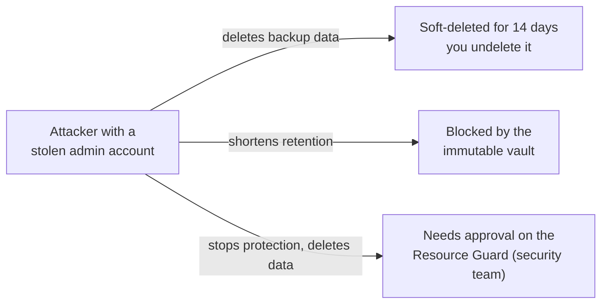
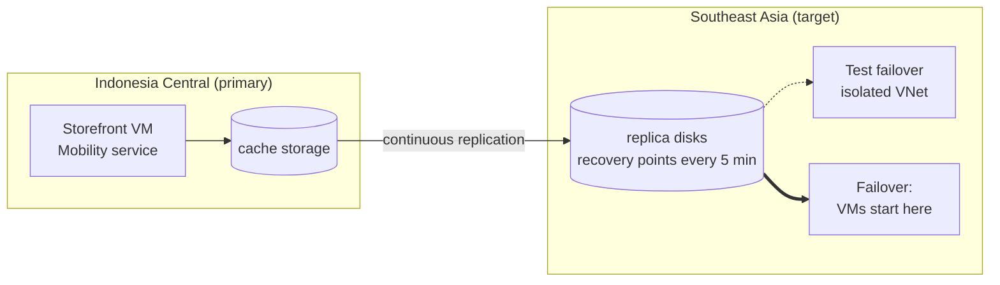

# Lunch 17 · Backup and Disaster Recovery (Basic)

> **Track:** Core month · **Level:** Basic · **Part 4:** Secure, operate and govern
> **Time:** 60 minutes · **Prerequisite lunches:** 03, 06, 07
> **AZ-900 skill area:** Beyond AZ-900 (reliability in practice)
> **Lab:** [Lab 17 · The restore drill](../../labs/17-backup-disaster-recovery/README.md) — 60–90 minutes (mostly waiting) · cost 💲💲

| ⏱ Minutes | Segment |
|---:|---|
| 5 | Scenario and objectives |
| 25 | Reading |
| 15 | Demo: interactive animation (+ optional walkthrough video) |
| 5 | Knowledge check |
| 5 | Key takeaways and lab preview |
| 5 | Buffer — finish your lunch 🍜 |

## 🍱 Today's menu

By the end of this lunch you will be able to:

- **Tell apart** high availability, backup and disaster recovery, and **set** RPO and RTO targets that a director can
  sign off.
- **Choose** between a Recovery Services vault and a Backup vault, and **explain** backup policies, instant restore and
  the restore options for a VM.
- **Explain** how soft delete, immutable vaults and multi-user authorization keep backups alive when an attacker holds
  an admin password.
- **Describe** how Azure Site Recovery fails a VM over to another region, and **plan** disaster recovery for a region
  without a pair, such as Indonesia Central.

## 🏪 Meanwhile at Nusantara Retail

On Monday morning, Pak Budi forwards a news story: a retail chain in Surabaya was hit by ransomware over the weekend.
The attackers didn't just encrypt the servers. They first signed in with a stolen administrator password and deleted
the backups. Nine days later, the chain's web shop is still offline.

Ibu Sari calls a meeting. "We moved the storefront to Azure," she says, "so we're safe, right?" Dewi points out that
the orders database is zone-redundant. Pak Budi remembers configuring "the backup job" on the old server in 2019 and
admits he has never tried a restore. Then someone from finance asks the question nobody can answer: if the whole
Indonesia Central region went dark tomorrow, where would the shop run, and would the law even let customer data go
there?

Today's question: **how much data can Nusantara Retail afford to lose, how quickly must it be back, and which Azure
services deliver those two numbers, even when the attacker or the region itself is the problem?**

---

## 📖 Reading (≈25 minutes)

### 1. High availability, backup and disaster recovery are three different jobs

People use these three terms as if they meant the same thing. They solve different problems, and a plan needs all
three.

- **High availability (HA)** keeps a service running through small, common failures: a disk, a server, a rack, a
  whole datacenter. You build it with redundancy *inside* one region: two VMs behind a load balancer (Lunch 09),
  zone-redundant storage (Lunch 07), a zone-redundant database. Failover is automatic and takes seconds.
- **Backup** is a copy of your data *at a point in time*, kept apart from the original so you can go back. It is the
  only one of the three that protects you from yourself: an accidental deletion, a corrupted file, a bad deployment or
  ransomware. High availability copies a mistake to every replica within milliseconds.
- **Disaster recovery (DR)** brings a whole service back in *another place* when the primary location is lost or
  unusable, for example after a region-wide outage. You keep a replica in a second region (or a second zone) and
  **fail over** to it.

| What goes wrong | High availability | Backup | Disaster recovery |
|---|---|---|---|
| The host under `vm-web-1` fails | ✅ the second VM keeps serving | too slow for this | not needed |
| Dewi's clean-up script deletes the product photos | ❌ the deletion is replicated | ✅ restore yesterday's copy | ❌ the replica deletes them too |
| Ransomware encrypts the orders server | ❌ | ✅ if the attacker couldn't destroy the backups | ⚠️ only from a recovery point older than the attack, within a short window |
| A region-wide outage hits Indonesia Central | ❌ every zone in the region is affected | ⚠️ only if a copy lives in another region, and slowly | ✅ fail over to the second region |

Two numbers drive every decision in this lunch. The **recovery point objective (RPO)** is the most data you can afford
to lose, measured in time. An RPO of 24 hours means you accept losing up to a day of changes, and that's exactly what a
nightly backup gives you. The **recovery time objective (RTO)** is the longest the service may be down, from the moment
it breaks until customers can use it again.

RPO and RTO are business decisions, not technical ones, and smaller numbers cost more. They also differ per system,
so Nusantara Retail sets them system by system. Ibu Sari signed off on these:

| System | RPO | RTO | Why |
|---|---|---|---|
| Orders and payments (Azure SQL) | 5 minutes | 1 hour | every lost order is lost revenue and an angry customer |
| Storefront web servers | 24 hours | 4 hours | they hold no unique data and can be rebuilt |
| Product catalogue (Cosmos DB) | 4 hours | 4 hours | can be rebuilt from supplier spreadsheets, slowly |
| Daily order exports on `vm-orders` | 24 hours | 8 hours | regenerated every night, but finance needs them at month-end |

Where do the real numbers come from? Your *achieved* RPO is the gap between recovery points, plus any delay before a
point is safely stored: with one backup a night at 22:00, a failure at 21:30 the next evening loses 23½ hours of
changes. Your *achieved* RTO is the sum of four steps: noticing the problem, deciding to recover, the recovery itself,
and checking that everything works. Teams usually plan only the third step, but the first two often take longest,
especially at 3 a.m. on a public holiday.

> [!TIP]
> Ask the business "what does one hour of downtime cost us?" and "what does losing one hour of orders cost us?"
> Those two prices tell you how much it's worth spending to shrink the RTO and the RPO.

### 2. Azure Backup: vaults, policies and restores

**Azure Backup** is a managed service: there's no backup server to patch and no tape to rotate. It keeps your backups
in a **vault**, a separate Azure resource with its own access control, outside the resource it protects. There are two
kinds:

| | Recovery Services vault | Backup vault |
|---|---|---|
| Protects | Azure VMs, SQL Server and SAP HANA running in VMs, Azure Files shares, and on-premises servers (through the MARS agent, MABS or DPM) | Newer workloads, such as Azure Blobs, Azure Disks, Azure Database for PostgreSQL flexible server and AKS |
| Also hosts | Azure Site Recovery | — |
| In Lab 17 | ✅ VM backup | — |

You manage both from the portal's **Resiliency** hub (formerly Azure Business Continuity Center), which shows
what is protected, and what isn't, across vaults, subscriptions and regions.

A **backup policy** says when to back up and how long to keep each **recovery point**. For VMs, the built-in
**DefaultPolicy** takes one backup a day and keeps each daily point for 30 days. Policies can add weekly, monthly and
yearly points kept for years. **Standard** policies back up once a day; **Enhanced** policies can back up as often as
every four hours and are required for newer disk types such as Premium SSD v2 and Ultra Disk.

A VM backup happens in two phases. First, the Backup extension on the VM takes a **snapshot** of its disks:
application-consistent on Windows, file-system consistent on Linux. That snapshot is usable at once, which is called
**instant restore**: DefaultPolicy keeps snapshots next to the disks for two days (a Standard policy allows one to
five), so a recent restore takes minutes. Second, the data is copied into the vault (the **vault tier**), the
isolated long-term copy. The first backup copies every used block and can take an hour or more; later ones copy only
the changes. You pay a monthly fee per protected instance, which depends on its size, plus the vault storage its
recovery points use; instant-restore snapshots are billed like ordinary disk snapshots.

A vault's storage can be locally, zone- or geo-redundant (GRS by default), and you can change that only before the
first backup. A GRS vault can also enable **Cross Region Restore**, which restores from the copy in the *paired*
region. Microsoft notes that the worst-case RPO there can reach 36 hours.

When you need the data back, you pick a recovery point and one of these options:

| Restore option | What you get | Typical use |
|---|---|---|
| Create a new VM | a VM built from the recovery point, in the same region | the original is gone, or you want a copy side by side |
| Restore disks | managed disks, plus a template, in a resource group you choose | customise the new VM, or attach a disk to an existing VM and copy files out |
| Replace existing | the VM's disks swapped for the recovery point's | roll a whole VM back (once the vault copy has finished) |
| File Recovery | the recovery point's disks mounted as drives by a script you download | a few files, without restoring the whole VM |
| Cross Region Restore | a VM or disks in the paired region, from the vault copy | the primary region is unavailable (GRS vaults only) |

For a single lost file, restoring a whole VM is overkill. **File Recovery** gives you a script that mounts the
recovery point's disks over iSCSI on a machine you choose, and that machine needs outbound network access to Azure
Backup, which a locked-down server often doesn't have. The alternative is the one you'll use in the lab: **restore
disks**, attach the restored disk to a VM as an extra data disk, copy the files you need, then detach and delete the
disk. It needs no internet access from the VM, and it shows you exactly where your data lives.

Not everything needs a vault. Many platform services back themselves up. **Azure SQL Database** takes automatic
backups and can restore to any point in time within its retention window (seven days by default). **Azure Cosmos DB**
takes periodic backups or, with continuous backup, restores to any point in the last 7 or 30 days. **Blob Storage**
offers soft delete, versioning and point-in-time restore (Lunch 07). Check what each service gives you by default and
whether that default matches its RPO.

> [!WARNING]
> Geo-redundant storage is not a backup. It replicates your mistakes too: a blob that Dewi deletes in Indonesia is
> deleted in the secondary copy moments later. Only a separate, point-in-time copy lets you go back.

### 3. Protecting the backups themselves

Attackers know that backups are your way back, so modern ransomware goes after them first, usually with a stolen
administrator account. Azure Backup answers with three layers.

**Soft delete** means deleted backup data isn't really gone. It moves into a *soft-deleted* state for 14 days by
default (you can extend that to 180), and you can **undelete** it during that time. Under **secure by default**, soft
delete is always on for Recovery Services vaults: it can't be switched off, it also applies to the vault itself
(deleting a vault makes it soft-deleted), and the first 14 days cost nothing extra.

An **immutable vault** blocks any operation that would destroy recovery points before they expire, such as deleting
backup data or shortening retention. While immutability is *unlocked* you can still turn it off; once it's *locked*,
it can never be undone, so lock it only after testing.

**Multi-user authorization (MUA)** stops one person, or one stolen account, from carrying out critical operations
alone. Operations such as disabling immutability or stopping protection with data deletion need an extra permission
on a **Resource Guard**, a separate resource owned by the security team, ideally in another subscription. A backup
administrator has to request time-limited access, for example through Privileged Identity Management, before the
operation goes through.

| Layer | What it stops | Can an attacker turn it off? |
|---|---|---|
| Soft delete | deleted backups disappearing for good, for 14–180 days | no: secure by default keeps it on |
| Immutable vault | early deletion of recovery points, shorter retention | unlocked: an admin can; locked: nobody can |
| Multi-user authorization | one account performing critical operations alone | only with approval on the Resource Guard |

The idea behind all three layers is old: keep at least one copy of your data that the accounts running production
can't destroy. Backup administrators call it the 3-2-1 rule: three copies, on two kinds of storage, one of them
somewhere else. In Azure terms, the vault is already separate from the VM; soft delete and immutability make deletion
slow and visible, and MUA puts a second person between an attacker and the last copy.

Add the basics on top: give people the narrowest built-in role (Backup Reader, Backup Operator or Backup
Contributor), and turn on Azure Monitor alerts for failed jobs and deleted backup data, so someone notices on day one,
not on day fifteen.

### 4. Azure Site Recovery: a standby copy in another region

Restoring from backup can take hours, which is too slow for a storefront with a one-hour RTO. **Azure Site Recovery
(ASR)** replicates VMs continuously to another region, or to another zone of the same region, and orchestrates the
switch.

When you enable replication, Site Recovery installs the **Mobility service extension** on the VM. Every disk write is
sent to a **cache storage account** in the source region and then shipped to replica managed disks in the target
region. Site Recovery creates **crash-consistent** recovery points every five minutes, a fixed setting, and
**app-consistent** ones only if you set a frequency (off by default). It keeps recovery points for one day unless you
change the policy. Unlike backup, replication needs outbound connectivity from the VM.

The most important button is **Test failover**. It boots copies of the VMs from a recovery point into an isolated
network, without stopping replication or touching production, so you can rehearse and then clean up. A real
**failover** starts the VMs in the target region. You then **re-protect** them (replicate in the reverse direction)
and later **fail back**. **Recovery plans** group VMs and start them in order, the database first, then the app tier,
then the web tier, with scripts or manual steps in between. You pay a per-VM Site Recovery charge plus the target
storage. The replica VMs don't run, and don't bill compute, until you fail over.

| | Azure Backup | Azure Site Recovery |
|---|---|---|
| Question it answers | "Give me yesterday's data back." | "Run this service somewhere else, now." |
| RPO you can expect | hours: daily, or every 4 hours with Enhanced | minutes: recovery points every 5 minutes |
| RTO you can expect | hours: restore, then rebuild | minutes to an hour: start the replicas |
| History kept | days to years | hours to days (one day by default) |
| Against deletion and ransomware | ✅ with soft delete, immutability and MUA | only within its short recovery-point window |

Most production services need both: Site Recovery for a fast RTO, and Backup for the long memory.

### 5. Disaster recovery for a region without a pair

Nusantara Retail's production will run in **Indonesia Central**, in Jakarta, to keep customer data in the country.
The region has three availability zones but **no paired region**, and that changes the plan:

1. **Zones are high availability, not disaster recovery.** Spreading VMs and databases across zones survives a
   datacenter failure, but not an event that takes down the whole region.
2. **Features that depend on a pair aren't available.** Geo-redundant storage, geo-redundant backup vaults and Cross
   Region Restore need a paired region. Backups in Indonesia Central stay in the region, on locally or zone-redundant
   storage, unless you copy them somewhere else yourself.
3. **You choose the secondary region, explicitly.** Many services replicate between any two regions: Site Recovery
   for VMs, failover groups for Azure SQL, extra regions for Cosmos DB and object replication for Blob Storage.

Choosing that secondary is a business decision as well as a technical one. It should be far enough away that one
event can't hit both regions, and close enough for acceptable latency. It must offer the services and VM sizes you
replicate, with enough capacity. It also has to satisfy **data residency**. Indonesia's Personal Data Protection Law
(Law No. 27 of 2022) allows personal data to be transferred abroad only under conditions, such as an equivalent level
of protection in the destination country, appropriate safeguards, or the person's consent. Nusantara's legal team
must approve before any customer data is replicated to Singapore. This lunch explains the technology; it isn't legal
advice. Southeast Asia, in Singapore, is the natural candidate: close, with three zones and a broad set of services.

| Component | High availability in Indonesia Central | Backup | Disaster recovery to Southeast Asia |
|---|---|---|---|
| Storefront VMs | spread across zones behind a load balancer | Azure Backup, daily, zone-redundant vault | Site Recovery, with a test failover every quarter |
| Orders database (Azure SQL) | zone-redundant database | automatic point-in-time backups | failover group |
| Catalogue (Cosmos DB) | zone redundancy | continuous backup | Southeast Asia as a second region |
| Product photos (Blob Storage) | zone-redundant storage | soft delete and versioning | object replication to an account in Southeast Asia |

Most failed recoveries fail for boring reasons. Watch out for these:

- **Backups nobody has restored.** The first restore happens during the incident, under pressure, and fails on a
  missing permission or a forgotten step.
- **One set of keys for everything.** Backups managed by the same admin accounts as production fall together with
  production. Separate the roles and add MUA.
- **Forgotten dependencies.** The VMs fail over, but the DNS name, the Key Vault, the firewall rules or the
  certificates still point at the primary region.
- **No capacity in the secondary.** The VM sizes or quota you need aren't available in the target region on the day
  everyone else is failing over too. Check quotas in advance.
- **A plan only one person understands.** If the runbook lives in Pak Budi's head, the RTO depends on his holidays.

Finally, **test your restores**. A backup you have never restored is a hope, not a plan. Nusantara Retail will
restore one file and one VM every month and run a test failover twice a year. Each drill measures the real RTO against
the target, and the runbook records who decides to fail over and how customers are told. An RTO is a guess until a
drill has timed it, and Lab 17 is your first drill.

> [!NOTE]
> **Pause and think:** Indonesia Central has three availability zones, and every Nusantara service could be
> zone-redundant there. Would that be enough to answer finance's question from this morning?

---

## 🎬 Demo (≈15 minutes)

1. **Interactive animation (≈6–8 min):** [Open the demo](https://stefpin.github.io/azure-fundamentals-lunches/demos/17-backup-disaster-recovery.html) —
   press ▶ Play or step through it at your own pace. Offline? Download
   [`docs/demos/17-backup-disaster-recovery.html`](../../docs/demos/17-backup-disaster-recovery.html) and open it in any browser.
2. **Walkthrough video (≤ 6 min):** _coming soon_ — [read the walkthrough script](demo-video-script.md).

What to watch for:

- How the time since the last recovery point becomes the data you lose (RPO), and the time to recover becomes the
  downtime (RTO).
- What happens when an attacker deletes the backups, and which layer saves them.
- How Site Recovery keeps a standby copy in a second region, and why the test failover runs in an isolated network.

## ✅ Knowledge check (≈5 minutes)

1. Dewi's clean-up script deleted 2,000 product photos from a storage account that uses geo-redundant storage. Does
   the copy in the secondary region save her?
   

Show answer

   **No.** Geo-redundant storage replicates the deletion as well. She needs a point-in-time protection such as blob
   soft delete, versioning or a backup, which keeps the old data instead of mirroring the change.

   

2. Ibu Sari accepts losing at most 4 hours of data and being down at most 1 hour for a VM-based service. Which number
   is the RPO, which is the RTO, and does a daily VM backup with DefaultPolicy meet them?
   

Show answer

   **RPO 4 hours, RTO 1 hour, and no.** A daily backup can lose up to 24 hours, and rebuilding from a backup rarely
   takes under an hour. An Enhanced policy (every 4 hours) fixes the RPO; Site Recovery or high availability fixes
   the RTO.

   

3. An attacker with a stolen admin account deletes every backup item in a Recovery Services vault. What happens to
   the data, and what should the team do?
   

Show answer

   **It's soft-deleted, not gone.** Secure-by-default soft delete keeps it for 14 days or more. The team undeletes the
   items, resumes protection, and adds multi-user authorization so the next attempt needs approval on a Resource
   Guard.

   

4. Which vault type do you need for Azure VMs and Azure Files shares, and which one for operational backup of Azure
   Blobs?
   

Show answer

   **A Recovery Services vault for VMs and Azure Files; a Backup vault for Blobs.** The Backup vault covers newer
   workloads such as Blobs, Disks, PostgreSQL flexible server and AKS.

   

5. The team wants the orders VM in Indonesia Central to survive a region-wide outage. Someone suggests a geo-redundant
   backup vault with Cross Region Restore. Why won't that work, and what would you propose instead?
   

Show answer

   **Indonesia Central has no paired region**, and geo-redundant vaults and Cross Region Restore depend on one.
   Choose a secondary region explicitly, such as Southeast Asia if the legal team approves the data transfer, and
   replicate with Site Recovery.

   

## 🧠 Key takeaways

- **High availability** survives component and zone failures, **backup** lets you go back in time, and **disaster
  recovery** moves the service to another region: plan all three.
- Set **RPO** (how much data you can lose) and **RTO** (how long you can be down) per system, and let those numbers
  choose the technology.
- **Azure Backup** keeps recovery points in a vault (a Recovery Services vault for VMs). Policies set frequency and
  retention, and instant restore makes recent restores fast.
- **Soft delete** (always on), **immutable vaults** and **multi-user authorization** keep backups recoverable even when
  an admin account is compromised.
- **Site Recovery** gives minute-level RPO in another region. For a nonpaired region like Indonesia Central you choose
  the secondary region yourself, weigh data residency, and **test** with drills.

## 🔬 Your lab: The restore drill

You'll run Nusantara Retail's first restore drill on your own time. A script creates a small VM with an orders file.
You protect the VM in a Recovery Services vault, look at the soft-delete settings you can't switch off, and trigger a
backup while you read. Then you "lose" the file and restore it from a recovery point by restoring a disk and copying
the file back. Finally, you play the attacker who deletes the backups, and get them back.

- ⏱ 60–90 minutes, mostly waiting · 💲💲 small charges while running · works on its own (no earlier lab needed)
- 👉 [Start Lab 17](../../labs/17-backup-disaster-recovery/README.md)

## 📚 Go further

- [Microsoft Learn: Secure by default with soft delete for Azure Backup](https://learn.microsoft.com/azure/backup/secure-by-default) —
  what is soft-deleted, for how long, what it costs, and how vault deletion behaves now.
- [Microsoft Learn: How to restore Azure VM data in Azure portal](https://learn.microsoft.com/azure/backup/backup-azure-arm-restore-vms) —
  every restore option, with its requirements and limits.
- [Microsoft Learn: Azure to Azure disaster recovery architecture](https://learn.microsoft.com/azure/site-recovery/azure-to-azure-architecture) —
  how Site Recovery replicates, which defaults it uses and what network access it needs.
- [Microsoft Learn: Azure region pairs and nonpaired regions](https://learn.microsoft.com/azure/reliability/regions-paired) —
  which regions have a pair, and how to design for those that don't.

---

⬅️ [Lunch 16 · Monitoring (Basic): Azure Monitor, Alerts, Service Health and Advisor](../16-monitoring-basic/README.md) · 🏠 [Course home](../../README.md) · [Lunch 18 · Governance and Compliance (Basic): Azure Policy, Locks, Tags and Microsoft Purview](../18-governance-compliance-basic/README.md) ➡️

Last validated: October 2026 · Spotted something out of date? [Open an issue](../../CONTRIBUTING.md).
