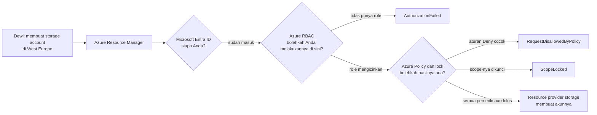
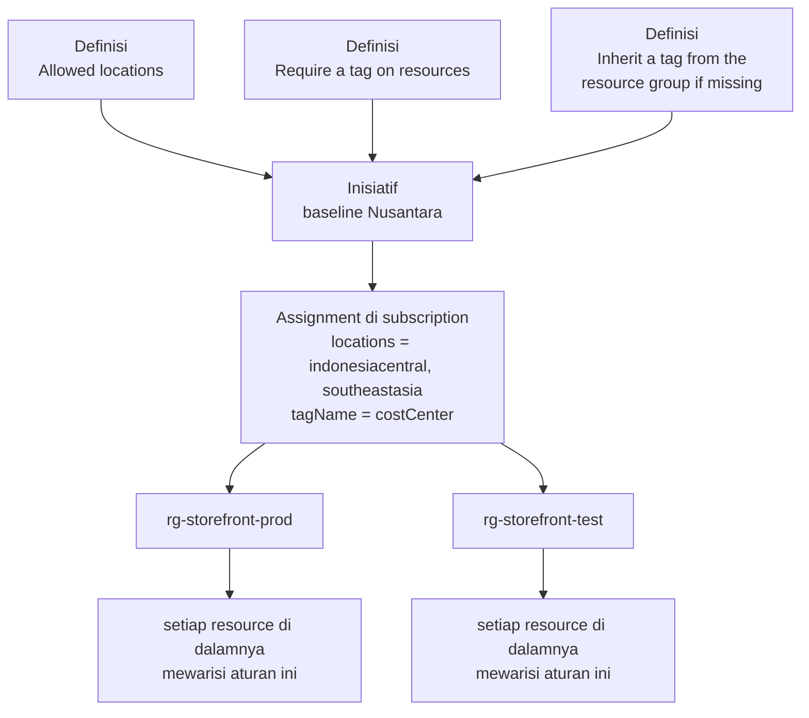
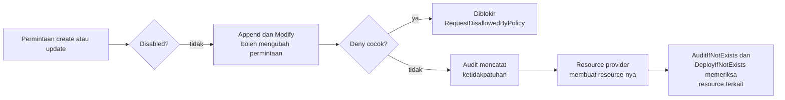

# Makan Siang 18 · Tata Kelola dan Kepatuhan (Dasar): Azure Policy, Lock, Tag, dan Microsoft Purview

🇬🇧 [Read in English](README.md)

> **Jalur:** Bulan inti · **Level:** Dasar · **Bagian 4:** Keamanan, operasional, dan tata kelola
> **Waktu:** 60 menit · **Makan siang prasyarat:** 04, 05
> **Area keterampilan AZ-900:** Menjelaskan manajemen dan tata kelola Azure
> **Lab:** [Lab 18 · Menjaga data tetap di tempat yang benar](../../labs/18-governance-compliance-basic/README.id.md) — sekitar 45 menit · biaya 💲
> **Penulis:** Stefanus Pinarta · [Tentang penulis](../../README.id.md#tentang-penulis)

| ⏱ Menit | Segmen |
|---:|---|
| 5 | Skenario dan tujuan |
| 25 | Bacaan |
| 15 | Demo: animasi interaktif (+ video panduan opsional) |
| 5 | Uji pemahaman |
| 5 | Poin penting dan pratinjau lab |
| 5 | Waktu cadangan — habiskan makan siang Anda 🍜 |

## 🍱 Menu hari ini

Setelah makan siang ini, Anda akan mampu:

- Menjelaskan arti tata kelola cloud dan memutuskan alat mana yang menjawab pertanyaan mana: Azure RBAC (*kontrol akses
  berbasis peran*), Azure Policy, atau resource lock (*kunci sumber daya*).
- Menguraikan komponen dasar Azure Policy — definisi, inisiatif, assignment, scope, parameter, kepatuhan, dan
  exemption.
- Memilih effect policy (Deny, Audit, Modify, Append, DeployIfNotExists, AuditIfNotExists, Disabled) untuk sebuah
  kebutuhan, dan memperkirakan kapan effect itu berjalan.
- Merancang strategi tag yang ringkas dan menegakkannya dengan policy, bukan sekadar dengan niat baik.
- Menguraikan kegunaan Microsoft Purview, Service Trust Portal, dan Microsoft Privacy Statement, serta apa yang
  menggantikan Azure Blueprints.

## 🏪 Sementara itu di Nusantara Retail

Senin pagi, Ibu Sari meneruskan dua e-mail kepada Anda. Yang pertama dari bagian keuangan: tagihan Azure bulan lalu
memuat satu baris biaya storage di West Europe yang tidak bisa dijelaskan siapa pun, dan separuh resource (*sumber
daya*) tidak punya tag, sehingga tidak ada yang tahu departemen mana yang harus membayarnya. Yang kedua dari penasihat
hukum Nusantara Retail, yang mengingatkan semua orang bahwa data pelanggan harus tetap berada di region (*wilayah*)
yang disetujui, dekat dengan rumah.

Anda pun menelusurinya. Dewi pernah membuat storage account (*akun penyimpanan*) uji coba di West Europe karena region
itu muncul di urutan atas sebuah daftar drop-down, lalu melupakannya. Rizky, sang kontraktor, nyaris menghapus resource
group (*grup sumber daya*) yang berisi database pesanan saat sedang "beres-beres" — ia punya izinnya, jadi tidak ada
yang menghentikannya. Tidak ada yang berniat jahat. Hanya saja, tidak ada pagar pengamannya.

Pertanyaan Ibu Sari singkat saja: *"Bisakah Azure mencegah kesalahan seperti ini sebelum terjadi — dan membuktikannya
kepada auditor?"* Hari ini Anda menjawabnya dengan Azure Policy, tag, lock, dan perkenalan pertama dengan Microsoft
Purview.

---

## 📖 Bacaan (≈25 menit)

### 1. Tata kelola berarti pagar pengaman, bukan gerbang

Sebelum era cloud, tata kelola di Nusantara Retail berupa ruang server yang terkunci dan tanda tangan Pak Budi di
setiap pesanan pembelian. Tidak ada yang masuk ke produksi tanpa melewati mejanya. Di Azure, siapa pun yang punya role
yang tepat bisa membuat database dalam tiga puluh detik, dari laptop, tengah malam. Kecepatan itulah alasan Anda pindah
ke cloud, jadi Anda tidak ingin tanda tangan itu kembali. Yang Anda inginkan adalah **pagar pengaman** (guardrail):
aturan yang ditegakkan platform secara otomatis, sehingga jalan yang aman sekaligus menjadi jalan yang mudah.

Bayangkan jalan tol. Tidak ada petugas yang memeriksa setiap mobil sebelum boleh melaju; yang ada hanyalah pagar
pembatas di kiri-kanan jalan dan marka yang jelas. Anda bebas melaju sesuai batas kecepatan, dan pagar itu baru
"bekerja" ketika ada mobil yang hendak keluar jalur. Gerbang tol justru sebaliknya: semua orang harus berhenti dan
antre. Tata kelola cloud yang baik terasa seperti pagar pembatas, bukan seperti gerbang tol.

**Tata kelola cloud** (cloud governance) adalah sekumpulan aturan, proses, dan alat yang menjaga pemakaian Azure Anda
tetap selaras dengan kebutuhan bisnis: biaya tetap bisa diperkirakan, data tetap berada di tempat yang dikehendaki
hukum, dan pengaturan keamanan tidak bergeser diam-diam. **Kepatuhan** (compliance) adalah bagian ketika Anda bisa
*membuktikannya* — kepada auditor, regulator, atau direktur Anda sendiri — dengan bukti, bukan janji.

Setiap pertanyaan tata kelola terhubung ke alat tertentu:

| Pertanyaan | Alat | Apa yang diperiksanya | Contoh di Nusantara Retail |
|---|---|---|---|
| Siapa yang boleh melakukan ini? | **Azure role-based access control (RBAC)** — Makan Siang 05 | identitas yang mengajukan permintaan dan role-nya di scope (cakupan) tersebut | Rizky mendapat role Contributor hanya di resource group uji coba |
| Bolehkah hasilnya ada? | **Azure Policy** | properti resource yang sedang dibuat atau diubah, tidak peduli siapa yang meminta | storage account hanya di Southeast Asia atau Indonesia Central |
| Apakah ini tidak boleh terhapus atau berubah karena kecelakaan? | **Resource lock** | operasi hapus (atau semua operasi tulis) pada scope yang dikunci, untuk semua orang | tidak ada yang bisa menghapus database pesanan, bahkan seorang Owner |
| Ini apa, dan siapa yang membayarnya? | **Tag** | label nama/nilai pada resource | `costCenter=CC-1001` pada semua yang dipakai toko online |
| Di mana data sensitif kita, dan siapa yang menyentuhnya? | **Microsoft Purview** | datanya sendiri, di Azure, Microsoft 365, dan di luar itu | menemukan setiap file yang berisi nomor telepon pelanggan |

Ketiga alat pertama bekerja bersama pada setiap permintaan. Ketika Dewi menjalankan `az storage account create`, Azure
Resource Manager (Makan Siang 04) mengautentikasi Dewi dengan Microsoft Entra ID (*ID Microsoft Entra*), memeriksa izin
RBAC-nya, lalu mengevaluasi policy assignment dan lock sebelum apa pun sampai ke resource provider (penyedia resource)
storage. Sebuah role mengatakan *Dewi* boleh membuat storage account; sebuah policy tetap bisa mengatakan *storage
account yang ini*, di West Europe, tidak boleh ada. Setiap pemeriksaan harus menjawab ya.

> [!TIP]
> Saat sebuah deployment gagal, kode error-nya memberi tahu pagar pengaman mana yang menghentikannya:
> `AuthorizationFailed` menunjuk ke RBAC, `RequestDisallowedByPolicy` ke Azure Policy (pesannya menyebut assignment
> yang memblokir Anda), dan `ScopeLocked` ke sebuah lock. Baca kodenya sebelum Anda meminta izin tambahan kepada siapa
> pun.

### 2. Azure Policy: definisi, inisiatif, dan assignment

Azure Policy punya tiga objek yang akan Anda temui di mana-mana.

Sebuah **policy definition** (definisi policy) adalah aturan yang ditulis dalam JSON. Bagian `if`-nya berisi kondisi
pada properti resource, misalnya "lokasinya tidak ada di daftar ini", dan bagian `then`-nya berisi **effect**, yaitu
apa yang terjadi ketika kondisi itu benar. Azure menyediakan ribuan **definisi bawaan** (built-in) yang dikelola
Microsoft, seperti *Allowed locations* dan *Require a tag on resources*. Jika tidak ada yang cocok, Anda menulis
**definisi kustom**. **Parameter** membuat sebuah definisi bisa dipakai ulang: *Allowed locations* tidak menuliskan
region secara permanen di dalamnya; ia meminta daftar region saat Anda memakainya.

Sebuah **initiative** (inisiatif; CLI dan API menyebutnya *policy set*) mengelompokkan beberapa definisi yang melayani
satu tujuan, sehingga Anda mengelolanya sebagai satu item. Microsoft menerbitkan inisiatif regulasi yang memetakan
kontrol-kontrol sebuah standar ke policy — misalnya ISO/IEC 27001, PCI DSS, dan **Microsoft cloud security benchmark**
yang di-assign secara default oleh Defender for Cloud (*Microsoft Defender untuk Cloud*, Makan Siang 15). Peritel yang
menerima pembayaran kartu, seperti Nusantara Retail, sangat memperhatikan inisiatif PCI DSS.

Sebuah **assignment** (penetapan) adalah titik ketika sebuah definisi atau inisiatif mulai bekerja. Assignment
menghubungkan aturan ke sebuah **scope** — management group (*grup manajemen*), subscription (*langganan*), resource
group, atau satu resource saja — dan mengisi nilai parameternya: "Allowed locations, pada subscription produksi, dengan
Indonesia Central dan Southeast Asia." Semua yang berada di bawah scope itu mewarisi assignment tersebut, sama seperti
role assignment diwariskan (Makan Siang 04). Sebuah assignment juga bisa membawa **exclusion** (scope anak yang
dilewati), **non-compliance message** kustom yang muncul di pesan error, dan **enforcement mode**: *Default* menegakkan
effect-nya, sedangkan *DoNotEnforce* hanya melaporkan, dan itulah cara Anda menguji aturan baru tanpa merusak deployment
siapa pun.

Ibaratnya rambu lalu lintas. Definisi adalah *jenis* rambunya, misalnya "dilarang parkir pada jam ___". Assignment
adalah tindakan memasang rambu itu di jalan tertentu dengan jam yang sudah diisi, misalnya pukul 07.00–19.00. Scope
adalah ruas jalan tempat rambu itu berlaku, dan semua kendaraan di ruas itu wajib mematuhinya, siapa pun pengemudinya.
Inisiatif? Itu satu paket rambu untuk kawasan sekolah: batas kecepatan, larangan parkir, dan zebra cross, dipasang
sekaligus.

Ada tiga detail yang menjebak hampir semua orang. Pertama, **mode** sebuah definisi menentukan apa yang dievaluasinya.
Aturan tag dan lokasi biasanya memakai mode *Indexed*, yang hanya memeriksa jenis resource yang mendukung tag dan
lokasi — dan melewati resource group. Itulah sebabnya *Allowed locations* tidak mencegah siapa pun membuat resource
group di West Europe; ada definisi bawaan terpisah, *Allowed locations for resource groups*, yang melakukannya. Kedua,
lokasi sebuah resource group hanyalah tempat metadatanya disimpan. Resource di dalamnya bisa berada di region mana pun,
jadi membatasi group-nya saja tidak melindungi apa-apa. Ketiga, assignment itu bertumpuk. Ketika beberapa assignment
berlaku untuk satu resource, masing-masing dievaluasi sendiri-sendiri dan hasilnya adalah kombinasi yang paling ketat.
Sebuah tim tidak bisa "keluar" dari Deny di level subscription dengan meng-assign policy yang lebih longgar ke resource
group miliknya; hanya exclusion atau exemption pada assignment aslinya yang bisa melakukannya.

Untuk menemukan definisi bawaan, buka **Policy › Definitions** di portal dan filter berdasarkan kategori (*Tags*,
*General*, *Storage*…), atau cari dari Cloud Shell dengan `az policy definition list`. Baca deskripsi dan parameternya
sebelum Anda meng-assign apa pun — nama tampilannya jarang menceritakan keseluruhan isinya.

### 3. Effect: apa yang terjadi ketika sebuah aturan cocok

Effect adalah jawaban sebuah aturan. Memilih effect yang tepat adalah sebagian besar keahliannya.

| Effect | Apa yang dilakukannya | Kapan bertindak | Gunakan ketika… |
|---|---|---|---|
| **Deny** | Memblokir permintaan create atau update; resource yang sudah ada hanya dilaporkan | sebelum permintaan sampai ke resource provider | aturannya tidak bisa ditawar, misalnya residensi data |
| **Audit** | Meloloskan permintaan dan menandai resource sebagai non-compliant | setelah Deny, sebelum resource provider | Anda ingin melihat situasinya dulu, atau aturannya bersifat saran |
| **Modify** | Menambah, mengganti, atau menghapus tag dan sebagian properti di dalam permintaan; memperbaiki resource yang sudah ada lewat remediation | sebelum Deny | perbaikannya bisa otomatis, misalnya menyalin sebuah tag |
| **Append** | Menambahkan field ke permintaan, tetapi tidak bisa memperbaiki resource yang sudah ada | sebelum Deny | masih dipakai oleh definisi bawaan tertentu; untuk tag, pilih Modify |
| **AuditIfNotExists** | Setelah deployment, memeriksa apakah resource terkait ada, dan melaporkan bila tidak ada | setelah resource provider berhasil | VM seharusnya punya Azure Monitor Agent, tetapi Anda hanya ingin tahu |
| **DeployIfNotExists** | Setelah deployment, men-deploy resource terkait yang belum ada dengan sebuah template; memperbaiki resource yang sudah ada lewat remediation | setelah resource provider berhasil | setiap database harus mengirim log-nya ke workspace pusat |
| **Disabled** | Mematikan aturan tanpa menghapus assignment-nya | diperiksa paling awal | Anda perlu menjeda aturan yang effect-nya berupa parameter |

Urutannya penting. Azure Policy memeriksa **Disabled** lebih dulu, lalu membiarkan **Append** dan **Modify** mengubah
permintaan, lalu mengevaluasi **Deny**, lalu **Audit**. **AuditIfNotExists** dan **DeployIfNotExists** baru berjalan
setelah resource provider melaporkan keberhasilan. Karena Modify berjalan sebelum Deny, aturan Modify yang menambahkan
tag yang hilang bisa mengubah permintaan yang tadinya akan diblokir aturan Deny menjadi permintaan yang lolos. Anda
akan melihat hal ini persis di lab.

Bayangkan loket pengurusan dokumen yang punya dua petugas. Petugas pertama melengkapi kolom yang lupa Anda isi,
misalnya menyalin alamat dari kartu keluarga yang Anda lampirkan; baru setelah itu petugas kedua memeriksa
kelengkapannya. Karena urutannya begitu, formulir yang tadinya pasti ditolak justru lolos. Modify adalah petugas
pertama, Deny petugas kedua. Tetapi kalau kartu keluarganya tidak dilampirkan, petugas pertama tidak punya apa pun
untuk disalin, dan formulir Anda tetap ditolak.

Ada beberapa effect yang lebih baru untuk kasus khusus: **DenyAction** memblokir permintaan hapus pada resource yang
cocok, **Manual** memungkinkan Anda menyatakan (attest) kontrol yang tidak bisa diperiksa secara otomatis, sedangkan
**Mutate** dan **addToNetworkGroup** melayani AKS dan Azure Virtual Network Manager.

Modify dan DeployIfNotExists mengubah sesuatu atas nama Anda, jadi assignment-nya membutuhkan sebuah **managed
identity** (identitas terkelola, Makan Siang 15) yang memegang role-role yang tercantum di definisi. Resource baru dan
resource yang diperbarui ditangani begitu datang. Resource yang sudah ada sebelum assignment hanya *dilaporkan* sampai
Anda menjalankan **remediation task** (tugas perbaikan), yang memakai identitas tersebut untuk memperbaikinya secara
massal.

**Kepatuhan** adalah rapornya. Setiap resource mendapat **compliance state** (status kepatuhan) per assignment —
*Compliant* (patuh), *Non-compliant* (tidak patuh), *Exempt* (dikecualikan), *Not started* (belum dimulai), dan
beberapa status lain yang lebih jarang. Evaluasi terjadi saat resource dibuat atau diperbarui (hasilnya muncul sekitar
15 menit kemudian), saat assignment dibuat atau diubah (butuh sekitar lima menit untuk berlaku, lalu pemindaian
dimulai), sekali setiap 24 jam untuk semuanya, dan sesuai permintaan dengan `az policy state trigger-scan`. Ketika
sebuah resource memang sah tidak bisa patuh — misalnya uji coba pemasaran selama dua minggu yang membutuhkan region
lain — Anda memberikan **exemption** (dispensasi), bukan melemahkan aturannya. *Waiver* berarti "kami menerima ini untuk
sementara"; *Mitigated* berarti "kami memenuhi maksud aturannya dengan cara lain"; tanggal kedaluwarsa memastikan tidak
ada yang lupa. Makan Siang 31 membahasnya lebih dalam.

### 4. Tag dan lock: beri label pada semuanya, lindungi yang penting

Sebuah **tag** adalah pasangan nama/nilai — `costCenter=CC-1001` — yang Anda tempelkan pada subscription, resource
group, atau resource (tetapi tidak pada management group). Tag tidak memakan biaya dan bisa menggerakkan banyak hal:
laporan biaya yang dikelompokkan per departemen (Makan Siang 19), otomatisasi yang mematikan mesin `environment=dev` di
malam hari, dan query yang menjawab "apa saja milik toko online?". Empat aturan yang perlu diingat:

- Resource **tidak** mewarisi tag milik resource group-nya. Jika Anda ingin pewarisan, sebuah policy yang harus
  melakukannya.
- Setiap resource, resource group, atau subscription bisa menampung hingga 50 tag. Nama tag tidak peka huruf
  besar-kecil (case-insensitive), tetapi nilainya peka (case-sensitive), sehingga `Finance` dan `finance` menjadi dua
  baris berbeda di laporan biaya.
- Tag adalah teks biasa yang muncul di ekspor, log, dan tagihan. Jangan pernah menaruh rahasia di dalam tag.
- Tidak semua jenis resource mendukung tag. Periksa dokumentasinya sebelum Anda membangun aturan berdasarkan tag.

Ibaratnya kulkas bersama di pantry kantor. Kotak bekal yang ditempeli stiker nama dan divisi aman sampai jam makan
siang; kotak tanpa label membuat semua orang bingung, dan akhirnya ikut dibuang saat kulkas dibersihkan hari Jumat. Tag
adalah stiker itu, tetapi untuk resource Azure.

Sebuah **strategi tag** sengaja dibuat singkat. Nusantara Retail memulai dengan empat tag wajib:

| Tag | Contoh nilai | Mengapa tag ini ada |
|---|---|---|
| `costCenter` | `CC-1001` (e-commerce) | bagian keuangan membebankan biaya ke departemen yang tepat |
| `environment` | `prod`, `test`, atau `dev` | otomatisasi dan alert memperlakukannya secara berbeda |
| `owner` | `team-storefront` | ada yang menjawab ketika resource-nya bermasalah |
| `dataClassification` | `confidential` | apa pun yang menyimpan data pelanggan mendapat pengawasan ekstra |

Policy mengubah strategi itu menjadi kenyataan. *Require a tag on resources* (Deny) menolak resource tanpa tag. *Add a
tag to resources* dan *Inherit a tag from the resource group if missing* (keduanya Modify) mengisi kekosongan secara
otomatis, sehingga orang cukup memberi tag pada resource group. Gabungkan aturan inherit dengan aturan require, dan
Anda mendapatkan kenyamanan sekaligus jaring pengaman.

Sebuah **resource lock** melindungi apa yang tidak boleh berubah karena kecelakaan. **CanNotDelete** (*Delete* di
portal) mengizinkan baca dan ubah tetapi memblokir penghapusan; **ReadOnly** (*Read-only*) memblokir semua operasi
tulis. Lock berlaku untuk subscription, resource group, dan resource, diwarisi oleh semua yang ada di bawahnya, dan
mengalahkan RBAC — bahkan seorang Owner harus melepas lock-nya lebih dulu. Hanya role yang memiliki izin
`Microsoft.Authorization/locks/*`, seperti Owner dan User Access Administrator, yang bisa membuat atau menghapusnya.

> [!WARNING]
> Lock lebih "tumpul" daripada kelihatannya. Lock ReadOnly memblokir operasi yang memakai POST, sehingga Anda tidak
> bisa menampilkan daftar key storage account, menyalakan atau me-restart VM di resource group yang dikunci, atau
> mengubah skala App Service plan. Lock CanNotDelete pada satu resource memblokir penghapusan seluruh resource
> group-nya. Dan lock hanya melindungi control plane (lapisan pengelolaan resource): seseorang yang punya akses data
> tetap bisa menghapus blob di dalam storage account yang "terkunci". Lock mencegah kecelakaan; backup (Makan Siang 17)
> memulihkan Anda dari kecelakaan itu.

### 5. Di luar pengaturan resource: Microsoft Purview, Service Trust Portal, dan pernyataan privasi

Azure Policy mengatur bagaimana resource *dikonfigurasi*. Azure Policy tidak bisa memberi tahu Anda bahwa sebuah file
CSV di storage account berisi 40.000 nomor telepon pelanggan, atau bahwa seseorang mengirimkannya lewat e-mail ke luar
perusahaan. Itulah tugas **Microsoft Purview**, keluarga solusi Microsoft untuk tata kelola data, keamanan data, dan
kepatuhan data. Purview bekerja di Azure, Microsoft 365, sumber data on-premises, dan cloud lain, dan Anda
mengelolanya di portal Microsoft Purview.

| Area | Kemampuan | Apa yang dilakukannya | Contoh di Nusantara Retail |
|---|---|---|---|
| Tata kelola data | **Data Map** | memindai sumber data dan mengklasifikasikan temuannya | menemukan database dan storage account mana yang menyimpan data pelanggan |
| Tata kelola data | **Unified Catalog** | katalog yang bisa dicari, lengkap dengan pemilik, istilah glosarium, dan kualitas data | Dewi menemukan dataset pesanan yang tepercaya alih-alih menyalin versi yang sudah basi |
| Keamanan data | **Information Protection** (sensitivity label) | memberi label dan melindungi dokumen serta data sesuai tingkat sensitivitasnya | ekspor data anggota loyalti diberi label *Confidential* |
| Keamanan data | **Data Loss Prevention** | mendeteksi dan memblokir pembagian informasi sensitif yang berisiko | nomor kartu tidak bisa keluar lewat e-mail |
| Keamanan data | **Insider Risk Management** | mendeteksi aktivitas pengguna yang berisiko | karyawan yang akan keluar mengunduh daftar pelanggan |
| Kepatuhan data | **Compliance Manager** | melacak kontrol Anda terhadap regulasi dan memberi skor kemajuan | bersiap menghadapi audit pelindungan data pribadi |
| Kepatuhan data | **Audit**, **eDiscovery**, **Data Lifecycle Management** | mencatat aktivitas, menemukan konten untuk kasus hukum, menyimpan atau menghapus data sesuai jadwal | menyimpan faktur selama jangka waktu yang diwajibkan, lalu menghapusnya |

Di level AZ-900, ingat pembagiannya: Azure Policy untuk konfigurasi resource, Purview untuk datanya sendiri.

Dua sumber dari Microsoft menjawab pertanyaan "bagaimana kita tahu bahwa *Microsoft* patuh?". **Service Trust Portal**
(servicetrust.microsoft.com) menerbitkan laporan audit independen dan sertifikasi untuk layanan cloud Microsoft —
ISO/IEC 27001, SOC 1, 2, dan 3, PCI DSS, CSA STAR, dan banyak sertifikasi regional — ditambah whitepaper. Sebagian
dokumen mengharuskan Anda masuk dengan akun kerja. Ketika auditor Nusantara Retail meminta bukti bahwa pusat data Azure
memenuhi PCI DSS, ke sanalah Anda mengarahkannya. **Microsoft Privacy Statement** (Pernyataan Privasi Microsoft,
privacy.microsoft.com) menjelaskan data pribadi apa yang dikumpulkan Microsoft melalui produk-produknya, bagaimana data
itu digunakan, dan pilihan apa yang dimiliki setiap orang. Bersama-sama, keduanya mencakup bagian Microsoft dalam
*model tanggung jawab bersama* (shared responsibility model); Azure Policy dan Purview membantu Anda dengan bagian Anda.

> [!IMPORTANT]
> **Azure Blueprints sudah pensiun — jangan memulai apa pun yang baru dengannya.** Blueprints, layanan pratinjau
> (preview) yang mengemas policy, role assignment, dan template, sudah memblokir definisi baru sejak 31 Juli 2026,
> memblokir assignment baru mulai 31 Oktober 2026, dan pensiun sepenuhnya pada 31 Januari 2027. Gunakan Azure Policy
> untuk aturannya dan **deployment stack**, dengan **template spec** atau Git untuk pengelolaan versi, untuk men-deploy
> dan melindungi resource sebagai satu kesatuan. Makan Siang 20 menunjukkan stack beraksi, dan Makan Siang 31 membahas
> migrasinya.

### 6. Bagaimana semuanya menyatu untuk Nusantara Retail

Kembali ke pertanyaan Ibu Sari. Inilah baseline tata kelola pertama yang Anda usulkan, beserta alat yang membawa setiap
aturannya:

| Kebutuhan | Alat dan pengaturannya |
|---|---|
| Data pelanggan tetap dekat dengan rumah | *Allowed locations* (Deny) pada subscription: Indonesia Central untuk produksi, Southeast Asia untuk lab |
| Setiap biaya bisa dilacak | *Inherit a tag from the resource group if missing* (Modify) ditambah *Require a tag on resources* (Deny) untuk `costCenter` |
| Database pesanan selamat dari aksi beres-beres | lock CanNotDelete pada resource group-nya |
| Kontraktor hanya melakukan apa yang perlu | RBAC: Rizky mendapat Contributor hanya di resource group uji coba |
| Auditor mendapatkan bukti | tampilan kepatuhan Azure Policy, regulatory compliance di Defender for Cloud, Service Trust Portal |
| Data sensitif diketahui dan dilindungi | pemindaian Microsoft Purview, direncanakan untuk kuartal depan |

Terapkan secara bertahap. Assign aturan baru dalam mode Audit atau DoNotEnforce terlebih dahulu, baca laporan
kepatuhannya selama seminggu, ajak bicara tim yang resource-nya muncul di laporan, dan baru setelah itu beralih ke
Deny. Perbaiki resource yang sudah ada dengan remediation task, bukan dengan skrip sekali pakai, agar perbaikannya bisa
diulang. Ketika seseorang membutuhkan pengecualian, tuliskan exemption dengan tanggal kedaluwarsa, alih-alih diam-diam
menghapus aturannya.

Baseline ini akan terbayar di makan siang berikutnya: tag `costCenter` menggerakkan laporan biaya di Makan Siang 19,
dan di Makan Siang 20 Anda men-deploy aturan dan resource dengan Bicep lalu melindunginya dengan deployment stack.

> [!NOTE]
> **Renungkan sejenak:** Pipeline Dewi membuat storage account tanpa tag di `rg-storefront-test`, yang memiliki tag
> `costCenter=CC-1001`. Baik *Require a tag on resources* maupun *Inherit a tag from the resource group if missing*
> sudah di-assign untuk `costCenter`. Apakah deployment-nya berhasil? Apa yang berubah jika seseorang menghapus tag dari
> resource group tersebut?

Siap untuk lebih jauh? **Makan Siang 31 · Tata Kelola Skala Besar** membawa gagasan-gagasan ini ke management group,
inisiatif yang mencakup banyak subscription, dan policy as code.

---

## 🎬 Demo (≈15 menit)

1. **Animasi interaktif (≈6–8 menit):** [Buka demo](https://stefpin.github.io/azure-fundamentals-lunches/demos/18-governance-compliance-basic.html?lang=id) —
   tekan ▶ Putar atau telusuri langkah demi langkah sesuai kecepatan Anda. Sedang offline? Unduh
   [`docs/demos/18-governance-compliance-basic.html`](../../docs/demos/18-governance-compliance-basic.html) dan buka di browser apa pun.
2. **Video panduan (≤ 6 menit):** _segera hadir_ — [baca naskah video](demo-video-script.id.md).

Yang perlu diperhatikan:

- Permintaan untuk West Europe dihentikan oleh mesin policy meskipun role Dewi mengizinkannya membuat storage account
  — dan pesan error-nya menyebut assignment yang memblokirnya.
- Resource yang sudah ada tidak pernah dihapus oleh aturan Deny; resource itu muncul sebagai non-compliant di tampilan
  kepatuhan.
- Permintaan tanpa tag yang sama gagal sebelum resource group punya tag `costCenter` dan berhasil sesudahnya, karena
  Modify berjalan sebelum Deny.
- Sebuah remediation task, yang bertindak melalui managed identity milik assignment, memperbaiki resource yang sudah
  ada sebelum aturan dibuat.

## ✅ Uji pemahaman (≈5 menit)

1. Rizky memegang role Contributor pada resource group yang berisi database pesanan. Anda harus memastikan tidak ada
   seorang pun — bahkan seorang Owner — yang menghapusnya karena kecelakaan, sementara operasi update tetap berjalan.
   Apa yang Anda gunakan?
   

Lihat jawaban

   Lock **CanNotDelete** pada database tersebut (atau pada resource group-nya) — *alasannya:* lock berlaku untuk semua
   orang apa pun role-nya, dan CanNotDelete tetap mengizinkan baca dan ubah; mencabut role Rizky justru akan ikut
   memblokir pekerjaannya yang sah.

   

2. Bagian keuangan ingin setiap resource baru membawa `costCenter`. Developer sering lupa memberi tag, tetapi setiap
   resource group selalu diberi tag saat dibuat. Policy bawaan mana yang paling sedikit menimbulkan hambatan, dan
   bagaimana dengan resource yang sudah ada?
   

Lihat jawaban

   Assign **Inherit a tag from the resource group if missing** (Modify), bila perlu didukung **Require a tag on
   resources** (Deny), dan jalankan **remediation task** untuk resource yang sudah ada — *alasannya:* Modify berjalan
   sebelum Deny, sehingga permintaan tanpa tag di group yang sudah bertag diperbaiki alih-alih ditolak, dan remediation
   menangani apa yang sudah ada sebelum assignment.

   

3. Anda meng-assign *Allowed locations* (hanya Southeast Asia) ke subscription. Keesokan paginya, sebuah storage
   account lama di West Europe tampil sebagai *Non-compliant*, tetapi masih berfungsi. Mengapa storage account itu
   tidak dihapus, dan apa saja pilihan Anda?
   

Lihat jawaban

   **Deny hanya memblokir permintaan create dan update** — *alasannya:* resource yang sudah ada dievaluasi dan
   dilaporkan, tetapi tidak pernah dihapus. Anda bisa memindahkan atau membuat ulang datanya di region yang diizinkan
   lalu menghapus akun lama, atau memberikan **exemption** berbatas waktu (Waiver) jika ada alasan bisnis untuk
   mempertahankannya untuk sementara.

   

4. Seorang auditor meminta laporan independen yang menunjukkan bahwa layanan cloud Microsoft memenuhi ISO/IEC 27001.
   Ke mana Anda mengarahkannya?
   

Lihat jawaban

   Ke **Service Trust Portal** — *alasannya:* portal itu menerbitkan laporan audit pihak ketiga dan sertifikasi untuk
   layanan cloud Microsoft, sedangkan Microsoft Purview dan Azure Policy mengurusi data *Anda* dan resource *Anda*.

   

5. Seorang rekan mengusulkan Azure Blueprints untuk mencetak susunan standar bagi subscription baru aplikasi loyalti.
   Apa rekomendasi Anda?
   

Lihat jawaban

   Jangan: **Azure Blueprints sudah pensiun** (tidak ada assignment baru mulai 31 Oktober 2026; pensiun sepenuhnya 31
   Januari 2027). Gunakan Azure Policy untuk aturannya dan **deployment stack** dengan template spec atau Git untuk
   resource-nya — *alasannya:* itulah pengganti yang direkomendasikan Microsoft.

   

## 🧠 Poin penting

- Azure RBAC memutuskan *siapa* yang boleh bertindak, Azure Policy memutuskan *apa* yang boleh ada, dan resource lock
  melindungi apa yang tidak boleh terhapus atau berubah karena kecelakaan — gunakan ketiganya bersama-sama.
- Policy definition adalah aturan jika/maka, inisiatif membundel beberapa definisi, dan assignment menerapkannya ke
  sebuah scope dengan parameter; semua yang ada di bawah scope itu mewarisi assignment-nya.
- Effect menentukan tanggapannya: Deny memblokir, Audit melaporkan, Modify dan Append mengubah permintaan lebih dulu,
  sedangkan DeployIfNotExists dan AuditIfNotExists memeriksa resource terkait setelah deployment. Modify dan
  DeployIfNotExists membutuhkan managed identity, ditambah remediation task untuk resource yang sudah ada.
- Tag menggerakkan laporan biaya dan otomatisasi, tetapi tidak diwariskan — pertahankan daftar tag wajib yang singkat
  dan tegakkan dengan policy.
- Microsoft Purview mengatur dan melindungi datanya sendiri; Service Trust Portal dan Microsoft Privacy Statement
  menjawab auditor dan pengacara; Azure Blueprints sudah pensiun, jadi gunakan policy ditambah deployment stack.

## 🗒️ Catatan lapangan dari Stefanus

> **Setiap Deny butuh pintu.** Saat meninjau desain tata kelola, saya menanyakan hal ini untuk tiap aturan Deny:
> *siapa pemiliknya, dan apa yang harus dilakukan developer pada Jumat pukul lima sore ketika aturan itu memblokir
> sesuatu yang sah?* Kalau jawabannya "buka tiket, lalu tunggu", orang akan mencari jalan memutar, biasanya lewat izin
> yang lebih luas atau subscription uji coba yang luput dari pengawasan. Jadi setiap assignment Deny saya lengkapi
> dengan non-compliance message yang menjelaskan apa yang harus dilakukan, pemilik yang jelas, dan jalur exemption
> bertanggal kedaluwarsa. Tag pun saya buat ramping: empat tag yang benar-benar dipakai untuk mengambil keputusan lebih
> berguna daripada dua puluh tag yang akhirnya diisi "nanti". Untuk lock, aturan saya sederhana: CanNotDelete untuk apa
> pun yang tidak bisa dibangun ulang dari kode, seperti database dan storage account berisi data, dan ReadOnly nyaris
> tidak pernah.

## 🔬 Lab Anda: Menjaga data tetap di tempat yang benar

Anda akan memasang pagar pengaman pertama Ibu Sari pada sebuah resource group lab: resource hanya di region lab Anda,
tag `costCenter` yang wajib, dan pewarisan tag otomatis dari resource group. Setelah itu Anda akan membuktikan bahwa
deployment di region lain ditolak, menyaksikan aturan Modify menyelamatkan deployment tanpa tag, memperbaiki dua
resource "lawas" dengan remediation task, dan membaca laporan kepatuhan — bukti yang sama yang akan diminta seorang
auditor.

- ⏱ Sekitar 45 menit · 💲 gratis atau hampir gratis · bisa dikerjakan terpisah (tidak perlu lab sebelumnya)
- 👉 [Mulai Lab 18](../../labs/18-governance-compliance-basic/README.id.md)

## 📚 Pelajari lebih lanjut

- [Microsoft Learn: Apa itu Azure Policy?](https://learn.microsoft.com/azure/governance/policy/overview) — gambaran
  umum resmi, termasuk perbedaan policy dan RBAC serta batasan per scope.
- [Microsoft Learn: Dasar-dasar effect definisi Azure Policy](https://learn.microsoft.com/azure/governance/policy/concepts/effect-basics) —
  setiap effect, urutan evaluasinya, dan bagaimana assignment yang bertumpuk digabungkan.
- [Microsoft Learn: Mengunci resource Azure untuk melindungi infrastruktur Anda](https://learn.microsoft.com/azure/azure-resource-manager/management/lock-resources) —
  daftar lengkap hal-hal mengejutkan yang diblokir oleh sebuah lock.
- [Microsoft Learn: Mengenal Microsoft Purview](https://learn.microsoft.com/purview/purview) — tur singkat solusi
  keamanan data, tata kelola, dan kepatuhan.

---

⬅️ [Makan Siang 17 · Pencadangan Data dan Pemulihan Bencana (Dasar)](../17-backup-disaster-recovery/README.id.md) · 🏠 [Beranda kursus](../../README.id.md) · [Makan Siang 19 · Manajemen Biaya (Dasar)](../19-cost-management/README.id.md) ➡️

Terakhir divalidasi: Oktober 2026 · Menemukan informasi yang sudah usang? [Buka issue](../../CONTRIBUTING.md).
