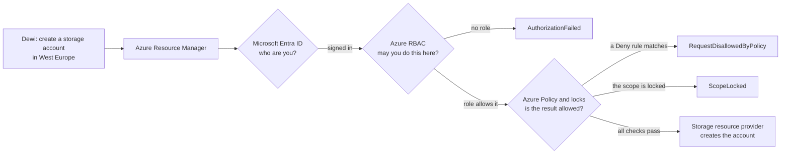
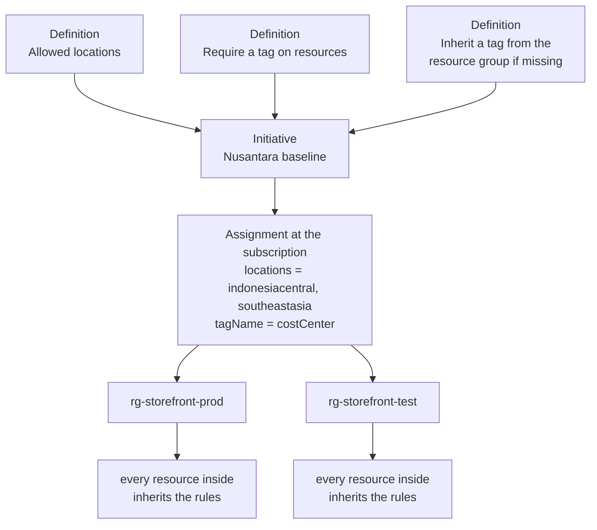
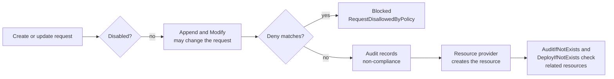

# Lunch 18 · Governance and Compliance (Basic): Azure Policy, Locks, Tags and Microsoft Purview

🇮🇩 [Baca dalam Bahasa Indonesia](README.id.md)

> **Track:** Core month · **Level:** Basic · **Part 4:** Secure, operate and govern
> **Time:** 60 minutes · **Prerequisite lunches:** 04, 05
> **AZ-900 skill area:** Describe Azure management and governance
> **Lab:** [Lab 18 · Keep data in the right place](../../labs/18-governance-compliance-basic/README.md) — about 45 minutes · cost 💲
> **Author:** Stefanus Pinarta · [About the author](../../README.md#about-the-author)

| ⏱ Minutes | Segment |
|---:|---|
| 5 | Scenario and objectives |
| 25 | Reading |
| 15 | Demo: interactive animation (+ optional walkthrough video) |
| 5 | Knowledge check |
| 5 | Key takeaways and lab preview |
| 5 | Buffer — finish your lunch 🍜 |

## 🍱 Today's menu

By the end of this lunch you will be able to:

- Explain what cloud governance means and decide which tool answers which question: Azure RBAC, Azure Policy or a resource lock.
- Describe the building blocks of Azure Policy — definitions, initiatives, assignments, scopes, parameters, compliance and exemptions.
- Choose a policy effect (Deny, Audit, Modify, Append, DeployIfNotExists, AuditIfNotExists, Disabled) for a requirement and predict when it runs.
- Design a small tagging strategy and enforce it with policy instead of good intentions.
- Describe what Microsoft Purview, the Service Trust Portal and the Microsoft Privacy Statement are for, and what replaces Azure Blueprints.

## 🏪 Meanwhile at Nusantara Retail

Monday morning, and Ibu Sari forwards you two e-mails. The first is from finance: last month's Azure invoice has a
storage line in West Europe that nobody can explain, and half of the resources carry no tags, so nobody knows which
department should pay for them. The second is from Nusantara Retail's legal advisor, reminding everyone that customer
data must stay in approved regions close to home.

You dig in. Dewi created a test storage account in West Europe because it was near the top of a drop-down list, then
forgot about it. Rizky, the contractor, almost deleted the resource group that holds the orders database while
"tidying up" — he had the permissions, so nothing stopped him. Nobody did anything malicious. There were simply no
guardrails.

Ibu Sari's question is short: *"Can Azure stop these mistakes before they happen — and prove to an auditor that it
did?"* Today you answer it with Azure Policy, tags, locks and a first look at Microsoft Purview.

---

## 📖 Reading (≈25 minutes)

### 1. Governance means guardrails, not gates

Before the cloud, governance at Nusantara Retail was a locked server room and Pak Budi's signature on every purchase
order. Nothing reached production without crossing his desk. In Azure, anyone with the right role can create a
database in thirty seconds, from a laptop, at midnight. That speed is why you moved to the cloud, so you do not want
the signature back. You want **guardrails**: rules the platform enforces automatically, so the safe path is also the
easy path.

**Cloud governance** is the set of rules, processes and tools that keeps your use of Azure aligned with the business:
costs stay predictable, data stays where the law wants it, and security settings do not drift. **Compliance** is the
part where you can *prove* it — to an auditor, a regulator or your own director — with evidence instead of promises.

Each governance question maps to a specific tool:

| Question | Tool | What it looks at | Example at Nusantara Retail |
|---|---|---|---|
| Who may do this? | **Azure role-based access control (RBAC)** — Lunch 05 | the identity making the request and its role at that scope | Rizky gets Contributor on the test resource group only |
| Is the result allowed to exist? | **Azure Policy** | the properties of the resource being created or changed, no matter who asks | storage accounts only in Southeast Asia or Indonesia Central |
| Must this never be deleted or changed by accident? | **Resource lock** | delete (or any write) operations on a locked scope, for everyone | nobody can delete the orders database, not even an Owner |
| What is it, and who pays for it? | **Tags** | name/value labels on resources | `costCenter=CC-1001` on everything the storefront uses |
| Where is our sensitive data, and who touches it? | **Microsoft Purview** | the data itself, across Azure, Microsoft 365 and beyond | find every file that contains customer phone numbers |

The first three work together on every request. When Dewi runs `az storage account create`, Azure Resource Manager
(Lunch 04) authenticates her with Microsoft Entra ID, checks her RBAC permissions, and then evaluates policy
assignments and locks before anything reaches the storage resource provider. A role says *Dewi* may create storage
accounts; a policy can still say *this* storage account, in West Europe, may not exist. Every check must say yes.

> [!TIP]
> When a deployment fails, the error code tells you which guardrail stopped it: `AuthorizationFailed` points to RBAC,
> `RequestDisallowedByPolicy` to Azure Policy (the message names the assignment that blocked you), and `ScopeLocked`
> to a lock. Read the code before you ask anyone for more permissions.

### 2. Azure Policy: definitions, initiatives and assignments

Azure Policy has three objects you will meet everywhere.

A **policy definition** is a rule written in JSON. It has an `if` part — a condition on resource properties, such as
"the location is not in this list" — and a `then` part, the **effect** that happens when the condition is true. Azure
ships thousands of **built-in definitions** that Microsoft maintains, such as *Allowed locations* and *Require a tag on
resources*. When nothing fits, you write a **custom definition**. **Parameters** make a definition reusable:
*Allowed locations* does not hard-code a region; it asks for a list when you use it.

An **initiative** (the CLI and the API call it a *policy set*) groups definitions that serve one goal, so you manage
them as a single item. Microsoft publishes regulatory initiatives that map the controls of a standard to policies —
for example ISO/IEC 27001, PCI DSS, and the **Microsoft cloud security benchmark** that Defender for Cloud
(Lunch 15) assigns by default. A retailer that takes card payments, like Nusantara Retail, pays close attention to the
PCI DSS one.

An **assignment** is where a definition or initiative starts working. It connects the rule to a **scope** — a
management group, subscription, resource group or single resource — and supplies the parameter values: "Allowed
locations, on the production subscription, with Indonesia Central and Southeast Asia." Everything below the scope
inherits the assignment, just as role assignments inherit (Lunch 04). An assignment can also carry **exclusions**
(child scopes it skips), a custom **non-compliance message** that appears in the error, and an **enforcement mode**:
*Default* enforces the effect, while *DoNotEnforce* only reports, which is how you test a new rule without breaking
anyone's deployment.

Three details trip up almost everyone. First, the **mode** of a definition decides what it evaluates. Tag and location
rules usually use *Indexed* mode, which only looks at resource types that support tags and locations — and skips
resource groups. That is why *Allowed locations* does not stop anyone creating a resource group in West Europe; a
separate built-in, *Allowed locations for resource groups*, does that. Second, a resource group's location is only
where its metadata lives. The resources inside can sit in any region, so restricting the group alone protects
nothing. Third, assignments stack. When several assignments apply to a resource, each one is evaluated on its own and
the result is the most restrictive combination. A team cannot "opt out" of a subscription-level Deny by assigning a
friendlier policy to its own resource group; only an exclusion or an exemption on the original assignment can do that.

To find a built-in, open **Policy › Definitions** in the portal and filter by category (*Tags*, *General*,
*Storage*…), or search from Cloud Shell with `az policy definition list`. Read the description and the parameters
before you assign anything — the display name rarely tells the whole story.

### 3. Effects: what happens when a rule matches

The effect is the rule's answer. Choosing the right one is most of the skill.

| Effect | What it does | When it acts | Use it when… |
|---|---|---|---|
| **Deny** | Blocks the create or update request; existing resources are only reported | before the request reaches the resource provider | the rule is non-negotiable, such as data residency |
| **Audit** | Lets the request through and marks the resource non-compliant | after Deny, before the resource provider | you want visibility first, or the rule is advice |
| **Modify** | Adds, replaces or removes tags and some properties in the request; fixes existing resources through remediation | before Deny | the fix can be automatic, such as copying a tag |
| **Append** | Adds fields to the request, but cannot fix existing resources | before Deny | a built-in still uses it; for tags, prefer Modify |
| **AuditIfNotExists** | After deployment, checks that a related resource exists and reports if it is missing | after the resource provider succeeds | VMs should have the Azure Monitor Agent, but you only want to know |
| **DeployIfNotExists** | After deployment, deploys the missing related resource with a template; fixes existing resources through remediation | after the resource provider succeeds | every database should send its logs to the central workspace |
| **Disabled** | Switches the rule off without deleting the assignment | checked first | you need to pause a rule whose effect is a parameter |

The order matters. Azure Policy checks **Disabled** first, then lets **Append** and **Modify** change the request,
then evaluates **Deny**, then **Audit**. **AuditIfNotExists** and **DeployIfNotExists** run only after the resource
provider reports success. Because Modify runs before Deny, a Modify rule that adds a missing tag can turn a request
that a Deny rule would have blocked into one that passes. You will see exactly this in the lab.

A few newer effects exist for special cases: **DenyAction** blocks delete requests on matching resources, **Manual**
lets you attest to controls that cannot be checked automatically, and **Mutate** and **addToNetworkGroup** serve AKS
and Azure Virtual Network Manager.

Modify and DeployIfNotExists change things on your behalf, so their assignment needs a **managed identity**
(Lunch 15) holding the roles the definition lists. New and updated resources are handled as they arrive. Resources that
existed before the assignment are only *reported* until you run a **remediation task**, which uses that identity to fix
them in bulk.

**Compliance** is the report card. Each resource gets a **compliance state** per assignment — *Compliant*,
*Non-compliant*, *Exempt*, *Not started* and a few rarer ones. Evaluation happens when a resource is created or
updated (results appear about 15 minutes later), when an assignment is created or changed (it takes about five minutes
to apply, then the scan begins), once every 24 hours for everything, and on demand with
`az policy state trigger-scan`. When a resource legitimately cannot comply — a two-week marketing test that needs
another region — you grant an **exemption** instead of weakening the rule. *Waiver* means "we accept this for now";
*Mitigated* means "we meet the intent another way"; an expiry date makes sure nobody forgets. Lunch 31 goes deeper.

### 4. Tags and locks: label everything, protect what matters

A **tag** is a name/value pair — `costCenter=CC-1001` — that you attach to a subscription, resource group or resource
(but not to a management group). Tags cost nothing and power a lot: cost reports grouped by department (Lunch 19),
automation that stops `environment=dev` machines at night, and queries that answer "what belongs to the storefront?".
Four rules to remember:

- Resources do **not** inherit their resource group's tags. If you want inheritance, a policy has to do it.
- Each resource, resource group or subscription holds up to 50 tags. Names are case-insensitive but values are
  case-sensitive, so `Finance` and `finance` end up as two different lines in a cost report.
- Tags are plain text that shows up in exports, logs and invoices. Never put a secret in a tag.
- Not every resource type supports tags. Check the documentation before you build a rule around one.

A **tagging strategy** is short on purpose. Nusantara Retail starts with four mandatory tags:

| Tag | Example value | Why it exists |
|---|---|---|
| `costCenter` | `CC-1001` (e-commerce) | finance charges the right department |
| `environment` | `prod`, `test` or `dev` | automation and alerts treat them differently |
| `owner` | `team-storefront` | someone answers when the resource misbehaves |
| `dataClassification` | `confidential` | anything holding customer data gets extra scrutiny |

Policy turns the strategy into reality. *Require a tag on resources* (Deny) refuses untagged resources. *Add a tag to
resources* and *Inherit a tag from the resource group if missing* (both Modify) fill the gap automatically, so people
only have to tag the resource group. Combine an inherit rule with a require rule and you get convenience plus a
backstop.

A **resource lock** protects what must not change by accident. **CanNotDelete** (*Delete* in the portal) allows reads
and updates but blocks deletion; **ReadOnly** (*Read-only*) blocks every write. Locks apply to subscriptions, resource
groups and resources, are inherited by everything below, and override RBAC — even an Owner must remove the lock first.
Only roles with `Microsoft.Authorization/locks/*` permissions, such as Owner and User Access Administrator, can create
or delete them.

> [!WARNING]
> Locks are blunter than they look. A ReadOnly lock blocks operations that use POST, so it stops you listing storage
> account keys, starting or restarting VMs in a locked resource group, or scaling an App Service plan. A CanNotDelete
> lock on one resource blocks deletion of its whole resource group. And locks protect only the control plane: someone
> with data access can still delete the blobs inside a "locked" storage account. Locks prevent accidents; backups
> (Lunch 17) recover from them.

### 5. Beyond resource settings: Microsoft Purview, the Service Trust Portal and the privacy statement

Azure Policy governs how resources are *configured*. It cannot tell you that a CSV file in a storage account holds
40,000 customer phone numbers, or that someone e-mailed it outside the company. That is the job of
**Microsoft Purview**, Microsoft's family of data governance, data security and data compliance solutions. It works
across Azure, Microsoft 365, on-premises sources and other clouds, and you manage it in the Microsoft Purview portal.

| Area | Capability | What it does | Nusantara Retail example |
|---|---|---|---|
| Data governance | **Data Map** | scans data sources and classifies what it finds | discover which databases and storage accounts hold customer data |
| Data governance | **Unified Catalog** | a searchable catalog with owners, glossary terms and data quality | Dewi finds the trusted orders dataset instead of copying a stale one |
| Data security | **Information Protection** (sensitivity labels) | labels and protects documents and data by sensitivity | the loyalty-member export is labelled *Confidential* |
| Data security | **Data Loss Prevention** | detects and blocks risky sharing of sensitive information | card numbers cannot leave by e-mail |
| Data security | **Insider Risk Management** | spots risky user activity | someone who is leaving downloads the customer list |
| Data compliance | **Compliance Manager** | tracks your controls against regulations and scores progress | prepare for a personal-data-protection audit |
| Data compliance | **Audit**, **eDiscovery**, **Data Lifecycle Management** | records activity, finds content for legal cases, keeps or deletes data on schedule | keep invoices for the required period, then delete them |

At AZ-900 level, remember the split: Azure Policy for resource configuration, Purview for the data itself.

Two Microsoft resources answer the question "how do we know *Microsoft* is compliant?". The **Service Trust Portal**
(servicetrust.microsoft.com) publishes independent audit reports and certifications for Microsoft's cloud services —
ISO/IEC 27001, SOC 1, 2 and 3, PCI DSS, CSA STAR and many regional ones — plus whitepapers. Some documents need a
sign-in with a work account. When Nusantara Retail's auditor asks for proof that Azure's datacenters meet PCI DSS,
that is where you send them. The **Microsoft Privacy Statement** (privacy.microsoft.com) explains what personal data
Microsoft collects through its products, how it uses that data, and the choices people have. Together they cover
Microsoft's half of the shared responsibility model; Azure Policy and Purview help you with yours.

> [!IMPORTANT]
> **Azure Blueprints is retired — do not start anything new with it.** Blueprints, a preview service that packaged
> policies, role assignments and templates, has blocked new definitions since July 31, 2026, blocks new assignments from
> October 31, 2026, and is fully retired on January 31, 2027. Use Azure Policy for the rules and **deployment stacks**,
> with **template specs** or Git for versioning, to deploy and protect resources as a unit. Lunch 20 shows stacks in
> action, and Lunch 31 covers migration.

### 6. How it fits together for Nusantara Retail

Back to Ibu Sari's question. Here is the first governance baseline you propose, and the tool that carries each rule:

| Requirement | Tool and setting |
|---|---|
| Customer data stays close to home | *Allowed locations* (Deny) on the subscription: Indonesia Central for production, Southeast Asia for labs |
| Every cost is traceable | *Inherit a tag from the resource group if missing* (Modify) plus *Require a tag on resources* (Deny) for `costCenter` |
| The orders database survives a tidy-up | a CanNotDelete lock on its resource group |
| Contractors do only what they must | RBAC: Rizky gets Contributor on the test resource group only |
| Auditors get evidence | the Azure Policy compliance view, Defender for Cloud regulatory compliance, the Service Trust Portal |
| Sensitive data is known and protected | Microsoft Purview scans, planned for next quarter |

Roll it out gently. Assign new rules in Audit or DoNotEnforce mode first, read the compliance report for a week, talk
to the teams whose resources show up, and only then switch to Deny. Fix existing resources with remediation tasks
rather than one-off scripts, so the fix is repeatable. When someone needs an exception, write an exemption with an
expiry date instead of quietly removing the rule.

The baseline pays off in the next lunches: the `costCenter` tag drives the cost reports in Lunch 19, and in Lunch 20
you deploy rules and resources with Bicep and protect them with a deployment stack.

> [!NOTE]
> **Pause and think:** Dewi's pipeline creates a storage account without tags in `rg-storefront-test`, which is tagged
> `costCenter=CC-1001`. Both *Require a tag on resources* and *Inherit a tag from the resource group if missing* are
> assigned for `costCenter`. Does her deployment succeed? What changes if someone removes the tag from the resource
> group?

Ready for more? **Lunch 31 · Governance at Scale** takes these ideas to management groups, initiatives across many
subscriptions, and policy as code.

---

## 🎬 Demo (≈15 minutes)

1. **Interactive animation (≈6–8 min):** [Open the demo](https://stefpin.github.io/azure-fundamentals-lunches/demos/18-governance-compliance-basic.html) —
   press ▶ Play or step through it at your own pace. Offline? Download
   [`docs/demos/18-governance-compliance-basic.html`](../../docs/demos/18-governance-compliance-basic.html) and open it in any browser.
2. **Walkthrough video (≤ 6 min):** _coming soon_ — [read the walkthrough script](demo-video-script.md).

What to watch for:

- The request for West Europe is stopped by the policy engine even though Dewi's role allows her to create storage
  accounts — and the error names the assignment that blocked it.
- Existing resources are never deleted by a Deny rule; they turn up as non-compliant in the compliance view.
- The same untagged request fails before the resource group has a `costCenter` tag and succeeds afterwards, because
  Modify runs before Deny.
- A remediation task, acting through the assignment's managed identity, fixes the resources that existed before the
  rules.

## ✅ Knowledge check (≈5 minutes)

1. Rizky has Contributor on the resource group that holds the orders database. You must make sure nobody — not even an
   Owner — deletes it by accident, while updates keep working. What do you use?
   

Show answer

   A **CanNotDelete** lock on the database (or on its resource group). Locks apply to everyone regardless of role, and
   CanNotDelete still allows reads and updates — removing Rizky's role would block his legitimate work too.

   

2. Finance wants every new resource to carry `costCenter`. Developers forget tags, but every resource group is tagged
   when it is created. Which built-in policies give the least friction, and what about resources that already exist?
   

Show answer

   Assign **Inherit a tag from the resource group if missing** (Modify), optionally backed by **Require a tag on
   resources** (Deny), and run a **remediation task** for the existing resources. Modify runs before Deny, so untagged
   requests in tagged groups are fixed instead of refused, and remediation handles what existed before the assignment.

   

3. You assign *Allowed locations* (Southeast Asia only) to the subscription. The next morning an existing storage
   account in West Europe shows as *Non-compliant*, but it still works. Why was it not removed, and what are your
   options?
   

Show answer

   **Deny only blocks create and update requests**; existing resources are evaluated and reported, never deleted. You
   either move or recreate the data in an allowed region and delete the old account, or grant a time-limited
   **exemption** (Waiver) if there is a business reason to keep it for now.

   

4. An auditor asks for an independent report showing that Microsoft's cloud services meet ISO/IEC 27001. Where do you
   send them?
   

Show answer

   To the **Service Trust Portal**. It publishes third-party audit reports and certifications for Microsoft's cloud
   services, whereas Microsoft Purview and Azure Policy are about *your* data and *your* resources.

   

5. A colleague proposes Azure Blueprints to stamp out a standard setup for the new loyalty-app subscription. What do you
   recommend?
   

Show answer

   Don't: **Azure Blueprints is retired** (no new assignments from October 31, 2026; fully retired January 31, 2027).
   Use Azure Policy for the rules and **deployment stacks** with template specs or Git for the resources, because that
   is Microsoft's recommended replacement.

   

## 🧠 Key takeaways

- Azure RBAC decides *who* may act, Azure Policy decides *what* may exist, and resource locks protect what must not be
  deleted or changed by accident — use all three together.
- A policy definition is an if/then rule, an initiative bundles definitions, and an assignment applies them to a scope
  with parameters; everything below the scope inherits the assignment.
- The effect decides the response: Deny blocks, Audit reports, Modify and Append change the request first, and
  DeployIfNotExists and AuditIfNotExists check related resources after deployment. Modify and DeployIfNotExists need a
  managed identity, plus remediation tasks for resources that already exist.
- Tags drive cost reports and automation but are not inherited — keep a short mandatory list and enforce it with
  policy.
- Microsoft Purview governs and protects the data itself; the Service Trust Portal and the Microsoft Privacy Statement
  answer the auditor and the lawyer; Azure Blueprints is retired, so use policy plus deployment stacks.

## 🗒️ Field notes from Stefanus

> **Every Deny needs a door.** For each Deny rule in a governance design, I ask: *who owns it, and what does a
> developer do at five on a Friday afternoon when it blocks something legitimate?* If the answer is "open a ticket and
> wait", people find a way around the rule, usually with broader permissions or a test subscription nobody governs. So
> every Deny assignment gets a non-compliance message that says what to do instead, a named owner, and an exemption
> path with an expiry date. I keep tags just as lean: four that drive real decisions beat twenty that end up filled
> with "tbd". And my rule for locks is simple: CanNotDelete on whatever you cannot rebuild from code, such as
> databases and storage accounts that hold data, and ReadOnly almost never.

## 🔬 Your lab: Keep data in the right place

You will put Ibu Sari's first guardrails on a lab resource group: resources only in your lab region, a mandatory
`costCenter` tag, and automatic tag inheritance from the resource group. Then you will prove that a deployment in
another region is refused, watch a Modify rule rescue an untagged deployment, fix two "legacy" resources with a
remediation task, and read the compliance report — the same evidence an auditor would ask for.

- ⏱ About 45 minutes · 💲 free or close to free · works on its own (no earlier lab needed)
- 👉 [Start Lab 18](../../labs/18-governance-compliance-basic/README.md)

## 📚 Go further

- [Microsoft Learn: What is Azure Policy?](https://learn.microsoft.com/azure/governance/policy/overview) — the
  official overview, including how policy and RBAC differ and the limits per scope.
- [Microsoft Learn: Azure Policy definitions effect basics](https://learn.microsoft.com/azure/governance/policy/concepts/effect-basics) —
  every effect, the order of evaluation and how layered assignments combine.
- [Microsoft Learn: Lock your Azure resources to protect your infrastructure](https://learn.microsoft.com/azure/azure-resource-manager/management/lock-resources) —
  the full list of surprising things a lock blocks.
- [Microsoft Learn: Learn about Microsoft Purview](https://learn.microsoft.com/purview/purview) — a tour of the data
  security, governance and compliance solutions.

---

⬅️ [Lunch 17 · Backup and Disaster Recovery](../17-backup-disaster-recovery/README.md) · 🏠 [Course home](../../README.md) · [Lunch 19 · Cost Management](../19-cost-management/README.md) ➡️

Last validated: October 2026 · Spotted something out of date? [Open an issue](../../CONTRIBUTING.md).
